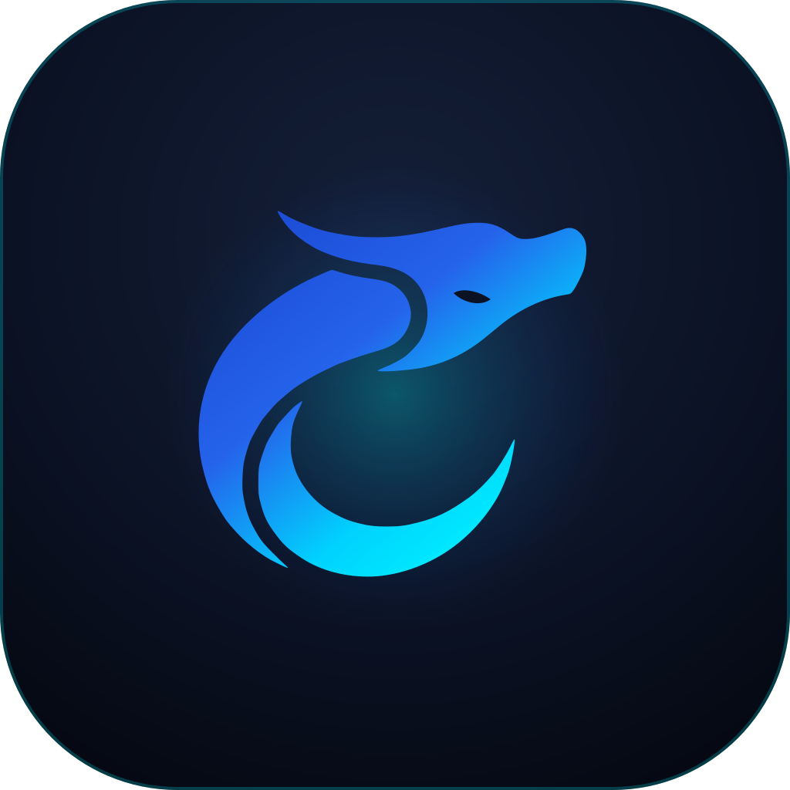

# 河洛 · Heluo Forge

  
   
  <strong>企业级智能研发平台 × 智能个人助理</strong>
   
  以一个工作入口，连接研发任务、个人工作与企业能力。

河洛（Heluo Forge）面向企业员工，将**企业级智能研发平台**与**智能个人助理**融为一体。在一个以 DeepSeek Harness（DSH）为宿主的个人工作环境里，衔接需求、代码与交付，也连接邮件、沟通、办公和专业协作。

河洛通过扩展复用企业已有的身份、模型和业务系统，让个人工作体验与企业的权限、数据和治理要求相衔接。每位员工使用自己的工作环境，各项能力遵循实际用户授权和接入系统的权限。

[了解产品方向](#产品方向) · [查看产品路线图](#产品路线图) · [阅读项目文档](#了解更多)

---

## 产品方向

从一项需求开始，助手可以协助梳理 Issue 和代码；需要处理往来时，查找相关邮件；讨论结束后，整理员工主动选择的聊天文字；遇到跨领域问题，再选择合适的专家协助。研发任务与日常工作在同一工作环境中衔接。

### 让研发工作更连贯

从理解需求和 Issue、查询研发上下文，到代码编写、验证和交付，河洛让智能助手围绕实际工作组织上下文。DevOps 与 Gitee 扩展对接企业已有研发工具，Skill 提供企业语义，Teamflow 承接工作流执行。

研发系统接入以**只读查询为现有能力基线**。受控写是已确认的研发目标，默认关闭，实际开放取决于具体动作的范围、用户授权、服务端权限、安全策略和验证结果。

### 让个人助理理解持续工作

个人助理也面向研发以外的企业工作：通过自然语言整理信息、延续任务，并按员工的选择使用与本人有关的上下文。

个人记忆方向基于 Hindsight，规划让员工配置记忆采集、查看和管理自己的记忆，并在允许时供助理使用。员工对记忆的选择以及个人内容的访问边界，是这一体验的重要组成部分。

### 让邮件融入工作流

智能邮件提供本地邮件工作台与 Coremail 接入，支持邮件检索、待办与知识整理、巡检和日报；**dsh-mail** 将邮件入口和使用说明带入 DSH。员工可以在授权范围内查询邮件、准备草稿，并在人工批准后发送 Agent 草稿。

### 让沟通与远程交办自然衔接

河洛探索两条互相独立的企业 IM 体验：

- **企业 IM 聊天**：在 DSH 中与同事单聊或群聊，优先探索与企业现有 IM 互通；员工可主动选择有权查看的聊天文字，生成仅本人可见的个人总结。
- **远程交办桌面助理**：员工通过企业 IM 中的智能助手，向本人授权的桌面 DSH 交办任务，并在 IM 中查看进展、确认请求和结果。

OA 方向则关注员工在授权范围内查看和整理办公信息。上述接入的具体能力以目标系统接口、用户授权与验证结果为准。

### 让专业能力按需协作

遇到跨领域工作时，河洛希望让员工发现并选择有权调用的专家智能体，由个人助理发起委派并综合结果。专家目录、任务状态与结果来源依托对应服务，调用遵循员工授权与接入规则。

### 以企业边界支撑个人体验

河洛在个人工作便利性与企业要求之间建立清晰边界：企业身份、模型访问与业务系统权限按各自实际能力核验；涉及敏感数据或有影响的操作，遵循适用的用户确认与企业规则。客户端的提示或登录状态不代替服务端授权。

企业组合、凭据存储和策略审计为扩展提供基础能力。

### 让企业能力更容易发现

**AIHUB** 面向员工提供企业 **MCP、Skills、CLI 和插件**的浏览与获取门户。**Nacos AI 注册中心**承担 MCP 服务的注册与发现，以及 Skills 的注册与获取，让员工在授权范围内按需使用企业能力。

插件分发方向复用 AIHUB 提供的索引与 DSH 原生插件市场，让员工按需发现和安装企业提供的能力。

---

## 产品路线图

以下路线图展示用户体验和当前进展，**不是发布日期或先后顺序承诺**。实际交付范围以[需求与场景基线](docs/requirements/requirements-baseline.md#2-范围边界唯一真源)及后续确认结果为准。

### 研发与平台能力

- **研发工作**：在个人工作环境中衔接需求、Issue、代码、验证和交付。 
  进展：DevOps、Gitee 等扩展已有部分本地实现；企业 CLI 与目标终端仍需验证。[实现与验证入口](docs/design/README.md#22-实现与验证入口)

- **企业身份与治理**：使用企业身份和模型，按既有权限与策略访问工作工具。 
  进展：身份、凭据、策略及企业组合已有部分本地实现；企业 IAM、网关与目标环境需分别验证。

- **AIHUB 能力门户**：在一个门户浏览和获取企业 MCP、Skills、CLI 和插件。 
  进展：产品方向已明确；各资源来源、用户权限与 DSH 接入按企业实际能力验证。

- **Nacos AI 注册中心**：注册、发现 MCP 服务，注册和获取 Skills。 
  进展：Nacos 提供相应注册中心能力；企业版本、权限及实际接入需分别核验。

- **插件发现与分发**：通过熟悉的 DSH 入口发现和安装企业提供的扩展。 
  进展：原生市场、AIHUB 索引与企业制品源的接入方向已有设计；实际企业接入待验证。[市场设计](docs/design/plugins/forge-market.md)

- **企业技能**：发现适用的企业 Skill，按需安装并在工作中使用。 
  进展：通过企业 Nacos 发现、安装及原生加载 Skill 为待评估方向。[企业技能跟踪](https://github.com/hrygo/heluo-forge/issues/97)

### 个人助理与协作

- **智能邮件**：查找邮件、整理信息和准备草稿，按人工批准规则处理 Agent 草稿发送。 
  进展：dsh-mail 将邮件入口带入 DSH；实际使用取决于安装和邮箱授权。[邮件接入跟踪](https://github.com/hrygo/heluo-forge/issues/155)

- **个人记忆**：员工选择记忆的采集和使用方式，让助理更好地延续工作。 
  进展：Hindsight 与 DSH 接入为产品方案草案；身份、记忆访问与数据处理边界待设计和核验。[个人记忆跟踪](https://github.com/hrygo/heluo-forge/issues/264)

- **企业 IM 聊天**：在 DSH 中与同事沟通，并对主动选择的聊天文字生成个人总结。 
  进展：[企业聊天方案](docs/requirements/enterprise-collaboration-chat-proposal.md)为草案，优先探索现有企业 IM 互通；接口和权限待核验。

- **IM 远程交办**：在企业 IM 中向本人桌面助理交办任务，查看进展、确认请求和结果。 
  进展：[跨端任务协同](https://github.com/hrygo/heluo-forge/issues/240)为待确认方向；身份绑定、桌面接入和任务反馈待验证。

- **OA 办公**：在授权范围内查看办公信息，并请助理协助阅读和整理。 
  进展：[OA 接入](https://github.com/hrygo/heluo-forge/issues/241)为候选方向；首期场景、接口与权限待确认。

- **专家智能体**：发现并选择合适的专家，向其委派任务并使用结果。 
  进展：[专家产品需求](docs/requirements/delegra-experts-prd.md)为草案；Delegra、员工授权与宿主接入待确认或验证。

### 目标环境与落地

- **目标环境与试点**：在 Windows、macOS 及麒麟、统信 UOS 等国产 Linux 环境中获得连贯、可控的工作体验。 
  进展：安装、企业接入与实际使用需在各目标环境分别验证；试点以验收结果为前提。

## 当前进展

河洛已形成企业研发场景的需求、架构与模块设计，身份、凭据、策略、企业组合和研发工具等已有部分本地实现与验证。智能邮件通过 dsh-mail 融入工作环境；记忆、企业沟通、跨端协同及专家智能体等方向已有产品方案或跟踪议题。

各模块的实际实现、验证环境与接入边界以[逐模块设计索引](docs/design/README.md#22-实现与验证入口)及对应方案为准。

---

## 了解更多

| 我想了解 | 从这里开始 |
|---|---|
| 产品当前范围和企业研发场景 | [需求与场景基线](docs/requirements/requirements-baseline.md) |
| 架构、企业接入与安全边界 | [总体架构](docs/architecture/platform-architecture.md) · [安全说明](SECURITY.md) |
| 已实现什么、验证到哪里 | [实现与验证入口](docs/design/README.md#22-实现与验证入口) |
| 企业能力门户与注册中心 | [插件市场设计](docs/design/plugins/forge-market.md) · [企业 Skill 跟踪](https://github.com/hrygo/heluo-forge/issues/97) · [Nacos MCP Registry](https://nacos.io/en/docs/latest/manual/user/ai/mcp-registry/) · [Nacos Skill Registry](https://nacos.io/en/docs/v3.2/manual/user/ai/skill-registry/) |
| 员工个人助理的产品方向 | [邮件](https://github.com/hrygo/heluo-forge/issues/155) · [个人记忆](https://github.com/hrygo/heluo-forge/issues/264) · [企业聊天](docs/requirements/enterprise-collaboration-chat-proposal.md) · [IM 远程交办](https://github.com/hrygo/heluo-forge/issues/240) · [OA](https://github.com/hrygo/heluo-forge/issues/241) · [专家智能体](docs/requirements/delegra-experts-prd.md) |
| 了解交付与部署 | [部署资产说明](deploy/README.md) · [文档总览](docs/README.md) |
| 反馈问题或参与贡献 | [项目议题](https://github.com/hrygo/heluo-forge/issues) · [贡献指南](CONTRIBUTING.md) · [安全报告](SECURITY.md) |
| 河洛的视觉形象 | [河洛苍螭品牌全景](docs/assets/branding/cyber-long/index.html) |

本仓库存放河洛的方案与扩展工程，基于 DSH 构建，不修改 DSH 本体。仓库使用 `UNLICENSED`，未授予开源许可；根工程与扩展包的 `private: true` 用于防止发布到 npm，具体使用和交付以适用许可及企业要求为准。
