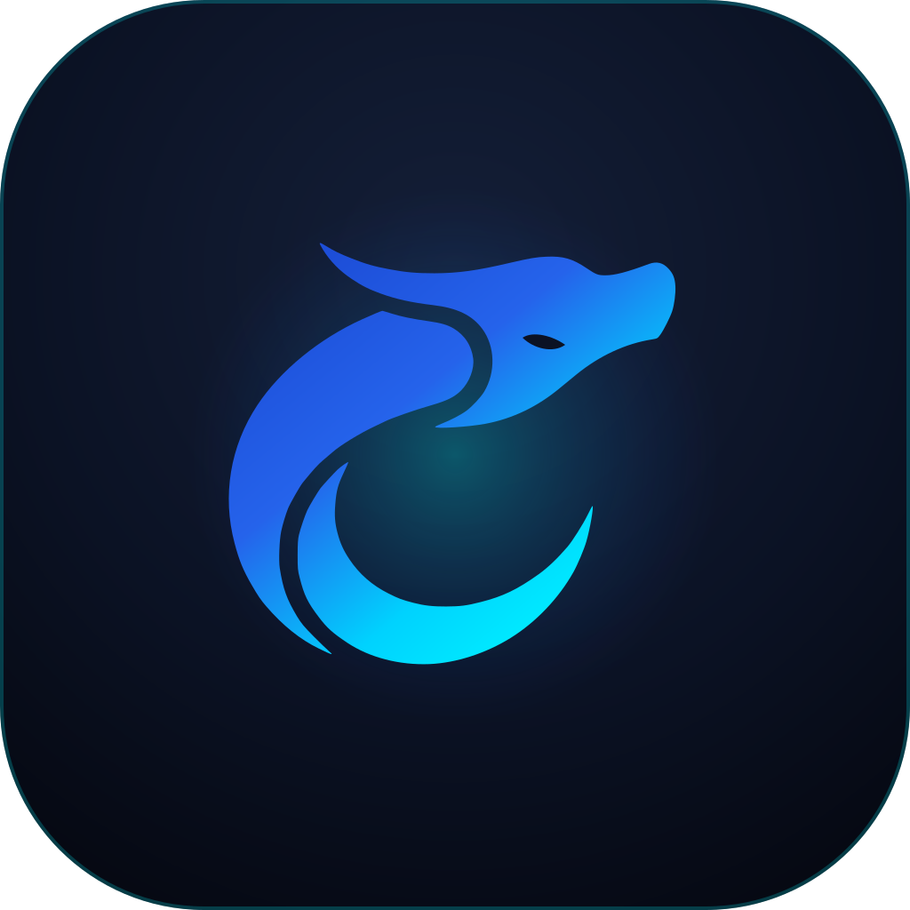

# 河洛 · Heluo Forge

<p align="center">
  <a href="docs/assets/branding/cyber-long/index.html">
    
  </a>
  <br>
  <strong>企业级智能研发平台 · ENTERPRISE AI PLATFORM</strong>
  <br>
  <sub>基于 DeepSeek Harness（DSH）的企业方案与扩展工程 · 官方视觉系统：<a href="docs/assets/branding/cyber-long/index.html">河洛苍螭 (Cyber Long)</a></sub>
</p>

河洛企业级智能研发平台（Heluo Forge）基于 DeepSeek Harness（DSH），通过插件、配置组合、企业现有 CLI 与技能包连接企业身份、模型网关和研发系统；Model Context Protocol（MCP，模型上下文协议）按集成需要另行评估。

**当前处于方案评审与开发骨架阶段，尚无完整河洛产品发行版。** 企业插件市场改用 DSH 原生「索引源」：AI 开发者平台（AIHUB）维护并托管 format-1 索引，原生市场浏览、官方 manager 从企业 npm 安装；`services/market-index` 只保留只读索引校验器。`@heluo/forge-market` 与旧 HTTP 服务为历史参考，不属目标；`@heluo/forge-iam` 与 `@heluo/forge-credentials-keychain` 为开发骨架（本地 mock OIDC 端到端测试与 keychain fallback 已建立，真实 IAM 与 OS keychain 未联调），品牌视觉套件已全面切换并锁定为「河洛苍螭」（方案 B），其余七个包与 DevOps MCP 仍为规划入口。企业联调、三目标安装与发行版尚未完成。

现状核对日期：2026-10-23。以下区分仓库实现、历史实机记录与待验证目标，不以目录或设计草案证明上线能力。

| 项 | 内容 |
|---|---|
| 工程标识 | `heluo-forge` |
| 文档编号前缀 | `CORP-DSH-*`，保留历史编号；DSH 指上游运行时 |
| 仓库边界 | 企业方案与扩展工程仓库，不包含或分发 DSH 本体 |
| 使用与分发 | 公开（public）仓库；根工程 `private: true` 禁止 npm 发布，`UNLICENSED` 表示未授予开源许可 |

## 1. 项目解决什么问题

项目目标是在企业现有系统上提供统一身份、模型访问与额度治理、受控研发工具、研发流程及内部能力分发。企业能力优先通过 DSH 扩展体系承载，客户端控制与服务端授权各负其责。

一期面向 Windows 桌面端和银河麒麟 aarch64 本机 Web，每人独立实例。完整范围、非目标与核心补丁例外以[需求基线 §2](docs/requirements/requirements-baseline.md#2-范围边界唯一真源)为准；系统责任与技术取舍见[总体架构](docs/architecture/platform-architecture.md)。这些是方案基线，企业接口、双端隔离与部署效果仍须验证。

DevOps 与 Gitee 的当前接入基线是复用现有 CLI，通过只读命令白名单接入；双端产物、凭据注入、结构化输出和权限仍待提供方核验。CLI 不满足前提时，先关闭相关能力并提交替代形态评审；MCP 服务与核心补丁不自动恢复为实施项。

## 2. 从哪里开始

按任务选择入口；各文档的版本、状态、责任团队与门禁统一查[文档清单](docs/DOCUMENT-REGISTER.md)。

| 你要做什么 | 从这里开始 |
|---|---|
| 理解需求、一期边界与成功指标 | [需求与场景基线](docs/requirements/requirements-baseline.md) |
| 评审架构、信任边界与技术取舍 | [总体架构设计](docs/architecture/platform-architecture.md) |
| 评估排期、依赖、门禁与验收 | [推广实施方案](docs/plans/rollout-plan.md) |
| 查找契约、团队交付物或待确认问题 | [文档总览](docs/README.md) |
| 查阅品牌标识、矢量切图与视觉规范 | [品牌资产全景系统](docs/assets/branding/cyber-long/index.html) → [生图提示词与规范](docs/assets/branding/prompts.md) |
| 开始模块设计或开发 | [逐模块设计索引](docs/design/README.md) → [工程开发与发布约定](docs/engineering/development-conventions.md) |
| 了解市场目标、索引契约与 AIHUB 交付 | [轻量市场设计](<docs/design/plugins/forge-market.md>) → [索引契约](<docs/design/services/market-index.md>) → [issue #12](https://github.com/hrygo/heluo-forge/issues/12) |
| 修改仓库、提交变更或发起评审 | [贡献指南](CONTRIBUTING.md)；agent 同时遵循 [AGENTS.md](AGENTS.md) |
| 报告安全问题或疑似泄露 | [安全策略](SECURITY.md) |

市场方案见[轻量市场设计](<docs/design/plugins/forge-market.md>)、[索引契约](<docs/design/services/market-index.md>)和[ADR-11/13](<docs/architecture/plugin-registry-source-decision.md>)：AIHUB 维护并托管 format-1 索引，用户添加只读 URL，原生市场浏览并由官方 manager 安装精确版本；不建生成器、市场服务、写前授权或 CI 发布链路。旧 `@heluo/forge-market` 与 `market-index` HTTP 服务仅作历史参考。企业审核/批准、AIHUB 索引与三目标安装仍待完成。

## 3. 本地检查

先安装或切换到仓库声明的工具链：Node.js 精确版本见 [.node-version](.node-version)，pnpm 版本见 [package.json](package.json) 的 `packageManager`；不要直接采用本机默认版本代替项目约束。

在仓库根目录执行：

```sh
node --version
pnpm --version
pnpm check
```

当前检查器、包与索引校验器使用 Node 标准库，运行检查无需安装依赖；历史市场包的客户端面板由 DSH 提供 React。需要安装工作区依赖时使用 `pnpm install --frozen-lockfile`，安装可能访问包源。`pnpm check` 本身离线运行，测试只启动本机临时 HTTP 服务（归档安装用例），不访问企业系统。

| 命令 | 验证范围 |
|---|---|
| `pnpm check` | 依次执行文档检查、仓库检查与 Node 自动发现的全部测试 |
| `pnpm check:docs` | 文档元数据、登记一致性、本地链接与锚点、表格及询问问题序列 |
| `pnpm check:repo` | 工程结构、工作区、模块状态、工作流权限与敏感信息规则 |
| `pnpm test:unit` | 当前实际执行 `node --test`，包含检查器、IAM 与 keychain 骨架、历史市场包契约、索引校验与归档安装用例 |
| `node --test packages/forge-iam/test packages/forge-credentials-keychain/test` | 单独验证 IAM 与凭据 keychain 骨架 |
| `node --test packages/forge-market/test/*.test.mjs` | 单独验证市场插件的逻辑、契约及本地安装链路 |
| `node --test services/market-index/test/*.test.mjs` | 单独验证索引校验器 |

[CI 工作流](.github/workflows/check.yml)通过 `node --run check` 执行相同定义，以只读权限运行，外部动作固定到提交 SHA。本地检查通过只证明对应规则和离线用例通过；远端 CI、分支保护、企业联调与 Windows / 麒麟实机效果需分别取证。

## 4. 仓库如何组织

| 路径 | 维护内容 | 当前边界 |
|---|---|---|
| `docs/` | 需求、架构、计划、契约、设计、运维、协作与工程文档 | 导航见[文档总览](docs/README.md)，登记见[文档清单](docs/DOCUMENT-REGISTER.md) |
| `docs/assets/branding/` | 河洛苍螭视觉套件：主标、11 组件标识、全尺寸切图、manifest 清单与交互全景控制台 | 方案 B 正式归档；各包内置图标与 manifest.json 保持校验一致 |
| `packages/` | 安装进 DSH 的九个产品扩展入口与一个凭据支撑包 | `forge-market` 为历史参考；`forge-iam`、`forge-credentials-keychain` 为开发骨架；其余七个仅职责 README |
| `services/` | 索引校验工具、条件建设的 DevOps MCP | `market-index` 只保留只读校验器；无服务、无生产部署；DevOps MCP 暂不建设 |
| `deploy/` | 私有制品仓库接入与双端分发资产 | 仅[规划说明](deploy/README.md)，没有可执行部署配置或制品 |
| `scripts/`、`tests/` | 工程检查器、检查器测试与历史归档安装用例 | 已建立离线检查与本地 HTTP 归档安装用例 |
| `.github/` | Issue/PR 模板与检查工作流 | 仓库文件不证明服务端保护或审批已启用 |

市场采用轻量原生索引模式。[ADR-11/13](<docs/architecture/plugin-registry-source-decision.md>)已确认企业私有 npm 为唯一制品源；AIHUB 维护并托管 format-1 索引，用户通过 DSH 原生「索引源」添加只读 URL，官方 manager 按精确版本安装。**本项目不生成索引、不写前授权、不承诺全通道覆盖**；索引 URL、JSON、Artifactory 终端认证与三目标安装仍待 AIHUB 与实机取证（[issue #12](https://github.com/hrygo/heluo-forge/issues/12)、[P0 取证单](<docs/plans/market-p0-verification.md>)）。旧插件与 HTTP 服务仅作历史参考，不属目标链路。

当前市场能力与验证边界：

| 对象 | 现状 | 缺口 |
|---|---|---|
| DSH 原生市场 | `0.2.1-rc.2` 支持索引源添加与浏览 | AIHUB URL、三目标安装未验 |
| AIHUB 索引 | issue #12 已建，内容未交付 | format-1、更新/撤回 SLA |
| 企业 Artifactory | 唯一制品源、同版不可变已确认 | 终端 `.npmrc` 与内网 HTTP 拉包未验 |
| 历史参考 | `packages/forge-market`、旧 HTTP 服务 | 不属目标，仅追溯 |

索引契约与只读校验器见[services/market-index](services/market-index/README.md)；目标是“能加、能看、能装、能撤”，不以本地测试替代三目标实机。

## 5. 如何参与

按[贡献指南](CONTRIBUTING.md)准备变更。文档内容在对应职责文件维护，README 保留概览和入口；新增、升版、改名或废止文档时按[文档治理规则](docs/README.md#6-编写约定)同步登记与引用。agent 的任务路由、授权和交付要求见 [AGENTS.md](AGENTS.md)。

支持与报告范围以[安全策略](SECURITY.md)及[运维索引](docs/operations/README.md)为准；尚未指定的联系人、支持时限与发布责任方保持待确认。
