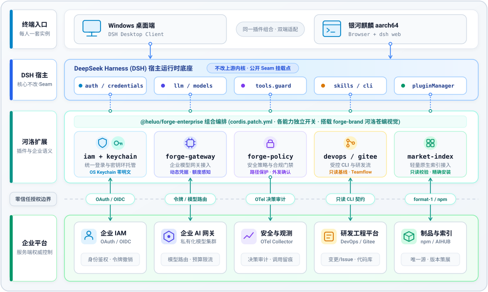

# 河洛 · Heluo Forge

<p align="center">
  <a href="docs/assets/branding/cyber-long/index.html">
    
  </a>
  <br>
  <strong>企业级智能研发平台 · ENTERPRISE AI PLATFORM</strong>
  <br>
  <sub>基于 DeepSeek Harness（DSH）的企业专属端侧智能研发中枢 · 官方视觉系统：<a href="docs/assets/branding/cyber-long/index.html">河洛苍螭 (Cyber Long)</a></sub>
</p>

河洛企业级智能研发平台（Heluo Forge）是面向大型组织构建的企业级端侧智能研发中枢。平台以 DeepSeek Harness（DSH）为原生底座，通过插件化架构、企业级安全策略与轻量能力索引，将大模型编程辅助能力无缝接入企业身份认证体系、AI 模型网关与研发生态基础设施，为企业研发团队提供安全合规、开箱即用且深度协同的智能编程体验。

| 项 | 内容 |
|---|---|
| 工程标识 | `heluo-forge` |
| 文档编号前缀 | `CORP-DSH-*`（保留历史编号，DSH 指上游宿主运行时） |
| 仓库边界 | 企业方案与扩展工程仓库，不包含、不修改或分发 DSH 本体 |
| 许可与使用 | 公开（public）方案仓库；根工程与各扩展包 `private: true` 禁止发布，`UNLICENSED` 表示未授予开源许可 |

银河麒麟使用 Web 端时，推荐使用新版 Chrome 或 Chromium；浏览器兼容性与实测范围见[客户端说明](deploy/clients/README.md#web-浏览器)。

---

## 1. 愿景与核心价值

大型企业落地端侧 AI 编程助手，既需要融入内网既有的**身份认证、模型网关、DevOps 与代码资产**，又面临**凭据裸露、调用失控、研发上下文割裂**以及 **Windows 与国产银河麒麟双端适配**等现实挑战。

河洛坚持“**核心不改，能力全插件**”的工程路线：以 DeepSeek Harness（DSH）为原生宿主底座，充分借助 DSH 开放的插件扩展机制（`auth / credentials`、`llm`、`tools.guard`、`skills / cli` 与 `pluginManager` 原生索引源），将端侧工作台无缝连接并拓展至企业各类核心平台，构建一套“**客户端零信任控制 + 服务端权威授权**”协同的智能研发底座：



### 核心价值主张

- 🔐 **全域身份互通与凭据托管**：原生对接企业统一 IAM（OIDC / PKCE 机制），实现端侧静默刷新与滑动续期；底层安全对接操作系统原生密钥环（OS Keychain），彻底消除明文存储与个人 API Key 暴露风险。
- ⚡ **透明模型网关与额度治理**：统一经由企业 AI 网关受控调度，支持运行时透明凭据注入、组织级租户隔离、细粒度调用计量与合规审计，解耦端侧与底层模型供应商。
- 🛡️ **端侧合规策略与动态门禁**：内置安全策略引擎，实现敏感文件路径硬拒绝、代码与客户数据外发二次确认门禁，确保研发资产端侧流转全程受控。
- 🔧 **受控研发生态协同**：对接企业现有 DevOps 平台与私有 Gitee 基础设施，遵循“只读优先、受控写严格审批”原则，让 AI 能够感知研发上下文并辅助任务流转。
- 📦 **企业轻量能力生态分发**：确立“企业私有 npm 为唯一制品源 + AIHUB 维护原生轻量索引”架构（ADR-11/13），依托 DSH 原生机制安全、受控分发企业内部专用能力插件。
- 🖥️ **国产双端与苍螭视觉体系**：深度适配 Windows 桌面与银河麒麟 aarch64 环境；全线搭载河洛苍螭（Cyber Long）官方设计系统，兼具东方美学与现代科技感。

---

## 2. 当前阶段与成熟度

> [!IMPORTANT]
> **当前处于方案评审与开发骨架阶段 (Stage 0: Foundation & Architecture Spike)，尚未形成面向生产的河洛产品商业发行版。**

河洛平台采取严谨的证据阶梯推进工程落地。我们区分三类客观事实：
1. **本地实现与离线用例**：仓库内可完整复现的扩展包代码骨架、离线单元测试与闭环验证；
2. **本机探针记录**：基于 macOS / 本机开发机完成的平台接口可行性验证记录；
3. **企业目标**：需真实企业 IAM、AI 网关、研发系统及国产实机环境方可最终取证的联调项。

| 演进阶段 | 阶段定位 | 当前状态 | 核心里程碑与验证依据 |
|---|---|---|---|
| **Stage 0** | **方案设计与开发骨架** | **已就绪** (当前阶段) | 需求基线、总体架构、字段级契约全部成文；8 大扩展包及凭据支撑包骨架建立；2700+ 离线测试用例闭环；河洛苍螭品牌视觉套件正式归档锁定。 |
| **Stage 1** | **企业环境与双端联调** | **进行中** (关键路径) | 企业 IAM 真实对接（访问令牌撤销与轮换联调）；企业 AI 网关动态认证与配额联调；银河麒麟 aarch64 实机环境取证；AIHUB 原生索引三目标安装验证。 |
| **Stage 2** | **企业打包与试点推广** | **规划中** | 企业双端定制安装包（Windows MSI / 麒麟 deb）；分批试点推广与效果验证；全链路研发效能度量与支持体系运转。 |

各模块的最新成熟度、已实测项与未验项清单，以[逐模块设计索引 §2.2](docs/design/README.md#22-实现与验证入口)为唯一依据，本文不复述动态计数。

---

## 3. 本地检查

本仓库的日常工程规范与检查机制全面面向离线闭环设计。贡献者与测试者可在无需访问外部企业网络的前提下，验证工程结构、文档元数据、包体规范与核心逻辑。

### 快速环境核对

运行本地检查前，请确保开发环境满足项目基准版本要求：
- **Node.js**：精确版本见 [.node-version](.node-version)（推荐使用版本管理工具切换）；
- **pnpm**：精确版本见 [package.json](package.json) 中的 `packageManager` 字段声明。

```sh
node --version
pnpm --version
pnpm check
```

> [!NOTE]
> `pnpm check` 会依次执行文档规范检查、仓库架构检查、包体模式验证、DSH 基线版本核验以及工程自动化测试用例。详细的模块化测试命令、测试参数分层、调试技巧与代码贡献流程，请参阅完整的 [贡献指南 (CONTRIBUTING.md §7)](CONTRIBUTING.md#7-检查命令) 与 [工程开发与发布约定](docs/engineering/development-conventions.md)。

---

## 4. 仓库组织结构

本工程按照职责清晰、分层解耦的原则组织工程资产：

| 目录 | 维护内容 | 职责与成熟度边界 |
|---|---|---|
| [`docs/`](docs/README.md) | 业务需求、架构设计、实施计划、字段契约、运维与协作文档 | 统一入口见[文档总览](docs/README.md)，元数据与版本见[文档清单](docs/DOCUMENT-REGISTER.md) |
| [`docs/assets/branding/`](docs/assets/branding/cyber-long/index.html) | 河洛苍螭视觉套件：主标、11 项核心组件标识、全尺寸切图与交互全景控制台 | 官方视觉资产唯一真源，各扩展包内置图标经逐字节校验保持一致 |
| [`packages/`](packages/) | 面向 DSH 宿主安装的 8 个核心产品扩展包与凭据支撑包 | 模块成熟度以[设计索引 §2.2](docs/design/README.md#22-实现与验证入口)实测记录为准 |
| [`services/`](services/) | 独立辅助工具与验证服务 | `market-index` 保持只读校验工具形态，不建独立对外服务或生产清单 |
| [`deploy/`](deploy/README.md) | 私有制品源接入与双端分发部署资产 | 包含分发架构说明，当前无生产执行脚本与可分发二进制包 |
| [`scripts/`](scripts/) | 离线工程检查器、环境探测工具与敏感扫描工具链 | 包含零外部依赖的文档、仓库与签名检验脚本 |

---

## 5. 探索与多角色指引

按您关注的视角选择最适合的阅读路径：

| 您的角色 / 关注方向 | 推荐起步入口 | 重点获取信息 |
|---|---|---|
| **技术决策者 / 架构师** | [总体架构设计](docs/architecture/platform-architecture.md) → [需求与场景基线](docs/requirements/requirements-baseline.md) | 平台信任边界、零信任设计原则、一期业务范围与演进路线 |
| **安全与合规负责人** | [安全策略](SECURITY.md) → [凭据存储模式](docs/design/credential-modes.md) → [AI 网关契约](docs/contracts/gateway-contract.md) | 凭据隔离机制、敏感操作门禁、审计追踪与数据合规设计 |
| **平台运维与 IT 团队** | [运维索引](docs/operations/README.md) → [部署说明](deploy/README.md) → [推广实施方案](docs/plans/rollout-plan.md) | 双端分发要求、私有源配置、试点推广阶段安排与门禁 |
| **扩展包与能力开发者** | [逐模块设计索引](docs/design/README.md) → [工程开发与发布约定](docs/engineering/development-conventions.md) | 插件生命周期、Cordis 补丁机制、接口设计准入与包体规范 |
| **品牌与交互设计师** | [品牌资产全景系统](docs/assets/branding/cyber-long/index.html) → [生图提示词与规范](docs/assets/branding/prompts.md) | 河洛苍螭设计系统、单笔流体曲率标准与高精度矢量切图 |
| **代码贡献者与协作 Agent** | [贡献指南](CONTRIBUTING.md)；AI 代理遵循 [AGENTS.md](AGENTS.md) | 变更准则、敏感扫描 Attestation 签名与任务路由矩阵 |
