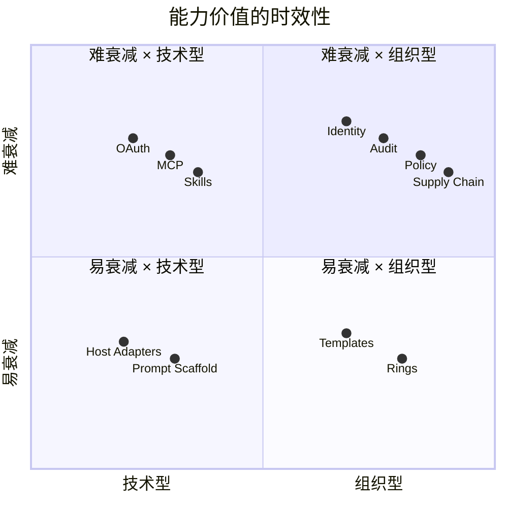
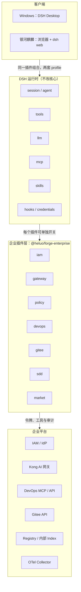
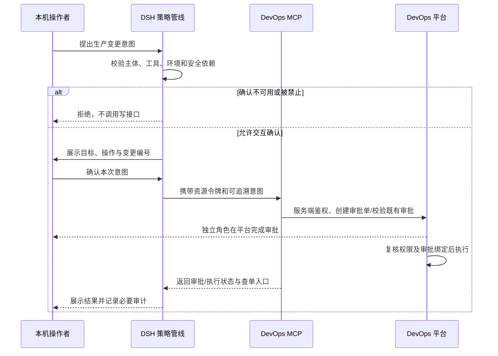

# 河洛企业级智能研发平台总体架构设计

## 文档信息

| 项 | 内容 |
|---|---|
| 文档编号 | CORP-DSH-ARCH-001 |
| 文档名称 | 河洛企业级智能研发平台总体架构设计 |
| 版本 | V1.3.3 |
| 文档状态 | 评审稿 |
| 密级 | 内部 |
| 编制 | DSH 平台组（代拟） |
| 审核 | 待定 |
| 批准 | 待定 |
| 最后更新 | 2026-10-20 |
| 门禁 | G0 |
| 文档层级 | L1 总体架构；字段级契约与运行手册由子文档承担（见 §12） |

## 修订记录

| 版本 | 日期 | 修订人 | 修订说明 |
|---|---|---|---|
| V0.1 | 2026-10-20 | DSH 平台组 | 初稿 |
| V0.2 | 2026-10-20 | DSH 平台组 | 增加标准符合性与能力价值复核 |
| V1.0 | 2026-10-20 | DSH 平台组 | 文档命名与内容正式化 |
| V1.1 | 2026-10-20 | DSH 平台组 | 图示改为 mermaid：§3.1 能力价值四象限、§4 分层架构；删除位图与 `docs/assets/` |
| V1.2 | 2026-10-20 | DSH 平台组 | 同步需求基线（3 部门 800 人、50% 麒麟、7 类角色、C1–C4 合规约束）；统一 DevOps MCP 传输协议、两层生产审批、`$DSH_HOME` 硬拒绝保护、G0–G3 门禁与 A1–A14 验收 |
| V1.3 | 2026-10-20 | DSH 平台组（代拟） | 补齐项目级取舍、系统责任与信任边界、身份和生产变更生命周期、容量验证、门禁证据与回函闭环；澄清安全插件停用、不可交互确认及结果未知时的拒绝/禁重放边界，新增 ADR-9/10；日志保留期恢复为待批准提议 |
| V1.3.1 | 2026-10-20 | DSH 平台组（代拟） | 仅迁移至 docs/architecture/ 并重建全库相对链接；章节、ADR、决策与口径不变 |
| V1.3.2 | 2026-10-20 | DSH 平台组（代拟） | 统一河洛 Heluo Forge 平台名称、包名与目录示例，补充品牌术语；技术决策与接口不变 |
| V1.3.3 | 2026-10-20 | DSH 平台组（代拟） | 加固 §7.1 令牌校验与生命周期：算法白名单、kid 未命中返回 503、内省缓存上限、预刷新与重用检测、凭据存储层级、退出顺序；记录一期不引入 DPoP 的理由 |

> 编制依据：原方案记载的 DSH `0.2.1-rc.2` 源码与官方文档核验，核验日期 2026-10-20。本版增补仅核对本仓库需求、架构、计划与网关草案的一致性，未重跑历史源码验证；企业 IAM / Kong / DevOps / Gitee 接口、Windows 安全隔离与银河麒麟实机、容量及恢复演练均未实测。团队回函之前，协议能力、排期、保留期与验收阈值均不视为对方承诺。
>
> 关联文档：[河洛企业级智能研发平台推广实施方案](../plans/rollout-plan.md)（WBS、验收、风险与待确认事项）、[河洛企业级智能研发平台需求与场景基线](../requirements/requirements-baseline.md)（范围真源、人群画像、核心场景与成功指标）。

## 1. 背景与目标

企业研发体系由五个域组成，本方案回答的是“每个域用什么插件形态承接、边界在哪、失败时怎么办”。一期面向 3 个部门共 800 名研发人员（Windows 与银河麒麟 aarch64 各占 50%），采用“每人一套 DSH”形态落地。

| 域 | 现状 | 本方案的目标 |
|---|---|---|
| 身份与授权 | 自研 OAuth IAM，支持跳转登录 | 一次登录，DSH 内所有企业能力复用同一身份 |
| 模型与成本 | 自研 Kong AI 网关（对接机构内私有化模型） | 客户端不持有网关 Key，按人 / consumer 计量与限额 |
| 工程系统 | 自研 DevOps（API + CLI）、Gitee | Agent 能读能写，写操作分环境管控、可审批、可追溯 |
| 研发流程 | oh-my-sdd 式重流程 | 只守三条不变量，流程由 skill 承载 |
| 分发与治理 | 无 | 私有市场、版本门禁、可回滚 |

**非目标**：多人共享单实例（多租户）、自建推理服务、替换 DevOps 平台、macOS 客户端、白标发行与公网暴露（完整范围边界以[需求与场景基线](../requirements/requirements-baseline.md) §2 为唯一真源）。

### 1.1 项目级判断与证据状态

**本版建议继续按既定单用户路线评审，不以“已有 OAuth / 已有网关”替代接入验证，也不以方案评审通过代替试点准入。** 需求范围、目标人群与 C1–C4 约束以[需求与场景基线](../requirements/requirements-baseline.md)为准；本文件只决定系统职责和跨域取舍，具体接口由 L3 团队契约承载。

| 内容类别 | 当前依据 | 评审时应如何使用 |
|---|---|---|
| 用户确认输入 | 3 部门 800 人、Windows / 麒麟各半、每人一套、网关与模型机构内私有化部署 | 作为范围输入；人数、设备与权限覆盖率尚未抽样 |
| 方案既有决策 | 模型经网关、按资源授权、工具用 MCP、流程用 skill、分发走内部源 | 保持本期路线；不表示各团队接口已具备或已签署 |
| 本版增补提议 | 安全依赖故障拒绝、分域责任、容量验证方法与回函闭环 | 进入评审与负向验收，由相应负责人签署后冻结 |
| 未验证输入 | IAM 多资源刷新、网关契约、DevOps/Gitee 授权、两端隔离、容量与支持能力 | 发函取得证据，完成联调/实机验证；缺失时按门禁阻断，不以推断补齐 |

### 1.2 路线取舍

一期沿用“本机单用户 DSH + 企业现有控制面”，不新建共享 AI 平台或替换研发平台。这一取舍复用现有身份、模型和工程授权，但把终端兼容、升级与支持留给项目承担，不能只计算插件研发成本。

| 路线 | 获益 | 主要代价 | 本期处置 |
|---|---|---|---|
| 本机 DSH + 企业插件/MCP | 保留本地工作区能力；复用现有平台的权限与账本 | 双终端适配、800 人分发与支持、单用户无共享会话 | 采用，受 G0–G3 逐级验证约束 |
| 共享 DSH 实例 | 集中运维，入口统一 | 需新增用户/会话/凭据隔离，扩大核心改造与责任边界 | 不采用，违反本期 N1 |
| 自建独立研发助手平台 | 可完全控制产品与流程 | 重建宿主、工具与分发，增加长期维护面 | 不采用，无已确认收益支持该投入 |

## 2. 设计原则

| # | 原则 | 理由 |
|---|---|---|
| P1 | **核心不改，能力全插件** | DSH 是 MIT，但 fork 核心会在每两周一个 rc 的节奏下持续失血；只有一处必须补丁（MCP 按请求取 token 及 `stdio` 凭据重连），其余全部走插件与配置 |
| P2 | **一个会话，按资源取令牌** | 登录一次；模型网关用单一 `CredentialRef`，MCP 由 IAM broker 按 `resource` 取 token；轮换无需重启 |
| P3 | **策略下沉到工具管线** | 用 `tools/pre-execute` 与 `ctx.tools.guard()` 做硬门禁，不维护每宿主 hooks |
| P4 | **流程只守不变量** | 产物、冻结、原子 PR 三条不变量；不规定“必须先调哪个 skill” |
| P5 | **市场即治理** | 私有 registry + 私有 index + `engines.dsh` 门禁，公网源不可回落 |
| P6 | **能力可隔离，安全依赖不可绕过** | 一个能力一个 bundle 行；可选能力故障单独隔离，IAM、policy 或必要审计不可用时，拒绝依赖它的企业调用/生产写操作，不能靠禁用安全插件恢复业务 |

## 3. 复核与标准对齐

方案需同时适应两项变化：Harness 约每两周发布一个候选版本，模型约每半年更新一代。判断标准不是“当前可运行”，而是**能力增强时方案价值是上升、持平还是衰减**。

### 3.1 能力价值的时效性

| 能力 | 会衰减的部分 | 不衰减的核心 | 本方案的落点 |
|---|---|---|---|
| 登录 | 表单、页面、跳转细节 | 身份、同意、撤销、审计 | 标准 OAuth + claims；UI 可替换 |
| 模型接入 | 模型选择、prompt 技巧、参数调优 | 配额、成本、数据边界、审计 | 网关侧策略，客户端不内嵌 |
| 工具 | 工具数量、描述措辞 | 权限、审批、幂等、可追溯 | MCP 标准 + policy |
| 研发流程 | 环数、模板、编排顺序 | 产物契约、冻结、追溯 | skill 可随模型重写，契约在 CLI/CI |
| 分发 | 安装器、市场 UI | 供应链、版本、回滚 | npm + index 标准 |
| 策略 | 规则清单本身 | 决策点、fail-closed、审计 | host seam + 可配置规则 |



> 图：能力放在哪个象限，决定它随模型/宿主增强而升值还是贬值；本方案把投入集中在右上与左上。

三条判据：

1. **换更强模型是否需要改**：需要改的越少，价值越稳。因此 prompt 与工作流编排不进入“契约”，只放在 skill 里。
2. **Harness 升级是否需要改**：只依赖公开 seam（`tools/pre-execute`、`credentials`、`llm`、`mcp`、`skills`）的不用改；依赖内部文件路径或私有 API 的会碎。
3. **换一个宿主是否还能用**：`SKILL.md`、MCP 工具、OAuth token、OTel 事件都是跨宿主资产；宿主适配层不是。

结论：**把价值放在“组织事实”和“标准接口”上，不要放在“提示词脚手架”和“宿主适配”上。**

### 3.2 标准符合性

| 标准 | 要求 | 本方案 | 差距 / 决策 |
|---|---|---|---|
| OAuth 2.1（draft-15） | PKCE 必须；无 implicit / ROPC；redirect 精确匹配 | Code + PKCE，public client | 无 |
| RFC 8252 | 原生应用用 loopback；优先 IP 字面量 | `127.0.0.1` 回调 | 禁用 `localhost` |
| RFC 8707 | `resource` 参数标识目标资源 | 改为按资源取 token | 依赖 IAM 支持 `resource` |
| RFC 9728 | MCP server 暴露 Protected Resource Metadata | DevOps MCP（HTTP）实现 PRM | 新增约 1 人周 |
| MCP 2026-07-28 | HTTP server 校验 `aud`；stdio 从环境取凭据 | DevOps HTTP + Gitee stdio | 与上一条同批实现 |
| MCP client 注册 | Client ID Metadata 优先，DCR 已弃用 | IAM 预注册 client | 无 |
| Agent Skills | `SKILL.md` frontmatter、渐进披露、<500 行 | SDD skill pack | 用 `skills-ref` 校验 |
| OTel GenAI | `gen_ai.*` 语义约定（仍为实验） | 决策审计 + 用量 | 只依赖稳定子集，内容默认不采 |
| SLSA / npm provenance | 构建来源可验证 | 内部 CI 出 provenance | 一期目标 L2 + 白名单 |

### 3.3 复核结论与待确认项

1. **网关额度（已确认）**：企业自研的 Kong AI 网关已具备详细额度管理，且后端模型为机构内私有化部署；DSH 不在客户端做计量。仍需对齐的是额度维度、窗口、超额行为与剩余额度查询方式；`ai-proxy` 的 OSS / Enterprise 分层不再影响本方案。
2. **MCP OAuth 客户端缺失（待实施）**：DSH 的 `mcp-client` 没有 OAuth 客户端。由 IAM 插件充当 token broker，按 `resource` 取 token 并缓存；`dsh-mcp-client` 补丁支持 HTTP 传输按请求回调取 token，以及 `stdio` 传输在凭据更新时重连子进程，约 +1 周。
3. **单一令牌的边界（已决策）**：RFC 8707 要求 token 绑定目标资源。一个宽 audience 的 token 会让泄漏半径覆盖所有服务，因此改为“一个会话 + 按资源签发”，模型网关仍用单一引用。

## 4. 总体架构



> 图：客户端 / DSH 运行时 / 企业插件 / 企业平台四层；插件层每格对应一个可独立开关的 bundle 行。运行时中未逐一展开的 `authorization`、`settings`、`webServer` 见 §5。

三条请求路径：

1. **登录**：浏览器 → IAM（Code + PKCE）→ 本机回调 → Host 写令牌记录与镜像引用。
2. **模型**：`llm-pi-ai` 解析 `ENTERPRISE_ACCESS_TOKEN` → Kong 验签、映射 consumer、限额 → 机构内私有化模型服务。
3. **工具**：MCP client 向 IAM broker 取按资源 token → DevOps MCP（HTTP）或本地 Gitee MCP（stdio）→ 工程系统 API；每次工具调用先过企业策略插件。

### 4.1 系统责任与信任边界

企业授权、计量和审批必须在对应服务端最终执行，客户端只负责携带身份、组织操作、提示确认并约束 Agent。用户具有本机管理员权限，因此 preset、工具描述或本机配置**不是防止用户自行绕过的企业安全边界**；其价值是限制 Agent 误操作与注入攻击，不能替代 IAM、网关和工程平台的鉴权。

| 系统/责任域 | 唯一负责的事实或控制 | 不承担的职责 | 关键失败边界 |
|---|---|---|---|
| IAM | 身份、资源授权、令牌生命周期与角色来源 | 不负责模型额度，也不等于本机 DSH 入口准入 | 不能取到目标资源有效令牌则不调用该资源 |
| AI 网关与模型服务 | 模型访问、person/consumer 计量、路由与正文日志边界 | 不让客户端维护第二份账本；不接收客户端自报身份作为授权依据 | 验签或额度依赖故障按冻结契约拒绝，不回落公网模型 |
| DevOps 平台与 MCP | 服务端项目/环境权限、审批、幂等与实际变更结果 | 不把本机点击确认当成平台审批；不信任工具描述的只读标签 | 审批未完成不执行；结果未知先查单，不盲目重放 |
| Gitee | 仓库权限与用户凭据授权 | 不因在本机启动 MCP 而扩大用户原有权限 | 独立凭据映射未确认时不开放相应工具 |
| DSH 与企业插件 | 本地交互、资源令牌引用、工具管线、沙箱、Agent 路径保护与决策事件 | 不是多租户服务，不是企业唯一授权点 | 安全依赖缺失时阻断相关能力，不静默降级 |
| 内部分发与 IT | 可信包源、构建证据、两端安装/更新/回滚通道 | 禁用市场工具不等于可阻止管理员自行安装软件 | 校验/兼容失败不安装；安全基线不符不准入企业资源 |
| 安全与观测平台 | 最小事件接收、访问控制、保留与异常响应 | 默认不接收会话、代码或模型正文；不做第二套成本计费 | 生产写操作无法形成必要审计时拒绝；其他断链处置待安全确认 |

插件、MCP 响应、仓库内容、工具输出和模型输出均按不可信数据处理，不能借其中的“指令”改变授权、审批或数据边界。工具的读写/环境属性必须由受控清单及参数校验确认；未知工具或环境无法判定时拒绝风险动作。

### 4.2 生产变更端到端生命周期

生产写操作绑定“主体、目标环境、操作内容与变更编号”，本机确认与平台审批各司其职；任何一方未满足均不执行。本机 approval policy 为 `never`、无可用确认 UI、超时或异常时，风险操作直接拒绝，**不是跳过确认自动放行**。具体绑定和状态字段由 DevOps/策略子文档定义。



本机确认后的审批单可立即返回 `pending_approval`，不持有客户端长连接等待。审批通过仅允许执行获批的目标与内容；参数、权限或目标环境变化时重新评估，不能复用旧确认。401、超时、断流不证明操作没有发生；仅在服务端确认无副作用，或具备可靠幂等/查单契约时才允许重试，否则返回“结果未知、待核查”。

### 4.3 身份与会话生命周期

身份生命周期必须覆盖登录、刷新、切换账号、角色变更、离职撤权和退出，而不仅是“第一次能拿 token”。此处是安全行为要求，不预设 IAM 已提供全部接口。

| 事件 | 客户端行为要求 | 服务端/待确认边界 |
|---|---|---|
| 登录与按资源调用 | 只向目标资源发送其有效令牌；缓存与当前主体及授权上下文绑定 | IAM 确认资源注册、scope、audience 与多资源刷新语义 |
| 刷新失败 | 区分网络故障与授权失效；无有效令牌即停止相应调用 | 锁内 ≤5 秒是网络请求超时目标，不是已测出的跨进程锁等待上界 |
| 切换账号或退出 | 清理令牌镜像、按资源缓存与身份相关连接；旧账号请求不延续到新会话 | 撤销接口、在途调用处置与本地会话保留规则需联调 |
| 角色变更、账号禁用或离职 | 不依赖旧 preset 继续授权；下次操作由服务端复核权限 | JWT 不天然即时可撤销；明确内省/撤销列表或有效期带来的最大残余授权窗口 |
| Gitee 独立凭据轮换 | 重新解析引用并重连所需子进程，禁止把凭据写入模型上下文 | IAM 映射或独立 OAuth/PAT 方案由 Gitee 团队确认，不能假设通用 IAM token 可直通 |

## 5. 插件形态映射

DSH 提供六种扩展形态，企业能力必须落在正确的形态上，否则会制造不必要的维护面。

| 形态 | 能力 | 何时用 | 本方案落位 |
|---|---|---|---|
| Host 服务插件 | 注册 Cordis 服务、Remote 方法、工具、策略 | 需要跨会话状态、原生能力或 UI 后端 | IAM、policy（含审计） |
| Client UI 插件 | Slot 注册、登录态、设置卡 | 用户可见的交互 | IAM 的账户菜单与登录页 |
| 配置 bundle | 只改组合与配置，无代码 | 已有插件能满足 | gateway、market、brand |
| MCP bundle | 每 server 一行 `dsh-mcp-client` | 外部系统有 API/CLI | DevOps（HTTP）、Gitee（stdio） |
| Skill pack | `SKILL.md` + 资源，按需加载 | 流程知识与模板 | SDD |
| Agent preset | 角色化工具集与提示 | 不同角色的权限与工具不同 | 7 类角色 preset（开发 / 评审 / 发布 / 测试 / 运维 / PMO / 外包） |

原则：**能用配置 bundle 就不写代码；能用 MCP 就不写原生工具；只有策略与身份必须原生**，因为它们要在工具管线上做同步决策。

## 6. 软件包组合

| 包 | 形态 | 职责 | 依赖的 seam |
|---|---|---|---|
| `@heluo/forge-enterprise` | umbrella bundle | 组合下列行，给两端共用 | `cordis.patch.yml` |
| `@heluo/forge-iam` | Host + Client 插件 | OIDC/OAuth 登录、刷新、令牌镜像、MCP token broker、账户 UI | `credentials`、`authorization`、`webServer`、`llm` |
| `@heluo/forge-gateway` | 配置 bundle | 企业模型路由、白名单、重试策略 | `llm-pi-ai` |
| `@heluo/forge-policy` | Host 插件 | 工具门禁、路径规则、`$DSH_HOME` 硬拒绝、客户数据外发确认、决策审计 | `tools/pre-execute`、`tools.guard`、`otel` |
| `@heluo/forge-devops` | MCP server（HTTP）+ bundle | 8–12 个研发平台工具（P1 可先以本地 stdio 验证工具面，P2 切换为 `streamable-http`） | `mcp-client` |
| `@heluo/forge-gitee` | MCP bundle（stdio） | 复用 `mcp-gitee`，arm64 自编译 | `mcp-client` |
| `@heluo/forge-sdd` | Skill pack + CLI | 产物契约、freeze/指纹、归档与 PR | `skill-filesystem`；路径门禁由 policy 执行 |
| `@heluo/forge-market` | 配置 bundle | 私有 index、私有 registry、版本门禁 | `plugin-market`、`plugin-manager` |
| `@heluo/forge-brand` | 配置 bundle | 产品名、Logo、主题 token | `brand`、`client-ui-theme` |

组合方式：umbrella bundle 只做 `insert`，每个能力一行，配置上可独立 `disabled` 或覆盖；**可被关闭不等于关闭后仍保持依赖权限**。IAM、policy 和必要审计须在准入及每次相关操作时满足安全依赖检查，缺失则拒绝相应企业调用或生产写操作；安全检查的可执行性仍须在 G2 前通过负向验收。

## 7. 领域设计

### 7.1 身份与令牌

**流程**：Authorization Code + PKCE（S256）→ 系统浏览器 → IAM 登录页 → `http://127.0.0.1:<port>/oauth/callback` → 校验 `state` / `nonce` / `iss` / `aud` → 写令牌。

**存储**：refresh token 与元数据存为 `CredentialKey` 记录；模型网关的 access token 镜像到 `CredentialRef: ENTERPRISE_ACCESS_TOKEN`，因为 `llm-pi-ai` 只解析引用。MCP 的 token 不落固定引用，由 IAM 插件的 token broker 按 `resource` 取用并缓存。

**按资源取 token**：RFC 8707 要求 token 绑定目标资源，MCP 的 HTTP server 按自己的 canonical URI 校验 `aud`。broker 在授权与刷新时带 `resource`，缓存键为 `(resource, scope)`；stdio server（如 Gitee）按 MCP 规范从环境取凭据，若企业 Gitee 支持 IAM 令牌或 Token Exchange，则由 broker 注入并在轮换时重启 `stdio` 子进程，否则在 `CORP-DSH-GITEE-001` 中配置用户级 Gitee OAuth/PAT 引用。若 IAM 不支持 `resource`，退化为按 audience 预注册多个 client，仍保持一资源一 token。

**刷新与并发**：把“判断有效期 → 刷新 → 写回”整体放进 `ctx.credentials.modifyRecord`（进程内辅以 single-flight）。该 API 的互斥跨进程生效，防止桌面与 web 两个进程同时轮换 refresh token；在锁内先复查有效期，后到者直接复用。为防止 IAM 响应缓慢导致文件锁长期阻塞本机其他凭据读取，锁内网络刷新请求必须设硬超时（≤5 秒），并在 P0-4 实测异步回调的锁超时与释放行为；刷新失败区分 `invalid_grant`（需重新登录）与网络错误（释放锁后退避重试）。

**校验与生命周期（加固）**：
- 校验项：`iss`、`aud`（含目标资源标识）、`exp`/`nbf` 与签名算法白名单（拒绝 `none` 与对称算法）；`kid` 未命中返回 503 而非 401，避免把密钥轮换误判为登录失效。时钟容差 ±60 秒为提议值，待网关与 IAM 确认。
- 内省缓存：单条结果缓存不超过 60 秒，撤销生效延迟以此为上界；缓存键使用令牌摘要，不落明文。
- 刷新触发：到期前 60 秒预刷新，避免请求在途过期；刷新在凭据锁内 single-flight，禁止并发轮换。
- 轮换与重用检测：IAM 若支持 refresh token 轮换，重用旧值按 `invalid_grant` 处理并视为会话失陷，清空凭据并要求重新登录，不静默重试。
- 存储层级：优先系统凭据库（Windows DPAPI/凭据管理器；麒麟 libsecret 或内核 keyring），不可用时回退 0600 文件，并在账户页标注“未受系统保护”。
- 退出顺序：停止新请求 → 清镜像与按资源缓存 → 调用 IAM 撤销（RFC 7009）与 RP 发起退出登录（若支持）→ 关闭连接；撤销失败只记录，不阻塞本地退出。
- 一期不引入 DPoP 或 mTLS 绑定令牌（RFC 9449）：本机单用户、无跨设备共享，收益低于改造成本；若网关后续支持 DPoP，再评估作为增量加固。

**身份传播**：须有可信稳定主体、目标资源及授权范围，具体claims/身份查询与角色来源由IAM和资源方确认；不把`email`设为必需身份或计费键。经确认的`groups`或等效属性映射7类角色preset（见[需求与场景基线](../requirements/requirements-baseline.md) §3.2），但服务端仍独立鉴权；审计使用最小主体关联，不将身份详情注入模型上下文。

**失败模式**：IAM不可达时仅保留仍有效的授权至原到期，过期即停止相应调用。模型请求仅在网关能证明鉴权拒绝、未被接受执行且未开始输出时，允许刷新后至多重放一次；已经生成、输出或结果未知时不自动重放，避免重复生成/计费。授权确认失效才提示重新登录，网络/依赖错误不冒充登录过期；不静默降级到其他模型。

### 7.2 模型与成本

目标形态为配置接入，客户端不新增计量账本。现有 LLM 适配器能否同时满足流式响应、401 安全刷新与 429 禁自动重试，仍须 P1 联调证明；不能仅凭配置里存在通用重试策略就判定无须适配。具体配置示意见附录 B，网关协议字段以 L3 为准。

网关侧拟采用 JWKS 或 introspection 验证、person/consumer 映射与模型白名单；具体插件和映射配置由网关团队确认，不预设 `key_claim_name=sub` 本身就能完成全套身份管理。后端仅连接机构内私有化模型服务，满足[需求与场景基线](../requirements/requirements-baseline.md) §4.4 C1。**额度由网关统一承担**——用户已确认企业网关具备详细额度管理，但双维度语义与接入契约未联调，DSH 不做本地计量。

**额度双维度**：网关必须能按人（`sub`）和按 consumer 记账，两者可同时生效，实际可用额度取更紧的一侧。

| 维度 | 主体 | 用途 | 典型场景 |
|---|---|---|---|
| 人 | `sub` | 公平性、个人预算 | 每人一套 DSH |
| consumer | consumer id | 成本归属、防滥用 | 团队共享服务、CI、外包 |

- 个人使用：consumer 与 person 1:1，两个维度数值一致，可从“人”切到“consumer”查看。
- 共享服务：workload consumer（如 `svc-ci`）承载团队预算，`sub` 仍是具体人，两个维度分别计，既避免单人耗尽团队额度，又能归因到人。
- 请求只带一个 token；网关从 JWT 派生 person、从凭证或注册信息派生 consumer，DSH 不传两个身份。

**超额错误摘要**：额度耗尽统一返回 429，携带恢复信息，客户端不自动重试；使用 Problem Details 区分个人与 consumer，并返回需求 REQ-04 要求的双层额度快照。完整字段、响应头、主耗尽层选择与示例只维护于 [AI 网关契约](../contracts/gateway-contract.md) §4.3，本层不复制。该契约仍为待网关团队确认的草案。
- `401` 只表示 token 无效，`403` 只表示无权限/模型未授权；**额度耗尽一律 429**，不用 403。
- DSH 收到 429 不自动重试，展示 `quota_reset`；若网关提供额度查询端点，可在设置页展示剩余额度。
- 客户端不持有上游 Key，也不做第二套账；成本以网关计量为准。

**审计与日志口径**：客户端只上报“谁、何时、哪个模型、成功/失败”，token 数由网关日志归集；网关与模型服务默认关闭请求/响应正文日志（满足 C4）。

### 7.3 工程系统工具

**DevOps MCP**（自研，目标形态为服务端 `streamable-http`；P1 概念验证可先用本地 `stdio` 验证工具面）：只暴露 8–12 个高频操作，工具名 `mcp__devops__<verb>_<noun>`；默认只读，写操作在工具描述中标注 `mutating: true`。

建议工具面：`pipeline_list`、`pipeline_get`、`pipeline_run`、`run_logs`、`deployment_list`、`deployment_status`、`deployment_rollback`、`issue_list`、`issue_get`、`issue_comment`。

**写操作两层审批模型**：
1. **本机操作确认（`@heluo/forge-policy`）**：按受控工具清单及可信目标归属判断读写/环境，描述中的 `mutating` 仅作提示，未知风险拒绝。测试环境也须满足角色和服务端权限；生产转本机 `ask`，展示本次目标与内容。`never`、无UI、拒绝、取消、超时或异常均不执行，不能靠客户端标签或工具描述放宽授权。
2. **平台多人审批（DevOps 平台）**：若生产变更需独立的发布负责人（Release Manager）异地审批，由 DevOps MCP 向 DevOps 平台提交变更/部署申请单并立即返回“待审批（pending_approval）”状态与审批单链接，审批流在 DevOps 平台内完成，不在 DSH 客户端同步挂起等待他人。

**Gitee**：复用 `oschina/mcp-gitee`（本地 `stdio`），arm64 自行交叉编译并校验 checksum；工具面默认只读，写操作（建分支、评论、提 PR）单独开关。

**按请求取 token 与 `stdio` 重连**：原方案核验记录表明 `headers` 与 `env` 在加载时求值；拟议 auth provider 回调须按请求取得目标资源令牌，并在当前主体内按资源/scope隔离缓存，切换身份清理旧缓存。HTTP的401刷新不等于可以无条件重放：仅在确认鉴权拒绝且未执行，或受控幂等契约证明安全时，才允许按已冻结策略重试；生产写请求已受理、超时、断流或结果未知时先查单，不能在通用transport.fetch中盲目重放。`stdio`凭据更新时重新解析引用并重启子进程。该补丁是一期核心改动的目标例外，50–80行仅为初估；向上游提案，未合入时由内部源承载，具体接口、工作量和兼容性仍须P1/P2验证。

**HTTP server 的 OAuth 义务**：按 MCP 2026-07-28，DevOps MCP（HTTP）需暴露 `/.well-known/oauth-protected-resource`（RFC 9728），校验 token 的 `aud` 等于自身 canonical URI，401 响应带 `WWW-Authenticate: Bearer resource_metadata=...`。Gitee 走 `stdio`，按规范从环境取凭据，不做 HTTP OAuth 流程。

**上下文预算**：每个 server 的工具数上限 12；不用的 server 在 preset 里禁用；流程性知识放 skill，不放工具描述。

### 7.4 研发流程（SDD）

只保留三条不变量与一个状态字段：

- **一致性**：canonical spec 与代码不漂移（freeze、SHA-256 指纹、stale 传播、archive）。
- **原子性**：一次交付的 PR 同时包含实现、spec、归档。
- **可追溯**：`change-id` 贯穿分支、commit、PR、tracker。

形态：1 个 skill（组合现有 `brainstorming` / `writing-plans` / `executing-plans` / `code-review-and-quality` / `test-driven-development` / `verification-before-completion`）+ 1 个约 300 行的 CLI（封装 openspec 的 new/validate/freeze/stale/archive/pr-body）+ `@heluo/forge-policy` 策略插件里的路径规则。阶段只写进 `.meta.json`，不驱动对话顺序。

**路径规则**（由 `@heluo/forge-policy` 基于 `tools/pre-execute` 与 `tools.guard` 执行，不维护独立 hook 引擎）：`spec` 阶段只允许写 `openspec/changes/<id>/**`；`apply` 阶段 canonical `openspec/specs/**` 与 `proposal.md`/`design.md` 只读；`review` 阶段不再写源码。无 `.meta.json` 时只执行 HARD 规则，不阻塞普通开发。

### 7.5 分发与治理

- **必装**：`@heluo/forge-enterprise` 由 MSI / deb 预置进 profile（支持用户自助安装与 MDM 推送），首次可用不依赖手动去市场安装。
- **可选**：内部 index 列出经审批的插件；`plugin-market` 配上私有 index，`plugin-manager` 配 `registry` + `fallbackRegistries`，公网源不在列表内。
- **门禁**：index 生成时校验 `engines.dsh` 与 `dsh.bundle.patch`；安装前校验包名白名单与 checksum。
- **按角色分级权限**（对应[需求与场景基线](../requirements/requirements-baseline.md) §3.2 与 REQ-14）：全员禁止回落或安装公网源；`开发者` preset 允许从内部私有市场安装已审批插件；只读类角色（评审、运维、PMO）及受限角色（外包 / 实习生）禁用 `plugin_manager` 工具。

### 7.6 审计、可观测与数据合规

- **决策审计**（`@heluo/forge-policy` 直接发 OTel event）：`sub`、`change_id`、`tool`、`decision`、`reason_code`、`latency`，不记参数正文，只记参数哈希。
- **会话审计（C2）**：`session-log` 通道含正文与代码，默认关闭，不落安全事件平台（SIEM）；确需开启时先做脱敏与保留期评审。
- **客户与生产数据保护（C1 / C3 / C4）**：
  - **C1（机构边界）**：网关与模型均为机构内私有化部署，客户与生产数据不出机构边界。
  - **C3（外发确认）**：`@heluo/forge-policy` 对涉及批量导出、归档外发或跨系统写入的操作强制转为 `ask` 人工确认。
  - **C4（服务端日志）**：网关与模型服务默认不留存请求/响应正文日志（详见 [AI 网关契约](../contracts/gateway-contract.md) §4.5）。
- **成本审计**：以网关的 consumer 与 `sub` 计量为准；DSH 侧只记调用次数与失败率。
- **保留期（待批准）**：180 天仅为决策审计与网关计量元数据的建议值，不是现行制度；安全与数据责任方须在 G2 前确认字段最小化、访问权限、具体期限及删除证据。批准前不开启正文采样，且不得按未批准期限启动正式试点。

## 8. 关键契约

| 契约 | 规则 |
|---|---|
| `ENTERPRISE_ACCESS_TOKEN` | POSIX 环境变量名，仅模型网关；每次登录/刷新覆盖写；消费方不得缓存跨请求 |
| claims | `sub` 必填；`aud` 必须包含目标服务；`groups` 映射 7 类角色 preset，缺失时按最小权限（受限只读）处理 |
| `resource` / `aud` | MCP HTTP token 绑定 server 的 canonical URI；broker 缓存键为 `(resource, scope)`；server 必须校验 `aud` |
| 额度错误 | `429` + `Retry-After` + `application/problem+json`；`quota_scope` ∈ {`person`, `consumer`}，支持 `quotas` 数组；`401`/`403` 不得复用 |
| OTel 字段 | 只用稳定的 `gen_ai.*` 子集 + `corp.sub` / `corp.change_id` / `corp.decision`；内容属性默认不采 |
| MCP 工具名 | `mcp__<server>__<verb>_<noun>`；只读与写操作（`mutating: true`）在描述中显式标注 |
| 策略决策 | `allow` / `ask` / `deny` + `reason_code`；`$DSH_HOME/**` 硬拒绝（`deny`）；异常一律 `deny`（fail closed） |
| bundle manifest | `dsh.bundle.patch` 必填；`engines.dsh` 声明兼容区间；peer 依赖精确到 rc |
| 配置键 | 统一 `corp.*` 前缀；敏感值只放凭据引用，不进 YAML |

## 9. 安全设计

**信任边界**：用户意图 → 不可信上下文/模型输出 → DSH 策略与工具子进程 → 企业网关/工程平台。Host 是目标中的受控执行组件，但“同一 OS 用户”不证明进程或插件可信；本机管理员可修改客户端，因此企业服务端始终独立鉴权。凭据文件 0600 不能隔离同用户 Agent，必须通过文件工具控制、子进程沙箱、秘密最小暴露与短期授权共同减灾；两端覆盖未经实测前不得宣称已实现硬隔离。

| 威胁 | 处置 |
|---|---|
| Prompt injection 诱导调用写工具 | 生产写操作本机 `ask` 二次确认 + 平台侧异步审批单；MCP 工具最小面；策略插件 fail closed |
| Agent 读取凭据并经内网工具（如评论接口）外传 | 目标为文件工具拒绝 `$DSH_HOME/**`，命令子进程通过经验证的沙箱/等效隔离阻止访问；不能靠命令字符串匹配证明安全。Windows 与麒麟都须验证符号链接、编码命令、环境继承及子进程绕过，未通过则不开放对应工具。access token TTL ≤60 分钟为本方要求、待 IAM 确认；最小 scope、一资源一 token 与撤权窗口由服务端契约兜底，不假设自包含 JWT 能即时撤销 |
| 客户与生产数据外泄 | 网关与模型机构内私有化部署（C1）；客户端禁配其他模型路由；批量导出/外发触发 `ask` 确认（C3）；服务端默认不留正文日志（C4） |
| 恶意插件 | 私有 registry + 包名白名单 + checksum + 受限角色禁用 `plugin_manager` |
| 供应链（依赖/构建脚本） | 锁定 lockfile、禁 `postinstall`、CI 重建、镜像内预构建；发布带 npm provenance（SLSA L2），安装校验 checksum 与白名单 |
| 越权读仓库 | Gitee/DevOps 侧按 token scope 限制；DSH 不自行扩权 |
| 审计缺失 | 决策与调用双路 OTel；缺 `sub` 视为失败并告警 |

安全控制不得依赖 Agent 自觉遵守：工具描述中的 `mutating` 只用于发现和说明，受控工具清单、参数/环境校验、服务端授权才是决策依据。生产写操作必要审计无法记录时拒绝；模型/只读事件在观测链路中断时能否采用有界缓存、缓存满后的行为与恢复时限，须安全团队在 G2 前批准，未确认不能默认丢弃或无限放行。

## 10. 部署拓扑

| 端 | 占比与规模 | 安装 | 运行 | 更新 |
|---|---|---|---|---|
| Windows | 50%（约 400 人） | MSI（用户自助安装为主，MDM 推送可选） | DSH Desktop + `desktop` profile | 官方 feed 或内部 feed |
| 银河麒麟 aarch64 | 50%（约 400 台） | deb + 内部 apt 源（自带 Node 24 与预构建 profile） | `systemd --user` 常驻（严格绑定 `127.0.0.1`）+ `.desktop` 调用 `dsh-web-open` 包装脚本读取本机 launch URL 打开浏览器 | apt + 版本门禁 |
| 内部服务 | — | — | Registry、Index、Kong、DevOps MCP、IAM、OTel Collector | 各自发布 |

麒麟不在用户端编译：`node-pty` 等原生模块在 arm64 构建机预编译后打进 deb。沙箱按 P0 结论三选一（bwrap / Landlock / 自定义 runner），由于麒麟占试点终端的一半（约 400 台），P0 麒麟实机验证为试点准入硬门禁。

### 10.1 容量、性能与投入边界

800 人是试点覆盖规模，不是已知并发数，也不是网关容量验证结果；目前不具备承诺时延、吞吐或资源预算的证据。容量由网关/模型服务负责，终端资源与安装由平台组/IT 负责，PMO 与业务确认可接受阈值，试点前以同一负载口径验收。

| 评估面 | P1 必须取得的基线 | G2 前必须冻结的判断依据 |
|---|---|---|
| 模型调用 | 代表性上下文与输出规模下的首 token/整次耗时、并发、错误/429/取消行为，区分网关和模型 | 角色/部门的预期活跃与峰值假设、按模型的容量/限流策略、业务可接受阈值；不能凭800人直接推算 |
| 工程工具 | 只读与写操作分别测服务端耗时、超时与查单能力 | 生产审批/幂等/结果未知处置；不能用客户端自动重试掩盖未知结果 |
| 终端与分发 | 两端安装、启动、原生模块、沙箱和升级回退样本 | 支持的 OS/CPU/浏览器矩阵、离线安装能力、失败设备隔离与支持容量 |
| 资源与总投入 | 平台组 2–3 人为既有估算，不含其他团队等待、基础设施和试点支持 | IAM/网关/DevOps投入、ARM构建资源、签名/内部源/监控/支持成本是否复用及负责人；无证据不宣称零成本 |

若未取得性能目标和容量证据，只能报告“测得基线，阈值待定”，不能通过 G2。性能阈值不在本文发明数字，由 `CONF-GW` / `CONF-IT` / `CONF-PMO` 回函回写。

### 10.2 运行保障与故障域

每人一套减少跨用户会话混用，但企业 IAM、网关、内部源和工程平台仍是共享依赖。故障由所属服务团队恢复，平台组负责客户端定位与用户指引，安全事件优先止损；详细值班与恢复步骤由运行子文档承担。

| 故障域 | 高阶处置要求 | 不允许的“恢复方式” |
|---|---|---|
| IAM/网关不可用 | 显示可归因错误，保留有效授权至原到期，过期即拒绝；按已冻结规则退避 | 使用共享 API Key、延长 token、静默切换公网模型 |
| 工程系统写请求结果未知 | 展示变更/审批查询入口，由平台查证是否已生效，再决定后续 | 将超时一律当失败并重复部署/回滚 |
| 终端或安全插件异常 | 隔离失败能力/设备；恢复受支持的整套发布基线并重测 | 关闭策略、沙箱或审计继续保持生产权限 |
| 审计或敏感数据事件 | 保全最小证据、暂停风险操作、撤权/吊销并由安全组织处置 | 为排障长期采集正文、在工单中粘贴真实凭据 |

## 11. 版本与兼容性管理

- **锁版本**：一期固定 DSH `0.2.1-rc.2`；升级前跑内部兼容性套件（登录、模型、工具、SDD、市场）。由于终端以用户自助安装为主，客户端启动时检查最低兼容版本门禁。
- **标准漂移**：OAuth 2.1 仍是 draft，MCP 规范按日期发版；兼容性套件里固定规范版本（PRM、`resource`、`aud`），规范升级时先跑套件再放行。
- **内部包**：SemVer；`engines.dsh` 写区间；host 插件与 client 插件同版本发布。
- **通道**：`internal`（默认）与 `canary`（灰度）；可选插件故障可单行回滚，身份/策略/审计相关回滚须同时检查依赖与服务端兼容，不能恢复到缺失强制控制的版本。
- **发布单元**：记录 DSH、企业插件、策略、MCP、skill 与两端 profile 的版本组合、校验与兼容证据；不仅锁单个包。首次安装、升级失败、回滚和停用安全插件都纳入负向回归，演练通过后才声明可回滚。
- **上游**：MCP 补丁提 PR；若上游暂未合入，由内部私有 registry 维护带补丁版本；identity seam 以 RFC 形式提案，避免长期维护大面积核心 fork。

## 12. 交付组织与职责

下表为责任分配提议，不代替团队认领或批准。A=该项最终负责，R=实施/提供证据，C=协作评审，I=知会；每项只有一个 A，G0 由 PMO 落实实名负责人，审核与批准栏仍保持待定。将 IT 与 PMO 分开，避免把终端交付和业务验收混为一项。

| 工作 | DSH 平台组 | IAM | 网关/模型 | DevOps | Gitee | 安全 | IT | PMO/业务 |
|---|---|---|---|---|---|---|---|---|
| IAM 协议、资源注册与撤权 | C | A/R | C | C | C | C | I | I |
| IAM 客户端插件与凭据生命周期 | A/R | C | I | I | I | C | C | I |
| 网关契约、容量与日志控制 | C | C | A/R | I | I | C | C | I |
| DevOps MCP、服务端权限与审批接口 | R | C | I | A/R | I | C | C | C |
| Gitee 授权契约 | R | C | I | I | A/R | C | I | I |
| 本地 Gitee MCP 与 SDD 包 | A/R | I | I | C | C | C | I | I |
| 策略、安全基线与审计要求 | R | C | C | C | C | A | C | I |
| 终端打包、内部源与支持通道 | R | I | I | I | I | C | A/R | C |
| 生产变更业务审批职责 | C | C | I | R | I | C | I | A |
| 批次、指标、投入与试点去留 | R | C | C | C | C | C | R | A |

### 12.1 子文档清单与责任

本文只保留跨域决策；下列子文档由对应团队补充，字段级契约与操作步骤以子文档为准。

| 子文档 | 负责 | 必须包含 | 门禁 |
|---|---|---|---|
| IAM 接入 | IAM 团队 | 端点、claims、资源/client方案、TTL与撤销；按阶段冻结并留未验清单 | G0方向及P0联调；G1接入契约；G2生产运行流程 |
| 网关契约 | 网关团队 | 验签、consumer、双维度额度、429与C1/C4；保留期、故障和容量单独签署 | G0方向及P0联调；G1接入契约；G2运行参数 |
| 麒麟验证 | 平台组 | 实测输出、沙箱候选、runner方案与原生模块清单；工程化再验 | G0前置验证；G2安装与隔离 |
| DevOps MCP | DevOps 团队 | 工具/scope/PRM与只读契约；生产审批、幂等/查单及审计对账 | G1只读和资源契约；G2生产运行 |
| Gitee 集成 | 平台组 | 版本、arm64构建、用户凭据/scope与只读隔离；写开关及审计 | G1只读契约；G2可选写入开放决定 |
| 策略与审计 | 安全 + 平台组 | 7 类角色 preset、`$DSH_HOME` 硬拒绝、客户数据外发确认（C3）、决策 schema、保留期 | G2 |
| 分发与市场 | 平台组 + IT | registry 与 index、通道、兼容门禁、回滚步骤 | G2 |
| 终端打包 | 平台组 + IT | MSI 自助安装/MDM、deb/apt/`systemd --user`（`127.0.0.1`）与 `dsh-web-open` 脚本、更新回滚 | G2 |
| SDD 流程 | 平台组 | skill 结构、CLI 命令、policy 路径规则、CI 校验、产物契约 | G2 |
| 试点推广 | PMO | 3 部门 800 人批次（建议分两批各 400 人）、M1–M6 指标、支持渠道、退出条件 | G2 |

子文档按 [_template.md](../templates/_template.md) 规范编写，结论先行；主文档不复制子文档细节，只在决策变化时回写。

**阶段门禁（全库统一口径）**：
- **G0（方案评审与前置验证门禁，第 1 周末）**：冻结 L1/L2/需求基线，完成 P0 前置验证（麒麟实机、IAM 联调、网关契约草案）。
- **G1（概念验证门禁，第 5 周末）**：完成 P1（4 周）核心插件、MCP 补丁与 DevOps/Gitee 只读闭环，通过 10 人内测。
- **G2（试点准入门禁，第 9 周末）**：完成 P2 工程交付（4 周，含写操作审批、安装包、私有市场、7 类角色策略与 SDD），准入 3 部门 800 人试点。
- **G3（推广门禁，第 15 周末）**：完成 6 周试点运行与指标（M1–M6）评估，达标后进入 P3 持续推广。

### 12.2 门禁证据与决策权

第 1/5/9/15 周是依赖及时到位时的工程基准，不是已承诺日历日期；任何阶段等待、返工、容量整改或错峰试点窗口不足，均需 PMO 重排并保留原因。L1/L2 冻结是方案基线，不意味着 L3 未验接口或团队承诺已生效。

| 门禁 | 必须具备的证据摘要 | 拟签署职责 | 未关闭时的动作 |
|---|---|---|---|
| G0 | P0 实机与联调证据、范围和需求基线、团队认领/替代路径/计划、G1/G2遗留项清单 | 平台牵头架构，相关能力团队确认输入，安全/IT/PMO确认各自前置项；实名待定 | 不把“已发函”或口头可行当作前置验证通过 |
| G1 | 按锁定版本完成登录/刷新、MCP补丁与只读闭环，10人内测，DevOps/Gitee契约冻结及容量基线 | 平台与 IAM/网关/DevOps/Gitee 对本域证据负责，安全评审 | 有条件条目明确禁用范围、负责人和关闭门禁，不能提前开放生产写 |
| G2 | A1–A9/A14、两端隔离、服务端权限/审批、最小必要审计、安装/支持、容量阈值与恢复证据；SDD按WBS交付 | 平台/IT确认交付，安全确认控制，PMO/业务批准批次准入，相关服务负责人确认承载 | 未验安全控制不得延期到G3；只冻结未通过能力不能自动缩减已批准范围 |
| G3 | A10–A13与M1–M6完整观察窗口、故障/问卷证据及可追溯结论 | PMO/业务签署去留，平台/安全/IT与各服务团队提供本域证据 | 按需求基线§6.2停止扩量、延期复测或进入推广；“有条件通过”不是已通过G3 |

生产审批角色、范围变更批准者、每道门禁最终签署人均由 `CONF-PMO` 回函明确，未落实实名不得代签。若接口或安全能力不支持既定方案，应先形成替代方案及影响评估；涉及需求/范围变化由批准者决定，不由某一团队回函自动改变。

### 12.3 发函、回函与基线闭环

跨团队确认按 IAM、网关/模型、DevOps、Gitee、IT、安全、PMO/业务七域分别组织，并使用 `CONF-<域>-*` 问题 ID 跟踪。回函经核验后写入对应 L3、WBS 与验收证据，不另设字段契约真源；未回函不视为同意。

处理顺序为：发函并登记 → 对方认领 → 逐项回函并提供脱敏证据 → 平台与责任团队核验/联调 → 更新对应 L3 → 影响跨域决策时更新本文件与 ADR → 按门禁签署。回函“支持”但无证据仅算收到答复，不算关闭；替代能力需重新核验，无回函不视为同意。提议的认领/初答时限由发函人填写，不能替代门禁截止。

G0 先取得方向、负责人、可联调性与计划，但 P0 要求的验证必须真正完成；DevOps/Gitee详细契约在 G1 关闭，生产审批、运行安全参数与试点准入在 G2 前关闭。每条遗留项记录问题 ID、结论/限制、证据、负责人与承诺时间、影响需求/WBS/验收、关闭门禁；“待确认”不是默认已支持。

## 13. 验收标准

完整验收矩阵（`A1–A14`）见 [推广实施方案](../plans/rollout-plan.md) §7；其中架构治理与标准符合性的三项核心判据如下：

| # | 验收项 | 判据 |
|---|---|---|
| A12 | 插件隔离与回滚 | 可选能力单独禁用不影响无依赖能力；IAM/policy/必要审计关闭或故障时，相关企业调用或生产写操作被拒绝；受支持组合回滚 ≤10 分钟 |
| A13 | 审计完整性 | 按需求基线与完整验收矩阵区分模型事件与生产变更归因，要求字段缺失为 0；最小必要审计与C4在G2前已就绪，G3完成完整性评估 |
| A14 | 标准符合性 | PKCE + loopback IP；HTTP MCP按目标资源绑定令牌并校验aud（resource或经确认的audience/client替代）；HTTP server暴露PRM；401刷新与安全重试不导致生产变更重放 |

## 14. 架构决策记录

| # | 决策 | 被否方案 | 后果 |
|---|---|---|---|
| ADR-1 | 每人一套 DSH | 共享实例多租户 | 少 8–12 人周，但无法团队共享会话 |
| ADR-2 | 令牌直通网关 | 客户端换发 API Key | 客户端无 Key；要求网关支持 JWKS 或 introspection |
| ADR-3 | 外部系统用 MCP，策略用原生插件 | 全部原生 / 全部 MCP | 工具面解耦；DevOps 走 HTTP MCP，Gitee 走本地 stdio MCP |
| ADR-4 | `tools/pre-execute` + `guard` 做门禁 | 每宿主 hooks.json | 一条策略路径；不维护独立 hook 引擎 |
| ADR-5 | 必装走 umbrella bundle，可选走市场 | 全部走市场 | 首次可用不依赖网络；市场只治理增量 |
| ADR-6 | SDD 做 skill 包，不做产品 | 五环七层产品 | 维护面小；流程强度靠 `@heluo/forge-policy` 路径规则补 |
| ADR-7 | 一期默认官方 App，不白标 | 本期直接自建白标发行 | 与需求基线N3一致；G0确认现有路线，确需白标走范围变更与单独立项，不靠开放问题自动扩大范围 |
| ADR-8 | 一个会话、按资源取 token | 单一宽 audience token | 泄漏半径小；优先resource，不支持时由IAM确认按audience/client替代，仍保持目标资源隔离 |
| ADR-9 | 安全依赖不可绕过，确认不可用即拒绝（新增提议） | 禁用policy/审计后继续调用；approval=never视为自动确认 | 明确本机管线防Agent误用与服务端最终鉴权分工；G2增加安全插件关闭、无确认UI与绕过负向验收，可能增加跨端验证投入 |
| ADR-10 | 生产变更以受绑定审批和可查证结果为准（新增提议） | 所有401/超时统一刷新后自动重放；本机确认等同平台审批 | DevOps须提供权限复核、审批绑定与幂等/查单契约；无可靠证据时结果未知，不为可用性重复产生副作用 |

ADR-9/10 为本版待评审提议，审核/批准未填写，不代表安全或DevOps团队已承诺实现。原有工期与代码行数为估算，不构成接口完成或排期承诺。

## 15. 风险登记

| 风险 | 等级 | 处置 | 负责 |
|---|---|---|---|
| 麒麟沙箱 fail closed（影响 50% 约 400 台终端） | 高 | P0 实机验证前置为准入项；预装 bwrap 或自定义 runner | 平台组 + 安全 |
| 上游 rc 节奏导致插件失效 | 高 | 锁版本 + 兼容性套件 + 内部镜像 | 平台组 |
| `node-pty` arm64 现场编译失败 | 高 | arm64 构建机预构建，deb 内带 `node_modules` | 平台组 + IT |
| 800 人自助安装支持比过高（约 1:300） | 高 | G0 复核支持人力；必要时将 800 人拆为两批各 400 人进场，并内置安装自检与版本门禁 | PMO + 平台组 |
| 凭据文件（含 `refresh_token`）被 agent 读取并经内网工具外传 | 高 | `@heluo/forge-policy` 对 `$DSH_HOME/**` 硬拒绝 + 沙箱遮蔽挂载 + 短 TTL 与可撤销令牌 | 平台组 + 安全 |
| 白标与官方更新策略冲突 | 中 | 一期官方 App；白标单独立项 | 产品 |
| 网关验签方式待确认（JWKS / introspection） | 中 | P0 用真实 token 联调；不支持 JWKS 则改 introspection | 网关 + 平台组 |
| MCP OAuth broker 与 Gitee 身份映射复杂度 | 中 | HTTP 优先支持 `resource`（不支持则按 audience 预注册 client）；Gitee 明确 IAM 映射或独立凭据 | 平台组 |
| 标准漂移（OAuth 2.1 / MCP） | 中 | 兼容性套件固定规范版本；升级先跑套件 | 平台组 |
| 将preset或本机配置误当不可绕过企业授权 | 高 | 服务端独立验权限/环境/审批；本机管线只作为Agent控制层；两端安全依赖关闭与绕过负向测试 | 各服务团队 + 安全 + 平台组 |
| 生产写请求结果未知后被自动重放 | 高 | 冻结幂等/查单契约，无法证实安全时禁止重放并人工核查；本机确认与平台审批绑定原意图 | DevOps + 安全 |
| 容量、观察窗口或支持能力未经确认就承诺15周 | 高 | P1取得测量基线，G2前冻结阈值与批次支持，末批窗口不足则重排并停止扩量 | 网关/模型 + IT + PMO |

## 附录 A 仓库结构

以下为实施后的目标布局，并非当前已存在的目录；本仓库仍为方案评审工作区，未创建实现包。

```text
heluo-forge/
├─ packages/
│  ├─ forge-enterprise/   # umbrella patch
│  ├─ forge-iam/           # host + client (含 MCP token broker)
│  ├─ forge-gateway/      # bundle only
│  ├─ forge-policy/        # host plugin (含门禁、$DSH_HOME 保护、SDD 路径规则与审计)
│  ├─ forge-devops/        # streamable-http server & bundle
│  ├─ forge-gitee/        # stdio mcp row + arm64 binary
│  ├─ forge-sdd/           # skills + CLI
│  ├─ forge-market/       # index + registry
│  └─ forge-brand/        # brand tokens
├─ profiles/
│  ├─ desktop/
│  └─ web/
└─ ci/
   ├─ compat.yml
   └─ market-index.yml
```

## 附录 B 插件组合示例

以下为既有方案的概念组合示意，**不是已核验可直接安装的生产配置**。拟议企业包配置与 auth broker 扩展需在实施前对照锁定版本的真实 schema/接口验证；`maxRetries: 2` 不代表已实现“429不重试”或生产写安全重放。纯 OAuth 与 OIDC 的配置、Windows/麒麟插件可用性也须按回函调整，本文不据示例宣称这些能力已存在。

```yaml
# packages/forge-enterprise/cordis.patch.yml
- insert:
    - id: corp-iam
      name: '@heluo/forge-iam'
      config:
        issuer: https://iam.corp.example
        clientId: dsh-desktop
        scopes: [openid, profile, offline_access]
    - id: corp-policy
      name: '@heluo/forge-policy'
      config:
        failClosed: true
        rules: enterprise
        denyPaths: ['$DSH_HOME/**']
    - id: corp-gateway
      name: '@deepseek-ai/dsh-llm-pi-ai'
      config:
        providers:
          corp:
            displayName: 企业 AI 网关
            api: openai-completions
            baseURL: https://ai-gateway.corp.example/v1
            apiKeyEnv: ENTERPRISE_ACCESS_TOKEN
            retryPolicy: { mode: normal, maxRetries: 2 }
            models: [{ id: corp-chat, name: 企业对话模型, contextWindow: 131072 }]
    - id: corp-devops
      name: '@deepseek-ai/dsh-mcp-client'
      config:
        serverName: devops
        transport: streamable-http
        url: https://devops.corp.example/mcp
        # 需 @corp 的 mcp-client 补丁：按请求向 IAM broker 取该 resource 的 token
        auth:
          type: broker
          resource: https://devops.corp.example/mcp
          scopes: [devops.read, devops.write]
    - id: corp-market
      name: '@deepseek-ai/dsh-plugin-market'
      config:
        indexes: [https://plugins.corp.example/index.json]
```

> 本文件为 Design，解释“怎么搭、为什么这样搭”；排期与验收执行以关联 Plan 为准。

## 附录 C 术语与缩略语

| 术语 | 全称 / 说明 |
|---|---|
| 河洛 / Heluo Forge | 河洛企业级智能研发平台；工程标识 `heluo-forge`，基于 DSH 与企业插件体系构建 |
| DSH | DeepSeek Harness，本方案的宿主运行时 |
| IAM | 企业统一身份认证系统 |
| PKCE | Proof Key for Code Exchange（RFC 7636） |
| MCP | Model Context Protocol |
| PRM | OAuth 2.0 Protected Resource Metadata（RFC 9728） |
| ADR | Architecture Decision Record，架构决策记录 |
| SDD | Spec-Driven Development，规格驱动开发 |
| WBS | Work Breakdown Structure，工作分解结构 |
| SSO | Single Sign-On，单点登录 |
| consumer | 网关侧的调用主体，可对应个人或工作负载 |
