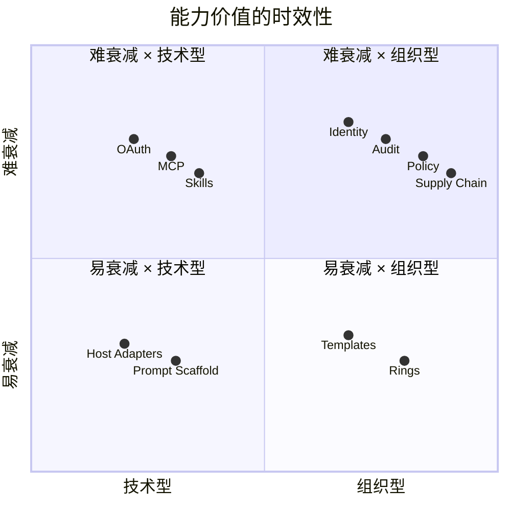
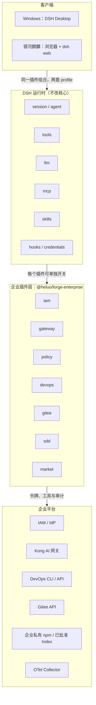

# 河洛企业级智能研发平台总体架构设计

## 文档信息

| 项 | 内容 |
|---|---|
| 文档编号 | CORP-DSH-ARCH-001 |
| 文档名称 | 河洛企业级智能研发平台总体架构设计 |
| 版本 | V2.6.0 |
| 文档状态 | 评审稿 |
| 密级 | — |
| 编制 | DSH 平台组（代拟） |
| 审核 | 待定 |
| 批准 | 待定 |
| 最后更新 | 2026-10-28 |
| 门禁 | G0 |
| 文档层级 | L1 总体架构；字段级契约与运行手册由子文档承担（见 §12） |

> 编制依据：原方案记载的 DSH `0.2.1-rc.2` 源码与官方文档核验，核验日期 2026-10-20。2026-10-21 用户确认 O3「企业 IAM 独占登录」，官方登录在企业内网不可用，§6 的 IAM seam 与官方行禁用关系已同步；同日本版按用户确认的 ADR-11/13 同步企业 npm 来源、AIHUB 原生索引与首版自包含三目标准入；市场接口在 DSH `0.2.1-rc.2` 下只读复核，形成正式技术方案而非企业生效批准；其余历史源码验证未重跑；企业 IAM / Kong / DevOps / Gitee 接口、Windows 安全隔离与银河麒麟实机、容量及恢复演练均未实测。2026-10-22 用户裁决：V1 模型网关凭据采用 UAG 标准产品的个人凭证（静态 Key），原 ADR-2 令牌直通不再作为一期目标，由 ADR-14 取代；依据为网关团队同日《客户端接入 AI 网关》分析稿（基线 UAG dev/2.2.1，所述代码行为，非承诺）。控制台签发、Kong key-auth、`privacy_mode`、SCIM/停用联动、容量与统计仍需联调核验。团队回函之前，协议能力、排期、保留期与验收阈值均不视为对方承诺。
>
> 关联文档：[河洛企业级智能研发平台推广实施方案](../plans/rollout-plan.md)（WBS、验收、风险与待确认事项）、[河洛企业级智能研发平台需求与场景基线](../requirements/requirements-baseline.md)（范围真源、人群画像、核心场景与成功指标）。

2026-10-21 仓库实现复核：市场插件及目录 HTTP 参考服务已有源码与本地测试；完整企业身份、来源/角色治理、持久化发布及双端交付仍未闭环。当前能力与历史测试 profile 记录见[根 README](../../README.md)和[设计索引](../design/README.md)。本文的方案与验收均为目标，不因局部实现自动判定门禁通过；本次未新增企业联调、双端或部署证据。

> 2026-10-23 当前目标：需求方已确认专用访问与生命周期边界，见[评审稿](gateway-identity-review.md)与 ADR-16；纯令牌/Key＋令牌待提供方能力与成本评审。旧 Key-only 决策作为历史保留，不代表新目标已实现或已获跨团队批准。

## 1. 背景与目标

企业研发体系由五个域组成，本方案回答的是“每个域用什么插件形态承接、边界在哪、失败时怎么办”。一期面向 3 个部门共 800 名研发人员（Windows 与银河麒麟 aarch64 各占 50%），采用“每人一套 DSH”形态落地。

| 域 | 现状 | 本方案的目标 |
|---|---|---|
| 身份与授权 | 自研 OAuth IAM，支持跳转登录 | 一次登录，DSH 内所有企业能力复用同一身份 |
| 模型与成本 | 自研 Kong AI 网关（对接机构内私有化模型） | 个人按可信当前身份授权，保留 Key 时归属一致；应用凭证受控开通；不持上游模型密钥计量限流 |
| 工程系统 | 自研 DevOps（API + CLI）、Gitee | 系统变更及独立验收为主、故事作背景；查询基线 + 受控研发写目标（待批/默认禁用），可追溯 |
| 研发流程 | oh-my-sdd 式重流程 | 只守三条不变量，流程由 skill 承载 |
| 分发与治理 | 无 | 私有市场、版本门禁、可回滚 |

**非目标**：多人共享单实例（多租户）、自建推理服务、替换 DevOps 平台、macOS 客户端、白标发行与公网暴露（完整范围边界以[需求与场景基线](../requirements/requirements-baseline.md) §2 为唯一真源）。

### 1.1 项目级判断与证据状态

**本版建议继续按既定单用户路线评审，不以“已有 OAuth / 已有网关”替代接入验证，也不以方案评审通过代替试点准入。** 需求范围、目标人群与 C1–C4 约束以[需求与场景基线](../requirements/requirements-baseline.md)为准；本文件只决定系统职责和跨域取舍，具体接口由 L3 团队契约承载。

| 内容类别 | 当前依据 | 评审时应如何使用 |
|---|---|---|
| 用户确认输入 | 3 部门 800 人、Windows / 麒麟各半、每人一套、网关与模型机构内私有化部署 | 作为范围输入；人数、设备与权限覆盖率尚未抽样 |
| 方案既有决策 | 模型经网关、DevOps/Gitee 优先复用既有 CLI，其他确需标准工具协议的接入才使用 MCP、流程用 skill、分发走内部源 | 保持本期路线；不表示各团队接口已具备或已签署 |
| 本版增补提议 | 安全依赖故障拒绝、分域责任、容量验证方法与回函闭环 | 进入评审与负向验收，由相应负责人签署后冻结 |
| 未验证输入 | IAM 多资源刷新、网关契约、DevOps/Gitee 授权、两端隔离、容量与支持能力 | 发函取得证据，完成联调/实机验证；缺失时按门禁阻断，不以推断补齐 |

### 1.2 路线取舍

一期沿用“本机单用户 DSH + 企业现有控制面”，不新建共享 AI 平台或替换研发平台。这一取舍复用现有身份、模型和工程授权，但把终端兼容、升级与支持留给项目承担，不能只计算插件研发成本。

| 路线 | 获益 | 主要代价 | 本期处置 |
|---|---|---|---|
| 本机 DSH + 企业插件/MCP | 保留本地工作区能力；复用现有平台的权限与账本 | 双终端适配、800 人分发与支持、单用户无共享会话 | 采用，受 G0–G3 逐级验证约束 |
| 共享 DSH 实例 | 集中运维，入口统一 | 需新增用户/会话/凭据隔离，扩大核心改造与责任边界 | 不采用，违反本期 N1 |
| 自建独立研发助手平台 | 可完全控制产品与流程 | 重建宿主、工具与分发，增加长期维护面 | 不采用，无已确认收益支持该投入 |

## 2. 设计原则

| # | 原则 | 理由 |
|---|---|---|
| P1 | **核心不改，能力全插件** | DSH 是 MIT，但 fork 核心会在每两周一个 rc 的节奏下持续失血；DevOps/Gitee CLI 接入不需核心补丁，其他 MCP 补丁须单独证明必要性并经范围评审 |
| P2 | **统一身份与专用访问** | 个人访问校验当前身份及 DSH 用途；应用 Agent 按应用/环境受控开通；两条个人路线待核验，不允许裸 Key 降级 |
| P3 | **策略下沉到工具管线** | 用 `tools/pre-execute` 与 `ctx.tools.guard()` 做硬门禁，不维护每宿主 hooks |
| P4 | **流程只守不变量** | 产物、冻结、原子 PR 三条不变量；不规定“必须先调哪个 skill” |
| P5 | **市场即策展，企业 npm 唯一制品源** | 企业私有 npm 同步公网包并承载内部定制包；AI 开发者平台（AIHUB）负责插件预创建、建仓、审查、发布 npm，并维护托管 format-1 索引；用户在 DSH 原生「插件市场 → 索引源」添加只读 URL，浏览后由官方 manager 安装精确版本。本项目只保留索引校验、契约与三目标验收，不建生成器、市场服务、写前授权或 CI 发布链路 |
| P7 | **复用企业既有资产** | 企业已有的 CLI、制品库、审批单与身份能力能覆盖的，不再自建服务或协议；能力细节不清时由对应团队补充说明，作为待确认项推进，不阻塞其余设计 |
| P6 | **能力可隔离，安全依赖不可绕过** | 一个能力一个 bundle 行；可选能力故障单独隔离，IAM、policy 或必要审计不可用时，拒绝依赖它的企业调用，不能靠禁用安全插件恢复业务 |

## 3. 复核与标准对齐

方案需同时适应两项变化：Harness 约每两周发布一个候选版本，模型约每半年更新一代。判断标准不是“当前可运行”，而是**能力增强时方案价值是上升、持平还是衰减**。

### 3.1 能力价值的时效性

| 能力 | 会衰减的部分 | 不衰减的核心 | 本方案的落点 |
|---|---|---|---|
| 登录 | 表单、页面、跳转细节 | 身份、同意、撤销、审计 | 标准 OAuth + claims；UI 可替换 |
| 模型接入 | 模型选择、prompt 技巧、参数调优 | 配额、成本、数据边界、审计 | 网关侧策略，客户端不内嵌 |
| 工具 | 工具数量、描述措辞 | 权限、数据边界、可追溯 | MCP 标准 + policy |
| 研发流程 | 环数、模板、编排顺序 | 产物契约、冻结、追溯 | skill 可随模型重写，契约在 CLI/CI |
| 分发 | 安装器、市场 UI | 供应链、版本、回滚 | npm + index 标准 |
| 策略 | 规则清单本身 | 决策点、fail-closed、审计 | host seam + 可配置规则 |



> 图：能力放在哪个象限，决定它随模型/宿主增强而升值还是贬值；本方案把投入集中在右上与左上。

三条判据：

1. **换更强模型是否需要改**：需要改的越少，价值越稳。因此 prompt 与工作流编排不进入“契约”，只放在 skill 里。
2. **Harness 升级是否需要改**：只依赖公开 seam（`tools/pre-execute`、`credentials`、`llm`、`mcp`、`skills`）的不用改；依赖内部文件路径或私有 API 的会碎。
3. **换一个宿主是否还能用**：`SKILL.md`、MCP 工具、OAuth token、OTel 事件都是跨宿主资产；宿主适配层不是。

结论：**把价值放在“组织事实”和“标准接口”上，不要放在“提示词脚手架”和“宿主适配”上。**

### 3.2 标准符合性

| 标准 | 要求 | 本方案 | 差距 / 决策 |
|---|---|---|---|
| OAuth 2.1（draft-15） | PKCE 必须；无 implicit / ROPC；redirect 精确匹配 | V1 机密客户端；PKCE 条件启用；公共客户端未确认 | IAM 6.0.3/6.3 不支持公共客户端/PKCE；需等效安全路径 |
| RFC 8252 | 原生应用用 loopback；优先 IP 字面量 | `127.0.0.1` 回调 | 禁用 `localhost` |
| RFC 8707 | `resource` 参数标识目标资源 | 改为按资源取 token | 依赖 IAM 支持 `resource` |
| RFC 9728 | HTTP MCP server 暴露 Protected Resource Metadata | 仅对后续经决策启用的 HTTP MCP server 适用；DevOps MCP 当前不建设 | 不纳入本期 CLI 接入 |
| MCP 2026-07-28 | HTTP server 校验 `aud`；stdio 从环境取凭据 | 按具体 MCP 集成形态适用；DevOps/Gitee 当前走 CLI | 不纳入本期 CLI 接入 |
| MCP client 注册 | Client ID Metadata 优先，DCR 已弃用 | IAM 预注册 client | 无 |
| Agent Skills | `SKILL.md` frontmatter、渐进披露、<500 行 | SDD skill pack | 用 `skills-ref` 校验 |
| OTel GenAI | `gen_ai.*` 语义约定（仍为实验） | 决策审计 + 用量 | 只依赖稳定子集，内容默认不采 |
| SLSA / npm provenance | 构建来源可验证 | 内部 CI 出 provenance | 一期目标 L2 + 白名单 |

### 3.3 复核结论与待确认项

1. **网关额度（已确认）**：企业自研的 Kong AI 网关已具备详细额度管理，且后端模型为机构内私有化部署；DSH 不在客户端做计量。2026-10-22 分析稿称 UAG 按团队、成员、个人凭证、Agent、Provider 设日/月预算，无按模型预算；预算语义、`reset_at`/`Retry-After` 与剩余额度查询仍需联调确认。`ai-proxy` 的 OSS / Enterprise 分层不再影响本方案。
2. **MCP OAuth 客户端能力（按需评估）**：DSH 的 `mcp-client` 没有 OAuth 客户端。DevOps/Gitee 已决策复用 CLI，因此不以 MCP broker 或 `dsh-mcp-client` 补丁作为其接入前提。若其他已批准的 MCP 集成需要按请求取令牌或凭据轮换，再由对应设计验证补丁必要性与范围。
3. **单一令牌的边界（已决策）**：RFC 8707 要求 token 绑定目标资源。一个宽 audience 的 token 会让泄漏半径覆盖所有服务，因此改为“一个会话 + 按资源签发”，同样约束本轮个人模型访问；资源登记方式按 IAM 实际能力确认，不能用 ID Token 或宽 audience 代替。

## 4. 总体架构



> 图：客户端 / DSH 运行时 / 企业插件 / 企业平台四层；插件层每格对应一个可独立开关的 bundle 行。运行时中未逐一展开的 `authorization`、`settings`、`webServer` 见 §5。

四条请求路径：

1. **登录**：浏览器 → IAM（授权码；V1 机密客户端，PKCE 条件）→ 本机回调 → Host 写 IAM 会话；网关目标授权的取用方式待核验。
2. **模型**：经核验的 DSH 凭据 seam 取得网关目标授权（A 纯令牌，或 B 令牌＋本人 Key）→ 网关验证当前身份、用途、网络、模型及预算 → 机构内私有化模型服务；具体承载尚未冻结。
3. **工具**：受控命令调用 DevOps CLI 或 Gitee `gh` 兼容 CLI → 工程系统 API；服务端按用户现有权限鉴权，每次工具调用先过企业策略插件。
4. **插件分发**：公网包由企业 registry 同步；内部定制源码从固定 Gitee group 经构建发布至同一 registry；AIHUB 维护 format-1 索引，终端在原生「索引源」添加该 URL，由官方管理器从企业 npm 取精确版本，禁止公网/归档备用路径。

### 4.1 系统责任与信任边界

企业授权、计量必须在对应服务端最终执行，客户端只负责携带身份、组织操作、提示确认并约束 Agent。用户具有本机管理员权限，因此 preset、工具描述或本机配置**不是防止用户自行绕过的企业安全边界**；其价值是限制 Agent 误操作与注入攻击，不能替代 IAM、网关和工程平台的鉴权。

| 系统/责任域 | 唯一负责的事实或控制 | 不承担的职责 | 关键失败边界 |
|---|---|---|---|
| IAM | 身份、资源授权、令牌生命周期与角色来源 | 不负责模型额度，也不等于本机 DSH 入口准入 | 不能取到目标资源有效令牌则不调用该资源 |
| AI 网关与模型服务 | 模型访问、个人/团队预算与限流、路由与正文日志边界 | 不让客户端维护第二份账本；不接收客户端自报身份作为授权依据 | 凭据、额度或日志控制不可用时按冻结规则拒绝，不回落公网模型 |
| DevOps 平台 | 服务端项目/环境只读授权与查询结果 | 不承担生产变更执行；不信任工具描述的只读标签 | 越权查询由服务端拒绝；CLI 命令面与输出由提供方确认 |
| Gitee | 仓库权限、用户凭据授权；内部定制源码 group/repo/commit 追溯 | 不承担统一插件包分发；源码读取与 npm 制品使用分别授权 | 凭据注入或源码授权未确认时不开放相应读取 |
| 企业 npm 仓库与发布方 | 公网同步、内部包发布、制品完整性/保留、其侧访问控制 | 同步不等于插件包名准入；可索引版本由 AIHUB 发布前策展；内部 scope 不得回退公网；不以拉取上游次数代表终端下载 | 缺包/无权/完整性或撤回后拒绝，不直连公网补洞 |
| DSH 与企业插件 | 本地交互、资源令牌引用、工具管线、沙箱、Agent 路径保护与决策事件 | 不是多租户服务，不是企业唯一授权点 | 安全依赖缺失时阻断相关能力，不静默降级 |
| 内部分发与 IT | 可信包源、构建证据、两端安装/更新/回滚通道 | 禁用市场工具不等于可阻止管理员自行安装软件 | 校验/兼容失败不安装；安全基线不符不准入企业资源 |
| 安全与观测平台 | 最小事件接收、访问控制、保留与异常响应 | 默认不接收会话、代码或模型正文；不做第二套成本计费 | 必要审计无法形成时拒绝相应企业调用；其他断链处置待安全确认 |

插件、MCP 响应、仓库内容、工具输出和模型输出均按不可信数据处理，不能借其中的“指令”改变授权或数据边界。工具的读写/环境属性必须由受控清单及参数校验确认；未知工具或环境无法判定时拒绝风险动作。

### 4.2 身份与会话生命周期

身份生命周期必须覆盖登录、刷新、切换账号、角色变更、离职撤权和退出，而不仅是“第一次能拿 token”。此处是安全行为要求，不预设 IAM 已提供全部接口。

| 事件 | 客户端行为要求 | 服务端/待确认边界 |
|---|---|---|
| 登录与按资源调用 | 只向目标资源发送其有效令牌；缓存与当前主体及授权上下文绑定；本轮个人模型网关同样在此列 | IAM 确认资源注册、scope、audience 与多资源刷新语义 |
| 刷新失败 | 区分网络故障与授权失效；无有效令牌即停止相应调用 | 锁内 ≤5 秒是网络请求超时目标，不是已测出的跨进程锁等待上界 |
| 切换账号或退出 | 清理令牌副本、按资源缓存与身份相关连接；旧账号请求不延续到新会话；已保存的网关 Key 绑定原主体，换账号不得沿用 | 默认只结束当前设备授权；本地立即停止/清理/取消，服务端接受撤销后五分钟内当前授权及刷新后代不能访问；不全局退出 SSO 或其他设备/应用；离线未确认需明示 |
| 角色变更、账号禁用或离职 | 不依赖旧 preset 继续授权；下次操作由服务端复核权限 | 从 IAM 实际停用或网关实际封禁起，五分钟内拒绝新模型请求，刷新不能延长；同步/缓存/容差计入，HR→IAM 上游时延另计 |
| DevOps/Gitee CLI 凭据轮换 | 通过经确认的用户级凭据机制生效，禁止把凭据写入模型上下文 | 由各服务团队确认 CLI 支持的凭据注入、刷新与撤销方式；不能假设通用 IAM token 可直接使用 |

## 5. 插件形态映射

下表区分 Host/Client 插件、配置组合及工具/技能/角色接入方式；CLI/MCP 是集成方式，不当作新的原生 Loader 包形态。企业能力须采用满足目标的最小扩展面。

| 形态 | 能力 | 何时用 | 本方案落位 |
|---|---|---|---|
| Host 服务插件 | 注册 Cordis 服务、Remote 方法、工具、策略 | 共享状态、原生能力或 UI 后端 | IAM、policy（含审计）、market 受管准入与更版协调 |
| Client UI 插件 | Slot 注册、登录态、设置卡 | 用户可见的交互 | IAM 账户菜单/登录页、market 薄交互 |
| 配置 bundle | 只改组合与配置，无代码 | 已有插件能满足 | gateway、brand；market 仅附组合配置 |
| CLI 工具接入 | 现有 CLI + 受控命令白名单 | 企业平台已有 CLI，结构化输出和凭据注入可满足需求 | DevOps、Gitee |
| MCP bundle | 每 server 一行 `dsh-mcp-client` | 提供方有 MCP 服务，或 CLI 不满足已确认前提 | 按具体集成决策启用；DevOps MCP 服务当前不建设 |
| Skill pack | `SKILL.md` + 资源，按需加载 | 流程知识与模板 | SDD |
| Agent preset | 角色化工具集与提示 | 不同角色的权限与工具不同 | 7 类角色 preset（开发 / 评审 / 发布 / 测试 / 运维 / PMO / 外包） |

原则：**能用配置就不写代码，已有 CLI 满足前提就复用；Host 只承载必要身份、策略及市场共用准入/状态协调。** 市场不复制官方安装器或 UI 框架，CLI/MCP 形态仍按 ADR-10 选择。

## 6. 软件包组合

| 包 | 形态 | 职责 | 依赖的 seam |
|---|---|---|---|
| `@heluo/forge-enterprise` | umbrella bundle | 组合下列行，给两端共用 | `cordis.patch.yml` |
| `@heluo/forge-iam` | Host + Client 插件 | 企业 IAM 独占登录、刷新、登录态与网关凭据录入、账户 UI；官方行由组合包禁用；MCP token broker 仅按后续获批集成需要评估 | `credentials`、`webServer`、`settings`、`llm-pi-ai`（消费方）、`agentDefaultModel`；`authorization` 仅作后续通用凭据 UI 适配 |
| `@heluo/forge-gateway` | 配置 bundle | 企业模型路由、白名单、重试策略 | `llm-pi-ai` |
| `@heluo/forge-policy` | Host 插件 | 工具门禁、路径规则、`$DSH_HOME` 硬拒绝、客户数据外发确认、决策审计 | `tools/pre-execute`、`tools.guard`、`otel` |
| `@heluo/forge-devops` | CLI 接入（工具面） | 复用 DevOps CLI，经白名单开放已确认的只读命令；不建设 MCP 服务 | bash seam、策略门禁、凭据注入、审计 |
| `@heluo/forge-gitee` | CLI 接入（工具面） | 复用 Gitee 的 `gh` 兼容 CLI，经白名单开放只读命令；不自建 MCP 或交叉编译 | bash seam、策略门禁、凭据注入、审计 |
| `@heluo/forge-sdd` | Skill pack + CLI | 产物契约、freeze/指纹、归档与 PR | `skill-filesystem`；路径门禁由 policy 执行 |
| DSH 原生插件市场 | DSH 内置 | 读取 AIHUB 索引、展示插件并调用官方 manager 安装 | `pluginMarket`、`pluginManager` |
| `@heluo/forge-brand` | 配置 bundle | 产品名、Logo、主题 token | `brand`、`client-ui-theme` |

组合方式：umbrella bundle 只做 `insert`，每个能力一行，配置上可独立 `disabled` 或覆盖；**可被关闭不等于关闭后仍保持依赖权限**。IAM、policy 和必要审计须在准入及每次相关操作时满足安全依赖检查，缺失则拒绝相应企业调用；安全检查的可执行性仍须在 G2 前通过负向验收。

## 7. 领域设计

### 7.1 身份与令牌

**登录基线**：企业 IAM 独占登录，系统浏览器、授权码 + loopback 回调；V1 以机密客户端 + 系统钥匙串落地，PKCE 仅在 IAM 书面确认且配置启用时使用；校验 state、nonce、issuer、audience 和适用签名/时效。公共客户端/PKCE 已由厂商回函明确不支持，目标 Access Token 能力仍待确认。ID Token 用于登录，不能代替模型 API Access Token。

**人员与授权**：IAM 给出可信稳定人员及目标授权；网关执行用途、模型、预算和网络策略。跨客户端 subject 不预设相等，账号重建/改名的映射由 IAM 与网关明确。DSH 默认 UA 的网关关键字匹配仅降低普通误用，不构成不可伪造的身份或撤销权限；可选诊断标识不参与授权，不要求硬件指纹、内置通用秘密或新增设备密码学体系，详见 ADR-18。

**存储与刷新**：系统凭据库保护 IAM 会话及可选个人 Key，秘密不进入上下文/日志；Key 不被 IAM 刷新覆盖。生产 OS provider 及双端保护以设计索引实测入口为准。现有 DSH 凭据 seam 的按操作解析与 `modifyRecord` 锁可作为接入依据，但不证明已支持目标资源令牌或双凭据承载。检查有效期、刷新、写回在锁内复核，进程内 single-flight；锁内网络超时 ≤5 秒为目标，不等于已测跨进程等待上界。

**退出与撤权**：当前设备退出先本地停止企业调用、清会话与运行时副本并取消本地在途连接，再按经核验机制撤销当前授权。默认不退出浏览器全局 SSO、其他设备或应用 Agent，不默认撤销长期个人 Key。服务端接受撤销（含异步入队）后五分钟内，当前授权全部已发/窗口内新发访问令牌及所有刷新后代不能继续新模型访问。离线只承诺本地即时退出，明确服务端未确认；安装 UUID 不能作为撤销授权。

IAM 实际停用或网关实际封禁后，新模型请求最迟五分钟内拒绝；刷新不得续命。总窗口包含同步、节点缓存、验证缓存与时钟容差，HR→IAM 同步另计。JWT 本地验签可以减少在线依赖，但本身不解决撤销。AT 格式、audience、验证方式和单授权生命周期的具体字段以提供方正式契约为准。

**依赖故障与在途调用**：只有仍有效、可验证且可守住五分钟撤权窗口的授权可继续；否则停止，不降级到裸 Key。已接收流可按已有截止时间结束，每次后续模型调用重新判断；本地取消不保证上游已停或零计费。未知结果、已执行或已输出的请求不自动重放。错误分类、恢复和参数见[网关契约](../contracts/gateway-contract.md)；不固定“所有 401 一律重建 Key”或“所有 401 一律刷新”。

DevOps/Gitee CLI 仍由各平台确认用户凭据，不因本轮网关变化自动接入 token broker。未来获准 MCP 保持独立资源授权义务；不以本轮为由实施核心补丁。IAM 待核验问题及原函覆盖判断见[专项问询函 §8](../collaboration/iam-confirmation-letter.md#8-本轮需求覆盖评估与补充确认清单平台内部)。

### 7.2 模型与成本

模型只经企业 AI 网关到机构内私有化模型服务；额度、计量与模型授权由网关承担，客户端不持上游模型密钥、不做第二套账。

个人候选 A 为纯令牌，候选 B 为 Key＋令牌；B 必须同时验证并比较人员归属，不是备用认证方式。成本接近时优先 A；B 只有显著降低总成本且达到相同安全目标时才采用。选路前核实无 Key 下预算/来源/C4 策略等效能力，以及双凭据在 DSH 的承载方式；不能预先断言只需配置或必须新增 Kong 插件。成本比较及待核验能力集中于[评审稿 §5—§6](gateway-identity-review.md)。

无人值守 Agent 复用网关可用的应用实体，按应用/环境受控开通；记录创建人、责任团队与当前责任人，可交接，运行时不要求创建人在线。DSH 交互式 Agent 属个人路径。应用凭证不能变成个人研发旁路，所有入口均执行用途及相应来源规则。

团队与成员预算必须在选定路线成立，多设备、换 Key 或刷新不能重置个人预算。现有 UAG 分析稿所述 Key 级授权、团队/成员额度、RPM/TPM、预算 429 等只作为现状证据；具体字段与错误不在 L1 复制，见[契约 §4.2—§4.4](../contracts/gateway-contract.md)。

个人可在企业最低要求上选择加严 IP；应用默认限定出口 IP/CIDR，例外审批。网关控制台负责凭证、审批、IP、责任归属与人工更换；DSH 只承载用户所需状态、录入（若 B）及链接。Agent 默认 90 天，更长审批，接受必要短维护窗口，不要求自动轮换平台或零中断。

C4 同时约束两类访问及两条候选路线。有 Key 时开启现有 `privacy_mode`；A 必须有无静态 Key 的等效策略，并抽验网关/模型日志不含正文。UAG 产品默认记录正文的现状不能被改写为默认关闭。用途、身份、撤权或退出关键能力不足时相应路径不开放，不能以缩短 Key 寿命、人工工单或 IP 规则代替。

### 7.3 工程系统工具

**输入与真源**：用户以显式 command/Skill 加系统变更号承接任务。DevOps 的系统变更有独立描述及验收，绑定一个系统与明确仓库；所属用户故事可跨系统。DSH 一次只承接一个系统变更，不能靠相似标题猜目标。正式要求与已确认业务澄清在 DevOps；工程 Issue、PR 与评审在 Gitee。

**CLI 优先，形态按职责组合**：优先使用提供方已有 CLI；Skill 承载最小企业指引，薄插件只补必要上下文、策略或人类展示，不能因为模型频繁调用就重写 CLI。命令清单、结构化输出、凭据注入、服务端鉴权、目标终端产物均待企业内网核验；不成立则关闭该动作，提交替代形态评审。MCP 仍为条件项，不自动启动服务或补丁。

**只读基线与受控写目标分开**：REQ-09/10 查询基线保留；[需求 §2.3](../requirements/requirements-baseline.md)完整承接澄清/进展回写、Issue/分支/提交/PR 关联、审查留痕和合入后关单的目标。范围、安全及接口未批准前写保持禁用；批准后普通研发写可在有限任务委托内自动执行，不将每步操作交回人工搬运。业务取舍和人工审查仍须真实确认。未登记或无法判定读写的动作一律拒绝。服务端按用户、项目、环境独立授权，客户端标签不扩大权限；受控清单由责任方登记，工具自报读写属性不可信。

**交付与边界**：简单变更可一个 Issue，复杂变更按真实交付边界拆分；相关提交以 `[变更号]` 开头。更强模型交叉审查后由人确认，正式记录落 Gitee PR 并绑定版本。相应验收与交付 PR 合入事实满足后才关 Issue；不自动合并、不代业务验收、不执行 CI 触发或生产变更、不调用故事/系统变更最终完成。CI/CD 的制品/UAT 事实优先从 DevOps 查询；最终结束由既有故事上线流程联动。

字段及失败语义见[工具契约](../contracts/engineering-tools.md)，能力地图、形态反例与开放决策见[跨模块设计](../design/plugins/forge-devops-lifecycle.md)。两者为草案，不是企业接口可用证明。

**MCP 身份处理**：V1 不启用 MCP。若后续获准启用，UAG 标准部署使用同一把个人凭据、以 `apikey` 头调用 `/mcp`，不提供按 `resource` 换令牌（RFC 8693 仅在 AIGS/AAM 启用时可用）；这与 A14 的目标资源隔离义务存在差距，须在 MCP 形态评审时单独裁决，不能把 UAG 现成能力写成已满足 A14。任何刷新都不得导致结果未知的写请求自动重放。DevOps/Gitee 当前 CLI 形态不依赖 MCP token broker 或 MCP client 补丁。

**MCP HTTP OAuth 义务**：任何经决策启用的 HTTP MCP server 均须按适用规范暴露 Protected Resource Metadata 并校验目标资源 audience；该义务仅适用于未来获批的 MCP，V1 不适用。DevOps MCP 服务当前不建设，Gitee 也不使用 `stdio` MCP。

**上下文预算**：已批准 MCP 的每个 server 工具数上限 12；不用的 server 在 preset 禁用。按任务提供企业规则，不全量灌入历史 Skill。

### 7.4 研发流程（SDD）

只保留三条不变量与一个状态字段：

- **一致性**：canonical spec 与代码不漂移（freeze、SHA-256 指纹、stale 传播、archive）。
- **原子性**：一次交付的 PR 同时包含实现、spec、归档。
- **可追溯**：`change-id` 贯穿分支、commit、PR、tracker。

形态：最小企业 Skill 指引 + 可复用的确定性校验 CLI/CI + `@heluo/forge-policy` 路径规则。分析、规划、实现、验证、修复方法交给模型与 Harness，不指定第三方 Skill 调用链、不预估新 CLI 行数，也不移植 Comet/oh-my-sdd Runtime。阶段元数据仅用于保护产物，不驱动固定对话顺序。

**路径规则**（由 `@heluo/forge-policy` 基于 `tools/pre-execute` 与 `tools.guard` 执行，不维护独立 hook 引擎）：`spec` 阶段只允许写 `openspec/changes/<id>/**`；`apply` 阶段 canonical `openspec/specs/**` 与 `proposal.md`/`design.md` 只读；`review` 阶段不再写源码。无 `.meta.json` 时只执行 HARD 规则，不阻塞普通开发。

技术问题修复应返回实现上下文，修复后重新交叉审查；不能在只读审查上下文绕过源码保护。旧工具的 PR 创建即最终结项动作不继承；业务结束不由 SDD 状态推断。

### 7.5 分发与治理

- **入口**：使用 DSH 原生「插件市场 → 索引源」，不要求客户端内置自定义市场插件；`@heluo/forge-enterprise` 仍按原发行方式预置。
- **索引来源与生命周期**：AI 开发者平台（AIHUB）维护并托管 format-1 索引 JSON，提供稳定只读 URL；插件预创建、Gitee 建仓、审查、npm 发布均由其负责。本项目只定义索引契约、提供只读校验器并做三目标验收，不生成索引、不写前授权、不承建审批后台。
- **制品源**：企业私有 npm 统一承载公网同步包和内部定制包，后者源码固定 Gitee group。首版索引只放**自包含、Windows/统信 UOS/麒麟三目标通用**的稳定版；普通外部 npm 运行时依赖不进入首版。同一 profile 绑定一个规范企业 registry 入口（内网 HTTP 例外），`fallbackRegistries: []`；包体、索引和展示资源均限内网。
- **终端基线**：Win10 amd64、统信 UOS 20 amd64 与银河麒麟 aarch64 三目标并存，UOS 与麒麟不是替代关系；私有 registry 入口仅存本地配置并在打包时内置，内网 HTTP 为已批准例外。
- **边界**：原生 format-1 只承载目录，不含 integrity、OS/CPU、policyRevision 或授权字段；索引可读即可安装。企业控制依赖 AIHUB 策展、Artifactory ACL/不可变与网络边界。原生源一旦开放，无法证明写前授权或全通道覆盖，因此不宣称 REQ-14/G2 通过；角色限制只能减少入口，不能当作硬隔离。
- **按角色分级权限**（对应[需求与场景基线](../requirements/requirements-baseline.md) §3.2 与 REQ-14）：全员禁止直连或回落公网源；`开发者` preset 允许安装 AIHUB 索引内的精确稳定版；只读类角色（评审、运维、PMO）及受限角色（外包 / 实习生）禁用 `plugin_manager` 工具。该限制只能减少入口，不宣称全通道硬隔离。

版本切换按原生能力处理；没有通用 upgrade 时先卸载再安装精确版本，不承诺原子升级、自动回滚或保留原排序。无 HMR 的启动包按官方停机/CLI/重启路径处理，不私改 profile。方案、索引契约与验收见[轻量决策](<plugin-registry-source-decision.md>)、[插件设计](<../design/plugins/forge-market.md>)及[索引契约](<../design/services/market-index.md>)。

### 7.6 审计、可观测与数据合规

**过程观察投影**：由 `forge-policy` 既有 OTel 出口补平台不可见的最小事件，不新建采集包/服务。[事件契约](../contracts/metrics-events.md)与[目录](../design/plugins/forge-devops-lifecycle.md) §9 为唯一字段/口径来源；指标可独立关闭或降级，必要安全审计失败仍按原安全规则拒绝相关动作。内容及其哈希不进入指标；既有安全审计的参数哈希不得复制为效能事件字段。

**C3 调整提案**：现行跨系统写一律 ask 的规则仍有效。为实现有限委托内普通研发写自动执行，需安全团队批准明确的动作/资源/版本分类；批准前保留 ask 或关闭写，不能用入口确认代替全部跨系统确认。业务决策、正式人工 review 及高风险动作不因分类而消失。


- **决策审计**（`@heluo/forge-policy` 直接发 OTel event）：`sub`、`change_id`、`tool`、`decision`、`reason_code`、`latency`，不记参数正文，只记参数哈希。
- **会话审计（C2）**：`session-log` 通道含正文与代码，默认关闭，不落安全事件平台（SIEM）；确需开启时先做脱敏与保留期评审。
- **客户与生产数据保护（C1 / C3 / C4）**：
  - **C1（机构边界）**：网关与模型均为机构内私有化部署，客户与生产数据不出机构边界。
  - **C3（外发确认）**：`@heluo/forge-policy` 对涉及批量导出、归档外发或跨系统写入的操作强制转为 `ask` 人工确认。
  - **C4（服务端日志）**：UAG 产品默认记录请求/响应正文；河洛使用的每个个人凭证必须在创建/更换时开启 `privacy_mode`，并由安全抽验网关与模型日志不含正文（详见 [AI 网关契约](../contracts/gateway-contract.md) §4.5）。
- **成本审计**：以网关的团队与成员计量为准；DSH 侧只记调用次数与失败率。
- **保留期（待批准）**：180 天仅为决策审计与网关计量元数据的建议值，不是现行制度；安全与数据责任方须在 G2 前确认字段最小化、访问权限、具体期限及删除证据。批准前不开启正文采样，且不得按未批准期限启动正式试点。

## 8. 关键契约

| 契约 | 规则 |
|---|---|
| `ENTERPRISE_STATIC_KEY` | 模型网关个人凭据引用；由 UAG 控制台签发，用户录入/更新；不随 IAM 刷新；消费方不得缓存跨请求 |
| IAM access token | 仅保存在 IAM GrantRecord，用于身份/账户与未来按资源调用；V1 不镜像为模型网关凭据 |
| claims | `sub` 必填；`aud` 必须包含目标服务；`groups` 映射 7 类角色 preset，缺失时按最小权限（受限只读）处理 |
| `resource` / `aud` | MCP HTTP token 绑定 server 的 canonical URI；broker 缓存键为 `(resource, scope)`；server 必须校验 `aud` |
| 额度错误 | `429`；预算 body 含 `reset_at`，RPM/TPM 含 `Retry-After`；不要求 `problem+json` / `quota_scope` / `quotas`；`401` / `403` / `400` 按 UAG 语义分流 |
| OTel 字段 | 只用稳定的 `gen_ai.*` 子集 + `corp.sub` / `corp.change_id` / `corp.decision`；内容属性默认不采 |
| MCP 工具名 | `mcp__<server>__<verb>_<noun>`；只读与写操作（`mutating: true`）在描述中显式标注；生产写工具不在接入范围（N9） |
| 策略决策 | `allow` / `ask` / `deny` + `reason_code`；`$DSH_HOME/**` 硬拒绝（`deny`）；异常一律 `deny`（fail closed） |
| bundle manifest | `dsh.bundle.patch` 必填；`engines.dsh` 声明兼容区间；peer 依赖精确到 rc |
| 配置键 | 统一 `corp.*` 前缀；敏感值只放凭据引用，不进 YAML |

## 9. 安全设计

**信任边界**：用户意图 → 不可信上下文/模型输出 → DSH 策略与工具子进程 → 企业网关/工程平台。Host 是目标中的受控执行组件，但“同一 OS 用户”不证明进程或插件可信；本机管理员可修改客户端，因此企业服务端始终独立鉴权。凭据文件 0600 不能隔离同用户 Agent，必须通过文件工具控制、子进程沙箱、秘密最小暴露与短期授权共同减灾；两端覆盖未经实测前不得宣称已实现硬隔离。

| 威胁 | 处置 |
|---|---|
| Prompt injection 诱导越权查询或外发数据 | 受控只读工具清单 + 服务端独立授权；C3 外发转 `ask` 确认；策略插件 fail closed |
| Agent 读取凭据并经内网工具（如评论接口）外传 | 目标为文件工具拒绝 `$DSH_HOME/**`，命令子进程通过经验证的沙箱/等效隔离阻止访问；不能靠命令字符串匹配证明安全。Windows 与麒麟都须验证符号链接、编码命令、环境继承及子进程绕过，未通过则不开放对应工具。网关个人凭据为长期 Key，泄露后可用至撤销或到期；以每设备一把、90 天有效期、系统凭据库、`privacy_mode` 与撤销审计减灾。共用 Key 的用量仍归 `owner_user_id`，无法区分实际使用者，须在开通规范中禁止转借。 |
| 客户与生产数据外泄 | 网关与模型机构内私有化部署（C1）；客户端禁配其他模型路由；批量导出/外发触发 `ask` 确认（C3）；河洛使用的网关凭据开启 `privacy_mode` 并抽验服务端不含正文日志（C4） |
| 恶意插件 | 私有 registry + 包名白名单 + checksum + 受限角色禁用 `plugin_manager` |
| 供应链（依赖/构建脚本） | 锁定 lockfile、禁 `postinstall`、CI 重建、镜像内预构建；发布带 npm provenance（SLSA L2），安装校验 checksum 与白名单 |
| 越权读仓库 | Gitee/DevOps 侧按 token scope 限制；DSH 不自行扩权 |
| 审计缺失 | 决策与调用双路 OTel；缺 `sub` 视为失败并告警 |

安全控制不得依赖 Agent 自觉遵守：工具描述中的 `mutating` 只用于发现和说明，受控工具清单、参数/环境校验、服务端授权才是决策依据。必要审计无法记录时拒绝相应企业调用；模型/只读事件在观测链路中断时能否采用有界缓存、缓存满后的行为与恢复时限，须安全团队在 G2 前批准，未确认不能默认丢弃或无限放行。

## 10. 部署拓扑

| 端 | 占比与规模 | 安装 | 运行 | 更新 |
|---|---|---|---|---|
| Windows | 50%（约 400 人） | MSI（用户自助安装为主，MDM 推送可选） | DSH Desktop + `desktop` profile | 官方 feed 或内部 feed |
| 银河麒麟 aarch64 | 50%（约 400 台） | deb + 内部 apt 源（自带 Node 24 与预构建 profile） | `systemd --user` 常驻（严格绑定 `127.0.0.1`）+ `.desktop` 调用 `dsh-web-open` 包装脚本读取本机 launch URL 打开浏览器 | apt + 版本门禁 |
| 内部服务 | — | — | Registry、Index、Kong、IAM、OTel Collector；DevOps MCP 为条件项，当前不建设 | 各自发布 |

麒麟不在用户端编译：`node-pty` 等原生模块在 arm64 构建机预编译后打进 deb。沙箱按 P0 结论三选一（bwrap / Landlock / 自定义 runner），由于麒麟占试点终端的一半（约 400 台），P0 麒麟实机验证为试点准入硬门禁。

### 10.1 容量、性能与投入边界

800 人是试点覆盖规模，不是已知并发数，也不是网关容量验证结果；目前不具备承诺时延、吞吐或资源预算的证据。容量由网关/模型服务负责，终端资源与安装由平台组/IT 负责，PMO 与业务确认可接受阈值，试点前以同一负载口径验收。

| 评估面 | P1 必须取得的基线 | G2 前必须冻结的判断依据 |
|---|---|---|
| 模型调用 | 代表性上下文与输出规模下的首 token/整次耗时、并发、错误/429/取消行为，区分网关和模型 | 角色/部门的预期活跃与峰值假设、按模型的容量/限流策略、业务可接受阈值；不能凭800人直接推算 |
| 工程工具 | 只读查询测服务端耗时、超时、错误分类与分页/限流 | 超时与无法确认未执行时的处置；不能用客户端自动重试掩盖未知结果 |
| 终端与分发 | 两端安装、启动、原生模块、沙箱和升级回退样本 | 支持的 OS/CPU/浏览器矩阵、离线安装能力、失败设备隔离与支持容量 |
| 资源与总投入 | 平台组 2–3 人为既有估算，不含其他团队等待、基础设施和试点支持 | IAM/网关/DevOps投入、ARM构建资源、签名/内部源/监控/支持成本是否复用及负责人；无证据不宣称零成本 |

若未取得性能目标和容量证据，只能报告“测得基线，阈值待定”，不能通过 G2。性能阈值不在本文发明数字，由 `CONF-GW` / `CONF-IT` / `CONF-PMO` 回函回写。

### 10.2 运行保障与故障域

每人一套减少跨用户会话混用，但企业 IAM、网关、内部源和工程平台仍是共享依赖。故障由所属服务团队恢复，平台组负责客户端定位与用户指引，安全事件优先止损；详细值班与恢复步骤由运行子文档承担。

| 故障域 | 高阶处置要求 | 不允许的“恢复方式” |
|---|---|---|
| IAM/网关不可用 | 显示可归因错误；IAM 会话保留至原到期，网关凭据按自身到期/撤销状态处置；按已冻结规则退避 | 共用他人网关凭据、延长 token、静默切换公网模型 |
| 工程系统只读查询失败 | 显示可归因错误并按冻结规则退避，不把失败当授权通过 | 关闭服务端授权或用客户端标签绕过校验 |
| 终端或安全插件异常 | 隔离失败能力/设备；恢复受支持的整套发布基线并重测 | 关闭策略、沙箱或审计继续保持生产权限 |
| 审计或敏感数据事件 | 保全最小证据、暂停风险操作、撤权/吊销并由安全组织处置 | 为排障长期采集正文、在工单中粘贴真实凭据 |

## 11. 版本与兼容性管理

- **锁版本**：一期兼容目标固定 DSH `0.2.1-rc.3`（版本单一真源为仓库根 `.dsh-version`；rc.2→rc.3 的安装/升级/回退/卸载循环已实测，见[设计索引 §2.2](<../design/README.md#22-实现与验证入口>)）。内部兼容性套件（登录、模型、工具、SDD、市场）**尚未开跑**，其结论是 G1 的输入，届时回写 §2.2。由于终端以用户自助安装为主，客户端启动时检查最低兼容版本门禁。
- **标准漂移**：OAuth 2.1 仍是 draft，MCP 规范按日期发版；兼容性套件里固定规范版本（PRM、`resource`、`aud`），规范升级时先跑套件再放行。
- **内部包**：SemVer；`engines.dsh` 写区间；host 插件与 client 插件同版本发布。
- **通道**：`internal`（默认）与 `canary`（灰度）；可选插件故障可单行回滚，身份/策略/审计相关回滚须同时检查依赖与服务端兼容，不能恢复到缺失强制控制的版本。
- **发布单元**：记录 DSH、企业插件、策略、MCP、skill 与两端 profile 的版本组合、校验与兼容证据；不仅锁单个包。首次安装、升级失败、回滚和停用安全插件都纳入负向回归，演练通过后才声明可回滚。
- **上游**：仅在未来 MCP 补丁经单独评审批准后才提 PR；若获批且上游暂未合入，再评估内部维护带补丁版本。当前 DevOps/Gitee CLI 接入不产生此补丁需求。

## 12. 交付组织与职责

下表为责任分配提议，不代替团队认领或批准。A=该项最终负责，R=实施/提供证据，C=协作评审，I=知会；每项只有一个 A，G0 由 PMO 落实实名负责人，审核与批准栏仍保持待定。将 IT 与 PMO 分开，避免把终端交付和业务验收混为一项。

| 工作 | DSH 平台组 | IAM | 网关/模型 | DevOps | Gitee | 安全 | IT | PMO/业务 |
|---|---|---|---|---|---|---|---|---|
| IAM 协议、资源注册与撤权 | C | A/R | C | C | C | C | I | I |
| IAM 客户端插件与凭据生命周期 | A/R | C | I | I | I | C | C | I |
| 网关契约、容量与日志控制 | C | C | A/R | I | I | C | C | I |
| DevOps CLI 只读命令与查询接口 | R | C | I | A/R | I | C | C | C |
| Gitee 授权契约 | R | C | I | I | A/R | C | I | I |
| Gitee CLI 只读命令与 SDD 包 | A/R | I | I | C | C | C | I | I |
| 策略、安全基线与审计要求 | R | C | C | C | C | A | C | I |
| 终端打包、内部源与支持通道 | R | I | I | I | I | C | A/R | C |
| 批次、指标、投入与试点去留 | R | C | C | C | C | C | R | A |

### 12.1 子文档清单与责任

本文只保留跨域决策；下列子文档由对应团队补充，字段级契约与操作步骤以子文档为准。

| 子文档 | 必须包含 |
|---|---|
| IAM 接入 | 端点、claims、资源/client方案、TTL与撤销；按阶段冻结并留未验清单 |
| 网关契约 | 个人凭证、归属、团队/成员预算、429与C1/C4；保留期、故障和容量单独签署 |
| 麒麟验证 | 实测输出、沙箱候选、runner方案与原生模块清单；工程化再验 |
| DevOps CLI 接入 | 系统变更及独立验收、故事背景、字段/身份；受控澄清/进展写的范围、C3 分类、版本与回查；CLI 不足时另评替代形态 |
| Gitee CLI 接入 | CLI 版本、aarch64产物、用户凭据；查询与常规 Issue/分支/提交/PR/评审写分别列清单，核验 C3、确认和回查 |
| 策略与审计 | 7 类角色 preset、`$DSH_HOME` 硬拒绝、客户数据外发确认（C3）、决策 schema、保留期 |
| 分发与市场 | registry 与 index、通道、兼容门禁、回滚步骤 |
| 终端打包 | MSI 自助安装/MDM、deb/apt/`systemd --user`（`127.0.0.1`）与 `dsh-web-open` 脚本、更新回滚 |
| SDD 流程 | skill 结构、CLI 命令、policy 路径规则、CI 校验、产物契约 |
| 试点推广 | 3 部门 800 人批次（建议分两批各 400 人）、M1–M3、M5–M6 指标、支持渠道、退出条件 |

子文档按 [_template.md](../templates/_template.md) 规范编写，结论先行；主文档不复制子文档细节，只在决策变化时回写。上表各子文档的负责方与门禁以[文档清单](../DOCUMENT-REGISTER.md)为唯一真源，本表不复制。

**阶段门禁**：G0–G3 的定义、证据包与签署角色见[推广实施方案](../plans/rollout-plan.md) §4.6；本文件不重复。

### 12.2 门禁证据与决策权

第 1/5/9/15 周是依赖及时到位时的工程基准，不是已承诺日历日期；任何阶段等待、返工、容量整改或错峰试点窗口不足，均需 PMO 重排并保留原因。L1/L2 冻结是方案基线，不意味着 L3 未验接口或团队承诺已生效。

门禁的证据包、证据负责、拟签署角色与"未关闭时的动作"以[推广实施方案 §4.6](../plans/rollout-plan.md)为唯一真源；本文件不复制该表（原表内容已并入）。

范围变更批准者、每道门禁最终签署人均由 `CONF-PMO` 回函明确，未落实实名不得代签。若接口或安全能力不支持既定方案，应先形成替代方案及影响评估；涉及需求/范围变化由批准者决定，不由某一团队回函自动改变。

### 12.3 发函、回函与基线闭环

跨团队确认按 IAM、网关/模型、DevOps、Gitee、IT、安全、PMO/业务七域分别组织，并使用 `CONF-<域>-*` 问题 ID 跟踪。回函经核验后写入对应 L3、WBS 与验收证据，不另设字段契约真源；未回函不视为同意。

处理顺序为：发函并登记 → 对方认领 → 逐项回函并提供脱敏证据 → 平台与责任团队核验/联调 → 更新对应 L3 → 影响跨域决策时更新本文件与 ADR → 按门禁签署。回函“支持”但无证据仅算收到答复，不算关闭；替代能力需重新核验，无回函不视为同意。提议的认领/初答时限由发函人填写，不能替代门禁截止。

G0 先取得方向、负责人、可联调性与计划，但 P0 要求的验证必须真正完成；DevOps/Gitee 详细契约在 G1 关闭，运行安全参数与试点准入在 G2 前关闭。每条遗留项记录问题 ID、结论/限制、证据、负责人与承诺时间、影响需求/WBS/验收、关闭门禁；“待确认”不是默认已支持。

## 13. 验收标准

完整验收矩阵（`A1–A14`）见 [推广实施方案](../plans/rollout-plan.md) §7；其中架构治理与标准符合性的三项核心判据如下：

| # | 验收项 | 判据 |
|---|---|---|
| A12 | 插件隔离与回滚 | 可选能力单独禁用不影响无依赖能力；IAM/policy/必要审计关闭或故障时，相关企业调用被拒绝；受支持组合回滚 ≤10 分钟 |
| A13 | 审计完整性 | 按需求基线与完整验收矩阵核对模型事件与工具调用归因，要求字段缺失为 0；最小必要审计与C4在G2前已就绪，G3完成完整性评估 |
| A14 | 标准符合性 | 授权码 + loopback IP（V1 机密客户端；PKCE 条件）；未来 HTTP MCP 按目标资源绑定令牌并校验 aud（resource 或经确认的 audience/client 替代）；HTTP server 暴露 PRM；未来 MCP 的 401 刷新与安全重试仅限可安全重试的只读请求，无法确认未执行时不自动重放；本轮网关目标授权、人员/用途及五分钟生命周期按契约核验，不能裸 Key 降级；无法确认未执行不自动重放 |

> A14 的 MCP 目标资源绑定是未来 MCP 集成的前提；V1 不启用 MCP；本轮网关目标授权也需验证，不能用现成个人凭据或控制台 OIDC 宣称 A14 已满足。

## 14. 架构决策记录

| # | 决策 | 被否方案 | 后果 |
|---|---|---|---|
| ADR-1 | 每人一套 DSH | 共享实例多租户 | 少 8–12 人周，但无法团队共享会话 |
| ADR-2 | 令牌直通网关（历史决策，已被 ADR-14 取代） | 客户端换发 API Key | 2026-10-22 起不作为一期目标；UAG 数据面不验 IAM JWT |
| ADR-3 | 外部系统用 MCP，策略用原生插件（历史决策，接入形态由 ADR-10 修订） | 全部原生 / 全部 MCP | 保留工具协议解耦原则；DevOps/Gitee 当前按 CLI 优先 |
| ADR-4 | `tools/pre-execute` + `guard` 做门禁 | 每宿主 hooks.json | 一条策略路径；不维护独立 hook 引擎 |
| ADR-5 | 必装走 umbrella bundle，可选走市场 | 全部走市场 | 首次可用不依赖网络；市场只治理增量 |
| ADR-6 | SDD 做 skill 包，不做产品 | 五环七层产品 | 维护面小；流程强度靠 `@heluo/forge-policy` 路径规则补 |
| ADR-7 | 一期默认官方 App，不白标 | 本期直接自建白标发行 | 与需求基线N3一致；G0确认现有路线，确需白标走范围变更与单独立项，不靠开放问题自动扩大范围 |
| ADR-8 | 一个会话、按资源取 token | 单一宽 audience token | 泄漏半径小；优先resource，不支持时由IAM确认按audience/client替代，仍保持目标资源隔离 |
| ADR-9 | 安全依赖不可绕过，确认不可用即拒绝（新增提议） | 禁用policy/审计后继续调用；approval=never视为自动确认 | 明确本机管线防Agent误用与服务端最终鉴权分工；G2增加安全插件关闭、无确认UI与绕过负向验收，可能增加跨端验证投入 |
| ADR-10 | DevOps 与 Gitee 复用已有 CLI 作为工具面；仅在 CLI 无法满足已确认的必要能力时，另行评估 MCP | DevOps 自建 HTTP MCP、Gitee 复用 `mcp-gitee` 并交叉编译 | 减少自建服务、协议适配和麒麟端编译维护；依赖 CLI 的稳定结构化输出、凭据注入和双端可用性核验；细节不满足时先关闭相应命令，再提交形态变更评审 |
| ADR-11／13 | [企业私有 npm 唯一制品源 + AIHUB 原生 format-1 索引](<plugin-registry-source-decision.md>)；不再建设生成器/current/写前授权 | 自建生成器与发布控制；把纯包名名单当索引 | AIHUB 维护并托管索引；本项目只做契约、校验与三目标验收；企业源与三目标安装仍需验证 |
| ADR-12／13 | [首版仅自包含、三目标通用稳定包](<plugin-registry-source-decision.md>)；单 profile 单规范 registry，原生索引源 + 官方移除后安装（用户于 2026-10-21 选择轻量方案） | 仅固定根版本却终端重解外部依赖；同 profile 混源；把官方安装称原子升级 | 首版只放自包含三目标稳定版；不建生成器/写前授权/租约，不宣称全通道；普通带依赖包属后续扩展，生产准入仍需 G1/G2 |
| ADR-14 | 历史决策；当前目标由 ADR-16 修订。2026-10-22 采用 UAG 个人凭证（静态 Key）接入模型网关；企业 IAM 只负责登录与身份，网关凭据由 UAG 控制台签发并录入客户端 | 要求 UAG 新增数据面 JWT 验签、把令牌直通作为一期目标 | 客户端持有长期 Key；需 SCIM/停用流程、`privacy_mode`、TTL 与容量证据；原 JWKS/introspection 增量不再适用 |
| ADR-15 | 企业研发能力按职责组合，受控写完整设计、未批不启用 | 固定 Skill 链、重造 CLI/MCP、将工程交付等同故事结束 | 需求方已确认产品方向；C3 分类、企业接口和宿主能力待安全及提供方核验；见需求 §2.3 与 DESIGN-013 |
| ADR-16 | 个人访问验证当前人员及 DSH 用途，应用 Agent 受控开通；五分钟撤权与当前设备授权退出；个人 A 纯令牌 / B Key＋令牌按能力及成本选路 | Key-only＋IP 代替人员认证、应用凭证作为个人通用旁路、默认全局 SSO 登出 | 需求方已确认；技术路线、字段及提供方能力待核验，成本接近优先 A；不默认新增硬件证明或轮换平台；见[评审稿](gateway-identity-review.md) |
| ADR-17 | V1 IAM 登录采用预注册机密客户端 + 系统钥匙串，PKCE 仅条件启用 | 硬等公共客户端/PKCE 才上线；或把共享 secret 当作强客户端身份 | 这是对 OAuth 2.1/RFC 8252 的已知偏离，不是安全等价：共享 secret 无法对使用者隐藏。仅作有期限过渡；P0 未完成 secret 生命周期、平台 keychain 与回调精确匹配前不得扩量；见 DESIGN-002 §4.5 |
| ADR-18 | 采用 DSH 默认 `User-Agent`，由网关按 DSH 标识关键字匹配；不改 DSH 核心、不通过插件改写 UA | 定制固定 UA、客户端全局拦截或本地转发改写 | 需求方于 2026-10-28 确认；避免维护宿主网络拦截，但默认 UA 可变化且不能区分河洛定制，可被仿冒；关键字与网关支持、各入口及代理链路待确认，不替代 ADR-16 当前人归属。取值与验收见[标识设计](../design/client-identification.md)和[网关契约](../contracts/gateway-contract.md#41-身份用途与凭据) |

ADR-11 的来源方向及 ADR-12 的自包含三目标首版策略已由用户确认；2026-10-21 用户进一步决定采用 ADR-13 轻量模式：AIHUB 维护并托管 format-1 索引，用户在原生「索引源」添加 URL，官方 manager 安装。本项目不再建设生成器、`current/policy/evidence`、CI 单写发布、15 分钟租约或写前授权；只保留索引契约、只读校验器与三目标验收。2026-10-22 用户裁决采用 ADR-14：UAG 个人凭证为 V1 模型网关凭据，ADR-2 令牌直通退出主路径。2026-10-23 需求方补充确认 ADR-16，Key-only 不再满足当前目标，具体路线仍待评审。其余团队接口、生产准入与本文件审核/批准不据此代签。 2026-10-28 增补 ADR-17：在 IAM 6.0.3/6.3 明确不支持公共客户端/PKCE 的约束下，V1 采用机密客户端过渡；该偏离的威胁模型与门禁见 DESIGN-002 §4.5，不能据此宣称登录安全已闭环。

## 15. 风险登记

| 风险 | 等级 | 处置 | 负责 |
|---|---|---|---|
| 麒麟沙箱 fail closed（影响 50% 约 400 台终端） | 高 | P0 实机验证前置为准入项；预装 bwrap 或自定义 runner | 平台组 + 安全 |
| 上游 rc 节奏导致插件失效 | 高 | 锁版本 + 兼容性套件 + 内部镜像 | 平台组 |
| `node-pty` arm64 现场编译失败 | 高 | arm64 构建机预构建，deb 内带 `node_modules` | 平台组 + IT |
| 800 人自助安装支持比过高（约 1:300） | 高 | G0 复核支持人力；必要时将 800 人拆为两批各 400 人进场，并内置安装自检与版本门禁 | PMO + 平台组 |
| 凭据文件（含 `refresh_token`）被 agent 读取并经内网工具外传 | 高 | `@heluo/forge-policy` 对 `$DSH_HOME/**` 硬拒绝 + 沙箱遮蔽挂载 + 短 TTL 与可撤销令牌 | 平台组 + 安全 |
| 白标与官方更新策略冲突 | 中 | 一期官方 App；白标单独立项 | 产品 |
| UAG 个人凭证的安全与运维风险（Kong 明文、手工轮换、401 不细分、SCIM 依赖） | 高 | 核验 A/B 身份与用途、单授权及刷新后代撤销、五分钟端到端保证；使用 Key 时另评 DB/备份风险及 C4；不以工单代替上限 | 网关 + IAM + 安全 + 平台组 |
| DevOps/Gitee CLI 凭据注入与身份映射未确认 | 中 | G1 前分别核实 CLI 的认证、授权、刷新与撤销；未确认的命令保持禁用 | 平台组 |
| 标准漂移（OAuth 2.1 / MCP） | 中 | 兼容性套件固定规范版本；升级先跑套件 | 平台组 |
| 将preset或本机配置误当不可绕过企业授权 | 高 | 服务端独立验权限/环境；本机管线只作为Agent控制层；两端安全依赖关闭与绕过负向测试 | 各服务团队 + 安全 + 平台组 |
| 容量、观察窗口或支持能力未经确认就承诺15周 | 高 | P1取得测量基线，G2前冻结阈值与批次支持，末批窗口不足则重排并停止扩量 | 网关/模型 + IT + PMO |

## 附录 A 仓库结构

以下为实施后的**目标布局（2026-10-20 设计快照）**，与实际目录不完全一致：当前 `packages/` 已有多个可运行包与测试、`services/market-index` 有只读校验器。逐包实现与验证状态见[设计索引 §2.2](<../design/README.md#22-实现与验证入口>)；本仓库仍处于方案评审与开发骨架阶段，尚未形成产品发行版。

```text
heluo-forge/
├─ packages/
│  ├─ forge-enterprise/   # umbrella patch
│  ├─ forge-iam/           # host + client (企业登录、网关凭据录入；MCP broker 按需评估)
│  ├─ forge-gateway/      # bundle only
│  ├─ forge-policy/        # host plugin (含门禁、$DSH_HOME 保护、SDD 路径规则与审计)
│  ├─ forge-devops/        # existing CLI + read-only command allowlist
│  ├─ forge-gitee/        # gh-compatible CLI + read-only command allowlist
│  ├─ forge-sdd/           # skills + CLI
│  ├─ forge-market/       # index + registry
│  └─ forge-brand/        # brand tokens
├─ profiles/
│  ├─ desktop/
│  └─ web/
└─ ci/
   ├─ compat.yml
   └─ market-index.yml
```

## 附录 B 插件组合示例

以下保留 2026-10-22 Key-only 及更早 MCP 的历史概念组合，不体现 ADR-16 的当前目标；不能据此开放调用。当前目标须在 G1 能力/接口确认后重新冻结配置。以下为历史示意，**不是已核验可直接安装的生产配置**。拟议企业包配置与 auth broker 扩展需在实施前对照锁定版本的真实 schema/接口验证；`maxRetries: 0` 表示不自动重试，具体边界仍须实测。UAG 个人凭证由控制台签发、用户录入，示例不表示控制台、模型白名单或日志策略已联调；Windows/麒麟插件可用性也须按回函调整，本文不据示例宣称这些能力已存在。

```yaml
# packages/forge-enterprise/cordis.patch.yml
- insert:
    - id: corp-iam
      name: '@heluo/forge-iam'
      config:
        issuer: https://iam.corp.example
        clientId: dsh-desktop
        scopes: [openid, profile, offline_access]
    - id: corp-policy
      name: '@heluo/forge-policy'
      config:
        failClosed: true
        rules: enterprise
        denyPaths: ['$DSH_HOME/**']
    - id: corp-gateway
      name: '@deepseek-ai/dsh-llm-pi-ai'
      config:
        providers:
          corp:
            displayName: 企业 AI 网关
            api: openai-completions
            baseURL: https://ai-gateway.corp.example/v1
            apiKeyEnv: ENTERPRISE_STATIC_KEY
            retryPolicy: { mode: normal, maxRetries: 0 }
            models: [{ id: corp-chat, name: 企业对话模型, contextWindow: 131072 }]
    - id: corp-devops
      name: '@deepseek-ai/dsh-mcp-client'
      config:
        serverName: devops
        transport: streamable-http
        url: https://devops.corp.example/mcp
        # 需 @corp 的 mcp-client 补丁：按请求向 IAM broker 取该 resource 的 token
        auth:
          type: broker
          resource: https://devops.corp.example/mcp
          scopes: [devops.read, devops.write]
    - id: corp-market
      name: '@deepseek-ai/dsh-plugin-market'
      config:
        indexes: [https://plugins.corp.example/index.json]
```

> 本文件为 Design，解释“怎么搭、为什么这样搭”；排期与验收执行以关联 Plan 为准。

## 附录 C 术语与缩略语

| 术语 | 全称 / 说明 |
|---|---|
| 河洛 / Heluo Forge | 河洛企业级智能研发平台；工程标识 `heluo-forge`，基于 DSH 与企业插件体系构建 |
| DSH | DeepSeek Harness，本方案的宿主运行时 |
| IAM | 企业统一身份认证系统 |
| PKCE | Proof Key for Code Exchange（RFC 7636） |
| MCP | Model Context Protocol |
| PRM | OAuth 2.0 Protected Resource Metadata（RFC 9728） |
| ADR | Architecture Decision Record，架构决策记录 |
| SDD | Spec-Driven Development，规格驱动开发 |
| WBS | Work Breakdown Structure，工作分解结构 |
| SSO | Single Sign-On，单点登录 |
| 个人凭证 | UAG 控制台签发的静态 Key，按设备一把；绑定到 `owner_user_id` 与团队 |
