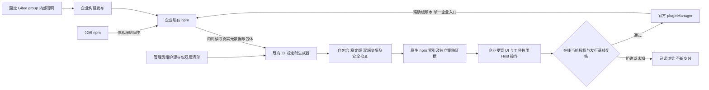

# 插件市场决策：双层 npm 白名单与自动版本索引

## 文档信息

| 项 | 内容 |
|---|---|
| 文档编号 | CORP-DSH-ARCH-004 |
| 文档名称 | 插件市场决策：双层 npm 白名单与自动版本索引 |
| 版本 | V1.0.1 |
| 文档状态 | 评审稿 |
| 密级 | — |
| 编制 | DSH 平台组（代拟） |
| 审核 | 待定 |
| 批准 | 待定 |
| 最后更新 | 2026-10-21 |
| 门禁 | 正式技术方案；G1 接入与发行基线核验，G2 安装开放验证 |

> 编制依据：2026-10-21 用户确认企业私有 npm 为统一制品源、registry 地址与精确插件包名两层白名单、名单内兼容稳定版自动检查收录、终端禁止公网；内部定制源码固定于企业 Gitee group。用户在审查整改中进一步选择“首版限定自包含、双端通用包”，并授权修订、发布正式版本方案。本文承载 ADR-11 的来源决策及 ADR-12 的首版准入、安装恢复边界；不重新询问已确认方向。
>
> 核验依据：2026-10-21 只读核对当前 DSH `0.2.1-rc.2` 的 `pluginMarket`、`pluginManager` 接口、随包说明与插件开发规范；Node 24.21.0 / pnpm 11.28.5 隔离复现证明精确根版本不固定传递依赖。该 DSH 版本是接口核验基线，不自动成为获批企业发行版本。未做企业 registry、Windows/麒麟安装与运行验收。
>
> 关联文档：[需求基线](<../requirements/requirements-baseline.md>)、[总体架构 ADR-11/12](<platform-architecture.md#14-架构决策记录>)、[市场插件设计](<../design/plugins/forge-market.md>)、[索引生成契约](<../design/services/market-index.md>)、[企业 npm 接入](<../../deploy/registry/README.md>)、[Gitee 源码问询](<../collaboration/gitee-market-clarification.md>)、[历史调研](<plugin-market-research.md>)。

## 0. 三分钟读懂

| 问题 | 答案 |
|---|---|
| 决策 | 企业 npm 为唯一制品源；管理员批“源 + 精确包名”；CI 自动检查稳定版 |
| 首版收什么 | 自包含、Windows／麒麟双端通用、稳定 SemVer 的根版本 |
| 首版不收什么 | 外部运行依赖、单平台、预发布、终端脚本/编译；这些只是首版排除，不是 DSH 非法 |
| 安装怎么走 | 写前在线授权 → 官方 manager 精确版本 → 需更版时“移除后安装” |
| 谁负责 | 管理员管名单，平台管基线，CI 管生成与发布，企业 registry 管包体 |
| 现在状态 | 技术方案评审稿；代码仍是 Gitee 参考实现；企业接入与双端未验 |

**一条链**：名单 → 自动生成 → 索引与证据 → 在线授权 → 官方安装。

**读法**：只看边界读 §1、§6；要接入读 §4、§5、§10；要验收读 §9。字段与流程细节不在本文重复，见 [DESIGN-012](<../design/services/market-index.md>)。

## 1. 结论与发布状态

**管理员只维护企业 registry 地址与精确插件包名白名单；系统自动检查自包含、双端通用的稳定 bundle，生成原生 npm 索引及独立证据，受管入口在线复核当前授权后交官方管理器安装。**

正式技术方案以评审稿交付，不代签企业审核/批准，不代表安装功能已实现、企业服务已接入或 G1/G2 已通过。当前代码仍是 Gitee 归档参考实现。业务代码、配置、测试、运行 profile 与部署资产不因文档发布而自动变更。

不新建 PostgreSQL、逐版本审批后台、下载鉴权代理、另一套安装器或复杂安装 journal。市场管理员不手录版本、摘要或逐版签字；不合首版规则的候选自动排除并提供原因。

## 2. ADR-11 与 ADR-12 的职责

- **ADR-11 保持有效**：企业私服同步公网并存储内部定制包；只有内部定制源码须固定 Gitee group/repo。公网镜像包不必复制进 Gitee。用户 DSH 不访问公网 registry、Git、tarball 或其他公网插件服务。
- **ADR-12 明确首版边界**：只收自包含、Windows/银河麒麟双端通用稳定包，同一 profile 只使用一个规范企业 registry 入口；版本切换采用官方移除后安装，授权离线或失效即拒绝新写。
- 普通 npm 运行时依赖、独立平台包及平台 optional 依赖不因符合 DSH 格式便进入首版；它们不被认定为 DSH 非法，仅列为后续范围扩展，不能作为本版自动降级路径。
- 内部构建和 npm 发布属于既有企业 CI/发布流程；市场生成器读取实际发布包，不承担源码构建、制品托管或包体改写。

## 3. 目标链路

优先复用受控 Git 清单、既有 CI 与内部 HTTPS 静态托管。图示均为目标；企业字段、生成协议及原子发布规则唯一真源在[索引生成契约](<../design/services/market-index.md>)，不向原生 schema 增加未知门禁字段。

## 4. 管理职责与首版准入

| 对象 | 维护责任 | 约束 |
|---|---|---|
| registry 地址白名单 | 管理员/企业仓库维护方 | 规范企业 HTTPS URL 与标识，不含凭据；不因 package 自报 URL 扩大 |
| 插件包白名单 | 市场管理员 | 精确 npm 包名到 registry 标识的唯一映射，不用 scope 通配，不逐版审批 |
| profile 与目标矩阵 | 平台发行/终端维护方 | 一个 profile 绑定一个规范 registry 和一份锁定目标矩阵；非管理员日常版本清单 |
| 候选、索引与诊断 | 自动生成器 | 稳定根版本自动检查；默认最新合规稳定版，保留仍合规历史版用于恢复 |
| 完整性与来源 | 生成器、registry、内部发布方 | 核验真实包体；定制关联 group/repo/commit/构建，镜像保留 upstream/扫描/许可 |
| 下载与发布凭据 | 企业 npm 及既有安全体系 | 分别最小授权、轮换撤销；不进入清单、URL、日志或模型上下文 |

**自包含的判定以真实 npm tarball 为准：**

1. 不存在会导致终端另行解析取包的 `dependencies`、`optionalDependencies`、`bundleDependencies` 或 `bundledDependencies`；相应声明须不存在或为空。已编入包内的产物与 Node 内置模块可用，但不能依赖终端补包、编译或外部 CDN。
2. `devDependencies` 只服务上游构建；普通 `build`/`test` 脚本存在不等于终端会执行，不据此误拒。安装会触发的生命周期脚本、隐式 native 构建和终端编译则拒绝。
3. peer 只允许目标 DSH 已提供、公开且经矩阵核验的基线，禁止自动补装 peer。Client 的 React 等由 DSH 模块表提供；新增未核验运行时 external/CDN 依赖不支持。
4. 对相同根版本、包体与目标 DSH 基线，首版不再需要终端重解外部 npm 运行时闭包；仍须核对 profile 的既有依赖/锁、受管配置及运行基线，不能忽略遗留浮动依赖。

静态与装载检查不证明插件所有功能无缺陷或代码绝对无害；发布信任、企业安全检查及终端网络边界仍独立成立。

## 5. 自动稳定版本与双端交集

- 源和精确包名均命中清单；从指定企业源获取真实 name/version、包体、bundle patch、Host/Client 入口及 `engines.dsh`/适用 peer 约束。
- 根插件版本必须是有效稳定 SemVer；`latest`/`next` 或版本范围不能代替选定精确版。宿主 rc 按官方兼容规则核验，不因宿主 rc 允许插件预发布，也不沿用旧近似解析器。
- 首版统一索引采用**全目标交集**：同一候选必须覆盖锁定 DSH、Windows 与银河麒麟 aarch64 的发行矩阵；缺一端证据不收录，不靠原生索引不存在的 os/cpu 字段补救。Windows CPU/发行参数由 G1 核定，不在本文臆定。
- 结构、入口与矩阵 smoke 可由 CI 自动执行，不要求每版人工双端签字；发布包的实际形态而非源码仓库形态接受校验。
- 不自动批准脚本或版本豁免。隔离/撤回版本不得因再次扫描而复活；失败候选保留可解释诊断，不回退公网、Gitee 或旧归档安装器。
- 同名同版本对应同一包体，禁止覆盖或按平台返回不同 digest。包内已构建的双端资源必须随同一包体受检，不能在终端补下载。

## 6. 单源 profile、当前授权与强制边界

1. 一个 profile 使用一个规范企业聚合 registry，官方 manager 的 `fallbackRegistries` 为空；管理员名单可包含不同环境入口，但同一 profile 不跨 registry 混装。这样避免当前官方管理器已知的跨源锁文件/重启移除问题；确需多源必须另行评审并实证。
2. 写开启前核验 profile manifest/lock 一致、既有依赖已纳入发行基线、无未受控 pnpmfile/override/配置覆盖，peer 不自动补装且不自动放行构建。存量配置不自动清理；不满足时保持只读。
3. 每次受管安装、升级或回退写前，在线读取可信 HTTPS 当前策略控制元数据，不使用浏览缓存授权。控制许可自生成起最多 **15 分钟**，既有 CI 每 **5 分钟**轻量复核当前输入并续期，不重跑完整候选扫描；续期失败自然到期只读。准入决定到期取“本次在线判定后 **60 秒**”与控制许可到期的较早者；过期、变更、时钟异常、不可达、身份/角色未知均重新判定或拒绝。GET 成功不能使旧静态许可永久有效。
4. 清单撤销、风险版本与发布代次独立于浏览缓存 TTL。旧列表、旧确认框、pnpm 缓存和索引恢复都不能新授予权限；目录可显示过期数据，但新写必须拒绝。
5. **原生索引筛选不是强制白名单。** 受管 UI/工具共用 Host 操作；原生任意 spec、本地路径/Git/tarball、其他市场、CLI、角色及撤回通道须按声明范围负向验收。未具备等价控制则市场保持只读，不能以隐藏菜单、禁某一个工具或杜撰全局 SDK hook 代替授权。
6. 网络、企业 registry 的逻辑视图/ACL 与既有终端措施承担其可证明的物理边界。终端无公网回退，内部 scope 缺包不得代理到公网同名包；不承诺防恶意本机管理员。

这些规则是正式方案的准入条件，不是企业现有产品能力已验证的声明；无法满足时不以缩减安全目标自行通过 REQ-14/G2。

## 7. 版本切换、失败恢复与退出

- 首次安装、启用保存、Host 激活、Client 可用分层观察。pnpm exit 0、文件落盘或变化事件不等于整体成功。
- 当前官方管理器在 HMR 下拒绝直接覆盖已装包；通用市场不提供原位升级 API。受管 Host 采用**移除旧版 → 安装精确目标版**，保存原启用意图，披露重新选入末尾可能改变层优先级。
- 移除前复核目标及当前允许的旧版恢复资格；移除失败即停。移除成功后安装失败、取消或授权变化时，显示“旧版已移除/需要恢复”，不得谎称旧版仍运行或自动循环重装；恢复也须使用当前准入的精确旧版。
- 无 HMR 的启动包、管理组件等不能在线安全移除的对象，按官方停止/CLI/重启流程处理或拒绝该路径，不私改 profile 或锁文件。
- 请求失联先用官方运行中结果与 inventory 核对；查不到结果不证明失败或取消，保留 pending/unknown。只重投结果，不因丢回报重放安装。不为此引入复杂持久化 journal。
- 授权判定点是提交官方 manager 的每个写调用前；移除后的新安装必须重判。调用提交后发生的新撤回不承诺可原子拦截 manager 内部提交，可取消阶段尽力取消，再核对实际状态并处置风险；不把新策略发布当成已撤销运行中的所有操作。
- 下架、停止收录、取包阻断与已安装风险处置分开；不承诺删索引或 npm deprecate 会自动卸载已装代码。

## 8. 发布、资源与快照恢复

- 内部定制及本插件发布核验 en/zh `meta.title`/`meta.description`、授权图标、对应 `exports` 与 `files`，并读取实际 npm 包验证运行文件、patch、语言和图标闭包。本地 link 成功不能代替 tarball 验收；第三方缺显示资源可以明确 fallback，不自动判 DSH 非法。
- 原生索引的图片只采用获准内网同源/相对静态资源或省略；浏览器图片不受 pnpm registry 控制。生产 registry、索引、策略和资源使用可信 HTTPS/企业 CA，不关闭证书验证；HTTP loopback 仅用于隔离测试。
- 原生 format-1 无 `integrity`、目标矩阵或当前授权字段；这些属于独立生成证据/控制产物，不自创字段冒充官方能力。当前 pnpm 对显式精确 spec 已实测保存精确根版本，不能把“未传 saveExact 必然存范围”当缺陷。
- 同环境/矩阵由单一可调度 owner 写入，长矩阵子任务不能阻塞每5分钟的授权复核/续期；发布前重新核对最新受控输入与当前代次，只有自身续期可按契约更新候选预期代次，陈旧任务不得覆盖删除包后的新结果。完整候选快照校验完成后原子切换，分步读取跨切换时按摘要/版本不一致拒绝并重取。
- 恢复历史产物先按**当前**名单、风险和矩阵重验证，再产生新代次；不回退当前安全许可。删除包/风险隔离应先关闭相应新安装，不等待长扫描形成无限撤权窗口。

## 9. 验收与实施准入

字段和逐项断言分别由[索引生成契约](<../design/services/market-index.md>)及[插件测试矩阵](<../design/plugins/forge-market.md#11-测试与验收>)承载，以下为跨域关闭条件。

| 场景 | 必须结果 | 责任与门禁 |
|---|---|---|
| 名单内自包含双端稳定包/新稳定版本 | 自动检查收录、精确版本、无逐版人工审批 | 平台组；G1 规则，G2 实测 |
| 浮动或精确外部运行依赖、自动 peer、终端构建、单平台包 | 首版排除并给原因，不把它们称为所有 DSH 的非法格式 | 平台组；生成器验收 |
| 同 profile 混源、未获准包/源、插件预发布版 | 拒绝，不换源或宽化权限 | 平台/仓库方/安全；G2 |
| 旧列表、离线、超过 60 秒、撤权后旧确认及缓存命中 | 可浏览但新写拒绝；策略变更重判 | 平台/安全；G2 |
| 慢旧任务晚于删除包的新任务、恢复旧快照 | 不恢复撤销，新代次/当前许可有效 | CI/分发维护方；G2 |
| 已装包升级/回退、移除失败、新安装失败/取消 | 正确两步、启用/层顺序说明、旧版已移除状态和合规恢复 | 平台/IT；G2 基础演练，A10 完整验收 |
| 公网图标/资源、实际包缺入口或内部显示资源 | 外网 URL 排除/省略，实际包校验失败不发布 | 平台/发布方；发布前 |
| 原生/UI/工具/CLI/本地 spec 或角色控制覆盖不足 | 保持只读，不宣称全通道治理或 REQ-14 达标 | 平台/IT/安全；G2 |

## 10. 企业接入事实与当前实现

| 尚需企业证据 | 责任方 | 关闭要求 |
|---|---|---|
| registry 产品/规范入口、同步留存、包体不可变、scope 权威解析、ACL 与撤权 | 仓库维护方、IT、安全 | G1 契约，G2 越权/缺包/恢复证据 |
| DSH/Node/pnpm/SDK、Windows 参数及麒麟矩阵、受管 profile 基线 | 平台发行方、IT | 生成器开启前锁定；双端入口与生命周期实测 |
| CI 串行/陈旧发布拒绝、HTTPS 静态托管/CA、原子切换与当前授权读取 | 平台组、既有 CI/分发维护方 | G1 接入实现，G2 故障/撤回演练 |
| 下载/发布认证、角色、凭据生命周期、最小日志与支持岗位 | 仓库维护方、安全及平台组 | 安装开放前确认责任和可观察证据 |
| 定制 group/repo/commit 与发布来源关联 | Gitee/内部构建发布方 | 定制包准入前核验，不请 Gitee 代批 npm 权限 |

[历史调研](<plugin-market-research.md>)保留社区/官方取证，但其 Gitee 统一制品源、逐版本审批、PG/自有取包控制面及通用 tarball 源不是首版默认方案。当前插件及 HTTP 服务仍按自有 JSON/Gitee 归档协议运行；旧错误码、字段、历史测试和计数保持参考语义，不能原地改名冒充 npm 支持。

下载统计为可选扩展：终端 tarball、上游同步、metadata、索引访问、安装与激活分开；pnpm 缓存不是新下载。源码 star 未知不当 0，公网包不伪造 Gitee 映射，不为热度另建数据库作为前置。正式技术方案发布不改变上述实现与实测边界。
