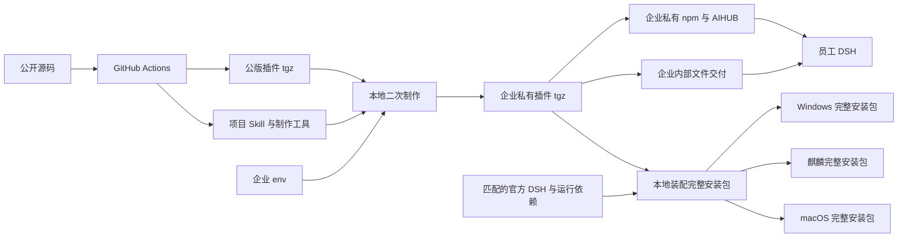

# 公版插件、企业私有包与完整 DSH 安装方案

## 文档信息

| 项 | 内容 |
|---|---|
| 文档编号 | CORP-DSH-ARCH-006 |
| 文档名称 | 公版插件、企业私有包与完整 DSH 安装方案 |
| 版本 | V0.4.0 |
| 文档状态 | 草案 |
| 密级 | — |
| 编制 | DSH 平台组（代拟） |
| 审核 | 待定 |
| 批准 | 待定 |
| 最后更新 | 2026-11-10 |
| 门禁 | 完整方案待用户确认；企业接口与目标平台待实测 |

> 编制依据：当前用户于 2026-11-10 确认本方案的公版、私版与完整 DSH 安装包形态、目标架构、制作和使用角色、制包机系统、Skill 标准化范围、配置归属及凭据更新目标，范围见 §1；不表示完整技术方案已经批准。2026-11-10 静态核对本仓库工作区、Agent Skills 规范及相关官方文档；未读取真实企业配置、连接企业系统或构建发布制品。现有代码状态以[设计索引 §2.2](<../design/README.md#22-实现与验证入口>)为准。
>
> 关联文档：[需求与场景基线](<../requirements/requirements-baseline.md>)、[总体架构](<platform-architecture.md>)、[企业插件制品源决策](<plugin-registry-source-decision.md>)、[企业组合包设计](<../design/plugins/forge-enterprise.md>)、[IAM 机密认证契约](<../contracts/iam-client-auth-isolated.md>)、[工程开发与发布约定](<../engineering/development-conventions.md>)。

## 1. 目标与范围

GitHub Actions 以公开源码生成一个包含目标平台所需组件的公版 DSH 插件 `.tgz`。公版及其公开附属物不包含企业私有地址、企业共享密钥或个人信息。制包人员在本地取得公版，以仓库外的企业 `.env`、符合 Agent Skills 标准的项目级 Skill、手册和脚本制作跨平台企业私有插件包，并将该私有包与匹配的 DSH 运行时装配成各目标平台的完整安装包。员工可选择在已有 DSH 中安装企业插件，或直接安装已集成企业插件的完整 DSH；两种路径均无需员工输入企业统一配置。

当前用户确认的需求如下；确认人是项目负责人（当前用户），确认日期为 2026-11-10，适用范围仅限本方案，不等同批准完整技术方案：

| 事项 | 已确认目标 |
|---|---|
| 公版 | 一个跨平台 DSH 插件 `.tgz`，通过公开 GitHub Release 提供 |
| 私版 | 一个覆盖目标平台、预置企业非个人配置的企业组合插件 `.tgz`，支持企业私有 npm / AIHUB 和企业内部文件交付 |
| 完整 DSH | 为各目标系统和 CPU 架构提供完整安装包，内含 DSH 和已接入的企业组合；安装后可启动使用，不要求员工另装 DSH 或手工安装企业插件 |
| 公开 Release | 提供公版插件与版本匹配的制作工具；不提供公版完整 DSH，所需官方宿主作为制包输入另行取得 |
| 制包机 | 在制包人员的 macOS 上二次制作；不要求制作工具在 Windows 或麒麟上执行 |
| 企业配置 | IAM、网关等企业统一信息以及共享 `client_secret` 由本地 `.env` 提供，不放入公开仓库或公版 |
| 个人 Key | 不放入企业 `.env` 或企业包；员工首次登录后自行录入，绑定可确认且地址不变的更新保留；历史绑定无法确认时一次性重录 |
| 网关更换 | 新包切换企业网关地址，要求用户重新录入个人 Key，不自动把旧 Key 发送到新地址 |
| IAM secret 轮换 | 新包携带更新后的共享 secret；允许员工重新登录，员工不输入该 secret |
| Skill | 制作端的项目级 Skill 和员工端已有研发 Skill 均符合 Agent Skills 标准；制作 Skill 面向兼容该标准的助手，员工使用 DSH |
| 目标平台 | Windows x64 / ARM64、麒麟 x86_64 / ARM64、macOS Intel / Apple 芯片；真实安装与运行须分别验证 |
| Web 形态 | 麒麟使用官方 DSH Web 版和桌面入口，通过浏览器使用；Windows ARM64 也允许采用 Web 形态 |

制包机器和员工终端是不同角色：在 macOS 上制作的一个私版插件包仍须保留全部目标组件；完整 DSH 安装包按目标系统和架构适配，同一安装包经验证可覆盖多个架构。用户已确认企业完整安装包可以携带并在企业内部再分发匹配的 DSH 运行时；本方案不要求修改 DSH 核心或维护 DSH fork。当前实现与本方案不同，完成设计、实现与验收前不能把上述目标描述为现有能力。

## 2. 角色、制品与信任边界

| 角色或制品 | 责任与边界 |
|---|---|
| 公版构建 | 以指定公开版本构建闭包、自带目标组件并核验公开制品；不读取企业 `.env` |
| 制包人员 | 下载公版、制作工具与匹配的官方宿主输入，提供企业配置，交互确认必要参数，生成并核验企业插件包与各目标完整安装包 |
| 员工 | 按授权使用已有 DSH 的企业插件，或安装已集成企业插件的完整 DSH；按需录入个人 Key，不负责企业地址或共享 secret 配置 |
| 公版 `.tgz` | 中性可定制基础制品，缺少企业配置时不能伪装成已接入企业环境 |
| 私版 `.tgz` | 注入企业配置后的新制品，保留目标平台组件及包依赖闭包；按企业内部渠道交付 |
| 完整 DSH 安装包 | 按目标平台携带匹配的 DSH、可分发运行依赖与同一版本的企业私版插件；仅经企业内部渠道交付 |
| 制作工具 | 与公版版本对应的项目级 Agent Skill、SOP、可执行脚本和占位模板；作为 Release 附属资源提供，不要求先取得完整源码 |

公版包含全部目标平台组件，制作脚本仅需在制包人员的 macOS 运行；包内组件是否能在员工终端上使用，仍须按目标平台分别实测。公开 GitHub Release 会附带源码归档；仓库当前源码、历史、Release 资产、日志和缓存的敏感内容需分别评估。通用扫描不能证明未知的企业命名均被发现。

已有 DSH 的插件安装须遵守现行角色策略：有插件管理权限的用户可自行安装；受限角色需要通过已验证的管理员或受管理预置路径取得插件，不通过放宽 `plugin_manager` 权限来交付。公开下载不自动授予使用或再分发许可：公开发布前须明确并记录本项目公版插件及制作工具的许可和允许的使用范围；在作出决定前不预设开源许可。

终端门禁约束受支持的产品流程，不能防止同权限 JavaScript 或本机管理员绕过进程内检查；企业服务端必须独立鉴权。完整包不得把本地检查描述为对同权限进程的隔离。

共享 `client_secret` 按用户目标进入私版及携带该私版的完整 DSH 安装载荷。任何能够读取这些载荷的人都可能提取其中的共享 secret；平台受保护的凭据后端可以保护运行期副本，但不会消除安装包中的副本。该事实不改变用户已选的免输入交付方式。按 [RFC 8252 §8.5](<https://www.rfc-editor.org/rfc/rfc8252.html#section-8.5>)，分发给多个用户的静态 secret 不能作为客户端机密性证明。

## 3. 配置分类与交互

| 输入类别 | 内容与映射 | 缺失处理 |
|---|---|---|
| 基础制品 | 公版文件、来源、版本及可核对摘要；制作完整安装包时还需匹配目标平台的 DSH 和运行依赖 | 文件、架构、兼容关系或核验不匹配时停止 |
| 输出信息 | 企业包和完整安装包版本、输出目录、目标平台及能力配置 | 必填项缺失或目标文件已存在时停止 |
| IAM 企业配置 | 可信 `issuer`、`clientId`；标准发现地址或明确的授权、令牌与 JWKS 端点；回调路径、端口与地址族；客户端认证方法和共享 secret | 本企业采用 `confidential` 模式；缺失必填字段或 issuer 不一致时停止；Basic／Post 以企业端实际支持结果选择，不回落 public |
| 网关企业配置 | 企业网关地址及所启用能力需要的默认配置 | 目标能力启用且配置缺失时停止 |
| 其他企业配置 | 企业统一且与个人无关的已启用能力配置 | 按能力检查；未启用能力不强加字段 |
| 个人数据 | 个人 Key、账号、个人 token、密码 | 不作为企业 `.env` 或私版输入 |

上述为字段类别，不声明现有 `.env` 键名或运行时映射已经实现。可提供仅含示例占位符的 `.env.example`；真实 `.env` 位于仓库外，由制作脚本作为数据解析，不使用 shell `source`、`eval` 或把原文件整体打入插件。配置转写使用结构化编码，禁止依赖全局文本替换。不同能力的非个人企业值与每台机器的程序路径分别处理。

使用 OIDC Discovery 时，发现文档的 `issuer`、用于构造发现地址的可信 issuer 和 ID Token 的 `iss` 必须精确一致，见 [OIDC Discovery §4.3](<https://openid.net/specs/openid-connect-discovery-1_0.html#ProviderConfigValidation>)；不允许仅以不受信任的发现地址替代 issuer。企业端若不符合标准，须记录实测兼容缺口并另行评估，不能静默跳过校验。生产回调须明确 `redirectPath`、固定或动态 `callbackPort` 和 IPv4 / IPv6 策略，分别核验 IAM 注册规则及 Desktop、Web 的回环回调。[既有口头转述](<../collaboration/iam-confirmation-letter.md>)称支持 IPv4 动态端口，但没有配置样例或端到端实测；IPv6 另行核验。

Skill 引导助手确认公版及 DSH 版本与摘要、企业版本、输出位置、目标平台与能力和必填字段是否已提供；值可由脚本校验，但不将 secret、完整地址或 `.env` 内容放入 Agent 上下文、命令参数、日志、错误或公开报告。用户明确确认已汇总的必要参数后才生成；取消或校验失败不输出被标为成功的包，也不覆盖已有文件。真实 `.env`、包含企业配置的暂存文件、私版插件与完整安装包均置于仓库外，按平台使用受限制的文件权限；成功前只原子落位工具自身创建的临时文件，失败只清理本次运行可确认归属的暂存，不清理用户已有数据。

## 4. 公版构建与本地二次制作

### 4.1 公版与企业插件包

公版构建复用现有企业组合包的依赖闭包与原生组件核验，增加明确的中性配置入口和公版检查。公开 Release 除一个插件 `.tgz` 外，须提供版本匹配、可独立取得的 Skill／脚本／SOP 与公版摘要；这些资源不属于员工安装单元。制作流程须在没有源码工作区时验证 Skill 的发现和脚本调用。Release 生成的源码归档与插件 `.tgz` 分别检查。

制作资源展开后保留 `.agents/skills/heluo-forge-release-bundle/` 及其相对脚本、手册路径；SOP 说明如何从该工作目录加载 Skill，并说明不同助手的发现方式可能有差异。真实 `.env` 与私版不放进制作资源归档；验收须检查隐藏的 `.agents` 目录确已随资源交付。

建议以明确的发布 tag 为工作流入口，按 tag 指向的公开提交构建并通过检查后上传 Release 资源；公开构建不接收企业 `.env`。工作流使用固定版本的 Action 与最小必需权限，原生组件按已固定的来源、摘要和许可证核验。发布失败不得将不完整资产报告为成功；触发公开发布和实际远端状态按已授权的发布操作分别核验。

二次制作必须读取并核验**实际下载的公版**，而不是以制包人员当前源码或 Git 工作区代替。制作人员从已知项目的公开 Release 取得目标版本及摘要，并独立确认来源；只拿到一个与包同处的不可信摘要时不能把它当成来源证明。离线验证需事先通过可信渠道取得预期摘要或可验证证明。制作器只需在 macOS 执行，只修改约定的配置和私版清单位置；其余文件的内容、可执行位、各目标平台原生组件、许可证、依赖闭包和宿主元数据应保持一致。读取归档时拒绝越界路径、重复路径及未允许的链接类型；写出前检查产物结构与完整性。

公版和私版是不同字节的制品。制作完成后，从私版实际文件重新生成私版摘要与清单；记录公版版本和摘要、制作工具版本、企业包版本及私版摘要，不记录配置值。校验和证明字节一致性，不单独证明制作者身份；公版发布来源可按需要增加可离线核验的制品证明。同名同版本必须对应同一制品摘要；配置、公版或制作工具变化导致字节变化时均须使用新版本。面向企业索引的版本按既有稳定 SemVer 规则分配；离线制作只能得到候选版本，私服发布和文件交付前分别核对实际发布记录与版本冲突。

现有企业包清单为 `private: true`，标准 npm 发布会拒绝该标志，即使目标是私有 registry。企业发布需设计生成物清单与私服目标约束，或验证企业制品库的导入方式；不改变源码包清单的既有保护来假装发布已打通。现行制品源决策允许内网 HTTP；若实际通过 HTTP 传输私版，其包体和所含共享 secret 在该链路上不受 TLS 保护，实际传输路径及企业措施须核验。见 [npm package.json 文档](<https://docs.npmjs.com/cli/configuring-npm/package-json/#private>)。

### 4.2 完整 DSH 安装包装配

制作人员以已核验的企业插件私版和匹配的 DSH 上游发行物为输入，在本地制作完整安装包。宿主输入从官方可核验渠道取得，固定来源、版本、目标平台及摘要；公开 Release 不代为提供完整 DSH。每个安装包携带对应 DSH、企业插件及可再分发的必要运行组件；安装和企业插件初始化不依赖公网，也不要求员工预装 Node.js、pnpm、DSH 或另行安装插件。系统必须提供的依赖与最低版本须逐平台列明并在安装前检查；IAM 和网关等企业服务仍须实际可达。

企业插件 `.tgz` 继续通过私有 npm / AIHUB 或内部文件交付；完整 DSH 安装包作为平台安装制品通过企业内部文件渠道交付，不将其伪装成 AIHUB 的插件包。

| 目标终端 | 完整安装包与入口 | 未验证项 |
|---|---|---|
| Windows x64 | 对应架构的官方 DSH Desktop 与企业插件 | 宿主输入、打包、签名及 Desktop profile 预装方式 |
| Windows ARM64 | 对应架构安装包；允许官方 DSH Web 与桌面入口，通过浏览器使用 | 上游运行时、原生依赖、安装与浏览器入口 |
| 麒麟 x86_64 / ARM64 | 分别提供官方 DSH Web、目标架构运行依赖及桌面入口，通过本机浏览器使用 | 实际发行版、原生依赖、会话服务和离线安装 |
| macOS Intel / Apple 芯片 | 对应架构的官方 DSH Desktop 与企业插件 | 目标版本的宿主输入、打包、签名及 Desktop profile 预装方式 |

采用 Web 形态的目标只向本机回环地址提供服务，不对局域网或其他用户开放；回环监听本身不证明多用户隔离。锁定版 [DSH 0.2.1-rc.3 Web 文档](<https://github.com/deepseek-ai/deepseek-harness/blob/dsh-v0.2.1-rc.3/packages/bundle/web-app/README.md>)描述启动 URL 携带进程令牌，默认可能输出该 URL，并提供关闭输出和打开浏览器的配置。可先验证 `printUrl: false`、`openBrowser: true`，或设计仅限当前用户的进程内 / IPC 令牌交接；不能预设其覆盖已运行服务和重复点击。令牌不得进入 stdout、systemd journal、日志、命令历史或其他用户可读文件。须验证未认证访问、浏览器会话隔离、双账户并发、重复点击、服务重启、过期令牌和端口冲突；不能满足隔离条件时不开放该交付。

2026-11-10 核对的 [DSH 0.2.1-rc.3 Desktop 打包文档](<https://github.com/deepseek-ai/deepseek-harness/blob/dsh-v0.2.1-rc.3/apps/desktop/packaging/README.md>)列出 macOS arm64 / x64 与 Windows x64 构建目标，未将 Linux 列为 Desktop 发布目标；官方[下载页](<https://www.deepseek.com/download/>)展示 Windows 和 Apple 芯片 macOS 下载。不能据此断言所有目标架构均有匹配的官方预编译安装包。Windows ARM64 和麒麟 Web、macOS Intel 宿主输入与目标版本兼容性均须单独核验。

装配工具由 macOS 本机发起并完成，必要时可评估本机受控虚拟机或仿真；不得将企业 `.env`、私版插件或完整私版发送到公开 CI。官方当前 Desktop 文档对 Windows x64 构建要求 Windows x64 环境，因此不能假设 macOS 单机可直接生成或签署全部目标安装包；应先做逐平台可行性验证，缺少必要工具、宿主输入或本机执行能力时停止对应目标并列明缺口，不将未经用户确认的远端构建当作既定方案。

安装包记录 DSH、运行时、企业插件、制作器、目标系统与实际进程架构和各输入 / 输出摘要，明确其版本组合；对原生或经系统仿真运行的形态如实标注并在目标机实测，不以未经验证的其他架构制品声称目标平台已覆盖。优先通过受支持的安装和插件管理接口组合，保持官方 DSH 可执行载荷的来源可追溯；如封装需要改变已签名载荷，必须重新核验签名、平台信任和更新方式，不能沿用原签名有效的结论。DSH 上游仓库的 [MIT 许可](<https://github.com/deepseek-ai/deepseek-harness/blob/fcc0ad462172522aaf5c93a7b2e01f6b9f0b0159/LICENSE>)不自动证明所有官方二进制、商标、运行库和第三方组件的再分发条件；按实际输入分别核验许可并随包保留必要声明。

逐目标记录 DSH Web 前端、Node / Electron、`node-pty` 及其他原生模块的版本、进程架构和 ABI，以及系统库、浏览器、Secret Service 和企业 TLS 依赖；凭据 addon 可加载不等于完整运行时闭包可用。若采用 Node 24 官方 Linux x64 / ARM64 预编译包，其 glibc 最低要求为 2.28，见 [Node 官方迁移说明](<https://nodejs.org/en/blog/migrations/v22-to-v24>)；其他版本按实际发行物核验。

签名与公证按目标平台和企业实际策略核验，区分上游可执行载荷和外层安装包。Apple 公证需要[向 Apple 提交制品](<https://developer.apple.com/documentation/security/notarizing-macos-software-before-distribution>)；本地制包不等于授权上传含企业配置或 secret 的制品。可评估先公证不含私有配置的载体、再在本地装配私有配置，或采用企业内部信任方式；须验证装配后签名、离线 Gatekeeper 与 Windows 信任表现，不能假定任一方式必然可用。

私版摘要与完整包来源记录仅交企业渠道。若安装包直接携带 `.tgz`，须核对其与已确认私版摘要一致；若按白名单展开，须逐文件核对内容和模式、企业配置注入一致性，并在安装后验证实际生效插件的版本和载荷，不能只检查清单。还须验证以本地文件安装后，后续插件修复、安装和升级是否依赖原始文件路径；必要时设计受限权限、版本化的持久载荷及其轮换和卸载处理，不依赖已删除的临时目录。

### 4.3 安装、首启与更新

完整安装包的企业插件在首次启动前或首次启动流程中，通过目标 DSH 版本支持的机制完成每个员工账户的初始化、装载和校验；用户无需另行运行插件安装命令。不得把插件文件存在包内等同于已挂载，也不得通过直接覆盖已有用户 profile、会话、设置或凭据来制造“预装成功”。初始化须幂等、可恢复并处理多账户和并发启动；失败时给出明确错误，企业认证与受保护能力继续遵守原有 fail-closed 门禁。

用户 profile 与 `$DSH_HOME` 覆盖层可能晚于企业组合补丁并覆盖其配置；[现有组合层序实测](<../design/plugins/forge-enterprise.md#53-组合与包体闭包e01-37>)仅适用于记录中的 DSH 版本和 profile。安装及启动须检查实际合成结果：若现有覆盖使企业必需配置失效或恢复受限入口，保留原用户文件、报告具体冲突并使受保护能力 fail closed，不静默覆盖用户层或报告企业配置成功。不得使用会整体重建已有 profile 的命令作为预装捷径。

锁定版 [DSH 0.2.1-rc.3 Desktop 文档](<https://github.com/deepseek-ai/deepseek-harness/blob/dsh-v0.2.1-rc.3/apps/desktop/README.md>)说明 `desktop` profile 由 Desktop 独占，需先启动以初始化 profile，再完全退出，随后使用 Desktop 自带命令管理插件；Web 使用独立 profile。这是上游文档，不是本项目实测。完整安装的前置探针须使用合成配置验证“全新账户 → 启动并初始化 → 完全退出 → 随包 CLI 离线安装 → 重启 → 验证插件实际生效”，再验证初始化中断、并发、升级和回退；不能使用 Web profile 的测试证明 Desktop 已预装。

该上游文档还描述 Desktop 欢迎流程可能引导设置官方模型 API Key。企业完整安装包须在全新账户实测：员工无需输入官方 DeepSeek Key 即可进入企业登录及个人网关 Key 流程，官方登录和模型路径不能绕过企业约束；未登录时允许打开宿主外壳，但受保护的企业能力保持拒绝。目标版本若无法通过受支持的组合方式满足这些条件，应保留缺口并重新评估，不擅自修改 DSH 核心。

初始化窗口还须检查直接启动官方宿主、快捷方式及安装器入口；上游恢复流程允许禁用第三方插件，而现有企业补丁承担关闭官方账号、模型和明文凭据入口的职责。因此恢复操作可能同时移除企业限制，这是待实测的风险。须演练恢复按钮、手动禁用 / 卸载企业组合、宿主升级及中断恢复，并验证独立于可被移除插件的受支持约束；若无法满足企业策略，不将该完整安装目标标为可交付。

终端不连接公网是现行需求。锁定版 Desktop 文档描述启动及周期更新检查和产品分析；须逐项核验 Desktop、Web、插件管理的实际网络目标、触发条件和数据，验证受支持的设置或企业网络控制能够阻断公网，且阻断后不绕过策略、不误报成功。私服选源、安装与恢复等路径分别抓取证据，不假设所有私服失败都会回落公网。

DSH 更新、企业插件更新和安装包更新作为版本组合管理；须验证官方更新或恢复流程不会静默移除企业插件、重启官方登录或回灌不符合企业约束的配置。安装、失败恢复、卸载和回退须保留对话记录、工作区及非企业设置，不擅自清除已有个人凭据。认证状态与个人 Key 按 §6 的地址及 secret 变化规则处理；secret 修订后允许重新登录，不要求旧 IAM 登录保持有效。自动更新通道、代码签名和版本兼容以实际支持能力及实测为准。

锁定版 Desktop 文档指出 Windows 官方卸载可删除 Electron user-data 和产品目录，而 Desktop 设置也位于该 user-data；只保留 `$DSH_HOME` 不足以证明保留全部设置。`/KEEP_APP_DATA` 是上游描述的候选参数，不能假定系统卸载入口自动使用。须在目标账户分别演练企业卸载入口及系统卸载入口，核验 Desktop 设置、浏览器存储与 `$DSH_HOME` 的保留或可恢复性；无法满足时报告缺口，不宣称卸载验收通过。

## 5. Agent Skills 与项目技能

项目级制作 Skill 保存在 `.agents/skills/heluo-forge-release-bundle/`。其 `SKILL.md` 使用符合 [Agent Skills 规范](<https://agentskills.io/specification>)的 YAML frontmatter、`name` 和 `description`，目录名与 `name` 一致；操作步骤、脚本、示例及手册按 `scripts/`、`references/`、`assets/` 的需要组织。规范不规定助手如何扫描目录或允许运行脚本，因此标准格式、实际发现、交互能力和脚本执行能力分别验证。规范核验日期为 2026-11-10。

Skill 不依赖 Codex 专有接口、工具名或路径；由具备读取技能资源和运行脚本能力的兼容助手执行。脚本及普通 SOP 应可由制包人员直接调用，Agent 不代替确定性配置校验或归档处理。跨助手能力取决于各宿主的发现、权限与交互实现，不能仅凭文件格式宣称所有助手均已验证。

实施范围包括新增的制作 Skill 与现有员工研发 Skill：

| Skill | 实施范围 | 兼容性要求 |
|---|---|---|
| `.agents/skills/heluo-forge-release-bundle/` | 建立从公版下载、私版定制到各目标完整 DSH 安装包装配和核验的流程，提供制作脚本及按需手册 | 不依赖 Codex 专有工具；制作脚本在 macOS 验证，并随公开 Release 取得；普通 SOP 支持不通过 Agent 手工运行 |
| `packages/forge-enterprise/skills/issue-delivery/` | 为已有研发 Skill 添加标准 frontmatter 并核验全部引用资源 | `name` 与 `issue-delivery` 目录一致；DSH 仍以 `enterprise-issue-delivery` 入口注册，保持仅用户显式触发、按需加载、卸载清理和原有 Teamflow 职责 |

现有 DSH provider 从 `clauses.json` 提供发现摘要并读取包内 Skill 正文。标准元数据与宿主摘要须有一致性约束，避免形成互相矛盾的维护入口；实际注册名称是宿主的命名空间映射，不要求改名或迁移已有 DSH 入口。元数据变更后须验证候选、正文及相对 `references/` 在真实目标宿主仍可读取，不能只凭标准文件校验宣称 DSH 已兼容。

仓库尚无已提交的公版定制 Skill；员工侧现有研发 Skill 由 DSH provider 注册，但其 `SKILL.md` 尚无规范要求的 frontmatter。本机 `skill-creator` 快速校验器未覆盖目录名一致等全部规范规则，也与规范可选字段的支持范围不同，不能单独作为标准合规判据。项目级制作 Skill 不因存在于源码树而自动出现在 Release 下载或 DSH 员工环境。

## 6. IAM、个人 Key 与升级

共享 secret、个人 Key 和 IAM grant 是不同类别。企业 `.env` 的共享 secret 需要由私版提供给 IAM 运行时；现有普通配置拒绝明文 `clientSecret`，`clientSecretRef` 本身也不是生产密钥来源。必须先定义并实现真实来源、自动初始化、可验证绑定、轮换和失败处理，不能使用总是返回成功的 verifier 绕过现有门禁。按照单包交付目标，任何安装期导入方案都不能声称安装包本身不含 seed。

| 候选来源 | 取舍与需补能力 |
|---|---|
| A：可信装配创建只读包内来源 | 不额外持久化一份 secret；仍需实现独立 verifier、跨进程状态协调及真实运行时接线 |
| B：安装或启动时将包内 seed 导入平台凭据后端 | 增加受保护的运行期副本，但仍保留包内 seed；还需验证后端、导入原子性、更新、回退和失败恢复 |

建议先评估 A，前提是能提供满足现行安全边界的独立认可和当前性证明；否则进一步设计 B。两者都需要修订当前仅限 synthetic source 的契约、实现真实来源和接线；包内来源自报可信或配置布尔值不是证明。

来源设计还须满足现有契约的同步当前性检查和独立验证：现有凭据后端主要通过异步接口访问，直接将其 `resolve` 包装为来源不能证明跨进程当前性。修订标识必须防止 A→B→回退 A 时复用旧代际；固定写入包内的版本号或摘要不足以单独证明每次实际状态切换均不复用。详细设计须给出可验证的跨进程协调与代际机制，并覆盖首次初始化、重复启动、安装中断、升级、回退、同版／异版并发和旧 writer；相同状态的普通重启不应无故要求重新登录，不同进程不能只因后启动就接管已激活状态。无法证明旧 writer 不会覆盖当前记录时，不能开放该升级路径。

当前默认装配还缺少新登录／刷新所需单记录能力证明，以及个人网关 Key 保存／清除所需联合能力证明；目标平台适配器证据不足时保持不可用。共享 secret 来源、IAM grant 存储、个人网关凭据存储以及模型／工具消费所需见证须分别设计、测试和接线；同一能力的自报、官方账号排除检查、缓存的 `ready` 状态或启用未核验适配器，都不能替代其他能力的证明。仅完成二次打包不构成企业 IAM 或模型消费可用证明。

私版配置的企业网关地址是新请求的权威目标。用户的 Key 应绑定 IAM `issuer`、用户身份及规范化后的网关地址；绑定可确认且同一地址升级保留 Key，地址发生变化或历史绑定无法确认时要求重新录入。旧记录有地址时不能继续优先访问旧地址；旧记录没有地址时不能把该 Key 回退用于新地址。两种情况均不得把旧 Key 向新地址发送或自动采用。变更期间旧请求／凭据状态的并发处理须有可复现测试，不把已经发出的网络请求描述为可撤回。

本机 Host 的凭据保存接口必须拒绝与企业权威地址不一致的调用方地址，不保存或发送随该请求提交的 Key；界面不得允许将目标改为任意地址。旧客户端、旧记录、模型发现及实际调用均须覆盖；无地址的新协议须明确用户知情绑定，不能静默改写不匹配地址。当前旧记录并不总含 issuer 或网关地址，不能仅凭当前 grant 推断历史 Key 绑定；对于无法以可信证据证明绑定的记录，按用户确认的例外要求一次性重录。

Desktop、Web 和不同版本在同一系统账户下可能访问相同凭据命名空间；设计须明确记录所有者、可共享范围、当前性和写入协调，覆盖并发运行、退出、升级与回退，既防止互相覆盖也避免无依据地重复要求用户录入。

共享 secret 修订变化时按新的认证上下文处理，允许重新登录；用户不输入共享 secret。[IAM 回函记录](<../collaboration/iam-access-confirmation.md>)描述：服务端缓存刷新前仅旧 secret 有效，刷新后仅新 secret 有效，并非双值并行窗口；实际生效最长约两分钟及刷新令牌行为仍须实测。轮换时预制新包并暂不激活，安排维护窗口，在 IAM 修改并确认新值实际生效后再启用新包、引导重新登录；提前启用失败时明确提示，不宣称新 secret 已生效。回退前须确认服务端当前接受的 secret，不能只回退客户端或假设旧值仍有效；结果不明的 OAuth 请求或旧 grant 不盲目重放，无法安全确认时重新登录。

当前代码固定使用 PKCE S256，而厂商与内部回函对相关能力存在冲突；实际服务端是否接受、忽略或拒绝这些参数尚未联调，不宣称已支持或已失败。需要按企业实际接口核验，再决定兼容方式；不能把配置注入当作协议验证。

## 7. 与当前仓库契约的关系

本文件为草案，不静默覆盖现行受控文档。方案实施时需由对应责任文档同步以下已确认目标：

- [需求基线](<../requirements/requirements-baseline.md>)及[制品源决策](<plugin-registry-source-decision.md>)增加企业内部文件交付，并保留私有 npm / AIHUB 路径；明确公网公版是制作输入。
- [需求基线](<../requirements/requirements-baseline.md>)、[总体架构](<platform-architecture.md>)与仓库 [AGENTS.md](<../../AGENTS.md>)须同步用户已确认的完整 DSH 企业安装包、六个 OS / CPU 目标及企业内再分发边界；现有“不分发 DSH 本体”表述与该目标冲突。范围变化不自动授权修改 DSH 核心、创建 fork 或白标发行。
- [IAM 机密认证契约](<../contracts/iam-client-auth-isolated.md>)及[IAM 主设计](<../design/plugins/forge-iam.md>)调整共享 secret 随私版交付、真实来源和生命周期的约束；当前契约禁止 secret 进入交付物，不能假装已经兼容。
- [推广实施方案](<../plans/rollout-plan.md>)及受影响的 IAM 回函引用、网关接口和其他现行文档须同步新交付边界与轮换顺序；历史回函保留原文。根 [README](<../../README.md>)仅同步产品定位和真实阶段，不写成制作手册。
- [企业组合包设计](<../design/plugins/forge-enterprise.md>)、[开发约定](<../engineering/development-conventions.md>)和对应测试明确公版构建、私版定制、完整 DSH 装配、安装初始化、产物核验、版本及发布边界；同步检查仍声称不分发 DSH 的其他现行文档。
- 建立项目级打包 Skill，覆盖从下载公版、制作私版到完整 DSH 安装包装配和核验；源码构建指引不能代表新流程。上述冲突应在实施对应能力前同步，本文不直接变更现行基线。

## 8. 验证与验收

| 验证层次 | 应达到的判据 |
|---|---|
| Skill 标准 | 两个自有 Skill 均检查 frontmatter、非空名称和描述、目录名匹配及资源路径；使用 Agent Skills 规范参考校验器或经规范对照的离线检查，包含正反例；分别验证制作助手发现与调用、DSH 原有入口及资源加载 |
| 公版闭包 | 公开包无企业配置，包含目标组件及许可证；缺资源、失配与已知敏感样本均能使检查失败 |
| 制作器 | 必填项缺失、特殊字符、伪造摘要、路径穿越、已有输出与取消交互均有负例；运行日志和报告不含输入 secret |
| 制品一致性 | 输入与输出比对仅允许约定配置／清单变化；平台原生文件字节和归档模式保持；私版摘要及清单重新验证 |
| 完整安装包 | 六个 OS / CPU 目标各有经过验证的安装覆盖；无公网及无预装 Node.js / pnpm / DSH 条件下安装、首次启动并自动装载企业插件，核对实际生效载荷、DSH / 插件版本组合及安装包摘要；插件缺失或未挂载不得显示成功 |
| 安装与保留 | 分别验证 Desktop / Web profile、全新账户和已有 DSH 用户、多个系统账户、重复安装及并发初始化；注入 profile / home 层冲突时保留用户文件、拒绝不安全组合；升级、失败恢复、卸载和回退保留对话记录、工作区与非企业设置，不擅自清除个人凭据；Windows 另验系统卸载入口及 Desktop user-data；认证状态按 §6 处理，官方登录及模型入口不被意外恢复 |
| 首启引导 | 先完成 §4.3 的锁定版 Desktop 初始化探针；全新账户无需输入官方 Key 即可到达企业登录和个人网关 Key 流程；验证直接启动、初始化中断、恢复与卸载企业组合后的受限入口，不把宿主外壳启动当作企业能力可用 |
| Web 本机入口 | 麒麟与 Windows ARM64 采用 Web 时，验证回环监听、未认证访问、会话隔离、双账户并发、重复入口、重启、过期令牌和端口冲突；确认启动令牌不进入 stdout、journal、日志或其他用户可读文件 |
| 禁公网与沙箱 | 核验启动、更新、遥测、选源和恢复的真实网络请求以及断网行为；按现行 REQ-08 在两种麒麟架构及目标 Windows 环境验证受保护路径、符号链接、子进程和环境继承等沙箱负例；所需沙箱不可用时关闭相应能力 |
| 制作与来源 | 完整安装在 macOS 本机制作或由本机受控环境完成；分别核验宿主及运行闭包的来源、版本、架构、系统库、签名状态及许可证；企业配置不进入公开 CI 或未经授权的公证上传；缺少必需输入或信任条件时该目标不得标记完成 |
| 身份与网关 | 模拟和真实环境分别验证可信 issuer 一致性、回调注册、密钥来源、独立 verifier 和同步当前性、Desktop / Web 并发、A→B→A 防代际复用、登录和刷新；个人 Key 首次录入、绑定可证时同地址保留、换地址重录及旧记录缺地址 / issuer 且无法证明绑定时一次性重录分别验证；旧客户端提交错误地址和 Key 时不得保存或发送，不得把旧 Key 发往新地址；验证 secret 生效先后及回退 |
| 目标平台 | 在 macOS 制包机验证公版下载与私版制作；在麒麟 x86_64／ARM64、Windows 和 macOS 员工终端分别取真实证据；目标平台依赖见下表 |
| 交付路径 | 验证有权限用户安装、受限角色的受管理预置、实际私服导入、AIHUB 索引及目标版 DSH 的文件安装、修复、升级和回退；不得放宽角色权限；npm 本地安装演练与离线单测不替代企业目标机实测 |

当前工作区仅具备部分本地构建与隔离验证基础；完整公版 Release、从公版定制私版、完整 DSH 安装包、目标系统和真实企业联调均未由本方案验证。

目标平台依赖按当前[凭据包说明](<../../packages/forge-credentials-keychain/README.md>)核对；包含组件不等于平台通过：

| 员工终端 | 当前组件和依赖 | 当前验证边界 |
|---|---|---|
| Windows x64／ARM64 | 对应架构的原生 addon 和 Microsoft Visual C++ 运行库 | addon 默认按未核验处理；目标系统、跨进程与凭据事务待验 |
| 麒麟 Linux x64／ARM64 | 对应架构的原生 addon 和可用的 Secret Service；实际 Node 及系统库另核验 | addon 默认按未核验处理；目标发行版、会话和凭据事务待验 |
| macOS x64／ARM64 | 应用层加密文档后端，不使用以上 Windows／Linux addon | 两种架构和目标宿主分别取证；不能用本机局部测试推及全部环境 |

## 9. 实施顺序与验证成本

1. 先同步已确认的范围、交付和 secret 边界；以合成配置完成 Desktop 首次初始化 / 恢复约束及 Web 令牌、禁公网的最小可行性探针。无法满足目标时保留完整包缺口，公版插件等独立工作仍可继续。
2. 公版插件、制作 Skill 和私版制作器可与 IAM 契约、网关绑定及凭据来源设计并行；各自先完成可重复的离线正反例，再接真实服务。
3. 核验六类目标平台的宿主闭包、本机装配和安装生命周期；按全新安装、已有安装、升级、回退四类动作计算，至少 24 个平台动作覆盖点，失败恢复、多用户、沙箱、断网和真实联调另计，不要求必然使用六台物理机。
4. 以企业 IAM / 网关和私有分发路径实测结果决定各目标是否开放；记录实际构建耗时、安装包体积、虚拟化、签名及测试成本，不把估算当作已测数据。

## 10. 待确认与实施前技术项

| 事项 | 责任与截止 | 当前处理 |
|---|---|---|
| IAM 是否支持 S256、客户端认证方法及轮换细节 | 实际 IAM 提供方与环境；声明企业可用前 | 待实测；不由公版或 mock 结果推断 |
| 真实共享 secret 来源、首次初始化与验证机制 | 本项目详细设计；接入真实 secret 前 | 待设计；不得以自报可信绕过门禁 |
| 各架构 DSH 宿主及运行时来源与许可 | 制包详细设计；制作完整安装包前 | 核验目标版本、可用架构、来源和再分发条件；不得把上游当前文档当作锁定版本已验证 |
| 本项目公版插件和制作工具的许可 | 项目负责人；公开 Release 前 | 明确公开下载、使用与再分发范围，不预设开源授权 |
| macOS 本机制作六类完整安装包 | 制作器验证；承诺各平台交付前 | 核验本机工具、必要虚拟化、签名和离线装配；无法完成的目标保留缺口 |
| Desktop / Web 企业插件自动预装及更新保留 | 目标 DSH 版本及各员工终端；企业完整包开放前 | 核验真实 profile 生命周期、官方更新与恢复，不覆盖已有用户数据 |
| IAM issuer、回调注册与企业安全策略 | IAM 提供方及各目标终端；企业能力开放前 | 验证发现文档和令牌 issuer、回环地址族 / 端口、禁公网、沙箱和受限角色交付 |
| 企业私服接收方式、发布权限和版本规则 | 企业制品库实际能力；企业发布前 | 待核验；不以本地打包通过代替 |
| 公开敏感信息检查的企业专有识别规则 | 制包与仓库维护方；公开发布前 | 待设计；规则及真实样本不进入公开制品 |
