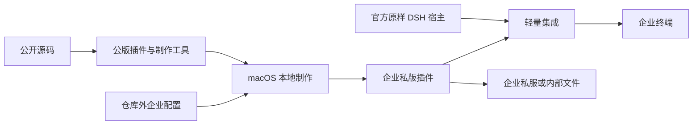

# 公版插件、企业私有包与官方 DSH 集成方案

## 文档信息

| 项 | 内容 |
|---|---|
| 文档编号 | CORP-DSH-ARCH-006 |
| 文档名称 | 公版插件、企业私有包与官方 DSH 集成方案 |
| 版本 | V0.6.0 |
| 文档状态 | 草案 |
| 密级 | — |
| 编制 | DSH 平台组（代拟） |
| 审核 | 待定 |
| 批准 | 待定 |
| 最后更新 | 2026-11-12 |
| 门禁 | 轻量集成方案待用户确认；问答式交付打包与员工启动器已本地验证；企业接口与目标平台待实测 |

> 编制依据：项目负责人确认企业采用 public 客户端、以官方宿主集成企业插件、不重新签名或公证，轻量安装方式由 miniceM 调研选择；具体范围见 §1。文档为技术方案草案，不表示企业接口、安装流程或目标平台已实测。现有实现与验证见[设计索引 §2.2](<../design/README.md#22-实现与验证入口>)。
>
> 关联文档：[需求与场景基线](<../requirements/requirements-baseline.md>)、[总体架构](<platform-architecture.md>)、[企业插件制品源决策](<plugin-registry-source-decision.md>)、[企业组合包设计](<../design/plugins/forge-enterprise.md>)、[IAM 机密认证契约](<../contracts/iam-client-auth-isolated.md>)、[工程开发与发布约定](<../engineering/development-conventions.md>)。

## 1. 目标与范围

GitHub Actions 使用公开源码生成包含目标平台组件的公版 DSH 插件 `.tgz`，公版及公开附属物不包含企业私有地址、企业凭据或个人信息。制包人员在 macOS 下载并核验公版，以仓库外的企业配置、项目级 Skill、手册和脚本制作跨平台企业私有插件包；官方 DSH 宿主与企业插件通过简便步骤集成，员工无需输入企业统一配置。

| 事项 | 已确认目标 |
|---|---|
| 公版 | 一个跨平台 DSH 插件 `.tgz`，通过公开 Release 提供；制作工具单独提供 |
| 私版 | 一个预置企业非个人配置的跨平台企业插件包，支持企业私有 npm / AIHUB 与内部文件交付 |
| 宿主 | 保持官方 DSH 宿主及签名载荷原样，以受支持的插件机制集成企业插件；不修改 DSH 核心或创建 fork |
| 安装 | 不要求自建双击安装器；允许企业内成套提供原样官方宿主和插件，或通过官方渠道取得宿主后执行企业初始化；由 miniceM 调研选择 |
| 签名与公证 | 不重新签名或公证官方宿主；上游载荷来源、实际签名状态及系统信任分别核验，不预设全部平台可用 |
| 企业 IAM | 企业支持并采用 `authMode=public`、`clientAuthMethod=none`；使用授权码与 PKCE S256，不在私版提供共享 `client_secret` |
| 个人 Key | 员工首次登录后录入，不进入企业配置或私版；与 issuer / 网关地址绑定的增强另由 [issue #226](<https://github.com/hrygo/heluo-forge/issues/226>) 跟踪 |
| 制包机与 Skill | 本地制作在 macOS 执行；制作端与员工端既有研发 Skill 按 Agent Skills 标准整理 |
| 目标平台 | Windows x64 / ARM64、麒麟 x86_64 / ARM64、macOS Intel / Apple；目标环境验收由 [issue #123](<https://github.com/hrygo/heluo-forge/issues/123>) 跟踪，未运行不能宣称交付通过 |

麒麟采用 Web 形态，Windows ARM64 允许 Web 形态。原样内部分发官方宿主取决于对应发行物及第三方组件的许可、可获取性和企业策略；通过官方渠道取得宿主不代表所有目标架构均已有官方预编译发行物。员工终端与制包机职责不同，企业服务仍须可达。

## 2. 角色、制品与信任边界

| 角色或制品 | 责任与边界 |
|---|---|
| 公版构建 | 公开源码构建闭包并核验目标组件；不读取企业配置 |
| 制包人员 | 下载公版及工具、校验来源和摘要，在 macOS 生成私版；官方宿主按所选路径取得 |
| 员工 / 管理员 | 通过选定的简便步骤完成宿主与企业插件集成，员工只输入个人 Key 等个人信息 |
| 公版 `.tgz` | 中性可定制基础制品；缺少企业配置时不伪装为已接入企业环境 |
| 私版 `.tgz` | 注入允许的非个人配置，保留平台组件和依赖闭包；仅经企业渠道交付 |
| 官方宿主 | 由官方渠道取得或在许可允许时原样随企业材料提供；不改写已签名载荷，不把外层材料的完整性与上游签名混为一谈 |
| 制作工具 | 与公版匹配的项目级 Skill、SOP、脚本和示例；公开 Release 单独提供，不要求制包人员取得源码 |

已有 DSH 的插件安装遵循现行角色策略：具备插件管理权限的用户可自行安装，受限角色采用经验证的管理员或受管理预置路径，不放宽 `plugin_manager` 权限。公开下载不自动授予使用或再分发许可；项目插件、制作工具及上游二进制和第三方组件的许可分别核验。

本机进程内门禁不能阻止同权限 JavaScript 或本机管理员绕过；企业服务端须独立鉴权。归档摘要证明字节一致性，不单独证明来源可信或系统信任。公开源码归档、Release 资产、日志和缓存分别检查，通用扫描不能证明未知企业命名均已识别。

## 3. 配置分类与交互

| 输入类别 | 内容与映射 | 缺失处理 |
|---|---|---|
| 基础制品 | 公版来源、版本及可核对摘要；选定路径所需官方宿主及目标架构 | 文件、来源、架构或版本不匹配时停止 |
| 输出信息 | 企业包版本、输出目录、目标能力 | 必填项缺失或目标文件已存在时停止 |
| IAM 企业配置 | 可信 `issuer`、`clientId`、发现或显式端点、回调路径、端口及地址族；`authMode=public`、`clientAuthMethod=none` | 缺失必填字段或 issuer 不一致时停止；不要求也不写入共享 secret |
| 网关企业配置 | 企业网关地址及所启用能力需要的默认配置 | 能力启用而配置缺失时停止 |
| 其他企业配置 | 企业统一且与个人无关的已启用能力配置 | 按能力检查，未启用能力不强加字段 |
| 个人数据 | 个人 Key、账号、token、密码 | 不作为企业配置或私版输入 |

真实 `.env` 位于仓库外且不提交，可由制作人员复用。制作器以 `--config` 读取专用文件并按数据解析，不使用 shell `source`、`eval` 或将完整文件打入插件；允许的企业配置转写到私版 `cordis.patch.yml`，因此对交付对象可见。密钥、个人凭据与令牌不作为配置输入。命令参数和脱敏报告不包含配置值；当前 Discovery 预检结果和部分错误会回显 issuer 与端点，原始输出须按企业敏感信息保护，分享前人工脱敏。

OIDC Discovery 的 `issuer`、可信 issuer 和 ID Token 的 `iss` 必须精确一致；生产回调的路径、端口与 IPv4 / IPv6 策略按企业注册规则核验。用户确认企业支持 public 与 PKCE S256；厂商历史回函曾给出不同口径，实际 public 登录、S256 及回调注册仍须在企业环境验证，不能仅凭配置或 mock 消除证据冲突。

Skill 引导助手收集公版摘要、企业版本、IAM 登录和撤销端点、client_id、网关地址与 provider、回调信息、可选 Gitee host 和输出位置。`release-delivery` 从仓库外权限为 600 的专用 `.env` 读取允许的配置，制包人员可复用该文件；secret 和完整 `.env` 不进入交付物。用户核对配置与预览摘要后才生成；取消或校验失败不输出被标为成功的包，也不覆盖已有文件。制作器默认只接受 HTTPS；确需内网 HTTP 时由打包人员显式确认明文传输风险，再设置 `HELUO_IAM_ALLOW_INSECURE_HTTP=true`。该开关只约束制作器检查，运行时不能依靠它阻止 HTTP。员工端初始化脚本按 `--release` 与 `--profile` 执行；交付 zip 内的 macOS/Linux/Windows 启动器以 `--profile auto --install-host` 运行：员工只需有 Node.js（含 npm），缺少官方 dsh 时由脚本以 npm 全局安装锁定版本，再用 `dsh --profile web --dump-config` 无界面创建 web profile（已有 web 则复用），随后只执行一次 `dsh plugin add`。官方 Desktop 应用独占 desktop profile，且锁定版公开 CLI 无条件拒绝管理该 profile；启动器因此在只检测到 desktop profile 时报 `DESKTOP_PROFILE_UNSUPPORTED`，提示改用 web 形态或在 Desktop 应用内插件设置中安装，不会误改 Electron 的 profile。员工不需要手工填写任何企业字段，也不需要预装 DSH。Windows 同时兼容原生 `dsh.exe` 与 npm 全局安装的 `dsh.cmd`/`dsh.bat`：启动器与初始化脚本解析 shim 中的 JS 入口后直接用 node 执行，不要求员工机存在 `dsh.exe`，也不通过 shell 拼接命令。真实 `.env`、包含企业配置的暂存文件与私版插件均置于仓库外，按平台使用受限制的文件权限；失败时只清理本次运行可确认归属的暂存，不清理用户已有数据。

## 4. 公版构建与本地二次制作

### 4.1 公版与企业插件包

公版构建复用现有企业组合包的依赖闭包与原生组件核验，增加明确的中性配置入口和公版检查。公开 Release 除一个插件 `.tgz` 外，须提供版本匹配、可独立取得的 Skill／脚本／SOP 与公版摘要；这些资源不属于员工安装单元。制作流程须在没有源码工作区时验证 Skill 的发现和脚本调用。Release 生成的源码归档与插件 `.tgz` 分别检查。

制作资源展开后保留 `.agents/skills/heluo-forge-release-bundle/` 及其相对脚本、手册路径；SOP 说明如何从该工作目录加载 Skill，并说明不同助手的发现方式可能有差异。真实 `.env` 与私版不放进制作资源归档；验收须检查隐藏的 `.agents` 目录确已随资源交付。

建议以明确的发布 tag 为工作流入口，按 tag 指向的公开提交构建并通过检查后上传 Release 资源；公开构建不接收企业 `.env`。工作流使用固定版本的 Action 与最小必需权限，原生组件按已固定的来源、摘要和许可证核验。发布失败不得将不完整资产报告为成功；触发公开发布和实际远端状态按已授权的发布操作分别核验。

二次制作必须读取并核验**实际下载的公版**，而不是以制包人员当前源码或 Git 工作区代替。制作人员从已知项目的公开 Release 取得目标版本及摘要，并独立确认来源；只拿到一个与包同处的不可信摘要时不能把它当成来源证明。离线验证需事先通过可信渠道取得预期摘要或可验证证明。制作器只需在 macOS 执行，只修改约定的配置和私版清单位置；其余文件的内容、可执行位、各目标平台原生组件、许可证、依赖闭包和宿主元数据应保持一致。读取归档时拒绝越界路径、重复路径及未允许的链接类型；写出前检查产物结构与完整性。

公版和私版是不同字节的制品。制作完成后，从私版实际文件重新生成私版摘要与清单；记录公版版本和摘要、制作工具版本、企业包版本及私版摘要，不记录配置值。校验和证明字节一致性，不单独证明制作者身份；公版发布来源可按需要增加可离线核验的制品证明。同名同版本必须对应同一制品摘要；配置、公版或制作工具变化导致字节变化时均须使用新版本。面向企业索引的版本按既有稳定 SemVer 规则分配；离线制作只能得到候选版本，私服发布和文件交付前分别核对实际发布记录与版本冲突。

现有企业包清单为 `private: true`，标准 npm 发布会拒绝该标志，即使目标是私有 registry。企业发布需设计生成物清单与私服目标约束，或验证企业制品库的导入方式；不改变源码包清单的既有保护来假装发布已打通。现行制品源决策允许内网 HTTP；若实际通过 HTTP 传输私版，其配置和包体在该链路上不受 TLS 保护，实际传输路径及企业措施须核验。见 [npm package.json 文档](<https://docs.npmjs.com/cli/configuring-npm/package-json/#private>)。

### 4.2 官方宿主与企业插件的低成本集成

官方 DSH 由可核验渠道获取，记录版本、来源、目标架构和摘要。企业插件包继续通过私有 npm / AIHUB 或内部文件交付；公开 Release 不代为提供官方宿主。

企业交付物由四部分组成：私版 `.tgz`、`private-release.json`、`scripts/init-enterprise-plugin.mjs` 与面向员工的按平台启动器。制作端由 `scripts/release-delivery.mjs` 一次完成制作、独立核验、目录组织、启动器生成与 zip 打包，打包人员无需手工拼接目录；Skill 收集企业字段并引导脱敏确认。配置 Discovery 时制作器检查 HTTP 200、`issuer` 及 `authorization_endpoint`/`token_endpoint`/`jwks_uri`；只提供显式端点或使用 `--skip-discovery-check` 时，Discovery 未核验。制作端对 issuer 尾斜杠作宽松比较，运行时要求精确一致；撤销端点也不在 Discovery 预检范围内，均须单独核验。来源记录沿用 `heluo-private-release/1` 模式，至少包含入口包名与版本、公版基线版本与摘要、制品文件名、大小与 SHA-256，并声明 `config.secretEmbedded: false`。初始化脚本单文件自包含，只依赖 Node 内置模块，不 import 仓库内模块，可在没有源码工作区的员工机上直接运行。

miniceM 对比并选择以下两条候选：

| 候选 | 员工或管理员操作 | 成本与待核验项 |
|---|---|---|
| A：企业内成套提供 | 取得原样官方宿主、企业插件及简明步骤或初始化脚本，按指引完成安装集成 | 宿主与插件一起管理便于线下交付；须核验官方二进制和第三方组件的企业内再分发许可、版本与更新责任 |
| B：官方渠道加企业初始化 | 从官方渠道取得并安装宿主，再执行企业脚本或按简明步骤集成插件 | 无需随企业材料分发宿主；需核验终端取得官方宿主的实际途径，以及不同系统的脚本、权限和离线依赖 |

| 维度 | A：企业内成套提供 | B：官方渠道加企业初始化 |
|---|---|---|
| 员工操作步数 | 解压企业材料 → 运行启动器（host 与插件同包）→ 重启登录；未含 Node.js 安装步骤 | 安装 Node.js LTS（如缺）→ 运行启动器（缺宿主时 npm 自动安装、缺 profile 时自动创建）→ 重启登录；macOS web 已实测，Desktop 未实测 |
| 管理员/受限角色 | 需管理员分发宿主、运行依赖与更新，受限角色依赖受管预置 | 员工可自助安装插件；受限角色是否允许 `dsh plugin` 与 npm 安装须实测，不放宽 `plugin_manager` |
| 平台宿主与运行依赖 | 每个目标需准备并核验宿主、Node/Electron 依赖与架构；六目标当前仅 macOS arm64 有本地证据 | 宿主由官方渠道按平台提供；npm 自动安装需要可用的官方 registry 或企业镜像，麒麟/Windows 离线场景未实测 |
| 离线依赖 | 可在内网分发完整材料，但宿主与依赖需随包校验 | 终端无公网时需要企业镜像或预置宿主；启动器未内置离线宿主包，离线路径未实测 |
| 更新与回退 | 需同时管理宿主与插件版本；回退由企业包控制 | 宿主更新由官方渠道负责；插件回退需重新安装旧版，启动器对版本冲突 fail closed、不自动升降 |
| 用户数据保留 | 取决于安装位置；当前启动器不改 profile 数据，未做保留测试 | 当前启动器不改用户 profile/数据，未做保留测试；卸载与恢复按 #123 |
| 许可与再分发 | 必须取得官方宿主及第三方组件的企业内再分发许可，结论未出 | 不随企业材料分发宿主，许可风险较低；官方制品来源与版本须可核验 |
| 签名与系统信任 | 不重签；外层材料完整性不等于上游签名，Gatekeeper/SmartScreen 未验证 | 同左；宿主走官方签名载荷，企业插件为未签名 npm 包 |
| 实现与维护成本 | 需维护宿主版本组合、安装包与更新通道；人日待测 | 已实现启动器与 npm 安装、web profile 创建；后续主要跟随官方版本与 npm 可用性；人日待测 |

路线选择：**候选 B**。依据是 issue #222 明确优先低成本集成、官方载荷原样、不新增宿主再分发；A 保留为内网离线成套交付的替代方案，使用前补宿主许可、平台组合与更新责任结论。miniceM 的最终确认记录仍待补于 issue #222。

两条路线都不要求重新签名、公证或新增双击安装器；不修改上游签名载荷，集成到宿主支持的 profile 或插件位置。企业内部不连接公网的终端可由授权人员提前取得所需官方制品；不假定必须由终端直接联网。若任何候选要求修改已签名宿主，不能沿用原签名或默认增加重签，须记录缺口并重新评估。

调研记录应包括实际用户操作步数、管理员与受限角色路径、各平台宿主和运行依赖、安装与更新、数据保留、许可、系统信任及实现和运维成本；比较结果列出实现人日、后续维护投入及其估算依据，不以未经测量的数值作承诺。无法核实的能力保持待验证；路线选择与实现结果在 [issue #222](<https://github.com/hrygo/heluo-forge/issues/222>) 记录。

锁定版 [DSH Desktop 打包文档](<https://github.com/deepseek-ai/deepseek-harness/blob/dsh-v0.2.1-rc.3/apps/desktop/packaging/README.md>)列出 macOS arm64 / x64 与 Windows x64 构建目标，未将 Linux 列为 Desktop 目标；Windows ARM64、麒麟 Web 和 macOS Intel 的具体宿主输入及兼容性须按目标版本核验，不以该文档代替目标设备实测。

上游可执行载荷签名、企业插件摘要与外层交付材料完整性是不同事实。无需新增企业签名并不证明 Gatekeeper、SmartScreen 或离线信任必然通过；目标环境实际表现归 [#123](<https://github.com/hrygo/heluo-forge/issues/123>) 记录。不得未经授权将企业私版或配置上传外部公证服务。

### 4.3 安装、首启与更新

集成使用目标 DSH 版本支持的插件管理和 profile 机制，不以插件文件存在代替实际挂载。锁定版 [Desktop 官方文档](<https://github.com/deepseek-ai/deepseek-harness/blob/dsh-v0.2.1-rc.3/apps/desktop/README.md>)给出的插件管理顺序是：首次启动并初始化 Desktop profile、完全退出、通过 `dsh plugin --profile desktop add <package>` 安装、重新启动。**2026-11-11 本机在 npm 安装的 dsh 0.2.1-rc.5 上复核：CLI 对任何 `--profile desktop` 调用（含 `--dump-config` 与 `plugin add`）都直接报 `profile "desktop" is managed exclusively by the Electron application`，该顺序在当前公开 CLI 上不可执行**；因此启动器不再自动选择 Desktop，只检测到 Desktop profile 时以 `DESKTOP_PROFILE_UNSUPPORTED` 明确拒绝，提示改用 web 形态或在 Desktop 应用内插件设置安装。Desktop 内的实际安装路径、权限与运行期挂载仍待官方能力或目标版本支持后实测。现有用户 profile、对话、工作区、非企业设置和个人凭据均须保留；覆盖层使企业必需配置失效时，保留原文件、报告冲突并使受保护能力 fail closed。

Web 目标只监听本机回环；回环本身不证明多用户隔离。[锁定版 Web 文档](<https://github.com/deepseek-ai/deepseek-harness/blob/dsh-v0.2.1-rc.3/packages/bundle/web-app/README.md>)说明启动 URL 包含进程凭据，`printUrl: false` 可阻止输出该行；是否能配合浏览器启动和重复入口安全使用仍须验证。会话隔离、并发、重启、端口冲突及令牌泄露均需检查；令牌不得进入其他用户可读的日志或输出。目标终端禁公网、更新与恢复行为和系统卸载数据保留均按 #123 在实际环境验证。

Windows、麒麟和 macOS 的运行时、系统库、浏览器、Secret Service、插件原生组件与实际进程架构分别核验。宿主或必要依赖缺失时保留该目标缺口，不用其他架构的结果代替。

## 5. Agent Skills 与项目技能

项目级制作 Skill 保存在 `.agents/skills/heluo-forge-release-bundle/`。其 `SKILL.md` 使用符合 [Agent Skills 规范](<https://agentskills.io/specification>)的 YAML frontmatter、`name` 和 `description`，目录名与 `name` 一致；操作步骤、脚本、示例及手册按 `scripts/`、`references/`、`assets/` 的需要组织。规范不规定助手如何扫描目录或允许运行脚本，因此标准格式、实际发现、交互能力和脚本执行能力分别验证。规范核验日期为 2026-11-10。

Skill 不依赖 Codex 专有接口、工具名或路径；由具备读取技能资源和运行脚本能力的兼容助手执行。脚本及普通 SOP 应可由制包人员直接调用，Agent 不代替确定性配置校验或归档处理。跨助手能力取决于各宿主的发现、权限与交互实现，不能仅凭文件格式宣称所有助手均已验证。

实施范围包括新增的制作 Skill 与现有员工研发 Skill：

| Skill | 实施范围 | 兼容性要求 |
|---|---|---|
| `.agents/skills/heluo-forge-release-bundle/` | 以问答方式向打包人员收集企业字段，调用 `release-delivery` 生成含私版插件、启动器、安装说明与校验和的员工 zip；提供制作脚本、初始化脚本及按需手册；不装配宿主安装包，不面向安装用户询问企业配置 | 不依赖 Codex 专有工具；制作脚本在 macOS 验证，并随公开 Release 取得；普通 SOP 支持不通过 Agent 手工运行 |
| `packages/forge-enterprise/skills/issue-delivery/` | 为已有研发 Skill 添加标准 frontmatter 并核验全部引用资源 | `name` 与 `issue-delivery` 目录一致；DSH 仍以 `enterprise-issue-delivery` 入口注册，保持仅用户显式触发、按需加载、卸载清理和原有 Teamflow 职责 |

现有 DSH provider 从 `clauses.json` 提供发现摘要并读取包内 Skill 正文。标准元数据与宿主摘要须有一致性约束，避免形成互相矛盾的维护入口；实际注册名称是宿主的命名空间映射，不要求改名或迁移已有 DSH 入口。元数据变更后须验证候选、正文及相对 `references/` 在真实目标宿主仍可读取，不能只凭标准文件校验宣称 DSH 已兼容。

仓库尚无已提交的公版定制 Skill；员工侧现有研发 Skill 由 DSH provider 注册，但其 `SKILL.md` 尚无规范要求的 frontmatter。本机 `skill-creator` 快速校验器未覆盖目录名一致等全部规范规则，也与规范可选字段的支持范围不同，不能单独作为标准合规判据。项目级制作 Skill 不因存在于源码树而自动出现在 Release 下载或 DSH 员工环境。

## 6. IAM、个人 Key 与升级

企业登录基线是 public 客户端，`clientAuthMethod=none`；授权码使用 PKCE S256 与系统浏览器、回环回调。企业私版不包含共享 `client_secret`，也不为本交付路径实现真实 secret 来源和轮换。用户对 public 支持的确认不等于真实服务端对 S256、注册回调和令牌生命周期的联调结论；这些事实由 #123 验证，旧厂商回函保留原貌。

public 模式不免除 IAM grant、个人 Key 存储和模型 / 工具消费的原子性、可信来源与 fail-closed 门禁。当前默认装配及目标平台证据仍须按 [#121](<https://github.com/hrygo/heluo-forge/issues/121>)、[#182](<https://github.com/hrygo/heluo-forge/issues/182>) 分别核验；不以缓存 `ready`、provider 自报或测试替身代替。机密模式的隔离契约继续适用于未来另行获准的使用，不因本次 public 决策打开真实 secret 来源。

个人 Key 与可信 issuer、用户和规范化网关地址的绑定、旧记录迁移、地址变更提示和 A→B→A 并发处理由 [#226](<https://github.com/hrygo/heluo-forge/issues/226>) 单独跟踪，不作为 #222 的验收条件。在该项完成前不能宣称现有实现已防止旧 Key 向新地址发送；网关地址切换的运行安排须考虑这一已知缺口。

## 7. 与受控文档的关系

[需求基线](<../requirements/requirements-baseline.md>)定义范围；[总体架构](<platform-architecture.md>)记录 public 登录和官方宿主集成决策；[IAM 主设计](<../design/plugins/forge-iam.md>)定义身份与凭据准入。历史企业回函保留原文，真实支持情况以实际联调为准。企业组合、制品源和推广实施文档明确内部文件交付与官方宿主的许可边界；根 README 保持产品宣介职责。

[机密认证隔离契约](<../contracts/iam-client-auth-isolated.md>)不因 public 基线放宽：机密模式的真实来源依旧关闭，用户后续另行选择时须单独设计和核验。实际制作脚本、发布链路和员工安装步骤均未由本方案实施。

## 8. 验证与验收

| 验证层次 | 判据与归属 |
|---|---|
| Skill 与公版 | frontmatter、名称、目录和资源路径有正反例；公开包无企业配置并核验目标组件、许可证与依赖闭包 |
| 制作器 | 必填项、来源摘要、特殊字符、路径越界、已有输出和取消操作均有正反例；日志和报告不含敏感值 |
| 制品一致性 | 仅约定配置 / 清单发生变化，平台组件字节、模式与依赖闭包保持，私版摘要从最终文件计算 |
| 宿主集成 | miniceM 对候选作记录并选定简便方式；本地可重复检查插件实际安装挂载、权限、失败提示和数据保留，不重新签名或公证 |
| 身份与存储 | 本地验证 public 配置、S256 参数、issuer、回调与既有凭据门禁；不把本地替身当企业 IAM 或网关联调 |
| 目标环境 | Windows x64 / ARM64、麒麟 x86_64 / ARM64、macOS Intel / Apple 的安装、升级、回退及安全检查由 [#123](<https://github.com/hrygo/heluo-forge/issues/123>) 独立验收；缺环境标 BLOCKED，未运行标 NOT RUN |
| 网关地址绑定 | 由 [#226](<https://github.com/hrygo/heluo-forge/issues/226>) 独立设计、实现和验收，不作为本方案实施 issue 的关闭条件 |

仅具备局部本地构建与隔离验证基础；公版 Release、从公版定制私版、选定宿主集成路线、目标终端及真实企业联调尚未由本方案验证。

## 9. 实施顺序

1. 完成受控文档同步；miniceM 调研并选择官方宿主轻量集成方式，记录成本、许可与未验条件。
2. 构建公版、制作 Skill 与私版制作器，并完成可重复的离线正反例；采用 public 配置，保持现有 IAM 与凭据安全门禁。
3. 按选定方案完成宿主与插件的安装引导及本地核验；个人 Key 网关绑定按 #226 独立排期。
4. #123 在六类目标环境及原有 UOS 目标记录真实安装、运行、安全和企业联调结果；目标平台开放以各自证据为准。

## 10. 待核验事项

| 事项 | 责任与处理 |
|---|---|
| 两条低成本宿主集成候选 | miniceM 比较用户步骤、平台可用性、许可、数据保留及实现 / 运维成本，选择并记录 |
| public、S256、可信 issuer 与回调 | 企业 IAM 与目标环境联调；保留历史回函冲突，不以 mock 宣称通过 |
| 各架构官方宿主及企业再分发许可 | 按实际版本、来源、架构、签名状态和上游许可核验；不假定所有平台有官方预编译发行物 |
| 本项目公开插件及工具许可 | 公开 Release 前明确下载、使用与再分发范围 |
| 平台凭据与运行依赖 | #182 负责后端逐目标取证，#123 负责端到端和安装生命周期；未取证不开放相关能力 |
| 私服、AIHUB 与内部文件交付 | 分别验证实际导入、权限、版本与完整性；本地打包不等于企业交付通过 |
| 网关 Key 地址绑定 | #226 单独跟踪，未实施前保留风险和未验证状态 |
