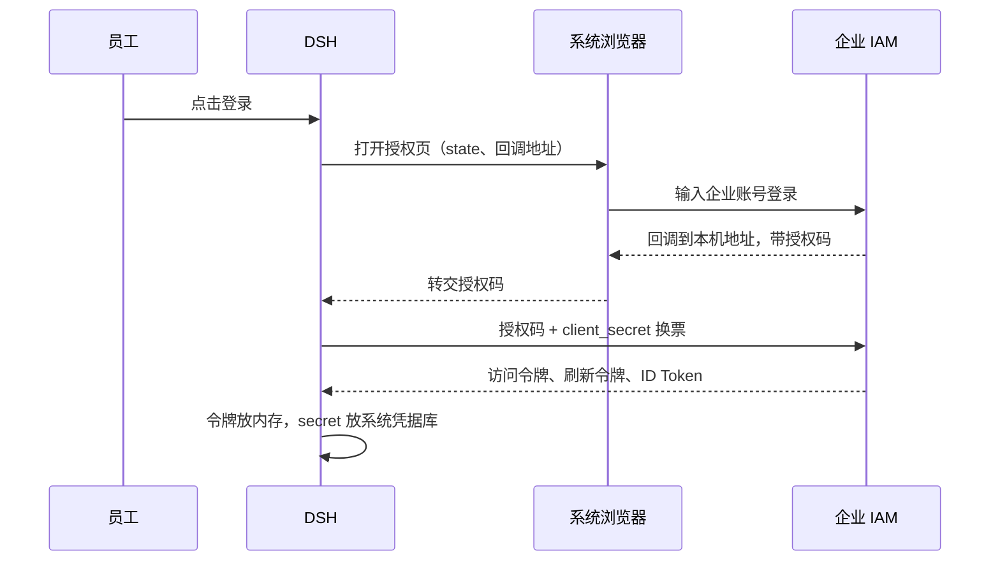

# DSH 研发助手接入企业 IAM 确认函

## 文档信息

| 项 | 内容 |
|---|---|
| 文档编号 | CORP-DSH-CONF-006 |
| 文档名称 | DSH 研发助手接入企业 IAM 确认函 |
| 版本 | V0.4.2 |
| 文档状态 | 草案 |
| 密级 | — |
| 编制 | DSH 平台组（代拟） |
| 审核 | 待定 |
| 批准 | 待定 |
| 最后更新 | 2026-11-03 |
| 门禁 | G1 身份登录与令牌闭环；G2 撤销与登出联动 |

> 编制依据：2026-11-03 收到企业 IAM 团队对 C1—C11 的逐项书面答复，本版按答复更新各条结论，并在受影响条目下补充“对我方的影响”。答复是提供方对能力的书面说明，不是接口联调、网关撤权实测或上线批准；答复中的“理论上实时”“最迟两分钟”等表述仍须在测试环境验证。接入形态仍依据厂商 IAM 6.0.3/6.3 与内部校验回函的差异确定为“机密客户端 + 操作系统凭据库”。
>
> 关联文档：[IAM 统一登录与权限接入问询函](<iam-confirmation-letter.md>)、[IAM 接入详细设计](<../design/plugins/forge-iam.md>)、[AI 网关契约](<../contracts/gateway-contract.md>)、[文档清单](<../DOCUMENT-REGISTER.md>)。

## 1. 摘要

DSH 研发助手计划启动 30 人试点，需要接入企业 IAM 统一登录。与最初设想相比有一处变化：厂商 IAM 6.0.3/6.3 不支持公共客户端与 PKCE，因此改为「机密客户端 + 操作系统凭据库」。

这一变化影响客户端注册方式、secret 管理和令牌失效语义。本函原用 11 个问题请贵方确认，企业 IAM 团队已于 2026-11-03 对 C1—C11 逐项书面答复。

答复确认了接入所需的客户端注册粒度、人员标识与刷新语义，同时有两处与我方目标不一致的限制：

1. **登出范围**（C6、C7）：RP 登出作用于当前浏览器会话，同一会话下其他应用的令牌一并作废，无法只结束 DSH 这一份授权。
2. **撤销入口**（C3、C4）：只说明可在 IAM 后台手动停用，未确认可供 DSH 调用的撤销或登出接口、鉴权方式与结果回执。

secret 轮换是人工操作、更新后最迟两分钟生效、旧访问令牌不随轮换作废。本项目为企业内部使用，client_id/client_secret 仅用于 DSH 自身接入，不与其他应用共用；任何形式的 client_id/client_secret 泄露均不在本项目评估范围（2026-11-03 用户决定，视为不可能发生且无影响），因此该项只作为操作约束，不作为安全门禁（见 §5 范围前提）。

以上差距已写入 §13.1 与[设计 §12.1](<../design/plugins/forge-iam.md#121-待决技术事项清单>)，在接口和实测证据补齐前不开放真实联调。本函不要求贵方改动现有配置：接入以新增客户端的方式完成。

## 2. 我们是谁，要接什么

DSH 是部署在员工个人电脑上的研发助手，帮助员工写代码、做代码评审和研发问答。试点有两种终端：

| 终端 | 形态 | 登录方式 |
|---|---|---|
| Windows | 桌面应用 | 系统浏览器登录，回到应用 |
| 麒麟 | 本机 Web 服务 | 系统浏览器登录，回到本机服务 |

- 用户范围：30 名员工，账号由企业统一开通。
- 为什么必须接入 IAM：企业要求统一身份。DSH 不保留独立账号体系，也不允许员工用个人 API Key 绕过。
- 员工体验：点击登录后打开系统浏览器，在 IAM 页面完成登录，再回到 DSH。DSH 不接触员工密码。

## 3. 登录流程

## 4. 与最初方案的差异

最初按公共客户端 + PKCE 设计：客户端不保存 secret，靠 PKCE 防止授权码被截获后换票。厂商回函明确不支持公共客户端与 PKCE S256，换票必须携带 secret，因此改为下表方案。

| 项目 | 最初设想 | 现方案 |
|---|---|---|
| 客户端类型 | 公共客户端 | 机密客户端 |
| 换票凭据 | PKCE（S256） | client_secret（Basic 或 POST） |
| secret 存放 | 无 | 操作系统凭据库 |
| 回调地址 | 可动态端口 | 固定端口，精确登记 |

**存储说明**：系统凭据库用于避免 secret 明文落盘、混入日志或被其他用户读取；它不阻止同一用户读取自己设备上的凭据。按 2026-11-03 的范围前提，此说明只界定存储方式，不用于风险评估。

## 5. 客户端注册与 secret 管理

**C1 已确认（2026-11-03）**：全企业共用一个客户端（client_id），不按设备拆分。

这意味着 30 台试点设备使用同一份客户端凭据。我方据此调整：

- secret 由终端运维在安装时统一注入，只存系统凭据库，不写入安装包、配置文件、日志和命令行。
- **范围前提（2026-11-03，用户决定）**：本项目为企业内部使用，`client_id` 与 `client_secret` 仅用于 DSH 自身接入，不与其他企业应用共用；任何形式的 client_id/client_secret 泄露均不在本项目评估范围，视为不可能发生且无影响。该事项不作为风险、门禁、验收或联调项；凭据存放与轮换按存储和运维要求执行。

| 编号 | 原提问（2026-11-03 已答复） | 为什么需要 |
|---|---|---|
| C2 | 请提供企业统一策略中的具体数值：轮换周期、吊销生效时间、泄露处置时限。另请说明：轮换 secret 是否影响已发出的访问令牌与刷新令牌？ | 我们按这些值排维护窗口，并判断轮换时是否需要通知 30 名用户 |

**C2 已确认（2026-11-03）**：

- **轮换周期**：无固定轮换周期，不支持自动轮换。每次更新 client_secret 需在 IAM 后台手动操作。
- **生效时间**：更新后最迟两分钟生效。机制为定时任务每两分钟将应用信息同步到缓存，实际校验 client_secret 时取缓存而非数据库。
- **对已发令牌的影响**：client_secret 更新前已签发的访问令牌和刷新令牌**不会立即作废**，按各自有效期自然过期。默认访问令牌有效期 7200 秒，刷新令牌有效期 7300 秒。
- **注意事项**：刷新令牌调用刷新接口时**必须同时传入 client_secret**。即刷新令牌本身不独立可用——刷新接口唯一作用是换取新的访问令牌与刷新令牌，但该接口必传 client_secret，二者缺一不可。由此可推论：**client_secret 轮换后，之前签发的刷新令牌虽然本身未被作废，但已无法继续用于刷新**——刷新链路依赖 client_secret 与刷新令牌配对，secret 更换后旧刷新令牌失去作用，实际不可用。而旧的访问令牌不受影响，仍可继续正常调用接口、换取用户信息，直至自然过期。
- **泄露处置（按 §5 范围前提，不在本项目评估范围，仅记录 IAM 答复）**：无固定的自动处置时限。发现 client_secret 泄露后，需手动在 IAM 后台更新 secret，更新后最迟两分钟生效（见上文“生效时间”）；旧 secret 换取的令牌按自然过期失效，无立即作废机制。

**对我方的影响**：

- 原“双 secret 长期并存、可平滑轮换”的说法不成立，轮换是人工操作；两分钟缓存窗口内新旧值是否同时有效仍未确认（D3）。配置更新后至少等待两分钟再判定成败，避免把缓存同步窗口误报为故障。
- secret 轮换后，旧访问令牌仍可用到 7200 秒到期；旧刷新令牌因刷新必带 secret 而不可用。按范围前提，轮换只按运维窗口执行。
- 刷新必须携带 secret，因此 secret 在设备端不可用（keychain 故障、未注入）时，刷新链路直接不可用；本地不能把它当作可重试的网络错误。

我方仍会：secret 只落系统凭据库；日志、诊断与命令行不输出 secret；按运维计划通过 C2 更换 secret；员工离职或账号停用时按 C4 注销该用户令牌。按人停用不受共用客户端影响（见第 6 节）。

## 6. 停用与登出

我方需要达到两个效果：

- **管理员停用**：停用某位员工后，5 分钟内该员工在全部设备上的 DSH 失效。
- **员工主动退出**：只结束 DSH 这一份授权及其派生授权；其他设备上的 DSH、以及该员工在其他系统的登录都不受影响。退出后，这份授权的令牌立即失效。

| 编号 | 原提问（2026-11-03 已答复） | 为什么需要 |
|---|---|---|
| C3 | 已发出的访问令牌能否在服务端停用？从操作到生效最长多久？ | 决定 5 分钟要求能否满足 |
| C4 | 停用的粒度：按人（全部设备）、按客户端，还是按单次授权？ | 决定我们如何向员工解释“退出”的范围 |
| C5 | 停用或登出生效时，正在进行的请求会怎样：立即断开，还是允许完成？ | 避免员工以为已退出、实际请求仍在跑 |
| C6 | RP 发起的登出能否只结束本客户端的当前授权，不影响该员工的其他设备和其他系统？ | 错杀会影响员工使用其他系统 |
| C7 | 登出后，这份授权的访问令牌与刷新令牌是否立即失效，还是等到自然过期？ | 决定退出是否真的“退干净” |

**C3 已确认（2026-11-03）**：可在 IAM 后台手动停用访问令牌。理论上实时生效——点击注销后，缓存中的访问令牌实时作废。

**对我方的影响**：答复只描述后台手动操作，未说明可供 DSH 调用的撤销接口、鉴权方式、请求与回执格式。“理论上实时”是缓存机制推断，不是端到端实测；管理员停用能否在 5 分钟内让网关上拒绝新请求，仍须联调取证。

**C4 已确认（2026-11-03）**：停用粒度支持三个层级，可按需选择：

- **按会话维度注销**：可单独下线某个浏览器会话，或一键下线全部会话。浏览器会话与浏览器进程绑定——同一台终端上同一个浏览器，无论打开多少窗口、标签页，都属于同一个浏览器会话；只有明确开无痕/隐私窗口，才会开始一个新的浏览器会话。一个浏览器会话内可对应多次授权码换取记录——首次换取需用户认证，之后因单点登录（SSO）可免密获取授权码。
- **按令牌维度注销**：可下线某个具体的访问令牌或刷新令牌，或一键注销该用户名下所有令牌。
- **按用户维度禁用**：直接在后台将用户状态置为禁用，则该用户名下所有会话与令牌全部注销。

**对我方的影响**：按用户禁用可在 IAM 侧覆盖“离职/停用后全部设备失效”；网关侧是否在 5 分钟内拒绝新请求仍须联调。按令牌注销可用于员工离职、账号停用等场景，但答复未说明这些操作是否开放 API；若只能人工在后台执行，则 30 人试点的应急流程必须写明操作人和时限。

**C5 已确认（2026-11-03）**：停用或登出生效后，令牌立即作废。带作废令牌的请求到达 IAM 时立即拒绝，无宽限期。

**对我方的影响**：“到达 IAM 时拒绝”不覆盖已经通过 IAM 校验、正在网关侧执行的请求；已接收的流按各自截止时间结束，不推断上游已停止或零计费。

**C6 已确认（2026-11-03）**：登出作用范围为**当前浏览器会话**。

- 登出后，当前浏览器对应的会话、以及该会话下关联的令牌（访问令牌 + 刷新令牌）全部作废。
- 会话与浏览器绑定：一个浏览器对应一个会话；令牌与应用绑定：一个登录的应用对应一对访问令牌 + 刷新令牌。
- 若用户在其他浏览器也登录过，其他浏览器的会话及其关联令牌**不受影响**。

**对我方的影响**：该范围与“只结束 DSH 这一份授权、不影响员工在其他系统的登录”的目标不一致。同一浏览器会话下其他企业应用的令牌会随这次登出一并作废；按同一会话级语义，其他应用退出也会使 DSH 在该会话的令牌失效（推断）。DSH 默认退出因此不能直接调用全局登出，只能选择“本地退出 + 单令牌撤销（接口未确认）”，或在明确告知范围后使用全局登出。该差异记入 §13.1 D2 与[设计 §12.1](<../design/plugins/forge-iam.md#121-待决技术事项清单>)。

**C7 已确认（2026-11-03）**：调用全局退出接口后，当前浏览器会话关联的所有令牌（即该浏览器会话下的全部访问令牌与刷新令牌）**立即作废**，不等待自然过期。

**对我方的影响**：“立即作废”的对象是当前浏览器会话下的全部令牌，不是单次 DSH 授权，限制与 C6 相同。若只撤销 DSH 的访问令牌，需确认程序化单令牌撤销接口；在此之前，本地退出只能如实显示“服务端撤销未确认”。

## 7. 人员标识

我们用签发方（issuer）加主体（sub）作为员工的唯一标识，写入审计记录，用于回答“这次操作是谁做的”。因此该标识必须稳定：员工转岗、改名、账号重建后仍应指向同一个人。

| 编号 | 原提问（2026-11-03 已答复） | 为什么需要 |
|---|---|---|
| C8 | ID Token 中的 sub 是否在转岗、改名、账号重建后保持不变？若会变化，是否有稳定的替代字段（如工号）？ | 标识变化会让同一个人被记成两个人，审计断链 |

**C8 已确认（2026-11-03）**：`sub` 即工号。

- **转岗、改名、账号禁用后又启用**：工号不变，`sub` 保持稳定。
- **离职后重新入职**：原账号注销、工号作废，分配新工号、创建新账号。严格来说是两个独立账号，各自的 `sub` 不同，并非同一账号的 `sub` 字段发生变化。

**对我方的影响**：转岗、改名、禁用再启用等常见场景下 `sub` 稳定，可作为审计记录中的操作人标识。离职再入职属于旧账号注销、新账号创建的情况，各自 `sub` 独立。项目组已确认：离职再入职按新人处理，工号与 `sub` 均变更；“账号重建”不包含此场景。DSH 审计以单次操作记录为主，不涉及跨账号合并同一人的历史数据，试点期内不要求跨账号合并，故不阻塞接入；后续如需人员全景审计再评估。

## 8. 刷新与重用

我方原计划：每次刷新轮换刷新令牌；旧的访问令牌允许在 5 分钟内自然过期；旧的刷新令牌立即作废。该计划已被 C10 否定，见下。一旦检测到旧刷新令牌被重复使用，认定凭据可能已泄露，整条授权链作废并要求重新登录。

| 编号 | 原提问（2026-11-03 已答复） | 为什么需要 |
|---|---|---|
| C9 | 是否开启刷新令牌轮换？旧令牌重用检测的窗口与返回错误码是什么？ | 决定我们如何区分正常重试与凭据泄露 |
| C10 | 刷新后，旧的访问令牌是否立即失效，还是允许自然过期？ | 立即失效会打断进行中的请求，需要提前设计 |
| C11 | 检测到旧刷新令牌重用时，是作废整条授权链，还是只拒绝这一次刷新？ | 这是泄露发生时的止损边界 |

**C9 已确认（2026-11-03）**：

- **支持刷新令牌轮换**：每次刷新后，旧的刷新令牌即时作废，同时下发新的刷新令牌。
- **重用检测**：检测到旧刷新令牌被重复使用时，HTTP 响应码 401，body 返回 `invalid_grant`。

**对我方的影响**：本地刷新必须严格单飞，任何“重试一次”或“两个进程各刷一次”都会让后到者拿到 401。收到 401 `invalid_grant` 时不得继续使用旧刷新令牌，也不得把它当作普通网络错误重试。

**C10 已确认（2026-11-03）**：刷新成功后，旧的访问令牌**实时作废**，不允许自然过期。

**对我方的影响**：原“旧访问令牌允许 5 分钟自然过期”的假设不成立。刷新完成的瞬间，仍在用旧访问令牌的并发请求会被服务端拒绝；本地必须串行化刷新与取用，或对 401 做有限重取，不能把每个 401 都当成会话失效。

**C11 已确认（2026-11-03）**：检测到旧刷新令牌重用时，**仅拒绝本次刷新请求**（返回 `invalid_grant`），不作废整条授权链——当前正在使用的访问令牌与刷新令牌不受影响，仍可正常使用。

- 之前成功刷新后下发的最新访问令牌与刷新令牌**仍可正常使用**，不受重用检测影响。
- 补充说明：刷新成功后旧的访问令牌与刷新令牌实时作废，即同一时刻只有一对有效令牌，不管刷新多少次。

**对我方的影响**：不能把重用检测当作泄露止损。检测只拒绝本次请求；若攻击者先刷新，合法客户端会收到 401 并被要求重新登录，但攻击者取得的新令牌不会因此失效。缓解手段是刷新必带 secret（攻击者仅拿到刷新令牌不足以续期），以及发现异常后按 C4 主动注销。DSH 侧收到 `invalid_grant` 时终止本地授权并要求重新登录，且不重放旧刷新令牌。

## 9. 需要贵方配合的事项

| 事项 | 说明 | 时间 |
|---|---|---|
| 测试环境客户端 | 测试用 client_id 与 secret，或注册入口与审批流程 | 联调前 |
| 回调地址登记 | 固定端口的本机回环地址，精确匹配 | 联调前 |
| 测试账号 | 普通员工账号，以及可执行停用操作的管理员账号 | 联调前 |
| 撤销与登出接口 | 可供客户端调用的撤销/登出端点、鉴权、请求与回执 | 联调前，见 §13.1 D1 |
| 对接人 | 技术对接人与答复渠道 | 已收到书面答复；联调对接人待定 |

## 10. 答复方式与时间

2026-11-03 已收到企业 IAM 团队对 C1—C11 的逐项书面答复，结论并入第 5—8 节。

答复未覆盖、需要补充说明的事项列入 §13.1，按 D1—D4 编号提出；回函正文见 §14（待发送）。补充答复仍请注明：结论（支持 / 不支持 / 需配置）、依据（文档或配置项）、适用版本与限制条件。

## 11. 适用版本与边界

- 本函适用于企业 IAM 6.0.3 / 6.3。
- 本函是接入方案确认，不构成上线、投产或安全验收的批准。
- 在补充事项确认与真实联调完成前，我们不改变现有生产配置，也不宣称撤销闭环已验证。
- IAM 升级主版本或改造公共客户端/PKCE 能力后，本确认需要重新评估。

## 12. 联系方式

| 角色 | 联系人 | 联系方式 |
|---|---|---|
| DSH 平台组 | 待填 | 待填 |
| 实施协调 | 待填 | 待填 |

## 附：术语

| 术语 | 含义 |
|---|---|
| PKCE | 换票时用一次性随机值证明“发起方就是换票方”，防止授权码被截获后换票 |
| 公共客户端 | 不持有 secret 的客户端，如桌面应用、CLI、单页应用 |
| 机密客户端 | 持有 secret 的客户端，secret 必须妥善保管 |
| RP | 依赖方（Relying Party），本函中指 DSH |
| 访问令牌 / 刷新令牌 | 前者用于调用接口，后者用于换取新的访问令牌 |

## 13. 确认事项与答复结论

| 编号 | 事项 | 回答责任方 | 截止门禁 |
|---|---|---|---|
| C1 | 客户端注册粒度——已确认：全企业共用一个客户端，仅 DSH 使用 | — | 2026-11-03 已确认 |
| C2 | client_secret 轮换方式——已确认：无固定周期、手动更新、两分钟生效；旧 AT 不立即作废、按自然过期；旧 RT 随 secret 更换实际不可用；刷新接口必传 secret | IAM 团队 | 已确认 2026-11-03 |
| C3 | 访问令牌服务端停用能力与窗口——已确认：后台手动停用，理论上实时生效（缓存实时作废） | IAM 团队 | 已确认 2026-11-03 |
| C4 | 停用粒度——已确认：支持按会话、按令牌、按用户三个层级注销 | IAM 团队 | 已确认 2026-11-03 |
| C5 | 停用或登出时进行中请求的行为——已确认：令牌立即作废，无宽限期 | IAM 团队 | 已确认 2026-11-03 |
| C6 | RP 登出范围——已确认：登出作用于当前浏览器会话，同会话其他应用一并作废，其他浏览器会话与令牌不受影响 | IAM 团队 | 已确认 2026-11-03（隔离差距见 D2） |
| C7 | 登出后令牌是否立即失效——已确认：全局退出接口调用后，当前浏览器会话关联的所有令牌立即作废 | IAM 团队 | 已确认 2026-11-03 |
| C8 | sub 稳定性——已确认：sub 即工号；转岗/改名/禁用再启用不变；离职再入职按新人处理（新工号、新 sub） | IAM 团队 | 已确认 2026-11-03 |
| C9 | 刷新令牌轮换与重用检测——已确认：支持轮换，旧令牌即时作废；重用返回 401 + invalid_grant | IAM 团队 | 已确认 2026-11-03 |
| C10 | 刷新后旧访问令牌的失效时间——已确认：实时作废，不允许自然过期 | IAM 团队 | 已确认 2026-11-03 |
| C11 | 重用时是否作废整条授权链——已确认：仅拒绝本次刷新（invalid_grant），当前有效令牌对不受影响 | IAM 团队 | 已确认 2026-11-03 |

### 13.1 答复后新识别的待确认项

| 编号 | 事项 | 回答责任方 | 截止门禁 |
|---|---|---|---|
| D1 | 是否提供可供客户端调用的令牌撤销与 RP 登出接口？端点、鉴权方式、请求/回执格式、失败语义分别是什么？ | IAM 团队 | G1 真实联调前 |
| D2 | C6 已明确登出为浏览器会话级。是否提供单令牌或单授权撤销接口，使 DSH 退出时只撤销自己的令牌、不调用全局登出？端点、鉴权与回执是什么？ | IAM 团队 | G2 退出联动验收前 |
| D3 | secret 更新后的两分钟缓存窗口内，新旧 secret 是否同时有效？设备在窗口内用新 secret 刷新失败时，应按什么间隔重试？ | IAM 团队 | G1 轮换演练前 |
| D4 | 刷新令牌是否滑动续期、有无绝对有效期或空闲超时？7300 秒是否意味着空闲超过约两小时就必须重新登录？ | IAM 团队 | G1 会话生命周期验收前 |

## 14. 补充确认函（D1—D4，待发送）

> 以下为拟发送给企业 IAM 团队的补充确认正文。发送前由项目组确认收件人与渠道；未发送前不作为已提出事项。

**主题：DSH 接入 IAM——C1—C11 答复后的四项补充确认**

尊敬的 IAM 团队：

感谢贵方 2026-11-03 对 C1—C11 的逐项答复。大部分问题已经清楚，我们据此调整了接入设计。还有四个问题会直接影响 30 人试点能否稳定上线，想请贵方再确认一次。每个问题都写了我们为什么问、希望得到什么形式的答复，方便贵方直接对应。

**范围说明：** 本函不涉及 client_id/client_secret 泄露或应用冒用；该事项不在本项目评估范围。D1、D2 只解决员工离职/账号停用和单次授权退出，D3、D4 只影响轮换窗口与登录时长，不要求贵方按防泄露或防冒用作答。

**D1. 有没有 DSH 可以调用的撤销或登出接口？**

员工离职或账号停用时，我们需要尽快让 DSH 的授权失效。C3、C4 说明后台可以手动停用，但没有说明是否有供系统调用的接口。请确认：

1. 是否有撤销访问令牌、撤销刷新令牌、以及登出的 HTTP 接口？
2. 调用方如何鉴权：client_secret、管理员账号，还是其他方式？
3. 请求与成功/失败响应示例；对已撤销的令牌重复调用，返回什么？
4. 从调用成功到 IAM 拒绝新请求，最长需要多久？

如果没有接口，请说明推荐的应急流程：由谁操作、一般多久完成。在收到书面说明前，我们不会按猜测的接口实现，也不会把它当作已确认能力。

**D2. 能否只撤销 DSH 这一份授权，而不退出整个浏览器会话？**

C6、C7 说明登出会结束当前浏览器会话，同一会话下其他应用也会被退出。DSH 的默认退出只想结束自己这一份授权，不影响员工正在使用的其他系统。请确认：

1. 是否提供“按令牌”或“按单次授权”撤销接口，可以只撤销 DSH 的访问令牌和刷新令牌？
2. 如果有，端点、鉴权和回执是什么？
3. 如果没有，DSH 将默认只做本地退出，并在界面标明“服务端撤销未确认”；只有员工明确同意时才调用全局登出。这个处理是否符合贵方建议？

**D3. secret 更新后的两分钟内，新旧 secret 是什么关系？**

C2 说更新后最迟两分钟生效；这里只关心轮换期间刷新是否可用，不涉及泄露止损。我们担心设备在这两分钟内用新 secret 刷新会失败。请确认：

1. 这两分钟内，旧 secret 和新 secret 是否都有效？还是各节点在缓存刷新时切换，窗口内不同节点可能接受不同的值？
2. 如果设备用新 secret 刷新失败，建议等待多久再重试？是否固定等两分钟？
3. 轮换期间，是否建议我们暂停新登录、只保留刷新？

**D4. 刷新令牌是滑动续期，还是有绝对期限？**

C2 说刷新令牌有效期 7300 秒。请确认：

1. 每次刷新后，刷新令牌的有效期是否重新计时？
2. 是否有绝对有效期或空闲超时？如果有，分别是多久？
3. 如果刷新令牌不滑动、也没有绝对期限，员工是否每约两小时就要重新登录一次？我们需要提前设计提示，避免影响使用。

以上四项不改变已经确认的接入方式，只影响失败处理和员工体验。请按“结论 / 限制 / 适用版本”回复；如果某项需要另行审批，也请告知流程和预计时间。在收到答复并完成测试环境联调前，我们不会开启真实登录，也不会调整生产配置。

联系人：[待填]
