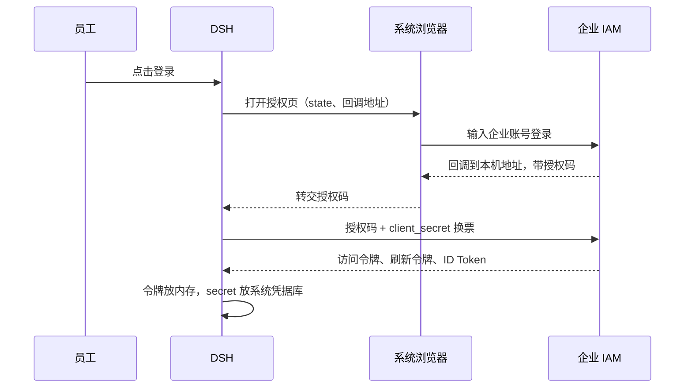

# DSH 研发助手接入企业 IAM 确认函

## 文档信息

| 项 | 内容 |
|---|---|
| 文档编号 | CORP-DSH-CONF-006 |
| 文档名称 | DSH 研发助手接入企业 IAM 确认函 |
| 版本 | V0.1.0 |
| 文档状态 | 草案 |
| 密级 | — |
| 编制 | DSH 平台组（代拟） |
| 审核 | 待定 |
| 批准 | 待定 |
| 最后更新 | 2026-11-03 |
| 门禁 | G1 身份登录与令牌闭环；G2 撤销与登出联动 |

> 编制依据：2026-11-03 依据厂商 IAM 6.0.3/6.3 回函与内部校验回函（§02 称具备 PKCE、§08 未填）的差异，DSH 平台组确认接入形态与令牌语义；本函面向企业内部 IAM 团队，代拟未发送，不构成上线或安全验收批准。
>
> 关联文档：[IAM 统一登录与权限接入问询函](<iam-confirmation-letter.md>)、[IAM 接入详细设计](<../design/plugins/forge-iam.md>)、[AI 网关契约](<../contracts/gateway-contract.md>)、[文档清单](<../DOCUMENT-REGISTER.md>)。

## 1. 摘要

DSH 研发助手计划启动 30 人试点，需要接入企业 IAM 统一登录。与最初设想相比有一处变化：厂商 IAM 6.0.3/6.3 不支持公共客户端与 PKCE，因此改为「机密客户端 + 操作系统凭据库」。

这一变化影响客户端注册方式、secret 管理和令牌失效语义。本函用 11 个问题请贵方确认，其中 C1 已确认、C2 已确认轮换方式（具体数值待提供）；其余答复后我们即可完成配置并安排联调。

本函不要求贵方改动现有配置：接入以新增客户端的方式完成。

## 2. 我们是谁，要接什么

DSH 是部署在员工个人电脑上的研发助手，帮助员工写代码、做代码评审和研发问答。试点有两种终端：

| 终端 | 形态 | 登录方式 |
|---|---|---|
| Windows | 桌面应用 | 系统浏览器登录，回到应用 |
| 麒麟 | 本机 Web 服务 | 系统浏览器登录，回到本机服务 |

- 用户范围：30 名员工，账号由企业统一开通。
- 为什么必须接入 IAM：企业要求统一身份。DSH 不保留独立账号体系，也不允许员工用个人 API Key 绕过。
- 员工体验：点击登录后打开系统浏览器，在 IAM 页面完成登录，再回到 DSH。DSH 不接触员工密码。

## 3. 登录流程

## 4. 与最初方案的差异

最初按公共客户端 + PKCE 设计：客户端不保存 secret，靠 PKCE 防止授权码被截获后换票。厂商回函明确不支持公共客户端与 PKCE S256，换票必须携带 secret，因此改为下表方案。

| 项目 | 最初设想 | 现方案 |
|---|---|---|
| 客户端类型 | 公共客户端 | 机密客户端 |
| 换票凭据 | PKCE（S256） | client_secret（Basic 或 POST） |
| secret 存放 | 无 | 操作系统凭据库 |
| 回调地址 | 可动态端口 | 固定端口，精确登记 |

**安全边界说明**：系统凭据库能防止 secret 明文落盘、防止其他用户读取，但**不能阻止同一用户读取自己电脑上的凭据**。它防的是泄露到磁盘与日志，不是把员工挡在自己的设备之外。请贵方按这个实际边界评估风险。

## 5. 客户端注册与 secret 管理

**C1 已确认（2026-11-03）**：全企业共用一个客户端（client_id），不按设备拆分。

**C2 已确认（2026-11-03）**：支持新旧 secret 并存，可平滑轮换；轮换周期、吊销与泄露处置时限按企业统一策略执行。

这意味着 30 台试点设备使用同一份客户端凭据。我方据此调整：

- secret 由终端运维在安装时统一注入，只存系统凭据库，不写入安装包、配置文件、日志和命令行。
- 任何一台设备泄露 secret，都等于全部试点设备的凭据泄露。因此轮换能力比按设备注册时更关键。

| 编号 | 请确认 | 为什么需要 |
|---|---|---|
| C2 | 请提供企业统一策略中的具体数值：轮换周期、吊销生效时间、泄露处置时限。另请说明：轮换 secret 是否影响已发出的访问令牌与刷新令牌？ | 我们按这些值排维护窗口，并判断轮换时是否需要通知 30 名用户 |

我方将采取的缓解：secret 只落系统凭据库；日志、诊断与命令行不输出 secret；发现异常时按 C2 的流程更换；按人停用不受共用客户端影响（见第 6 节）。

## 6. 停用与登出

我方需要达到两个效果：

- **管理员停用**：停用某位员工后，5 分钟内该员工在全部设备上的 DSH 失效。
- **员工主动退出**：只结束 DSH 这一份授权及其派生授权；其他设备上的 DSH、以及该员工在其他系统的登录都不受影响。退出后，这份授权的令牌立即失效。

| 编号 | 请确认 | 为什么需要 |
|---|---|---|
| C3 | 已发出的访问令牌能否在服务端停用？从操作到生效最长多久？ | 决定 5 分钟要求能否满足 |
| C4 | 停用的粒度：按人（全部设备）、按客户端，还是按单次授权？ | 决定我们如何向员工解释"退出"的范围 |
| C5 | 停用或登出生效时，正在进行的请求会怎样：立即断开，还是允许完成？ | 避免员工以为已退出、实际请求仍在跑 |
| C6 | RP 发起的登出能否只结束本客户端的当前授权，不影响该员工的其他设备和其他系统？ | 错杀会影响员工使用其他系统 |
| C7 | 登出后，这份授权的访问令牌与刷新令牌是否立即失效，还是等到自然过期？ | 决定退出是否真的"退干净" |

## 7. 人员标识

我们用签发方（issuer）加主体（sub）作为员工的唯一标识，写入审计记录，用于回答"这次操作是谁做的"。因此该标识必须稳定：员工转岗、改名、账号重建后仍应指向同一个人。

| 编号 | 请确认 | 为什么需要 |
|---|---|---|
| C8 | ID Token 中的 sub 是否在转岗、改名、账号重建后保持不变？若会变化，是否有稳定的替代字段（如工号）？ | 标识变化会让同一个人被记成两个人，审计断链 |

## 8. 刷新与重用

我方计划：每次刷新轮换刷新令牌；旧的访问令牌允许在 5 分钟内自然过期；旧的刷新令牌立即作废。一旦检测到旧刷新令牌被重复使用，认定凭据可能已泄露，整条授权链作废并要求重新登录。

| 编号 | 请确认 | 为什么需要 |
|---|---|---|
| C9 | 是否开启刷新令牌轮换？旧令牌重用检测的窗口与返回错误码是什么？ | 决定我们如何区分正常重试与凭据泄露 |
| C10 | 刷新后，旧的访问令牌是否立即失效，还是允许自然过期？ | 立即失效会打断进行中的请求，需要提前设计 |
| C11 | 检测到旧刷新令牌重用时，是作废整条授权链，还是只拒绝这一次刷新？ | 这是泄露发生时的止损边界 |

## 9. 需要贵方配合的事项

| 事项 | 说明 | 时间 |
|---|---|---|
| 测试环境客户端 | 测试用 client_id 与 secret，或注册入口与审批流程 | 联调前 |
| 回调地址登记 | 固定端口的本机回环地址，精确匹配 | 联调前 |
| 测试账号 | 普通员工账号，以及可执行停用操作的管理员账号 | 联调前 |
| 对接人 | 技术对接人与答复渠道 | 本函回复时 |

## 10. 答复方式与时间

请按 C1—C11 编号逐条回复，每条注明：结论（支持 / 不支持 / 需配置）、依据（文档或配置项）、适用版本、限制条件。无法回答的请说明原因，不需要给推测性结论。

期望在两周内收到答复，以便安排联调；如贵方排期更紧，请告知可行时间。

## 11. 适用版本与边界

- 本函适用于企业 IAM 6.0.3 / 6.3。
- 本函是接入方案确认，不构成上线、投产或安全验收的批准。
- 在贵方书面确认前，我们不改变现有配置，也不进行真实联调。
- IAM 升级主版本或改造公共客户端/PKCE 能力后，本确认需要重新评估。

## 12. 联系方式

| 角色 | 联系人 | 联系方式 |
|---|---|---|
| DSH 平台组 | 待填 | 待填 |
| 实施协调 | 待填 | 待填 |

## 附：术语

| 术语 | 含义 |
|---|---|
| PKCE | 换票时用一次性随机值证明"发起方就是换票方"，防止授权码被截获后换票 |
| 公共客户端 | 不持有 secret 的客户端，如桌面应用、CLI、单页应用 |
| 机密客户端 | 持有 secret 的客户端，secret 必须妥善保管 |
| RP | 依赖方（Relying Party），本函中指 DSH |
| 访问令牌 / 刷新令牌 | 前者用于调用接口，后者用于换取新的访问令牌 |

## 13. 待确认事项

| 编号 | 事项 | 回答责任方 | 截止门禁 |
|---|---|---|---|
| C1 | 客户端注册粒度——已确认：全企业共用一个客户端 | — | 2026-11-03 已确认 |
| C2 | secret 轮换方式已确认（双 secret 并存）；具体周期与时限按企业策略，数值待提供 | IAM 团队 | 联调前 |
| C3 | 访问令牌服务端停用能力与窗口 | IAM 团队 | 联调前 |
| C4 | 停用粒度（人 / 客户端 / 授权） | IAM 团队 | 联调前 |
| C5 | 停用或登出时进行中请求的行为 | IAM 团队 | 联调前 |
| C6 | RP 登出范围 | IAM 团队 | 联调前 |
| C7 | 登出后令牌是否立即失效 | IAM 团队 | 联调前 |
| C8 | sub 稳定性与替代字段 | IAM 团队 | 联调前 |
| C9 | 刷新令牌轮换与重用检测 | IAM 团队 | 联调前 |
| C10 | 刷新后旧访问令牌的失效时间 | IAM 团队 | 联调前 |
| C11 | 重用时是否作废整条授权链 | IAM 团队 | 联调前 |
