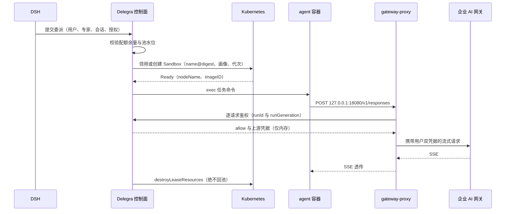

# Delegra 专家智能体 Kubernetes 智能调度设计

## 文档信息

| 项 | 内容 |
| --- | --- |
| 文档编号 | CORP-DSH-DESIGN-024 |
| 文档名称 | Delegra 专家智能体 Kubernetes 智能调度设计 |
| 版本 | V1.0.0 |
| 文档状态 | 评审稿 |
| 密级 | — |
| 作者 | hrygo |
| 编制 | Agent（代拟） |
| 审核 | 待定 |
| 批准 | 待定 |
| 最后更新 | 2026-11-21 |
| 门禁 | 三阶段按 §5 逐阶段验收；目标集群、Cilium、沙箱控制器与企业网关按 §7 取证前不开放生产 |
| 模块状态 | 规划 |

> 编制依据：项目负责人提交的《Forge 专家智能体结合 Kubernetes 智能调度方案》（V0.1.0 草案，2026-11-21），以及 2026-11-21 对 Delegra `origin/deploy` 提交 `2c54db803edcb118c56660cd883c9306e218d1cc4` 中 `packages/plugins/sandbox-providers/kubernetes/` 的静态读码核验。读码只证明当前源码形态，不证明集群行为；本机没有目标集群、Cilium、沙箱控制器与企业网关的运行证据，冷启动与池命中数据均为设计目标值。
>
> 关联文档：[运行时镜像设计](delegra-runtime-images.md)（CORP-DSH-DESIGN-022）、[专家智能体 PRD](../requirements/delegra-experts-prd.md)、[专家接入方案](../plans/2026-11-18-forge-experts-integration-proposal.md)、[专家智能体管理插件详细设计](plugins/forge-experts.md)、[网关契约](../contracts/gateway-contract.md)、[需求基线](../requirements/requirements-baseline.md)。跨仓库跟踪见 [issue #420](https://github.com/hrygo/heluo-forge/issues/420)。

## 1. 结论

专家智能体的执行面落在 Delegra 的 Kubernetes 沙箱插件。当前插件能完成「领用、起 Pod、exec、销毁」，但镜像、配额与凭据都绑定在适配器默认值和单次环境变量注入上：镜像写死 `imageOverride: null`，Pod 没有架构亲和与场景配额，provider Key 经 `envFrom` 进入 `agent` 容器。这套形态可以跑通单机验证，无法支撑按专家画像调度、交互式低延迟、零信任撤权与多租户配额治理。

本设计把执行面拆成四层：DSH 终端层、Delegra 控制面、Kubernetes 执行面、企业边界；对应四项能力：专家画像驱动的动态路由与异构调度、干净态单向预热池、零信任凭据控制点、集群水位感知与弹性反压。四项能力由 `hrygo/Delegra` 的阶段 issue 承接：路由与画像为 #72，凭据与租户调谐为 #73 与 #74，预热池与容量反压为 #75 与 #76；本仓库继续承担设计准入、按摘要选用与真实 Runner 验收。

方案分三阶段推进，每阶段有独立可核对的验收判据。阶段一在现有插件内完成按摘要路由与资源画像，不引入新控制器；阶段二引入受控代理 Sidecar 与 Server-Side Apply 调谐；阶段三引入预热池、优先级与容量反压。阶段依赖是硬性的：没有按摘要路由，池化会把错误镜像放进热池；没有逐请求撤权，池化会放大凭据存活时间。

## 2. 现状与工程断层

2026-11-21 对 Delegra `origin/deploy`（`2c54db803e`）静态读码，确认以下六处与生产调度要求不匹配。源码位置以该提交为准，集群侧行为待目标环境核验。

| 编号 | 维度 | 源码现状 | 生产风险 |
| --- | --- | --- | --- |
| G1 | 镜像路由 | `src/plugin.ts` 的领用路径固定 `resolveImage({ imageOverride: null }, ...)`；`src/image-allowlist.ts` 只做 glob 白名单匹配，`resolveImage()` 返回纯字符串、不解析也不校验 OCI 摘要，override 路径不套用 `imageRegistry` 的镜像库重写；`rewriteRegistry()` 以最后一个 `:` 切 tag，未区分 tag 与 `@sha256:` 摘要，带端口的仓库地址会被误切（本机复跑 `registry.corp.example:5000/org/img` 得到重复前缀）。 | 无法按专家透传 17 个 ARM64 制品的 `name@digest`；摘要能保留属切分巧合而非显式解析，私有库重写与摘要格式都没有校验。 |
| G2 | 冷启动 | 每次领用新建 Sandbox CR 并轮询 Ready，`src/sandbox-cr-orchestrator.ts` 默认 `timeoutMs: 120_000`、`pollMs: 2000`；`src/lease-lifecycle.ts` 说明 Pod 不可原地重启。 | 交互式首次可见结果时间由调度与镜像拉取决定；失效租约只能冷重建。 |
| G3 | 架构与资源画像 | `src/sandbox-cr-builder.ts` 不写 `nodeSelector`；所有场景共用 `250m/512Mi` 到 `2C/4Gi` 的默认配额；`/workspace` 固定 `8Gi`、`/tmp` 固定 `2Gi`，无 `/dev/shm`。 | `codex-java-21` 编译、`codex-test-web` 的 Chromium 沙箱、`codex-office-zh` 并发导出都缺资源；`codex-min` 配额浪费。 |
| G4 | 凭据边界 | `src/secret-manager.ts` 把 `BOOTSTRAP_TOKEN` 与适配器 `envKeys` 写入 per-run Secret，`src/sandbox-cr-builder.ts` 以 `envFrom` 注入 `agent` 容器。 | 工具子进程可读用户模型凭据；撤权或取消后存活进程仍可直连网关，撤销无法按请求收敛。 |
| G5 | 租户调谐 | `src/tenant-orchestrator.ts` 全部走 `createIgnoringAlreadyExists`（首次创建后冻结）；`LimitRange` 写死 `max: 4C / 8Gi`；源码注释已记录 `egressMode` 切换会残留旧模式策略。 | 配额、LimitRange 与网络策略无法在线调整；两种 egress 策略叠加后取交集。 |
| G6 | 容量准入 | 领用前只创建或检查租户 `ResourceQuota`，不读 `status.used/hard`；插件内无池水位概念。 | 突发并发直接把 Sandbox CR 打给集群，触发 Quota 拒绝或 Pending 堆积；交互式与批量任务同队竞争。 |

六项都可在最小改动下分别推进，但共享同一组运行时事实：镜像身份、租约代次（`runGeneration`）、租户配额与出站边界。任何一项单独实施都会在下一阶段被重做，因此按阶段合并交付。

## 3. 架构

四层职责：

1. **终端层（DSH）**：`@` 选人、个人启停校验与 IAM 委派提交，见[专家管理插件设计](plugins/forge-experts.md)。
2. **控制面（Delegra）**：持久队列与容量准入、专家画像路由（镜像摘要、资源画像、`runGeneration` 代次围栏）、逐请求授权判定与任务回执。
3. **执行面（Kubernetes ARM64）**：Sandbox CR 生命周期、租户资源调谐、干净态池领用、双容器隔离执行、任务结束销毁。
4. **企业边界**：受控代理经 Cilium FQDN 白名单访问企业 AI 网关，网关按发起用户鉴权与计量。

```mermaid
flowchart LR
    subgraph 终端层
      DSH[DSH 插件<br/>@ 选人与委派]
    end
    subgraph 控制面
      Q[持久队列<br/>容量准入与反压]
      R[画像路由<br/>name@digest 与资源画像]
      A[逐请求授权<br/>runGeneration 核验]
    end
    subgraph 执行面
      WP[干净态预热池]
      SB[Sandbox Pod<br/>agent 零凭据与 gateway-proxy]
      T[租户资源<br/>SSA 调谐]
    end
    GW[企业 AI 网关]
    DSH --> Q --> R --> SB
    R --> WP --> SB
    SB --> A --> GW
    T -. 配额与出站边界 .-> SB
```

领用序列：



## 4. 分层方案

### 4.1 专家画像驱动的路由与异构调度

领用契约扩展 `AcquireLeaseParams`：`expertId`、`imageOverride`（强制 `name@sha256:`）、`platformDigest`、`resourceProfile`、`priorityClassName`、`runGeneration`，以及任务级 `executionWorkspaceSettings.networkEgress`（已有）。`image-allowlist.ts` 增加不可变摘要解析与强校验，拒绝未带 `@sha256:` 的浮动 tag；`sandbox-cr-builder.ts` 强制写入 `nodeSelector: { "kubernetes.io/arch": "arm64" }`；运行回执记录实际拉取的 `imageID` 与 `nodeName`。

资源按场景画像供给，不再全局共用一套配额：

| 画像 | 覆盖镜像 | Requests → Limits | 专项挂载与调优 |
| --- | --- | --- | --- |
| `light` | `codex-min`、`codex-ops-diag`、`codex-ops-k8s`、`codex-ops-iac`、`codex-sql`、`codex-test-api` | `250m / 512Mi` → `1C / 2Gi` | 高密度混部，优先从池领用 |
| `build` | `codex-java-8/11/17/21/25`、`codex-node`、`codex-go`、`codex-dotnet-10` | `1C / 2Gi` → `4C / 6Gi` | `/workspace` 扩至 `16Gi`；编译阶段允许 CPU Burst |
| `browser` | `codex-test-web` | `1C / 2Gi` → `4C / 8Gi` | `/dev/shm` 挂 `medium: Memory` 的 `1Gi`，支撑非 root 的 `chromiumSandbox` |
| `office` | `codex-office-zh` | `500m / 1Gi` → `2C / 4Gi` | 独立 `/tmp`（`4Gi`）与运行级 `HOME`，避免 LibreOffice 导出争用 |
| `load` | `codex-test-load` | `500m / 1Gi` → `2C / 4Gi` | 绑定独立压测网络策略与更严格的 FQDN、CIDR 白名单 |

五个画像的上限都在当前租户 `LimitRange` 的 `max: 4C / 8Gi` 边界内，阶段一无需修改租户上限即可运行。默认租户 `ResourceQuota` 为 20 Pod、`requests.cpu 10`、`requests.memory 20Gi`，按各画像 Requests 折算可并发的重任务规模有限；扩容与在线调整由 §4.4 的 SSA 调谐承接。

镜像局部性：17 个场景镜像共享 `codex-min` 公共父层。ARM64 节点池以轻量 DaemonSet 预拉取最新已验收的 `codex-min` 与高频派生镜像，把增量层冷拉降到秒级；预拉取只使用 `expert-images-release.json` 中已验收的 `@sha256:` 摘要，不使用浮动 tag。

### 4.2 干净态单向预热池

高频镜像（`codex-min`、`codex-java-21`、`codex-office-zh`）由 `SandboxTemplate` 加 `SandboxWarmPool`（或等价的轻量 WarmPool Controller）维持热备，工作日按时段维持基线水位，夜间与周末缩至 0；低频镜像不建池，靠节点本地公共层加增量冷启。

池的红线是单向：池内 Pod 只运行 `tini -- sleep infinity`，未挂载用户 Secret、未同步工作区、无历史会话；领用时原子 Patch 标签 `paperclip.io/pool-state: warm` 到 `claimed` 并绑定 `runId`、`companyId`、`runGeneration`；任务完成、超时、取消或撤权时调用 `destroyLeaseResources` 彻底销毁，**绝不回池**。任何已注入工作区数据、已执行工具或已绑定代次的 Pod，都不得清理后回放。

同会话追问用短租约而非回池：仅当同一员工、同一 DSH 会话、同一有效授权代次时保留 3 到 5 分钟空闲租约；超时、切号、撤权或关闭会话立即销毁。池的容量与命中（池就绪数、命中数、Claim 等待时长、冷启次数）作为控制面指标暴露，用于水位自动调节。

### 4.3 零信任凭据控制点

`agent` 主容器不持有任何用户模型凭据。同 Pod 增加 `gateway-proxy` Sidecar（静态编译的轻量镜像），主容器只配置 `base_url = "http://127.0.0.1:18080/v1"` 与绑定 `runId` 加 `runGeneration` 的一次性 `PROXY_SESSION_TOKEN`；用户 Key 与 IAM access token 只在 Sidecar 每次转发前向 Delegra 换取，且只在单次请求的内存缓冲中存在。

数据面接口：

- 入口 `POST http://127.0.0.1:18080/v1/responses`，仅放行白名单路径与方法。
- 必传头：`Authorization: Bearer <PROXY_SESSION_TOKEN>`、`X-Paperclip-Run-Id`、`X-Paperclip-Run-Generation`。
- 原样透传企业网关的 SSE，响应头回传 `X-Gateway-Request-Id`；令牌或代次不匹配直接返回 `401/403`，不向控制面或网关转发。

控制面逐请求鉴权（`POST /internal/runner/v1/gateway-authorize`）返回放行凭据或拒绝码：

| 错误码 | 触发条件 | Sidecar 处置 |
| --- | --- | --- |
| `RUN_GENERATION_STALE` | 代次被替代或任务重派 | `409`，阻断且不重试 |
| `TASK_CANCELLED` | 任务取消或租约释放 | `403`，本地代次失效 |
| `USER_AUTH_REVOKED` | 切号、登出、令牌过期或撤权 | `401`，清零内存凭据 |
| `MODEL_NOT_ALLOWED` | 模型超出专家或当次授权范围 | `403`，零网关流量 |
| `BUDGET_EXHAUSTED` | 用户或团队预算不足 | `429/402`，不可重试 |

隔离基线：主容器 `1000:1000`、Sidecar `1001:1001` 防 `/proc` 互读；Sidecar `readOnlyRootFilesystem: true`、`allowPrivilegeEscalation: false`、`drop: ["ALL"]`；两个 Secret 分离，`agent` 容器的 Secret 不含用户凭据。生产集群强制 `egressMode: "cilium"`，按精确 FQDN 放行集群 DNS、Delegra 控制面与企业 AI 网关，关闭 `standard` 模式的全公网 80/443 回退；受监管客户数据（C3/C4）专家启用 `runtimeClassName: kata-fc` 的独立内核隔离。日志只记录请求 ID、代次、状态码与耗时，不记录请求与响应正文。

AIGS 演进：切到「Agent 令牌加 RFC 8693 `sub`/`act` 用户委派」时，只由控制面改变下发内容，Sidecar 与主容器不改代码。该路线另由 [issue #396](https://github.com/hrygo/heluo-forge/issues/396) 取证。

### 4.4 集群水位感知、动态调谐与弹性反压

租户资源从 `read-or-create` 升级为 Server-Side Apply：以 `KubernetesObjectApi` 统一写入，`fieldManager = "paperclip-k8s-plugin"`，`force: true` 只接管本插件声明字段，保留第三方控制器写的注解；`ResourceQuota`、`LimitRange` 与网络策略支持在线调整。`egressMode` 切换时显式删除旧模式残留策略（404 视为成功），消除两套策略取交集的问题。进程内以命名空间为键维护配置指纹缓存，默认 TTL 5 分钟，同指纹未过期直接跳过 7 次 API 往返。

派发前做容量准入：消费端在调用 `acquireLease` 前读取目标租户 `ResourceQuota.status.used/hard` 与对应画像的池可用数；余量不足或集群出现 Pending 时留在持久队列，按 `PriorityClass` 排队并向 DSH 回报 `queued`，不创建 Pending Pod。准入状态机显式化，失败不重发、不返回旧值、不显示成功。

优先级分两级：`paperclip-expert-interactive`（交互式 `@` 委派与池领用，`value: 100000`，可抢占低优）与 `paperclip-expert-batch`（异步长任务，`value: 10000`，不抢占）。节点池配合 Karpenter 或 Cluster Autoscaler，加低优先级 Overprovisioning 占位 Pod，在池 Claim 高频时提前拉起 ARM64 节点。

## 5. 分阶段实施与验收

| 阶段 | 跨仓库 issue | 核心范围 | 阶段验收判据 |
| --- | --- | --- | --- |
| 阶段一 | Delegra [#72](https://github.com/hrygo/Delegra/issues/72) | `image-allowlist.ts` 摘要强校验；`sandbox-cr-builder.ts` 的 `arm64` 亲和、五种画像配额与 `/dev/shm`；`plugin.ts` 解除镜像硬编码并补回执取证 | 同一入口按 `name@digest` 分别调度 `codex-min` 与 `codex-java-21` 到原生 ARM64 节点；错误摘要、错误平台与非白名单镜像在创建 CR 前失败；[#394](https://github.com/hrygo/heluo-forge/issues/394) 的合成会话、工具、取消与回收通过 |
| 阶段二 | Delegra [#73](https://github.com/hrygo/Delegra/issues/73)、[#74](https://github.com/hrygo/Delegra/issues/74) | 受控代理 Sidecar 替代 `envFrom`；租户 SSA 调谐与 `egressMode` 残留清理；生产强制 `cilium` | 两用户并发同一专家互不串扰；旧进程在取消、撤权、切号或过期后的请求全部被拦截且网关零入站；网关回执归属发起人预算；[#395](https://github.com/hrygo/heluo-forge/issues/395) 的对应验收通过 |
| 阶段三 | Delegra [#75](https://github.com/hrygo/Delegra/issues/75)、[#76](https://github.com/hrygo/Delegra/issues/76) | 干净态单向预热池与公共层预拉取；派发前配额反压、PriorityClass 与 Kata 高敏隔离 | 高频专家热池命中耗时以实测记录（目标 1 秒以内，不以目标值代替实测）；压测下无失控 Pending；脏 Pod 回池尝试被拒绝；[#397](https://github.com/hrygo/heluo-forge/issues/397) 的启用与回退验收通过 |

阶段推进的前置条件：

- 阶段一以 `expert-images-v1.0.0` 的已验收摘要和 ARM64 节点池为前置；无节点池时只能在合成环境验证接线，验收保持未完成。
- 阶段二以 [#395](https://github.com/hrygo/heluo-forge/issues/395) 的企业授权契约与目标网关认可逐请求鉴权为前置；未取得时专家入口保持关闭，不以 `standard` 回退放行。
- 阶段三以目标集群的 `agent-sandbox` 控制器版本、Cilium、优先级准入与 Kata 运行时类可用为前置；缺失时该阶段记 `BLOCKED` 并附缺口。

本仓库的实测证据登记在 `docs/design/verification/delegra-k8s-scheduling.md`；证据缺失的能力不得改写为「可用」。

## 6. 红线与治理

- **禁止脏 Pod 回池**：已注入工作区数据、已执行工具或已绑定代次的 Pod 一律走 `destroyLeaseResources` 销毁，不做清理后回放。
- **拒绝浮动镜像标签**：K8s 侧不使用 `:latest` 或无摘要 tag，调度必须锁定经过 `expert-images-release.json` 核验的 `name@sha256:`，保证已受理任务在升级或紧急撤出时可回溯、可复跑。
- **凭据不落盘**：上游凭据只在单次请求内存中存在，不写环境变量、临时文件或跨请求缓存；诊断与日志不出现凭据值。
- **`job` 模式仅作降级兜底**：`batch/v1` Job 不支持多命令 exec 与原生流式文件同步，主路线锁定 `sandbox-cr`，并随 `kubernetes-sigs/agent-sandbox` 的 API 演进核对。
- **门禁只能收紧**：`requireImmutableDigest`、`egressMode`、Sidecar 校验等开关只能收紧权限；配置缺失时 fail closed，不降级放行。

## 7. 证据边界与待确认

已核验：

- Delegra `origin/deploy` 提交 `2c54db803edcb118c56660cd883c9306e218d1cc4` 中 §2 六项的源码形态（静态读码，2026-11-21）。
- 17 个 ARM64 镜像已按 `expert-images-v1.0.0` 发布并登记摘要，见[运行时镜像实测记录](verification/delegra-runtime-images.md)。

未核验：

- 目标集群版本、节点池架构与容量，以及 `kubernetes-sigs/agent-sandbox` 控制器实际版本及其预热池 API。
- Cilium 的 L7 DNS 代理、FQDN 策略与企业网关出站路径的实际行为。
- Sidecar 逐请求鉴权在企业网关侧的身份、在途流处置与撤权时限。
- 冷启动、池命中、Pending 抑制与抢占行为；本设计只给目标值，不给实测结论。

| 待确认事项 | 回答责任方 | 截止门禁 |
| --- | --- | --- |
| 目标集群版本、ARM64 节点池形态，以及是否具备 Karpenter 或 Cluster Autoscaler | 平台运维 | 阶段一实施前 |
| `agent-sandbox` 控制器版本及预热池能力是否可用；不可用时的最小控制器方案 | 平台运维 | 阶段三实施前 |
| Cilium 版本、L7 DNS 代理能力，以及企业网关 FQDN 的实际放行结果 | 平台运维与网络 | 阶段二实施前 |
| Sidecar 镜像的构建、签名与按摘要发布责任方 | Delegra | 阶段二实施前 |
| 企业网关对逐请求鉴权与代次围栏的认可方式、在途流处置与撤权时限 | 网关团队 | 阶段二验收前 |
| C3 与 C4 数据的判定口径及 `kata-fc` 运行时类安装范围 | 安全与平台运维 | 阶段三验收前 |

## 8. 附录

### 8.1 阶段一接口摘要

```ts
export interface ResolveImageInput {
  imageOverride?: string | null;
  platformDigest?: string | null;
}

export interface ResolvedImageRef {
  image: string;
  digest: string | null;
  expectedPlatformDigest: string | null;
  source: "override" | "default";
}

export type ExpertResourceProfileName = "light" | "build" | "browser" | "office" | "load";

export interface ResolvedPodSizing {
  requests: { cpu: string; memory: string };
  limits: { cpu: string; memory: string };
  workspaceSizeLimit: string;
  tmpSizeLimit: string;
  shmSizeLimit?: string;
}
```

`BuildSandboxCrManifestInput` 新增 `nodeSelector`、`priorityClassName`、`workspaceSizeLimit`、`tmpSizeLimit`、`shmSizeLimit`；`kubernetesProviderConfigSchema` 新增 `requireImmutableDigest`（默认 `false`）、`nodeArch`（`arm64`、`amd64`、`any`，默认 `any`）与 `priorityClassName`。

### 8.2 阶段二 Sidecar 协议摘要

```json
{
  "runId": "run_01j...",
  "runGeneration": 3,
  "agentId": "agent_...",
  "requestedModel": "deepseek-reasoner",
  "wireApi": "responses",
  "clientRequestId": "req_01j..."
}
```

放行响应返回 `decision: "allow"`、`leaseExpiresAt`、`upstream.baseUrl` 与 `upstream.headers`；拒绝响应返回 `decision: "deny"`、`code`（对应 §4.3 错误码）与 `retryable`。

### 8.3 阶段三资源清单要点

```yaml
apiVersion: scheduling.k8s.io/v1
kind: PriorityClass
metadata:
  name: paperclip-expert-interactive
  labels:
    paperclip.io/managed-by: paperclip-k8s-plugin
value: 100000
globalDefault: false
preemptionPolicy: PreemptLowerPriority
---
apiVersion: scheduling.k8s.io/v1
kind: PriorityClass
metadata:
  name: paperclip-expert-batch
  labels:
    paperclip.io/managed-by: paperclip-k8s-plugin
value: 10000
globalDefault: false
preemptionPolicy: Never
```

预热池模板的出站策略按 §4.3 的精确白名单构造：默认拒绝全部出入站，仅放行集群 DNS、Delegra 控制面端口与企业网关 HTTPS FQDN。完整清单与逐文件改动在 Delegra 的阶段 issue 中维护，本文只固定判据与边界。
