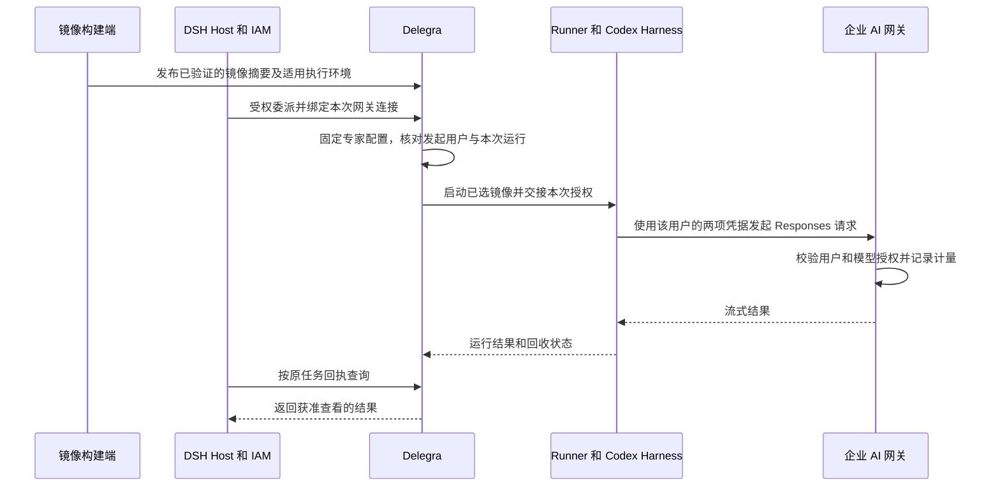

# Delegra 专家智能体运行时镜像设计

## 文档信息

| 项 | 内容 |
| --- | --- |
| 文档编号 | CORP-DSH-DESIGN-022 |
| 文档名称 | Delegra 专家智能体运行时镜像设计 |
| 版本 | V1.0.0 |
| 文档状态 | 评审稿 |
| 密级 | — |
| 作者 | hrygo |
| 编制 | Agent（代拟） |
| 审核 | 待定 |
| 批准 | 待定 |
| 最后更新 | 2026-11-20 |
| 确认人 | 项目负责人（当前用户） |
| 确认日期 | 2026-11-20 |
| 确认事项 | Delegra 组装和调度专家。镜像默认包含 Codex，构建、验收与交付统一使用 `linux/arm64`。镜像方案覆盖受监管机构开发、测试、运维和办公，按 DRY 与 SOLID 复用公共层，在保全 Agent 与 Codex 必需能力的前提下压缩体积。首版使用发起用户的授权，允许把 DSH IAM 获取的网关连接交给本次任务的 Harness 使用。接入 AIGS 后按用户与 Agent 两种身份的权限交集执行。 |
| 适用范围 | 专家的组成、`linux/arm64` 镜像和两阶段身份模型。目标 Runner 与企业接入按 §5 核验。 |
| 门禁 | 固定目标 Runner 后按 §3 验收原生 `linux/arm64` 镜像。企业接入按 §4 核对范围与授权，按 §5 核验实际契约。 |

> 编制依据为[运行时镜像概念简报](../engineering/reviews/2026-11-20-delegra-runtime-images-concepts-brief.md)、2026-11-20 的[本机镜像与模拟网关探针](../engineering/spikes/2026-11-20-delegra-runtime-images/README.md)，以及 Delegra 标签 `deploy/v2026.1106.0-r2` 的构建和 Codex 配置源码。真实 Runner 和企业网关连接待联调。
>
> 关联文档为[专家智能体 PRD](../requirements/delegra-experts-prd.md)、[专家接入方案](../plans/2026-11-18-forge-experts-integration-proposal.md)和[企业 AI 网关契约](../contracts/gateway-contract.md)。

## 1. 概述

**专家智能体 = 镜像 + skills + 工具集合 + 用户令牌。** Delegra 管理专家配置、组装这四项并调度任务。镜像提供 Codex Harness 和本地工具链，skills 定义工作方法，工具集合规定专家可调用的工具和动作。用户在发起任务时授权，目标服务按该用户的有效权限判定调用。

最小镜像提供公共 Codex 层。开发、测试、运维与中文办公按场景派生各自的镜像。Java 8、11、17、21、25 各有独立构建目标。同一镜像可供多个专家使用，专家在每次运行中使用本次任务的工作区、会话和用户授权。 [镜像与 Dockerfile 构建规格](#9-镜像与-dockerfile-构建规格)

## 2. 问题

不同专家依赖不同版本的工具。比如 Java 项目要求指定 JDK，中文办公需要字体及文档导出工具。如果任务开始后再安装，执行结果会依赖当时的软件源和版本。预置并固定镜像能让 Delegra 在派发前选定运行环境，并在排障、复跑和回退时查明任务到底用了哪个版本。

员工从 DeepSeek Harness（DSH）交办任务后，专家的模型调用要计入发起用户。邮件、OA、DevOps 和 Gitee 分别按各服务的用户权限控制访问。首版需要证明 DSH 的用户授权能交接到对应的远端运行，两位用户使用同一个专家时，每次运行都采用发起用户自己的授权。

## 3. 目标与验收

| 目标 | 完成判据 |
| --- | --- |
| 首批两镜像可运行 | 目标 Delegra Runner 在原生 Linux ARM64 环境启动锁定摘要的 `codex-min` 和 `codex-java-21`。核对实际镜像摘要、`linux/arm64` 平台、Runner 与 Codex 可执行文件的架构、Codex 版本、非 root 用户和工作区。Java 镜像用 ARM64 JDK 21 编译并运行样例，任务完成或取消后可核对回收结果。 |
| 体积与必要能力同时验收 | 公共层与每个派生镜像均能完成同一套文件、Git、Shell、Codex stdio 会话和退出检查。真实 Runner 用合成网关完成模型会话和工作区内的工具操作。镜像体积按 ARM64 压缩层及派生增量记录，在相同功能验收通过的候选中选冷拉体积较小的配方。 |
| 工具链镜像可独立演进 | 以共享 Codex 层派生开发、测试、运维、办公镜像。每个目标的 Dockerfile 对应固定的 ARM64 输入与场景验收，Java 各主版本独立发布。发布记录说明镜像摘要、工具链版本和适用 Runner。升级与回退分别用新任务验证，已经受理的任务仍可查到原镜像和配置版本。 |
| 网关调用归属发起用户 | 用户在 DSH 授权本次任务。DSH IAM 提供网关地址、个人网关 Key 和同一用户的 IAM access token，Delegra 交给对应运行的 Harness。Harness 完成一次 `/responses` 推理，网关侧可核对用户、模型授权及用量归属。 |
| 任务授权可隔离和撤回 | 两位用户分别运行同一个专家，核对工作区、会话、工具、凭据及用量归属。验收覆盖通用 Shell、日志和产物的凭据隔离。授权缺失、过期或已撤销时拒绝后续调用，按所属服务契约核对时限。 |

## 4. 范围边界

本设计覆盖镜像及其版本、Delegra 运行环境和 Harness 的任务授权。专家目录、`@` 交互、员工接口及任务回执沿用[专家智能体 PRD](../requirements/delegra-experts-prd.md)和[接入方案](../plans/2026-11-18-forge-experts-integration-proposal.md)。邮箱、OA、DevOps 和 Gitee 的企业工具按各自接入设计验收，首批镜像验证以 Codex 启动、Java 样例和模型调用为主。

项目实施范围以[需求基线 §2](../requirements/requirements-baseline.md#2-范围边界唯一真源)为准。现行基线把跨系统 Agent 调度列在范围之外，个人研发模型访问限定于 DSH。企业启用拟议的专家委派及个人模型访问路径，以项目负责人确定的实施范围和目标网关的实际准入为准。 [个人模型访问约束](../requirements/requirements-baseline.md#46-模型访问身份与专用凭证要求)

AIGS 接入阶段对同一资源和动作同时核验用户与 Agent 身份。双方均有权时才放行，任一身份缺失、失效或无权时拒绝调用。 [IAM 向 AIGS 演进预研](../plans/dsh-plugin-tools/iam-to-aigs-evolution.md)

## 5. 已有证据与待核验事项

本机 Docker 已运行两个 `linux/arm64` 镜像，验证 Codex `0.167.1` 启动、非 root 工作区和 Java 样例。模拟网关收到 Codex 的 `/responses` 请求和两项合成凭据，缺失 IAM access token 时返回 `401`。 [镜像配方与实测记录](../engineering/spikes/2026-11-20-delegra-runtime-images/README.md)

Delegra 固定标签 `deploy/v2026.1106.0-r2`（`25c86a283a9c`）的 `runner-binary.ts` 能识别 Linux ARM64 Runner 可执行文件。该标签的 Daytona fleet 配方固定使用 `linux/amd64` 基镜像，并锁定同架构的 Cursor 和 GitHub CLI。该标签声明的远端 Native Codex 兼容范围为稳定版 `>=0.149.0 <0.161.0`，`Dockerfile.release` 检查 `0.160.0`。npm 注册表有 `0.160.0-linux-arm64` 制品，本机探针的 `0.167.1` 超出 `r2` 的远端兼容范围。 [固定版本与验收依据](../engineering/reviews/2026-11-20-delegra-runtime-images-concepts-brief.md#接入取舍) · [Codex ARM64 包元数据](https://registry.npmjs.org/@openai%2fcodex/0.160.0-linux-arm64)

| 待核验事项 | 依据或责任方 | 验收时点 |
| --- | --- | --- |
| 目标 Delegra 版本、Runner 模式、提供方和镜像来源。核验实际沙箱为原生 `linux/arm64`，并核对 glibc、Codex 版本和启动契约。 | 目标部署记录及实际运行探针 | 目标 Runner 验收前 |
| DSH IAM 如何将同一用户的两项凭据绑定到本次任务，以及 Runner 如何将可用范围限制在 Harness 的网关调用。 | DSH Host 及 Delegra 接入实现 | 企业凭据交接前 |
| Delegra 调用来源准入、实际 `/responses`、用户计量、撤权和退出行为。 | 目标网关及[网关契约](../contracts/gateway-contract.md) | 企业试点前 |

## 6. 技术方案

### 6.1 从镜像发布到任务启动

镜像构建端产出容器镜像及其版本记录。Delegra 的专家配置选择一个已验证的执行环境、skills 版本和工具集合版本。用户从 DSH 交办任务，Delegra 受理时固定这些版本，派发时重验权限和运行环境，Runner 启动相应镜像及 Harness。网关验证当前用户和模型授权，Delegra 依据实际运行回执更新任务。 [专家接入方案 §3—§5](../plans/2026-11-18-forge-experts-integration-proposal.md#3-dsh-选择与委派绑定)

### 6.2 镜像矩阵与版本

| 场景 | 镜像 | 主要能力 |
| --- | --- | --- |
| 公共层 | `codex-min` | 固定版 Codex、Native Runner、Git、`rg`、Shell 和 CA 证书 |
| 开发 | `codex-java-8`、`codex-java-11`、`codex-java-17`、`codex-java-21`、`codex-java-25`、`codex-python`、`codex-node`、`codex-go`、`codex-sql`、`codex-dotnet-10` | 各语言工具链及数据库客户端 |
| 测试 | `codex-test-api`、`codex-test-web`、`codex-test-load` | Newman 接口回归、Playwright 浏览器回归、k6 容量测试 |
| 运维 | `codex-ops-diag`、`codex-ops-k8s`、`codex-ops-iac` | 网络与证书诊断、Kubernetes 清单与查询、基础设施即代码 |
| 办公 | `codex-office-zh` | LibreOffice、中文字体、Pandoc 和 PDF 工具 |

首轮由 `codex-min` 和 `codex-java-21` 验证公共层、派生和真实 Runner。标准目录与按需目标依次扩展。镜像优先级、14 份 Dockerfile 的继承、安装内容和 18 个构建目标的验收以[构建规格](#9-镜像与-dockerfile-构建规格)为准。任务可调用的外部动作由专家工具集合、当次授权和实际服务权限决定。

公共层只装配一次 Codex、Runner 和常用工作区工具。场景镜像继承同一运行约定，添加所需工具与直接依赖。下载、编译及缓存留在构建阶段，最终层保留完整运行资产。镜像体积与启动性能按实测比较，Agent 常用操作和 Codex 协议是裁剪的验收条件。 [镜像构建原则](#92-镜像构建原则)

所有镜像仅构建和交付 `linux/arm64`。构建与启动验收均在原生 ARM64 环境执行。`r2` Native 参考组合使用 Codex `0.160.0` 及 GNU libc 2.39 或更新版本。基础镜像引用摘要，锁定 Codex 与工具链的 ARM64 制品版本和校验值。镜像发布至目标 Runner 获准访问的制品源，发布记录保存摘要、平台、构建输入、工具链、软件物料清单、构建来源证明、适用 Runner 与验收结果。探针配方用于复现共享层和工具链，部署配方还须覆盖目标 Runner 的启动及会话协议。 [本机镜像与模拟网关探针](../engineering/spikes/2026-11-20-delegra-runtime-images/README.md) · [Paperclip Runner 平台要求](https://docs.paperclip.ing/reference/adapters/paperclip-runner/)

### 6.3 Delegra 如何选用镜像

专家引用 Delegra 维护的执行环境。维护者在执行环境中配置镜像来源、目标 Runner 和平台，任务输入只选择获准的专家。任务受理时固定执行环境、镜像摘要、skills 和工具集合版本。派发按受理记录选择同一版本并核对实际环境。快照模式同时记录提供方的不可变快照标识及其来源镜像。运行回执关联请求、任务和运行代次，记录实际启动的镜像或可查证的快照、平台和 Codex 版本。

| 执行路径 | 固定标签源码证据 | 详细设计约束 |
| --- | --- | --- |
| Daytona Native | `packages/plugins/sandbox-providers/daytona/src/plugin.ts` 将环境的 `image` 或 `snapshot` 传给沙箱创建。快照资格验证可解析不可变 ID。该标签的 fleet 镜像为 `linux/amd64`。 | 接入依赖目标服务支持自定义 ARM64 镜像和原生 ARM64 沙箱。按所选模式核对镜像摘要或快照来源，并验证实际 `app-server`、工作区及退出。 |
| Kubernetes | `packages/plugins/sandbox-providers/kubernetes/src/plugin.ts` 的领用路径把 `imageOverride` 设为 `null`。`image-allowlist.ts` 支持检查 override，当前启动从适配器的 `runtimeImage` 解析镜像。 | 选用此路径时先证明专家配置能选择并追溯到指定镜像，且 Pod 被调度到实际 ARM64 工作节点。适配器默认镜像的配置及 allowlist 单独核验。 |
| `codex_local` | `packages/adapters/codex-local/src/server/runtime-config.ts` 可将 `PAPERCLIP_CODEX_PROVIDERS` 映射为 Codex 配置。 | 此证据适用于直接适配器。Native Runner 通过自己的 `app-server` 启动与配置入口验收。 |

目标组合需要同时验证镜像拉取和原生 ARM64 启动。指定镜像、平台、固定版 Codex 或必要的 Runner 能力不满足时，任务报告启动失败。升级或回退切换新受理任务引用的已验证 ARM64 环境版本，原任务按已固定的版本追踪和对账。 [固定版本与验收依据](../engineering/reviews/2026-11-20-delegra-runtime-images-concepts-brief.md#接入取舍)

### 6.4 DSH 网关授权交接

1. **DSH 确认当前用户和任务。** Host 核对真实提交、选择的专家、当前 IAM 会话与本次授权。`resolveGatewayConnection()` 读取同属主个人网关 Key 和 `baseURL`，`getAccessToken()` 提供当前 IAM access token。Host 须在受控交接前把属主、会话、凭据版本和到期时间绑定到同一次提交，并复验账号与配置在异步读取期间仍有效。现有模型路径的 `captureModelSession()` 提供同一登录代次的检查语义，现有读取接口各有独立入口。 [Host 凭据接入](../../packages/forge-iam/docs/credential-access.md#33-dsh-host-插件宿主服务)
2. **Delegra 按实际运行交接。** 员工接口依据自身接受的凭据核对发起人、组织和专家调用权限。网关连接在受信通道内与该用户、专家、请求、任务和运行代次绑定。任务和派发记录只保留归属、有效期及受控引用，每次取用都重新核对当前运行和授权。两项秘密仅由本次运行使用，授权到期时间取本次用户授权与 IAM access token 的较早到期时间。刷新由 DSH Host 管理。授权过期时沿用「待用户」状态，等待原用户重新授权。归属无法核实时阻断交接并核对原任务记录。
3. **Runner 在 Harness 启动边界消费。** 经目标环境验证可隔离的路径，将两项凭据交给本次 Codex Provider。可信配置以 `base_url` 指定获准的企业网关，`wire_api` 选 `responses`，通过 `env_key` 和 `env_http_headers` 引用运行时值。Native Runner 在 `codex_provider.rs` 按名单向 `app-server` 传递环境。任务级配置和两项凭据的交接需在该启动路径接线并实测。加密传输、运行时私有注入与短期保管复用部署环境已有能力，具体接口随目标环境核验。 [Codex 0.160.0 配置定义](https://github.com/openai/codex/blob/rust-v0.160.0/codex-rs/core/config.schema.json)
4. **约束工具执行边界。** 工作区和 skills 可被本次任务读取，可信 Provider 配置和凭据由托管运行环境拥有。`shell_environment_policy` 约束命令继承的环境变量。隔离验收同时覆盖文件、进程、工具出站网络及日志，证明凭据限于 Harness。任一关键边界缺少目标 Runner 证据时，企业凭据调用入口保持关闭，镜像启动与协议验证使用合成凭据。 [Codex 0.160.0 配置定义](https://github.com/openai/codex/blob/rust-v0.160.0/codex-rs/core/config.schema.json)
5. **网关验证并记账。** 交接前将 `baseURL` 与目标环境获准的 HTTPS 网关地址核对。Harness 仅向获准的 `POST ${baseURL}/responses` 发送 `Authorization: Bearer …`、`X-IAM-Token` 和 `X-Consumer-Type: personal`。实际网络来源和客户端身份按网关开放的接入路径校验。网关验证两项凭据和模型授权，记录真实用户与团队用量。 [网关身份、用途与凭据](../contracts/gateway-contract.md#41-身份用途与凭据) · [网关服务端点契约](../contracts/gateway-contract.md#44-服务端点契约与流式协议)

接入改动落在三个边界。DSH Host 在可信提交出口封装任务授权。Delegra 的受限员工接口受理任务，派发端交接受控凭据引用。Native 路径的 `native-session-executor.ts` 准备 Harness，`codex_provider.rs` 启动 Provider 并限定继承环境。接入契约定义获准的授权交接方式、秘密的运行时取用以及任务状态。 [接入方案的权限与数据边界](../plans/2026-11-18-forge-experts-integration-proposal.md#4-delegra-权限隔离与数据)

邮箱、OA、DevOps 和 Gitee 的凭据由各自受控工具入口按本次授权消费。工具动作用当前专家的配置和当次任务授权取交集，资源访问由对应服务判定。接入 AIGS 时，在同一调用入口同时绑定当前用户和 Agent 身份，按目标授权接口校验同一资源与动作。 [AIGS 演进预研](../plans/dsh-plugin-tools/iam-to-aigs-evolution.md)

### 6.5 排队、失败与回收

| 场景 | 处理与验收 |
| --- | --- |
| 排队期间过期、切换账号或撤权 | 派发再次核对当前运行及授权状态。核验失败的任务停止相关调用，由原用户重新授权。验证排队越过有效期及旧用户授权交接。 |
| 提交丢回执、Worker 重启或迟到结果 | 通过原请求回查权威任务与运行代次。未决保持待核对。重派前核实前次执行结果并重新校验可用授权。旧代次交接、工具答复和结果均须通过当前代次检查。 |
| 网关拒绝或流中断 | 凭据缺失、身份不一致、到期或撤销按网关契约处理。已建流按契约处置。对状态不明的请求先核对结果，适用的限流重试遵循网关的退避和副作用判据。 |
| 任务结束、取消或环境回收失败 | 关闭本次 Harness 的凭据访问，再按现有执行环境机制回收凭据和工作区。回执可查任务归属及回收结果。未确认回收的环境保持隔离并进入对账。 |

运行验收先用合成凭据跑通镜像、真实 Runner 和协议请求，再以获准的企业测试用户核对网关 `/responses`、用户计量、撤权及跨用户隔离。两类验收使用实际启动路径，分别记录版本、环境、请求关联和结果。 [接入验收与恢复](../plans/2026-11-18-forge-experts-integration-proposal.md#61-待实测项) · [网关生命周期约束](../contracts/gateway-contract.md#411-生命周期与失败约束)

## 7. 方案取舍

### 7.1 镜像形态

| 方案 | 收益与代价 | 取舍 |
| --- | --- | --- |
| 公共 Codex 层与场景镜像 | 同一公共层支持多个专家，语言或办公工具可独立发版。每个新增目标仍需构建和验证工具链。 | 采用。以最小镜像和 Java 21 验证派生与复用，每个所需 Java 主版本单独出镜像。 |
| 全工具单镜像 | 维护一个镜像入口，所有任务拉取相同的大镜像，各套工具的更新和验收耦合。多个 JDK 还需在任务运行时选择。 | 场景工具按已确认的镜像编排发布。 |
| 任务启动时安装工具 | 可以临时扩展场景，启动依赖软件源可用性、下载时间和版本解析结果。 | 将首轮工具链放在构建阶段固定，在 Runner 上验证启动和使用。 |

### 7.2 模型网关认证与费用归属

此处的调用者指**发起并授权当前任务的自然人**。同一个已装配的专家可服务不同调用者，每次推理的积分与费用按该次任务获准的调用者归属。模型调用的有效权限仍是**调用者当前权限 ∩ Agent 当前权限**，本次授权范围进一步约束具体请求。

| 方案 | 网关如何确认身份 | 权限与计量 | 适用条件与代价 |
| --- | --- | --- | --- |
| 用户凭据直连 | 本次 Harness 使用 DSH IAM 取得的个人网关 Key 和 IAM access token。 | 首版按 §6 由 Delegra 约束专家配置和任务授权，网关执行当前用户的模型权限及成员和团队预算。 | 复用受管个人访问契约。须实测 Runner 内两项用户凭据的隔离、Delegra 来源准入和 `/responses`。 |
| Agent 令牌认证，调用者计费 | 专家的 Harness 使用该 Agent 的网关访问令牌，同时提交网关可验证的本次用户委派。 | 网关或其认可的授权服务核验双方对同一模型和动作的当前权限。网关从已核验的委派确定调用者、成员与团队预算，按该归属管控并扣减实际用量。 | Harness 只持有 Agent 令牌与受限任务委派。个人网关 Key 和 IAM access token 留在原有的授权边界。新增依赖是受信委派、服务端双主体授权和调用者计量。 |

网关 `V2.2.0` 目标契约分别描述个人访问和无人值守应用访问。应用凭据归属服务与系统代码，现有计量维度包括成员、团队、凭证和模型。应用路径需要补充「按已验证的发起用户扣减预算」及网关校验双主体权限的契约。Delegra `deploy/v2026.1106.0-r2` 的 `packages/db/src/schema/cost_events.ts` 已有 `agentId`、`responsibleUserId` 和 `providerRequestId`。对账时核对这些字段与网关回执的实际映射，扣费账户与额度以网关验证和结算为准。 [网关身份与凭据](../contracts/gateway-contract.md#41-身份用途与凭据) · [网关额度与计量](../contracts/gateway-contract.md#42-额度与计量)

### 7.3 Agent 令牌路线的调用流程

1. **授权。** 用户在 DSH 以本人身份选定专家并授权本次任务。Delegra 受理任务并确定运行代次后，由受信签发方核对本次授权与任务归属，签发仅供目标 LLM 网关使用的短时委派。委派绑定组织、用户、Agent、任务、运行代次、模型与动作范围，交给对应运行的 Harness。
2. **鉴权。** Harness 使用 Agent 的网关访问令牌及任务委派调用 `/responses`。网关验证 Agent 令牌，并验证委派签发方、受众、有效期和撤权状态。网关从绑定到运行的 Agent 令牌或受信运行连接确认实际运行，再与委派比对。网关以核验出的用户和 Agent 身份判定双方对当前模型与动作的权限。委派可采用签名的短时证明，或通过受信服务查询的授权引用。具体载体由接入契约确定。
3. **计量。** 网关从委派的用户身份映射其有效计费账户与团队，在推理前用该账户执行预算检查。实际用量按同一账户结算。Agent 身份用于执行审计和凭证级限流，网关回执关联用户、Agent、任务和请求。流式中断后按实际计量回执核对，重复回执按同一真实模型请求去重。Delegra 关联回执以展示和对账。
4. **失效。** 任一身份失效、权限无法判定、用户授权撤销、任务结束或账户不可确认时，拒绝受影响的新模型请求。撤权覆盖签发与实际网关调用，时限沿用适用的企业网关要求。 [网关生命周期约束](../contracts/gateway-contract.md#411-生命周期与失败约束)

AIGS 预研中的双标识令牌可以承载同一授权语义。采用 OAuth 令牌交换时，用户作为主体，Agent 作为执行者，短时令牌可用 `sub` 和 `act` 表达两者。令牌交换与用户委派的实时撤回、有效权限和积分结算分别取证。 [AIGS 演进预研](../plans/dsh-plugin-tools/iam-to-aigs-evolution.md) · [RFC 8693 委派语义](https://www.rfc-editor.org/rfc/rfc8693.html#section-1.1) · [RFC 8693 执行者声明](https://www.rfc-editor.org/rfc/rfc8693.html#section-4.1)

### 7.4 候选路线验收及采用条件

| 验收场景 | 可核对结果 |
| --- | --- |
| 甲、乙分别调用同一个专家并获双主体授权 | 同一个 Agent 身份出现在两条记录中。甲、乙各自的额度按实际推理扣减，另设的专家维护者和默认应用账户的额度无此项扣减。 |
| 仅人有权、仅 Agent 有权，或委派缺失、失效或串用 | 对指定模型和动作拒绝请求。网关拒绝错用户、错 Agent、错任务、错代次或错目标的委派，且无对应推理扣费。 |
| 人的预算用尽、任一方撤权或任务取消 | 网关按实际原因拒绝受影响的新请求。核对撤权和取消是否在规定时限内阻断后续调用。在途请求按真实网关回执结算。 |
| 重复收到同一条推理回执或客户端中断 | 每条真实模型调用按网关回执对账。同一回执重复交付只结算一次，未知结果保留待核对。 |

§6 是已确认的首版技术方向。Agent 令牌路线具备调用者归因和权限交集的契约及实测证据后，可作为首版选型重新比较。两条路线共用镜像矩阵和 Runner 验证。新增取证集中在委派签发与校验、网关授权及调用者预算结算，实施成本以目标环境的现有支持度为准。

## 8. 实施计划

任务 1、2 交付首批两份可由已选 Runner 原生启动并按摘要查证的 `linux/arm64` 镜像。任务 3、4 验证按发起用户授权和计量的网关接入，任务 5 扩展受监管机构镜像目录。以 `deploy/v2026.1106.0-r2` 的 Native Runner 源码和 Codex `0.160.0` ARM64 制品作为参考构建组合。镜像配方交付路径为 Delegra 的 `docker/agent-runtime/experts/`，构建职责和各目标验收见[构建规格](#9-镜像与-dockerfile-构建规格)。沙箱提供方、实际部署版本和获准制品源在任务 2 核定。

下列文件路径以所列仓库根目录为基准。任务 1 可独立进行本地验证。任务 2 依赖已确定的 Runner 和试验环境。任务 3、4 的企业调用依赖实际人员授权、受限员工接入及目标网关契约，范围按[需求基线 §2](../requirements/requirements-baseline.md#2-范围边界唯一真源)和[专家接入方案](../plans/2026-11-18-forge-experts-integration-proposal.md#6-恢复后的阶段与验收)核对。

### 8.1 任务 1 · 构建首批两个镜像

| ARM64 构建输入 | 固定来源 |
| --- | --- |
| 参考运行底座 | `node:24.21.0-trixie-slim@sha256:173f125896c3b47ddf056734c7ea789d04595a6a08769a8f78e0df642781fb66` 的 `linux/arm64` 清单，本机探针实测 glibc `2.41`。精简候选的 Debian slim 与官方原生包摘要见[构建原则](#92-镜像构建原则)。 |
| Runner 构建 | `rust:1.97-bookworm@sha256:6e957ef098dcc77d33e310261e4ed5843bb108d5c3b5dc2b476cbc8b6caf53fa`。源码和 `Cargo.lock` 取自 `r2` 提交 `25c86a283a9c787a01911c714618d78df7552af7`，复用该标签的 `runnerd-build` 编译命令与构建输入。 |
| Java 工具链 | 从 `maven:3.9-eclipse-temurin-21@sha256:71a6832f657180ea206901ffc548c0e73a257cb09b4912619177586d0268d59c` 提取 ARM64 JDK 和 Maven。 |

| 仓库与文件 | 动作与理由 |
| --- | --- |
| Delegra `docker/agent-runtime/experts/Dockerfile` | 新建 ARM64 `runnerd-build` 阶段，以 `cargo build --locked --release -p paperclip-runner-core --bin paperclip-runnerd` 构建。以独立阶段准备 Codex 完整运行资产，最终层只复制运行所需文件和工具。沿用 UID/GID `1000:1000`、`/workspace` 和 `tini` 命令入口。构建时检查 `BUILDOS`、`BUILDARCH`、`TARGETOS` 与 `TARGETARCH` 均对应 `linux/arm64`。 |
| Delegra `docker/agent-runtime/experts/Dockerfile.java` | 新建共用 Java 配方。`codex-java-21` 从固定工具链阶段复制 `/opt/java/openjdk` 与 `/usr/share/maven`，使用 Bake 传入的最小镜像作为运行层。其他 Java 主版本按各自固定的工具链摘要增加目标。 |
| Delegra `docker/agent-runtime/experts/package.json`、`docker/agent-runtime/experts/package-lock.json` | npm 参考构建使用最小清单及锁文件，以 `npm ci` 固定安装 `@openai/codex@0.160.0` 和同版本 `linux-arm64` 制品。采用完整原生包时，在 Bake 固定该归档的版本和摘要，交付配方采用通过验收的安装路径。 |
| Delegra `docker/agent-runtime/experts/Dockerfile.dockerignore` | 将仓库根目录构建上下文限于此配方目录、`packages/paperclip-runner/runner/` 的 `Cargo.toml`、`Cargo.lock` 和 `crates/`，以及该 Runner 包的 `protocol/`、`acpx-profiles.json` 和 `antigravity-distributions.json`。 |
| Delegra `docker/agent-runtime/experts/.dockerignore`、`docker/agent-runtime/experts/debian.sources` | 前者限定场景镜像的目录上下文，后者固定受信的版本化 Debian 构建软件源。公共层继承同一软件源约定。 |
| Delegra `docker/agent-runtime/experts/buildx-bake.hcl` | 新建两份镜像的入口，固定 `platforms = ["linux/arm64"]`。Java 目标使用 `target:codex-min` 命名上下文复用公共层。 |
| Delegra `tests/runner-e2e/expert-runtime-images-smoke.mjs` | 新建本地冒烟测试，接收最小镜像与 Java 镜像两个引用。断言实际平台、可执行文件架构、基础层复用、用户、版本、中文工作区、Git 与归档。测试进程从容器外驱动 `app-server` stdio 握手和 EOF 退出，Java 镜像执行编译运行样例。 |
| HeluoForge `docs/design/verification/delegra-runtime-images.md` | 新建实测记录，写实际源码版本、构建输入与镜像摘要、平台、体积、构建及冷启动耗时、基础层增量和测试结果。 |

- [ ] 先写冒烟断言。两份镜像的 OCI 平台均为 `linux/arm64`，容器内 `uname -m` 返回 `aarch64`，`paperclip-runnerd` 和 Codex 的 ELF 目标为 AArch64。两个镜像均报告 `codex-cli 0.160.0`。通过默认命令入口执行普通用户的工作区操作、Codex `app-server` 初始化及退出，断言见[运行验收](#923-agent-与-codex-运行验收)。`paperclip-runnerd --build-metadata` 报告 `dial_ws_loopback`、`dial_wss`、`listen_ws`。Java 镜像用 `javac --release 21` 编译并运行样例，`mvn --version` 核对 ARM64 JDK 与版本。
- [ ] 在固定源码基线和原生 ARM64 BuildKit 节点上执行 `docker buildx bake -f docker/agent-runtime/experts/buildx-bake.hcl --print codex-min codex-java-21`，核对阶段和平台。执行 `docker buildx bake -f docker/agent-runtime/experts/buildx-bake.hcl --load codex-min codex-java-21`，得到本地测试标签 `paperclip-expert/codex-min:arm64-local` 和 `paperclip-expert/codex-java-21:arm64-local`。
- [ ] 用 `node tests/runner-e2e/expert-runtime-images-smoke.mjs paperclip-expert/codex-min:arm64-local paperclip-expert/codex-java-21:arm64-local` 在 `--network none` 下验证参考产物。用同版 Codex 完整原生包试装精简候选，对相同镜像角色复跑同一套测试。验证架构、版本、工具缺失和制品校验失败的反例，记录产物摘要、平台、体积和压缩层增量。通过的候选进入任务 2。

本机探针提供共享层、运行用户和 JDK 样例，`r2` 源码提供 Native Runner 编译入口。ARM64 Runner 构建、镜像产物及所选提供方的启动契约由本任务与任务 2 验收。 [本机镜像探针](../engineering/spikes/2026-11-20-delegra-runtime-images/README.md) · [Docker 多平台构建](https://docs.docker.com/build/building/multi-platform/)

### 8.2 任务 2 · 验证 Delegra 实际启动、版本固定与回收

| 仓库与文件 | 动作与理由 |
| --- | --- |
| HeluoForge `docs/design/verification/delegra-runtime-images.md` | 追加目标 Runner 版本、提供方与模式、执行环境、镜像或快照身份，以及各实测场景的通过或阻塞结果。 |
| HeluoForge `docs/design/README.md` | 实测记录形成后，在 §2.2 增加运行时镜像的验证入口。 |

- [ ] 确认目标提供方有原生 ARM64 节点并支持每个执行环境选用固定镜像。在获准的试验制品源登记两个候选摘要，核对各摘要提供 `linux/arm64` 清单。按现有执行环境入口配置两个测试专家。采用快照时登记可追溯到对应 ARM64 镜像摘要的不可变快照。验收记录节点平台、实际沙箱的 `aarch64` 与 glibc、实际镜像或快照身份和启动的 Codex。
- [ ] 以合成任务分别启动两个专家。通过试验环境中的模拟 `/responses` 验证 `app-server` 会话、至少一次 Shell 操作和文件编辑，核对 Git 差异、工具调用事件、退出及产物回收。确认 Codex 来自指定镜像，实际执行版本与该环境的构建记录一致。按相同功能与运行约定验收精简候选和参考产物，选用通过验收且冷拉量较小的配方。
- [ ] 演练摘要不可拉取、平台不匹配、Runner 或 Codex 版本不匹配、运行中取消。核对任务故障或取消回执以及环境清理状态，尚待确认的回收进入对账。
- [ ] 受理一个任务后更新同专家的环境版本，再受理新任务，核对两者各自使用已固定的镜像、skills 和工具集合。回退新任务引用，并验证原任务的回执仍能查询。

### 8.3 任务 3 · 接通 DSH 用户凭据与 Harness

在任务 2 通过后，核对三项接入依据。DSH 可信提交能绑定原用户与所选专家。Delegra 受限员工入口能核验同一用户、任务与运行代次。网关允许该来源和客户端使用同属主双凭据调用 `/responses`。由实际部署的受控通道确定凭据交接接口，再启用以下接线。 [可信提交及受理](../plans/2026-11-18-forge-experts-integration-proposal.md#3-dsh-选择与委派绑定) · [网关端点](../contracts/gateway-contract.md#44-服务端点契约与流式协议)

Host 交接以已核验的发起人、原 DSH 会话、专家、请求和用户授权到期时间为输入。受控回调消费 `baseURL`、个人 Key、IAM access token 与两项凭据的绑定和有效期。Delegra 按已受理的组织、发起人、专家、任务和运行代次取用授权，队列持有受控引用与过期时间，Harness 取得本次调用所需的连接。具体传输字段以已核验的员工接口和凭据通道为准。

| 仓库与文件 | 动作与理由 |
| --- | --- |
| HeluoForge `packages/forge-iam/src/expert-gateway-handoff.mjs`、`packages/forge-iam/src/service.mjs` | 新建 Host 内部交接模块，由现有服务装配受限调用入口。消费已验证的委派及当前 IAM 会话，复用 `captureModelSession()` 的代次判断、`resolveGatewayConnection()` 的属主检查和 Host 的访问令牌生命周期。在实际交接前对用户、Key 版本、地址与有效期复验，由受控发送回调消费连接。 |
| HeluoForge `packages/forge-iam/test/expert-gateway-handoff.test.mjs` | 新建合成验证，覆盖取凭据期间换账号或切换凭据、到期、旧授权与重复提交。断言未授权时发送回调零调用。 |
| Delegra `server/src/services/native-runtime/expert-gateway-authorization.ts`、`server/src/services/native-runtime/native-session-executor.ts` | 新建前者作为本次运行的授权消费模块，修改后者以接入 Native Harness 准备入口。比较已核验任务和授权的用户、专家、任务及运行代次，按有效期决定能否启动模型调用。 |
| Delegra `server/src/services/native-runtime/expert-gateway-authorization.test.ts`、`server/src/services/native-runtime/native-session-executor.test.ts` | 新建前者覆盖两个用户并发、引用重复领取、过期与旧代次、取消与恢复。更新后者，从正常 Native 启动入口验证受控消费。 |
| Delegra `packages/paperclip-runner/runner/crates/runner-core/src/codex_provider.rs` | 在实际 `app-server` 启动处接入每次运行的 Provider 配置及私有凭据，复用已有启动和环境策略。在同文件测试段加启动环境与命令环境隔离的断言。 |
| HeluoForge `docs/contracts/gateway-contract.md`、`docs/design/verification/delegra-runtime-images.md` | 将获准接入方式、客户端与来源、撤权约束写入契约，实测记录只写所验版本、系统回执与结果。 |

- [ ] 定向验收 Host 绑定与 Native 消费。Host 侧执行 `node --test packages/forge-iam/test/expert-gateway-handoff.test.mjs`。Delegra 侧执行 `pnpm exec vitest run server/src/services/native-runtime/expert-gateway-authorization.test.ts server/src/services/native-runtime/native-session-executor.test.ts`。Runner 侧执行 `cargo test --locked --manifest-path packages/paperclip-runner/runner/Cargo.toml -p paperclip-runner-core codex_provider`。
- [ ] 以实际 Runner 和合成凭据执行 `/responses`，核对 `Authorization`、`X-IAM-Token`、个人用途声明及运行归属。检查 Shell、文件、其他任务、日志、产物、停止和回收边界。测试换账号、旧运行与过期时，客户端进入可核对的拒绝或待用户状态。
- [ ] 用获准的企业测试账号联调。核对成功调用的实际用户、模型授权和计量，验证缺失凭据、错配、任务取消以及凭据撤权后的新请求。测试耗尽预算和中断流时的回执与状态。通过后才开放对应的企业接入路径。 [接入验收场景](../plans/2026-11-18-forge-experts-integration-proposal.md#61-待实测项) · [凭据失效约束](../contracts/gateway-contract.md#411-生命周期与失败约束)

### 8.4 任务 4 · 取证 Agent 令牌与调用者计费

| 仓库与文件 | 动作与理由 |
| --- | --- |
| HeluoForge `docs/design/verification/delegra-runtime-images.md` | 增记目标网关和身份系统是否支持 Agent 认证、运行级委派校验、双主体权限与调用者计费，附可对账的实际请求记录。 |
| HeluoForge `docs/contracts/gateway-contract.md` | 选定该路线并取得真实契约后，写入 Agent 令牌用途、网关接受的委派载体、双方授权和撤权判据，以及调用者扣费与结算回执约束。 |

- [ ] 查实 Agent 注册及签发入口、委派与运行的可信绑定、网关查询双方当前授权的能力，以及用量按发起用户映射的账本接口。以实际契约确定令牌承载和网关接缝，再核定双方逐文件接线清单。
- [ ] 通过同一专家运行甲、乙两次任务，核对单一 Agent 身份与两个用户的真实额度扣减。仅用户有权、仅 Agent 有权、委派串用或账户缺失时，从网关记录确认请求被拒。
- [ ] 演练两方分别撤权、任务取消及重复和迟到回执。核对新请求停止、已发生用量准确归属，以及同一请求的结算去重。用实际回执判断此路线的准入和与首版方向的取舍。

### 8.5 任务 5 · 构建开发、测试、运维和办公镜像目录

以任务 1 的公共层及 Java 配方为基础，按[构建规格](#93-逐份-dockerfile-构建内容)加入 16 个派生目标。以下配方及工具锁文件路径相对于 Delegra 的 `docker/agent-runtime/experts/`。

| 文件 | 动作与理由 |
| --- | --- |
| `Dockerfile.python`、`Dockerfile.node`、`Dockerfile.go`、`Dockerfile.dotnet`、`Dockerfile.sql` | 新建开发场景配方，分别提供 Python 虚拟环境、Node/TypeScript、Go、.NET SDK 和 SQL 客户端。 |
| `Dockerfile.test-api`、`Dockerfile.test-web`、`Dockerfile.test-load` | 新建接口、浏览器及容量测试配方，分别锁定 Newman、Playwright/Chromium 和 k6。 |
| `Dockerfile.ops-diag`、`Dockerfile.ops-k8s`、`Dockerfile.ops-iac` | 新建诊断、Kubernetes 清单处理和 OpenTofu 配方，后两者复用诊断层。 |
| `Dockerfile.office-zh` | 新建中文办公配方，锁定 CJK 字体、LibreOffice、Pandoc 和 PDF 检查工具。 |
| `tooling/node/package.json`、`tooling/node/package-lock.json`、`tooling/test-api/package.json`、`tooling/test-api/package-lock.json`、`tooling/test-web/package.json`、`tooling/test-web/package-lock.json` | 新建场景工具清单和锁文件，固定 CLI 和其依赖的完整性。 |
| `buildx-bake.hcl`、`.dockerignore` | 加入场景目标，固定每个目标的 ARM64 制品来源和校验值。`Dockerfile.java` 复用于其他四个 JDK。场景上下文加入所需 Dockerfile 和锁文件。 |
| Delegra `tests/runner-e2e/expert-runtime-images-smoke.mjs` | 扩展为按目标执行公共断言和[场景样例](#93-逐份-dockerfile-构建内容)，保留任务 1 的两镜像基础层复用检查。 |
| HeluoForge `docs/design/verification/delegra-runtime-images.md` | 追加各镜像的配方、固定输入、实测摘要、架构、构建与启动耗时、大小及 Runner 验收。 |

- [ ] 按[目录顺序](#91-目录与选型依据)加入标准目标，再按项目核定的版本和任务需求完成其余配方。`buildx bake --print` 确认 18 个目标各自使用正确 Dockerfile 和父层，Java 五个目标的 JDK 主版本与 ARM64 摘要逐项核对。
- [ ] 在原生 ARM64 环境分目标构建，以同一套公共冒烟和对应的场景样例验证精简前后的能力与体积。每个目标核对固定版本、非 root 用户、实际架构、可写工作区和 Codex 协议。浏览器测试另验 Chromium 沙箱及清理，办公另验 CJK 字体、三类文件转 PDF 和版式。构建失败和功能不符按目标记录。
- [ ] 按[制品与运行验收](#94-构建与发布验收)记录 SBOM、构建来源和精确版本，完成任务 2 的真实 Runner 拉取、启动、取消和回收检查。通过后登记对应镜像与适用场景。公共层更新时重建受影响的目标，核对按摘要切换与回退。

交付记录保留命令、执行环境、版本、结果与耗时。计划与契约交付执行 `pnpm check` 与 `git diff --check`。每项实现用其具名测试和实际入口分别验收，按镜像、Runner、网关请求及用户归属核对证据。

## 9. 镜像与 Dockerfile 构建规格

调研与制品核验日期为 2026-11-20。

### 9.1 目录与选型依据

目录覆盖受监管机构常见的后端工程、数据分析、前端开发、接口与浏览器测试、平台运维和中文文档处理。FINOS 与 Linux Foundation 的 2026 年报告从行业从业者参与的公开仓库中观察到 Python、TypeScript、Go、Java 等语言，以及容器、Kubernetes、API、测试和文档等主题。CNCF 的两项机构实施案例分别提供 Kubernetes 平台和应用交付的参照。以下顺序结合这些证据与本项目的试点需求，机构存量技术、目标版本和实际使用量通过项目清单核验。 [FINOS 2026 报告图 4—6](https://www.linuxfoundation.org/hubfs/Research%20Reports/StateofOpenSourceinFinancialServices_2026_Report_110226.pdf?hsLang=en#page=12) · [CNCF 容器平台案例](https://www.cncf.io/case-studies/china-merchants-bank/) · [CNCF 应用交付案例](https://www.cncf.io/case-studies/cmbc/)

| 顺序 | 镜像 | 场景 |
| --- | --- | --- |
| 试点两项 | `codex-min`、`codex-java-21` | 验证公共层、Java 派生、Delegra 启动和任务回收 |
| 标准目录 · 开发 | `codex-java-17`、`codex-python`、`codex-node`、`codex-go`、`codex-sql` | 后端服务、数据处理、前端与工具开发、SQL 开发和诊断 |
| 标准目录 · 测试 | `codex-test-api`、`codex-test-web` | 接口回归、交易或审批流程的浏览器回归 |
| 标准目录 · 运维 | `codex-ops-diag`、`codex-ops-k8s` | 网络与证书诊断、Kubernetes 排障和清单校验 |
| 标准目录 · 办公 | `codex-office-zh` | 中文 Word、Excel、PPT 处理与 PDF 导出 |
| 按项目需求 | `codex-java-8`、`codex-java-11`、`codex-java-25`、`codex-dotnet-10`、`codex-test-load`、`codex-ops-iac` | 存量或指定 JDK、Linux .NET 项目、容量回归和基础设施即代码 |

共 18 个 `linux/arm64` 构建目标、14 份 Dockerfile。Java 8、11、17、21、25 各自发布一份镜像，共用 `Dockerfile.java`。项目依赖库、业务 SDK、Gradle Wrapper 和 Python 数据分析库等按项目锁文件提供，镜像内仅预置该场景共用的工具。 [Temurin 支持路线图](https://adoptium.net/support)

### 9.2 镜像构建原则

#### 9.2.1 DRY 与 SOLID

| 原则 | 在镜像中的做法 |
| --- | --- |
| DRY | Codex、Runner、基础工具和运行约定只在 `codex-min` 装配一次。Bake 复用同一公共层。一份 `Dockerfile.java` 按五个主版本的固定摘要构建五份镜像。制品版本在 Bake 输入或对应包锁文件维护，验收复用公共样例。 |
| 单一职责 | 公共层提供启动和基本工作区能力。构建阶段负责下载、验签或校验、编译与安装。场景镜像添加该场景的工具及直接运行依赖。 |
| 开闭原则 | 新工具链通过现有父镜像、独立 Bake 目标和场景样例接入。共用配方只在公共运行约定或公共依赖变化时修改。 |
| 可替换 | 各派生镜像满足同一 ARM64 启动约定。更换镜像摘要后，Agent 仍能以相同的用户、工作区和命令入口完成公共操作，Codex 仍能按固定协议启动并退出。 |
| 接口隔离 | 浏览器、JDK、数据库客户端和办公工具按场景装入。专家任务按构建清单选择能完成工作的最小镜像。 |
| 依赖倒置 | Dockerfile 通过 `expert_base` 消费已核验的父层，通过摘要和锁文件消费官方制品。Delegra 依赖镜像的运行约定与能力清单，可用同一个调度入口启动各场景。 |

所有 Bake 目标使用 `platforms = ["linux/arm64"]`，由原生 ARM64 BuildKit 构建。以 Debian 13 glibc 底座交付目标版本的 Codex 和 `paperclip-runnerd`。配方目录为 Delegra 的 `docker/agent-runtime/experts/`。公共 `Dockerfile` 使用仓库根上下文，以 `Dockerfile.dockerignore` 保留编译所需的 Runner 源码和配方。场景文件使用配方目录及其 `.dockerignore`。`expert_base` 默认连接 `target:codex-min`，API 和 Web 测试连接 `target:codex-node`，Kubernetes 和 IaC 连接 `target:codex-ops-diag`。 [Docker 多平台构建](https://docs.docker.com/build/building/multi-platform/) · [Docker Bake 目标上下文](https://docs.docker.com/build/bake/contexts/#using-a-target-as-a-build-context) · [Paperclip Runner 平台要求](https://docs.paperclip.ing/reference/adapters/paperclip-runner/)

`buildx-bake.hcl` 固定基础及工具链镜像摘要、发行归档版本和校验值，APT 使用 `debian.sources` 指定有签名的版本化 Debian 源，Node 工具按各目录 npm 锁文件安装。访问私有制品源的构建授权通过 BuildKit secret 临时挂载。企业工具授权和工作区数据随任务交接。 [Docker 构建密钥](https://docs.docker.com/build/building/secrets/)

#### 9.2.2 保留能力并控制体积

1. 把 Rust 编译、Codex 下载安装、压缩包解包和场景工具的准备放在构建阶段。用 `COPY --from` 将 `paperclip-runnerd`、Codex 的完整运行资产和必要工具复制到最终层。保留上游许可文件、Codex 配套二进制与资源，以及实际执行所需的动态库、沙箱和证书。对官方制品保留包内配套目录，私有构建缓存留在 BuildKit 的 cache mount。 [Docker 多阶段构建](https://docs.docker.com/build/building/multi-stage/) · [BuildKit 缓存优化](https://docs.docker.com/build/cache/optimize/)
2. 每个目标按能力清单安装运行依赖。APT 在同一个 `RUN` 中更新索引并使用 `--no-install-recommends` 安装，索引与下载缓存使用构建缓存挂载或在该层结束前清理。归档下载及解包留在工具阶段。JDK、浏览器、办公字体和数据库客户端只进对应场景。Codex 运行安装只选择 `linux/arm64` 的官方制品。 [Docker 构建最佳实践](https://docs.docker.com/build/building/best-practices/)
3. 首轮用固定 Node 24 slim 与完整 ARM64 npm 包建立 Codex `0.160.0` 参考产物。在临时构建目标中试装同版本的官方完整原生包 `codex-package-aarch64-unknown-linux-musl.tar.zst`，运行层用固定 ARM64 Debian slim，继续提供同一 UID、`HOME` 和命令入口。按官方制品摘要验证完整归档，通过 §9.2.3、Java 样例和实际 Runner 验收后，以实测选定体积更小的配方。原生包可独立履行公共能力时，Node 和 npm 按 `Dockerfile.node` 的工具链引入。 [Codex 0.160.0 官方发行](https://github.com/openai/codex/releases/tag/rust-v0.160.0) · [npm 启动器源码](https://github.com/openai/codex/blob/rust-v0.160.0/codex-cli/bin/codex.js)
4. 用相同的 Codex、Runner、目标平台与压缩算法比较候选。以 ARM64 OCI manifest 的 `layers[].size` 之和记录冷拉所需的压缩层字节数，并按 layer digest 去重计算各派生镜像相对父层的增量。用相同 Docker 存储配置记录 `docker image inspect` 的本地大小，单独测量冷拉、启动和首个 turn 的耗时。每次更新标明新增能力、依赖与体积变化，优先保留通过全部验收且拉取量小的产物。

2026-11-20 的本机探针为 Codex `0.167.1`。`docker image inspect` 报告最小镜像 1,092,912,077 字节，Java 21 镜像 1,578,874,730 字节。容器内 `du -ms` 测得 Codex 安装目录约 393 MiB，其中配套资源约 54 MiB。该结果用于定位优化重点。发布选择依据同版本 `0.160.0` 的完整构建与功能对比。原生候选基镜像为 `debian:trixie-slim@sha256:24a01011d10eba3a023bc8585b9650b8b29021240d4217c05b905e09ef4a5232`，已核对 Linux ARM64。完整 Codex 原生归档的发布摘要为 `sha256:83d68fdeb6022722b66f50459363aa43f55ce0fb70778aa1cfeaa70e46ce97fe`。 [本机探针](../engineering/spikes/2026-11-20-delegra-runtime-images/README.md) · [Codex 发行文件](https://github.com/openai/codex/releases/tag/rust-v0.160.0)

#### 9.2.3 Agent 与 Codex 运行验收

| 必需能力 | 验收 |
| --- | --- |
| 默认即可工作 | 以非 root 用户 `1000:1000` 和可写 `/workspace` 启动，`HOME`、`CODEX_HOME`、临时目录及可写工具缓存由当前运行分配。CLI 路径直接在 `PATH` 可解析，`tini` 透传命令参数。对两次同专家运行核对各自的工作区和会话状态。 |
| 常用任务操作 | 在无需 TTY 的环境使用 `sh`、`bash`、`git`、`rg`、`find`、`grep`、`sed`、`awk`、`diff` 和 `tar`。用 UTF-8 文件名创建、查找及修改合成文件，核对 Git 差异与归档内容。工具的安装目录对任务用户只读。 |
| Codex 正常操作 | 从镜像默认入口通过标准输入输出连接固定版 `codex app-server`，单独核对 `codex exec --help`。验证 `initialize`、`initialized` 和 EOF 后退出。然后在目标 Runner 上运行合成 `/responses` 会话，实际完成一次 Shell 操作和工作区文件编辑，核对工具调用事件、差异、退出状态及取消后的子进程回收。 |
| 能力可发现 | 发布记录列明镜像场景、命令名、可用版本和适用 Runner，由 Delegra 在组装并派发时提供给 Harness。Codex 从真实任务工作区读取项目 `AGENTS.md`，会话和用户授权由当前任务提供。 |

本机 `0.167.1` 探针通过中文文件、Git 差异和归档验证。`codex exec --help` 可运行，镜像入口保留命令的非零退出码，`app-server` stdio 初始化使用独立的 `CODEX_HOME` 并正常退出。模拟 `/responses` 复验通过。固定发布版本、真实 Runner 的工具操作和任务取消仍按[实施计划](#8-实施计划)验收。 [Codex App Server 0.160.0 协议](https://github.com/openai/codex/blob/rust-v0.160.0/codex-rs/app-server/README.md)

发布记录关联镜像摘要、ARM64 manifest、源提交、精确工具版本、体积、构建耗时及运行验收结果。发布构建附软件物料清单（SBOM）与 BuildKit 构建来源证明，按制品库既有策略完成扫描和来源校验。手工复制的二进制和字体同样记录来源与许可证。公共层更新时重建并验收受影响的子镜像，Delegra 按已验收摘要切换新任务。 [Docker 构建证明](https://docs.docker.com/build/metadata/attestations/) · [FINOS 供应链调研](https://www.linuxfoundation.org/hubfs/Research%20Reports/StateofOpenSourceinFinancialServices_2026_Report_110226.pdf?hsLang=en#page=22)

### 9.3 逐份 Dockerfile 构建内容

表内 `FROM`、`COPY`、`RUN` 和 `ENV` 指明实施时的构建指令及其职责。所有冒烟样例使用合成数据。公共层、Runner 协议和场景功能分别按[实施计划](#8-实施计划)验证。

#### 9.3.1 最小镜像与 Java

| Dockerfile → Bake 目标 | 构建指令与输入 | 完成判据 |
| --- | --- | --- |
| `Dockerfile` → `codex-min` | `FROM` 固定 ARM64 Rust 镜像进入编译阶段，`COPY` 固定标签的 Runner 源码和 `Cargo.lock`，`RUN cargo build --locked --release` 编译 `paperclip-runnerd`。最终阶段使用按 §9.2.2 验收的精简底座，`COPY` Runner 与 Codex `0.160.0` 的完整运行资产。安装 `git`、`ripgrep`、`ca-certificates`、`tar` 和 `tini` 等公共依赖。创建 `/workspace`，切换至 `1000:1000` 并以 `tini` 传递任务命令。 | OCI 为 `linux/arm64`，关键 ELF 为 AArch64，满足 §9.2.3 的文件、Shell、Codex 会话和进程退出验收。 |
| `Dockerfile.java` → `codex-java-8`、`codex-java-11`、`codex-java-17`、`codex-java-21`、`codex-java-25` | Bake 为每个目标传入 `JAVA_TOOLCHAIN_IMAGE`，`FROM` 对应的 Maven/Temurin ARM64 摘要作 `java-toolchain` 阶段，最终阶段 `FROM expert_base`。`COPY --from=java-toolchain` 取 `/opt/java/openjdk` 和 `/usr/share/maven`，`ENV JAVA_HOME=/opt/java/openjdk`，将 JDK 和 Maven 的 `bin` 加入 `PATH`。每个目标只装对应主版本的 JDK。 | `java`、`javac`、`mvn --version` 确认为所选 JDK。Java 8 编译指定 `-source 8 -target 8`，其余用 `javac --release <major>`，执行样例并核对输出。 |

以下为 2026-11-20 从 Docker Official Images 的 Maven 制品查询得到的 ARM64 清单摘要，作为各 Java 目标的构建输入候选。复制工具链后的执行兼容性按上表逐个验证。 [Maven 官方镜像](https://hub.docker.com/_/maven) · [Temurin 发布平台](https://adoptium.net/supported-platforms/)

| Java | 来源标签 | `linux/arm64` manifest |
| --- | --- | --- |
| 8 | `maven:3.9-eclipse-temurin-8` | `sha256:fb202aee3d84117bc9b1db9047f3f37c4a88a9c7da119de7f7b551de4f3b146c` |
| 11 | `maven:3.9-eclipse-temurin-11` | `sha256:26fe0264f4b197d52638ff3dc415cf8c2f6ae4ad669445feeaa8d483a74a9ec4` |
| 17 | `maven:3.9-eclipse-temurin-17` | `sha256:a9f2cf869775553ae002e9d64b35679b9e810b335f58035031b39bf5c6429886` |
| 21 | `maven:3.9-eclipse-temurin-21` | `sha256:71a6832f657180ea206901ffc548c0e73a257cb09b4912619177586d0268d59c` |
| 25 | `maven:3.9-eclipse-temurin-25` | `sha256:4908705d2e22261d4ee0aa74f2ecdabf7c034fd49f1aa15e262e4220f1d6ef06` |

#### 9.3.2 开发和数据处理

| Dockerfile → Bake 目标 | 在 `FROM expert_base` 的最终阶段添加 | 完成判据 |
| --- | --- | --- |
| `Dockerfile.python` → `codex-python` | `RUN` 从 Debian 13 锁定源安装 `python3.13`、`python3.13-venv`，从固定原生 ARM64 `ghcr.io/astral-sh/uv` 工具阶段 `COPY` `uv` 至 `/usr/local/bin/uv`。项目依赖进任务自己的 `.venv`。 | 创建 venv，核对 `python`、`pip` 和 `uv`，运行处理合成 CSV 的 Python 样例与单元测试。 |
| `Dockerfile.node` → `codex-node` | 使用锁定的 ARM64 Node 24 与 npm。按选定的公共层在构建期确定由父层继承或从 Node 工具阶段复制，保证同一套 Node 运行时。`COPY tooling/node/package.json` 与同目录 `package-lock.json`，`RUN npm ci` 安装固定版 `pnpm` 和 `typescript` 至 `/opt/expert-tools/node`，`ENV PATH` 包含对应 `.bin`。 | 验证 Node 和工具版本，`tsc` 编译小型 TypeScript 程序，运行产物并核对输出。 |
| `Dockerfile.go` → `codex-go` | 工具阶段取官方 `go1.27.4.linux-arm64.tar.gz`，按发布方 SHA-256 `3392582988a273a87ab5043ee1b2c9c17a2c3c00580bf9326c47a2e0aaaeac92` 校验后解压。最终阶段 `COPY` Go 到 `/usr/local/go`，设置 `PATH` 和 `GOTOOLCHAIN=local`。项目需要 CGo 时按其依赖核验构建工具。 | `go env GOOS GOARCH` 返回 `linux`、`arm64`，断开外网运行无依赖样例的 `go test`。 |
| `Dockerfile.dotnet` → `codex-dotnet-10` | 工具阶段 `FROM mcr.microsoft.com/dotnet/sdk:10.0-noble` 的 ARM64 摘要 `sha256:299dd5c45103c1fb44ea9d1fd1b149ca056786da47afb84438140411892eec46`。从中 `COPY /usr/share/dotnet`，核对底座并补齐 Debian 13 的 `libc6`、`libgcc-s1`、`libgssapi-krb5-2`、`libicu76`、`libssl3t64`、`libstdc++6`、`ca-certificates`、`tzdata`，设置 `DOTNET_ROOT`、`PATH` 和 `DOTNET_CLI_TELEMETRY_OPTOUT=1`。 | `dotnet --info` 核对 ARM64 和 .NET 10 SDK，清空样例的外部 NuGet 源，构建并运行 `net10.0` 控制台样例。 |
| `Dockerfile.sql` → `codex-sql` | `RUN` 安装 `postgresql-client`、`default-mysql-client` 和 `sqlite3`。按项目核对目标数据库客户端、TLS 及认证方式。Oracle、DB2、国产数据库等通过目标环境获准的 ARM64 客户端或受控连接器接入。 | 核对客户端版本，对合成 SQLite 库执行固定查询。拟启用 PostgreSQL 或 MySQL 时在相应测试服务核对 TLS、用户权限和查询结果。 |

ARM64 Go 发行元数据和 .NET 镜像清单已核对，完整场景镜像按上表验收。 [Debian Python 3.13 venv](https://packages.debian.org/trixie/python3.13-venv) · [uv 的 Docker 安装](https://docs.astral.sh/uv/guides/integration/docker/) · [Go 下载和校验值](https://go.dev/dl/) · [.NET SDK 官方镜像](https://mcr.microsoft.com/en-us/artifact/mar/dotnet/sdk/about) · [.NET Debian 依赖](https://learn.microsoft.com/en-us/dotnet/core/install/linux-debian)

#### 9.3.3 测试

| Dockerfile → Bake 目标 | 构建指令与输入 | 完成判据 |
| --- | --- | --- |
| `Dockerfile.test-api` → `codex-test-api` | `FROM expert_base` 对应 `codex-node`。`RUN` 安装 `curl`、`jq`，复制 `tooling/test-api/` 的 npm 清单和锁文件，以 `npm ci` 安装 Newman，添加 CLI 到 `PATH`。 | 在容器回环地址启动模拟接口，用 Postman Collection v2.1 断言状态码、JSON 字段和错误响应，生成 JUnit 测试报告。 |
| `Dockerfile.test-web` → `codex-test-web` | `FROM expert_base` 对应 `codex-node`。用 `tooling/test-web/` 的锁文件安装 `@playwright/test`。设置 `PLAYWRIGHT_BROWSERS_PATH=/opt/playwright`，以固定版 Playwright 执行 `playwright install --with-deps chromium`，将浏览器目录设为运行用户可读、可执行。 | 以非 root 用户设置 `chromiumSandbox: true`，对回环样例页校验表单和页面跳转，保存测试报告与截图。Runner 同时验证所需沙箱能力及浏览器进程回收。 |
| `Dockerfile.test-load` → `codex-test-load` | `FROM expert_base` 对应 `codex-min`。在下载阶段按发布方校验值取得 Grafana k6 Linux ARM64 归档，复制 `k6` 至 `/usr/local/bin`。 | 用一个虚拟用户对回环模拟接口运行固定时长的容量样例，校验成功率和本地结果。实际测试的目标、负载规模和时段按任务授权。 |

Java 项目复用相应 JDK 镜像执行项目自带的测试，Python 项目可从项目锁文件安装 `pytest`。PostgreSQL、MySQL、缓存与消息队列这类集成测试依赖使用独立的 ARM64 服务镜像或获准测试实例，按项目固定版本和摘要。依赖服务由试验环境编排，任务容器通过获准的测试网络访问。已核对 k6 `v2.4.0` 的 Linux ARM64 归档。 [Newman CLI](https://learning.postman.com/docs/reference/newman-cli/command-line-integration-with-newman/) · [Playwright ARM64 系统要求](https://playwright.dev/docs/intro#system-requirements) · [Playwright Docker 沙箱](https://playwright.dev/docs/docker) · [k6 ARM64 发布制品](https://github.com/grafana/k6/releases/tag/v2.4.0)

#### 9.3.4 运维

| Dockerfile → Bake 目标 | 构建指令与输入 | 完成判据 |
| --- | --- | --- |
| `Dockerfile.ops-diag` → `codex-ops-diag` | `FROM expert_base` 对应 `codex-min`。`RUN` 安装 `curl`、`jq`、`openssl`、`bind9-dnsutils`、`iproute2`、`procps`，支持 HTTP、DNS、证书和进程诊断。 | 核对工具版本、解析合成证书、读取本容器网卡并对回环模拟接口取证。默认普通权限即可运行。 |
| `Dockerfile.ops-k8s` → `codex-ops-k8s` | `FROM expert_base` 对应 `codex-ops-diag`。下载阶段按照目标集群版本锁定 `kubectl` 和兼容的 Helm ARM64 二进制，校验后复制到 `/usr/local/bin`。Kustomize 使用 `kubectl kustomize`。 | `kubectl version --client` 与集群 API Server 版本差在支持范围内。离线运行 `kubectl kustomize` 和 `helm template` 并核对资源清单。真实查询按权限验收。 |
| `Dockerfile.ops-iac` → `codex-ops-iac` | `FROM expert_base` 对应 `codex-ops-diag`。下载并校验 OpenTofu Linux ARM64 归档，复制 `tofu` 到 `/usr/local/bin`。使用项目锁文件和获准的 provider 镜像站。 | 以无外部 provider 的配置运行 `tofu fmt -check`、`tofu init -backend=false` 和 `tofu validate`。部署所需授权由独立执行入口提供。 |

运行环境按任务授权提供查询网络和工具入口。集群令牌、SSH 私钥、云平台凭据和数据库凭据由实际系统在受控边界消费。镜像以普通用户启动，使用 Runner 的隔离和网络策略。已核对 OpenTofu `v1.13.9` 的 Linux ARM64 归档。 [Kubernetes 版本偏差策略](https://kubernetes.io/releases/version-skew-policy/) · [kubectl Linux 安装](https://kubernetes.io/docs/tasks/tools/install-kubectl-linux/) · [Helm 安装](https://helm.sh/docs/intro/install) · [OpenTofu ARM64 发布制品](https://github.com/opentofu/opentofu/releases/tag/v1.13.9)

#### 9.3.5 中文办公

| Dockerfile → Bake 目标 | 构建指令与输入 | 完成判据 |
| --- | --- | --- |
| `Dockerfile.office-zh` → `codex-office-zh` | `FROM expert_base` 对应 `codex-min`。`RUN` 从锁定 Debian 源安装 `libreoffice-writer`、`libreoffice-calc`、`libreoffice-impress`、`libreoffice-l10n-zh-cn`、`fonts-noto-cjk`、`fontconfig`、`locales`、`pandoc`、`poppler-utils`。生成 `zh_CN.UTF-8`，设置 `LANG`，运行 `fc-cache`，回到 `USER node:node`。 | `fc-match` 命中简体中文 Noto 字体。使用独立 LibreOffice 用户目录，以 `soffice --headless --convert-to pdf` 转换含中文及表格的 `.docx`、`.xlsx`、`.pptx` 样张，检查 PDF 页数与提取文本，抽验表格和分页。 |

中文字体和办公工具随镜像版本固定。对指定机构模板要求的一致性通过合成样张单独验收。邮件、OA 和文件系统访问通过各自获准的工具入口。 [Debian Noto CJK 包](https://packages.debian.org/trixie/fonts-noto-cjk) · [LibreOffice 命令行参数](https://help.libreoffice.org/latest/en-US/text/shared/guide/start_parameters.html)

### 9.4 构建与发布验收

1. **先验证配方。** 用 `docker buildx bake -f docker/agent-runtime/experts/buildx-bake.hcl --print <target>` 核对每个目标的 Dockerfile、父层、构建输入及平台。使用 `--load <target>` 在 ARM64 构建节点装入本地测试镜像，验证镜像元数据和关键原生程序的 ELF 架构。冒烟测试以普通用户执行，合成服务按需使用回环地址或独立测试环境。
2. **生成可追溯制品。** 获准发布时以 `--push --sbom=true --provenance=mode=min` 生成镜像及证明。记录实际 ARM64 manifest、工具版本、构建时间、体积和冷启动耗时。在获准制品库检查摘要、证明和扫描结果，再创建 Delegra 的测试执行环境。验收覆盖错误架构、摘要无法拉取、工具缺失及版本错配。
3. **从实际调度入口验收。** 最小镜像和 Java 21 先验证完整 Runner 会话。其余目标同样经过真实 Runner 的拉取、启动、功能样例、取消和回收。达到运行判据后，才在实际目录登记其可用场景。按项目需用版本逐个启用，公共层变更后以新任务演练切换与回退。 [Delegra 运行验收](#3-目标与验收)
