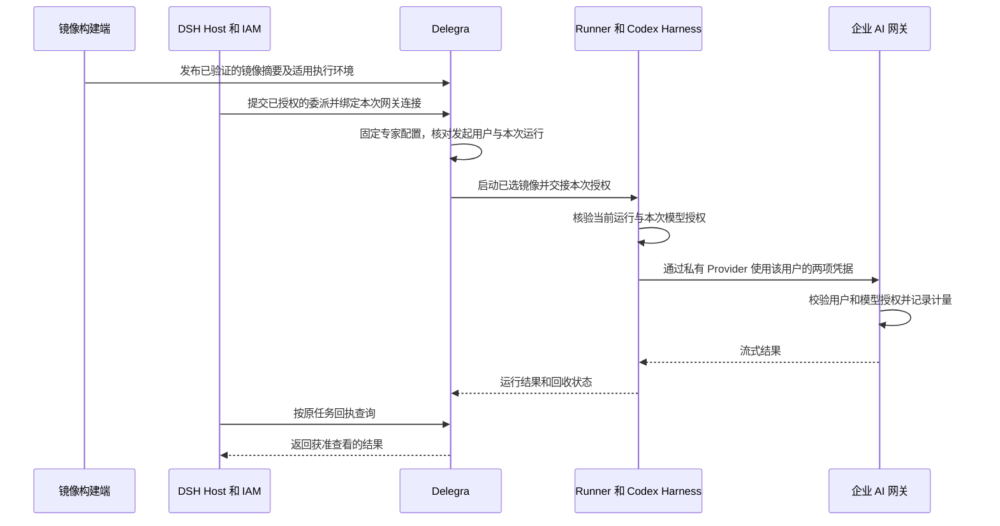

# Delegra 专家智能体运行时镜像设计

## 文档信息

| 项 | 内容 |
| --- | --- |
| 文档编号 | CORP-DSH-DESIGN-022 |
| 文档名称 | Delegra 专家智能体运行时镜像设计 |
| 版本 | V1.1.7 |
| 文档状态 | 评审稿 |
| 密级 | — |
| 作者 | hrygo |
| 编制 | Agent（代拟） |
| 审核 | 待定 |
| 批准 | 待定 |
| 最后更新 | 2026-11-20 |
| 确认人 | 项目负责人（当前用户） |
| 确认日期 | 2026-11-20 |
| 确认事项 | Delegra 组装和调度专家。所有镜像包含 Codex、Python 和 uv，构建、验收与交付统一使用 `linux/arm64`。镜像配方归属 Heluo Forge 仓库。镜像方案覆盖受监管机构开发、测试、运维和办公，按 DRY 与 SOLID 复用公共层，在保全 Agent 与 Codex 必需能力的前提下压缩体积。首版使用发起用户的授权，允许把 DSH IAM 获取的网关连接交给本次任务的 Harness 使用。接入 AIGS 后按用户与 Agent 两种身份的权限交集执行。 |
| 适用范围 | 专家组成、`linux/arm64` 镜像、首版 DSH 用户凭据与 AIGS 双主体授权。 |
| 门禁 | 按 §3、§8 分别验收本地 ARM64 制品与目标 Runner。企业凭据接入须满足 §4、§6.4 的授权、契约与实测判据。 |

> 编制依据为[运行时镜像概念简报](../engineering/reviews/2026-11-20-delegra-runtime-images-concepts-brief.md)、2026-11-20 的[本机镜像与模拟网关探针](../engineering/spikes/2026-11-20-delegra-runtime-images/README.md)，以及 Delegra 标签 `deploy/v2026.1106.0-r2` 的构建和 Codex 配置源码。真实 Runner 和企业网关连接待联调。
>
> 关联文档为[专家智能体 PRD](../requirements/delegra-experts-prd.md)、[专家接入方案](../plans/2026-11-18-forge-experts-integration-proposal.md)和[企业 AI 网关契约](../contracts/gateway-contract.md)。

## 1. 概述

**专家智能体 = 镜像 + skills + 工具集合 + 用户令牌。** Delegra 管理专家配置、组装这四项并调度任务。镜像提供 Codex Harness 和本地工具链，skills 定义工作方法，工具集合规定专家可调用的工具和动作。“用户令牌”指本次任务获准的用户凭据。首版网关使用同一用户的个人 Key 与 IAM access token，目标服务按实际用户和动作判定权限。

最小镜像提供公共 Codex 层。开发、测试、运维与中文办公按场景派生各自的镜像。Java 8、11、17、21、25 各有独立构建目标。同一镜像可供多个专家使用，专家在每次运行中使用本次任务的工作区、会话和用户授权。 [镜像与 Dockerfile 构建规格](#9-镜像与-dockerfile-构建规格)

## 2. 问题

不同专家依赖不同版本的工具。比如 Java 项目要求指定 JDK，中文办公需要字体及文档导出工具。如果任务开始后再安装，执行结果会依赖当时的软件源和版本。预置并固定镜像能让 Delegra 在派发前选定运行环境，并在排障、复跑和回退时查明任务到底用了哪个版本。

员工从 DeepSeek Harness（DSH）交办任务后，专家的模型调用要计入发起用户。邮件、OA、DevOps 和 Gitee 分别按各服务的用户权限控制访问。首版需要证明 DSH 的用户授权能交接到对应的远端运行，两位用户使用同一个专家时，每次运行都采用发起用户自己的授权。

## 3. 目标与验收

| 交付面 | 完成判据 |
| --- | --- |
| 本地参考镜像 | 在原生 Linux ARM64 BuildKit 节点构建 `codex-min` 和 `codex-java-21`，固定 `r2` Runner 源码和 Codex `0.160.0`。两份都通过 §9.2.3 的非 root 工作区、工具、Codex stdio 和退出断言，Java 21 完成样例编译与运行。 |
| 目标 Runner | 从同一正常调度入口分别启动两份镜像，核对实际 OCI 摘要，或不可变快照 ID 加可证实的来源 OCI 摘要。运行回执同时证明原生 ARM64、实际 Runner 与 Codex 的架构、制品摘要、来源和版本。合成 `/responses` 会话覆盖工作区操作、完成、取消和回收。 |
| 体积与工具目录 | 通过相同启动契约、公共冒烟与场景样例后比较压缩层和冷启动。按工具场景派生镜像，每个 Java 主版本独立出目标。发布、升级和回退演练覆盖排队任务原始版本、制品保留与紧急撤出。 |
| 首版个人网关 | 范围基线、可信 DSH 提交、Delegra 受限员工接口、目标网关和托管运行安全条件成立后，用两个获准测试用户验证同一专家的 `/responses`。网关回执证明同属主双凭据、同一发起人的模型授权、用量和预算归属。 |
| 授权隔离与失效 | 从实际调度入口验证同一任务的 Provider 与工具隔离、跨用户及跨运行代次隔离。旧进程仍存活时，验收取消、退出、切号、过期或失联后的新请求拒绝、在途流处置与回收回执。合成先验，企业时限按目标网关契约复验。 |

## 4. 范围边界

本设计覆盖镜像、执行环境、Harness 的任务级模型授权及候选计费。专家目录、`@` 交互、员工接口、任务回执和隐私沿用[专家 PRD](../requirements/delegra-experts-prd.md)与[接入方案](../plans/2026-11-18-forge-experts-integration-proposal.md)。邮箱、OA、DevOps 与 Gitee 通过各自已准入的工具入口使用发起用户权限。首批镜像验证以 Codex 运行、Java 样例及合成模型会话为目标。

本地镜像制作和合成 Runner 验证可独立评审。企业跨系统委派和远端个人模型使用受[需求基线 §2](../requirements/requirements-baseline.md#2-范围边界唯一真源)及[个人模型访问约束](../requirements/requirements-baseline.md#46-模型访问身份与专用凭证要求)约束。企业接入以项目负责人完成范围裁决及基线回写、可信宿主接缝和受限员工接口实际可用为前置，分别由 [issue #245](https://github.com/hrygo/heluo-forge/issues/245) 和 [issue #244](https://github.com/hrygo/heluo-forge/issues/244) 跟踪。还须取得目标网关对远端 Harness 客户端身份、网络来源、实际 `/responses`、IAM 令牌受众与同属主判据的有效证据。

客户资料的试用按既有数据边界开通。核查机构内的 Delegra、Runner、网关和模型处理位置，网关及模型关闭正文日志，本机保留适用的人工确认。验收使用合成标记核对传输落点、诊断和持久化证据，再按已获准的数据类别启用。 [专家 PRD §6](../requirements/delegra-experts-prd.md#6-上下文权限与数据) · [网关数据与审计边界](../contracts/gateway-contract.md)

AIGS 接入阶段由目标授权服务对同一资源和动作判定当前用户与独立 Agent 的权限交集。工具侧验收双方获准、仅一方获准、任一身份失效和授权服务不可用，切换后持续执行双主体判据，并用审计关联两种身份、动作和资源。模型候选路线另按 §7.4 核验。 [AIGS 预研](../plans/dsh-plugin-tools/iam-to-aigs-evolution.md)

## 5. 已有证据与待核验事项

本机 Docker 已运行两个 `linux/arm64` 镜像，验证 Codex `0.167.1` 启动、非 root 工作区和 Java 样例。模拟网关收到 Codex 的 `/responses` 请求和两项合成凭据，缺失 IAM access token 时返回 `401`。 [镜像配方与实测记录](../engineering/spikes/2026-11-20-delegra-runtime-images/README.md)

本库的固定版参考镜像及场景目录在原生 Linux ARM64 完成本地构建和冒烟。实测记录包含 Codex `0.160.0` 的两种打包形态、ARM64 manifest 摘要、压缩层和各场景结果。 [运行时镜像实测记录](verification/delegra-runtime-images.md)

Delegra 固定标签 `deploy/v2026.1106.0-r2`（`25c86a283a9c`）的 `runner-binary.ts` 能识别 Linux ARM64 Runner。该标签的 Daytona fleet 配方使用 `linux/amd64`，`Dockerfile.release` 检查 Codex `0.160.0`。远端 Native 兼容稳定版 `>=0.149.0 <0.161.0`。npm 注册表有 `0.160.0-linux-arm64` 制品。本机探针使用的 `0.167.1` 超出该区间。 [固定版本与验收依据](../engineering/reviews/2026-11-20-delegra-runtime-images-concepts-brief.md#接入取舍) · [Codex ARM64 包元数据](https://registry.npmjs.org/@openai%2fcodex/0.160.0-linux-arm64)

| 待核验事项 | 依据或责任方 | 验收时点 |
| --- | --- | --- |
| 目标 Delegra 版本、Runner 模式、提供方和镜像来源。核验实际沙箱为原生 `linux/arm64`，并核对 glibc、Codex 版本和启动契约。 | 目标部署记录及实际运行探针 | 目标 Runner 验收前 |
| 目标通道能否从同一 Host 授权记录绑定凭据、发起人、任务和运行代次，并在已运行 Harness 内执行逐请求失效。 | DSH Host、Delegra 及所选运行环境 | 企业凭据交接前 |
| 远端 Harness 的受管身份与来源、实际 `/responses`、IAM 受众与主体比对阶段、用户计量、撤权和数据路径。 | 目标网关及[网关契约](../contracts/gateway-contract.md) | 企业联调前 |

## 6. 技术方案

### 6.1 从镜像发布到任务启动

镜像构建端产出容器镜像及其版本记录。Delegra 的专家配置选择一个已验证的执行环境、skills 版本和工具集合版本。用户从 DSH 交办任务，Delegra 受理时固定这些版本，派发时重验权限和运行环境，Runner 启动相应镜像及 Harness。网关验证当前用户和模型授权，Delegra 依据实际运行回执更新任务。 [专家接入方案 §3—§5](../plans/2026-11-18-forge-experts-integration-proposal.md#3-dsh-选择与委派绑定)



### 6.2 镜像矩阵与版本

| 场景 | 镜像 | 主要能力 |
| --- | --- | --- |
| 公共层 | `codex-min` | 固定版 Codex、Native Runner、Python、uv、Shell、CA 证书和[通用工程工具](#922-保留能力并控制体积) |
| 开发 | `codex-java-8`、`codex-java-11`、`codex-java-17`、`codex-java-21`、`codex-java-25`、`codex-node`、`codex-go`、`codex-sql`、`codex-dotnet-10` | 各语言工具链及数据库客户端 |
| 测试 | `codex-test-api`、`codex-test-web`、`codex-test-load` | Newman 接口回归、Playwright 浏览器回归、k6 容量测试 |
| 运维 | `codex-ops-diag`、`codex-ops-k8s`、`codex-ops-iac` | 网络与证书诊断、Kubernetes 清单与查询、基础设施即代码 |
| 办公 | `codex-office-zh` | LibreOffice、中文字体、Pandoc 和 PDF 工具 |

首轮由 `codex-min` 和 `codex-java-21` 验证公共层、派生和真实 Runner。标准目录与按需目标依次扩展。镜像优先级、Dockerfile 继承、安装内容和验收以[构建规格](#9-镜像与-dockerfile-构建规格)为准。任务可调用的外部动作由专家工具集合、当次授权和实际服务权限决定。

公共层装配 Codex、Runner、Node、Python、uv 和常用工作区工具。所有发布目标和对照目标沿用相同的 Python 运行约定。场景镜像继承同一运行约定，添加所需工具与直接依赖。下载、编译及缓存留在构建阶段，最终层保留完整运行资产。裁剪后按 §9.2.3 复验文件、Git、Shell、Codex stdio 会话和退出，比较冷拉压缩量、启动及首个 turn 耗时。 [镜像构建原则](#92-镜像构建原则)

所有镜像仅构建和交付 `linux/arm64`。构建与启动验收均在原生 ARM64 环境执行。`r2` Native 参考组合使用 Codex `0.160.0` 及 GNU libc 2.39 或更新版本。基础镜像引用摘要，锁定 Codex 与工具链的 ARM64 制品版本和校验值。镜像发布至目标 Runner 获准访问的制品源，发布记录保存摘要、平台、构建输入、工具链、软件物料清单、构建来源证明、适用 Runner 与验收结果。探针配方用于复现共享层和工具链，部署配方还须覆盖目标 Runner 的启动及会话协议。 [本机镜像与模拟网关探针](../engineering/spikes/2026-11-20-delegra-runtime-images/README.md) · [Paperclip Runner 平台要求](https://docs.paperclip.ing/reference/adapters/paperclip-runner/)

### 6.3 Delegra 如何选用镜像

专家引用不可变的执行环境版本。维护者登记目标提供方、执行模式、平台、镜像、skills 和工具集合版本。受理记录固定这些引用与专家配置，派发按同一版本选镜像并用当前授权复验。运行回执关联请求、任务和运行代次，记录实际镜像摘要或快照及来源摘要、平台、实际 Runner 与 Codex 的来源、摘要和版本。

| 执行路径 | 固定标签源码证据 | 资格判据 |
| --- | --- | --- |
| Daytona Native | `packages/plugins/sandbox-providers/daytona/src/plugin.ts` 有按执行环境传入 `image`／`snapshot` 的接缝，可解析不可变快照 ID。该标签的默认 fleet 镜像为 `linux/amd64`。 | 优先核验现有自定义镜像或快照接缝。实际服务须具备原生 ARM64 沙箱、获准制品源、对应启动命令和可查证的实际镜像身份。 |
| Kubernetes | `packages/plugins/sandbox-providers/kubernetes/src/plugin.ts` 的领用路径传入 `imageOverride: null`。当前选镜像采用适配器的 `runtimeImage`。Job 模式由 `pod-spec-builder.ts` 指定 Tini 与 `paperclip-agent-shim`。 | 选择此路线前须核定按专家选择摘要的接线及所用 backend 的真实启动契约。Job 路径须提供相应 shim。两个专家各使用指定摘要及 ARM64 工作节点，回执能反查实际运行。 |
| `codex_local` | `packages/adapters/codex-local/src/server/runtime-config.ts` 可将 `PAPERCLIP_CODEX_PROVIDERS` 映射为直接适配器配置。 | 作为配置对照。Native 的 `app-server` 使用其专用 transport、启动与凭据消费入口。 |

固定 `r2` Native 远端冷启动需要在执行环境 `PATH` 可用的 Node。预装 `paperclip-runnerd` 由控制端验证构建能力和制品身份，预装件校验失败可以触发控制端制品落地。Codex 的兼容区间校验与精确版本固定是两个判据，配置还可通过显式路径或 npm 提供 Codex。验收预装模式时，控制端默认 ARM64 制品槽与镜像消费同一份 Runner 构建，消除显式制品及 npm 的替代路径，核对实际启动文件和两条镜像来源证据。镜像缺件、Runner 摘要错配或 Codex 不等于固定版均使该组合的验收失败。 [实际 Runner 验收](#82-任务-2-验证-delegra-实际启动版本固定与回收)

已受理任务固定的镜像、快照、skills 和工具版本保留到排队、运行及约定可恢复期限结束。执行环境所有者依据任务引用清理制品。紧急撤出可停止使用有问题的版本，受影响任务记录版本及真实失败状态并保持获权回查。切换或回退后续任务的默认环境引用时，已受理任务按原版本查证。

### 6.4 DSH 网关授权交接

1. **绑定真实提交。** DSH Host 只接受可信的用户提交及当次专家授权，绑定用户、组织、原 DSH 会话、专家、请求和授权期限。使用 `captureModelSession()` 的会话代次校验，并复用 `resolveGatewayConnection()` 的属主与 Key 代次校验。发送前由可信 Host 回调从同一持久授权记录消费 IAM access token 及 `accessExpiresAt`，复验用户、会话、`baseURL` 和 Key 代次。该授权到期取用户授权与实际 token 到期的较早值。刷新由 DSH Host 管理。 [Host 凭据指南](../../packages/forge-iam/docs/credential-access.md#33-dsh-host-插件宿主服务)
2. **受理与领取。** Delegra 受限员工入口使用自身认可的人员凭据核验发起用户、组织与专家调用权限，受理私有任务并分配运行代次。任务和派发记录保存授权绑定、有效期及受控引用。可信执行端在领取时核对发起人、任务、专家、运行代次和最新授权，拒绝旧代次及重复领取。消息、技能、工作区、构建输入、普通任务环境和提供方的执行命令均排除凭据值。
3. **运行时私有注入。** 针对已选提供方验证独立秘密投递、私有配置和可信模型请求控制点。授权只在托管 Provider 的本次运行使用，工具的进程、文件、环境和出站边界独立验收。Codex 可信配置通过 `baseURL` 到 `base_url` 的映射固定网关，`wire_api` 为 `responses`，`env_key`、`env_http_headers` 只引用 Provider 私有运行时值。Codex 的 `shell_environment_policy` 限定工具环境继承，文件和进程可见性及网络由经验证的运行边界执行。固定 `r2` 的普通远端执行会把环境放入提供方执行请求。Rust 的环境名单仅控制最后一段传递。首版私有通道须逐段验证员工受理、队列引用、控制端 transport、提供方和 Runner 消费。 [Codex 0.160.0 配置定义](https://github.com/openai/codex/blob/rust-v0.160.0/codex-rs/core/config.schema.json)
4. **逐请求判定。** 可信请求控制点在每个新模型调用前验证当前运行代次、任务授权时效和撤销状态、专家配置允许的模型及当次授权范围。该控制点与任务工具隔离，并限制 Provider 只访问获准的 HTTPS 网关。网关从 `POST ${baseURL}/responses` 的 `Authorization: Bearer …` 和 `X-IAM-Token` 判定正在使用的人员身份、实际模型权限和预算。 `X-Consumer-Type: personal` 声明仅供审计。以目标网关认可的客户端身份与来源作为准入证据。 [网关身份与凭据](../contracts/gateway-contract.md#41-身份用途与凭据) · [网关服务端点](../contracts/gateway-contract.md#44-服务端点契约与流式协议)
5. **验收与放行。** 先核验提供方是否能复用任务租约、出站控制和运行私有通道实现逐请求判定。若需新增中转或网关扩展，评估额外网络跳、流式透传、故障态和运维成本后提交选型。任一关键隔离、撤权和计量条件缺失时，企业凭据入口保持关闭。使用合成授权验证启动、网络、拒绝及诊断，确认目标条件后使用获准的企业测试账号和合成数据联调。

邮箱、OA、DevOps 与 Gitee 各自按当前专家配置、任务授权与目标服务权限消费相应用户凭据。AIGS 工具调用使用同一资源与动作的双身份授权，保持状态查询和对账所需的独立当前权限。 [接入方案权限边界](../plans/2026-11-18-forge-experts-integration-proposal.md#4-delegra-权限隔离与数据)

### 6.5 排队、失败与回收

| 场景 | 权威检查与验收 |
| --- | --- |
| 排队或领取时已过期、换账号或撤权 | 在本次运行领取前依据最新授权及同一发起人重新核验。归属不明时保持待核对，已知过期且允许恢复时进入待用户。取消与领取并发时只允许当前仍获权的运行启动。 |
| 运行中授权到期、退出、取消或失联 | 本次授权状态以可信 Host 会话与 Delegra 当前运行租约为依据。逐请求控制点在期限、撤销或运行失联后拒绝新请求。已有活动流按目标契约处置。任务授权超期须由原用户重新授权并分配新的运行代次。跨授权热复用以实证为前置。 |
| 提交丢回执、Worker 重启或迟到结果 | 按原请求回查权威任务及运行代次，未决保持待核对。重派前核实前次执行与副作用，重新校验权限。旧代次的凭据领取、工具答复和结果不能变更当前运行。 |
| 网关拒绝或流中断 | 网关原因区分身份、权限、预算和限流。凭据错误不重放。可判定未发生副作用的限流按契约退避。归属或执行结果未知时按网关请求回执核对。 |
| 任务结束或环境回收失败 | 先停用运行授权，再回收凭据与工作区。未确认回收时保持隔离并对账。回执记录已知归属、请求关联、实际回收状态和可继续的受权操作。 |

验收让已取得授权的 Harness 在一次合成推理后继续存活，分别触发早于 token 的任务到期、取消、Host 退出或切号、回收失联，核对后续请求被拒。企业联调另核对实际撤权收敛、目标网关的在途流处置及其他有效会话。 [网关生命周期](../contracts/gateway-contract.md#411-生命周期与失败约束) · [现有接入验收](../plans/2026-11-18-forge-experts-integration-proposal.md#61-待实测项)

## 7. 方案取舍

### 7.1 镜像形态

| 方案 | 收益与代价 | 取舍 |
| --- | --- | --- |
| 公共 Codex 层与场景镜像 | 同一公共层支持多个专家，语言或办公工具可独立发版。每个新增目标仍需构建和验证工具链。 | 采用。以最小镜像和 Java 21 验证派生与复用，每个所需 Java 主版本单独出镜像。 |
| 全工具单镜像 | 维护一个镜像入口，所有任务拉取相同的大镜像，各套工具的更新和验收耦合。多个 JDK 还需在任务运行时选择。 | 场景工具按已确认的镜像编排发布。 |
| 任务启动时安装工具 | 可以临时扩展场景，启动依赖软件源可用性、下载时间和版本解析结果。 | 将首轮工具链放在构建阶段固定，在 Runner 上验证启动和使用。 |

### 7.2 模型网关认证与费用归属

调用者是发起并授权本次任务的自然人。同一个已装配的专家可服务不同调用者，网关按每次任务已核验的用户账户及团队预算结算实际用量。

| 路线 | 认证与授权决定点 | 费用及准入条件 |
| --- | --- | --- |
| 首版个人凭据 | Delegra 和托管运行控制点约束专家配置、当次任务授权和可用模型。网关用个人 Key 和 IAM access token 校验当前用户及实际模型权限。 | 按当前用户的成员和团队预算扣减。通过 §6.4 的远端来源、私有投递、逐请求失效和隔离验收后开放。 |
| Agent 令牌认证，调用者计费 | Harness 持 Agent 网关令牌，并提交网关可验的本次用户委派。网关或认可的授权服务判断同一模型和动作的有效权限为 **调用者当前权限 ∩ Agent 当前权限**，并约束于本次用户授权。 | 网关从已核验的委派映射调用者、成员与团队预算，按实际用量结算。依赖可信签发、运行绑定、双主体授权、预算和结算接口。 |

网关 V2.2.0 目标契约的现有应用凭据归属服务与系统代码。候选需要补充用户委派和调用者计量支持。固定 `r2` 的 `cost_events` 已有 `agentId`、`responsibleUserId` 和 `providerRequestId`，用于关联审计、展示与对账。实际扣减、去重及预算真源为网关账本。 [网关身份与计量](../contracts/gateway-contract.md#42-额度与计量)

### 7.3 Agent 令牌路线的调用流程

1. **授权。** 用户在 DSH 以本人身份选定专家并授权本次任务。Delegra 受理任务并确定运行代次后，由受信签发方核对本次授权与任务归属，签发仅供目标 LLM 网关使用的短时委派。委派绑定组织、用户、Agent、任务、运行代次、模型与动作范围，交给对应运行的 Harness。
2. **鉴权。** Harness 使用 Agent 的网关访问令牌及任务委派调用 `/responses`。网关验证 Agent 令牌，并验证委派签发方、受众、有效期和撤权状态。网关从绑定到运行的 Agent 令牌或受信运行连接确认实际运行，再与委派比对。网关以核验出的用户和 Agent 身份判定双方对当前模型与动作的权限。委派可采用签名的短时证明，或通过受信服务查询的授权引用。具体载体由接入契约确定。
3. **计量。** 网关从委派的用户身份映射其有效计费账户与团队，在推理前用该账户执行预算检查。实际用量按同一账户结算。Agent 身份用于执行审计和凭证级限流，网关回执关联用户、Agent、任务和请求。流式中断后按实际计量回执核对，重复回执按同一真实模型请求去重。Delegra 关联回执以展示和对账。
4. **失效。** 任一身份失效、权限无法判定、用户授权撤销、任务结束或账户不可确认时，拒绝受影响的新模型请求。撤权覆盖签发与实际网关调用，按目标契约验证时限、在途流和持久账本。 [网关生命周期约束](../contracts/gateway-contract.md#411-生命周期与失败约束)

AIGS 双标识令牌可承载同一授权语义。采用 OAuth 令牌交换时，用户作为主体，Agent 作为执行者，短时令牌可用 `sub` 和 `act` 表达两者。令牌交换、运行级授权撤回、有效权限和积分结算分别取证。 [AIGS 演进预研](../plans/dsh-plugin-tools/iam-to-aigs-evolution.md) · [RFC 8693 委派语义](https://www.rfc-editor.org/rfc/rfc8693.html#section-1.1) · [RFC 8693 执行者声明](https://www.rfc-editor.org/rfc/rfc8693.html#section-4.1)

### 7.4 候选路线验收及采用条件

| 验收场景 | 可核对结果 |
| --- | --- |
| 甲、乙分别调用同一个专家并获双主体授权 | 同一个 Agent 身份出现在两条记录中。甲、乙各自的额度按实际推理扣减，另设的专家维护者和默认应用账户的额度无此项扣减。 |
| 仅人有权、仅 Agent 有权，或委派缺失、失效或串用 | 对指定模型和动作拒绝请求。网关拒绝错用户、错 Agent、错任务、错代次或错目标的委派，且无对应推理扣费。 |
| 人的预算用尽、任一方撤权或任务取消 | 网关按实际原因拒绝受影响的新请求。核对撤权和取消是否在规定时限内阻断后续调用。在途请求按真实网关回执结算。 |
| 重复回执、并发预算或流中断 | 网关以稳定的请求及结算标识对账，同一真实请求重复回执只结算一次。并发调用遵循成员及团队预算，流中断按实际用量结算，未知结果保留待核对。 |

§6 为首版个人凭据方向。Agent 令牌路线按任务 4 取得可信运行委派、双主体授权和用户结算的实际证据，并统一比较外部改造与联调成本，再决定是否采用。两条路线共用镜像矩阵与 Runner 验收。

## 8. 实施计划

`deploy/v2026.1106.0-r2` 的 Native Runner 和 Codex `0.160.0` 为首轮 ARM64 参考组合。镜像配方位于 Heluo Forge 的 [`deploy/delegra-expert-images/`](../../deploy/delegra-expert-images/README.md)，Runner 编译输入取自固定的 Delegra 源码归档。任务各自产出可核验结果。跨系统范围、托管镜像发布、企业接口与真实用户凭据遵循 §4 的适用准入。

| 任务 | 主要交付 | 执行前置 |
| --- | --- | --- |
| 1 · [issue #393](https://github.com/hrygo/heluo-forge/issues/393) | 两份 ARM64 参考镜像、派生配方和本地冒烟 | 固定构建输入与原生 ARM64 构建节点 |
| 2 · [issue #394](https://github.com/hrygo/heluo-forge/issues/394) | 目标 Runner 资格核验和两镜像正常调度验收 | 任务 1 的参考制品，目标部署、提供方和获准的试验制品源 |
| 3 · [issue #395](https://github.com/hrygo/heluo-forge/issues/395) | DSH 本次用户授权与 Harness 安全接入 | 任务 2、§4 的范围及身份准入、合格的私有投递和请求控制点 |
| 4 · [issue #396](https://github.com/hrygo/heluo-forge/issues/396) | Agent 令牌与调用者计费候选的能力证据 | 已核验的运行环境、提供方实际接口及相关试验授权 |
| 5 · [issue #397](https://github.com/hrygo/heluo-forge/issues/397) | 开发、测试、运维和办公场景的锁定配方与制品 | 任务 2 固定公共层。各任务场景有适用工具版本及代表性样例 |

### 8.1 任务 1 · 构建首批两个镜像

| ARM64 构建输入 | 固定来源 |
| --- | --- |
| 参考运行底座 | `node:24.21.0-trixie-slim@sha256:173f125896c3b47ddf056734c7ea789d04595a6a08769a8f78e0df642781fb66`，Linux ARM64，已有 glibc `2.41` 的本机证据。 |
| Runner 构建 | `rust:1.97-bookworm@sha256:6e957ef098dcc77d33e310261e4ed5843bb108d5c3b5dc2b476cbc8b6caf53fa`。取 `r2` 提交 `25c86a283a9c787a01911c714618d78df7552af7` 的构建输入及 `Cargo.lock`。 |
| Java 工具链 | `maven:3.9-eclipse-temurin-21@sha256:71a6832f657180ea206901ffc548c0e73a257cb09b4912619177586d0268d59c`，提取 ARM64 JDK 和 Maven。 |

| 交付路径 | 内容 |
| --- | --- |
| `deploy/delegra-expert-images/Dockerfile` | ARM64 `runner-build` 运行 `cargo build --locked --release -p paperclip-runner-core --bin paperclip-runnerd`。独立层准备 Codex 完整运行资产。最终层按 §9.2 保留 Node、基础工具及 `tini`，以普通用户启动。检查 `BUILDOS`、`BUILDARCH`、`TARGETOS`、`TARGETARCH` 均对应 `linux/arm64`。 |
| `deploy/delegra-expert-images/Dockerfile.java` | 基于同一公共层复制工具链的 `/opt/java/openjdk` 和 `/usr/share/maven`，设置 `JAVA_HOME`、`PATH`。 |
| `deploy/delegra-expert-images/package.json`、`package-lock.json` | 以 npm 锁文件与 `npm ci` 固定 `@openai/codex@0.160.0` 及对应 Linux ARM64 制品。 |
| `deploy/delegra-expert-images/.dockerignore` | 构建上下文限于配方目录，包含 Dockerfile、Debian 快照配置和工具锁文件。公共 Dockerfile 校验固定源码归档的 SHA-256，仅取编译所需的 Runner manifest、锁文件、crates、协议和配置文件。 |
| `deploy/delegra-expert-images/debian.sources`、`buildx-bake.hcl` | 填入已验证 Debian 签名快照、信任根与 ARM64 包来源，快照标识及发布索引摘要保存在构建元数据。Bake 固定基础和工具链摘要、平台和命名上下文。Java 目标复用对应公共层。 |
| `tests/runner-e2e/expert-runtime-images-smoke.mjs` | 从容器外驱动真实默认入口与 `app-server` stdio，用 `--network none` 验证 §9.2.3。接收一个或多个镜像引用。失败以非零状态退出并输出断言。每个容器均在用例结束后核对回收。 |
| `docs/design/verification/delegra-runtime-images.md` | 实测记录含固定源码、输入、镜像摘要、平台、压缩层增量、工具版本、耗时及通过和失败判据。 |

- [x] 先用 `docker buildx bake -f deploy/delegra-expert-images/buildx-bake.hcl --print codex-min codex-java-21` 核对平台与父层。用相同入口 `--load` 构建标签 `paperclip-expert/codex-min:arm64-local`、`paperclip-expert/codex-java-21:arm64-local`。记录原生 ARM64 构建节点。
- [x] 运行 `node tests/runner-e2e/expert-runtime-images-smoke.mjs paperclip-expert/codex-min:arm64-local paperclip-expert/codex-java-21:arm64-local`。断言两份的 OCI 平台、容器 `aarch64`、关键 ELF、`codex-cli 0.160.0`、UID/GID、文件与会话结束结果。核对 Runner `--build-metadata` 的 `dial_ws_loopback`、`dial_wss`、`listen_ws`。Java 执行 `javac --release 21` 样例与 `mvn --version`。
- [x] 精简候选使用独立 Bake 目标 `codex-min-native`、`codex-java-21-native` 和 `arm64-native-local` 标签，以相同 Node 运行资产和官方原生 Codex 归档复跑冒烟。按 §9.2.2 分别导出 OCI 布局，以相同压缩算法计算层大小。测试构建平台错误、固定摘要校验失败、公共工具缺失和 stdio 超时，核对失败且资源清理。通过本地验收的候选交任务 2 比较实际启动。

### 8.2 任务 2 · 验证 Delegra 实际启动、版本固定与回收

- [ ] 先产出提供方资格记录，包含实际部署版本、原生 ARM64 节点、执行模式、配置入口及镜像选择字段、制品源和镜像或快照身份。按 §6.3 核定现有入口，优先验证 Daytona 自定义 ARM64 组合。需要补齐提供方接线时，先列实际仓库路径、配置和测试清单。无满足条件的组合时记录 `BLOCKED`。
- [ ] 从所选正常入口分别调度两个合成专家，使用固定的镜像摘要或不可变快照。预装模式从控制端匹配同一个 ARM64 Runner 制品，禁用显式 Codex 制品及 npm 安装路径，核对实际 `runnerd` 和 Codex 的来源、摘要及版本。通过同一 Runner 的合成 `/responses` 夹具验证初始化、工具事件、一次 Shell 和工作区编辑、退出、取消与子进程及工作区回收。
- [ ] 验证按摘要拉取镜像失败、平台错误、Runner 哈希不符、预装 Codex 缺失及兼容区间内的非指定 Codex 版本。运行证据区分镜像预装与控制端回退；回退不能通过镜像预装验收。以失败回执记录实际阶段与清理状态。
- [ ] 跨升级、默认版本回退、常规清理和紧急撤出验证排队与运行任务。后续任务使用切换后的引用，已受理任务保留原镜像、skills 和工具版本，回执可追溯。将证据写入 `docs/design/verification/delegra-runtime-images.md`，形成实测记录后登记设计索引 §2.2。

### 8.3 任务 3 · 接通 DSH 用户凭据与 Harness

- [ ] 核对任务 2、§4 的企业准入、目标系统能力与有效契约。用合成凭据证明私有投递、任务级授权、逐请求判定和工具隔离，再固定员工入口、派发、运行引用、transport、Provider 消费的端口、错误与幂等状态。选定目标通道的接线清单形成后实施。
- [ ] Host 私有交接位于 `packages/forge-iam/src/expert-gateway-handoff.mjs`，由 `service.mjs` 装配。调整 `service-token.mjs` 的受控消费投影，从同一持久授权记录提供 token 与到期时间，复用当前会话及网关 Key 绑定检查。对跨刷新、切号、换 Key、到期和重复提交验证绑定一致或零发送。
- [ ] Delegra 运行端由 `server/src/services/native-runtime/expert-gateway-authorization.ts` 与 `native-session-executor.ts` 核验运行和授权。逐文件清单覆盖实际员工路由、持久派发、私有投递、`packages/paperclip-runner/src/live/runnerd-codex-transport.ts`、`packages/paperclip-runner/runner/crates/runner-core/src/codex_provider.rs` 的消费接缝以及选定提供方。按 §6.4 隔离 Provider 与工具，停用时保留获权查询和取消。
- [ ] 定向验收入口为 `node --test packages/forge-iam/test/expert-gateway-handoff.test.mjs`、Delegra 的 `pnpm exec vitest run server/src/services/native-runtime/expert-gateway-authorization.test.ts server/src/services/native-runtime/native-session-executor.test.ts`、`cargo test --locked --manifest-path packages/paperclip-runner/runner/Cargo.toml -p paperclip-runner-core --test codex_provider`。复用 Runner 集成夹具，核对隔离和授权断言命中。
- [ ] 用实际调度路径覆盖两个用户并发、重复领取、排队过期、同一任务的工具隔离、日志与产物、过期后的存活 Harness、取消、失联和回收。适用企业契约通过后，用获准测试账号核对真实身份、模型、用户及团队扣费、预算拒绝、撤销和在途流。正式契约与实测分别维护在 `docs/contracts/gateway-contract.md`、`docs/design/verification/delegra-runtime-images.md`。

### 8.4 任务 4 · 核验 Agent 令牌与调用者计费

- [ ] 核验现有身份与网关是否提供 Agent 签发、运行绑定、可信用户委派、双主体授权、调用者预算与结算接口。接口或可授权试验环境缺失时记录 `BLOCKED`。该能力验证独立于首版个人凭据完成判据。
- [ ] 有目标契约与试验条件时，按 §7.4 核验两个用户同一专家的额度归属、单侧有权拒绝、撤权时限、运行代次错配、并发预算和结算回执去重。用网关账本判定实际扣费，Delegra 关联展示。
- [ ] 按身份系统及网关的接口改动、验证工作量与隔离收益记录选型依据，留在实测记录。采用候选路线时形成对应网关契约、逐文件接线方案、停用与回退验收。

### 8.5 任务 5 · 构建开发、测试、运维和办公镜像目录

- [x] 实现 §9.1 的 17 个发布目标及 13 份 Dockerfile。按真实项目所需版本和场景分批启用。每批先固定目标工具版本、ARM64 归档及校验值、包来源和运行依赖，样例有明确入口、固定预期和退出结果。
- [x] 在 `deploy/delegra-expert-images/` 中通过 `Dockerfile.java` 派生四个其他 JDK。其他配方及父层以 §9.3 为准。Node、Newman 和 Playwright 分别在 `tooling/node/`、`tooling/test-api/`、`tooling/test-web/` 维护 `package.json` 与 `package-lock.json`。在 `buildx-bake.hcl` 和 `.dockerignore` 补入已选目标的输入及上下文。
- [x] 在原生 ARM64 节点用 `buildx bake --print` 核对发布目标，以统一冒烟入口运行各场景样例。验证 Chromium 沙箱、办公 CJK 字体及三类格式导出，记录本地镜像摘要、体积增量、冒烟耗时和失败条件。 [本地实测记录](verification/delegra-runtime-images.md)
- [ ] 从目标 Runner 的正常调度入口验证按摘要拉取、冷启动、取消、进程和工作区回收以及版本回退，覆盖浏览器任务与试点场景。
- [ ] 通过 §9.4 才登记可用镜像。试点形成冷拉、启动、并发和每任务 Token 用量证据，由负责人据预算与代表性任务决定扩展顺序与规模。公共层更新时重建并复验受影响的发布目标。

计划和契约交付前执行 `pnpm check` 与 `git diff --check`。实测记录保留环境、命令、版本、请求关联、结果与耗时。

## 9. 镜像与 Dockerfile 构建规格

调研与制品核验日期为 2026-11-20。

### 9.1 目录与选型依据

目录覆盖受监管机构常见的后端工程、数据分析、前端开发、接口与浏览器测试、平台运维和中文文档处理。FINOS 与 Linux Foundation 的 2026 年报告从行业从业者参与的公开仓库中观察到 Python、TypeScript、Go、Java 等语言，以及容器、Kubernetes、API、测试和文档等主题。CNCF 的两项机构实施案例分别提供 Kubernetes 平台和应用交付的参照。以下顺序结合这些证据与本项目的试点需求，机构存量技术、目标版本和实际使用量通过项目清单核验。 [FINOS 2026 报告图 4—6](https://www.linuxfoundation.org/hubfs/Research%20Reports/StateofOpenSourceinFinancialServices_2026_Report_110226.pdf?hsLang=en#page=12) · [CNCF 容器平台案例](https://www.cncf.io/case-studies/china-merchants-bank/) · [CNCF 应用交付案例](https://www.cncf.io/case-studies/cmbc/)

| 顺序 | 镜像 | 场景 |
| --- | --- | --- |
| 试点两项 | `codex-min`、`codex-java-21` | 验证公共层、Java 派生、Delegra 启动和任务回收 |
| 标准目录 · 开发 | `codex-java-17`、`codex-node`、`codex-go`、`codex-sql` | 后端服务、前端与工具开发、SQL 开发和诊断 |
| 标准目录 · 测试 | `codex-test-api`、`codex-test-web` | 接口回归、交易或审批流程的浏览器回归 |
| 标准目录 · 运维 | `codex-ops-diag`、`codex-ops-k8s` | 网络与证书诊断、Kubernetes 排障和清单校验 |
| 标准目录 · 办公 | `codex-office-zh` | 中文 Word、Excel、PPT 处理与 PDF 导出 |
| 按项目需求 | `codex-java-8`、`codex-java-11`、`codex-java-25`、`codex-dotnet-10`、`codex-test-load`、`codex-ops-iac` | 存量或指定 JDK、Linux .NET 项目、容量回归和基础设施即代码 |

目录包含 17 个 `linux/arm64` 发布目标、13 份 Dockerfile。任务 1 的两个精简对照目标用于本地候选比较。Java 8、11、17、21、25 各自发布一份镜像，共用 `Dockerfile.java`。Python 开发和数据处理可直接使用 `codex-min`。项目依赖库、业务 SDK、Gradle Wrapper 和 Python 数据分析库等按项目锁文件提供。 [Temurin 支持路线图](https://adoptium.net/support)

### 9.2 镜像构建原则

#### 9.2.1 DRY 与 SOLID

| 原则 | 在镜像中的做法 |
| --- | --- |
| DRY | Codex、Runner、基础工具和运行约定只在 `codex-min` 装配一次。Bake 复用同一公共层。一份 `Dockerfile.java` 按五个主版本的固定摘要构建五份镜像。制品版本在 Bake 输入或对应包锁文件维护，验收复用公共样例。 |
| 单一职责 | 公共层提供启动和基本工作区能力。构建阶段负责下载、验签或校验、编译与安装。场景镜像添加该场景的工具及直接运行依赖。 |
| 开闭原则 | 新工具链通过现有父镜像、独立 Bake 目标和场景样例接入。共用配方只在公共运行约定或公共依赖变化时修改。 |
| 可替换 | 各派生镜像满足同一 ARM64 启动约定。更换镜像摘要后，Agent 仍能以相同的用户、工作区和命令入口完成公共操作，Codex 仍能按固定协议启动并退出。 |
| 接口隔离 | 浏览器、JDK、数据库客户端和办公工具按场景装入。专家任务按构建清单选择能完成工作的最小镜像。 |
| 依赖倒置 | Dockerfile 通过 `expert_base` 消费已核验的父层，通过摘要和锁文件消费官方制品。Delegra 依赖镜像的运行约定与能力清单，可用同一个调度入口启动各场景。 |

所有 Bake 目标使用 `platforms = ["linux/arm64"]`，由原生 ARM64 BuildKit 构建。以 Debian 13 glibc 底座交付目标版本的 Codex 和 `paperclip-runnerd`。构建上下文为本仓库的 `deploy/delegra-expert-images/`，由 `.dockerignore` 限定配方及锁文件。公共 Dockerfile 按固定提交和 SHA-256 取得 Delegra Runner 源码。`expert_base` 默认连接 `target:codex-min`，API 和 Web 测试复用 `codex-min` 的 Node 运行时和固定 Node 工具阶段的 npm 安装入口，仅复制各自运行工具。Kubernetes 和 IaC 连接 `target:codex-ops-diag`。 [Docker 多平台构建](https://docs.docker.com/build/building/multi-platform/) · [Docker Bake 目标上下文](https://docs.docker.com/build/bake/contexts/#using-a-target-as-a-build-context) · [Paperclip Runner 平台要求](https://docs.paperclip.ing/reference/adapters/paperclip-runner/)

`buildx-bake.hcl` 固定基础及工具链镜像摘要、发行归档版本和校验值，APT 使用 `debian.sources` 指定有签名的版本化 Debian 源，Node 工具按各目录 npm 锁文件安装。访问私有制品源的构建授权通过 BuildKit secret 临时挂载。企业工具授权和工作区数据随任务交接。 [Docker 构建密钥](https://docs.docker.com/build/building/secrets/)

#### 9.2.2 保留能力并控制体积

公共工具优先选择 Agent 在无额外指令时常用、OCI 压缩体积增量小的命令。体积包含新增运行依赖。

1. Rust 编译、下载、验签、归档解包和工具安装缓存留在构建阶段。最终层只复制固定版 Runner、Codex 的完整运行资产以及直接依赖，保留许可、Codex 配套资源、动态库、证书和实际沙箱所需的文件。 [Docker 多阶段构建](https://docs.docker.com/build/building/multi-stage/) · [BuildKit 缓存优化](https://docs.docker.com/build/cache/optimize/)
2. 公共层用已验证签名的 Debian 13 快照固定包集。最小公共能力覆盖 `bash`、`ca-certificates`、`coreutils`、`curl`、`diffutils`、`file`、`findutils`、`gawk`、`git`、`grep`、`jq`、`make`、`patch`、`procps`、`ripgrep`、`sed`、`tar`、`tini`、`unzip`、`util-linux`、`zip`，保留底座自带的 POSIX Shell 与必要系统库。`curl` 和 `jq` 支持 HTTP 请求、制品下载和 JSON 筛选。`file` 识别制品类型，`zip` 和 `unzip` 处理 ZIP 归档，`make` 执行项目任务，`patch` 应用文本差异。`tree` 展开目录层级，`xxd` 查看二进制字节，`lsof` 查看进程打开的文件和套接字。`rsync` 增量同步文件，GNU tar 可调用 `bzip2`、`xz` 和 `zstd` 处理压缩归档。公共包集通过 `python3`、`python3-venv` 提供 Python `3.13.5`、标准库与虚拟环境，`python` 指向同一解释器。公共层从固定摘要的 Astral ARM64 镜像复制 `uv`、`uvx` `0.13.9`，随镜像包含 MIT 许可证。任务在工作区创建虚拟环境，并按项目锁文件安装依赖。APT 在同层更新并以 `--no-install-recommends` 安装，签名索引与包缓存留在 BuildKit 缓存或清理。只在对应场景引入 JDK、浏览器、字体和数据库客户端。 [Docker 构建最佳实践](https://docs.docker.com/build/building/best-practices/) · [Astral Docker 指南](https://docs.astral.sh/uv/guides/integration/docker/) · [uv MIT 许可证](https://github.com/astral-sh/uv/blob/0.13.9/LICENSE-MIT)
3. 参考镜像用固定 Node 24 slim 和完整 ARM64 npm 包安装 Codex `0.160.0`。原生候选用固定 ARM64 Debian slim 和完整 `codex-package-aarch64-unknown-linux-musl.tar.zst`，从同一 Node 24 运行底座复制 Node 可执行文件并核对直接运行依赖。在两条路径均保留 Runner 正常入口的 Node，按 Codex 包形态及场景需要保留 npm。两条底座创建或沿用 `1000:1000` 的非 root 账户，默认 `HOME` 指向镜像账号的主目录、`WORKDIR /workspace`、`tini` 透传入口。场景层构建需要提权时以 `USER 0` 完成安装，再恢复 `USER 1000:1000`，运行时将工作区和缓存分配给该用户。 [Codex 0.160.0 官方发行](https://github.com/openai/codex/releases/tag/rust-v0.160.0)
4. `--load` 验功能，本地 OCI 导出测压缩层。每次对一个目标用同一 Bake 文件及压缩设置覆写输出，例如下列命令。读取 ARM64 manifest 的 `layers[].size` 之和，按 layer digest 去重计算相对父层增量。用相同存储配置记录本地大小，区分冷拉、启动及首个 turn 耗时。选择通过相同公共验收、场景样例和真实 Runner 验收后压缩拉取量较小的候选。 [Docker OCI 导出](https://docs.docker.com/build/exporters/oci-docker/)

```sh
oci_dir=$(mktemp -d)
oci_dir=$(cd "$oci_dir" && pwd -P)
docker buildx bake -f deploy/delegra-expert-images/buildx-bake.hcl --allow "fs.write=$oci_dir" \
  --set "codex-min.output=type=oci,dest=$oci_dir/codex-min-arm64.oci.tar,compression=gzip,compression-level=6,force-compression=true" \
  codex-min
```

2026-11-20 本机探针使用 Codex `0.167.1`。本地最小镜像为 1,092,912,077 字节，Java 21 为 1,578,874,730 字节。Codex 目录约 393 MiB，其中资源约 54 MiB。发布选型使用同版本 `0.160.0` 的完整对比。原生候选基镜像为 `debian:trixie-slim@sha256:24a01011d10eba3a023bc8585b9650b8b29021240d4217c05b905e09ef4a5232` 的 ARM64 制品。Codex 原生归档的发布摘要为 `sha256:83d68fdeb6022722b66f50459363aa43f55ce0fb70778aa1cfeaa70e46ce97fe`。 [本机探针](../engineering/spikes/2026-11-20-delegra-runtime-images/README.md) · [Codex 发行文件](https://github.com/openai/codex/releases/tag/rust-v0.160.0)

#### 9.2.3 Agent 与 Codex 运行验收

| 必需能力 | 验收 |
| --- | --- |
| 默认即可工作 | 以非 root 用户 `1000:1000` 和可写 `/workspace` 启动，`HOME`、`CODEX_HOME`、临时目录及可写工具缓存由当前运行分配。CLI 路径直接在 `PATH` 可解析，`tini` 透传命令参数。对两次同专家运行核对各自的工作区和会话状态。 |
| 常用任务操作 | 在无需 TTY 的环境使用 `sh`、`bash`、`git`、`rg`、`find`、`grep`、`sed`、`awk`、`diff` 和 `tar`。用 UTF-8 文件名创建、查找及修改合成文件，核对 Git 差异与归档内容。工具的安装目录对任务用户只读。 |
| HTTP 和 JSON | 以非 root 用户在网络隔离容器内用 `curl` 请求回环模拟接口，再用 `jq` 验证合成 JSON。 |
| 制品检查与归档 | 用 `zip` 打包 UTF-8 文件，用 `file` 验证 ZIP 的 MIME 类型，用 `unzip` 还原文件并对比内容。 |
| 项目任务与补丁 | 用 `make` 执行合成项目的验证目标，用 `patch` 应用已知差异并核对修改结果。 |
| 目录和进程诊断 | 用 `tree` 枚举合成目录，用 `xxd` 读取 ZIP 签名，再以普通用户用 `lsof` 查询当前进程打开的文件。 |
| 同步和压缩归档 | 用 `rsync` 同步目录并核对文件内容及重复运行的变更列表。用 GNU tar 分别生成并还原 `.tar.bz2`、`.tar.xz` 和 `.tar.zst`。 |
| Python 正常操作 | 普通用户从命令行运行同一解释器的 `python` 与 `python3`。核对解释器、`uv` 和 `uvx` 的 AArch64 ELF 与版本。在断网工作区分别用 `python -m venv` 和 `uv venv` 创建虚拟环境，核对 pip 并运行合成 CSV 的单元测试。 |
| Codex 正常操作 | 从镜像默认入口通过标准输入输出连接固定版 `codex app-server`，单独核对 `codex exec --help`。验证 `initialize`、`initialized` 和 EOF 后退出。然后在目标 Runner 上运行合成 `/responses` 会话，实际完成一次 Shell 操作和工作区文件编辑，核对工具调用事件、差异、退出状态及取消后的子进程回收。 |
| 能力可发现 | 发布记录列明镜像场景、命令名、可用版本和适用 Runner，由 Delegra 在组装并派发时提供给 Harness。Codex 从真实任务工作区读取项目 `AGENTS.md`，会话和用户授权由当前任务提供。 |

本机 `0.167.1` 探针通过中文文件、Git 差异和归档验证。`codex exec --help` 可运行，镜像入口保留命令的非零退出码，`app-server` stdio 初始化使用独立的 `CODEX_HOME` 并正常退出。模拟 `/responses` 复验通过。固定发布版本、真实 Runner 的工具操作和任务取消仍按[实施计划](#8-实施计划)验收。 [Codex App Server 0.160.0 协议](https://github.com/openai/codex/blob/rust-v0.160.0/codex-rs/app-server/README.md)

发布记录关联镜像摘要、ARM64 manifest、源提交、精确工具版本、体积、构建耗时及运行验收结果。发布构建附软件物料清单（SBOM）与 BuildKit 构建来源证明，按制品库既有策略完成扫描和来源校验。手工复制的二进制和字体同样记录来源与许可证。公共层更新时重建并验收受影响的子镜像，Delegra 按已验收摘要切换新任务。 [Docker 构建证明](https://docs.docker.com/build/metadata/attestations/) · [FINOS 供应链调研](https://www.linuxfoundation.org/hubfs/Research%20Reports/StateofOpenSourceinFinancialServices_2026_Report_110226.pdf?hsLang=en#page=22)

### 9.3 逐份 Dockerfile 构建内容

表内 `FROM`、`COPY`、`RUN` 和 `ENV` 指明实施时的构建指令及其职责。所有冒烟样例使用合成数据。公共层、Runner 协议和场景功能分别按[实施计划](#8-实施计划)验证。

#### 9.3.1 最小镜像与 Java

| Dockerfile → Bake 目标 | 构建指令与输入 | 完成判据 |
| --- | --- | --- |
| `Dockerfile` → `codex-min` | `FROM` 固定 ARM64 Rust 镜像进入编译阶段，`COPY` 固定标签的 Runner 源码和 `Cargo.lock`，`RUN cargo build --locked --release` 编译 `paperclip-runnerd`。最终层 `COPY` Runner、Codex `0.160.0` 的完整运行资产及所需 Node。安装 §9.2.2 的公共包集，配置账户、`HOME`、`/workspace` 与 `tini`，切换至 `USER 1000:1000`。 | OCI 为 `linux/arm64`，关键 ELF 为 AArch64，通过公共、Java 派生及目标 Runner 的相应验收。 |
| `Dockerfile.java` → `codex-java-8`、`codex-java-11`、`codex-java-17`、`codex-java-21`、`codex-java-25` | Bake 的 `java_toolchain` 命名上下文为每个目标提供固定的 Maven/Temurin ARM64 摘要，最终阶段 `FROM expert_base`。`COPY --from=toolchain` 取 `/opt/java/openjdk` 和 `/usr/share/maven`，`ENV JAVA_HOME=/opt/java/openjdk`，将 JDK 和 Maven 的 `bin` 加入 `PATH`。每个目标只装对应主版本的 JDK。 | `java`、`javac`、`mvn --version` 确认为所选 JDK。Java 8 编译指定 `-source 8 -target 8`，其余用 `javac --release <major>`，执行样例并核对输出。 |

以下为 2026-11-20 从 Docker Official Images 的 Maven 制品查询得到的 ARM64 清单摘要，作为各 Java 目标的构建输入候选。复制工具链后的执行兼容性按上表逐个验证。 [Maven 官方镜像](https://hub.docker.com/_/maven) · [Temurin 发布平台](https://adoptium.net/supported-platforms/)

| Java | 来源标签 | `linux/arm64` manifest |
| --- | --- | --- |
| 8 | `maven:3.9-eclipse-temurin-8` | `sha256:fb202aee3d84117bc9b1db9047f3f37c4a88a9c7da119de7f7b551de4f3b146c` |
| 11 | `maven:3.9-eclipse-temurin-11` | `sha256:26fe0264f4b197d52638ff3dc415cf8c2f6ae4ad669445feeaa8d483a74a9ec4` |
| 17 | `maven:3.9-eclipse-temurin-17` | `sha256:a9f2cf869775553ae002e9d64b35679b9e810b335f58035031b39bf5c6429886` |
| 21 | `maven:3.9-eclipse-temurin-21` | `sha256:71a6832f657180ea206901ffc548c0e73a257cb09b4912619177586d0268d59c` |
| 25 | `maven:3.9-eclipse-temurin-25` | `sha256:4908705d2e22261d4ee0aa74f2ecdabf7c034fd49f1aa15e262e4220f1d6ef06` |

#### 9.3.2 开发和数据处理

| Dockerfile → Bake 目标 | 在 `FROM expert_base` 的最终阶段添加 | 完成判据 |
| --- | --- | --- |
| `Dockerfile.node` → `codex-node` | 继承公共层的锁定 Node 24；从同一 Node 工具阶段取得 npm，与公共运行时版本一致。`COPY tooling/node/package.json` 与同目录 `package-lock.json`，`RUN npm ci` 安装固定版 `pnpm` 和 `typescript` 至 `/opt/expert-tools/node`，`ENV PATH` 包含对应 `.bin`。 | 验证 Node 和工具版本，`tsc` 编译小型 TypeScript 程序，运行产物并核对输出。 |
| `Dockerfile.go` → `codex-go` | 工具阶段取官方 `go1.27.4.linux-arm64.tar.gz`，按发布方 SHA-256 `3392582988a273a87ab5043ee1b2c9c17a2c3c00580bf9326c47a2e0aaaeac92` 校验后解压。最终阶段 `COPY` Go 到 `/usr/local/go`，设置 `PATH` 和 `GOTOOLCHAIN=local`。项目需要 CGo 时按其依赖核验构建工具。 | `go env GOOS GOARCH` 返回 `linux`、`arm64`，断开外网运行无依赖样例的 `go test`。 |
| `Dockerfile.dotnet` → `codex-dotnet-10` | 工具阶段 `FROM mcr.microsoft.com/dotnet/sdk:10.0-noble` 的 ARM64 摘要 `sha256:299dd5c45103c1fb44ea9d1fd1b149ca056786da47afb84438140411892eec46`。从中 `COPY /usr/share/dotnet`，核对底座并补齐 Debian 13 的 `libc6`、`libgcc-s1`、`libgssapi-krb5-2`、`libicu76`、`libssl3t64`、`libstdc++6`、`ca-certificates`、`tzdata`，设置 `DOTNET_ROOT`、`PATH` 和 `DOTNET_CLI_TELEMETRY_OPTOUT=1`。 | `dotnet --info` 核对 ARM64 和 .NET 10 SDK，清空样例的外部 NuGet 源，构建并运行 `net10.0` 控制台样例。 |
| `Dockerfile.sql` → `codex-sql` | `RUN` 安装 `postgresql-client`、`default-mysql-client` 和 `sqlite3`。按项目核对目标数据库客户端、TLS 及认证方式。Oracle、DB2、国产数据库等通过目标环境获准的 ARM64 客户端或受控连接器接入。 | 核对客户端版本，对合成 SQLite 库执行固定查询。拟启用 PostgreSQL 或 MySQL 时在相应测试服务核对 TLS、用户权限和查询结果。 |

ARM64 Go 发行元数据和 .NET 镜像清单已核对，完整场景镜像按上表验收。 [Go 下载和校验值](https://go.dev/dl/) · [.NET SDK 官方镜像](https://mcr.microsoft.com/en-us/artifact/mar/dotnet/sdk/about) · [.NET Debian 依赖](https://learn.microsoft.com/en-us/dotnet/core/install/linux-debian)

#### 9.3.3 测试

| Dockerfile → Bake 目标 | 构建指令与输入 | 完成判据 |
| --- | --- | --- |
| `Dockerfile.test-api` → `codex-test-api` | `FROM expert_base` 对应 `codex-min`。使用固定 Node 工具阶段在 `tooling/test-api/` 的锁文件上执行 `npm ci`，复制 Newman 运行闭包并加入 `PATH`。 | 在容器回环地址启动模拟接口，用 Postman Collection v2.1 断言状态码、JSON 字段和错误响应，生成 JUnit 测试报告。 |
| `Dockerfile.test-web` → `codex-test-web` | `FROM expert_base` 对应 `codex-min`。使用固定 Node 工具阶段和 `tooling/test-web/` 的锁文件准备 `@playwright/test`，复制运行闭包。设置 `PLAYWRIGHT_BROWSERS_PATH=/opt/playwright`，按 Debian 快照安装系统库，再按锁定的 Playwright 版本安装并校验其对应的 ARM64 Chromium，运行用户具备读取和执行权限。 | 以非 root 用户设置 `chromiumSandbox: true`，对回环样例页校验表单和页面跳转，保存测试报告与截图。Runner 同时验证所需沙箱能力及浏览器进程回收。 |
| `Dockerfile.test-load` → `codex-test-load` | `FROM expert_base` 对应 `codex-min`。在下载阶段按发布方校验值取得 Grafana k6 Linux ARM64 归档，复制 `k6` 至 `/usr/local/bin`。 | 用一个虚拟用户对回环模拟接口运行固定时长的容量样例，校验成功率和本地结果。实际测试的目标、负载规模和时段按任务授权。 |

Java 项目复用相应 JDK 镜像执行项目自带的测试，Python 项目可从项目锁文件安装 `pytest`。PostgreSQL、MySQL、缓存与消息队列这类集成测试依赖使用独立的 ARM64 服务镜像或获准测试实例，按项目固定版本和摘要。依赖服务由试验环境编排，任务容器通过获准的测试网络访问。已核对 k6 `v2.4.0` 的 Linux ARM64 归档。 [Newman CLI](https://learning.postman.com/docs/reference/newman-cli/command-line-integration-with-newman/) · [Playwright ARM64 系统要求](https://playwright.dev/docs/intro#system-requirements) · [Playwright Docker 沙箱](https://playwright.dev/docs/docker) · [k6 ARM64 发布制品](https://github.com/grafana/k6/releases/tag/v2.4.0)

#### 9.3.4 运维

| Dockerfile → Bake 目标 | 构建指令与输入 | 完成判据 |
| --- | --- | --- |
| `Dockerfile.ops-diag` → `codex-ops-diag` | `FROM expert_base` 对应 `codex-min`。`RUN` 安装 `openssl`、`bind9-dnsutils`、`iproute2`、`procps`，支持 DNS、证书、网卡和进程诊断。 | 核对工具版本、解析合成证书、读取本容器的回环网卡和进程。默认普通权限即可运行。 |
| `Dockerfile.ops-k8s` → `codex-ops-k8s` | `FROM expert_base` 对应 `codex-ops-diag`。下载阶段按照目标集群版本锁定 `kubectl` 和兼容的 Helm ARM64 二进制，校验后复制到 `/usr/local/bin`。Kustomize 使用 `kubectl kustomize`。 | `kubectl version --client` 与集群 API Server 版本差在支持范围内。离线运行 `kubectl kustomize` 和 `helm template` 并核对资源清单。真实查询按权限验收。 |
| `Dockerfile.ops-iac` → `codex-ops-iac` | `FROM expert_base` 对应 `codex-ops-diag`。下载并校验 OpenTofu Linux ARM64 归档，复制 `tofu` 到 `/usr/local/bin`。使用项目锁文件和获准的 provider 镜像站。 | 以无外部 provider 的配置运行 `tofu fmt -check`、`tofu init -backend=false` 和 `tofu validate`。部署所需授权由独立执行入口提供。 |

运行环境按任务授权提供查询网络和工具入口。集群令牌、SSH 私钥、云平台凭据和数据库凭据由实际系统在受控边界消费。镜像以普通用户启动，使用 Runner 的隔离和网络策略。已核对 OpenTofu `v1.13.9` 的 Linux ARM64 归档。 [Kubernetes 版本偏差策略](https://kubernetes.io/releases/version-skew-policy/) · [kubectl Linux 安装](https://kubernetes.io/docs/tasks/tools/install-kubectl-linux/) · [Helm 安装](https://helm.sh/docs/intro/install) · [OpenTofu ARM64 发布制品](https://github.com/opentofu/opentofu/releases/tag/v1.13.9)

#### 9.3.5 中文办公

| Dockerfile → Bake 目标 | 构建指令与输入 | 完成判据 |
| --- | --- | --- |
| `Dockerfile.office-zh` → `codex-office-zh` | `FROM expert_base` 对应 `codex-min`。`RUN` 从锁定 Debian 源安装 `libreoffice-writer`、`libreoffice-calc`、`libreoffice-impress`、`libreoffice-l10n-zh-cn`、`fonts-noto-cjk`、`fontconfig`、`locales`、`pandoc`、`poppler-utils`。生成 `zh_CN.UTF-8`，设置 `LANG`，运行 `fc-cache`，回到 `USER 1000:1000`。 | `fc-match` 命中简体中文 Noto 字体。使用独立 LibreOffice 用户目录，以 `soffice --headless --convert-to pdf` 转换含中文及表格的 `.docx`、`.xlsx`、`.pptx` 样张，检查 PDF 页数与提取文本，抽验表格和分页。 |

中文字体和办公工具随镜像版本固定。对指定机构模板要求的一致性通过合成样张单独验收。邮件、OA 和文件系统访问通过各自获准的工具入口。 [Debian Noto CJK 包](https://packages.debian.org/trixie/fonts-noto-cjk) · [LibreOffice 命令行参数](https://help.libreoffice.org/latest/en-US/text/shared/guide/start_parameters.html)

#### 9.3.6 版本锁与场景样例

| 构建输入 | 锁定位置与验收 |
| --- | --- |
| 公共 Debian 依赖 | `debian.sources` 锁定原生 ARM64 签名快照与信任根。记录快照标识、发布索引摘要和所安装包及版本。所有派生层使用同一快照时只维护一份来源。 |
| Java、Python、Go、.NET | 在 Bake 为每个目标记录基础或工具链镜像摘要、归档版本、SHA-256 与选择的架构。Python 解释器与 venv 由公共 Debian 快照固定，uv 由工具镜像摘要固定，项目依赖由任务锁文件固定。 |
| Node、接口和浏览器 | 各工具目录的 npm 锁文件固定闭包。浏览器额外锁定 Playwright 对应的 Chromium 版本、ARM64 归档、校验值及系统依赖。 |
| 容量测试与平台工具 | Bake 固定 k6、kubectl、Helm、OpenTofu 的 ARM64 归档及 SHA-256。kubectl 的版本差与 Helm 兼容性按目标集群核定。 |
| SQL 和办公 | 在允许的 Debian 快照锁定客户端、LibreOffice、CJK 字体和 PDF 工具，按目标系统核验直接依赖、认证方式或样张。 |

新增目标的合成文件与预期结果放在 `tests/runner-e2e/fixtures/expert-runtime/`。统一冒烟入口按目标选择场景测试，记录退出码、输出核对、失败阶段和剩余资源。只有目标项目的指定版本及输入锁可复现时才登记该镜像。

### 9.4 构建与发布验收

1. **先验证配方。** 用 `docker buildx bake -f deploy/delegra-expert-images/buildx-bake.hcl --print <target>` 核对每个目标的 Dockerfile、父层、构建输入及平台。使用 `--load <target>` 在 ARM64 构建节点装入本地测试镜像，验证镜像元数据和关键原生程序的 ELF 架构。冒烟测试以普通用户执行，合成服务按需使用回环地址或独立测试环境。
2. **生成可追溯制品。** GitHub Actions 以专用版本标签选定 `main` 中的源码，按摘要将 ARM64 候选和 SBOM、最小构建来源证明写入 GHCR。按相同摘要拉取并验证每个场景，确认完整矩阵后签署发布回执并创建精确版本标签。回执关联发布入口摘要、ARM64 manifest、运行时版本和压缩体积，构建与冒烟耗时见 Actions 日志。目标制品库检查摘要、证明及扫描结果后，再创建 Delegra 测试执行环境并记录冷启动。验收覆盖错误架构、摘要无法拉取、工具缺失及版本错配。 [构建与发布工作流](../../deploy/delegra-expert-images/README.md#github-actions)
3. **从实际调度入口验收。** 最小镜像和 Java 21 先验证完整 Runner 会话。其余目标同样经过真实 Runner 的拉取、启动、功能样例、取消和回收。达到运行判据后，才在实际目录登记其可用场景。按项目需用版本逐个启用，公共层变更后以新任务演练切换与回退。 [Delegra 运行验收](#3-目标与验收)
