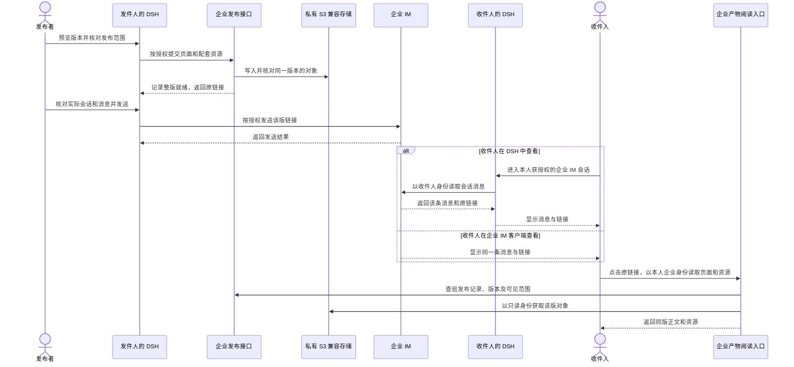

# 企业产物发布与分享设计

## 文档信息

| 项 | 内容 |
| --- | --- |
| 文档编号 | CORP-DSH-DESIGN-021 |
| 文档名称 | 企业产物发布与分享设计 |
| 版本 | V0.5 |
| 文档状态 | 草案 |
| 密级 | — |
| 作者 | hrygo |
| 编制 | Agent（代拟） |
| 审核 | 待定 |
| 批准 | 待定 |
| 最后更新 | 2026-11-19 |
| 确认人 | 项目负责人（当前用户） |
| 确认日期 | 2026-11-19 |
| 确认事项 | 首版做通用 HTML 发布与企业 IM 分享，收件人可仅用 DSH 收到实际企业 IM 消息并打开完整 HTML，普通链接可在企业内自由转发，限群为低优先级的场景可选能力。首版采用私有 S3 兼容存储，由企业产物阅读入口按本人托管资格提供固定版本。 |
| 适用范围 | 已确认的产品方向和托管路径选型。目标环境、产品实例和接口按 §8.1 取证。 |
| 门禁 | 按 §8.1 取得开工前的接口证据，满足范围、契约、逐文件实施及具名测试准入。集成交付按 §8.2、§8.3 验收。 |

## 1. 概述与问题

员工在 DeepSeek Harness（DSH）个人助手中生成 HTML 产物。交付同事在线阅读时，需要完成上传内容、取得可访问链接和把链接发到会话三件事。将这些动作纳入助手，目标是减少用户在托管平台与即时通信（IM）之间的切换，并在同一入口看清内容版本、可见范围和每项操作的结果。试点以同一产物对照企业现有手工上传和发链接的做法，记录操作次数及故障恢复表现。

首版目标覆盖项目周报、分析报告、使用手册、方案说明等各类符合托管要求的 HTML 产物。发布者选定一版成品及配套资源，由企业发布接口存入私有 S3 兼容存储，再从助手把该版的内网链接发到实际企业 IM 会话。收件人可以从自己的 DSH 或企业 IM 客户端接收同一条消息，点击原链接，经企业产物阅读入口（WebServer）用本人企业账号在线阅读。接入条件及交付结果按 §8 取证和验收。

## 2. 首版目标与后续范围

| 目标 | 完成判据 |
| --- | --- |
| 通用 HTML 发布 | 发布者预览并选定一版产物，阅读入口提供对应版本的页面与必要资源。至少两类代表样本由独立收件人从两个入口分别打开，按 §8.2 核对同一版的正文、必要资源和声明支持的交互。 |
| 企业内自由分享 | 发布确认展示链接实际可见范围。已预选会话时同时展示发送目标。持链接且具备托管平台基础访问资格的员工可以在线查看，原会话外的有权员工也可以打开转发链接。 |
| 助手直接分享 | 员工在 DSH 中核对企业 IM 会话和消息，经实际授权发出。验收核对发送归属、目标会话、对应版本及 IM 中的实际消息。 |
| DSH 收件 | 收件人仅用自己的 DSH 进入本人获授权的企业 IM 会话，看到本次分享、发送者和原链接并完成阅读。以企业 IM 服务端标识或可唯一核对的关联证明两端是同一条消息。 |
| 结果可查证 | 发布和发送各自呈现结果。回执中断后，原账号可在同一 DSH 环境中继续查证同一次操作。查实发布就绪时恢复同一版原链接，查实发送时核对目标会话中的实际消息。 |

按项目群限制阅读是低优先级的场景可选能力，设计见 §5。PPT、Word 等产物发布到企业云文档属于后续产品方向，各平台按其真实阅读、编辑与分享能力设计。实施范围由[需求基线 §2](../requirements/requirements-baseline.md#2-范围边界唯一真源)维护。

### 2.1 企业 IM 依赖与关联

首版接入依赖企业 IM 互通中的会话入口、企业身份映射、本人授权的消息收发、服务端消息关联、撤权及读取恢复。发布链接在 DSH 和企业 IM 客户端呈现为同一次投递，作为互通的实际验收用例。通讯录、群管理、图片附件和个人 Agent 私有总结由企业聊天 Epic 分别跟踪。 [企业聊天 Epic #239](https://github.com/hrygo/heluo-forge/issues/239)

企业 IM 远程交办产生 HTML 成果时，可经相应授权和发布成功查证，把固定版本链接随任务结果回传。远程任务接收、设备绑定、执行和确认由跨端任务 Epic 跟踪。 [跨端任务协同 Epic #240](https://github.com/hrygo/heluo-forge/issues/240)

## 3. 关键用户旅程

| 场景 | 前提与动作 | 可观察结果 |
| --- | --- | --- |
| 发布并发到 IM | 员工选择个人助手生成的分析报告及资源，查看待发布版本和可见范围，取得链接后在助手中确认目标会话和消息。 | 托管端就绪后提供内网链接。IM 确认写入目标会话后，助手显示「已发送」。 |
| 先发布，稍后发送 | 员工选定产物和可见范围，此时尚未指定 IM 会话。 | 发布成功后可取得原链接。员工之后选择真实会话，核对消息后发出。 |
| 在 DSH 收件 | 企业 IM 已把分享消息写入目标会话。收件人仅用自己的 DSH，以本人企业账号进入获授权的会话。 | DSH 显示该条消息、发送者和原链接。收件人点击原链接，用受支持的阅读环境及本人企业账号读对应版本。 |
| 断线后恢复收件 | DSH 断线期间，企业 IM 投递分享。收件人恢复连接并重新取得有效会话授权。 | DSH 补齐可核对的区间，已取得的每条消息只显示一次，仍有缺口时提示「同步不完整」。 |
| 同事打开转发链接 | 群成员把普通链接转给另一位企业同事。收件人点开，必要时完成企业登录。 | 登录后返回同一版本。页面与配套资源按收件人的基础访问资格返回。 |
| 发布回执中断 | 员工已授权提交，托管方可能已经接收，助手没有收到确定结果。 | 助手显示「发布待核验」。查实版本已就绪后取回原链接，员工再决定是否发送。 |
| 发送未确认 | 链接已发布，IM 发送返回中断。 | 发布的链接仍可查看。助手显示「发送待核验」，核对该次发送在目标会话中的结果。 |

## 4. 技术方案

### 4.1 职责与信任边界

| 参与方 | 责任 |
| --- | --- |
| DSH 个人助手及扩展入口 | 发件端选择版本、预览、确认范围、受控发布与发送、呈现查证结果。收件端在本人获授权的企业 IM 会话中展示消息与原链接。宿主提供实际可用的扩展入口，客户端展示状态快照。 |
| 企业身份与访问管理（IAM）及既有策略 | 为实际员工提供相应资源的身份和授权依据。跨系统写入按现行组织策略及必要审计执行。策略判定为询问（`ask`）时，当前用户在本机逐次确认后方可提交；受控写的确认卡片同样在本机完成。发布与发送分别核对授权。 |
| 企业发布接口 | 按发起账号及服务端授权接收版本与资源，写入私有 S3 兼容存储。维护唯一发布记录、版本对象清单、可见范围、就绪和生命周期状态，返回阅读入口的固定版本原链接并提供发布查证。 |
| 企业产物阅读入口（WebServer） | 面向收件人的内网 HTTPS 服务。按本人企业身份授权页面和资源请求，依据发布记录检查版本可读性，使用服务端只读身份读取该版对象。 |
| 私有 S3 兼容存储 | 保存版本对象，按企业配置隔离桶及对象访问。存储提供方的读取一致性、身份权限、保留和恢复能力按 §8.1 核验。 |
| 企业 IM | 管理会话与消息的授权、投递及记录。发件人选择实际会话，收件人按本人身份读取有权访问的消息。 |

企业发布接口和 IM 分别对写入执行服务端授权。企业 IM 授权收件人读取会话消息，阅读入口按收件人的企业身份和托管资格授权页面及资源。发布、阅读使用按职责授权的服务端身份。模型访问及其凭据由企业 AI 网关独立管理。发布记录是发布和阅读共用的版本状态依据，桶中单个对象的存在只证明该对象可查。组件配置、接口和权限能力以目标环境取证。

发布确认关联发起账号、所选版本和实际可见范围。发送确认另行关联发起账号、实际发送主体、稳定的目标会话、消息内容和版本链接。确认项变更时重新核对和确认。两次写入均在提交前执行现行策略及适用的本机人工确认（`ask`），落实必要审计和目标服务端授权。用户取消、策略拒绝或必要审计不可用时，对应写入保持未提交。

### 4.2 正常流程

以下为接入取证通过后的目标流程。

### 4.3 产物、版本与接口语义

| 对象 | 所需信息与所有权 |
| --- | --- |
| 待发布产物 | 员工选定的版本、入口 HTML、配套资源及需保留的交互。预览和提交使用同一版资源集合。内容在确认后发生变化时，更新预览并重新确认待发布版本与范围。 |
| 发布记录 | 企业发布接口是版本就绪、原链接、可见范围和生命周期的事实来源。记录关联本次操作、发起账号及所选版本，并绑定入口路径、必要对象清单及各对象的固定身份或内容校验依据。 |
| 发送结果 | 企业 IM 是目标会话、实际消息和发送状态的事实来源。发送关联信息对应单次操作、目标会话和已发布版本。 |
| 收件消息 | DSH 以收件人身份按企业 IM 授权读取会话。显示企业 IM 实际消息中的发送者、消息和原链接，实际消息按服务端会话与消息标识，或经取证可唯一对应同一次写入的等价关联辨认。 |

发布按完整版本交付，宿主读取范围限于员工所选产物及其必要资源。入口 HTML 和必要资源写入该版独立的对象前缀。必要数据、样式、图片、脚本等随版交付，或引用经验证的固定版本，并按该产物的访问范围读取。发布接口按该版对象和依赖清单核验资源可由阅读侧取得、内容对应所选版本且符合发布范围后，将该版记录置为就绪。部分上传、缺失依赖或权限核验失败时，保持未就绪并提示原因。在有效期内，已就绪版本绑定的对象内容保持固定。支持的资源与交互按 §8.2 样本清单验收。

接入需要提交并查证发布、选择已授权企业 IM 会话、发送并查证消息，以及以收件人身份读取会话消息。动作、版本引用和结果状态是设计语义。具体 DSH 扩展点、企业端 API 字段、协议和错误映射由真实接口核验后进入对应契约。

### 4.4 链接可见范围

普通链接可在企业内自由转发。读者持有链接并符合托管平台基础访问规则，即可用企业账号访问。普通发布适用于既有企业规则允许在该范围流转的内容。需要限定读者的材料通过具备相应访问控制的企业发布路径交付。

发布确认显示产物、版本和实际可见范围，可在选择 IM 会话前独立完成发布。已预选会话时显示发送目标，发送前核对实际会话与消息。阅读入口对 HTML 页面和配套资源直链使用同一权限。DSH 与企业 IM 客户端展示产物内容的链接预览（含缓存）都须经实测符合这一范围。会话授权有效时，展示消息及可点击的文本链接。展示内容预览及其缓存还须具备有效的托管访问资格。托管拒绝或预览授权暂不可核验时，保留有权查看的消息及文本链接。阅读入口独立判定原链接的页面与资源权限。未登录的收件人完成企业登录后返回原链接，缺少访问资格时提示「无权访问」。

一个链接指向一个已发布版本。修订版发布后生成新链接。原版在有效期内仍由原链接访问。到期、下架及相应页面反馈由托管平台按企业现有生命周期规则处理。

### 4.5 发布与发送结果

提交前为每次已确认的写入取得可由原账号重新找回的操作关联。发布关联账号、操作、所选版本及可见范围。发送关联账号、操作、目标会话及已发布版本，并以经核验的发送归属和消息内容校对。托管与 IM 各自提供结果事实。

| 状态 | 企业发布接口 | 发送到企业 IM |
| --- | --- | --- |
| 未提交 | 产物未就绪、取消或门禁拒绝时展示原因。 | 版本未确认就绪、取消或门禁拒绝时展示原因。 |
| 请求中 | 提交预览确认的完整版本，等待托管结果。 | 发送已确认就绪的版本链接，等待企业 IM 结果。 |
| 成功 | 托管确认同一次发布的完整版本就绪，显示该版原链接。 | IM 确认同一次发送的消息写入目标会话，显示「已发送」。 |
| 明确失败 | 托管端给出可判定的失败结果。满足已验证的重试条件并核对当前授权后，可重新提交。 | IM 给出可判定的失败结果。保留已发布版本，满足已验证的重试条件并核对当前授权后，可用原链接重试。 |
| 待核验 | 按原账号及该次发布的关联查证版本就绪状态。查实成功后恢复同一版原链接。 | 按原账号及该次发送的关联核对稳定会话、实际消息和链接版本。查实后更新该次发送结果。 |

提交后回执丢失、查询延迟或匹配不唯一时进入或保持「待核验」。待核验期间仅查证该次操作。只有提供方已核验的记录足以确认失败、且符合其恢复语义时，才进入明确失败和相应重试流程。查询暂空仍按未知处理，除非核验确认它对该服务具有明确的终态含义。发送入口仅接受托管确认就绪的版本。

首版要求原账号在同一目标 DSH 环境退出或重启后可继续查证。切换账号时仅呈现当前账号有权访问的操作结果，切回原账号后按原关联恢复。优先使用按本人身份可回查的提供方记录，确需宿主保存引用时，只保留操作关联、账号归属及必要的版本或会话引用，按企业保留规则和提供方查证期限确定保存和清理。超出查证期限且仍缺终态证据时，提示暂无法核验并保持未知处理。关联来源、所有者和生命周期在 §8.1 取证后进入接入契约。

宿主将同一次确认的重复点击合并为一次提交。员工另行确认的发送属于新操作，即使会话和链接相同。验收分别核对宿主发起次数和提供方实际写入次数，覆盖同一会话中已有同文同链接消息的情况。

### 4.6 DSH 收件与会话权限

一次分享将链接写入选定的企业 IM 会话。收件人在自己的 DSH 从本人获授权的会话入口读取该条消息，企业 IM 客户端呈现同一条消息。首版接入所需能力为打开实际会话、以本人身份读取、辨认本次消息及打开原链接。Forge Chat 的企业 IM 互通仍待实际接口取证，接入方向见[企业聊天产品方案 §4](../requirements/enterprise-collaboration-chat-proposal.md#4-接入路径与决策条件)。宿主入口、身份映射和读取方式按 §8.1 取证。DSH 从消息发起打开，完整 HTML 由目标宿主支持的阅读环境呈现，阅读入口按本人权限返回页面和资源。

消息、原链接、缓存及预览的展示绑定当前账号、当前会话和经核验仍有效的服务端授权。授权有效且符合实际保留规则时，DSH 可用本账号、本会话的缓存显示已授权内容。明确撤权或拒绝时隐藏相应消息、链接和预览，提示无会话访问权限。授权过期或暂时无法确认仍有效时只展示权限或同步状态。授权有效期、撤权生效与查验方式按 §8.1 取证。

每次读取关联其发起时的账号、会话及授权上下文。切换账号或会话、退出或授权失效时，先前上下文的响应停止更新当前视图。切回原账号或原会话时重新核验授权并使用本次上下文读取。恢复连接时，按当前授权核验后展示内容，缓存和迟到响应遵循同样的条件。合法取得的普通链接由阅读入口按托管基础资格独立判权。

### 4.7 收件同步与恢复

连接恢复后，DSH 先核对本人及会话权限，再按企业 IM 经取证的历史或增量读取方式补齐。恢复范围为当前有权会话内，自上次确认的读取位置至本次可确定的结束位置之间、服务端仍可读取的中断区间。读取位置只推进到已核对连续覆盖的位置，发现的缺口保留为未补齐。首次读取或缺少可信位置时，按提供方可核对的历史范围读取，并如实显示覆盖情况。

重叠结果按服务端会话与消息标识，或等价的权威关联去重。同一实际消息只展示一次。同文同链接的不同实际消息各自保留。读取进行中显示同步状态。超出可读历史、读取仍有缺口或当前记录无法证明覆盖完整时显示「同步不完整」，并注明已确认的读取范围。权限失效按 §4.6 停止展示相应内容。

收件查询、补齐和重复刷新只读取企业 IM 已有消息。即使发件端仍为「发送待核验」，收件人有权读取时也可恢复已写入的消息。发件端继续按 §4.5 查证同一次发送，查实后更新其写入结果。

### 4.8 企业产物阅读入口（WebServer）

阅读入口以独立的企业内网 HTTPS 地址承接 DSH 和企业 IM 中的原链接。企业单点登录（SSO）使用收件人的本人身份。成功后仅回到与本次登录绑定的本入口原版本页面或资源地址。已有浏览器会话时，按可辨认的当前阅读账号判权，收件人可通过企业登录切换账号。正式入口、IAM 回调和切换行为按 §8.1 核验。

| 能力 | 行为与边界 |
| --- | --- |
| 统一鉴权 | 页面请求和资源直链逐请求校验当前企业身份及托管阅读资格。资格不足时提示「无权访问」。授权暂不可核验时拒绝返回正文和资源。 |
| 固定版本 | 根据 URL 的版本及资源路径查权威发布记录。只有所请求版本已就绪、仍可读且资源属于其清单时才返回内容。未登记或指向该版清单之外的对象请求予以拒绝。 |
| 私有桶与完整呈现 | 服务端只读身份限定在获授权的产物对象范围。入口按发布记录读取该版绑定的对象内容，保持相对路径和正确的 `Content-Type`。发布记录不可用、存储故障、对象缺失或与绑定内容不符时，拒绝相应读取并提示读取异常。 |
| 缓存与预览 | 浏览器、代理和客户端显示内容预览或复用缓存前，须以当前读者身份确认阅读权限及当前版本可读性。条件请求也须执行同样检查。首版页面和资源响应禁止缓存，无法验证当前权限和版本状态的 IM 或 DSH 预览仅显示文本链接。 |
| 内容与凭据隔离 | 用独立执行上下文隔离不同产物版本、SSO 会话、托管管理面及 DSH。产物脚本只能请求本版资源与经核验的固定依赖。共享地址是阅读入口固定版本的 HTTPS 链接。存储地址及访问凭据由服务端保管。 |

阅读入口是独立交付单元。使用与实际读取契约一致的预置发布记录和私有桶对象，可独立取证、开工和验收。集成时使用企业发布接口生成的发布记录和对象，再与 DSH、企业 IM 一起按 §8.2、§8.3 验收。 [阅读入口 issue #387](https://github.com/hrygo/heluo-forge/issues/387)

## 5. 低优先级可选能力 · 限群

对需要限定项目组内部阅读的产物，例如一份受限周报，发布时选用限群并绑定企业 IM 中的稳定群标识。发布确认展示对应群与实际可见范围。阅读入口对页面和任一配套资源按打开时的群成员资格判定，使用访问者自己的企业账号。

群外员工及退群成员打开旧链接、转发链接或资源直链时得到权限拒绝。群成员查验暂时不可用时，启用了限群的产物保持原访问范围，显示「暂无法核验访问权限」。普通链接按托管平台基础访问规则工作，可在未配置成员查询能力的环境独立验收。采用限群时单独验证身份映射、当前成员查询、退群后生效、缓存与预览，再注入成员查询故障复测普通链接。

## 6. 安全、运行与回退

- **数据与内容隔离。** 用既有企业发布规则判定普通分享的适用内容。客户数据遵循机构内数据边界。DSH 宿主隔离预览内容与工具、凭据及会话数据。企业托管和实际阅读环境隔离报告内容与托管管理权限及 DSH 工具权限。HTML 按待发布数据处理，隔离能力以 §8 的目标环境验证为准。
- **权限与证据。** 发布和发送动作各自沿用现行授权与审计。业务权限拒绝、提供方故障和结果待核验须有可辨认反馈。发布物的页面、配套资源和展示内容的链接预览受同一可见范围约束。
- **排障和容量。** 审计按既有规则记录关联标识、操作、版本、必要的目标会话标识、状态及耗时。日志限于上述必要元数据，凭据仅通过宿主受信接口处理。IM 消息使用托管端确认的企业内网链接。按代表性样本测量产物体积、资源数、上传耗时、收件端加载耗时和查证结果，以提供方配额及实测确定上限。
- **停用与生命周期。** 停用助手入口时停止新发布与新发送。企业 IM 已投递的消息按其授权与保留规则读取。托管服务先停止到期或下架版本的页面和资源读取，再按保留规则回收对象。已确认发布、尚未发送的版本按同一托管生命周期管理。

## 7. 托管选型与取舍

首版采用私有 S3 兼容存储与企业产物阅读入口。多个读取实例可使用同一套版本对象，发布记录统一控制整版何时可读。具体 S3 提供方、存储读取一致性、浏览器 SSO、发布记录接口和运行部署形态按 §8.1 取证。 [总体架构 ADR-30](../architecture/platform-architecture.md#14-架构决策记录)

| 方案 | 对首版目标的适用性 | 取舍 |
| --- | --- | --- |
| 企业 SSO 与静态文件目录 | 同一文件系统可按版本目录发布完整资源。 | 多实例共享版本依赖共享卷或文件同步，也须验证目录恢复和整版就绪语义。 |
| 自建 GitLab Pages | 在身份覆盖、访问控制和并行部署额度符合要求时可提供版本化站点。 | 阅读资格及部署生命周期依赖 GitLab 项目配置。 |
| 企业现有手工上传与发链接 | 现有托管和 IM 可完成基本交付，需员工单独操作两套服务。 | 试点用同一产物对照操作次数、系统切换与失败恢复。首版验收使用助手发出、收件人在 DSH 接收的实际交付。 |
| 通过 IM 发送 HTML 文件或导出物 | 适合实际平台支持的附件流转。附件的资源、交互和访问条件由企业 IM 决定。 | 首版用托管原链接保持可转发的固定版本、配套资源和在线交互。附件能力按其适用场景评估。 |
| 在首版普遍按群限制访问 | 适用于读者必须限定为当前群成员的产物，读取时依赖成员查询。 | 限群低优先级，按场景选用。普通 HTML 链接按托管基础访问资格在企业内自由转发。 |

## 8. 企业接口取证与首版验收

### 8.1 开工前接口取证

探针使用获授权的目标环境、合成 HTML、实际测试会话及企业测试账号。收件探针可用已发布的合成样本链接和预投递消息，通过现有企业接口及目标 DSH 的最小受支持扩展验证能力。开工前取证针对下表的接口及宿主能力。助手的受控发布与发送、真实收件点击、完整阅读和综合故障用例在集成后按 §8.2、§8.3 验收。

每项记录目标系统与版本、宿主形态与 SDK、核验日期、账号角色及授权、接口依据、操作、预期与实际结果、脱敏的提供方记录和证据位置。结论为「通过」「不通过」或「待取证」，通过仅适用于实际核验的目标环境与接入形态。账号样本覆盖发件人、会话和托管均有权的收件人，以及两种访问资格不同的员工。缺少首版必需证据时，登记缺口和受影响的路径，该路径保留在取证阶段。其他独立探针可以继续核验，限群按采用范围独立取证。

| 接点 | 开工前最小操作及通过证据 |
| --- | --- |
| DSH 与 SDK | 核验目标宿主支持选定并预览合成版本、绑定其资源、接入现行策略与审计及所需的受控调用入口。用最小收件探针和预投递消息，验证本人企业身份进入获授权会话、读取实际消息、呈现并打开其中的链接，收件人侧企业 IM 客户端保持关闭。记录宿主扩展点、账号切换边界、打开方式及预览隔离能力。 |
| 企业 IAM | 核验用于 DSH 和企业 IM 的本人身份映射、阅读入口的独立授权、SSO 回调、会话过期或撤权时的行为。验证本人登录后回到原链接及受控资源，切号后按当前阅读账号判权，过期回调或试图回跳到域外时拒绝。核验许可、拒绝及授权暂不可核验的可辨认结果。 |
| 企业 IM 发送与查证 | 在授权会话用实际接口发送测试消息。提供方记录可核对发送归属、会话、消息及链接版本，提交前可得的关联可重新取得并对应本次发送。核验查询为空、延迟、明确失败、恢复期限和允许重试的条件。 |
| 企业 IM 会话读取与恢复 | 在实际目标会话，以独立收件人身份读取预投递消息，对照服务端会话与消息标识或可唯一对应写入的等价记录。核验本人授权、拒绝、撤权的生效方式及有效期限。用提供方读接口查验可读历史、重叠页或增量结果、可读边界和缺口的判定语义。 |
| 企业发布接口与私有 S3 | 对实际目标桶验发布端身份的写入及校验权限、独立版本对象前缀、写后可读与就绪记录提交条件。提交合成版本，核验部分上传时保持未就绪、正式版本对象固定、保留及下架规则。用提交前可得的关联查回同一次操作、同一版本及原链接，记录查证期限、查询为空和明确失败的语义。 |
| 企业产物阅读入口（WebServer） | 使用获授权的预置合成对象和发布记录，核验本人登录回跳、逐请求页面及资源鉴权、桶只读身份、正确类型和相对路径。覆盖同名跨版、对象被覆盖或从备份恢复后的固定内容校验。用无害样本验证脚本能执行已声明交互且无法访问其他版本、会话凭据或管理接口。用已有读取记录的会话复验撤权、下架及依赖故障，含条件请求和可用的内容预览。 |
| 限群（可选） | 按采用范围核验身份映射、稳定群标识、读时成员资格、撤权触发与缓存的生效边界。普通链接按托管基础规则单独取证。 |

### 8.2 集成交付与完整 HTML 验收

至少选用两类代表样本。每类样本测试前登记入口 HTML、预览期望、必要资源路径、固定外部依赖与声明支持的交互。样本清单逐项记录收件实测与结论。正文和必要资源均对应同一版本，收件人以本人企业账号从实际分享消息打开后，样式、图表及声明的交互按清单工作，即通过完整 HTML 验收。

| 代表样本 | 应核对的内容与资源 |
| --- | --- |
| 图文类 HTML，例如项目周报 | 正文、表格、图片与样式。逐项核对页面和引用的必要资源。 |
| 带图表或交互的 HTML，例如分析报告 | 正文、图表、图片、样式、图表依赖的固定版本数据或脚本，以及样本声明保留的交互。 |

1. **发布同一版。** 发件人在目标 DSH 预览并确认该版 HTML、必要资源和实际可见范围。按现行授权提交后，记录该次发布、托管就绪、版本及原链接。验一条先发布、稍后选择会话的路径。
2. **发出可辨认的新分享。** 在实际测试会话预置一条同文同链接的旧消息，记录其服务端标识或等价关联。发件人在 DSH 确认实际目标会话与消息，执行本次发送。核对提供方记录、发送归属、目标会话、版本原链接及本次确认对应的一次实际写入。
3. **仅用 DSH 收件并打开。** 收件人侧企业 IM 客户端保持关闭，收件端没有本次新消息的本地记录。独立收件人仅用自己的 DSH，以本人企业账号进入获授权的实际会话，看到本次消息、发送者和原链接。从消息点击原链接进入该宿主支持的干净阅读会话，以本人企业账号登录后返回原链接，按样本清单阅读同版正文、必要资源和交互。
4. **对照企业 IM 客户端。** DSH 独立收件及打开通过后，再用同一收件人的企业 IM 客户端查看该会话。用服务端会话与消息标识，或能唯一对应同一次写入的提供方记录，核对两个入口展示的是本次新消息。对照原链接、发送者和版本，在独立的干净阅读会话按同一清单验证完整 HTML。
5. **交叉验收与转发。** 使用该条消息和原链接。会话有权、托管无权的账号能看到消息与文本链接，页面、资源直链和内容预览遵守托管拒绝。另用未登录的干净会话核对页面及资源直链的登录或拒绝行为，检查预览及缓存是否只按有效权限展示内容。原会话无权、托管有权的员工经企业内转发取得普通链接后能阅读同版页面和资源，原会话内的消息、缓存和预览遵守会话拒绝。普通转发用未配置限群能力的环境验收，采用限群时按 §5 追加可选用例。
6. **版本隔离和执行边界。** 发布替换同名资源的新版，变更样本所用必要依赖的上游内容，复验旧链接仍可读取原版资源并使用已声明的交互。缺必要资源、固定依赖或访问条件的反例保持未就绪。用含脚本的合成样本进行无害隔离验证，观察预览及在线阅读的宿主工具、会话数据和托管管理权限均由各自边界限制。到期及下架按托管记录及页面提示验收。

每类样本串联同一次 DSH 发布、托管原链接、新旧消息的服务端记录、DSH 独立收件、企业 IM 对照和两个入口的完整阅读。留存实际账号角色、宿主和操作系统版本、会话入口、链接打开方式、本人登录回跳及脱敏证据。通过结论按实际纳入交付的宿主形态分别记录。

### 8.3 集成故障、授权与试点验收

| 场景 | 通过判据 |
| --- | --- |
| 受控发布及发送 | 分别验取消、策略拒绝、必要审计不可用、确认项变化与重复点击。核对宿主提交次数、对应远端实际写入次数、该次确认内容及重新确认行为。按已核验规则验明确失败后的重试。 |
| 发布回执中断 | 托管已接收后模拟回执中断。助手保持「发布待核验」，重启后用原账号查证，切换账号时状态隔离。查实同一次操作的完整版本就绪后恢复原链接。结果未知时只查证，对照托管实际写入。 |
| 读取就绪与生命周期 | 部分对象已上传时试读该版页面和资源，均按未就绪处理。整版就绪后，先打开页面、资源直链及可用的内容预览，再分别验证撤销托管资格、到期、下架和发布记录不可用后的读取与缓存复用。复测旧链接、条件请求及预览，核对发布记录、拒绝结果和对象回收顺序。 |
| 发送回执中断 | 在同一会话预置同文同链接消息，在 IM 写入本次消息后模拟回执中断。保持「发送待核验」，覆盖重启、切号隔离和回到原账号。查实后核对本次实际消息、版本链接和对应写入次数。 |
| 撤权、切号与迟到响应 | 先用有权账号加载消息及预览，然后断线，在企业端撤权后重开会话及重连。另延迟原账号的读取结果，在切号、切回或切换会话后返回。分别对照当前账号、会话、有效授权和服务端拒绝，检查消息、链接、缓存、预览及迟到响应的展示。撤权、拒绝或授权暂无法核验时只显示相应状态。旧上下文的结果无法更新当前界面或回填可见缓存，回切用重新核验后的读取结果。 |
| 断线补齐与去重 | 在投递前中断收件 DSH 读取，期间投递多条消息，含同文同链接但实际标识不同的消息。实际接口按页或批次读取时，让本次分享落在首批恢复结果之后。本人重新取得有效授权后按 §4.7 补齐，覆盖重叠结果与重复刷新。逐条核对约定区间的服务端消息标识，每条显示一次。另验可读历史截断或部分读取失败时显示「同步不完整」，后续消息的到达不掩盖缺口。恢复前后核对 IM 实际写入次数相同。 |
| 发件待核验时独立恢复收件 | 企业 IM 已写入且发件端回执中断，收件 DSH 从断线中恢复并读取该条实际消息。对照同一服务端消息、恢复过程的写入次数及发件人按原操作独立查证的结果。 |
| 试点对照 | 同一产物按本机助手流程及企业手工流程交付。以相同版本、访问资格和完整阅读作为终点，比较操作次数、系统切换及故障恢复结果。 |

普通首版以 §8.2 的真实交付与 §8.3 综合用例共同通过为准。企业接口的实际结果和支持范围以目标环境记录为准。

### 8.4 待确认

| 待确认问题 | 事实来源或裁决人 | 截止门禁 |
| --- | --- | --- |
| 哪些目标 DSH 与 SDK 版本支持受控入口、本人会话读取、预览隔离和原链接打开 | 目标 DSH 宿主探针及 SDK 提供方 | 开工前接口取证 |
| IM 身份映射、真实消息关联、撤权生效方式、可读历史范围和恢复语义 | 企业 IAM、IM 实际契约和提供方记录 | 开工前接口取证 |
| 私有 S3 提供方及目标桶、读写身份与读后校验条件、发布记录和查证接口 | 企业托管实际契约、目标桶权限及实测记录 | 开工前接口取证 |
| 阅读入口域名、SSO 回调、版本路由、逐请求读授权和就绪检查的接入形态 | 企业托管与 IAM 实际契约及探针记录 | 开工前接口取证 |
| 项目范围登记、纳入验收的目标宿主及实际实施落点 | 项目负责人依据取证结果确认 | 设计收口及开工 |

## Detailed Implementation Plan

### 开工条件

1. **范围登记。** 将通用 HTML 发布、企业 IM 分享和 DSH 收件纳入需求基线 §2，关联受影响的架构与验收。限群按采用场景单独登记和取证。
2. **接口与行为契约。** 各交付单元取得 §8.1 中自身依赖接口的通过证据。按真实接口定稿发布、阅读、发送及收件的授权主体、对象、版本与消息关联、错误映射、状态所有权和生命周期。分别明确两个写入的查证及可重试条件、阅读入口的版本路由和就绪判定，以及收件授权有效期、切换与撤权、读取结果绑定、补齐范围、消息去重、缺口反馈及必要的缓存保留规则。
3. **逐文件实施清单。** 按设计索引 §5 记录包及宿主装配入口、每个源码文件、构建与运行配置、测试及夹具的仓库相对路径。逐项标明新增、修改或删除、所属阶段、职责、状态归属、依赖、适用的配置 schema、导出面及兼容策略。每阶段给出具体构建与验收命令。开工清单以通过取证后的实际落点为准。
4. **具名测试清单。** 每个用例记录对应验收目标、测试文件及名称、可执行命令、前置账号角色与环境或服务替身、夹具、触发点、期望状态、证据位置。写入及恢复用例列明涉及的宿主提交和提供方实际写入次数，收件用例列明同一实际消息的展示次数。发布和发送的回执中断在相应提供方接收请求后、助手确认结果前注入。收件故障用例分别定位断线、撤权、切号与旧读取返回的顺序。测试替身与真实交付各保留自己的实际证据。

按交付单元满足上述条件后进入该单元编码。开工接口结论、已定契约、实施文件清单和具名测试应可相互追溯。阅读入口先行所需证据为目标企业 IAM、私有桶读取和权威发布记录的读取契约，预置记录须满足该契约。企业 IM、DSH 和写入接口的实测按各自路径取证，首版集成交付需要实际链路共同通过。

| 具名测试应覆盖的范围 | 最低用例 |
| --- | --- |
| 发布与完整 HTML | 正常和先发布后选会话、版本和资源就绪、依赖固定、缺资源或超范围依赖、旧版隔离、预览和阅读隔离、原链接及页面和资源授权。 |
| 阅读入口 | 本人登录和回跳绑定、切号、跨版及未登记资源、固定对象内容、页面和资源直链、脚本执行隔离、缓存和预览在资格撤销、记录不可用及下架后的行为。 |
| 两类写入及回执恢复 | 取消、拒绝、审计依赖失效、确认项变化、重复点击、已接收丢回执、明确失败重试、重启与切号隔离。用提供方记录核对实际写入次数。 |
| 同次投递与两端收件 | 企业 IM 客户端关闭时 DSH 独立收件与开链、同文同链旧消息消歧、服务端一次写入、两个入口的同版完整阅读及实际普通转发。 |
| 读取授权和同步 | 会话与托管权限交叉、掉线撤权、授权暂不可核验、切换及回切后迟到响应、跨页补齐与重叠去重、超出可读历史的缺口，以及发件待核验时独立恢复。 |
| 可选限群 | 采用后验读时成员资格、退群后的旧链接和资源拒绝、预览和缓存、查询异常，以及此时普通路径照常工作。 |

### 取证与实施阶段

| 阶段 | 工作 | 退出判据 |
| --- | --- | --- |
| 开工前接口取证 | 按 §8.1 独立运行授权探针并登记实际能力与缺口。 | 对已纳入的首版目标路径，每项必需接口具备对应通过证据，缺证路径保留在取证。 |
| 设计收口及开工 | 依据取证定稿契约、状态归属、文件清单和具名测试。 | 开工条件齐备，文件路径、变更动作、构建与验收命令、证据位置明确。 |
| 企业产物阅读入口 | 可与发布及 IM 路径并行。对接企业 SSO、发布记录和私有桶的只读访问。 | 用目标 IAM、私有桶和符合读取契约的预置记录验证 §4.8，具名构建及测试通过。 |
| 普通 HTML 发布 | 实现成品选择、预览、发布确认和回执处理。 | 具名构建和测试通过。可由目标托管确认完整版本、返回原链接并验证发布恢复。 |
| 企业 IM 分享与 DSH 收件 | 仅在会话入口、本人映射、消息读取及发送能力取证通过后接入。按契约实现受控发送、查证、收件与补齐。 | 具名构建和测试通过，分别留存发送及收件恢复证据。 |
| 首版集成交付 | 使用实际发布记录和对象串联发布、阅读、IM 分享与 DSH 收件。 | 按 §8.2、§8.3 验收整版就绪及下架、真实同次投递、两端完整阅读、权限及同步恢复。 |
| 可选限群 | 按场景核验及实现 §5。 | 可选用例独立通过。普通路径按自身结果验收。 |

### 受控文档与实施证据

| 文档或证据 | 维护条件 |
| --- | --- |
| 本设计、[设计索引](README.md#21-跨模块设计)、[金鱼审查证据](../engineering/reviews/enterprise-artifact-publishing-egm.md) | 正文登记编号及状态，索引提供导航，评审证据保留简报、评审目标及处置的版本引用。实施通过 [Epic #385](https://github.com/hrygo/heluo-forge/issues/385) 跟踪。 |
| [需求基线](../requirements/requirements-baseline.md)、[总体架构](../architecture/platform-architecture.md) | 托管选型见 ADR-30。实施范围纳入基线时同步对应需求及跨域职责。 |
| 发布、阅读、发送与收件契约 | 开工前将核验过的字段、授权和恢复语义写入对应契约。按既有契约覆盖情况决定文档落点。 |
| 逐文件实施与具名测试清单 | 依据真实接口和宿主落点确定路径、命令及验收证据位置，按本节开工条件评审。 |

受控文档编号按 `pnpm docs:catalog` 核对，链接及锚点按 `pnpm check:docs` 校验。实施时执行 `pnpm check:repo`、`pnpm check:version` 及各阶段具名构建和测试。目标企业交付按 §8 留存实际验收证据。

## 编制依据

- 产品范围及权限口径依据 [概念简报](../engineering/reviews/enterprise-artifact-publishing-egm.md#概念简报)。
- 设计与验收规则依据 [V0.3 审查目标](../engineering/reviews/enterprise-artifact-publishing-egm.md#v03-审查目标)、[金鱼审查汇总](../engineering/reviews/enterprise-artifact-publishing-egm.md#v03-金鱼审查汇总)、[审查处置](../engineering/reviews/enterprise-artifact-publishing-egm.md#v03-审查处置)及 [V0.5 托管选型复核](../engineering/reviews/enterprise-artifact-publishing-egm.md#v05-托管选型复核)。
- 项目范围、安全及设计准入按 [需求基线 §2](../requirements/requirements-baseline.md#2-范围边界唯一真源)、[总体架构](../architecture/platform-architecture.md)、[DSH 插件高阶规范](../engineering/dsh-plugin-conventions.md)及[设计索引 §5](README.md#5-完成判据)维护。仓库依据核对日期为 2026-11-19，宿主和企业接口证据按 §8 取证。
