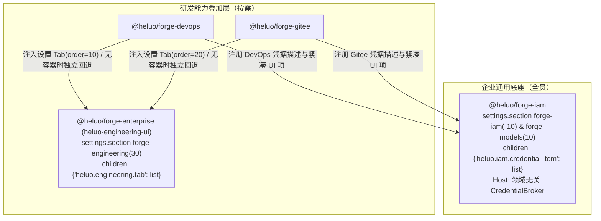

# 企业设置菜单统一与 Token 收敛详细设计

## 文档信息

| 项 | 内容 |
|---|---|
| 文档编号 | CORP-DSH-DESIGN-018 |
| 文档名称 | 企业设置菜单统一与 Token 收敛详细设计 |
| 版本 | V2.0.0 |
| 文档状态 | 生效 |
| 密级 | — |
| 编制 | DSH 平台组（代拟） |
| 审核 | 待定 |
| 批准 | 待定 |
| 最后更新 | 2026-11-13 |
| 门禁 | G2（设计规范与仓库双定位代码及离线契约/探针闭环已落地，企业真机与外部系统未联调） |
| 确认人 | 用户（项目唯一决策人） |
| 确认日期 | 2026-11-13 |
| 确认事项 | 按「一体双定位解耦 + 去技术细节渐进披露 + 不修改 DSH 宿主源码」定稿方案 B 分层菜单、IAM 领域无关凭据扩展槽位、双向兼容与收敛 Gitee「高级」用户界面 |
| 适用范围 | Heluo Forge 企业设置信息架构、通用账号与模型底座、可扩展凭据（Token）槽位及 DevOps / Gitee 研发工具配置收敛 |

> 编制依据：[根 README](../../README.md) 确立的「企业级智能研发平台 × 智能个人助理」一体双定位产品基线、DSH 宿主 `settings.section` / `settings.section.icon` / `settings.plugins.tab` 与 `SettingsSectionOwnerProps` 契约实核、仓内 `forge-iam` / `forge-credentials-keychain` / `forge-enterprise` / `forge-devops` / `forge-gitee` 源码审计、[DSH 插件高阶规范](../engineering/dsh-plugin-conventions.md)（CORP-DSH-ENG-003）及[SQLite 存储扩展与使用规范](../engineering/sqlite-storage-conventions.md)。
>
> 关联文档：[根 README](../../README.md)、[总体架构](../architecture/platform-architecture.md)、[逐模块设计索引](README.md)、[IAM 接入](plugins/forge-iam.md)、[IAM 模型与工具隔离消费设计](iam-consumer-isolated.md)、[企业组合包详细设计](plugins/forge-enterprise.md)、[DevOps 接入](plugins/forge-devops.md)、[Gitee 接入](plugins/forge-gitee.md)、[网关凭据双模式支持设计](credential-modes.md)、[DOP CLI 规范](../contracts/dop-cli-spec.md)、[GH CLI 规范](../contracts/gh-cli-spec.md)、[企业研发工具接入最小契约](../contracts/engineering-tools.md)、[企业模型设置手动添加模型实施方案](../plans/2026-11-13-enterprise-manual-model-add-luna-guide.md)。

## 1. 结论与「一体双定位」效力边界

Heluo Forge 面向全体企业员工提供**智能个人助理**（日常对话、邮件、个人记忆、办公协作），同时为研发人员叠加**智能研发平台**能力（需求、DevOps、Gitee 与交付流）。因此设置体系与凭据模型采取**通用底座与研发能力物理及体验双解耦**架构，且完全建立在 DSH 宿主既有公开槽位之上，**不修改 DSH 宿主源码、不创建 fork**：

1. **非研发通用场景（双定位通用底座）**：设置侧栏仅出现 **`企业账号`**（`order: -10`）与 **`企业模型`**（`order: 10`）两项企业入口，页面、引导流与术语体系中**零研发工具（DevOps / Gitee / CLI）与零底层 Token 协议概念**。
2. **研发增强场景（按需叠加）**：启用研发扩展组合时，侧栏追加 **`企业研发工具`**（`order: 30`）；同时各研发插件通过领域无关的 **IAM 凭据扩展槽位** 将自身 Token 配置按需挂入 `企业账号`，默认保持静默与自然语言状态，不把底层状态机与环境变量细节暴露给日常用户。

本设计的当前三类事实验证状态严格区分如下：

| 事实类别 | 当前结论 | 说明 |
|---|---|---|
| **已生效（设计规范）** | 生效 | 本文确立的双定位分层菜单、IAM 通用凭据扩展机制、渐进披露文案规则、`cli-runner.mjs` 环境白名单收敛与 Gitee「高级」下线规则为后续实施唯一依据 |
| **已实施（仓库代码现状）** | 已落地（离线闭环） | 仓内代码与离线验证已落地：`@heluo/forge-credentials-keychain` 内存后端与存储引用校验；`ext-token` 隔离存储（双因子 AAD、状态机）与 `createExtTokensService` 宿门外形、`createCredentialBroker` 窄端口及 `forge-iam` 装配层 `provide('forgeIamCredentialBroker')`；`POST /api/forge-iam/models/manual` 与 `GET/PUT/DELETE /api/forge-iam/ext-credentials[/<id>]`；`@heluo/forge-iam/client.js` 顶级双菜单（`forge-iam` `-10`、`forge-models` `10` 与同名 `settings.section.icon`）、纯 3 步通用引导、就绪 AI 服务自动折叠（`AI 服务 · 已就绪`）、`heluo.iam.credential-item` 声明与静默渲染及手动模型增删界面；`@heluo/forge-enterprise` 底座（3 行）/ 研发叠加层（4 行）拆分与 `forge-engineering`（`order: 30` + 图标 + `heluo.engineering.tab`）；`@heluo/forge-devops` 与 `@heluo/forge-gitee` 的扩展描述符、`ENV_ALLOWLIST` 收敛、`heluo.engineering.tab`（`10`/`20`）与 `heluo.iam.credential-item`（`10`/`20`）接入、ADR-0012 无容器独立回退，以及 Gitee UI 移除「高级」表单；`scripts/check-client-module.mjs` 与 `tests/ui-contract.test.mjs` 覆盖双定位两组契约，合成宿主探针 `scripts/probe/run-iam-managed-models-probe.mjs` 覆盖标准目录与手动模型增删闭环 |
| **未联调（企业外部环境）** | 未核验 / 未联调 | 真实企业 OS 凭据库（`iam-cli:devops:<loginCode>`、`gitee-cli-go`）在子进程中的继承与覆写行为、企业内网 `gh` 只读探测样本及未来 IAM 联邦换票接口仍受 G1/G2 门禁约束 |

## 2. 产品与架构设计原则

1. **双定位零耦合原则**：`@heluo/forge-iam` 是全体员工共享的身份与模型访问底座，源码与 UI **严禁硬编码 `devops`、`gitee`、`dop`、`gh`、`DEVOPS_API_KEY`、`GITEE_TOKEN` 或任何单一研发业务名词**。研发工具通过扩展槽位与声明式注册表按需接入；未加载研发插件时，通用用户体验完全不受任何研发元素打扰。
2. **去技术细节与渐进式披露原则**：
   - **隐藏协议栈**：用户只需知道「是否已登录公司账号」「AI 服务是否已可用」，**无需知道也绝不在主界面看见** OIDC Access/Refresh Token、CAS、AAD、Vault 键值、OS 凭据库目标名、`ENV_ALLOWLIST` 或 `persistentTokenPolicy` 等工程实现细节。
   - **默认平静态**：当依赖外部终端已登录态即可正常工作的研发工具未在本应用手动指定 Token 时，默认仅以平静单行呈现（`跟随本机登录，无需额外设置`），而非满屏警示或“未托管”术语；AI 访问密钥在验证就绪后同步收起为单行就绪态。
   - **按需与异常才打扰**：只有用户主动展开「单独指定 Token」，或确实发生账号切换冲突、`gh` 明文残留高危或工具认证失败时，才就地呈现自然语言处理建议与一键修复动作；底层环境变量名、四层探测明细与技术代码统一沉入「环境诊断」折叠抽屉。
3. **方案 B 与原位替代（含独立图标）**：结合 `@heluo/forge-enterprise/cordis.patch.yml` 禁用官方 `ui-settings-account`（`-10`）与 `ui-settings-models`（`10`）的前提，企业入口原位替代对应序列并注册匹配 `id` 的 `settings.section.icon` 矢量图标，消除默认齿轮图标混淆。
4. **双向兼容与收敛 Gitee「高级」**：扩展 Token 支持无缝复用本机终端 CLI 登录态及合规环境变量，也支持显式加密托管覆盖；彻底从工具设置页移除 `Gitee「高级 · 通常不用改」`（`authEnv` / `persistentToken`）用户界面，保留后端 `runtime-config.mjs` 契约与合规检查能力。
5. **DSH 宿主零修改约束**：严格遵守 DSH 现有 `settings.section` / `settings.section.icon` / 父子槽位 `children`（`kind: 'list', scope: 'root'`）与 `SettingsSectionOwnerProps`（仅 `{ close }`）契约，跨区导引经 `sectionNavigatorOf(ctx)` 安全探测后确定性回退明确文字路径，并全量符合 [DSH 插件高阶规范](../engineering/dsh-plugin-conventions.md)（CORP-DSH-ENG-003 P1–P9）。

## 3. 双定位导航架构、组合分层与扩展装配

### 3.1 通用场景 vs 研发场景导航矩阵

| `order` | 分区 `id` | 显示名称 | 图标（`settings.section.icon`） | 通用个人助理（非研发） | 研发增强（含研发插件） | 归属与职责 |
|---|---|---|---|---|---|---|
| `-10` | `forge-iam` | 企业账号 | IAM 盾牌/工牌图标 | **显示**（纯通用视图） | **显示**（含扩展 Token 区） | `@heluo/forge-iam`：账号状态、AI 服务访问 + 动态渲染 `heluo.iam.credential-item` |
| `0` | `general` | 通用设置 | DSH 内置图标 | 显示 | 显示 | DSH 内置通用设置 |
| `10` | `forge-models` | 企业模型 | 模型节点/立方体图标 | **显示** | **显示** | V1 由 `@heluo/forge-iam` 托管（未来可平迁网关包，`id`/`order` 不变） |
| `15` | `plugins` | 内置插件 | DSH 内置图标 | 显示 | 显示 | DSH 内置插件容器 |
| `20` | `agent-presets` | Agent 预设 | DSH 内置图标 | 显示 | 显示 | DSH 内置预设配置 |
| `30` | `forge-engineering` | 企业研发工具 | 扳手/终端图标 | **不显示** | **显示**（替代原 `29/50/60`） | `@heluo/forge-enterprise` 研发容器：汇总就绪状态、DevOps/Gitee 子槽位条目与折叠技术诊断 |

### 3.2 企业组合补丁分层（「双定位」隔离实现）

`@heluo/forge-enterprise` 将安装组合拆分为**通用企业基础层**与**研发能力叠加层**，保障非研发部署天然洁净且符合 [tests/plugin-patch-layers.test.mjs](../../tests/plugin-patch-layers.test.mjs) 的跨层策略一致性约定：

1. **通用企业基础层**：禁用七项官方行（`deepseek-account` / `ui-settings-account` / `llm-deepseek-account` / `llm-deepseek` / `llm-pi-ai` / `ui-settings-models` / `credentials`），仅挂载全员共用的基础组件：`heluo-credentials-keychain`、`heluo-policy`（携带逐字一致的并集策略目录与审计配置）、`heluo-iam`（后续可扩展邮件、个人记忆、企业聊天等通用助理扩展）。
2. **研发能力叠加层**：仅在面向研发人员的 profile / preset 中挂载：`heluo-issue-delivery-skill`、`heluo-engineering-ui`（`@heluo/forge-enterprise` 纯展示容器）、`forge-devops`、`heluo-gitee`。未选择研发叠加层时，浏览器端无任何研发容器与工具插件装载，通用侧栏保持 `-10 / 0 / 10 / 15 / 20`。

### 3.3 `企业研发工具` 与 IAM 凭据扩展的双槽位零竞态装配

1. **IAM 凭据扩展槽位（`heluo.iam.credential-item`）**：
   - `@heluo/forge-iam/client.js` 在注册 `forge-iam` 分区时声明子槽位 `children: { 'heluo.iam.credential-item': { kind: 'list', scope: 'root' } }`。
   - **渲染规则**：前端实时读取 `ctx.slots.entries('heluo.iam.credential-item')`；当条目数为 `0` 时，**整块扩展 Token 区块（含标签入口、说明、空状态）彻底不渲染**。只有至少一个业务扩展注入凭据组件时，才呈现「访问凭据（Token）」子区并按 `order` 渲染各已安装扩展。
2. **研发容器子槽位（`heluo.engineering.tab`）与 ADR-0012 回退**：
   - `@heluo/forge-enterprise` 通过 `package.json` 的 `dsh.client` 与 `./client` 提供极简纯 UI 容器 `heluo-engineering-ui`（宿主入口仅导出空 `apply()` 占位，零业务逻辑、零持久化，符合 [企业组合包详细设计](plugins/forge-enterprise.md)），注册 `settings.section`（`id: 'forge-engineering'`, `order: 30`，`children` 声明子槽位 `heluo.engineering.tab`，另注册 `settings.section.icon`）——**容器只由研发叠加层那条 `heluo-engineering-ui` 行激活**：bundle 的 client 随条目装载，通用底座没有该行，非研发用户不会出现空分区。
   - `@heluo/forge-devops/client.js`（Tab `order: 10`）与 `@heluo/forge-gitee/client.js`（Tab `order: 20`）使用两段式 `ctx.slots.inject` + Cordis disposer 切换：容器存在时立即释放各自独立 `settings.section` 落入容器标签页；单独安装单包（ADR-0012）且无容器时保留既有独立分区（`gitee` 50、`devops` 60、`devops-readiness` 29）不丢失配置入口，回退不注册 `settings.section.icon` 以避免彼此撞号。

### 3.4 与 `CORP-DSH-PLAN-021`（手动添加模型）协同边界

[企业模型设置手动添加模型实施方案](../plans/2026-11-13-enterprise-manual-model-add-luna-guide.md)（`CORP-DSH-PLAN-021` 草案）对应的 `renderModelsCard`、`useModelCatalogue`、`modelAccess` 与 `/api/forge-iam/models/manual` 统一承接在独立的 **`企业模型`（`forge-models`, `order: 10`）** 分区内：对内共享统一 `model-selection` 存储与网关凭据门禁；对外呈现为简洁的次级“手动添加模型”动作，不暴露内部合流与缓存刷新状态词。

## 4. 双定位用户旅程与极简化交互规范

### 4.1 通用个人助理用户旅程（非研发员工）

1. **三步纯净 Onboarding（移除一切研发引导）**：
   - **第 1 步 · 登录企业账号**：点击浏览器 SSO 完成企业登录。
   - **第 2 步 · 启用 AI 服务**：当前路线 B 下输入个人 AI 访问密钥并自动验证（仅用“用于开通企业 AI 模型对话”等自然语言，不出现静态 Key、AAD、双因子等协议名词；未来支持服务端自动签发后可跳过该步）。
   - **第 3 步 · 选择默认企业模型**：确认首选对话模型，直接开始日常工作与对话。
   - `@heluo/forge-iam` 原生引导中**严禁出现 DevOps、Gitee、CLI 检查或工具 Token 步骤**。
2. **日常账号与模型管理**：
   - 打开 **`设置 → 企业账号`**：仅看见两项核心信息——「当前登录人信息与退出切换」和「AI 服务状态」（未授权时展示密钥录入框；已验证通过后**自动折叠为单行状态 `AI 服务 · 已就绪`**，右置低调的「更换」按钮）。
   - 打开 **`设置 → 企业模型`**：专注浏览、切换和按需补充企业模型。未登录或 AI 服务未就绪时展示清晰阻断提示与 `请先前往 设置 → 企业账号 完成准备` 指引（探测到 `sectionNavigatorOf(ctx)` 可用时附直达按钮）。

### 4.2 研发工程师用户旅程（无感优先、异常处理闭环）

1. **日常无感路径（无需打开 Token 设置）**：工程师本机终端若已执行过登录或注入合法环境，使用研发工具与 `企业研发工具` 时直接透传复用，不强制用户进入 `企业账号` 复制任何 Token。
2. **查看或主动指定扩展 Token（仅研发组合可见）**：
   - 打开 **`设置 → 企业账号`**，扩展「Token」区域默认以**低噪单行卡片**显示各已安装工具：
     - 未手动指定且无异常：**`DevOps · 跟随本机登录（正常可用）`**、**`Gitee · 跟随本机登录（正常可用）`**。
     - 用户主动点击 **`单独指定 Token`** 后，展开只写不回显的密钥输入框，白话提示「在此保存后，本应用将优先使用这里的 Token 覆盖本机环境」，已保存态显示 **`已在此单独保存（优先使用）`** 与 **`清除并恢复跟随本机`**。
3. **唯一显式告警时机（问题与风险导向）**：
   - 当出现 **切换公司账号导致旧托管冲突（`OWNER_MISMATCH`）**、**检测到 `~/.gitee-cli` 存在明文持久化高危文件（`persistentToken`）** 或 **CLI 报认证失效** 时，对应扩展条目自动展开醒目提示条，用自然语言给出操作结论（如「本地存有其他账号遗留的独立凭据，已安全停用；请清除后恢复跟随本机，或重新录入」「本机检测到明文 Gitee 配置文件，建议改用系统安全登录或在此加密保存」），不将底层枚举码或实现细节放在主提示第一行。
4. **研发工具配置与折叠排障**：
   - 打开 **`设置 → 企业研发工具`**，首屏仅保留 `DevOps (dop)` / `Gitee (gh)` 的「就绪概览 + 可执行文件路径 + 超时毫秒 + 检查按钮」，遇到认证错误提示 `可前往 设置 → 企业账号 查看或指定工具凭据，或在终端完成登录`；底层四层探测明细、环境变量**变量名**、Gitee `authEnv` / `persistentToken` 只读策略键与「复制脱敏诊断报告」统一收进默认折叠的 **「环境诊断（技术详情）」**。

## 5. 领域无关的通用凭据扩展契约与安全边界

### 5.1 `@heluo/forge-iam` 通用凭据托管注册表（Host Broker）

遵循 [SQLite 存储扩展与使用规范](../engineering/sqlite-storage-conventions.md) 与 `CORP-DSH-ENG-003` P2/P7（单写所有者、按域物理隔离）：

- **IAM 自身不写死业务工具**：`@heluo/forge-iam` 通过导出宿主窄端口 **`CredentialBroker`（或 `ext-token-registry`）** 接受扩展插件按契约声明自己的凭据描述：
  - 注册字段：`{ extensionId, storageRef, envKey, allowlistedEnvNames, detectRiskAndExternal? }`。
  - **严格命名与隔离守则**：
    - `storageRef` 必须匹配 `^[A-Za-z_][A-Za-z0-9_]*$`（如由 `@heluo/forge-devops` 声明 `HEL_EXT_DEVOPS_TOKEN`、由 `@heluo/forge-gitee` 声明 `HEL_EXT_GITEE_TOKEN`），底层持久化至独立记录键 `heluo-iam/ext-token-<extensionId>`（凭据库键语法 `^[a-z][a-z0-9-]*\/[a-z][a-z0-9-]*$` 只允许一个斜杠，因此用连字符而非再分层），**与 `heluo-iam/session`、`ENTERPRISE_STATIC_KEY`（`heluo-iam/gateway-credential`）完全物理隔离**，互不影响撤回。
    - 写入统一经 `@heluo/forge-iam` 单一 CAS 队列并把明文 `ownerSubject` 纳入 AEAD 附加认证数据（AAD）。
    - `@heluo/forge-devops` 与 `@heluo/forge-gitee` **零 SQLite Vault 直读权限**；仅能在执行前向 IAM Broker 请求：① 脱敏摘要态（仅供报错引导或诊断视图）；② 合法 `execFile` 调用边界的瞬态环境变量注入对象（严禁写入 HTTP JSON 响应体或日志）。

### 5.2 双向兼容解析优先级与子进程环境收口

1. **未单独保存（默认平静态）**：IAM Broker 返回空覆写；插件沿用允许列表内环境变量或让 `dop` / `gh` 自然使用 OS 系统凭据库（DSH **不主动探测篡改**用户 OS Keyring、`~/.gitee-cli/config.json` 或 `~/.config/dop`，仅在状态文案与诊断中诚实体现「跟随本机配置，本应用未直接读取系统密钥库」）。
2. **显式单独保存（`HOSTED_ACTIVE`）**：仅当当前 IAM 会话已登录且 `ownerSubject === session.subject` 时，在子进程启动边界先完成环境变量白名单裁剪，再以最高优先级强制注入插件声明的 `envKey`（DevOps 为 `DEVOPS_API_KEY`，Gitee 为 `GITEE_TOKEN`，移除任何同域干扰环境变量）。
3. **跨账号换号隔离（`OWNER_MISMATCH`）**：若库内存在该 `extensionId` 的托管记录但 `ownerSubject !== currentSession.subject`，Broker **强制 fail-closed（返回拒绝，0 次子进程启动）**——既不注入旧员工 Token，也不静默回退读取本机环境制造身份混淆，等待用户在扩展卡片点击清除或覆写。
4. **未登录（`IAM_NOT_SIGNED_IN`）与换号是两种状态**：库内有托管记录但当前没有登录主体时，没有可比较的 `ownerSubject`；同样 fail-closed，但用户人话是「请先登录企业账号」，不能错误地显示成「其他账号遗留凭据」。
5. **`forge-devops` 子进程环境安全收敛**：将 `packages/forge-devops/src/cli-runner.mjs` 从 `{ ...process.env, ...normalizeEnv(env) }` 收敛至与 `packages/forge-gitee/src/gitee-cli.mjs` 同等级的 **`ENV_ALLOWLIST` 严格白名单模式**，阻断 `DEEPSEEK_API_KEY`、`GITEE_TOKEN` 等无关环境凭据泄漏。

### 5.3 收敛 Gitee「高级（`authEnv` / `persistentToken`）」分层职责

| 要素 | 工具设置页（`企业研发工具 → Gitee`） | IAM 扩展 Token 项（`企业账号` 内 `Gitee` 项） | 后端契约与折叠「环境诊断」 |
|---|---|---|---|
| `authEnv` | **彻底移除**（主表单仅保留 `cliPath`、`timeoutMs` 与只读 `host`） | 默认不显示变量名噪声；仅展开技术排障时查看 | **完整保留**在 `packages/forge-gitee/src/runtime-config.mjs` `ConfigStandard` 与只读诊断中 |
| `persistentToken` | **彻底移除** | 仅当扫描真正命中明文残留或触发阻断策略时，展示自然语言安全提醒与迁移指引 | **完整保留** `detectPersistentToken` 与合规拦截策略，在诊断抽屉展示策略级别与命中文件 |

## 6. 各页面单页极简规范

### 6.1 `企业账号`（`id: 'forge-iam'`, `order: -10`）

- **全员通用核心区（始终存在）**：
  - **账号身份区**：展示姓名/标识、登录状态与登录/退出切换按钮，**绝不出现 Access Token / Refresh Token 等协议词汇**。
  - **AI 服务区**：未配置网关个人访问密钥时显示单步输入框与清晰白话引导；验证就绪后**默认折叠为单行状态 `AI 服务 · 已就绪`** + 「更改密钥」按钮。
- **按需扩展凭据（Token）区（仅 `heluo.iam.credential-item` 条目数 > 0 时渲染）**：
  - 展示由各已加载业务扩展注册的凭据条目：默认平静单行（「跟随本机登录，无需配置」），支持用户点击展开「单独指定 Token」，仅在异常或高危风险命中时展开人话处理卡片。

### 6.2 `企业模型`（`id: 'forge-models'`, `order: 10`）

- **前置拦截条**：仅在未登录或 AI 服务未就绪时显示，附明确路径提示 `前往 设置 → 企业账号 完成准备`（加可选 `sectionNavigatorOf(ctx)` 快捷跳转）。
- **模型列表与手动添加**：展示可用模型与切换默认选中；按 `CORP-DSH-PLAN-021` 提供轻量「手动添加模型」辅助操作（白话标注「目录未列出时可按模型 ID 补充，实际权限以企业网关为准」，不在主画面露出底层合流或缓存细节）。

### 6.3 `企业研发工具`（`id: 'forge-engineering'`, `order: 30`，仅研发叠加层启用）

- **顶部状态条**：一行工具就绪态 + 全局刷新 + 轻量引导 `需要独立指定工具 Token 可前往 设置 → 企业账号`（仅在需要时）。
- **子槽位条目（`heluo.engineering.tab`）**：`DevOps (dop)`（`order: 10`）与 `Gitee (gh)`（`order: 20`），只呈现与定位本地工具直接相关的「就绪检查 + 可执行文件路径 + 超时 + 主机提示（只读）」。DevOps 条目内部先渲染跨工具就绪总览、再渲染配置面板；就绪面板以嵌入形态渲染（不重复容器标题与页脚）。容器级「一行工具就绪态 + 全局刷新」状态条属后续项，尚未实现。宿主只向容器组件暴露 `renderSlot(key, owner)` 而不暴露条目枚举（`SlotCore` 没有列接口），因此容器按 `order` 纵向渲染条目、不自绘 Tab 条；条目自身的标题与可视层级由条目提供。
- **底部折叠「环境诊断（技术详情）」**（默认严格收起）：容器当前仅展示折叠占位说明（「凭据统一由企业账号安全托管，不在此处明文展示」）；DevOps 四层探测明细、命中环境变量**名**及扩展 Token 只读诊断分别位于工具就绪详情及凭据卡片折叠区内，跨工具容器级统一汇总与「复制脱敏诊断报告」属后续项。

## 7. 状态机、失败模式与安全边界

### 7.1 内部状态到用户人话投影映射（前端零裸码泄露）

| 内部 Broker 状态 | 子进程环境行为 | 前端正常/异常人话投影 | 允许用户动作 |
|---|---|---|---|
| `UNSET_NO_HOSTED` / `ENV_INHERITED` | 仅保留允许列表基础变量 + 命中白名单变量；不覆写系统凭据库 | 平静态：`跟随本机登录（正常可用，无需配置）` | 查看 / 展开「单独指定 Token」 |
| `HOSTED_ACTIVE` | 白名单裁剪后注入插件 `envKey` 覆写 | 已托管：`已在此单独保存（优先于本机环境）` | 更新覆盖 / 「清除并恢复跟随本机」 |
| `OWNER_MISMATCH` | **Fail-closed 拦截（0 次子进程启动）** | 醒目警示：`存在其他企业账号遗留的独立凭据，已自动停用` | 「清除旧配置」 / 「使用当前账号重设」 |
| `IAM_NOT_SIGNED_IN` | **Fail-closed 拦截（0 次子进程启动）** | 平静提示：`登录企业账号后可用（已托管的凭据暂不外发）` | 「前往 设置 → 企业账号 登录」 |
| `PENDING_WRITE` | 串行 CAS 队列锁定读写 | 按钮锁定与保存中态，保留输入草稿，不提前报错或报成功 | 等待完成 |
| `KEYCHAIN_UNAVAILABLE` | 拒绝解密或写入托管，不写明文 | 明确错误提示：`本机安全存储暂不可用，未保存（详情可查看诊断）` | 重试或改用本机 CLI 登录 |

- 遵循 `CORP-DSH-ENG-003` P5：前端经单一错误读取口解析响应，HTTP 接口与错误信息**绝对禁止携带密钥原文、切片或未脱敏的环境变量值**。
- **防不了什么**：如本机运行同系统权限（同 UID）恶意进程直接读取进程环境变量、钩取子进程内存或直接读取用户本地终端 `~/.gitee-cli/config.json`，应用层加密保存无法替代操作系统内核隔离；本方案保证的是静态配置文件零明文、插件跨包零直读 Vault、换号零错用及子进程环境最小暴露。

## 8. 模块与契约变更矩阵（状态见各行）

| 目标包 / 范围 | V2.0.0 变更职责与边界 | 禁止与隔离要求 |
|---|---|---|
| `@heluo/forge-credentials-keychain` | 复用 `readRecord` / `modifyRecord` / `deleteRecord`；校验各扩展注册的 `storageRef` 符合 `^[A-Za-z_][A-Za-z0-9_]*$` | **不**改变既有 `ENTERPRISE_STATIC_KEY`；**不**向工具包开放原始 Vault 句柄 |
| `@heluo/forge-iam` | **已实施（离线闭环，外部未联调）**：`ext-token` 隔离存储（双因子 AAD 与状态机）、`createExtTokensService` 宿门外形与 `createCredentialBroker` 窄端口、插件装配层 `provide('forgeIamCredentialBroker')`、扩展令牌的 `GET/PUT/DELETE /api/forge-iam/ext-credentials[/<id>]` 同源端点、手动模型的 service 方法与 `POST /api/forge-iam/models/manual` 端点、手动模型记录的存储与两级权威规则、Onboarding 收回 **3 步纯通用引导**（零工具名词）、`client.js` 拆出 `forge-iam`（`-10`）与 `forge-models`（`10`，含 `CORP-DSH-PLAN-021` 模型特性及手动模型增删控件）及各自图标、`settings.section` 上 `heluo.iam.credential-item` 子槽位声明及 `Panel` 空集静默隐藏渲染（`renderSlot(..., { fallback: null })`）均已实现并通过离线单测与合成宿主探针；**未联调**：真实企业网关、OS 凭据库与宿主 GUI 实机联调 | **严禁在 `forge-iam` 源码或默认文案中硬编码 `DevOps`/`Gitee`/`dop`/`gh`**；遵守 `client-structure.test.mjs` 单点读取与参数预算 |
| `@heluo/forge-enterprise` | **已实施（基础壳体离线闭环）**：基础企业组合补丁与研发能力叠加层分离（`cordis.patch.yml` 3 行 / `cordis.patch.engineering.yml` 4 行，通用用户不加载 `heluo-engineering-ui`、`forge-devops`、`heluo-gitee`、`heluo-issue-delivery-skill`）；纯展示 `client.js` 研发容器（`forge-engineering` `order: 30` + icon + `heluo.engineering.tab` + 折叠「环境诊断（技术详情）」占位区）；包清单与测试同步；容器级顶部状态条及跨工具诊断/复制聚合属后续项 | 容器内严禁写业务逻辑或持久化状态；维持三层 `heluo-policy` 6 条目录逐字同步 |
| `@heluo/forge-devops` | **已实施（离线闭环，外部未联调）**：`cli-runner.mjs` 收敛至 `ENV_ALLOWLIST`、扩展描述符 `HEL_EXT_DEVOPS_TOKEN` 与可选 Broker 接入（宿主提供 Broker 时注册并在运行期优先，未提供时按 standalone 读环境变量）、`client.js` 实现 `heluo.engineering.tab`（`order: 10`，就绪检查与配置面板合并为一个条目、四层明细收拢在工具就绪详情折叠区）与独立回退（保留既有 `devops` 60 + `devops-readiness` 29，不注册分区图标：两个包的独立回退若都取 30 会彼此撞号，统一口径待容器成为必装件后再收口），并向 `heluo.iam.credential-item`（`order: 10`）注册「跟随本机登录 / 按需展开 / 异常警示」极简凭据条目；**未联调**：真实 `dop` OS 凭据库联动与双端实机验证 | 保留 ADR-0012 单包可用性与单一 `?refresh=1` 契约 |
| `@heluo/forge-gitee` | **已实施**：保留 `runtime-config.mjs` 中 `authEnv`/`persistentToken` 后端契约与检测、扩展描述符 `HEL_EXT_GITEE_TOKEN` 与可选 Broker 接入（同 devops 的降级口径）、`client.js` 实现 `heluo.engineering.tab`（`order: 20`）与独立回退（保留 `gitee` 50，不注册分区图标，理由同上）、彻底移除「高级」用户表单，并向 `heluo.iam.credential-item` 注册极简 Token 项与条件式明文风险提示 | 禁止绕过 `detectPersistentToken` 或改动用户本地 `~/.gitee-cli/config.json` |
| 全仓门禁与文档 | `tests/ui-contract.test.mjs` 分别覆盖 **「通用助理 2 菜单（零研发渗漏）」** 与 **「研发增强 3 菜单（含子 Tab 与扩展凭据槽位）」** 两组契约；同步插件设计文档与 README | 不放松 P1–P9、补丁一致性与脱敏扫描测试 |
| DSH 宿主系统 | **零修改（严禁任何源码或接口改动）** | 不修改 `SettingsRoot` 与 `SettingsSectionOwnerProps` |

## 9. 验收判据与外部待核验清单

### 9.1 后续实施期可失败自动化判据

1. **双定位零耦合验收（核心新增）**：
   - 仅挂载通用企业基础插件（不挂 `forge-devops`、`forge-gitee`、`heluo-engineering-ui`）时：设置侧栏仅含 `forge-iam`（`-10`）与 `forge-models`（`10`），`forge-engineering` 不存在；`Onboarding` 仅含 3 步通用流程；`企业账号` DOM 与静态快照中**零 `DevOps`、`Gitee`、`dop`、`gh` 与扩展 Token 区渲染**（若任何位置泄露出研发文案，测试直接变红）。
   - 挂载完整研发叠加层时：呈现 `-10` / `10` / `30` 三菜单与各自矢量图标，`heluo.engineering.tab` 零竞态装配，且 `heluo.iam.credential-item` 正常呈现两项扩展凭据。
2. **去技术细节渐进披露验收**：
   - 正常已登录、AI 网关已就绪且未手动保存外部 Token 时，`企业账号` 默认视图中**不得出现** `OIDC`、`Refresh Token`、`ENTERPRISE_STATIC_KEY`、`ENV_ALLOWLIST`、`OWNER_MISMATCH`、`persistentToken`、`DEVOPS_API_KEY`、`外部默认链` 等实现名词；AI 网关已就绪区域处于收起态，仅点击扩展操作或注入故障态时才展开对应详情。
3. **ADR-0012 回退与跨区兜底**：容器双挂载序（先父后子、先子后父）均只出现一个 `forge-engineering` 分区；无容器单装单工具时保留独立入口；`SettingsSectionOwnerProps` 仅 `{ close }` 时确定性展示文字路径。
4. **Token 双向优先级、环境隔离与 Gitee 合规**：`HOSTED_ACTIVE` 覆盖环境、无关变量（`DEEPSEEK_API_KEY`）在 `forge-devops`/`forge-gitee` 子进程彻底剥离、`OWNER_MISMATCH` 0 次启动拦截、HTTP GET 零明文泄漏；Gitee 设置界面无「高级」表单区而后端 `authEnv`/`persistentToken` 校验与告警仍生效。

### 9.2 企业真实环境与外部待核验项

1. **真实 `dop` / `gh` 系统密钥链联动实测**（`未联调`）：核验企业终端在 `iam auth login` / `dop auth login` / `gh auth login` 后默认透传复用以及 UI 单独指定 Token 覆写下的实际 CLI 报文行为。
2. **企业内网 `gh` 只读探测与明文扫描样本**（`未核验`）：获取真实仓库下启用/禁用 `persistentToken` 策略时的输出样本并校核告警文字准确性。
3. **企业 IAM 联邦换票与免静态 Key 网关演进**（`未接入`）：若未来路线演进为免手工输入 AI 网关密钥或支持 OIDC 下游换票，仅精简通用底座第 2 步与 Broker 内部分支，无需改动双定位分层结构。
