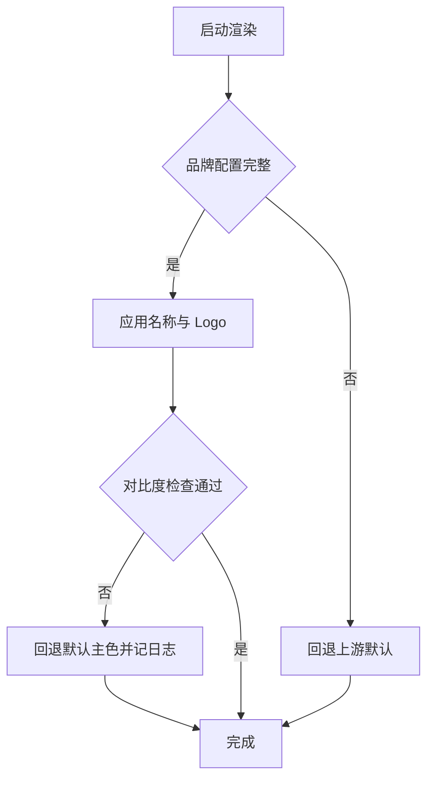

# 品牌与外观详细设计

## 文档信息

| 项 | 内容 |
|---|---|
| 文档编号 | CORP-DSH-DESIGN-006 |
| 文档名称 | 品牌与外观详细设计 |
| 版本 | V0.1.1 |
| 文档状态 | 草案 |
| 密级 | — |
| 编制 | DSH 平台组（代拟） |
| 审核 | 待定 |
| 批准 | 待定 |
| 最后更新 | 2026-10-20 |
| 门禁 | G2 |
| 模块状态 | 规划 |

> 编制依据：2026-10-20 片段级核验 `dsh-brand` 与 `dsh-client-ui-*` 系列包的存在性，确认品牌信息可由插件覆盖。**未核验**：可覆盖的 token 清单、Logo 资源解析路径、深浅色主题的覆盖粒度。
>
> 关联文档：[总体架构 §2](../../architecture/platform-architecture.md)、[需求基线 §2](../../requirements/requirements-baseline.md)、[设计索引](../README.md)。

## 1. 结论

本包只做一件事：让界面看起来是企业产品，而不是上游默认形态。

边界：可改名称、Logo、主色调、默认主题与页脚；不可改功能文案、安全提示、审批与审计入口。白标对外发行不在范围内。

还缺两件事才能进实现：可覆盖 token 清单实测、Logo 资源在双端的解析路径确认。

## 2. 目标与非目标

**目标**

- 一处配置换掉产品名、Logo 与主色，双端表现一致。
- 深浅色模式下对比度不下降，不影响可读性。
- 品牌信息缺失时回退上游默认，不出现空 Logo 或空名称。

**非目标**

- 不做白标发行、不做对外销售的多租户外观。
- 不隐藏或弱化安全提示、审批入口与审计入口。
- 不改变布局结构，只改变品牌资产与主题。

## 3. 需求与依赖

| 需求/验收 | 关系 | 说明 |
|---|---|---|
| REQ 统一入口与形态 | 支撑 | 用户看到企业品牌 |
| 验收 A2 安装后可用 | 支撑 | 品牌缺失不影响启动 |

| 依赖 | 类型 | 版本约束 | 缺失时的行为 |
|---|---|---|---|
| `dsh-brand` | 上游包 | 随目标 DSH | 用上游默认品牌 |
| 客户端主题包 | 上游包 | 随目标 DSH | 用上游默认主题 |

## 4. 扩展形态与边界

| 项 | 内容 |
|---|---|
| 形态 | 配置 bundle：品牌 token 与主题默认值 |
| 运行位置 | Host 配置 + 客户端渲染 |
| 目标 DSH 与 SDK | 随目标版本 |
| 使用的 seam 或服务 | 品牌服务、主题 token、客户端设置页 |
| 不修改的核心 | 组件结构、交互逻辑、安全提示组件 |

## 5. 接口与配置

| 配置项 | 类型 | 默认值 | 必填 | 说明 |
|---|---|---|---|---|
| `brand.productName` | string | 上游默认 | 否 | 标题栏与关于页显示名 |
| `brand.logoPath` | string | 空 | 否 | 本地资源路径，禁止外链 |
| `brand.accent` | string | 空 | 否 | 主色，需通过对比度检查 |
| `brand.theme` | `light` \| `dark` \| `system` | `system` | 否 | 默认主题 |
| `brand.footerText` | string | 空 | 否 | 页脚补充说明 |
| `brand.supportLink` | string | 空 | 否 | 支持入口，仅内网地址 |

```yaml title="品牌配置（示意）"
brand:
  productName: 河洛
  logoPath: ./assets/logo.svg
  accent: '#1F6FEB'
  theme: system
  footerText: 企业内部使用
```

## 6. 权限、凭据与数据

| 项 | 处理方式 | 生命周期 | 失败时 |
|---|---|---|---|
| 品牌资源 | 随包分发，本地读取 | 随包版本 | 回退上游默认 |
| 用户主题选择 | 用户级设置 | 持久 | 回退 `system` |
| 日志 | 只记加载成功或回退，不记用户选择明细 | 30 天 | 不影响渲染 |

## 7. 流程



**并发**：渲染只读配置，无共享状态。

**超时**：Logo 读取失败按缺失处理，不阻塞界面。

## 8. 失败模式

| 场景 | 行为 | 用户可见结果 | 是否可重试 |
|---|---|---|---|
| Logo 缺失或损坏 | 回退默认 | 显示上游默认标识 | 修包后重试 |
| 主色对比度不足 | 回退默认主色 | 颜色与预期不同 | 修配置后重试 |
| 名称超长 | 截断并省略 | 名称显示不全 | 修配置后重试 |
| 资源路径为外链 | 拒绝加载 | 保持默认 | 改用本地资源 |

## 9. 可观测性

| 事件 | 字段 | 去向 | 保留 |
|---|---|---|---|
| 品牌加载 | 结果、回退原因 | 本机日志 | 30 天 |
| 对比度回退 | 原色、回退色（不含用户数据） | 本机日志 | 30 天 |

## 10. 测试矩阵

| 层级 | 覆盖 | 命令 |
|---|---|---|
| 单元 | 配置校验、对比度计算、缺失回退 | `node --test` |
| 契约 | token 名称与上游一致 | 契约用例 |
| 集成 | 深浅色两种模式下渲染 | 视觉抽查 |
| 端到端 | 双端各完成一次启动与切换主题 | 手工 |

## 11. 打包、升级与回退

包名 `@heluo/forge-brand`，`private: true`，仅含配置与本地资源，声明 `engines.dsh`。

升级：资源路径保持不变，替换文件即可；新增 token 时保留旧默认。

回退：禁用本包回到上游默认外观，不影响功能与数据。

## 12. 未决事项

| 问题 | 需要谁回答 | 影响 |
|---|---|---|
| 可覆盖 token 的完整清单 | 平台组（实测） | 第 5 节字段范围 |
| Logo 在双端的解析路径 | 平台组（实测） | 资源分发方式 |
| 是否需要按部门区分子品牌 | PMO、平台组 | 多套配置 |
| 页脚是否需要合规声明 | 法务、安全 | `footerText` 内容 |

### 需用户确认的设计选项（增益不明确，暂不采用，保留待定）

| 选项 | 可能的增益 | 代价 | 当前处理 |
|---|---|---|---|
| 按部门下发子品牌 | 归属感 | 配置与资源成倍增加，维护分散 | 不采用，单一企业品牌 |
| 允许用户自换 Logo | 个性化 | 与"企业产品"定位冲突 | 不采用 |
| 品牌化安全提示文案 | 界面统一 | 可能削弱提示的严肃性 | 不采用，安全提示保持原样 |
| 支持启动页动画 | 观感更好 | 增加启动耗时与维护面 | 不采用 |
| 自定义字体文件 | 视觉一致 | 双端字体授权与体积成本 | 不采用 |

以上五项均不影响主链路；若后续确认增益，再单独评估。