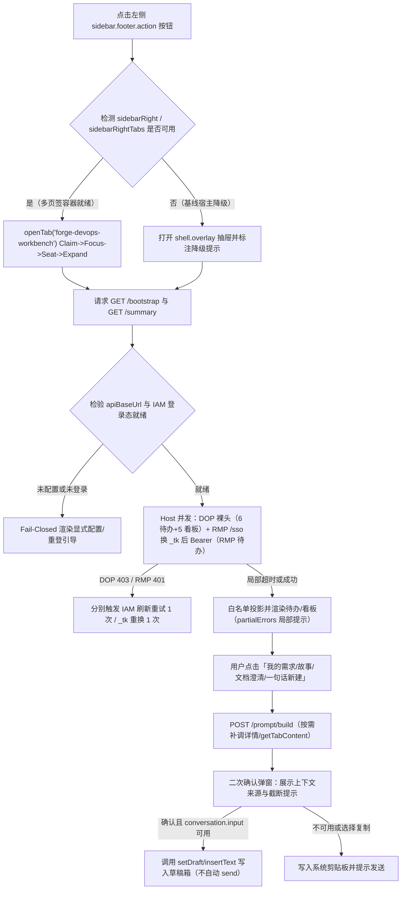

# DOP 工作台插件详细设计

## 文档信息

| 项 | 内容 |
|---|---|
| 文档编号 | CORP-DSH-DESIGN-028 |
| 文档名称 | DOP 工作台插件详细设计 |
| 版本 | V0.1.0 |
| 文档状态 | 草案 |
| 密级 | 内部 |
| 编制 | DSH 平台组（代拟） |
| 负责 | 平台组 |
| 审核 | 待定 |
| 批准 | 待定 |
| 最后更新 | 2026-11-28 |
| 门禁 | G1 接口事实；G2 策略与基线兼容性核验 |
| 模块状态 | 可用（一期分层重整：`src/shared/` 基础设施 + `src/domains/{overview,requirement}/` 分域隔离 + `// §6.1`–`// §6.6` 前端视图注册表，6 个只读工具、可视化连接配置与实测外链闭环；含隔离候选 DSH 实测，待基线实机与内网 DOP 平台验收） |

> 编制依据：基于 [总体架构](../../architecture/platform-architecture.md)、[需求与场景基线](../../requirements/requirements-baseline.md)、[DSH 插件高阶规范](../../engineering/dsh-plugin-conventions.md) 及 [工作台数据与模拟契约](../../contracts/devops-workbench-contract.md) 起草；2026-11-26 根据内网 DOP 前端逆向与 34 份实测样本确认 19 条真实 HTTP 接口、统一基准域分发、DOP/RMP 双轨鉴权及取消分队下拉框，并按仓库零内置 Mock 规范定版（外网独立挡板位于 `scripts/probe/mock-dop-server.mjs`）；2026-11-27 吸收内网补充语料完成 P0-1~P0-5 外链真实路由、纯数组公告、迭代路径 `/asd/api/sprint/<sprintId>/issue/list` 与 ITSM 换票 `/odo/api/online/process/url` 对齐，并收口为纯企业 IAM 认证、面向需求/项目/研发/测试/效能全流程的「DOP 工作台」、三层内网快速切换（本机覆写 > 包配置 > `HELUO_DOP_BASE_URL` / `FORGE_DEVOPS_DOP_ENDPOINT`）与 `docs/DETAIL.zh.md` 详情文档。
>
> 关联文档：[总体架构](../../architecture/platform-architecture.md)、[需求基线](../../requirements/requirements-baseline.md)、[设计索引](../README.md)、[DSH 插件高阶规范](../../engineering/dsh-plugin-conventions.md)、[SQLite 存储扩展规范](../../engineering/sqlite-storage-conventions.md)、[工作台数据与模拟契约](../../contracts/devops-workbench-contract.md)、[DevOps 插件设计](forge-devops.md)、[企业研发套件设计](forge-engineering.md)。

## 1. 结论

`@heluo/forge-devops-workbench`（「DOP 工作台」）作为独立 DSH 插件（Host 后端 + Browser 单文件客户端 `client.js`），在不修改任何 DSH 核心文件的前提下，在右侧多页签侧栏提供常驻研发协同工作台（覆盖需求、项目、研发、测试与效能全流程）。插件本体**零内置 Mock、零测试夹具、零 Mock 开关**，Host 后端仅配置单一 DOP 服务基准地址 `apiBaseUrl`（纯 IAM 认证），并发直调 DOP 域与 RMP `/rdp/vpgatway/**` 真实 HTTP API 聚合 7 路待办、三大进展板与「需求」页签上下文（顶部精简为「待办[N]▾」+「⚙ 定制」，无分队下拉框），同时按需复用 `@heluo/forge-devops`（`dop`）、`@heluo/forge-gitee`（`gh`）、`@heluo/forge-iam` 与 `@heluo/forge-policy` 已有能力；内网 DOP MCP 仅留作主对话大模型的可选扩展（由 DSH `dsh-mcp-client` 独立挂载）。一期工作台交互严格收敛为生成标准化工程提示词并由用户二次确认后填入对话草稿箱，外网开发通过进程外独立挡板 `mock-dop-server.mjs` 完成全链路联调。

## 2. 目标与非目标

- 目标：
  - 点击 DSH 左侧侧栏入口时，在右侧多页签工作区新增或聚焦「DOP 工作台」页签（`sidebarRight`），与其他右侧页签（文件预览、Browser 等）并行存在而不打断当前主对话画布。
  - 在 Host 端实现基于单一网关的 DOP（裸 `Authorization` 头 + 403 处理）与 RMP（`/sso` 换 `_tk` + 12h 内存缓存 + `Bearer <_tk>` + 表单提交 + 401 自动续换）双轨客户端、7 路待办并发与局部超时降级、`uam_myProfile` 超大响应白名单投影缓存及个人定制持久化。
  - 严格对齐 `@heluo/forge-iam` 零内置 Mock 架构规范与 [DSH 插件高阶规范](../../engineering/dsh-plugin-conventions.md) P1–P9，物理杜绝内网环境使用假数据，外网通过进程外挡板 1:1 仿真测试。
- 非目标：
  - 严格不修改、不覆盖、不通过运行时猴子补丁篡改 DSH 核心布局、多页签容器或会话内核代码。
  - 不实现分队切换下拉框与冗余团队列表接口调用（`/uam/api/team/list`、`/uam/api/group/list`）；不向工作台插件包内嵌入任何模拟数据、测试夹具或 Mock 切换开关。
  - 不用 MCP 协议承担工作台侧边栏的高频看板/待办轮询取数；一期不实现「项目」「研发」「效能」「测试」四个待定页签。
  - 一期不提供从工作台自动向模型发送消息（`send()`）或直接向需求/代码/测试平台提交变更写请求的能力；不复制 `dop`/`gh` CLI 解析器或 `@heluo/forge-iam` OAuth 实现。

## 3. 需求与依赖

| 需求/验收 | 关系 | 说明 |
|---|---|---|
| [需求基线](../../requirements/requirements-baseline.md) §2.3 / N7 | 支撑与约束 | 聚焦开发工作台与需求/故事工程流；严格遵守不修改 DSH 核心代码（N7） |
| 右栏多页签并行交互 | 新增核心体验 | 点击左侧动作栏即追加并定位右侧工作台页签，支持独立关闭与切换焦点 |
| 一期提示词工程边界 | 安全收敛 | 卡片快捷动作仅生成提示词交由人机二次确认，不越权写上游平台 |
| [工作台契约](../../contracts/devops-workbench-contract.md) §6 | 零内置 Mock 闭环 | 插件零 Mock 代码，外网联调复用 `scripts/probe/mock-dop-server.mjs` 与 `mock-iam-gateway.mjs` |

| 依赖 | 类型 | 版本约束 | 缺失时的行为 |
|---|---|---|---|
| `@deepseek-ai/dsh` 宿主（`slots`/`locale`） | 运行时宿主 | 见 [.dsh-version](../../../.dsh-version) | 无法装载插件，Host 启动阶段显式报依赖缺失 |
| 宿主右侧页签服务（`sidebarRight` / `sidebarRightTabs`） | 宿主可选 UI seam | 待在基线宿主核验 | 若基线版本未提供，按 §8 显式降级为 `shell.overlay` 侧拉面板或弹窗并提示兼容受限 |
| 宿主会话服务（`conversation`） | 宿主可选 seam | 待在基线宿主核验 | 若未挂载，提示词生成确认后降级为高亮预览 + 一键复制到剪贴板 |
| `@heluo/forge-iam`（`iam` 服务与 CLI） | 同仓依赖 / 唯一认证源 | `workspace:*` | 未登录或无 `iam` 时工作台展示 `UNAUTHORIZED` 引导前往「设置 → 企业账号」登录；不再单独提供静态凭据模式 |
| `@heluo/forge-devops` / `@heluo/forge-gitee` | 同仓扩展能力复用 | `workspace:*` | 仅经公开导出或约定接口边界衔接；缺失时系统变更拓展卡片灰化并标注不可用原因，零深导入源码 |
| `@heluo/forge-policy` | 同仓策略边界 | `workspace:*` | 受控写门禁继续受策略目录控制；一期纯只读模式亦遵守敏感外发与输入校验约束 |

## 4. 扩展形态与边界

| 项 | 内容 |
|---|---|
| 形态 | Host 插件 + Client 插件（独立单安装包 `@heluo/forge-devops-workbench`，可与 `@heluo/forge-engineering` 并装或在企业配置中挂载） |
| 运行位置 | 本机 Host（Node.js 聚数/HTTP 双轨客户端/RMP `/sso` 会话管理/同源路由/偏好存储） + 浏览器端单文件 `client.js` |
| 目标 DSH 与 SDK | 随仓库根 [.dsh-version](../../../.dsh-version)（右侧多页签 `sidebarRightTabs`/`sidebarRight` 与会话输入 `conversation` 接口于 2026-11-25 依据本地 0.2.2-rc.3 实测核验，基线版本兼容待实机复核） |
| 使用的 seam 或服务 | 左侧主入口 `sidebar.panellist`（`order: 20`，紧接「自动化任务」正下方，联动 `layout.panelInfo` 切换并先 `selectPanel(null)` + 等待 `sidebarRight.mounted` 挂载再 `openTab` 防误弹抽屉；旧基线无 `layout` 时自动回退 `sidebar.footer.action`）、插件详情页配置槽 `plugins.bundle.config`、右侧页签注册 `sidebarRightTabs.register` / `sidebarRight.openTab`、页签渲染槽位 `slots.inject('sidebar.right.pane.tab', ...)`、会话草稿 `conversation.input`（回退 `sessionInput`）、Host 只读工具挂载 `tools.register`（6 个 `forge_workbench_*` 只读工具，引导联动内置 `ask_user_question`）、外部详情直跳 `window.open(..., '_blank', 'noopener,noreferrer')`、同源 HTTP 端点 `/api/forge-devops-workbench/*`、Host 服务 `iam`/`credentials`/`sqlite` |
| 不修改的核心 | `@deepseek-ai/dsh` 内核、`dsh-client-ui-sidebar`、`dsh-client-ui-sidebar-right`、`dsh-client-ui-conversation`、`dsh-mcp-client` 与全部上游前端构建产物 |

### 4.1 内部架构分轴（遵循 CORP-DSH-ENG-003，零内置 Mock，单向分层）

后端严格遵守单向依赖方向：**`src/shared/`（公共基础设施） ← `src/domains/<domain>/`（完全隔离的业务域） ← 顶层注册/装配入口**，并通过 `test/service-structure.test.mjs` 守卫（P2 / P9）防止装配点膨胀或域间横向直接耦合：

| 目录 / 文件 | 归属轴 | 职责边界 |
|---|---|---|
| `client.js` | Browser 单文件 UI（P1） | 唯一浏览器入口：零相对 ESM 导入，带 `// §1`–`// §5`、`// §5.5` Shared Modals、`// §6.1`–`// §6.5` 分域独占视图锚点、`// §6.6` `DOMAIN_VIEW_RENDERERS` 注册表及 `// §7`–`// §8`；仅通过 `require('react')` 获取宿主 React 实例 |
| `src/index.mjs` | Host Cordis 装配 | `inject = []` 声明与生命周期编排，动态绑定 `iam` / `connection` / `devops` / `gitee` / `webServer` / `tools`（兼顾严格 `inject` 代理），挂载运行时连接配置、偏好库、服务门面、同源 HTTP 路由与 6 个只读工具，销毁时回收资源 |
| `src/service.mjs` | 无状态薄装配门面（P2） | **零可变状态变量**：仅装配 `cliBridge`、`src/shared/session-runtime.mjs` 与各业务域实例（`domains/overview`、`domains/requirement`），汇总暴露工作台服务 API 与提示词分派表 |
| `src/http.mjs` | 同源 HTTP 路由聚合器 | 挂载 `/api/forge-devops-workbench/*`，接入宿主 `connection` 同源鉴权与 `x-forge-workbench-request: 1` 头校验，声明共享核心路由并汇总各领域 `routes.mjs` |
| `src/tools.mjs` / `portal-links.mjs` / `prompt-builder.mjs` | 顶层域能力注册聚合 | 分别聚合各 `src/domains/<domain>/{tools,links,prompts}.mjs`，向外保持统一工具名（6 个）、外链生成器（经 `shared/url-safety.mjs`）与提示词入口 |
| `src/shared/session-runtime.mjs` | 核心运行时与会话状态轴（P2） | 唯一持有配置、端点诊断、IAM 无参 `getAccessToken()` 解析、`myProfile` 白名单缓存、`AbortController` 跟踪、偏好读写与变更/卸载钩子的核心模块；绝不反向导入任何 `domains/*` |
| `src/shared/dop-client.mjs` | DOP 域通用裸头客户端 | 封装 `/uam\|asd\|ppm\|bpm\|odo\|tmp/api/**` 通用 `requestDop()` 与 `myProfile` 白名单投影：注入裸 `Authorization` 头（无 `Bearer `）、处理 HTTP `403 Access Denied` 刷新重试 1 次、拦截 HTML/JSON 漂移 |
| `src/shared/rmp-sso.mjs` | RMP 域 SSO 与通用客户端 | 面向 `/rdp/vpgatway/**`：调用 `/sso` 取 302 `_tk` 并按用户隔离缓存（TTL ≤ 11.5h）、注入 `Authorization: Bearer <_tk>`、支持 `x-www-form-urlencoded` 传参、`401` 重换 1 次，并暴露 `request()` 供新域扩展 |
| `src/shared/{config,runtime-config,preferences,errors,cli-bridge,url-safety,prompt-utils,tool-helpers}.mjs` | 公共底座基元 | 配置校验与 3 层环境变量解析（`HELUO_DOP_BASE_URL` / `FORGE_DEVOPS_DOP_ENDPOINT` / `HELUO_DOP_TIMEOUT_MS`）、2 个非敏参数本地持久化、`rolePreset`/布局偏好存储（禁分队字段）、统一错误信封、`cliBridge` 公开复用、HTML 清洗与 UTF-8 16 KiB 安全裁剪 |
| `src/domains/overview/` | 总览业务域（5 模块） | `api.mjs` / `links.mjs` / `service.mjs` / `routes.mjs` / `tools.mjs`：聚合顶部 7 路并发待办、三大进展板（含分路超时降级与 Last-Request-Wins 去抖）、`/summary`、`/itsm/open-url` 与 `forge_workbench_todo_summary` |
| `src/domains/requirement/` | 需求业务域（6 模块，二期标准样板） | `api.mjs` / `links.mjs` / `prompts.mjs` / `service.mjs` / `routes.mjs` / `tools.mjs`：封装我的需求/故事列表、RMP 文档检索与大纲正文读取、4 类需求/故事提示词模板、`/requirements` & `/rmp/*` 路由与 5 个只读模型工具 |

## 5. 接口与配置

详细 HTTP 路由清单、请求/响应样例与错误码枚举以 [工作台数据、鉴权、工具与离线模拟契约](../../contracts/devops-workbench-contract.md) 为唯一真源，此处仅声明本模块插件配置与同源前端路由边界：

| 配置项 | 类型 | 默认值 | 必填 | 说明 |
|---|---|---|---|---|
| `enabled` | `boolean` | `true` | 否 | 控制工作台插件是否向左侧动作槽位与右侧多页签栏注册入口 |
| `apiBaseUrl` | `string` | `""` | 是（启用时） | 企业 DOP 服务基准地址（示例占位 `https://dop.corp.example`，同时承载 DOP 与 `/rdp/vpgatway/**`）；按「本机连接配置覆写 > 插件配置 > 环境变量 `HELUO_DOP_BASE_URL` / `FORGE_DEVOPS_DOP_ENDPOINT`」生效，均缺失则 Fail-Closed 不发起请求 |
| `authMode` | `'iam'` | `'iam'` | 否 | 统一企业认证模式：固定为 `'iam'`（自动复用 `@heluo/forge-iam` 会话），拒绝 `credential`/`mock` 模式 |
| `requestTimeoutMs` | `number` | `10000` | 否 | 单次上游 HTTP API 请求上限毫秒数（1,000–60,000），可用 `HELUO_DOP_TIMEOUT_MS` 覆盖 |

视觉防混淆提示（非开关）：当 `apiBaseUrl` 主机为 `127.0.0.1` 或 `localhost` 时，`/bootstrap` 响应向前端透出 `isLoopbackEndpoint: true`，UI 顶栏据此渲染只读徽标「当前连接本地联调端点」，不改变插件任何数据请求逻辑。

### 5.1 浏览器半同源 HTTP 接口面

所有前端请求均由 `client.js` 发往同源 `/api/forge-devops-workbench/*` 端点并强制携带自定义防 CSRF 请求头 `x-forge-workbench-request: 1`：

- `GET /api/forge-devops-workbench/bootstrap`：返回裁剪投影后的个人非敏档案（`loginCode`、`name`、`dashboardId`、`simulating`、角色摘要）、个人定制偏好、当前鉴权状态与 `isLoopbackEndpoint` 提示标识。
- `GET /api/forge-devops-workbench/config` & `PUT /api/forge-devops-workbench/config`：读取、可视化修改并持久化非敏感连接配置（`apiBaseUrl`、`requestTimeoutMs`）及来源诊断（`configSource`/`inheritedEnvKey`），支持 `{ resetToDefault: true }` 清除覆写、回退至插件配置或环境变量并即时重载内存客户端与缓存。
- `GET /api/forge-devops-workbench/itsm/open-url?wjbiid=<id>`：向DOP `/odo/api/online/process/url` 换取单条 ITSM 工单实时免密链接（经 `sanitizePortalUrl` 过滤），失败时安全回退模板 URL。
- `GET /api/forge-devops-workbench/summary?reqView=manager|business&implView=responsible|participate|creator&projView=responsible|participant&refresh=0|1`：在 Host 并发调 7 路待办与 5 路进展板 API 并聚合返回（含三大进展板各数字与阶段节点的可点击 `links` 映射）；单路超时时在 `partialErrors` 标记局部失败而不崩溃整页。
- `GET /api/forge-devops-workbench/requirements?view=managedByMe|acceptanceByMe|appliedByMe|participantHasMe&search=<kw>&pageNum=1&pageSize=20`：调用 `commonDashboard/requirement/query`、`issue/myIssue/list` 等返回「我的需求」「我的用户故事」列表。
- `GET /api/forge-devops-workbench/rmp/docs?quickSearch=<kw>&latestOnly=true|false&reqCode=<code>&currentPage=1&numPerPage=10` 与 `GET /api/forge-devops-workbench/rmp/outline?docId=<id>`：经 `src/shared/rmp-sso.mjs` 完成 `/sso` 换票后检索 RMP 文档列表及单篇大纲树。
- `POST /api/forge-devops-workbench/prompt/build`：依据动作键（`req.create.one_sentence`、`req.clarify.from_doc`、`req.card.clarify_and_split`、`story.card.design_and_prep`）拉取 `/asd/api/requirement/one/<id>`、`/asd/api/story/one/<id>`、`/rdp/.../getTabContent` 或接收前端限长本地文件摘录，渲染标准提示词与截断提示。
- `PUT /api/forge-devops-workbench/preferences`：持久化当前用户角色预设及看板/页签排序与显隐开关。

```ts title="导出与宿主接入接口（示意）"
export interface WorkbenchPluginConfig {
  enabled?: boolean;
  apiBaseUrl?: string;
  authMode?: 'iam';
  requestTimeoutMs?: number;
}

export interface WorkbenchTabRegistration {
  kind: 'forge-devops-workbench';
  title: string;
}
```

### 5.2 二期领域页签扩展与多人协作约定

面向后续新增「项目」「研发」「效能」「测试」四大领域页签的并行开发，所有扩展工作统一遵守以下模块化边界、命名规范与准入顺序：

1. **分域模块化边界（降低多人并行冲突）**：
   - **Host 后端**：直接参照一期 `src/domains/requirement/` 样板，新增领域独立建在包内 `src/domains/<domain>/`（分别为 `project/`、`dev/`、`efficiency/`、`testing/`，按需包含 `api.mjs`、`links.mjs`、`prompts.mjs`、`service.mjs`、`routes.mjs`、`tools.mjs`），仅通过工厂参数接收 `runtime`（`dopClient`、`rmpClient`、`portalLinks` 等）与 `cliBridge` 端口，严禁跨域横向 `import`（由 `test/service-structure.test.mjs` 守卫拦截）。公共装配点 `src/service.mjs`、`src/http.mjs`、`src/tools.mjs`、`src/portal-links.mjs`、`src/prompt-builder.mjs` 只做薄注册、参数路由与错误信封分发。
   - **Browser 前端**：维持单文件 `client.js` 零相对 ESM 导入形态（遵循 `CORP-DSH-ENG-003` P1），公共弹窗归位 `// §5.5`，在 `// §6.1`–`// §6.5` 按领域划分独占子区间（`§6.1 Requirement`、`§6.2 Project`、`§6.3 Dev`、`§6.4 Efficiency`、`§6.5 Testing`），并在 `// §6.6` `DOMAIN_VIEW_RENDERERS` 注册表登记视图及同步更新 `test/client-structure.test.mjs` 守卫。

2. **统一命名与安全接入规范**：

| 扩展维度 | 统一命名 / 出口约定 | 安全与门禁硬约束 |
|---|---|---|
| 同源 HTTP 路由 | 在 `domains/<domain>/routes.mjs` 定义 `/api/forge-devops-workbench/<domain>/<resource>`（如 `/projects/*`、`/dev/*`、`/efficiency/*`、`/testing/*`）并接入 `src/http.mjs` | 自动复用宿主 `connection` 同源鉴权与 `x-forge-workbench-request: 1` 头校验，统一 `no-store` 且零 CORS |
| 上游鉴权与取数 | 在 `domains/<domain>/api.mjs` 复用 `src/shared/dop-client.mjs`（DOP 裸头）与 `src/shared/rmp-sso.mjs`（RMP `_tk`） | 通过 `shared/session-runtime.mjs` 无参 `await ctx.iam.getAccessToken()` 取票；严禁新增静态凭据字段或向浏览器下发令牌 |
| 宿主模型工具 | 在 `domains/<domain>/tools.mjs` 定义 `forge_workbench_<domain>_<action>`，于 `src/tools.mjs` 统一登记 | 默认仅开放只读工具；若二期引入受控写操作，须单列设计评审并接入 `@heluo/forge-policy` 门禁与 C3 确认 |
| 提示词动作键 | 在 `domains/<domain>/prompts.mjs` 定义 `<domain>.<entity>.<action>`，注册入 `src/prompt-builder.mjs` 与 `src/service.mjs` 分派表 | 强制长度裁剪上限与二次确认弹窗，仅写入对话草稿箱或剪贴板，严禁自动触发发送 |
| 外部跳转链接 | 在 `domains/<domain>/links.mjs` 定义并汇总至 `src/portal-links.mjs`（基于 `shared/url-safety.mjs`） | 统一基于 `apiBaseUrl` 构造安全 `http:`/`https:` 链接；严禁在前端硬拼 URL 或携带令牌参数 |
| 既有能力复用 | 经 `src/shared/cli-bridge.mjs` 复用 `@heluo/forge-devops` 与 `@heluo/forge-gitee` 公开边界 | 代码仓/PR/Issue/变更查询优先复用已有包导出，严禁跨包使用相对路径深导入源码 |

3. **新领域页签四步开发准入清单**：
   1. **契约先行**：核验内网真实接口结构与字段约束，先同步更新 [工作台契约](../../contracts/devops-workbench-contract.md)（标注未实际联调项）。
   2. **挡板与脱敏夹具**：在仓库 `scripts/probe/fixtures/dop-workbench/`（支持按 `<domain>/*.json` 子目录存放）补齐二次脱敏样本（严禁含真实域名、IP、工号、姓名及组织名），并在 [mock-dop-server.mjs](../../../scripts/probe/mock-dop-server.mjs) 对应 `// --- Domain:` 分区扩展仿真路由与 [挡板测试](../../../tests/probe-mock-dop-server.test.mjs)。
   3. **分域实现与隔离守卫**：完成 `src/domains/<domain>/` 与前端 `// §6.x` 视图 + `DOMAIN_VIEW_RENDERERS` 注册；严守插件包零内置 Mock、零测试夹具、零域间直接 `import` 与零分队硬编码红线。
   4. **测试与门禁收口**：独立新增 `test/domain-<domain>.test.mjs` 补齐正反向单元测试，通过全量单测（含 `service-structure.test.mjs` 与 `client-structure.test.mjs` 守卫）、`node scripts/check-docs.mjs`、`auditTarball` 及敏感扫描校验，如实区分外网挡板验证与内网实机未验项。

## 6. 权限、凭据与数据

严格遵守 [SQLite 存储扩展规范](../../engineering/sqlite-storage-conventions.md) 中的职责划分，凭据、换票会话与个人工作台配置物理隔离：

| 项 | 处理方式 | 生命周期 | 失败时 |
|---|---|---|---|
| 凭据与 RMP `_tk` 会话 | DOP 令牌唯一由 `@heluo/forge-iam`（`ctx.iam`）托管；RMP `_tk` 由 `src/shared/rmp-sso.mjs` 仅在 Host 内存按当前用户标识缓存（上限 11.5h，切换账号/登出即清空），绝不落盘或下发给 `client.js` | 随 IAM 会话刷新、登出清理或 `_tk` 过期自动重换 | 返回 `UNAUTHORIZED` / `UPSTREAM_AUTH_DENIED` / `RMP_SSO_EXCHANGE_FAILED` 引导重登，不伪造数据 |
| `myProfile` 与业务上下文 | 4.77 MB 全量 `myProfile` 仅在 Host 端流式/内存解析并按白名单字段裁剪投影（只留 ~1 KiB 非敏基础字段），原始全量体随解析立即释放 | 请求级与短内存会话缓存（账号切换失效） | 解析异常触发明确降级错误，不向前端传递未裁剪大对象 |
| 用户定制偏好数据 | 通过 `src/shared/preferences.mjs` 写入独立配置表，仅存 `rolePreset` 与看板/页签排序/显隐开关 | 用户主动调整覆盖；卸载可清理或保留配置 | 读失败回退默认布局；写失败保留当前状态并显式提示 |
| 运行与安全日志 | 只记录 `requestId`、逻辑路由名、HTTP 状态码与耗时；严禁打印 `Authorization` 头、`_tk`、Cookie、RMP 文档正文与宿主机路径 | 沿用宿主审计与日志轮转策略 | 日志失败按策略告警但不泄露敏感字段 |

## 7. 流程

### 7.1 页签唤起、双轨取数与提示词生成主流程



### 7.2 并发、超时、取消与退出约定

1. **串行刷新与请求合并（P7）**：当用户切换需求/实施/项目看板视角参数或点击刷新时，客户端与 Host `src/domains/overview/service.mjs` 按“最新请求优先（Last-Request-Wins）+ 同键飞行请求复用（In-Flight Coalescing）”处理，取消过期请求避免旧视角覆盖新视角。
2. **7 路并发与分路独立超时**：待办 7 路请求与三大进展板 5 路请求各自绑定独立 `AbortController`；例如 RMP 未换票成功或 ITSM 超时时，其余 DOP 看板与待办照常渲染并在 `partialErrors` 显式标明失效源。
3. **取消与二次确认**：用户关闭确认弹窗或点击“取消”时，绝不修改当前会话草稿箱已有文本；草稿箱非空时提供“追加插入（`insertText`）”或“替换草稿（`setDraft`）”选项。
4. **插件停用与退出**：Host Cordis `dispose` 阶段中断所有在途 HTTP 请求、清除内存中 RMP `_tk` 缓存与 `myProfile` 投影缓存、注销路由；浏览器侧卸载页签槽位与左侧入口。

## 8. 失败模式

| 场景 | 行为 | 用户可见结果 | 是否可重试 |
|---|---|---|---|
| 未配置 `apiBaseUrl` 或格式非法 | 启动/请求阶段 Fail-Closed 拒绝挂载真实聚数 | 界面提示缺少 DOP 服务地址配置及配置路径 | 修复配置后可重试 |
| 基线 DSH 未提供 `sidebarRight` 多页签 API | 回落至 `shell.overlay` 抽屉展示 | 顶部提示“当前宿主不支持右侧多页签并存，已切换抽屉视图” | 否（依赖宿主升级） |
| 基线 DSH 未暴露 `conversation.input` 槽位 | 跳过草稿写入，切换为复制路径 | 二次确认按钮显示“复制提示词”并提示已复制到剪贴板 | 否 |
| DOP API 返回 HTTP `403 Access Denied` | IAM 模式刷新 Token 后至多重试 1 次；仍 `403` 归为 `UPSTREAM_AUTH_DENIED` | 渲染登录/授权失效引导卡，不将 `Access Denied` 纯文本当 JSON 抛解析异常 | 重登后可手动刷新 |
| RMP API 返回 HTTP `401` 空响应体 | 丢弃本地 `_tk` 缓存并重走 `/sso` 至多 1 次；`/sso` 亦失败报 `RMP_SSO_EXCHANGE_FAILED` | RMP 待办或文档检索栏局部降级提示重登，不影响 DOP 看板可用性 | 重登后可手动刷新 |
| 上游返回 HTML 网关拦截页或 JSON 字段漂移 | `Content-Type` 与 Schema 守卫拦截 `UPSTREAM_SCHEMA_DRIFT` | 对应模块展示“返回格式异常或企业网关未鉴权” | 修复后重试 |
| `getOutlineTree` / `selectArtInfo` 错误传参预防 | `src/shared/rmp-sso.mjs` 强制编码 `application/x-www-form-urlencoded`；外网挡板对错误 JSON 请求回 `400` 防回归 | 开发/测试阶段立刻暴露传参协议错误 | 否 |
| 外部请求缺失 `x-forge-workbench-request: 1` 头 | `src/http.mjs` 直接拒绝返回 HTTP `403` | 调用端收到明确同源校验拒绝响应 | 否 |

## 9. 可观测性

| 事件 | 字段 | 去向 | 保留 |
|---|---|---|---|
| `workbench.bootstrap.loaded` | `authMode`, `isLoopbackEndpoint`, `capabilities`（`sidebarRight`/`conversation` 布尔标志）, `durationMs` | Host 诊断日志 | 随宿主日志周期（零 Token 字段） |
| `workbench.api.partial_error` | `domain`（`dop` \| `rmp`）, `routeKey`, `httpStatus`, `errorCode`, `requestId` | Host 诊断日志 | 随宿主日志周期 |
| `workbench.rmp.sso_exchange` | `outcome`（`hit` \| `refreshed` \| `failed`）, `httpStatus` | Host 安全日志 | 严禁输出 `_tk` 或 `<SSO token>` |
| `workbench.prompt.generated` | `promptKind`, `docCount`, `charLength`, `truncated`, `deliveryTarget`（`draft`/`clipboard`） | Host 审计 / 本地遥测指标（遵循 [观察事件契约](../../contracts/metrics-events.md)） | 不保存提示词全文内容 |

## 10. 测试矩阵

| 层级 | 覆盖 | 命令 |
|---|---|---|
| 静态规范与结构守卫 | `client.js` 单文件零相对导入、`// §1`–`// §8` 含 `§5.5` 与 `§6.1`–`§6.6` 锚点、`service.mjs` 无状态薄装配、shared/domains 单向零耦合及变异破坏必败断言；零内置 Mock 与 `mock` 字样禁项扫描（对照发布文件）；文档登记与版本一致 | `node scripts/check-docs.mjs`、`node scripts/check-repo.mjs`、`node scripts/dsh-version.mjs check`、包内 `test/client-structure.test.mjs` 与 `test/service-structure.test.mjs` |
| 单元与状态机 | 7 路并发局部超时降级、视角切换并发去抖、`myProfile` 4.77 MB 裁剪投影、`requirement_progress` `null` 平均时长处理、四类提示词截断及空正文过滤 | `node --test "packages/forge-devops-workbench/test/*.test.mjs"` |
| 外网独立挡板协议测试 | 真实子进程启动 `scripts/probe/mock-dop-server.mjs`，验证 34 份夹具二次脱敏底线、DOP 裸头/错加 `Bearer` 返回 403、RMP 直透返回 401 空体、`/sso` 换 `_tk` 闭环、`getOutlineTree` form 强校验及 401/403/429/503 故障注入 | `node --test tests/probe-mock-dop-server.test.mjs` |
| 宿主接线与多页签探针 | 模拟/真实宿主环境验证 `sidebar.footer.action` 点击唤起/聚焦 `sidebarRight.openTab`、多页签并存与无 `sidebarRight` 时的 `shell.overlay` 降级 | 包内宿主接缝集成测试与 DSH 实机探针 |
| 端到端离线联合联调 | 同时拉起 `mock-iam-gateway.mjs` + `mock-dop-server.mjs`，完整走通登录 → 打开右页签 → 7 路待办与三板切换 → 需求/故事/RMP 文档澄清 → 二次确认写入草稿箱（未调用 `send()`） | 端到端离线脚本与桌面走查（内网真网关单列验收） |

> 阶段 3/4 离线与隔离 E2E 实测证据（2026-11-26）：`packages/forge-devops-workbench/test/*.test.mjs` 共 17 项包内单测（含 Cordis 严格代理防崩溃回归与 6 个 `forge_workbench_*` 工具端到端调用）及 `tests/probe-mock-dop-server.test.mjs` 共 2 项挡板集成测试（含 5 类外链 HTML 示意页与节点空正文校验）全部通过；并于 2026-11-26 在隔离临时 `DSH_HOME`（候选宿主 `0.2.2-rc.3` Web + 进程外独立挡板 + 外网推理模型）完成真浏览器 6 步 E2E 闭环（左侧唤起右侧多页签、待办汇总与 RMP 大纲加载、外部新页签跳转详情页、二次确认仅写入原生对话草稿箱不自动发送、模型真实调用只读工具并通过内置 `ask_user_question` 发起多轮交互选单后输出拆解方案，控制台零致命错、页面报错数为 0）。**以上结论均基于外网挡板与候选宿主获得，不代表仓库基线 `.dsh-version` 宿主及内网企业统一网关验收通过。**

## 11. 打包、升级与回退

1. **包与入口约定**：包名 `@heluo/forge-devops-workbench`，目录 `packages/forge-devops-workbench/`，声明 `"private": true` 与 `"engines": { "dsh": "..." }`；`peerDependencies` 仅可按宿主规范将 `react` 声明为可选对等依赖，禁止将 `@deepseek-ai/dsh` 打入依赖闭包或运行 `install` 生命周期脚本。
2. **产物严格隔离**：发布 tarball 仅包含 `package.json`、`README.md`、`client.js`、`src/**/*.mjs`（含 `src/shared/*` 与 `src/domains/*`）、`locale/*.json` 与可选补丁层/说明文档；`scripts/probe/` 下的独立挡板与脱敏夹具、`test/` 与 `node_modules/@deepseek-ai/` 均被 `auditTarball` 物理阻断进入发布包。
3. **升级与内网配置**：公版发布产物零企业地址且零内置 Mock；支持「本机连接配置覆写 > 企业私版预置包配置 > 环境变量 `HELUO_DOP_BASE_URL` / `FORGE_DEVOPS_DOP_ENDPOINT`」三层内网快速切换，企业内网打包或切换环境变量即可直接联调上线，无切换分支风险。
4. **回退策略**：无需改动 DSH 核心，卸载包或置 `enabled: false` 即时摘除入口，不影响 `@heluo/forge-devops`、`@heluo/forge-gitee` 与 `@heluo/forge-iam`；卸载前自动丢弃内存中 `_tk` 缓存。
5. **未验证清单**：基线宿主（见 [.dsh-version](../../../.dsh-version)）右栏多页签 API 实机可用性、三大进展板统计数字精准筛选列表页 URL 路由（P0-1~P0-5 外链及公告/迭代报文已完成补采对齐）、RMP `/sso` 参数 `<SSO token>` 与 IAM 令牌同源性、Windows/麒麟/UOS 实机布局。

## 12. 未决事项

| 问题 | 需要谁回答 | 影响 | 门禁 |
|---|---|---|---|
| 三大进展板（需求进展 KPI/5 阶段、实施进展排期/故事健康度、项目进展 9 里程碑）各数字点击跳转的精准筛选列表页 URL 路由 | 内网智能体 | 决定 `boardLink(boardKey, metricKey, view)` 能否从通用中心 `/dop/asd/dashboard` 细化为带筛选条件的目标列表路由（P0-1~P0-5 与公告/迭代已于 2026-11-27 对齐） | G1 |
| 仓库基线 DSH 版本（见 [.dsh-version](../../../.dsh-version)）是否已包含 `0.2.2-rc.3` 同等 `sidebarRightTabs` / `sidebarRight.openTab` 与 `conversation.input` 接口，或是否需走 `shell.overlay` 降级通道 | DSH 宿主团队 / 本机基线实测 | 决定右侧多页签原生直连还是启用一级兼容降级视图 | G1 / G2 |
| RMP `/rdp/vpgatway/vrmprovider/rms/api/sso` 所需的 `<SSO token>` 是否直接复用当前 IAM / DOP 同一令牌 | DOP / RMP 提供方 / 内网探针实测 | 决定 `src/shared/rmp-sso.mjs` 换票入参是直接取 `ctx.iam.getAccessToken()` 还是经前序 SSO 接口获取 | G1 |
| 「项目」「研发」「效能」「测试」四个领域页签的具体卡片交互、HTTP API 与提示词场景范围 | 业务需求方 | 决定二期扩展接口列表与页签组件范围，不影响一期上线 | 需求澄清 |
| 未来二期若开放从工作台直接触发需求新建或状态流转（受控写），其 C3 确认粒度、幂等台账与回查策略如何接入 `@heluo/forge-policy` | 安全与策略团队 / 平台负责人 | 仅影响二期受控写放开准入 | G2 |

## 实现与验证记录

**实现边界**：`@heluo/forge-devops-workbench`（「DOP 工作台」）一期 MVP 已实现并完成内部结构分层收口（`src/shared/` 11 个基础设施模块 + `src/domains/{overview,requirement}/` 业务域隔离 + `client.js` 单文件 `// §5.5` 与 `// §6.1`–`// §6.6` `DOMAIN_VIEW_RENDERERS` 视图注册表），提供顶部 7 路待办与三大进展板聚合、「需求」页签（我的需求/故事、RMP 文档检索与大纲正文澄清、四类提示词二次确认写入草稿箱）、6 个 `forge_workbench_*` 只读模型工具、三层内网切换配置热更新与纯 IAM 无参取票认证；插件本体零内置 Mock、零测试夹具、零分队开关。

**本地离线与隔离闭环测试**：包内 7 个单元测试/结构守卫（含 `test/service-structure.test.mjs` 与 `test/client-structure.test.mjs` 变异破坏验证）及进程外独立挡板测试 `tests/probe-mock-dop-server.test.mjs` 共 **27 / 27 通过**；受控文档、版本规则与包体闭包/tarball 审计均通过。此前在隔离临时 `DSH_HOME`（候选 Web 宿主 + 外网挡板 + 外网推理模型）走通真浏览器全链路 E2E 闭环（零控制台与页面报错）。

**未验证项**：[.dsh-version](../../../.dsh-version) 目标基线版本实机联调、内网企业 DOP/RMP 真实服务接口与 `/sso` `<SSO token>` 同源性、三大进展板精确列表筛选外链 URL、Windows/银河麒麟/UOS 双端生产打包与布局实测均未执行，不以离线挡板或隔离候选结果代替基线实机与企业生产验收。
