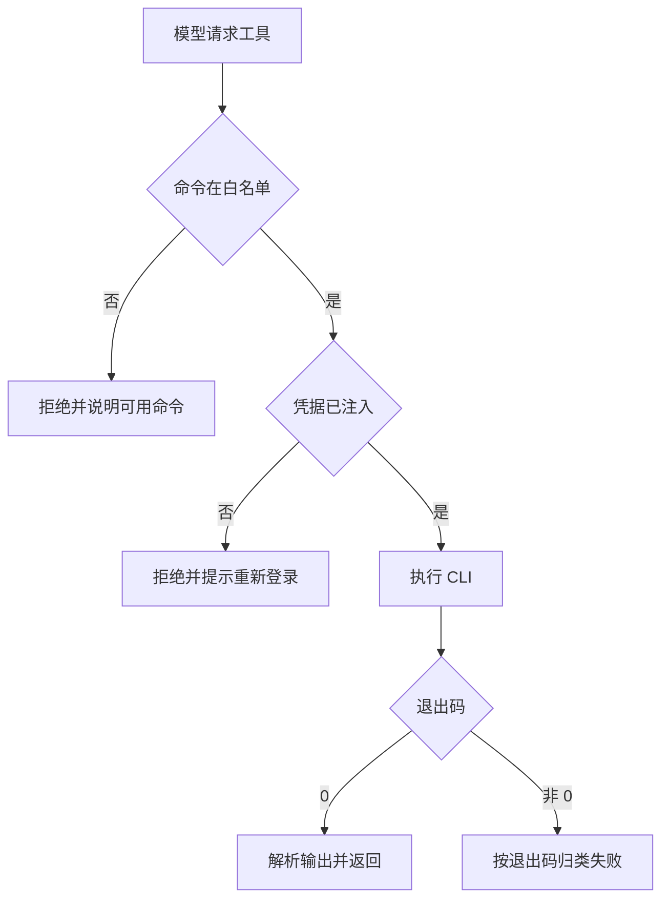

# DevOps 接入详细设计

## 文档信息

| 项 | 内容 |
|---|---|
| 文档编号 | CORP-DSH-DESIGN-009 |
| 文档名称 | DevOps 接入详细设计 |
| 版本 | V0.7.1 |
| 文档状态 | 草案 |
| 密级 | — |
| 编制 | DSH 平台组（代拟） |
| 审核 | 待定 |
| 批准 | 待定 |
| 最后更新 | 2026-11-13 |
| 门禁 | G1 |
| 模块状态 | 可用（四个工具：只读 runner（`change.read` / `change.list`）、上下文卡、受控写回（`change update`）、产物落盘（含 clarify/plan 机检）；写回默认关闭，企业 dop CLI 未联调，见设计索引 §2.2） |

> 编制依据：2026-10-20 依据两点事实——DevOps 平台已提供 CLI 工具；架构 P7 要求复用企业既有资产。据此本设计以 CLI 为接入形态，不新建 MCP 服务端。**未核验**：CLI 在银河麒麟 aarch64 上的可用性、是否支持环境变量注入凭据、是否提供结构化输出。三项均由 DevOps 团队补充确认，写入 §12，不阻塞设计其余部分。
>
> 2026-11-04 用户提供 dop 1.x 的写回参数：`change update <code> --summary/--description/--ai-ac`，用于 Agent 完成变更内容分析后回写标题、描述与验收标准。据此新增受控写工具 `forge_devops_change_update`（默认关闭，登记 enabled 需审批台账；写后回读）；命令 `--help` 与输出样例尚未取证，`--ai-ac` 的落点按回读假设处理。
>
> 2026-11-03 用户确认 D 方案（typed read runner）：只读面从「按能力切 4 个工具」改为「1 个枚举动作的 runner + 上下文卡 + 产物落盘」，删除恒 `denied` 的澄清写工具；`clarify` / `plan` 产物改由纯函数机检后生成正文。本版只调整工具面与校验口径，未新增企业 CLI 实测；`change list` 的真实 flag（含 `--status`）与双平台产物仍待核验。
>
> 2026-11-06（r15）补设置页两件事：①本包新增「企业研发」分区（`client.js`，id `devops-readiness`、order 29），汇总企业身份/公共参数/本机配置/DevOps/Gitee/业务写权限六行，只做本机可见性汇总，固定声明"不代表业务授权"；②保存回执区分"已保存；运行时已应用"与"已保存；未应用"，`saveCliConfig` 在写成功后重建读面并回 `applied`，端点原样透传。既有 `devops` 分区（id `devops`、order 60）只加页脚来源行与三行回执，字段面、请求契约与 id/order 均不变。**仍未核验**：`heluo-r15-uat` 独立 profile 的装入与回滚（计划与证据核对见 `scripts/uat-profile.mjs`）。
>
> 关联文档：[总体架构 §7.3](../../architecture/platform-architecture.md)、[需求基线](../../requirements/requirements-baseline.md) REQ-12、[策略与审计](forge-policy.md)。

## 1. 结论

用 DevOps 已有 CLI 作为工具面，通过受控命令白名单接入，不自建 MCP 服务端。

这个选择的前提是 CLI 能覆盖只读查询（系统变更及独立验收、所属故事、系统/仓库与必要项目信息）。若 CLI 缺失或必要前提不成立，关闭对应命令并提交替代形态、成本与验收评审；不自动恢复 MCP 服务或核心补丁工作项。

边界：本模块不实现授权，授权由 DevOps 服务端校验。查询为现有基线；经需求方确认的受控回写目标见 §13，范围/安全/接口未准入前禁用，不把设计确认当作服务授权。

**范围与平台边界（r10）**：本模块只讲 dop（DevOps 平台）变更流程。仓库、Issue、PR 的读写事实由 `@heluo/forge-gitee` 唯一负责，devops 不再持有 `gh` 侧实现（gh 适配器、actions、repository-resolver、repo-ref、review、report、commit-message 七个模块已删除）。因此 `change_context` 的承建仓库段降级为外部指引：`REPO_FACTS_EXTERNAL` + 下一步 `forge_gitee_repository_read` / `forge_gitee_issue_read`，不猜第二次。工具面为四个（`forge_devops_query` / `forge_devops_change_context` / `forge_devops_change_update` / `forge_devops_artifact_write`），配置四键（`dopBin` / `dopEndpoint` / `sourceType` / `timeoutMs`），页面可编辑两项（dop 入口、超时）。只读面不再按能力逐个开工具：一个 runner 以枚举动作分发（`change.read` / `change.list`），每个动作有自己的参数 schema，写动作永不入表；清单读取补上了原 CLI 已有、旧工具面缺失的 `change list`。

## 2. 目标与非目标

**目标**

- 只读查询走 CLI，命令面固定且可审计。
- 凭据不落配置文件，经环境注入。
- 命令超时、输出过大、非零退出都能被识别并归类。
- 未授权或不可用时明确失败，不静默降级。

**非目标**

- 不执行生产变更，不做部署与回滚。
- 不自建 MCP 服务、不暴露 PRM。
- 不代理用户权限，不做二次授权判定。
- 不提供自由 argv 或通用 `run(command)`：只读子命令只能经枚举动作 + 每动作参数 schema 进入，扩展参数不是「把命令行交给模型」。

## 3. 需求与依赖

| 需求/验收 | 关系 | 说明 |
|---|---|---|
| REQ 工程系统只读查询 | 直接实现 | 系统变更及独立验收为主，关联故事背景 |
| 验收 A7 只读闭环 | 支撑 | 查询链路可判定 |
| REQ-12 | 条件相关 | 当前不纳入 CLI 基线；另有获批 MCP 集成时才核定补丁、PRM、WBS 与验收 |

| 依赖 | 类型 | 版本约束 | 缺失时的行为 |
|---|---|---|---|
| DevOps CLI | 工具 | 由 DevOps 团队提供 | 工具面不可用，明确报错 |
| 企业策略插件 | 包 | 同批次 | 命令面不开放 |
| 凭据 broker | 包 | 同批次 | 无凭据即拒绝 |

## 4. 扩展形态与边界

| 项 | 内容 |
|---|---|
| 形态 | 工具面接入：技能提示 + 命令白名单 + 策略校验（无独立服务端） |
| 运行位置 | 本机 Host，固定 argv 经唯一 `execFile` 出口（`shell: false`），不经 bash 拼接 |
| 目标 DSH 与 SDK | 随目标版本 |
| 使用的 seam 或服务 | bash 工具、策略门禁、凭据注入、审计事件 |
| 不修改的核心 | 无 |

## 5. 接口与配置

| 配置项 | 类型 | 默认值 | 必填 | 说明 |
|---|---|---|---|---|
| `dopBin` | string | 自动发现 | 是 | dop 可执行文件路径；页面可编辑 |
| `dopEndpoint` | string | 空 | 否 | dop 服务端点；仅环境变量注入 |
| `sourceType` | `dop` | `dop` | 否 | 事实来源类型；由 dop 单独推导，不认 `gh` |
| `timeoutMs` | number | `60000` | 否 | 单次命令上限；页面可编辑 |

配置页只有两项可编辑（`dopBin`、`timeoutMs`）；其余键由环境变量或推导获得。配置面只有四个键：历史上的 `ghBin` / `ghOwner` 及其环境变量形式不在契约内，加载时被静默忽略——不报错、不产生条目、也不影响就绪判定（老 profile 升级后插件照常激活）。

四键的值共用同一条校验规则 `validateConfigField`（页面保存、环境变量层与宿主 loader 都走它）：先去掉首尾空白，再剥掉**一层**成对包裹引号——`FORGE_DEVOPS_TIMEOUT_MS='30000'` 这类启动脚本写法与带双引号的全路径属搬运噪声，不构成配置错误；剥完仍带引号的（单边或两层）判 `CLI_CONFIG_INVALID`，整层不回落下一层。后一项是必要的：环境变量层不读盘，带引号的 `dopBin` 能通过装配期，直到 `execFile` 才以 `ENOENT` 失败。

任务输入以系统变更及独立验收为主，所属故事只作背景。以下仅为待提供方映射的业务动作，不是可执行 CLI 命令，不预设 `dop` 的子命令或参数。r10 起动作目录只剩这两条：仓库、Issue、PR 的读取动作（`gitee.repository.read` / `gitee.issue.read` / `gitee.pr.read`）及其写动作已整体归 `@heluo/forge-gitee`，本模块不保留同名入口。

| 业务动作示意 | 必须取得的事实 | 状态 |
|---|---|---|
| 系统变更读取（`change.read`） | 独立描述/验收、系统/仓库、要求版本、所属故事 | 查询基线；实际命令/字段待核验 |
| 已确认澄清/研发进展回写 | 正确对象、原版本、真实确认及结果引用 | 受控写目标；范围/C3批准及验证前禁用 |

实际工具字段与失败语义见[工程工具契约](../../contracts/engineering-tools.md)，不能从上述动作名拼造未确认命令。

### 5.1 工具面（2026-11-03，用户确认 D 方案）

四个工具各自只有一种职责；「哪个动作 → 哪条策略条目」可逐条核对：

| 工具 | 动作 / 门禁 | 输入 | 输出与边界 |
|---|---|---|---|
| `forge_devops_query` | `change.read` / `change.list`（读） | `action`（枚举）、`target`（`change.read` 为变更号；`change.list` 只接受 `@me`）、`status`（仅清单，真实 flag 待核验） | 读信封（`status` / `source_revision` / `observed_at` / `command` / `truncated`）+ `facts`（单条：平台记录与归一结果；清单：`user` / `total` / `count` / `items` / `filter`）；不写平台 |
| `forge_devops_change_context` | `change.read`（读） | `target` 变更号 | 上下文卡（`text` 可直接作为 `context.md`）；承建仓库段是外部指引（`REPO_FACTS_EXTERNAL`） |
| `forge_devops_change_update` | `change.clarification.write`（写） | `target` 变更号、`summary` / `description` / `aiAc` 至少一个、`confirm{object}` | 默认不登记即拒绝；目标必须是本次会话已读到的变更；固定 argv `change update`，写后用 `change view` 回读；结果 done/failed/unknown，未知不重放 |
| `forge_devops_artifact_write` | 无平台动作（本地落盘） | `repoRoot`、`kind`、`body` 或 `data`、`meta` | 五类产物；`clarify` 需 `data.findings` 且过机检，`plan` 需 `data.items` 且逐条映射过机检；六字段 front matter 与路径约束不变。机检不通过**零落盘**，信封在平级字段带回逐条证据（`clarify` 为 `problems`、`plan` 为 `gaps`），`detail` 仍是字符串——只回一句"未通过机检"会让调用方无法修正。`data.findings` 的结构（`kind` / `basis` / 每个选项的 `pros` 与 `cons` / `recommendation.optionId`）写在工具参数说明里，不要求调用方读源码 |

三条边界：

- **枚举而非自由命令**：`action` 只允许契约里登记的两个读动作；清单的 `target` 只接受 `@me`（CLI 的 list 天然是当前登录人范围），其他取值在工具层拒绝、零下游调用。以后新增只读子命令时，先取证真实 flag，再把动作与 schema 加进枚举——不引入「把 argv 交给模型」的通用入口。
- **原始与归一分层**：`facts.raw` 是平台原始事实（仅当前受权会话，不落指标/审计/产物）；`facts.normalized` 是契约形状（与上下文卡同一映射），归一失败不抛错，`normalize_error` 可见。
- **写回默认关闭**：`change update` 是平台写，按契约登记为 `change.clarification.write`；分发补丁层不登记该动作，登记 `enabled` 还须 profile 里有效的审批台账条目（动作 + 资源 + 有效期），否则挂载即拒绝。工具面始终暴露入口，拒绝必须可见；写前要求先读该变更（`target` 必须等于会话绑定的变更号），写后回读核对，**不做通用 argv 透传**。
- **产物不绕过机检**：`clarify` / `plan` 两类只接受结构化 `data`，正文由 `renderClarifySheet` / `renderPlan` 生成；`body` 与 `data` 互斥，手写正文无法混过检查。澄清回写仍无 dop 命令面，工具面不再保留恒 `denied` 的写工具，澄清单以本地产物 + 待人工确认存在。

**target 不是可选项**：策略条目对任何动作都要求非空 target；清单的 `target` 固定为 `@me`，不是省略。产物落盘用的变更号来自入口绑定或一次成功读取（`change.read` 成功、`change.context` 返回 `ready`），不再要求必须先跑命令入口。

### 5.2 设置页（r15）

本包在设置页承载**两个**分区，都由包内 `client.js` 提供（`dsh.client = {platform:'web', immediately:true, inject:['slots','locale']}`）：

| 分区 | id | order | 职责 |
|---|---|---|---|
| 企业研发 | `devops-readiness` | 29 | 汇总六行本机可见性：企业身份（`/api/forge-iam/view` 的 state 映射为已登录/未登录/登录中/过期/不可达/未知）、公共参数（恒「未知」，无可核验的公共维护权限与接口）、本机配置（devops 与 gitee 快照里 `origin==='config'` 的**键名**）、DevOps（快照 `ready` + `dopBin` 来源）、Gitee（快照 `ready`）、业务写权限（恒「未知」） |
| 企业 DevOps | `devops` | 60 | 既有字段面（`dopBin`/`timeoutMs`）不变，只加页脚来源行与三行回执 |

三条边界：

- **只汇总、不授权**：分区顶部固定声明「本页只汇总本机可见性，不代表业务授权」；六行里没有一行能推出另一行（四组反例由 `tests/ui-contract.test.mjs` 与包内用例逐组断言另一行不变）。本机配置行只列键名，不列值。
- **只有 DevOps 行能检查**：`GET /api/forge-devops/cli?refresh=1` 是唯一会重新扫描的动作，且只由「检查 DevOps」触发（`refreshUrl()` 一处拼出，`?refresh=1` 在客户端只出现一次）。检查态六种：未检查/检查中/通过/失败/未知/已过期，子原因 `NO_CLI`→未配置、`ENTRY_NOT_EXECUTABLE`→不可执行、`ENDPOINT_UNREACHABLE`→目标不可达、`POLICY_DENIED`→只读被拒。Gitee 行恒「未执行」并写明"未获批准的只读探测，本页不发起请求"。
- **三态互不覆盖**：保存回执三行（保存 / 应用 / 检查）各自独立；`applied` 来自 POST 成功体的 `applied` 字段，缺失即「未知」，不由前端推断。r16 起 `applied` 表达四种可判定的结论，不再拿「合并态相等」冒充应用：`{ok:true}`＝本层正在使用且新值确实进了运行时；`{ok:true, active:false}`＝最后一个 CLI 入口被正常清除（无 CLI 是合法状态，不报失败）；`{ok:false, reason:'CLI_APPLY_UNVERIFIED'}`＝运行面归属宿主注入的 flow/reader，写成功但本层无法证明新值被采用；`{ok:false, reason:'CLI_REBUILD_FAILED'}`＝重建抛错或读面立不起来（`degradeFaces()`）。页脚来源行读快照里的 `plugin`（服务端从 `package.json` 投影）与 `readAt`，浏览器半不读 `package.json`；本机覆盖只看快照投影的 `layers.override`，不拿合并后的 `config` 反推（`layers` 不可用时显示「未提供」）。

服务端契约：`GET /api/forge-devops/cli` 的快照增 `plugin:{name,version}` 与 `editable:['dopBin','timeoutMs']`；`POST /api/forge-devops/cli` 成功体为 `{ok:true, snapshot, applied?}`——`applied` 有才带、原样透传。`saveCliConfig` 写成功后重算读面，只有运行时合并态里真的出现新值才回 `applied:{ok:true}`；清除最后一个入口回 `applied:{ok:true, active:false}`；运行面被宿主注入时回 `applied:{ok:false, reason:'CLI_APPLY_UNVERIFIED'}`；重建抛错或读面立不起来则 `degradeFaces()` 并回 `applied:{ok:false, reason:'CLI_REBUILD_FAILED'}`（"已保存"这个结论不变）。「检查」只走 `?refresh=1` 重新发现配置并重建读面，不执行 CLI、不请求企业端点；检查与刷新共用单调请求代次，更早发起的回包不能覆盖更晚建立的读面。

## 6. 权限、凭据与数据

| 项 | 处理方式 | 生命周期 | 失败时 |
|---|---|---|---|
| 访问令牌 | 环境变量注入，不写盘 | 随调用 | 未注入即拒绝 |
| 命令与参数 | 记入审计，敏感参数脱敏 | 90 天 | 不影响执行 |
| 查询结果 | 仅在会话内使用，不落日志 | 单次 | 失败即丢弃 |
| 输出缓存 | 不缓存 | — | — |

## 7. 流程

**并发**：允许多条命令并发，按调用隔离环境变量。

**超时**：到点终止进程，按"结果未知"处理，不自动重试。

**取消**：用户取消时终止子进程，不保留部分输出。

## 8. 失败模式

| 场景 | 行为 | 用户可见结果 | 是否可重试 |
|---|---|---|---|
| 命令不在白名单 | 拒绝 | 列出可用命令 | 否 |
| 凭据缺失或过期 | 拒绝并提示 | 引导重新登录 | 登录后重试 |
| 服务端 401/403 | 归类为授权失败 | 说明无权限 | 否 |
| 输出非 JSON | 记录并降级为文本提示 | 提示格式不符 | 否 |
| 超时 | 终止并标记结果未知 | 提示未完成 | 否 |
| CLI 不存在 | 工具面不可用 | 明确报错 | 安装后重试 |

## 9. 可观测性

| 事件 | 字段 | 去向 | 保留 |
|---|---|---|---|
| 命令执行 | 命令、参数摘要、退出码、耗时 | 审计 | 90 天 |
| 拒绝 | 原因、命令 | 审计 | 90 天 |
| 输出异常 | 长度、解析失败原因 | 本机日志 | 30 天 |

## 10. 测试矩阵

| 层级 | 覆盖 | 命令 |
|---|---|---|
| 单元 | 白名单、参数脱敏、输出解析 | `node --test` |
| 契约 | 枚举动作、每动作参数 schema、写回 confirm/绑定/回读三态、`body`/`data` 互斥、clarify/plan 机检 | `node --test` |
| 集成 | 未授权、超时、非 JSON 三类 | 本地仿 CLI |
| 设置页（r15） | 两个分区的 id/order 与两段式挂载、九种状态词、六行互不推导、`?refresh=1` 只由检查触发、保存/应用/检查三行互不覆盖、`applied` 透传与 `CLI_REBUILD_FAILED` 降级 | `node --test "packages/forge-devops/test/*.test.mjs"`（`client-shape.test.mjs`、`save-applied.test.mjs`）、`node scripts/check-client-module.mjs packages/forge-devops/client.js`、`node --test tests/ui-contract.test.mjs` |
| 端到端 | 双端各完成一次只读查询 | 手工 |

离线用例还覆盖：两条读动作各自路由、清单 `@me` 之外拒绝且零下游调用、`facts` 透传、归一失败只记 `normalize_error`、clarify 零选项与 plan 缺验证方式被拒且不落盘。

## 11. 打包、升级与回退

形态为配置与技能资产，不新增常驻进程；CLI 由 DevOps 团队分发与升级。

浏览器半（r15）：`exports['./client'] = './client.js'`、`files` 含 `client.js`、`peerDependencies = {react:'>=18'}` 且 `peerDependenciesMeta.react.optional = true`（react 由宿主 Web 外壳提供，不进闭包、不进 tarball）。版本投影：`src/index.mjs` 读自己的 `package.json` 注入快照的 `plugin`，页面只用服务端给的值。

升级：命令面只增不删；删除命令视为能力收缩，需说明。

回退：移除白名单即关闭工具面；不影响其他能力。

## 12. 未决事项

| 问题 | 需要谁回答 | 影响 |
|---|---|---|
| CLI 是否提供麒麟 aarch64 产物 | DevOps 团队 | 方案可行性前提 |
| 是否支持环境变量注入凭据 | DevOps 团队 | 第 6 节凭据方式 |
| 是否提供结构化输出与稳定退出码 | DevOps 团队 | 第 8 节错误归类 |
| 只读子命令清单与字段 | DevOps 团队 | 第 5 节命令面 |
| CLI 前提失败时的替代形态、成本与验收 | 平台组、DevOps、PMO | G1 前关闭失败命令；启用替代前单独批准，不自动恢复 REQ-12 |

### 设计选项与取舍（含 2026-11-03 用户确认项）

| 选项 | 可能的增益 | 代价 | 当前处理 |
|---|---|---|---|
| 同时保留 MCP 服务端 | 结构化工具面 | 两套并存，补丁与运维成本不降 | 不采用，待 CLI 确认后裁定 |
| 本地缓存查询结果 | 减少调用 | 数据新鲜度与权限变更不可控 | 不采用 |
| 受控研发写清单 | 澄清与进展回写 | 需范围、安全、幂等及并发核验 | 目标已确认，未准入前关闭，见 §13 |
| 按能力切工具（每个只读子命令一个工具） | 模型侧最直白 | 每加一条 CLI 子命令要改契约/动作表/工具/策略目录/补丁层/用例六处，能力容易落后于原 CLI | 2026-11-03 由用户改为 typed runner（见下行） |
| **typed read runner**（枚举动作 + 每动作 schema） | 拿回原 CLI 只读能力与扩展参数，写动作仍不可达 | 需要维护动作枚举表；扩展参数必须逐个取证，不能一把透传 | **采用**（2026-11-03 用户确认 D 方案）；仍是 §5.1.3 的薄适配，不是「自建 CLI 包装层」 |
| 自建 CLI 包装层（另做一个包装 CLI 进程） | 统一输出 | 与 P7 冲突，多一层维护 | 不采用；本包是进程内薄适配，不新增可执行体 |
| 把 CLI 调用改成 MCP 桥接 | 兼容旧工具面 | 回到被替换的形态 | 不采用 |

以上各项均不影响主链路；若后续确认增益，再单独评估。若 CLI 三项前提任一不成立，关闭对应命令并提交替代形态评审；不自动回到 MCP 或恢复 REQ-12。

## 13. 企业研发能力与受控回写

[需求基线 §2.3](../../requirements/requirements-baseline.md)是范围唯一真源，[全流程设计](forge-devops-lifecycle.md)定义产品行为，[工具契约](../../contracts/engineering-tools.md)定义待核验动作/结果；本模块不复制字段。

2026-11-04 起澄清回写以 `change update`（`--summary/--description/--ai-ac`）实现：工具面提供 `forge_devops_change_update`，默认不登记即拒绝，登记 enabled 还须审批台账；写前必须先读该变更，写后回读。澄清单与交付计划仍经机检后落本地产物。

显式入口加系统变更号后读取独立描述、验收、系统/仓库和所属故事。经人确认的业务澄清回写正确对象；开始时间及研发进展仅在字段语义明确后自动维护。不调用故事或系统变更最终完成，不用工程结束代填结束时间；最终状态随既有故事上线流程联动。

优先查询 DevOps 已展示的构建、制品及 UAT 部署关联，不触发 CI/CD。以上企业事实来自需求方确认，当前环境无内网，动作映射、字段、权限、并发更新、超时回查和双端行为均待 DevOps/平台核验。不得从旧 `dop` 文档拼造未知回写命令。

只读、普通研发写和需人工决定的动作分别登记与开关；§5 示例配置仍只表达查询候选，不证明写入口已实现。有限委托内自动写需安全批准 C3 分类；批准前保持原 ask 或禁用写。查询及写分别按跨模块设计 §10 验收，未核验动作不开放。
