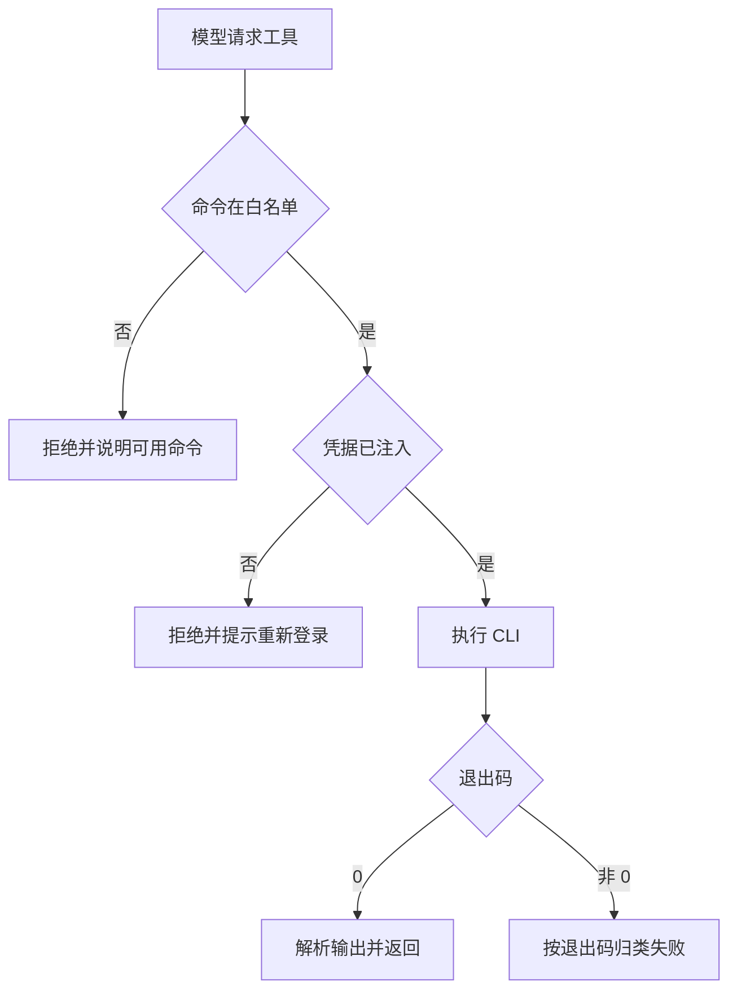

# DevOps 接入详细设计

## 文档信息

| 项 | 内容 |
|---|---|
| 文档编号 | CORP-DSH-DESIGN-009 |
| 文档名称 | DevOps 接入详细设计 |
| 版本 | V0.3.0 |
| 文档状态 | 草案 |
| 密级 | — |
| 编制 | DSH 平台组（代拟） |
| 审核 | 待定 |
| 批准 | 待定 |
| 最后更新 | 2026-10-22 |
| 门禁 | G1 |
| 模块状态 | 规划 |

> 编制依据：2026-10-20 依据两点事实——DevOps 平台已提供 CLI 工具；架构 P7 要求复用企业既有资产。据此本设计以 CLI 为接入形态，不新建 MCP 服务端。**未核验**：CLI 在银河麒麟 aarch64 上的可用性、是否支持环境变量注入凭据、是否提供结构化输出。三项均由 DevOps 团队补充确认，写入 §12，不阻塞设计其余部分。
>
> 关联文档：[总体架构 §7.3](../../architecture/platform-architecture.md)、[需求基线](../../requirements/requirements-baseline.md) REQ-12、[策略与审计](forge-policy.md)。

## 1. 结论

用 DevOps 已有 CLI 作为工具面，通过受控命令白名单接入，不自建 MCP 服务端。

这个选择的前提是 CLI 能覆盖只读查询（系统变更及独立验收、所属故事、系统/仓库与必要项目信息）。若 CLI 缺失或必要前提不成立，关闭对应命令并提交替代形态、成本与验收评审；不自动恢复 MCP 服务或核心补丁工作项。

边界：本模块不实现授权，授权由 DevOps 服务端校验。查询为现有基线；经需求方确认的受控回写目标见 §13，范围/安全/接口未准入前禁用，不把设计确认当作服务授权。

## 2. 目标与非目标

**目标**

- 只读查询走 CLI，命令面固定且可审计。
- 凭据不落配置文件，经环境注入。
- 命令超时、输出过大、非零退出都能被识别并归类。
- 未授权或不可用时明确失败，不静默降级。

**非目标**

- 不执行生产变更，不做部署与回滚。
- 不自建 MCP 服务、不暴露 PRM。
- 不代理用户权限，不做二次授权判定。

## 3. 需求与依赖

| 需求/验收 | 关系 | 说明 |
|---|---|---|
| REQ 工程系统只读查询 | 直接实现 | 系统变更及独立验收为主，关联故事背景 |
| 验收 A7 只读闭环 | 支撑 | 查询链路可判定 |
| REQ-12 | 条件相关 | 当前不纳入 CLI 基线；另有获批 MCP 集成时才核定补丁、PRM、WBS 与验收 |

| 依赖 | 类型 | 版本约束 | 缺失时的行为 |
|---|---|---|---|
| DevOps CLI | 工具 | 由 DevOps 团队提供 | 工具面不可用，明确报错 |
| 企业策略插件 | 包 | 同批次 | 命令面不开放 |
| 凭据 broker | 包 | 同批次 | 无凭据即拒绝 |

## 4. 扩展形态与边界

| 项 | 内容 |
|---|---|
| 形态 | 工具面接入：技能提示 + 命令白名单 + 策略校验（无独立服务端） |
| 运行位置 | 本机 Host，经 bash 工具调用 CLI |
| 目标 DSH 与 SDK | 随目标版本 |
| 使用的 seam 或服务 | bash 工具、策略门禁、凭据注入、审计事件 |
| 不修改的核心 | 无 |

## 5. 接口与配置

| 配置项 | 类型 | 默认值 | 必填 | 说明 |
|---|---|---|---|---|
| `devops.cliPath` | string | `devops` | 是 | CLI 可执行文件路径 |
| `devops.allowedCommands` | string[] | `[]` | 是 | 只读子命令白名单，空即禁用 |
| `devops.timeoutMs` | number | `60000` | 否 | 单次命令上限 |
| `devops.maxOutputBytes` | number | `262144` | 否 | 输出截断阈值 |
| `devops.authEnv` | string | `DEVOPS_TOKEN` | 否 | 注入凭据的环境变量名 |
| `devops.outputFormat` | `json` \| `text` | `json` | 否 | 期望输出格式 |

任务输入以系统变更及独立验收为主，所属故事只作背景。以下仅为待提供方映射的业务动作，不是可执行 CLI 命令，不预设 `devops` / `dop` 的子命令或参数：

| 业务动作示意 | 必须取得的事实 | 状态 |
|---|---|---|
| 系统变更读取（`change.read`） | 独立描述/验收、系统/仓库、要求版本、所属故事 | 查询基线；实际命令/字段待核验 |
| 已确认澄清/研发进展回写 | 正确对象、原版本、真实确认及结果引用 | 受控写目标；范围/C3批准及验证前禁用 |

实际工具字段与失败语义见[工程工具契约](../../contracts/engineering-tools.md)，不能从上述动作名拼造未确认命令。

## 6. 权限、凭据与数据

| 项 | 处理方式 | 生命周期 | 失败时 |
|---|---|---|---|
| 访问令牌 | 环境变量注入，不写盘 | 随调用 | 未注入即拒绝 |
| 命令与参数 | 记入审计，敏感参数脱敏 | 90 天 | 不影响执行 |
| 查询结果 | 仅在会话内使用，不落日志 | 单次 | 失败即丢弃 |
| 输出缓存 | 不缓存 | — | — |

## 7. 流程

**并发**：允许多条命令并发，按调用隔离环境变量。

**超时**：到点终止进程，按"结果未知"处理，不自动重试。

**取消**：用户取消时终止子进程，不保留部分输出。

## 8. 失败模式

| 场景 | 行为 | 用户可见结果 | 是否可重试 |
|---|---|---|---|
| 命令不在白名单 | 拒绝 | 列出可用命令 | 否 |
| 凭据缺失或过期 | 拒绝并提示 | 引导重新登录 | 登录后重试 |
| 服务端 401/403 | 归类为授权失败 | 说明无权限 | 否 |
| 输出非 JSON | 记录并降级为文本提示 | 提示格式不符 | 否 |
| 超时 | 终止并标记结果未知 | 提示未完成 | 否 |
| CLI 不存在 | 工具面不可用 | 明确报错 | 安装后重试 |

## 9. 可观测性

| 事件 | 字段 | 去向 | 保留 |
|---|---|---|---|
| 命令执行 | 命令、参数摘要、退出码、耗时 | 审计 | 90 天 |
| 拒绝 | 原因、命令 | 审计 | 90 天 |
| 输出异常 | 长度、解析失败原因 | 本机日志 | 30 天 |

## 10. 测试矩阵

| 层级 | 覆盖 | 命令 |
|---|---|---|
| 单元 | 白名单、参数脱敏、输出解析 | `node --test` |
| 契约 | 命令面与团队澄清清单一致 | 契约用例 |
| 集成 | 未授权、超时、非 JSON 三类 | 本地仿 CLI |
| 端到端 | 双端各完成一次只读查询 | 手工 |

## 11. 打包、升级与回退

形态为配置与技能资产，不新增常驻进程；CLI 由 DevOps 团队分发与升级。

升级：命令面只增不删；删除命令视为能力收缩，需说明。

回退：移除白名单即关闭工具面；不影响其他能力。

## 12. 未决事项

| 问题 | 需要谁回答 | 影响 |
|---|---|---|
| CLI 是否提供麒麟 aarch64 产物 | DevOps 团队 | 方案可行性前提 |
| 是否支持环境变量注入凭据 | DevOps 团队 | 第 6 节凭据方式 |
| 是否提供结构化输出与稳定退出码 | DevOps 团队 | 第 8 节错误归类 |
| 只读子命令清单与字段 | DevOps 团队 | 第 5 节命令面 |
| CLI 前提失败时的替代形态、成本与验收 | 平台组、DevOps、PMO | G1 前关闭失败命令；启用替代前单独批准，不自动恢复 REQ-12 |

### 需用户确认的设计选项（增益不明确，暂不采用，保留待定）

| 选项 | 可能的增益 | 代价 | 当前处理 |
|---|---|---|---|
| 同时保留 MCP 服务端 | 结构化工具面 | 两套并存，补丁与运维成本不降 | 不采用，待 CLI 确认后裁定 |
| 本地缓存查询结果 | 减少调用 | 数据新鲜度与权限变更不可控 | 不采用 |
| 受控研发写清单 | 澄清与进展回写 | 需范围、安全、幂等及并发核验 | 目标已确认，未准入前关闭，见 §13 |
| 自建 CLI 包装层 | 统一输出 | 与 P7 冲突，多一层维护 | 不采用 |
| 把 CLI 调用改成 MCP 桥接 | 兼容旧工具面 | 回到被替换的形态 | 不采用 |

以上五项均不影响主链路；若后续确认增益，再单独评估。若 CLI 三项前提任一不成立，关闭对应命令并提交替代形态评审；不自动回到 MCP 或恢复 REQ-12。

## 13. 企业研发能力与受控回写

[需求基线 §2.3](../../requirements/requirements-baseline.md)是范围唯一真源，[全流程设计](forge-devops-lifecycle.md)定义产品行为，[工具契约](../../contracts/engineering-tools.md)定义待核验动作/结果；本模块不复制字段。

显式入口加系统变更号后读取独立描述、验收、系统/仓库和所属故事。经人确认的业务澄清回写正确对象；开始时间及研发进展仅在字段语义明确后自动维护。不调用故事或系统变更最终完成，不用工程结束代填结束时间；最终状态随既有故事上线流程联动。

优先查询 DevOps 已展示的构建、制品及 UAT 部署关联，不触发 CI/CD。以上企业事实来自需求方确认，当前环境无内网，动作映射、字段、权限、并发更新、超时回查和双端行为均待 DevOps/平台核验。不得从旧 `dop` 文档拼造未知回写命令。

只读、普通研发写和需人工决定的动作分别登记与开关；§5 示例配置仍只表达查询候选，不证明写入口已实现。有限委托内自动写需安全批准 C3 分类；批准前保持原 ask 或禁用写。查询及写分别按跨模块设计 §10 验收，未核验动作不开放。
