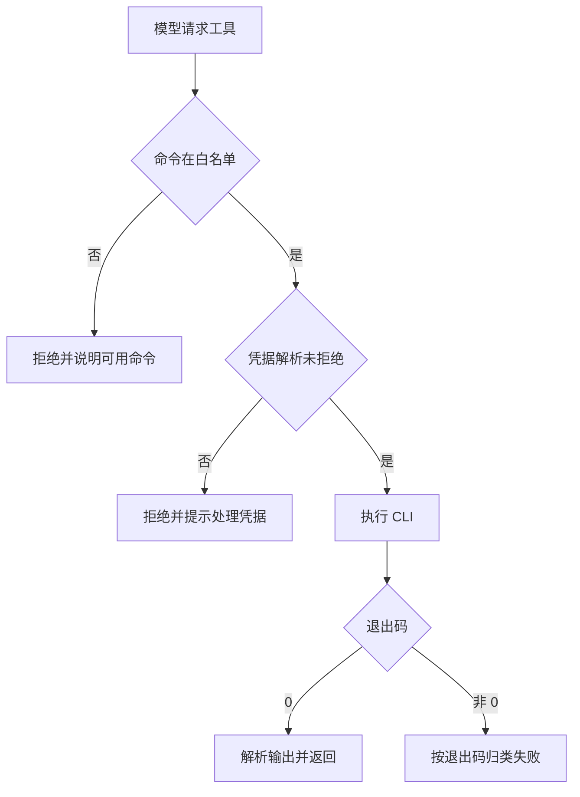

# DevOps 接入详细设计

## 文档信息

| 项 | 内容 |
|---|---|
| 文档编号 | CORP-DSH-DESIGN-009 |
| 文档名称 | DevOps 接入详细设计 |
| 版本 | V0.11.0 |
| 文档状态 | 草案 |
| 密级 | — |
| 编制 | DSH 平台组（代拟） |
| 负责 | 平台组（代拟） |
| 审核 | 待定 |
| 批准 | 待定 |
| 最后更新 | 2026-11-24 |
| 门禁 | G1 |
| 模块状态 | 可用（四个工具：只读 runner（`change.read` / `change.list`）、上下文卡、受控写回（`change update`）、产物落盘（含 clarify/plan 机检）；新会话编辑器提供变更选择器（只读清单 + 模板插入）；写回默认关闭，企业 dop CLI 未联调，见设计索引 §2.2） |

> 编制依据：2026-10-20 依据两点事实——DevOps 平台已提供 CLI 工具；架构 P7 要求复用企业既有资产。据此本设计以 CLI 为接入形态，不新建 MCP 服务端。**未核验**：CLI 在银河麒麟 aarch64 上的可用性、是否支持环境变量注入凭据、是否提供结构化输出。三项均由 DevOps 团队补充确认，写入 §12，不阻塞设计其余部分。
>
> 2026-11-04 用户提供 dop 1.x 的写回参数：`change update <code> --summary/--description/--ai-ac`，用于 Agent 完成变更内容分析后回写标题、描述与验收标准。据此新增受控写工具 `forge_devops_change_update`（默认关闭，写后回读；发放由策略门禁与组织信封决定）；命令 `--help` 与输出样例尚未取证，`--ai-ac` 的落点按回读假设处理。
>
> 2026-11-03 用户确认 D 方案（typed read runner）：只读面从「按能力切 4 个工具」改为「1 个枚举动作的 runner + 上下文卡 + 产物落盘」，删除恒 `denied` 的澄清写工具；`clarify` / `plan` 产物改由纯函数机检后生成正文。[dop 1.0.4 Windows 规格](../../contracts/dop-cli-spec.md)记录清单状态参数为 `--state`；其他版本与双平台产物仍须核验。
>
> 2026-11-06（r15）补设置页两件事：①本包新增「企业研发」分区（`client.js`，id `devops-readiness`、order 29），汇总企业身份/公共参数/本机配置/DevOps/Gitee/业务写权限六行，只做本机可见性汇总，固定声明"不代表业务授权"；②保存回执区分"已保存；运行时已应用"与"已保存；未应用"，`saveCliConfig` 在写成功后重建读面并回 `applied`，端点原样透传。既有 `devops` 分区（id `devops`、order 60）只加页脚来源行与三行回执，字段面、请求契约与 id/order 均不变。**仍未核验**：`heluo-r15-uat` 独立 profile 的装入与回滚（计划与证据核对见 `scripts/uat-profile.mjs`）。
>
> 2026-11-18（r19）新增会话起始变更选择器：新会话工具栏行（`conversation.hero.options`）注册 `devops.change-picker`，打开面板时才 `GET /api/forge-devops/changes`（复用 `change.list` 的同一读链路与策略门禁），选中后按当前模板插入当前编辑器草稿位点（r20 起模板可在设置页改写，未配置时用内置默认值）。只读清单不代表业务授权；插入不自动发送。
> 2026-11-19（r20）提示词模板改为**维护者配置**：新增补丁层配置键 `promptTemplate`（默认值为结构化编排指令），由只读端点 `GET /api/forge-devops/prompt` 下发给选择器；页面不提供编辑入口（终端用户自配容易漏掉验收与提问步骤），非法配置在装配期拒绝激活。
> 2026-11-24（r21）入口裁决改以卡片状态为准：`ok` 只表示读面走完了，不代表事实已取回。`devops-change` 只在卡片 `ready` 且自报变更号存在并等于请求号时输出成功与后续步骤；`blocked`、失败与空响应报阻塞（`CONTEXT_BLOCKED` / `CONTEXT_EMPTY`），`ready` 但自报号不符或缺省报不可确认（`CONTEXT_UNCONFIRMED`），三种情况都保留诊断卡与缺失项、给出配置或重试方向，且不改写会话绑定（issue #342）。
>
> 关联文档：[总体架构 §7.3](../../architecture/platform-architecture.md)、[需求基线](../../requirements/requirements-baseline.md) REQ-12、[策略与审计](forge-policy.md)。

## 1. 结论

用 DevOps 已有 CLI 作为工具面，通过受控命令白名单接入，不自建 MCP 服务端。

这个选择的前提是 CLI 能覆盖只读查询（系统变更及独立验收、所属故事、系统/仓库与必要项目信息）。若 CLI 缺失或必要前提不成立，关闭对应命令并提交替代形态、成本与验收评审；不自动恢复 MCP 服务或核心补丁工作项。

边界：本模块不实现授权，授权由 DevOps 服务端校验。查询为现有基线；经需求方确认的受控回写目标见 §13，范围/安全/接口未准入前禁用，不把设计确认当作服务授权。

**范围与平台边界（r10）**：本模块只讲 dop（DevOps 平台）变更流程。仓库、Issue、PR 的读写事实由 `@heluo/forge-gitee` 唯一负责，devops 不再持有 `gh` 侧实现（gh 适配器、actions、repository-resolver、repo-ref、review、report、commit-message 七个模块已删除）。因此 `change_context` 的承建仓库段降级为外部指引：`REPO_FACTS_EXTERNAL` + 下一步 `forge_gitee_repository_read` / `forge_gitee_issue_read`，不猜第二次。工具面为四个（`forge_devops_query` / `forge_devops_change_context` / `forge_devops_change_update` / `forge_devops_artifact_write`），配置四键（`dopBin` / `dopEndpoint` / `sourceType` / `timeoutMs`），页面可编辑两项（dop 入口、超时）。只读面不再按能力逐个开工具：一个 runner 以枚举动作分发（`change.read` / `change.list`），每个动作有自己的参数 schema，写动作永不入表；清单读取补上了原 CLI 已有、旧工具面缺失的 `change list`。

## 2. 目标与非目标

**目标**

- 只读查询走 CLI，命令面固定且可审计。
- 凭据不落插件配置文件；可由 IAM 托管并按次注入子进程，也可按部署使用白名单环境变量或 CLI 原有凭据机制。
- 命令超时、输出过大、非零退出都能被识别并归类。
- 未授权或不可用时明确失败，不静默降级。

**非目标**

- 不执行生产变更，不做部署与回滚。
- 不自建 MCP 服务、不暴露 PRM。
- 不代理用户权限，不做二次授权判定。
- 不提供自由 argv 或通用 `run(command)`：只读子命令只能经枚举动作 + 每动作参数 schema 进入，扩展参数不是「把命令行交给模型」。

## 3. 需求与依赖

| 需求/验收 | 关系 | 说明 |
|---|---|---|
| REQ 工程系统只读查询 | 直接实现 | 系统变更及独立验收为主，关联故事背景 |
| 验收 A7 只读闭环 | 支撑 | 查询链路可判定 |
| REQ-12 | 条件相关 | 当前不纳入 CLI 基线；另有获批 MCP 集成时才核定补丁、PRM、WBS 与验收 |

| 依赖 | 类型 | 版本约束 | 缺失时的行为 |
|---|---|---|---|
| DevOps CLI | 工具 | 由 DevOps 团队提供 | 工具面不可用，明确报错 |
| 企业策略插件 | 包 | 同批次 | 命令面不开放 |
| IAM 扩展凭据 broker | 可选宿主服务 | 同批次 | 缺席时按 standalone 环境与 CLI 原有凭据机制运行；托管凭据归属不匹配、不可读等状态拒绝调用 |

## 4. 扩展形态与边界

| 项 | 内容 |
|---|---|
| 形态 | 工具面接入：技能提示 + 命令白名单 + 策略校验（无独立服务端） |
| 运行位置 | 本机 Host，固定 argv 经唯一 `execFile` 出口（`shell: false`），不经 bash 拼接 |
| 目标 DSH 与 SDK | 随目标版本 |
| 使用的 seam 或服务 | bash 工具、策略门禁、凭据注入、审计事件 |
| 不修改的核心 | 无 |

## 5. 接口与配置

| 配置项 | 类型 | 默认值 | 必填 | 说明 |
|---|---|---|---|---|
| `dopBin` | string | 自动发现 | 是 | dop 可执行文件路径；页面可编辑。保存只要求「存在且是普通文件」，自动选中、装配准入与就绪证据还要求该入口能按本插件方式直接启动 |
| `dopEndpoint` | string | 空 | 否 | dop 服务端点；仅环境变量注入，适配器以 `--api-endpoint` 传递，实际是否生效须核验 CLI 版本 |
| `sourceType` | `dop` | `dop` | 否 | 事实来源类型；由 dop 单独推导，不认 `gh` |
| `timeoutMs` | number | `60000` | 否 | 单次命令上限；页面可编辑 |

配置页只有两项可编辑（`dopBin`、`timeoutMs`）；其余键由环境变量或推导获得。配置面只有四个键：历史上的 `ghBin` / `ghOwner` 及其环境变量形式不在契约内，加载时被静默忽略——不报错、不产生条目、也不影响就绪判定（老 profile 升级后插件照常激活）。

Windows `dop` 1.0.4 实测接受 `--api-endpoint` 但仍向默认端点发送请求，见 [CLI 规格](../../contracts/dop-cli-spec.md)。传入配置并不证明路由已切换；使用目标 CLI 前须核验实际请求目的地，不能把该版本结果推广到其他平台或版本。

**入口可启动性（r18）**：形态与「能不能启动」的判定由本包 `src/entry-form.mjs`（词表与两谓词）与 `src/entry-resolve.mjs`（沿 npm 包装脚本解析包内原生程序）承担；gitee 的 `gh` 入口各有一份，两者的等价性由根目录 `tests/cli-entry-parity.test.mjs` 逐条比对（同一输入两边同结论，任一侧单独漂移即变红）。保存侧 `isStorableEntry` 宽松（Windows 不限扩展名，`.cmd`/`.ps1`/无后缀 shim 都存得下，不回归 r8 AC-1）；启动侧 `isSpawnableEntry` 严格（Windows 只认原生可执行体，POSIX 要求普通文件 + 执行位）。自动发现只把能启动的入口放进候选：npm 全局安装留下的包装脚本会先沿 shim 文本解析出 `<prefix>\node_modules\<包>\bin\<tool>.exe` 再入候选（并标 `resolvedFrom`），解析不到的进 `rejected` 并在页面上列出；只剩包装脚本时 `ready=false` + `CLI_NOT_FOUND`，指引写明"发现 N 个包装脚本（本插件不经 shell 启动，无法使用）"，绝不静默选中。`readiness` 的 `executable` 证据同样以 `isSpawnableEntry` 判定，包装脚本直接 FAIL，装配期 fail closed。`GET /api/forge-devops/cli` 的候选与拒绝项因此携带 `form`/`resolvedFrom`/`spawnable`，`describeCliAccess()` 仍不输出路径。

**启动自检（r18）**：`POST /api/forge-devops/cli/selfcheck`（同源头校验，GET/HEAD 一律 405，避免预取触发子进程）以固定 argv 跑一次 `dop --version`（`shell:false`、超时 8 秒、输出截断 200 字符），报告 `{contract,at,state,ok,started,reason,exitCode,durationMs,argv,output,form}`。原因码 `no-entry`/`not-spawnable`/`spawn-failed`/`timed-out`/`nonzero-exit`；`exitCode===null` 表示进程根本没起来，与业务失败分开。自检是用户点击动作，**不进装配期发现**，也不写配置。

四键的值共用同一条校验规则 `validateConfigField`（页面保存、环境变量层与宿主 loader 都走它）：先去掉首尾空白，再剥掉**一层**成对包裹引号——`FORGE_DEVOPS_TIMEOUT_MS='30000'` 这类启动脚本写法与带双引号的全路径属搬运噪声，不构成配置错误；剥完仍带引号的（单边或两层）判 `CLI_CONFIG_INVALID`，整层不回落下一层。后一项是必要的：环境变量层不读盘，带引号的 `dopBin` 能通过装配期，直到 `execFile` 才以 `ENOENT` 失败。

任务输入以系统变更及独立验收为主，所属故事只作背景。以下是业务动作，不是自由拼接 CLI 的命令清单；已知参数以对应版本的 CLI 规格为证，企业字段和权限仍待核验。仓库、Issue、PR 的读写动作归 `@heluo/forge-gitee`，本模块不保留同名入口。

| 业务动作示意 | 必须取得的事实 | 状态 |
|---|---|---|
| 系统变更读取（`change.read`） | 独立描述/验收、系统/仓库、要求版本、所属故事 | 查询基线；实际命令/字段待核验 |
| 当前用户变更清单（`change.list`） | 用户可见清单与可选状态 | 查询基线；`dop` 1.0.4 的状态过滤使用 `--state`，目标版本须核验 |
| 已确认澄清/研发进展回写 | 正确对象、原版本、真实确认及结果引用 | 受控写目标；范围/C3批准及验证前禁用 |

实际工具字段与失败语义见[工程工具契约](../../contracts/engineering-tools.md)，不能从上述动作名拼造未确认命令。

### 5.1 工具面（2026-11-03，用户确认 D 方案）

四个工具各自只有一种职责；「哪个动作 → 哪条策略条目」可逐条核对：

| 工具 | 动作 / 门禁 | 输入 | 输出与边界 |
|---|---|---|---|
| `forge_devops_query` | `change.read` / `change.list`（读） | `action`（枚举）、`target`（`change.read` 为变更号；`change.list` 只接受 `@me`）、`status`（仅清单，映射到 `--state`） | 读信封（`status` / `source_revision` / `observed_at` / `command` / `truncated`）+ `facts`（单条：平台记录与归一结果；清单：`user` / `total` / `count` / `items` / `filter`）；不写平台 |
| `forge_devops_change_context` | `change.read`（读） | `target` 变更号 | 上下文卡（`text` 可直接作为 `context.md`）；承建仓库段是外部指引（`REPO_FACTS_EXTERNAL`） |
| `forge_devops_change_update` | `change.clarification.write`（写） | `target` 变更号、`summary` / `description` / `aiAc` 至少一个、`confirm{object}` | 随包登记但登记不等于放行（须 IAM 身份与前置执行记录；`confirmDopWrite` 开启后另经问答卡片确认）；目标必须是本次会话已读到的变更；固定 argv `change update`，写后用 `change view` 回读；结果 done/failed/unknown，未知不重放 |
| `forge_devops_artifact_write` | 无平台动作（本地落盘） | `repoRoot`、`kind`、`body` 或 `data`、`meta` | 五类产物；`clarify` 需 `data.findings` 且过机检，`plan` 需 `data.items` 且逐条映射过机检；六字段 front matter 与路径约束不变。机检不通过**零落盘**，信封在平级字段带回逐条证据（`clarify` 为 `problems`、`plan` 为 `gaps`），`detail` 仍是字符串——只回一句"未通过机检"会让调用方无法修正。`data.findings` 的结构（`kind` / `basis` / 每个选项的 `pros` 与 `cons` / `recommendation.optionId`）写在工具参数说明里，不要求调用方读源码 |

四条边界：

- **枚举而非自由命令**：`action` 只允许契约里登记的两个读动作；清单的 `target` 只接受 `@me`（CLI 的 list 天然是当前登录人范围），其他取值在工具层拒绝、零下游调用。以后新增只读子命令时，先取证真实 flag，再把动作与 schema 加进枚举——不引入「把 argv 交给模型」的通用入口。
- **原始与归一分层**：`facts.raw` 是平台原始事实（仅当前受权会话，不落指标/审计/产物）；`facts.normalized` 是契约形状（与上下文卡同一映射），归一失败不抛错，`normalize_error` 可见。
- **写回受门禁约束**：`change update` 是平台写，按契约登记为 `change.clarification.write`；分类默认允许，但每次执行仍须 IAM 身份与前置执行记录（[判定模型 §5、§6](../../design/policy-model.md)），内容、流程与确认三类规则由独立开关控制在 P1–P3 接入，确认走宿主问答卡片、取消或超时一律拒绝。工具面始终暴露入口，拒绝必须可见；写前要求先读该变更（`target` 必须等于会话绑定的变更号），写后回读核对，**不做通用 argv 透传**。
- **产物不绕过机检**：`clarify` / `plan` 两类只接受结构化 `data`，正文由 `renderClarifySheet` / `renderPlan` 生成；`body` 与 `data` 互斥，手写正文无法混过检查。澄清单作为本地产物待人工确认；另有受控回写的 `change update` 入口，企业命令与结果仍待核验。

**target 不是可选项**：策略条目对任何动作都要求非空 target；清单的 `target` 固定为 `@me`，不是省略。产物落盘用的变更号来自入口绑定或一次成功读取（`change.read` 成功、`change.context` 返回 `ready`），不再要求必须先跑命令入口。命令入口 `devops-change <变更号>` 与聚合读共用 `change-context.mjs` 的 `cardReadyFor` 判据：只有卡片 `status=ready` 且自报变更号存在并等于请求号才绑定并输出澄清/计划/实现旁白；`blocked`、失败、空响应与自报号不符/缺省一律返回阻塞结果，保留诊断卡与缺失项、给出配置或重试方向，且保留上一次成功绑定（新会话保持未绑定）。

### 5.2 设置页（r15）

本包在设置页按场景承载以下入口，都由包内 `client.js` 提供（`dsh.client = {platform:'web', immediately:true, inject:['slots','locale']}`）；当研发套件 `@heluo/forge-engineering` 在场时，`devops` 与 `devops-readiness` 合并挂载到容器子槽位 `heluo.engineering.tab`（`order: 10`，上就绪摘要下配置表单与内置访问凭证卡片），套件缺席（ADR-0012 单包安装）时保留独立分区；当 `@heluo/forge-iam` 在场时内置的 `DevopsCredentialItem` 通过 `/api/forge-iam/ext-credentials` 提供加密托管，缺席时静默提示仅使用本机环境或需安装「企业账号与模型」：

| 分区 / 槽位 | id | order | 职责 |
|---|---|---|---|
| `settings.section` / `heluo.engineering.tab` | `devops-readiness`（容器缺席 29）/ `devops`（容器缺席 60，容器内合并 10） | 29 / 60 / tab 10 | 汇总六行本机可见性（四层明细收拢于诊断详情）、DevOps CLI 配置字段（`dopBin`/`timeoutMs`）、页脚来源行、三行互不覆盖的回执以及内置扩展访问凭证（`DEVOPS_API_KEY`）卡片；`?refresh=1` 只由显式检查触发 |

三条边界：

- **只汇总、不授权**：分区顶部固定声明「本页只汇总本机可见性，不代表业务授权」；六行里没有一行能推出另一行（四组反例由 `tests/ui-contract.test.mjs` 与包内用例逐组断言另一行不变）。本机配置行只列键名，不列值。
- **只有 DevOps 行能检查**：`GET /api/forge-devops/cli?refresh=1` 是唯一会重新扫描的动作，且只由「检查 DevOps」触发（`refreshUrl()` 一处拼出，`?refresh=1` 在客户端只出现一次）。检查态六种：未检查/检查中/通过/失败/未知/已过期，子原因 `NO_CLI`→未配置、`ENTRY_NOT_EXECUTABLE`→不可执行、`ENDPOINT_UNREACHABLE`→目标不可达、`POLICY_DENIED`→策略拒绝。Gitee 行恒「未执行」并写明"本页不主动发起网络请求探测"。
- **三态互不覆盖**：保存回执三行（保存 / 应用 / 检查）各自独立；`applied` 来自 POST 成功体的 `applied` 字段，缺失即「未知」，不由前端推断。r16 起 `applied` 表达四种可判定的结论，不再拿「合并态相等」冒充应用：`{ok:true}`＝本层正在使用且新值确实进了运行时；`{ok:true, active:false}`＝最后一个 CLI 入口被正常清除（无 CLI 是合法状态，不报失败）；`{ok:false, reason:'CLI_APPLY_UNVERIFIED'}`＝运行面归属宿主注入的 flow/reader，写成功但本层无法证明新值被采用；`{ok:false, reason:'CLI_REBUILD_FAILED'}`＝重建抛错或读面立不起来（`degradeFaces()`）。页脚来源行读快照里的 `plugin`（服务端从 `package.json` 投影）与 `readAt`，浏览器半不读 `package.json`；本机覆盖只看快照投影的 `layers.override`，不拿合并后的 `config` 反推（`layers` 不可用时显示「未提供」）。

服务端契约：`GET /api/forge-devops/cli` 的快照增 `plugin:{name,version}` 与 `editable:['dopBin','timeoutMs']`；`POST /api/forge-devops/cli` 成功体为 `{ok:true, snapshot, applied?}`——`applied` 有才带、原样透传。`saveCliConfig` 写成功后重算读面，只有运行时合并态里真的出现新值才回 `applied:{ok:true}`；清除最后一个入口回 `applied:{ok:true, active:false}`；运行面被宿主注入时回 `applied:{ok:false, reason:'CLI_APPLY_UNVERIFIED'}`；重建抛错或读面立不起来则 `degradeFaces()` 并回 `applied:{ok:false, reason:'CLI_REBUILD_FAILED'}`（"已保存"这个结论不变）。「检查」只走 `?refresh=1` 重新发现配置并重建读面，不执行 CLI、不请求企业端点；检查与刷新共用单调请求代次，更早发起的回包不能覆盖更晚建立的读面。

### 5.3 会话起始变更选择（r19）

新会话编辑框上方的工具栏行由宿主按 `WorkspaceChip → conversation.hero.workspace → conversation.hero.agentPreset → conversation.hero.options` 渲染。本包在 `conversation.hero.options`（`kind:list`、scope `session`）注册 `id:'devops.change-picker'`、`order:-10`。该槽容器是 `margin-left:auto` 的右对齐 flex 盒，而 `conversation.hero.agentPreset` 是 `single` 槽（已被官方占满），工具栏行上没有第二个贴边座位；因此组件不移动、不包裹宿主节点，只用 `position:relative` 向左平移，位移取「容器左缘 − 模式选择器右缘 − 2px」，视觉上与工作区、模式选择器同排紧邻，箭头复用宿主同一条 chevron 路径。位移测量在挂载、首帧后一拍、`resize`、行与容器的 `ResizeObserver`、行上子节点增删的 `MutationObserver` 上重算（官方模式选择器与「基于 main / 新建工作树」都是后挂的，首帧右缘并不成立）。槽位注入面包含会话输入口 `inputActions`，选择只把文本写进当前编辑器，不提交、不发送。

端点：`GET /api/forge-devops/changes`。它与 `/cli` 共用前缀 `/api/forge-devops`，以更长的前缀独立注册（宿主按最长前缀匹配），既有 `/cli` 的契约与状态码矩阵不变。

| 事项 | 契约 |
|---|---|
| 读取链路 | 复用 `service.read({action:'change.list', target:'@me'})`：同一策略门禁、同一只读适配器、同一原因词表，不新增第二条读路径 |
| 成功体 | `{ok:true, items:[{id,summary}], count, total, truncated, observed_at}`；`id` 为平台变更号，`summary` 为概要；最多 100 条（`CHANGES_MAX_ITEMS`），超出计入 `truncated` |
| 失败体 | 与 `/cli` 同一错误信封 `{ok:false, code, message, detail?}`；`message` 由服务端按原因词写死，不回显异常文本，不携带命令行路径 |
| 状态码 | `NO_READER` / `PICKER_UNAVAILABLE` → 503；`POLICY_DENIED` → 403；`COMMAND_FAILED` / `COMMAND_TIMEOUT` / `MALFORMED_RESULT` / `NO_STRUCTURED_STATUS` / `MISSING_SOURCE_REVISION` → 502；其他 → 500 |
| 方法 | 只有 GET/HEAD 返回清单；其他方法 405 并带 `allow: GET`；响应统一 `cache-control:no-store`、`nosniff`、不设 CORS 头 |
| 缓存 | 服务端不缓存；客户端只在面板打开期间保留一份内存快照，重新打开或点「刷新」重取，不写 localStorage / sessionStorage / cookie |

选择行为（`client.js`）：

- 打开面板才发请求，同一时刻只允许一个在飞请求；失败显示类别文案，面板头部常驻「刷新」，入口本身不隐藏（失败可见）。
- 选中一项后调用 `inputActions.setDraft(prompt)` **整体替换**当前草稿（并触发 `persistDraft`）；连续切换多个变更时编辑器里只保留最后一次的模板，不首尾相接。`inputActions` 没有草稿读取面（`captureInsertion` 只给光标位点，拿不到全段长度），构造不出覆盖全段的 `insertText` span，所以整段写入只能走 `setDraft`；宿主抛错（正在发送 / 装配已卸载）时就地报错，不重试、不改草稿。缺 `setDraft` 的宿主退回位点插入（两次重取 span），保证能力不整体失效。位点写入被拒（草稿已变更或编辑器被锁）时重取一次 span，仍失败就地报错，不以覆盖草稿兜底；宿主抛错（正在发送 / 装配已卸载）同样报错不重试。
- 模板：内置默认值与 r19 口径逐字一致（结构化的「读变更 → 建 issue → issue-delivery → 工作区交付 → 建 PR」指令），由维护者在补丁层配置（见 §5.4）；填充时只把 `{code}` 替换为所选变更号（`split/join`，变更号里的 `$&` 之类保持字面）。模板不随语言切换，面板文案走 `devops` 命名空间。
- 替换不会自动发送：用户仍可编辑、追加或再选一次整体覆盖。
- 贴靠只读宿主几何：组件只调 `getBoundingClientRect` 与观察器，不读写宿主状态、不复制节点，也不依赖宿主的哈希类名；宿主的 `display:contents` 槽位壳（零盒）在测量时被跳过，模式选择器右缘通过下钻壳的首个有盒元素取得。

模板实测（同日、同 profile）：补丁层写入 `config.promptTemplate` 后，`GET /api/forge-devops/prompt` 返回 `source: config` 与该正文；改回默认值后返回 `source: config` 的结构化默认正文；未配置时 `source: default`。`POST` 等写方法一律 405 + `allow: GET`。页面选中变更后写入的是配置值，说明「维护者配置 → 选择器使用」闭环成立；设置页不存在该分区的编辑入口。

实测（2026-11-19，隔离 profile `heluo-r15-uat`、`dsh 0.2.1-rc.5`，未触碰日常 `desktop` profile）：工具栏行渲染「工作区 → 模式 → 变更 ▾」，选择器与模式选择器右缘相距 2px、箭头为宿主同款 chevron、文案加粗，切换工作区后位置自动重算；点开读到 `dop change list` 的 12 条「变更号 + 概要」，连续选中两条后编辑器里只剩后一条的模板（整体替换、不叠加），且不发送；端点 `GET` 返回 200（`cache-control:no-store`、`nosniff`、无 CORS 头），`POST` 返回 405 + `allow: GET`。官方「基于 main / 新建工作树」同场的相邻布局未在该 profile 复现（未装官方面板）。

边界：清单是「当前登录人可见的变更」，不是授权凭据；可见范围、平台权限与写能力仍由企业侧判定；本能力只读，不写平台。

### 5.4 提示词模板（r20）

模板是「选中一条变更后写进编辑器」的那段文字。它是**项目维护者**的口径配置，不是终端用户的偏好：用户自己改容易漏掉「缺验收标准先问我」「不以 `#` 开头」这类关键约束，反而制造风险。因此**页面不提供编辑入口**，改模板的唯一方式是编辑 profile 补丁层本插件条目的 `config.promptTemplate`，改完重载 profile 生效；不写就用内置默认值。

| 事项 | 契约 |
|---|---|
| 配置键 | `promptTemplate`，字符串，写在本插件补丁层同一行 `config:` 里；未配置即内置默认模板 |
| 校验 | 装配期只校验**类型**（非字符串则 `ConfigStandard` 报 issue 并拒绝激活）；内容规则（非空、含 `{code}`、≤4000 字、CRLF 归一为 LF、剪首尾空白）在使用时判定：不合法则**回落内置默认模板**并在下发体带 `warning` 说明原因——维护者写错一个模板不该让整包停止工作 |
| 下发 | `GET /api/forge-devops/prompt` → `{ok:true, template, source:'config'\|'default', placeholder:'{code}'}`，配置内容不合法时另带 `warning`；`source` 说明模板来自配置还是内置默认值 |
| 方法 | 只支持 GET/HEAD；其他方法 405 + `allow: GET`，错误文案直接指向「编辑 profile 补丁层的 config.promptTemplate」 |
| 响应头 | 与 `/cli` 同口径：`cache-control:no-store`、`nosniff`、不设 CORS 头 |
| 装配 | 端点只读 `config`，不依赖 `configEditor`：没有写面也能工作，也不需要文件锁、回读比对与冲突码 |
| 客户端 | 选择器打开面板时取一次模板（取不到回落内置默认值，不阻塞清单），选中时按模板填充变更号 |

维护者示例（profile 补丁层）：

```yaml
- id: forge-devops
  name: "@heluo/forge-devops"
  config:
    promptTemplate: |
      变更 {code}：先读变更详情，提炼需求与验收标准；
      缺验收标准时列缺口问我，不要编造。
```

边界：`{code}` 是唯一占位符，其余字符原样保留（变更号里的 `$&` 之类不会触发替换）；模板是提示层约束，不含凭据、不改工具授权，真正的门禁仍在策略与检查器。

## 6. 权限、凭据与数据

| 项 | 处理方式 | 生命周期 | 失败时 |
|---|---|---|---|
| 访问令牌 | IAM broker 可用时优先使用与当前账号绑定的加密托管令牌，按次注入 `DEVOPS_API_KEY`；无托管令牌或 broker 缺席时可使用白名单环境及 CLI 原有凭据机制 | 托管记录由凭据后端管理；子进程环境随调用 | 托管凭据归属不匹配、未登录或不可读时拒绝；CLI 与服务端最终判定认证 |
| 必要审计 | 策略记录允许字段内的动作、目标与结论，不记录令牌、业务正文、参数值或 stdout/stderr | 发行补丁配置内存 sink，进程结束后丢失；正式留存须接入持久 sink | 前置审计失败或超时则依赖该审计的策略动作不执行；事后补记失败保留执行结果并记录缺口，后续动作受限 |
| 查询结果 | 仅在会话内使用，不落日志 | 单次 | 失败即丢弃 |
| 输出缓存 | 不缓存 | — | — |

IAM 与插件可能并发装载，broker 尚未就绪的窗口按 standalone 环境处理；补丁行顺序本身不证明就绪。不能仅凭已安装 IAM 宣称全程不会使用环境凭据，依赖该保证的部署须另行验证就绪与配置。

## 7. 流程



**并发**：允许多条命令并发，按调用隔离环境变量。

**超时**：到点终止进程，按"结果未知"处理，不自动重试。

**取消**：用户取消时终止子进程，不保留部分输出。

## 8. 失败模式

| 场景 | 行为 | 用户可见结果 | 是否可重试 |
|---|---|---|---|
| 命令不在白名单 | 拒绝 | 列出可用命令 | 否 |
| 凭据不可用或过期 | 托管凭据不可用时拒绝；CLI/服务端认证失败时归类提示 | 引导检查凭据或重新登录 | 修复后重试 |
| 服务端 401/403 | 归类为授权失败 | 说明无权限 | 否 |
| 输出非 JSON | 记录并降级为文本提示 | 提示格式不符 | 否 |
| 超时 | 终止并标记结果未知 | 提示未完成 | 否 |
| CLI 不存在 | 工具面不可用 | 明确报错 | 安装后重试 |
| 变更事实未取回（未配置/读取失败/记录无效/空响应） | 入口按卡片状态报阻塞；诊断卡照常返回 | 阻塞原因、缺失项与恢复方向；不追加澄清/计划/实现旁白；会话保留上次绑定 | 配置或修复后重试 |

## 9. 可观测性

| 事件 | 字段 | 去向 | 保留 |
|---|---|---|---|
| 命令执行与拒绝 | 动作、目标、结论等允许字段 | 策略必要审计 | 发行补丁配置内存落点，进程结束后丢失；持久留存依 sink 及批准策略 |
| 输出异常 | 归类原因与脱敏诊断 | 返回结果或本机日志 | 依实际日志配置，不承诺固定期限 |

## 10. 测试矩阵

| 层级 | 覆盖 | 命令 |
|---|---|---|
| 单元 | 白名单、参数脱敏、输出解析 | `node --test` |
| 契约 | 枚举动作、每动作参数 schema、写回 confirm/绑定/回读三态、`body`/`data` 互斥、clarify/plan 机检 | `node --test` |
| 集成 | 未授权、超时、非 JSON 三类 | 本地仿 CLI |
| 设置页（r15） | 两个分区的 id/order（容器在场时合并为 `heluo.engineering.tab` 一个条目，`order` 10，容器塌陷时回退到两个独立分区）与两段式挂载、九种状态词、六行互不推导、`?refresh=1` 只由检查触发、保存/应用/检查三行互不覆盖、`applied` 透传与 `CLI_REBUILD_FAILED` 降级 | `node --test "packages/forge-devops/test/*.test.mjs"`（`client-shape.test.mjs`、`save-applied.test.mjs`）、`node scripts/check-client-module.mjs packages/forge-devops/client.js`、`node --test tests/ui-contract.test.mjs` |
| 提示词模板（r20） | 默认正文与产品口径逐字一致、两端字面量一致、`{code}` 校验与 CRLF/trim 归一、非法配置回落默认值、端点只读（POST/PUT/DELETE→405 + `allow: GET`）、响应头与错误体口径、客户端不存在编辑入口 | `node --test packages/forge-devops/test/prompt-template.test.mjs packages/forge-devops/test/prompt-api.test.mjs` |
| 会话起始选择器（r19） | 注册槽位/id/order 与 `locale`、`inject` 面、端点路径与「只读 GET」、失败体复用、prompt 模板逐字一致、插入走 `captureInsertion` + `insertText` 且失败不回写 `setDraft`、清单投影（去空/去重/上限） | `node --test packages/forge-devops/test/changes-api.test.mjs packages/forge-devops/test/client-picker.test.mjs packages/forge-devops/test/client-shape.test.mjs` |
| 端到端 | 双端各完成一次只读查询 | 手工 |

离线用例还覆盖：两条读动作各自路由、清单 `@me` 之外拒绝且零下游调用、`facts` 透传、归一失败只记 `normalize_error`、clarify 零选项与 plan 缺验证方式被拒且不落盘。

## 11. 打包、升级与回退

形态为配置与技能资产，不新增常驻进程；CLI 由 DevOps 团队分发与升级。

浏览器半（r15）：`exports['./client'] = './client.js'`、`files` 含 `client.js`、`peerDependencies = {react:'>=18'}` 且 `peerDependenciesMeta.react.optional = true`（react 由宿主 Web 外壳提供，不进闭包、不进 tarball）。版本投影：`src/index.mjs` 读自己的 `package.json` 注入快照的 `plugin`，页面只用服务端给的值。

升级：命令面只增不删；删除命令视为能力收缩，需说明。

回退：移除白名单即关闭工具面；不影响其他能力。

## 12. 未决事项

| 问题 | 需要谁回答 | 影响 |
|---|---|---|
| CLI 是否提供麒麟 aarch64 产物 | DevOps 团队 | 方案可行性前提 |
| 是否支持环境变量注入凭据 | DevOps 团队 | 第 6 节凭据方式 |
| 是否提供结构化输出与稳定退出码 | DevOps 团队 | 第 8 节错误归类 |
| 只读子命令清单与字段 | DevOps 团队 | 第 5 节命令面 |
| CLI 前提失败时的替代形态、成本与验收 | 平台组、DevOps、PMO | G1 前关闭失败命令；启用替代前单独批准，不自动恢复 REQ-12 |

### 设计选项与取舍（含 2026-11-03 用户确认项）

| 选项 | 可能的增益 | 代价 | 当前处理 |
|---|---|---|---|
| 同时保留 MCP 服务端 | 结构化工具面 | 两套并存，补丁与运维成本不降 | 不采用，待 CLI 确认后裁定 |
| 本地缓存查询结果 | 减少调用 | 数据新鲜度与权限变更不可控 | 不采用 |
| 受控研发写清单 | 澄清与进展回写 | 需范围、安全、幂等及并发核验 | 目标已确认，未准入前关闭，见 §13 |
| 按能力切工具（每个只读子命令一个工具） | 模型侧最直白 | 每加一条 CLI 子命令要改契约/动作表/工具/策略目录/补丁层/用例六处，能力容易落后于原 CLI | 2026-11-03 由用户改为 typed runner（见下行） |
| **typed read runner**（枚举动作 + 每动作 schema） | 拿回原 CLI 只读能力与扩展参数，写动作仍不可达 | 需要维护动作枚举表；扩展参数必须逐个取证，不能一把透传 | **采用**（2026-11-03 用户确认 D 方案）；仍是 §5.1.3 的薄适配，不是「自建 CLI 包装层」 |
| 自建 CLI 包装层（另做一个包装 CLI 进程） | 统一输出 | 与 P7 冲突，多一层维护 | 不采用；本包是进程内薄适配，不新增可执行体 |
| 把 CLI 调用改成 MCP 桥接 | 兼容旧工具面 | 回到被替换的形态 | 不采用 |

以上各项均不影响主链路；若后续确认增益，再单独评估。若 CLI 三项前提任一不成立，关闭对应命令并提交替代形态评审；不自动回到 MCP 或恢复 REQ-12。

## 13. 企业研发能力与受控回写

[需求基线 §2.3](../../requirements/requirements-baseline.md)是范围唯一真源，[全流程设计](forge-devops-lifecycle.md)定义产品行为，[工具契约](../../contracts/engineering-tools.md)定义待核验动作/结果；本模块不复制字段。

2026-11-04 起澄清回写以 `change update`（`--summary/--description/--ai-ac`）实现：工具面提供 `forge_devops_change_update`，随包登记但登记不等于放行（仍须 IAM 身份与前置执行记录，`confirmDopWrite` 开启后另经问答卡片确认）；写前必须先读该变更，写后回读。澄清单与交付计划仍经机检后落本地产物。

显式入口加系统变更号后读取独立描述、验收、系统/仓库和所属故事。经人确认的业务澄清回写正确对象；开始时间及研发进展仅在字段语义明确后自动维护。不调用故事或系统变更最终完成，不用工程结束代填结束时间；最终状态随既有故事上线流程联动。

优先查询 DevOps 已展示的构建、制品及 UAT 部署关联，不触发 CI/CD。以上企业事实来自需求方确认，当前环境无内网，动作映射、字段、权限、并发更新、超时回查和双端行为均待 DevOps/平台核验。不得从旧 `dop` 文档拼造未知回写命令。

只读、普通研发写和需人工决定的动作分别登记与开关；写入口已实现但默认禁用，不能把本地实现视为企业写权限或联调通过。有限委托内自动写需确认 C3 分类与权限；未准入前保持禁用。查询及写分别按跨模块设计 §10 验收，未核验动作不开放。

## 实现与验证记录

**实现边界**：`forge-devops` 的"只读查询 + 门禁骨架"**已落地**（D4，2026-10-24）：清单、只读端口（2026-11-03 起 `change.read` + `change.list` 两条）、门禁骨架、四个工具（`query`/`change_context`/`change_update`/`artifact_write`，参数用门禁认识的 `target`；写回按 `change.clarification.write` 随包登记、登记不等于放行）、离线测试（2026-10-26：空目录/漏映射/未开放拒绝挂载，读取走同一 `executeAction` admission，拒绝时适配器零调用）、**宿主探针两模式通过**（`with-reader`：模型自决调用经门禁到达适配器恰好一次；`no-reader`：可见地报 `NO_READER`；并借此发现并修复"缺 `inject` 导致工具静默不注册/整项不激活"），**企业 CLI 联调未做**，写动作未做企业联调。

**验证结果与限制**：对应设计中的测试矩阵为目标，不是执行结果。

## 准入核对要点

**设计与接入边界**：容器在场时挂入 `heluo.engineering.tab`/order 10，独立回退保留 `devops-readiness`/29 与 `devops`/60；凭据卡片内置于 DevOps 面板，`cli-runner.mjs` 使用 `ENV_ALLOWLIST` 与托管优先链；真实 `dop` 系统凭据库未联调。

**准入关注点**：系统变更/独立验收映射、aarch64 产物、凭据/输出；受控写范围、C3 分类与回查待批待验；真实 `dop` 凭据库未联调。
