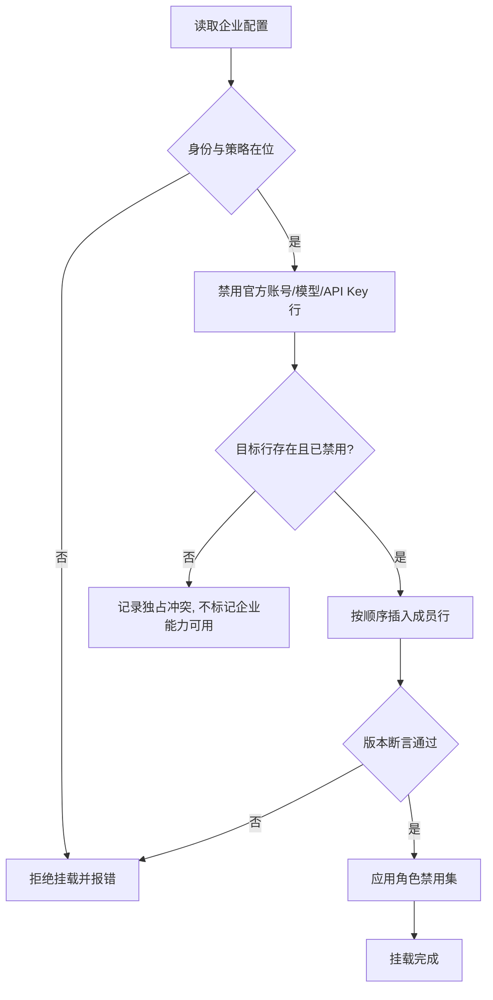

# 企业组合包详细设计

## 文档信息

| 项 | 内容 |
|---|---|
| 文档编号 | CORP-DSH-DESIGN-004 |
| 文档名称 | 企业组合包详细设计 |
| 版本 | V0.6.0 |
| 文档状态 | 草案 |
| 密级 | — |
| 编制 | DSH 平台组（代拟） |
| 审核 | 待定 |
| 批准 | 待定 |
| 最后更新 | 2026-10-24 |
| 门禁 | G2 |
| 模块状态 | 可用（组合骨架：官方行默认禁用 + 按需技能/条款装配；企业接入待开通） |

> 编制依据：2026-10-20 依据 DSH 组合层公开语义核验——补丁层叠加在包入口列表之上；`insert` 追加行，带 `id` 的补丁覆盖既有行且 `config` 整体替换、不深合并；`group: true` 配 `name: cordis:group` 使 `config` 成为可再插入的嵌套列表；`cordis:include` 载入外部 YAML 或 JSON 入口列表；`disabled` 接受布尔、null 或按挂载时机求值的 `!!js` 表达式；`!!js` 仅在 `config` 内按插件上下文求值；`isolate` 按服务名划分实例域。2026-10-21 用户确认采用 O3「企业 IAM 独占登录」，官方登录在企业内网不可用；本包据此默认禁用官方账号、官方模型、官方 API Key 与官方账户 UI 行。**未核验**：`engines` 版本断言在挂载期的具体报错形态、`fiberPhase` 的取值集合、禁用四行后 shell/onboarding 是否完整。
>
> 关联文档：[总体架构](../../architecture/platform-architecture.md)、[设计索引](../README.md)、[IAM 接入](forge-iam.md)、[策略与审计](forge-policy.md)、[双模式凭据](../credential-modes.md)。

## 1. 结论

本包不写业务逻辑，只回答一个问题：企业版由哪些能力、以什么顺序、在什么前提下一起出现。

边界：它组合 `@heluo/forge-*` 与上游插件，不实现其中任何一个；它决定默认值与禁用项，不决定策略内容与契约字段。

O3 的组成之一是**默认禁用官方账号、官方模型、官方 API Key 与官方账户 UI 四行**，使企业 IAM 成为唯一登录。官方登录在企业内网不可用，保留它只会制造一个坏掉的入口，并留下公网模型旁路。

还缺四件事才能进实现：版本断言的报错形态实测、角色 preset 的粒度确认、禁用四行后 shell/onboarding 的实测、默认禁用清单的业务确认。

### 1.1 专用访问目标的组合约束

2026-10-23 需求方已确认[需求基线 §4.6](../../requirements/requirements-baseline.md#46-模型访问身份与专用凭证要求)。组合包只挂载经过核验的个人认证路线（A 纯令牌 / B Key＋令牌待选），不能因模型插件能解析 Key 就跳过人员、用途或生命周期要求。关键依赖不满足则停止相应企业调用，不自动切换到裸 Key 或应用 Agent 凭证。

IAM 接入与模型接入分别核验网关目标授权、双凭据承载（若 B）、轻量 DSH 标识及当前授权退出。本包不管理应用凭证、IP 或审批，相关操作在网关控制台。配置示意不代表本轮能力已实现；选路及契约冻结后再调整真实配置。本轮不改 bundle 或源码。

## 2. 目标与非目标

**目标**

- 一处声明企业版包含的全部能力，避免用户自行拼装。
- 企业版只保留企业 IAM 登录与企业模型路由；官方登录、官方模型、官方 API Key 与官方账户 UI 默认禁用。
- 安全依赖（身份、策略）缺失时整体拒绝挂载，而不是静默降级。
- 每项能力可单独禁用，禁用后果写在包里而不是靠口头约定。
- 支持按角色下发差异化 preset，不复制多套安装包。

**非目标**

- 不实现身份、策略、网关接入等成员能力。
- 不接管配置分发与更新通道（见市场与分发）。
- 不替代组织级策略，只提供默认值。

## 3. 需求与依赖

| 需求/验收 | 关系 | 说明 |
|---|---|---|
| REQ-01 / A1、A14 | 支撑 | 企业 IAM 独占登录；未登录时企业模型不可用 |
| REQ-17 / A12 | 支撑 | 安全依赖缺失时拒绝企业调用，不保留原权限 |
| REQ-14 / A9 | 支撑 | 企业包只从企业源安装，不保留公网入口 |

| 依赖 | 类型 | 版本约束 | 缺失时的行为 |
|---|---|---|---|
| `@heluo/forge-iam` | 包 | 同批次版本 | 拒绝挂载，报明确错误 |
| `@heluo/forge-policy` | 包 | 同批次版本 | 拒绝挂载；**不提供只读降级**，策略缺失即企业入口关闭 |
| `@heluo/forge-gateway` | 包 | 同批次版本 | 允许挂载，模型能力不可用并提示 |
| `dsh-credentials` | 上游包 | 随目标 DSH | 拒绝挂载 |
| `dsh-deepseek-account-platform`、`dsh-llm-deepseek-account`、`dsh-llm-deepseek-api-key`、`dsh-client-ui-settings-account` | 上游包 | 随目标 DSH | 作为默认禁用目标；目标缺失时警告并跳过，不能当作已禁用 |

## 4. 扩展形态与边界

| 项 | 内容 |
|---|---|
| 形态 | 配置 bundle：`cordis.patch.yml` + 若干 preset |
| 运行位置 | 本机 Host（与profile 组合层同处） |
| 目标 DSH 与 SDK | `0.2.1-rc.2`；组合语义按上文核验项 |
| 使用的 seam 或服务 | 补丁层、`cordis:group`、`cordis:include`、`disabled`、`isolate` |
| 不修改的核心 | 组合层实现、成员包的内部逻辑 |

取舍：用一个包加开关，而不是每角色一个包。理由是补丁层的 `disabled` 已能表达差异，多包会让"企业版到底包含什么"出现多个副本。

## 5. 接口与配置

| 配置项 | 类型 | 默认值 | 必填 | 说明 |
|---|---|---|---|---|
| `enterprise.profile` | `full` \| `pilot` | `full` | 否 | 试点档默认关闭市场与 SDD |
| `enterprise.disable` | string[] | `[]` | 否 | 能力标识列表，映射到 `disabled: true` |
| `enterprise.rolePreset` | string | 空 | 否 | 角色 preset 名，决定默认禁用集 |

策略是硬依赖：没有 `policyRequired` 一类开关，也不存在"关闭策略后仅允许只读"的档位。策略未挂载或不可用时，依赖它的动作入口保持关闭且无可调用残留。

```yaml title="组合顺序（示意）"
insert:
  - id: enterprise-iam
    name: '@heluo/forge-iam'
  - id: enterprise-policy
    name: '@heluo/forge-policy'
  - id: enterprise-gateway
    name: '@heluo/forge-gateway'
  - id: enterprise-tools
    name: cordis:group
    group: true
    config:
      - id: enterprise-devops
        name: '@heluo/forge-devops'
      - id: enterprise-gitee
        name: '@heluo/forge-gitee'
# 市场不插入插件行：目标形态是 DSH 原生索引源 + AIHUB 托管 format-1 索引，
# `@heluo/forge-market` 为历史参考（ADR-11／13）。企业索引源按原生索引源配置，
# 键名以目标版本核验为准；试点档关闭市场走原生配置，不靠禁用本包某一行。
```

### 5.1 官方行默认禁用

O3 要求企业 IAM 是唯一登录，因此本包在补丁层默认关闭以下行；不使用 `insert` 复制新行，也不覆盖成员的 `config`：

```yaml title="默认禁用官方登录/模型（示意）"
- id: deepseek-account
  disabled: true
- id: llm-deepseek-account
  disabled: true
- id: llm-deepseek
  disabled: true
- id: ui-settings-account
  disabled: true
```

- `id` 以目标 profile 实际行为准；desktop 与 web 可能不同，G0 各核验一次。
- 目标不存在时 Loader 会警告并跳过；跳过不等于已禁用，必须由 `@heluo/forge-iam` 的独占断言兜底。
- 禁用官方 UI 后，onboarding、侧栏入口、默认模型由 IAM 包接管；本包不复制这些 UI。
- 升级 DSH 后重新应用补丁，并跑“官方行是否回灌”用例。

配置字段以本设计为准；网关字段仍见[网关契约](../../contracts/gateway-contract.md)。

#### 5.1.1 禁用实验（本机实测 2026-10-24）

补丁层落在 [packages/forge-enterprise/cordis.patch.yml](../../../packages/forge-enterprise/cordis.patch.yml)：只写"禁用官方行"，不预建指向未实现包的 `insert:` 行。

| 步骤 | 命令 | 结果 |
|---|---|---|
| 组合树核对（web） | `dsh --profile web --dump-config` | 四行都在：`deepseek-account`、`llm-deepseek`（`dsh-llm-deepseek-api-key`）、`llm-deepseek-account`、`ui-settings-account`（`dsh-client-ui-settings-account`） |
| 组合树核对（sdk） | `dsh --profile sdk --dump-config` | 只有前三行；无 `ui-settings-account` |
| 应用禁用层 | `dsh --profile web --patch <补丁> --dump-config` | 与基线逐行 diff：四行各多出 `disabled: true`，并带 `patched by <补丁>` 标记 |
| 命中不到的行 | `dsh --profile sdk --patch <补丁> --dump-config` | `dsh: [<补丁>] patch: entry "ui-settings-account" not found`，跳过且**不算已禁用** |
| 自动化对照 | `node scripts/probe/run-host-probe.mjs` | 报告 `composition` 段逐行给出"已落地 / 警告已出现"；去掉补丁层（`DSH_HOST_PROBE_DISABLE_OFFICIAL=0`）时该段整体 FAIL 且退出码 1（负向对照） |
| 升级回灌 | 同版本重复应用 | 结果一致；**真实 DSH 升级后的回灌未验**，升级后必须重跑上述核对 |

**未验**：`desktop` profile 本机不存在同名 profile，其行 id 未核验；运行时"官方模型不可选、`DEEPSEEK_API_KEY` 不构成旁路"需要接了官方模型行的 desktop/web 运行时——探针 profile 的 LLM 提供方在禁用前后都是 0 个（基线对照同样为 0），因此该项在探针里以 `blocked` 记录，不用"0 个提供方"冒充已证明；当前正在使用的 GUI profile 未用补丁重启（会打断会话）。**禁用实验失败即暂停 O3**，不 patch 内核。

### 5.2 按需企业 Skill 与规范条款加载

企业入口负责**装配**按需技能与规范条款，不重复实现成员包逻辑，也不把全部条款一次性注入上下文。宿主技能服务（`ctx.skills`）已核验：注册进去的是"只读运行时技能"，`list()` 只给调用无关的摘要，正文由 `get(name)` 按需加载。

| 规则 | 要求 |
|---|---|
| 发现与描述 | 技能必须给出准确的 `name` / `description` / `whenToUse`；描述与正文一致，不用空泛标题占位 |
| 用户入口 | 企业技能默认 `modelInvocable: false`、`userInvocable: true`：只有用户显式触发才承接，模型不能自动冒用企业流程入口 |
| 加载不写 | 加载只读资源与正文，不产生写动作，也不在加载时创建 Issue、分支或提交 |
| 条款适用性 | 条款索引标明适用系统与版本区间；两个系统/规范版本合成任务时**只加载适用条款**，其余按原因归档（版本不符、已过期、系统不符） |
| 硬要求与建议 | `level: hard \| advice` 分开呈现；硬要求必须在该动作被执行前可见 |
| 冲突与过期 | 过期条款移出选择集并指向维护者；同一主题的活跃硬条款冲突时**同时呈现双方与各自责任人**，不允许模型自行废止其一 |
| 上下文预算 | 不重复全量注入；每次选择都要给出条款数、正文字节数与估算 token，并受预算上限约束，超限即拒绝整体注入而不是静默截断 |
| 加载记录 | 记录本次加载了哪些条款、来自哪个版本、跳过哪些及原因，供追溯 |
| 自证边界 | 加载器只报告条款与引用，不做"合规通过"结论；确定性要求引用 [S01 (#27)](forge-sdd.md) 的交付清单与 CI 校验，不由模型自报合规 |
| 不做的事 | 不规定规划/编码/修复方法，不按阶段自动建 Issue |

## 6. 权限、凭据与数据

| 项 | 处理方式 | 生命周期 | 失败时 |
|---|---|---|---|
| 身份与令牌 | 由 IAM 包持有，本包不读写 | 随会话 | 拒绝挂载 |
| 策略配置 | 只读引入，不覆盖用户策略 | 随包版本 | 拒绝挂载 |
| 本包配置 | 用户级，不含敏感值 | 随profile | 回退默认值 |
| 组合日志 | 记录了哪些行、哪些被禁用 | 本机日志 | 不影响挂载 |

## 7. 流程



**独占断言**：官方行被跳过或禁用失败时，`@heluo/forge-iam` 启动检查 `ctx.get('deepseekAccount')`，不进入 `ready`、不写企业令牌，并记录 `exclusive-violation`。组合层与 IAM 包各自兜底，避免“补丁没生效但看起来登录了”。

**并发**：挂载只发生一次，无共享状态；重复挂载请求按幂等处理。

**超时**：成员初始化超时视为挂载失败，不做部分挂载。

**禁用与退出**：整体禁用回到无企业能力状态，必须在包说明中写明后果，禁止用"可禁用"掩盖策略缺失。

## 8. 失败模式

| 场景 | 行为 | 用户可见结果 | 是否可重试 |
|---|---|---|---|
| 身份包缺失 | 拒绝挂载 | 明确提示缺少身份能力 | 修后重试 |
| 策略包缺失 | 拒绝挂载或转只读 | 提示策略不可用 | 修后重试 |
| 版本不匹配 | 拒绝挂载 | 列出期望与实际的版本 | 升级后重试 |
| 某能力行插错位置 | 启动失败 | 指出冲突行 id | 修正补丁 |
| 官方行缺失/禁用被跳过 | 记录独占冲突，不标记企业能力可用 | 提示企业组合不完整 | 修正 row id 后重试 |
| 禁用官方 UI 后 shell/onboarding 缺失 | 暂停 O3，提交组合层替代方案评审 | 指出缺失能力 | 评审后重试；不改内核 |
| 升级后官方行回灌 | 重新应用禁用并告警 | 提示企业组合被恢复 | 重启/修正补丁 |
| 配置字段被整体替换 | 覆盖后行为异常 | 指出被替换的配置键 | 修正后重试 |

最后一行是本组合层最容易踩的坑：`config` 不深合并，覆盖时必须重述全部字段。

## 9. 可观测性

| 事件 | 字段 | 去向 | 保留 |
|---|---|---|---|
| 挂载完成 | 档位、启用行、禁用行、版本 | 本机日志 | 30 天 |
| 拒绝挂载 | 缺失依赖、断言失败项 | 本机日志 | 30 天 |
| 配置覆盖 | 被覆盖的 id 与键 | 本机日志 | 30 天 |

## 10. 测试矩阵

| 层级 | 覆盖 | 命令 |
|---|---|---|
| 单元 | 禁用集映射、顺序、版本断言 | `node --test` |
| 契约 | 补丁字段符合组合语义 | 契约用例 |
| 集成 | 缺身份/缺策略/版本不符三种拒绝 | 本地夹具 |
| 组合 | 禁用四行后 shell/settings/onboarding/模型选择可用；官方入口不可见；`DEEPSEEK_API_KEY` 不构成旁路；升级回灌 | 组合夹具 |
| 端到端 | 双端各完成一次挂载、官方入口不可见与整体禁用 | 手工 + 脚本 |

## 11. 打包、升级与回退

包名 `@heluo/forge-enterprise`，`private: true`，声明 `engines.dsh` 与成员包的同批次版本。产物只有补丁文件与 preset，不含运行时代码。

升级：整包升级，成员版本必须同批次；不允许单包漂移。

回退：保留上一版补丁即可回到旧组合；禁用项与用户配置不回退，避免丢失用户选择。

## 12. 未决事项

| 问题 | 需要谁回答 | 影响 |
|---|---|---|
| 挂载期版本断言的报错形态 | 平台组（实测） | 第 8 节失败语义 |
| `fiberPhase` 的取值与用途 | 平台组（实测） | 观测字段 |
| 角色 preset 的粒度（按职能还是按部门） | 平台组、PMO | 第 5 节 `rolePreset` |
| 官方四行 row id 在 desktop/web 的一致性 | 平台组（实测） | 第 5.1 节禁用补丁 |
| 禁用四行后 shell/onboarding 是否完整 | 平台组（实测） | O3 是否可在不修改核心的前提下成立 |
| 若禁用破坏 shell，是否接受最小核心补丁 | 用户、平台组 | 与“不 fork”非目标冲突 |
| 默认禁用清单是否还有未识别的官方旁路 | 安全、平台组 | 第 5.1 节默认值 |
| 旧官方 grant 与旧默认模型的迁移/清理 | 平台组、安全 | 升级体验与残留身份 |
| 试点档是否禁用市场 | 平台组、IT | `profile` 语义 |

### 需用户确认的设计选项（增益不明确，暂不采用，保留待定）

| 选项 | 可能的增益 | 代价 | 当前处理 |
|---|---|---|---|
| 每个角色一个独立 bundle | 安装即正确 | 组合副本增多，版本对齐成本上升 | 不采用，单一包加 `rolePreset` |
| 把私有市场配置写进本包 | 少一次配置 | 市场策略与市场包耦合 | 不采用，留在市场包 |
| 内置成员包版本自检脚本 | 升级期早发现问题 | 与 `engines` 断言重复 | 不采用 |
| 提供图形化组合编辑器 | 降低维护门槛 | 组合层已声明式，收益不确定 | 不采用 |
| 把策略内容也放进本包 | 一处配置 | 与策略包职责重叠，审计边界模糊 | 不采用 |

以上五项都不影响主链路；若后续确认增益，再单独评估并更新本设计。