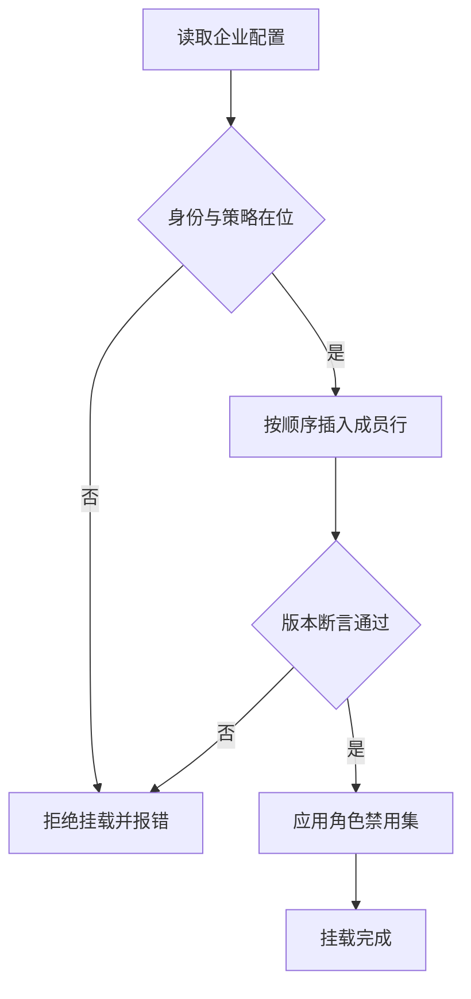

# 企业组合包详细设计

## 文档信息

| 项 | 内容 |
|---|---|
| 文档编号 | CORP-DSH-DESIGN-004 |
| 文档名称 | 企业组合包详细设计 |
| 版本 | V0.1 |
| 文档状态 | 草案 |
| 密级 | 内部 |
| 编制 | DSH 平台组（代拟） |
| 审核 | 待定 |
| 批准 | 待定 |
| 最后更新 | 2026-10-20 |
| 门禁 | G2 |
| 模块状态 | 规划 |

> 编制依据：2026-10-20 依据 DSH 组合层公开语义核验——补丁层叠加在包入口列表之上；`insert` 追加行，带 `id` 的补丁覆盖既有行且 `config` 整体替换、不深合并；`group: true` 配 `name: cordis:group` 使 `config` 成为可再插入的嵌套列表；`cordis:include` 载入外部 YAML 或 JSON 入口列表；`disabled` 接受布尔、null 或按挂载时机求值的 `!!js` 表达式；`!!js` 仅在 `config` 内按插件上下文求值；`isolate` 按服务名划分实例域。**未核验**：`engines` 版本断言在挂载期的具体报错形态、`fiberPhase` 的取值集合。
>
> 关联文档：[总体架构](../../architecture/platform-architecture.md)、[设计索引](../README.md)、[IAM 接入](forge-iam.md)、[策略与审计](forge-policy.md)、[双模式凭据](../credential-modes.md)。

## 1. 结论

本包不写业务逻辑，只回答一个问题：企业版由哪些能力、以什么顺序、在什么前提下一起出现。

边界：它组合 `@heluo/forge-*` 与上游插件，不实现其中任何一个；它决定默认值与禁用项，不决定策略内容与契约字段。

还缺三件事才能进实现：版本断言的报错形态实测、角色 preset 的粒度确认、默认禁用清单的业务确认。

## 2. 目标与非目标

**目标**

- 一处声明企业版包含的全部能力，避免用户自行拼装。
- 安全依赖（身份、策略）缺失时整体拒绝挂载，而不是静默降级。
- 每项能力可单独禁用，禁用后果写在包里而不是靠口头约定。
- 支持按角色下发差异化 preset，不复制多套安装包。

**非目标**

- 不实现身份、策略、网关接入等成员能力。
- 不接管配置分发与更新通道（见市场与分发）。
- 不替代组织级策略，只提供默认值。

## 3. 需求与依赖

| 需求/验收 | 关系 | 说明 |
|---|---|---|
| REQ 统一入口 | 支撑 | 用户只装一个企业包 |
| REQ 安全依赖不可绕过 | 支撑 | 缺身份或策略即不挂载 |
| 验收 A7 门禁 | 支撑 | 策略包必须在位且生效 |

| 依赖 | 类型 | 版本约束 | 缺失时的行为 |
|---|---|---|---|
| `@heluo/forge-iam` | 包 | 同批次版本 | 拒绝挂载，报明确错误 |
| `@heluo/forge-policy` | 包 | 同批次版本 | 拒绝挂载，除非显式声明只读模式 |
| `@heluo/forge-gateway` | 包 | 同批次版本 | 允许挂载，模型能力不可用并提示 |
| `dsh-credentials` | 上游包 | 随目标 DSH | 拒绝挂载 |

## 4. 扩展形态与边界

| 项 | 内容 |
|---|---|
| 形态 | 配置 bundle：`cordis.patch.yml` + 若干 preset |
| 运行位置 | 本机 Host（与profile 组合层同处） |
| 目标 DSH 与 SDK | 随目标版本，组合语义按上文核验项 |
| 使用的 seam 或服务 | 补丁层、`cordis:group`、`cordis:include`、`disabled`、`isolate` |
| 不修改的核心 | 组合层实现、成员包的内部逻辑 |

取舍：用一个包加开关，而不是每角色一个包。理由是补丁层的 `disabled` 已能表达差异，多包会让"企业版到底包含什么"出现多个副本。

## 5. 接口与配置

| 配置项 | 类型 | 默认值 | 必填 | 说明 |
|---|---|---|---|---|
| `enterprise.profile` | `full` \| `pilot` | `full` | 否 | 试点档默认关闭市场与 SDD |
| `enterprise.disable` | string[] | `[]` | 否 | 能力标识列表，映射到 `disabled: true` |
| `enterprise.policyRequired` | boolean | `true` | 否 | 关闭后仅允许只读能力 |
| `enterprise.rolePreset` | string | 空 | 否 | 角色 preset 名，决定默认禁用集 |

```yaml title="组合顺序（示意）"
insert:
  - id: enterprise-iam
    name: '@heluo/forge-iam'
  - id: enterprise-policy
    name: '@heluo/forge-policy'
  - id: enterprise-gateway
    name: '@heluo/forge-gateway'
  - id: enterprise-tools
    name: cordis:group
    group: true
    config:
      - id: enterprise-devops
        name: '@heluo/forge-devops'
      - id: enterprise-gitee
        name: '@heluo/forge-gitee'
  - id: enterprise-market
    name: '@heluo/forge-market'
    disabled: !!js "ctx.get('enterpriseProfile') === 'pilot'"
```

配置字段以本设计为准；网关字段仍见[网关契约](../../contracts/gateway-contract.md)。

## 6. 权限、凭据与数据

| 项 | 处理方式 | 生命周期 | 失败时 |
|---|---|---|---|
| 身份与令牌 | 由 IAM 包持有，本包不读写 | 随会话 | 拒绝挂载 |
| 策略配置 | 只读引入，不覆盖用户策略 | 随包版本 | 拒绝挂载 |
| 本包配置 | 用户级，不含敏感值 | 随profile | 回退默认值 |
| 组合日志 | 记录了哪些行、哪些被禁用 | 本机日志 | 不影响挂载 |

## 7. 流程



**并发**：挂载只发生一次，无共享状态；重复挂载请求按幂等处理。

**超时**：成员初始化超时视为挂载失败，不做部分挂载。

**禁用与退出**：整体禁用回到无企业能力状态，必须在包说明中写明后果，禁止用"可禁用"掩盖策略缺失。

## 8. 失败模式

| 场景 | 行为 | 用户可见结果 | 是否可重试 |
|---|---|---|---|
| 身份包缺失 | 拒绝挂载 | 明确提示缺少身份能力 | 修后重试 |
| 策略包缺失 | 拒绝挂载或转只读 | 提示策略不可用 | 修后重试 |
| 版本不匹配 | 拒绝挂载 | 列出期望与实际的版本 | 升级后重试 |
| 某能力行插错位置 | 启动失败 | 指出冲突行 id | 修正补丁 |
| 配置字段被整体替换 | 覆盖后行为异常 | 指出被替换的配置键 | 修正后重试 |

最后一行是本组合层最容易踩的坑：`config` 不深合并，覆盖时必须重述全部字段。

## 9. 可观测性

| 事件 | 字段 | 去向 | 保留 |
|---|---|---|---|
| 挂载完成 | 档位、启用行、禁用行、版本 | 本机日志 | 30 天 |
| 拒绝挂载 | 缺失依赖、断言失败项 | 本机日志 | 30 天 |
| 配置覆盖 | 被覆盖的 id 与键 | 本机日志 | 30 天 |

## 10. 测试矩阵

| 层级 | 覆盖 | 命令 |
|---|---|---|
| 单元 | 禁用集映射、顺序、版本断言 | `node --test` |
| 契约 | 补丁字段符合组合语义 | 契约用例 |
| 集成 | 缺身份/缺策略/版本不符三种拒绝 | 本地夹具 |
| 端到端 | 双端各完成一次挂载与整体禁用 | 手工 + 脚本 |

## 11. 打包、升级与回退

包名 `@heluo/forge-enterprise`，`private: true`，声明 `engines.dsh` 与成员包的同批次版本。产物只有补丁文件与 preset，不含运行时代码。

升级：整包升级，成员版本必须同批次；不允许单包漂移。

回退：保留上一版补丁即可回到旧组合；禁用项与用户配置不回退，避免丢失用户选择。

## 12. 未决事项

| 问题 | 需要谁回答 | 影响 |
|---|---|---|
| 挂载期版本断言的报错形态 | 平台组（实测） | 第 8 节失败语义 |
| `fiberPhase` 的取值与用途 | 平台组（实测） | 观测字段 |
| 角色 preset 的粒度（按职能还是按部门） | 平台组、PMO | 第 5 节 `rolePreset` |
| 默认禁用清单的业务边界 | 安全、平台组 | 第 5 节默认值 |
| 试点档是否禁用市场 | 平台组、IT | `profile` 语义 |

### 需用户确认的设计选项（增益不明确，暂不采用，保留待定）

| 选项 | 可能的增益 | 代价 | 当前处理 |
|---|---|---|---|
| 每个角色一个独立 bundle | 安装即正确 | 组合副本增多，版本对齐成本上升 | 不采用，单一包加 `rolePreset` |
| 把私有市场配置写进本包 | 少一次配置 | 市场策略与市场包耦合 | 不采用，留在市场包 |
| 内置成员包版本自检脚本 | 升级期早发现问题 | 与 `engines` 断言重复 | 不采用 |
| 提供图形化组合编辑器 | 降低维护门槛 | 组合层已声明式，收益不确定 | 不采用 |
| 把策略内容也放进本包 | 一处配置 | 与策略包职责重叠，审计边界模糊 | 不采用 |

以上五项都不影响主链路；若后续确认增益，再单独评估并更新本设计。