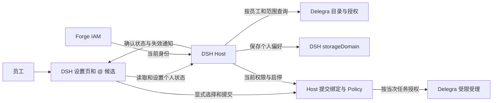

# Forge 专家智能体管理插件详细设计

## 文档信息

| 项 | 内容 |
| --- | --- |
| 文档编号 | CORP-DSH-DESIGN-023 |
| 文档名称 | Forge 专家智能体管理插件详细设计 |
| 版本 | V0.6.3 |
| 文档状态 | 草案 |
| 密级 | — |
| 作者 | hrygo |
| 编制 | Agent（代拟） |
| 审核 | 待定 |
| 批准 | 待定 |
| 确认人 | 项目负责人（当前用户） |
| 确认日期 | 2026-11-20 |
| 确认事项 | 在管理页通过按钮手动启用希望在 DSH 中 `@` 的专家。V0.5.0 第 1 至 5 节作为独立设计评审依据 |
| 适用范围 | 首次使用与新增调用权限的个人启用规则、本模块目标、责任边界、技术方案、取舍及实施验收计划 |
| 最后更新 | 2026-11-28 |
| 门禁 | 管理页按范围、专家目录与目标宿主取证准入。生产 `@` 点选与真实委派共用可信提交和受限受理门禁 |
| 模块状态 | 规划 |

> 编制依据包括项目负责人确认的个人启停规则、独立 Goldfish 评审及 2026-11-20 的固定版本源码核验。已核对 DSH `dsh-v0.2.1-rc.3` 的设置分区和输入候选扩展点，以及 Delegra `deploy/v2026.1106.0-r2` 的目录和指派授权。目标宿主装配、按员工授权提供的专家目录和真实提交链路待实测。 [概念简报](../../engineering/reviews/2026-11-20-forge-expert-manager-concepts-brief.md) · [独立设计评审](../../engineering/reviews/2026-11-20-forge-expert-manager-design-review/consolidated_review_report.md)
>
> 关联文档包括[专家 PRD](../../requirements/delegra-experts-prd.md)、[专家接入方案](../../plans/2026-11-18-forge-experts-integration-proposal.md)、[DSH 插件高阶规范](../../engineering/dsh-plugin-conventions.md)及 [Issue #246](https://github.com/hrygo/heluo-forge/issues/246)。

## 1. 结论

### 1.1 用户问题

员工需要在 DSH 找到 Delegra 授权给自己的专家，并决定哪些专家出现在聊天的 `@` 候选中。专家的工作职责、员工的调用权限和专家的接单状态各自变化。员工需要在浏览时辨认专家，在启停时知道个人设置是否保存，在发送前确认原先选择仍然有效。

### 1.2 概览

`@heluo/forge-experts` 提供「设置 → 专家智能体」和聊天输入框的专家候选组。目录呈现获准查看的专家和可披露的能力与权限摘要。「可调用」视图呈现所选组织内当前员工在至少一个有效委派范围内有调用资格的所有专家。用户通过「启用」「停用」按钮管理个人候选。首次使用与新增调用资格默认未启用。管理页独立开放时显示聊天委派尚未开放。 [专家 PRD §3、§4](../../requirements/delegra-experts-prd.md#3-场景与协作方式)

DSH Host 保存当前实例与组织下的个人偏好。每个会话按当前委派范围的调用资格、专家接单状态和个人启用状态形成 `@` 候选。员工账号、授权或专家状态变化时，受影响的候选和待发送选择随之更新。[专家接入方案 §3](../../plans/2026-11-18-forge-experts-integration-proposal.md#3-dsh-选择与委派绑定)

## 2. 目标与责任边界

### 2.1 设计目标

| 目标 | 可观察结果 |
| --- | --- |
| 找到有权使用的专家 | 在同一设置页浏览目录和「可调用」视图。通过获准披露的职责、可处理工作与工具资源或动作范围判断专家是否合适。按稳定专家 ID 区分同名项。摘要缺失、过期或不可披露时如实提示。目录结果不完整时显示实际范围 |
| 自主管理 `@` 候选 | 每个账号按其已保存的选择管理候选。首次出现的专家须手动启用。停用后仍有调用权的专家可从管理页再次启用。暂不接单和个人启用分别呈现 |
| 在正确范围内选择专家 | 管理页覆盖所选组织内的调用资格。候选与发送核对当前会话的委派范围。停用、撤权或切换范围导致所选专家失效时，界面保留草稿并提示重选 |

### 2.2 责任边界

Delegra 持有专家目录、权限、接单状态和任务生命周期。插件负责当前员工的目录体验、个人启停和 DSH 选择交互。个人设置作用于后续选择和新委派。已受理任务继续按 Delegra 的任务规则处理。专家配置、工具权限及 Harness 运行环境由 Delegra 管理。 [专家接入方案 §4](../../plans/2026-11-18-forge-experts-integration-proposal.md#4-delegra-权限隔离与数据) · [运行时镜像设计](../delegra-runtime-images.md)

专家目录使用已核验的员工授权契约，取证由 [#244](https://github.com/hrygo/heluo-forge/issues/244) 跟踪。范围裁决及接入恢复归 [#243](https://github.com/hrygo/heluo-forge/issues/243)。可信提交与草稿恢复归 [#245](https://github.com/hrygo/heluo-forge/issues/245)。各阶段遵循 §5 的开放条件。 [需求基线 §2](../../requirements/requirements-baseline.md#2-范围边界唯一真源) · [分阶段验收](../../plans/2026-11-18-forge-experts-integration-proposal.md#6-恢复后的阶段与验收)

### 2.3 关键使用场景

| 情境 | 员工操作 | 预期结果 |
| --- | --- | --- |
| 首次登录后有获准调用的专家 | 打开设置，从「可调用」中启用一位专家 | 管理页初始显示未启用。保存成功后，在获权且专家可接单的会话中可以 `@` 该专家 |
| 已选中专家并填写任务 | 从另一窗口停用专家，再发送原草稿 | 旧选择失效。任务草稿保留并提示重选，服务端新增任务为零 |
| 专家只在项目 A 可调用 | 启用专家，从项目 A 切换到项目 B | 本人的启用偏好保留，该专家退出项目 B 的候选。返回项目 A 时按当前资格与接单状态更新候选 |
| 专家的调用权限在该组织被全部撤回并重新授予 | 刷新目录后打开管理页 | 恢复资格的专家显示未启用，用户可再次手动启用 |

## 3. 技术方案

### 3.1 宿主装配与证据

`@heluo/forge-experts` 采用独立的 Host + Client 插件形态。浏览器侧使用一个 `client.js`，通过 `settings.section` 注册管理页，通过 `inputTriggers.registerSource` 注册独立的 `@` 专家组。Host 使用经过 DSH 连接鉴权的同源路由提供目录、偏好与候选。`cordis.patch.yml` 装配已核验的宿主服务。真实委派另使用 Forge Policy，在实际外发入口判定动作、目标、内容及所需的本机人工确认。Delegra 独立判定任务的服务端授权与受理。 [DSH 插件高阶规范 §3](../../engineering/dsh-plugin-conventions.md#3-逐条规范) · [接入方案 §3](../../plans/2026-11-18-forge-experts-integration-proposal.md#3-dsh-选择与委派绑定)

| 接入面 | 2026-11-20 核验依据 | 目标发行物验收 |
| --- | --- | --- |
| 管理页与候选 | DSH `dsh-v0.2.1-rc.3` 的 `ui-settings/src/client/contract/slots.ts` 声明根级设置槽。`ui-input-trigger/src/client/service.ts` 的候选源注册返回注销函数。`controller.ts` 的注销会移除当前组，异步重查会在结算前保留旧行 | 验证原生设置页装入、销毁、组标签、已开菜单失效与恢复、其他候选组与原草稿保留 |
| Host 存储 | 同一标签 `packages/bundle/base/cordis.patch.yml` 装配 `storageDomain`，默认以 DSH 用户目录中的 JSON 后端持久化。`storage-domain/src/index.ts` 与 `domain.ts` 提供版本检查、串行写入及关闭。`storage-json/src/atomic.ts` 定义文件替换的写入完成点。现有 `workspace` 通过公开 `storageDomain.open()` 使用独立数据域 | 在目标 profile 验证依赖已装载、目录归属、单 Host 写入、重启回读、失败恢复及卸载后原数据可读 |
| Host 路由 | Forge IAM 已使用 `webServer.register`、DSH 连接鉴权和同源事件流。[装配](../../../packages/forge-iam/src/index.mjs) · [路由](../../../packages/forge-iam/src/routes.mjs) | 核对 Client 在目标 Electron 或 Web 连接下的读取、写入、事件断开、重连与失效回读 |
| Delegra 权限 | `deploy/v2026.1106.0-r2` 的 `paperclip_list_agents` 按 `agent:read` 提供目录，任务创建另按专家、项目等上下文检查 `tasks:assign` | 用授权员工账号验证组织内调用资格、当前会话范围、接单状态、分页完整性及撤权收敛。[#244](https://github.com/hrygo/heluo-forge/issues/244) |

固定源码提交分别为 DSH `1f81c047fc48fa190a683e469daa699857e9afe8` 与 Delegra `25c86a283a9c787a01911c714618d78df7552af7`。源码核验覆盖接口实现。目标发行物装入和企业授权按表中判据实测。

### 3.2 组件和状态所有权



下表路径相对于计划中的 `packages/forge-experts/`。

| 部件 | 计划落点 | 职责 |
| --- | --- | --- |
| 装配 | `package.json`、`cordis.patch.yml`、`src/index.mjs` | 声明宿主依赖、连接各职责模块和管理生命周期。Host 入口仅负责装配 |
| 身份范围与目录 | `src/scope.mjs`、`src/catalog.mjs` | 从可信宿主连接和 IAM 解析当前员工与组织。目录模块通过员工专用通道读取授权事实，按范围保存短期快照并管理分页及过期 |
| 个人偏好 | `src/preferences.mjs` | 唯一写入者。维护本机持久记录、并发写序和确认状态 |
| Client 投影与 Host 路由 | `client.js`、`src/routes.mjs` | 浏览、提交单项启停、接收更新和处理当前候选。路由统一校验请求、调用 Host 方法并映射结果 |
| 选择与提交 | `src/selection.mjs` | Host 持有短期提交准备记录与可信轮次绑定。在 #245 取证确认的实际发送入口应用 Forge Policy 并交付受限请求 |

各 Host 模块通过装配入口注入所需 getter 或回调。Client 只消费 Host 确认的投影。候选根据当前会话上下文、授权目录和个人偏好派生，生命周期由同一 Host 控制。

### 3.3 员工授权与目录

Host 以 Forge IAM 的 `getSession()` 取得当前员工身份快照。专用凭据必须经目标 Delegra 服务验证，并按员工契约绑定本次请求的实例、组织与员工。Host 在凭据取得后、查询出站及发布结果前复验请求仍属于当前作用域。绑定不明或匹配失败时拒绝请求，响应不包含受限字段。浏览器只接收最小展示字段和非凭据的范围标识。 [IAM 凭据接入指南 §3.3](../../../packages/forge-iam/docs/credential-access.md#33-dsh-host-插件宿主服务) · [接入方案 §4](../../plans/2026-11-18-forge-experts-integration-proposal.md#4-delegra-权限隔离与数据)

Delegra 决定员工在所选组织内可以查看的专家。管理页的「可调用」视图从该目录呈现至少有一个委派范围具备调用资格的专家。候选另按实际会话的委派范围核对调用资格和接单状态。缺少该会话的范围证据时暂停该会话的候选。

管理页按需搜索和分页，游标绑定员工、组织、筛选条件和当前目录版本。范围未知或分页未完成时标记实际覆盖，缺项保持待确认。摘要限于该员工获准获悉的能力、工具资源或动作与调用限制。由 Delegra 的授权接口提供或确认可披露的信息，缺失时显示未提供。摘要用于选择参考，实际权限以当次授权和目标系统决定为准。

打开管理页或当前会话首次需要专家候选时读取。有效期内复用同范围请求。个人候选按已启用专家查询当前范围的资格，输入字符时筛选当前快照。身份或范围变化、授权失效通知及到达有效期触发刷新。最终发送使用当次复验，撤权收敛时间以目标契约实测为准。

### 3.4 个人偏好与并发保存

Host 使用 `defineDomain` 声明 `forge_experts` 存储域，版本为 `1`，使用 `preferences` 表和宿主已装配的 JSON 路由。部署沿用当前 DSH 用户目录，由一个 Host 打开该域。多个浏览器窗口共享该 Host。固定版本的 JSON 后端按进程内写入排序，目标 profile 需验证该域的数据位置只有一个 Host 写入。原生变更事件限于当前进程，对 Client 另发失效通知。 [SQLite 存储扩展与使用规范 §1](../../engineering/sqlite-storage-conventions.md#1-适用范围)

持久键取 `instanceId`、`orgId`、员工 `issuer` 与 `subject`、`expertId` 组成的规范 JSON 数组的 SHA-256 摘要。标识来自已核验的 Host 与 Delegra 上下文。记录保存 `enabled`、该专家偏好 `revision` 以及可核验的授权连续性摘要。缺项视为未启用且修订号为 `0`。目录字段和任务内容保留在其各自服务的生命周期内。存储域校验失败时保留原文件，暂停偏好写入和候选。

写入按以下顺序执行。

1. Host 为可管理的专家行发出一次编辑的 `editToken`，绑定专家、`scopeEpoch`、获悉的授权连续性、当前偏好修订及有效期。该标记表明用户操作时见到的状态，Host 写入时独立复验当前连接、员工身份与组织内调用资格。撤权后重授会使旧标记失效，包括从未保存过偏好的专家。
2. 同一 Host 按序处理启停及授权失效。先核对标记有效期、当前范围、记录修订和授权，并按记录 schema 校验待写值，再进入待确认状态并暂停受影响条目的操作、候选与发送。相同值且同一有效授权无需再写。同一标记的重复请求只结算一次，修改目标值或基于过期修订提交时返回冲突。
3. 原生存储确认后才发布当前修订和保存成功。待确认期间，目录仍可展示已获准披露的专家信息，偏好投影只表明待确认。失败且确认未写入时恢复上次确认的偏好。异步写入记录在原属主的键下，发布前复验作用域，丢弃上一代响应。
4. 丢回包后以同一 `editToken` 回读结算。Host 在标记有效且仍未观察到写入时返回待确认，标记过期且未进入写序后才能确认未执行。标记与短期结算记录留在 Host 内存，作用域变化后旧写入无法新入队，Client 读取新作用域的当前状态。已经入队的写入须继续确认结果。介质操作结果未知时暂停存储域写入及受影响候选，保留原数据。目标存储的恢复判据须证明当前持久记录，单次重新打开读到文件只作恢复证据之一。

Delegra 确认员工失去该专家在组织内的全部调用资格后，Host 先作废本机启用及编辑标记，再按写入顺序持久更新。重新授予时默认未启用。仅变更单个项目的调用资格时保留组织内偏好，更新受影响会话的候选。目录暂不可用或分页缺项时保留偏好记录，暂停未获确认的动作与候选。恢复时按 Delegra 的授权连续性证据决定旧偏好能否生效，无法确认的专家需要重新启用。

### 3.5 Client 到 Host 的接口

下表定义插件内部同源接口。所有路由使用 DSH 连接鉴权和当前员工上下文，写入还核对同源和请求头。Host 在启动、员工或组织切换时更换 `scopeEpoch`。响应与同源事件流（SSE）带同一作用域下可比较的 `viewVersion`。管理页使用所属组织的投影版本，候选使用实际会话的投影版本。目录、偏好或授权失效时 Host 先推进受影响投影的版本。会话委派范围变化或候选到期只影响对应候选投影。Delegra 的路径、字段和错误映射由已核验的外部契约承接。

| 入口 | 输入 | 成功结果 |
| --- | --- | --- |
| `GET /api/forge-experts/catalog` | `view=directory` 或 `view=callable`，可选 `query`、`cursor` | 当前范围、目录页和下一页游标或结束状态。每行含 `expertId`、名称、获准披露的职责、能力、可访问资源或动作、调用资格及原因与接单状态。可管理行带确认的 `enabled`、`revision` 和 `editToken`，未定时只给出偏好 `pending` |
| `GET /api/forge-experts/preferences/{expertId}` | 当前授权的专家 ID，可选待结算的 `editToken` | 当前已确认偏好及可用的编辑标记。带原标记时附自动可判定的已保存、未执行或待确认结算结果。偏好未定时返回 `202` 及 `pending`，无可操作的旧值 |
| `PUT /api/forge-experts/preferences/{expertId}` | `enabled` 布尔值、`editToken` | 确认保存后返回单项当前偏好和修订。重复提交仍在进行时返回 `202` 及 `pending`。范围、授权或修订变化返回冲突 |
| `GET /api/forge-experts/mentions` | 当前编辑器对应的 `sessionId`，由 Host 核对归属及实际委派范围 | 当前会话范围、`viewVersion`、授权有效期和候选。待确认的专家不进入集合 |
| `GET /api/forge-experts/events` | 已认证的同源连接 | 先发订阅就绪，再发作用域、目录、偏好或会话投影失效通知。事件包含版本及受影响视图，实际状态经同源接口回读 |

Host 废弃早于失效版本的合并查询与游标。Client 收到失效通知后先撤下受影响的旧投影，再回读。只采纳当前作用域、最新请求及未落后的版本，旧分页与保存回包同样适用。会话范围 A → B → A 使用不同候选版本。事件断开、授权过期或版本未知时暂停受影响候选。收到重连的订阅就绪事件后再取当前视图。其他会话的资格按各自版本判定。

结果错误体统一提供 `error.code`，Client 由一个入口解析。登录缺失返回 `401`，未授权组织返回 `403`，当前不可访问的专家统一返回 `404`，范围、编辑标记、游标或修订冲突返回 `409`，授权源或存储暂不可用返回 `503`。介质结果不明使用 `EXPERT_PREF_SAVE_UNKNOWN`，Client 进入待确认。内部故障保留 `500` 与脱敏诊断。入口在边界校验请求和服务端响应形状，作用域及标记由 Host 解释。

任务卡按当前任务与请求标识接收异步响应。切换任务时废弃旧卡片的在途响应及操作状态。同代次的权威对账更新生效后，卡片丢弃较早发出的刷新快照。同一请求补齐任务号时，卡片继续接收该请求的更新结果。SSE 和批量响应中的重复对账通知按同一快照处理。状态或结果接口返回 `401` / `403` 时，卡片清除缓存的结果投影并收起原文，成功读取当前获准的结果后恢复展示。首次委派或追问按原请求号对账返回 `EXPERT_TASK_NOT_FOUND` 时，卡片显示任务不可访问并清理缓存结果。仍待核对的追问草稿只读保留，卡片提供同一请求号的复核入口。追问受理获证后，后续结果由重新授权的结果读取提供。

Host 在返回待对账列表和批次结果前核对当前 IAM 身份、组织上下文与范围代次，变更时拒绝返回旧数据。对账事件发送前同样核对 IAM 身份和组织上下文。IAM 的组织上下文与 Delegra 已核验组织分别校验。同一请求的读取登记和终态落盘共享本地串行边界。存在交叠回查时，404 转为可重试的 `503 EXPERT_ACCEPTANCE_UNKNOWN` 并保留待对账索引。单独结算的权威 404 使用任务不可访问语义。后续权威结果确认受理时，Host 先恢复待对账索引再保存受理状态，承接受理写入失败和进程重启后的回查。本地关联暂不可读时，权威正向结果仍可返回，Host 尝试补登记待对账索引。同作用域内的同一追问请求号从读取关联记录到完成外发始终由一个请求持有。

### 3.6 候选失效与真实提交

候选由当前会话范围内可调用、可接单且个人已启用三个条件的交集得到。同名项显示获准披露的区分信息，选择关联稳定专家 ID。停用、切换账号或确认撤权时废弃受影响的快照与在途结果，通过原生候选源注销撤下同一 Client 实例各已开菜单中的专家组。原生文件、会话等组可继续使用。候选源重新注册后，员工再次打开 `@` 菜单可看到对应会话的当前专家组。点选核对会话、范围和候选版本。

生产 `@` 点选与真实委派一起开放。Host 在隔离配置可验证候选投影、分组及失效。管理页单独开放时不注册生产专家选择源，文件与会话引用继续可用。

原生编辑器持有草稿。点选时 `onPick` 核对候选版本并生成待匹配的专家引用，员工可继续编辑任务。发送时 Host 以实际草稿版本及会话准备短期记录，并在 #245 获证接缝把专家、任务摘要和真实原生提交一次性绑定到轮次。草稿或作用域变化使旧准备记录失效。发送前失败沿原生路径保留草稿，原生已接受后的拒绝在原属主会话提供显式取回并保留后续输入。已尝试委派的轮次过期后，Host 在有限容量的内存中保留原草稿及归属。迟到的明确拒绝沿同一恢复路径结算。每次选择独立分配 `draftRecoveryId`，用于同会话内精确匹配草稿缓冲、SSE 与重连回查。消息只包含恢复标识、归属、摘要和状态等最小元数据。受理未知时保留原请求号对账路径。失效专家引用须提示重选，按相同失败路径阻止它作为普通消息发送或投递给其他专家。

Host 在实际发送入口依据 Forge Policy 核对外发动作、目标及内容，需要人工确认时使用适用的 `confirmationScope`、`decideEgress` 和一次性确认接口。研发委托的 `authorizeDelegation` 适用范围保留在既有研发链路。Host 在出站前先登记待对账索引，再持久化最小请求关联。仅登记了索引时，批量对账确证关联缺失后清理索引。授权准备和两项持久化均完成后，Host 在与偏好更新同一串行边界做最后一次范围、授权、接单、启用、草稿及 Policy 复验，并将请求交付传输。先提交的停用使尚未交付的选择失效。已交付的请求按原 `requestId` 核对权威回执。人工确认和网络等待在该边界之外，Delegra 按实际员工与任务授权受理。 [提交与恢复](../../plans/2026-11-18-forge-experts-integration-proposal.md#3-dsh-选择与委派绑定) · [数据约束](../../requirements/requirements-baseline.md#44-数据与合规约束)

插件下线时释放候选源、事件订阅、路由和存储句柄。偏好保留在原宿主存储域，存量任务按接入方案的独立回查路径访问。

### 3.7 失败、隔离与诊断

| 事件 | 处理和用户可见结果 |
| --- | --- |
| 登录、组织或会话范围变化 | 废弃旧投影及待提交选择。A → B → A 使用不同代次。等待新范围确认，保留原草稿 |
| 授权或接单状态未知 | 暂停受影响候选，界面说明目录或专家状态暂不可确认。确认后按实时资格重新呈现 |
| 目录为空、搜索无匹配、无调用资格、尚未启用 | 分别展示对应状态。仍有调用资格时可在管理页手动启用 |
| 并发启停、写回未知或存储版本不兼容 | 回读或处理存储问题后才恢复写入。保存完成前维持待确认状态，未知期间收紧相关候选 |
| 可信选择或私有受理条件缺失 | 真实委派保持关闭，继续提供已通过独立验收的管理能力 |

诊断只提供阶段、结果码、请求关联号和耗时。授权事实由 Delegra 决定，Host 按 DSH 连接及当前员工控制本机交互。可访问 Host 和存储目录的同账户进程拥有相应本机权限，Delegra 仍按服务端身份和动作独立裁决。

### 3.8 待核验事项

| 具体问题 | 事实来源与跟踪 | 截止条件 |
| --- | --- | --- |
| 员工凭据如何绑定实例、账号与组织，如何证明目录完整性、可调用范围、授权连续性及撤权收敛时限 | Delegra 目标环境及员工契约。[#244](https://github.com/hrygo/heluo-forge/issues/244) | 真实目录开放前 |
| 固定发行物如何从独立制品装入设置、同源路由、事件流和存储域，如何复跑重启、两窗口、落盘未知及已开候选失效 | DSH 固定发行物及目标 profile。[#246](https://github.com/hrygo/heluo-forge/issues/246) | 管理包准入与候选验收 |
| 原生选择能否绑定实际提交和用户草稿，拒绝时是否保留后续输入 | DSH 原生输入与执行入口探针。[#245](https://github.com/hrygo/heluo-forge/issues/245) | 真实委派开放前 |

## 4. 备选方案与取舍

| 备选方案 | 做法与收益 | 代价与取舍 |
| --- | --- | --- |
| 获权即自动进入 `@` | 目录新增的可调用专家默认进入对应会话的候选，省去首次启用操作 | 授权变化会直接扩充聊天候选，无法体现员工对常用专家的主动选择。项目负责人确认由员工在管理页点击「启用」，首次使用和新增授权默认未启用。[产品确认记录](../../engineering/reviews/2026-11-20-forge-expert-manager-working-hypothesis.md#产品确认记录) |
| 独立的专家目录与同步服务 | 将目录、状态和权限范围复制到本地或独立服务，查询命中副本时减少远端读取 | 副本需要独立处理分页完整性、撤权、状态更新和恢复。在授权变化与同步完成之间，副本可能给出过期结果。设计沿用 Delegra 目录，Host 按需读取并在授权有效期内使用投影。持久保存限于个人启停偏好。[目录设计](#33-员工授权与目录) |
| 直接以可读目录生成候选 | 调用已有 `paperclip_list_agents`，用目录条目和状态筛选 `@`，接线较少 | `agent:read` 与 `tasks:assign` 各有判定。员工对项目 A 获准指派时，对项目 B 仍可能只有读取权。实际受理也需要按专家接单状态判断。候选采用当前会话范围内的调用资格、接单状态和个人启用状态。[固定源码依据](#31-宿主装配与证据) |
| 通过通用 Client 设置写入启停 | 使用 `settings` 的命名空间、配置表单和修订号持久化，复用通用配置写入 | 固定版本的 `settings-controller` 接受命名空间、补丁和修订号。业务侧仍需保证员工与组织归属、逐专家资格及跨窗口失效。设计由 Host 使用原生 `storageDomain` 按专家确认保存，通过同源接口发布已提交状态。[保存设计](#34-个人偏好与并发保存) |

### 4.1 提交绑定的备用路径

原生引用路径以 [#245](https://github.com/hrygo/heluo-forge/issues/245) 的实测为准，需证明用户点选、原生提交与 Host 授权准确归属同一次委派。若公开接口无法提供绑定证据，可评估由 Host 展示原任务和专家，再由员工显式确认的路径。该路径增加一次操作，需验证确认与原会话、专家和任务内容绑定，由项目负责人决定是否采用。在任一路径通过可信绑定与受限受理验收前，真实委派入口保持关闭。[专家接入方案 §3](../../plans/2026-11-18-forge-experts-integration-proposal.md#3-dsh-选择与委派绑定)

## 5. 逐文件实施与验收计划

按 #243 的适用范围裁决和恢复顺序推进，插件实施由 [#246](https://github.com/hrygo/heluo-forge/issues/246) 跟踪。项目负责人裁决实施范围。实施者按阶段探针取证并记录结果，真实接口与授权证据来自目标环境。 [设计索引 §5](../README.md#5-完成判据) · [专家接入方案 §6](../../plans/2026-11-18-forge-experts-integration-proposal.md#6-恢复后的阶段与验收)

| 阶段 | 准入与开放条件 |
| --- | --- |
| 专家管理 | 建包前取得 #244 专家目录契约、#246 的目标宿主设置、路由和存储探针通过记录，以及设计索引 §5 的准入结论。实际独立制品安装、员工目录和启停验收通过后可开放管理页 |
| 候选投影与失效 | 在已验管理能力和会话范围契约上，以隔离配置验证候选源注册、分组、过期和失效。生产配置在可信委派开放前保持专家点选关闭 |
| 可信委派 | #245 的可信绑定、Policy 外发及草稿恢复，Delegra 的员工私有路径、原子受理，以及 #247 的原请求关联与授权回查全数通过后开放生产点选和真实提交。阶段依赖以接入方案为准 |

插件配置 `managementEnabled`、`dispatchEnabled` 默认均为 `false`。管理启用依赖已验的 IAM、连接、路由、存储与目录。`dispatchEnabled` 依赖管理启用及可信委派准入。关闭委派停止新选择和新发送。关闭管理先停止委派，再释放管理入口和存储句柄。独立的权威任务回查按当前授权继续工作。

### 5.1 写入顺序与文件

路径以 HeluoForge 仓库根目录为准。每一环节携带可运行的功能和对应的正反向用例，范围以该环节通过的准入证据为准。

表内路径为计划新建文件。明确标为更新的路径使用现有文件。

| 环节 | 文件 | 改动与完成条件 |
| --- | --- | --- |
| 取证与准入 | `scripts/probe/run-forge-experts-host-preflight.mjs`、`scripts/probe/README.md`（更新） | 用独立临时工作区生成仅供取证的 Host + Client 夹具，通过现有构建器制作独立 tarball，再走目标终端的实际安装与装入。以合成身份验证设置、同源路由、事件流、存储域及重启回读。记录真实终端、安装命令、依赖与逐项结果 |
| 取证与准入 | `docs/contracts/delegra-expert-access.md` | 由 #244 的目标版本与角色矩阵形成专家访问契约。记录实例、员工与组织绑定，披露范围、调用资格、接单、完整性、分页、授权连续性、撤权时效及错误。受限受理补齐实际操作与回查语义 |
| 取证与准入 | `docs/design/plugins/forge-experts.md`（更新） | 按已获证的终端、配置和接口冻结宿主注入、包导出、记录 schema、公开导入与卸载接缝。按阶段记录准入结论及待验项 |
| 取证与准入、交付 | `docs/design/verification/forge-experts.md` | 实施者记录版本、终端及 profile、制品摘要、安装入口、通过判据、复跑命令和结果。区分合成夹具、固定发行物与企业环境。登记已知和未知格式的保全与恢复 |
| 交付 | `docs/design/README.md`（更新） | 已登记规划形态。首次取得模块实测记录时在 §2.2 增加结果链接 |
| 管理包 | `packages/forge-experts/package.json` | 声明 `private: true`、核验通过的 `engines.dsh` 下限、`node --test` 入口、Host 与 Client 导出、补丁层、语言与图标资源。包体闭包含实际声明的依赖和出口 |
| 管理包、可信委派 | `packages/forge-experts/cordis.patch.yml` | 注册该模块和适用配置。目标 profile 通过公开装配提供 IAM、连接、Web Server 与 `storageDomain`。真实委派接入经验证的 Policy 门禁 |
| 管理包 | `pnpm-lock.yaml`（更新） | 记录新增工作区包及实际依赖解析。用项目锁定的 pnpm 更新，并复验冻结锁文件安装 |
| 管理包、可信委派 | `packages/forge-experts/src/index.mjs` | 使用 `inject` 装配 Host 服务、同源路由和各职责模块。装入时建立存储句柄、路由和事件订阅，退出时释放。可信委派阶段接入选择校验与 Policy |
| 管理包 | `packages/forge-experts/src/scope.mjs` | 维护当前员工、实例、组织和作用域代次。验证连接身份和员工凭据映射，为请求、缓存和晚到结果提供可校验的范围 |
| 管理包 | `packages/forge-experts/src/catalog.mjs` | 按实际员工接口加载目录、调用与接单资格。按授权后的结果分页，保留完成状态。核验响应和有效期，并合并同一范围的并发读 |
| 管理包 | `packages/forge-experts/src/preferences.mjs` | 接入 `forge_experts` 原生存储域。按 §3.4 处理版本、并发、确认回读、授权变化与存储恢复。只发布已确认状态 |
| 管理包、候选与可信委派 | `packages/forge-experts/src/routes.mjs` | 管理阶段接入目录、单项偏好和同源通知。候选阶段取证 `mentions` 投影，可信绑定接入获证的发送接缝。统一输入校验、连接鉴权、版本、错误和生命周期 |
| 管理包、候选与可信委派 | `packages/forge-experts/client.js` | 用单 bundle 在设置槽呈现目录、授权摘要、启停和搜索。在隔离环境验证原生候选组和失效，可信委派阶段开放生产点选。通过 Host 回读处理保存未定与重连 |
| 管理包 | `packages/forge-experts/locale/en.json`、`packages/forge-experts/locale/zh.json`、`packages/forge-experts/icon.svg` | 声明对应语种的 `meta.title`、`meta.description`、按钮和状态。包内图标采用项目已授权的品牌资源，核对清单与导出路径 |
| 管理包、交付 | `packages/forge-experts/README.md` | 说明安装形态、依赖、管理入口、使用条件与实际验证范围。引用模块设计和实测记录 |
| 管理包 | `packages/forge-experts/test/scope-catalog.test.mjs`、`packages/forge-experts/test/preferences.test.mjs` | 前者覆盖组织及账号隔离、两类访问资格、分页和回包顺序。后者覆盖默认值、版本冲突、授权连续性、持久成功与失败、未知结果及重开 |
| 管理包、`@` 联动 | `packages/forge-experts/test/routes.test.mjs`、`packages/forge-experts/test/client.test.mjs` | 通过模块的正常路由和 Client 注册，验证认证、按钮操作、保存失败、回读、SSE 中断及旧候选移除。联动阶段覆盖相同专家 ID 在不同会话范围的变化 |
| 管理包、`@` 联动 | `packages/forge-experts/test/package-shape.test.mjs`、`packages/forge-experts/test/structure.test.mjs` | 校验清单、Client 单 bundle、locale、补丁层与关闭行为。按符号责任校验 Host 状态所有权、跨轴注入、候选失效和唯一错误解析。用临时变异证明每项结构守卫会失败 |
| 可信委派 | `packages/forge-experts/src/selection.mjs`、`packages/forge-experts/test/selection.test.mjs` | 通过 #245 已核验的公开接缝准备并绑定员工、专家、实际会话、草稿与原生提交。验证同名、普通文本、重复与复制、过期、内容变化和各阶段的草稿恢复 |
| 可信委派 | `packages/forge-experts/src/dispatch.mjs`、`packages/forge-experts/test/dispatch.test.mjs` | 经正式 Host 工具入口消费本次绑定，在实际传输前执行 §3.6。通过 #247 唯一持有的请求关联端口持久化 `requestId` 与员工、原会话的最小关系。未知结果按原 `requestId` 授权回查。覆盖模型未调用、停用与出站两种顺序、拒发、重复派发与丢回执重启 |
| 固定发行物验收 | `packages/forge-experts/test/host-install.test.mjs` | 显式指定终端和独立制品目录，按已获证的公开安装入口装入临时环境。分别执行 Host 装配与原生管理页用例，记录目标实际产物、重启、卸载和回退结果 |

固定版本在宿主上下文注入 `storageDomain.open()`，`defineDomain` 是包导出，记录 schema 使用 Zod。安装前探针须复用构建器的 `--root` 临时工作区入口并通过相同 tarball 闭包。按公开安装入口装入实际目标 profile，验证 `storageDomain`、包导出和 schema 的实际解析来源及同存储域重启回读。探针检查两个 Host 指向同一目录时的写入归属，证明该存储域只有一个 Host 写入。现行闭包仅允许可选 `react` 宿主 peer。任一必要接缝无法通过时保留建包阻塞，由设计取证确定可行接口。 [包体闭包规则](../../../scripts/lib/bundle-rules.mjs) · [发布约定](../../engineering/development-conventions.md#7-版本与发布)

### 5.2 验收及通过判据

| 验收面 | 环境与操作 | 通过条件 |
| --- | --- | --- |
| 目录权限和完整性 | #244 的目标角色矩阵。查询跨页、有同名专家、缺少或具有可披露摘要的目录。凭据取得途中切换员工、组织或实例，触发项目 A → B、撤权、重授和暂停接单 | 仅披露当前获准的目录及摘要，明确未知字段和实际覆盖。凭据错配或过期响应无受限数据。仅有查看资格的员工无法启停或委派。撤权收敛满足契约，重授默认未启用 |
| 个人操作与保存 | 一个固定 DSH Host、两个窗口。交错启停、延迟 PUT 入队、丢失成功回包、文件替换前失败、替换后耐久确认失败与重启及 A → B → A。让从未保存过偏好的旧请求跨撤权和重授到达 | 只发布已确认修订。待确认期间第二窗口无法操作旧值。标记到期的迟到请求无法入队。旧授权、旧修订和旧视图无法写入错误范围或恢复旧候选。重启能回读已持久结果，未知介质保留原数据 |
| 原生管理与候选 | 从实际制品装入目标终端，管理单独启用。隔离取证时让专家组与文件或会话组共存，菜单打开时停用、切换范围、撤权、到期或断开 SSE，并在重连间隙注入失效及旧回包 | 管理页可用，生产专家点选保持关闭。隔离候选只含有资格、可接单且已启用的专家。受影响旧组撤下，重新打开菜单后按当前资格显示。其他原生组和草稿保留，旧回包无法回填 |
| 真实提交及数据路径 | #245 的实际原生提交、Host 工具和模型适配器，#244 的受限受理与 #247 的授权回查。验证普通文字、复制或重放、失效引用、两种停用与出站顺序、未调用工具、C3 拒绝和丢回执重启。另核对原始入箱、历史重开与完整 HTTP 载荷，包括 `dsh_session_log` | 合法提交与员工、专家、原会话及授权一致。失效选择不会被作为普通消息发送。拒绝场景零越权出站、零新增 Delegra 任务，原属主可恢复草稿且后续输入保留。出站先发生时按原 `requestId` 对账，至多一条任务。目标模型组合满足入模和留存约束 |
| 安装、退出与回退 | `host-install.test.mjs` 从独立制品装入临时 profile，先关 `dispatchEnabled`，再关 `managementEnabled`。使用同一隔离存储域回装已验相容制品。首版没有相容旧制品时演练卸载后重装同一版本，另用未知存储格式夹具复跑 | 退出释放路由、事件与候选。相容偏好可回读，未知格式文件字节保留。存量任务继续按当前授权查询。若回退制品不能维持访问控制，保留已验制品或停用受影响投影 |

现有通用探针用于固定版本 SDK 基线对照。它不包含插件安装和原生界面用例。对照命令以实际 DSH CLI 路径替换示例值。 [接入方案 §8](../../plans/2026-11-18-forge-experts-integration-proposal.md#8-固定版本复跑与筛选结果)

```sh
DSH_BIN=/path/to/dsh DSH_HOST_PROBE_PROFILE=sdk node scripts/probe/run-host-probe.mjs
```

建包前由预检脚本生成临时夹具并取证。脚本落地后按目标环境运行。`FORGE_EXPERTS_TARGET` 取 `web` 或 `desktop`，桌面另用 `DSH_APP` 指定实际发行物，Web 使用 `DSH_BIN` 和已获证的 `web` 装配。脚本负责隔离 `DSH_HOME`，输出安装、启动及界面取证步骤。必要项须逐项 `PASS`，缺少启动器、终端或证据记录为 `BLOCKED` 或 `NOT RUN`。

```sh
DSH_BIN=/path/to/dsh FORGE_EXPERTS_TARGET=web node scripts/probe/run-forge-experts-host-preflight.mjs
```

管理包和实际安装用例落地后从仓库根目录构建独立制品并复跑。目标终端记录相容回退制品及安装入口。无制品或目标运行时的自动跳过显示为 `NOT RUN`。

```sh
pnpm --filter @heluo/forge-experts test
forge_experts_artifacts=$(mktemp -d)
node scripts/build-enterprise-bundle.mjs --entry @heluo/forge-experts "$forge_experts_artifacts"
DSH_BIN=/path/to/dsh FORGE_EXPERTS_TARGET=web FORGE_EXPERTS_ARTIFACT_DIR="$forge_experts_artifacts" node --test packages/forge-experts/test/host-install.test.mjs
pnpm check
git diff --check
```

实现者将每项验收的实际命令、终端、角色、安装包摘要及结果写入 `docs/design/verification/forge-experts.md`。使用临时用户目录、合成账号和本机仿服务作隔离验证。真实目录及真实委派按获准的目标组织、测试身份与数据范围验收，使用 #244、#245 和 #247 记录中的真实入口。仓库检查提供离线证据，目标验收以该记录的逐项结果为准。
