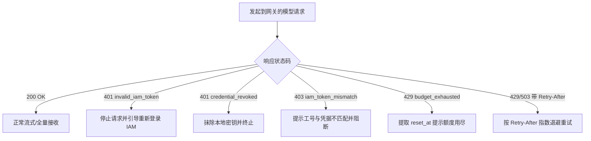

# 模型网关接入详细设计

## 文档信息

| 项 | 内容 |
|---|---|
| 文档编号 | CORP-DSH-DESIGN-005 |
| 文档名称 | 模型网关接入详细设计 |
| 版本 | V1.0.0 |
| 文档状态 | 评审稿 |
| 密级 | — |
| 编制 | DSH 平台组（代拟） |
| 审核 | 待定 |
| 批准 | 待定 |
| 最后更新 | 2026-11-07 |
| 门禁 | G2 |
| 模块状态 | 规划 |
| 适用范围 | 网关目标接入的协议对齐与适配设计；不含模块实现、代码与企业联调结论 |
| 裁决记录 | 2026-11-07 由项目最终裁决人确认采用路线 B 作为目标形态并确认本设计为设计层面定稿；该确认不代替审核与批准，也不代表模块已实现 |

> 编制依据：2026-10-22 对已安装 DSH 包核验；企业级 AI 网关技术规范 V2.1（正式评审稿，文件状态「正在修改」，审核与批准待定）作为建设标准输入，受管个人助手采用**路线 B（长效凭据 + 实时 IAM 身份令牌双因子凭据协同）**，该路线已由[需求基线](../../requirements/requirements-baseline.md)选定，并确立客户端 `baseUrl` 解耦架构、17 个标准服务路由、SSE 保活心跳过滤与统一错误码处理。本设计为设计层面定稿，不表示已实现、已联调或已批准；上游规范仍在修改，接入契约未冻结，模块实现状态见[设计索引 §2.2](../README.md#22-实现与验证入口)。
>
> 关联文档：[AI 网关契约](../../contracts/gateway-contract.md)（CORP-DSH-GW-001 V2.1.0）、[总体架构 ADR-16](../../architecture/platform-architecture.md)、[网关凭据双模式设计](../credential-modes.md)（CORP-DSH-DESIGN-001 V1.0.0）、[客户端标识设计](../client-identification.md)。

## 1. 结论

本接入模块负责河洛客户端与企业级 AI 网关目标契约的端到端协议对齐与适配，属规划中的能力，当前无清单、源码或测试。核心确立两大设计基准：
1. **客户端 `baseUrl` 彻底解耦**：设置面板暴露可配置的网关根路径（由部署配置注入，示例占位符 `https://ai-gateway.corp.example/aig/v1`），业务代码严禁硬编码 `/aig/v1`，全量 API 基于 `${baseUrl}/chat/completions`、`${baseUrl}/models` 等相对路径拼接，确保开发者本地代理（cliproxyapi / mock 等）与生产网关能够无缝切换。MCP 与 Agent 端点使用独立协议族前缀，不由该 `baseUrl` 拼接。
2. **双因子凭据协同注入与错误分流**：请求拦截器自动装配长效个人凭据（`Authorization: Bearer uag-sk-u-...`）与 IAM 身份令牌（`X-IAM-Token: <JWT>`），正确过滤网关 15 秒 SSE 心跳注释行，并实现网关标准化错误码（如 `401 invalid_iam_token` 停止请求并引导重新登录、`403 iam_token_mismatch` 阻断告警）的精细化处置。

## 2. 目标与边界

- **范围与职责**：
  - 客户端设置面板网关 `baseUrl` 配置项及模型白名单展示。
  - 模型请求拦截器中的双凭据与元数据请求头透明组装。
  - W3C SSE 流式传输中保活注释行（`: ping - <timestamp>\n\n`）的跳过与容错解析。
  - 网关 V2.1 标准错误码与 HTTP 状态码的映射及状态机处置。
  - 动态模型目录与能力/合规元数据（`capabilities` / `compliance`）解析。
- **非职责**：网关服务端配置下发、算力资源池调度以及底座模型权重生命周期管理。

## 3. 架构设计与请求拦截

### 3.1 客户端 `baseUrl` 路由体系

客户端支持通过图形化设置面板或环境变量配置网关基地址：

```typescript
export interface GatewayConfig {
  baseUrl: string; // 由部署配置注入；示例占位符 'https://ai-gateway.corp.example/aig/v1'
  apiKeyRef: string; // 引用存储于本地安全存储中的长效凭据标识
  timeoutMs: number; // 请求超时时间，默认 120000ms
}
```

核心端点调用必须基于 `${baseUrl}` 相对组装，全量 17 个端点见[网关契约 §4.4](../../contracts/gateway-contract.md)：
- 对话生成：`${baseUrl}/chat/completions`、`${baseUrl}/responses`、`${baseUrl}/messages`
- 向量与精排：`${baseUrl}/embeddings`、`${baseUrl}/rerank`
- 多模态：`${baseUrl}/audio/transcriptions`、`${baseUrl}/audio/speech`、`${baseUrl}/images/generations`、`${baseUrl}/moderations`
- 批量任务：`${baseUrl}/batches`、`${baseUrl}/batches/{batch_id}`
- 动态模型目录：`${baseUrl}/models`
- 配额查询：`${baseUrl}/quota`
- 凭据自服务申领与轮换：`${baseUrl}/credentials/self-service/issue`、`${baseUrl}/credentials/self-service/rotate`
- MCP 与 Agent 端点：`/aig/mcp/v1/{server_name}/mcp`、`/aig/agents/v1/{agent_id}/card`、`/aig/agents/v1/{agent_id}/tasks`（独立前缀）

### 3.2 双凭据请求拦截器装配

在发起 HTTP 请求时，拦截器自动注入标准头集合：

```http
POST ${baseUrl}/chat/completions HTTP/1.1
Host: ai-gateway.corp.example
Authorization: Bearer uag-sk-u-<user_credential_token>
X-IAM-Token: eyJhbGciOiJSUzI1NiIsInR5cCI6IkpXVCIsImtpZCI6ImlhbXNzbyJ9...
X-Consumer-Type: personal
User-Agent: Heluo-Client/0.4.0 (macOS; arm64)
X-Request-Id: 9b1deb4d-3b7d-4bad-9bdd-2b0d7b3dcb6d
X-Trace-Id: 4bf92f3577b34da6a3ce929d0e0e4736
Content-Type: application/json
```

## 4. 流式传输与心跳保活处理

网关为规避企业反向代理与防火墙 60 秒空闲断开限制，在流式传输期间每隔 15 秒下发注释行：

```text
: ping - 1730937600\n\n
```

客户端 SSE 解析器实现严格规范：
- 读取到每行文本后，若首字符为 `:`（ASCII 0x3A），则判定为 W3C 标准保活心跳帧，直接跳过并丢弃，不触发后续 JSON 解析。
- 仅当行首为 `data: ` 时，截取载荷解析实际增量 Delta。
- 读取到 `data: [DONE]` 时，正常终结当前流式迭代器。

## 5. 错误分类与状态机

适配器层对网关标准响应进行解析分流：



## 6. 验收与联调要求

以下为联调判据，非已达成的实机结论；未取得企业环境联调证据前一律标记待验。

1. **本地代理模式验证**：在配置界面将 `baseUrl` 设置为 `http://127.0.0.1:8080/v1`，使用本地代理成功拦截请求，路径中不出现多余的 `/aig/v1` 前缀重叠。
2. **双凭据协同验证**：联调时使用合法凭据与 IAM 登录态发起对话；故意携带过期身份令牌时，适配层应停止请求并引导重新登录，不自动重试。该判据以网关契约 4.1.2 的能力齐备后阶段为前提。
3. **心跳行压力验证**：在模型首字长思考（TTFT > 30s）期间，前端平稳接收 15s 心跳注释行，控制台不报 JSON 解析异常。
