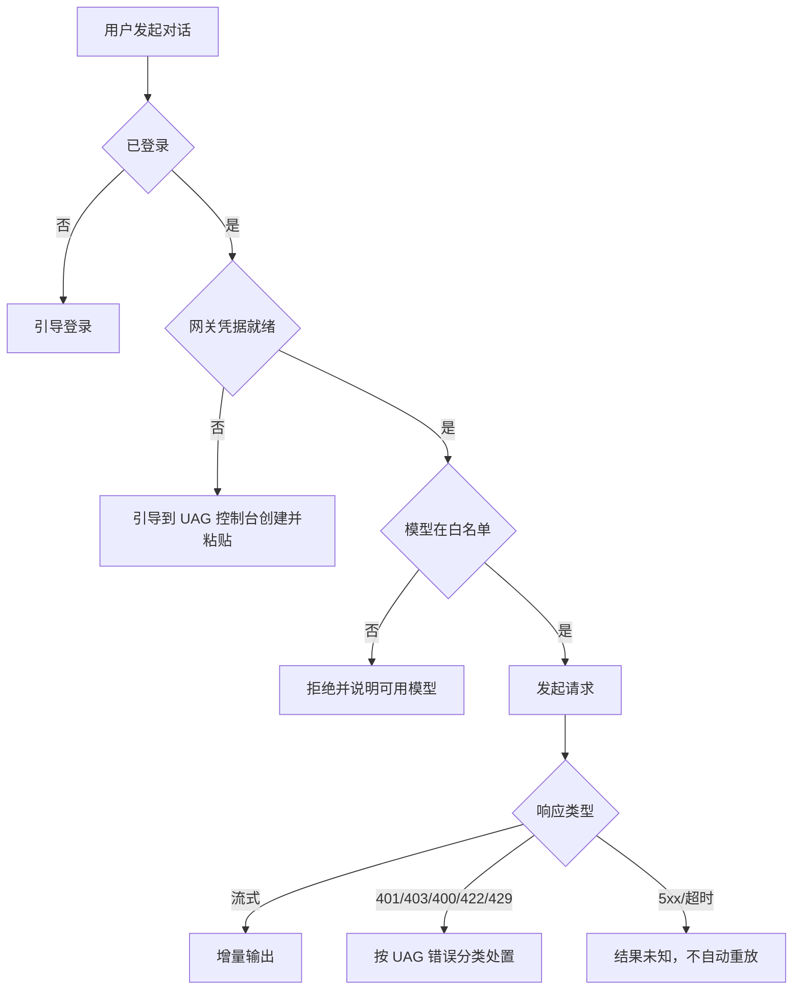

# 模型网关接入详细设计

## 文档信息

| 项 | 内容 |
|---|---|
| 文档编号 | CORP-DSH-DESIGN-005 |
| 文档名称 | 模型网关接入详细设计 |
| 版本 | V0.2.0 |
| 文档状态 | 草案 |
| 密级 | — |
| 编制 | DSH 平台组（代拟） |
| 审核 | 待定 |
| 批准 | 待定 |
| 最后更新 | 2026-10-22 |
| 门禁 | G2 |
| 模块状态 | 规划 |

> 编制依据：2026-10-22 对已安装 DSH 包做字符串级核验：`dsh-llm`、`dsh-llm-pi-ai`、`dsh-llm-retry`、`dsh-llm-deepseek`、`dsh-settings`、`dsh-client-ui-settings-models`；凭据以引用方式解析。UAG 行为依据网关团队同日分析稿（基线 `dev/2.2.1`，非承诺），未联调。**未核验**：`dsh-llm-retry` 的可配置项与重试边界、流式取消的传播方式、`llm-pi-ai` 对 `apikey` 头的支持方式。
>
> 关联文档：[AI 网关契约](../../contracts/gateway-contract.md) §4—§5、[总体架构 §7.2](../../architecture/platform-architecture.md)、[个人凭证接入设计](../../architecture/gateway-static-key-option.md)、[网关凭据双模式设计](../credential-modes.md)。

## 1. 结论

本包把上游模型插件接成“只走企业网关”的形态：地址固定、模型白名单、UAG 个人凭据引用、错误分类与重试边界，都写在配置里而不是散在代码里。

V1 的客户端凭据是 UAG 个人凭证（静态 Key），不是 IAM access token。本包不签发、不刷新、不自动重建 Key；它只从 `ENTERPRISE_STATIC_KEY` 解析值、在启动/录入时探测一次，并按 UAG 错误码分流。额度、归属、模型授权与正文日志由网关承担。

还缺三件事才能进实现：重试插件边界实测、流式取消行为确认、UAG 错误码/头与真实凭据联调。

## 2. 目标与非目标

**目标**

- 所有模型请求只发往企业网关，不出现公网直连。
- 模型名走白名单，未列出即拒绝并给出可读原因；服务端凭证级授权仍为最终依据。
- 错误按 UAG 语义分流：401/403/400/422/429/5xx 不混用。
- 流式输出可取消，取消后不结算到下一次请求、不重放。
- 凭据未配置或无效时 fail closed，并给出可操作的配置入口。

**非目标**

- 不实现 Key 签发、刷新或自动轮换（见双模式设计）。
- 不做用量统计与计费（网关侧负责）。
- 不提供公网模型或自带 Key 的旁路。
- 不把 `X-Device-Id` 作为计量依据；UAG 不采集该头。

## 3. 需求与依赖

| 需求/验收 | 关系 | 说明 |
|---|---|---|
| REQ 模型走网关 | 支撑 | 无公网直连；客户端持有 UAG 个人凭据，不持有上游模型密钥 |
| REQ 数据边界 C1–C2 | 支撑 | 正文不落日志；C4 由凭证 `privacy_mode` 与抽验落实 |
| 验收 A1/A3 首次调用 | 支撑 | 登录并配置网关凭据后完成首次对话 |

| 依赖 | 类型 | 版本约束 | 缺失时的行为 |
|---|---|---|---|
| `dsh-llm-pi-ai` | 上游包 | 随目标 DSH | 不挂载模型能力 |
| `dsh-llm-retry` | 上游包 | 随目标 DSH | 关闭重试，仅单次调用 |
| 网关契约 §4 | 文档 | 与网关同版本 | 错误映射按本文兜底 |
| `ENTERPRISE_STATIC_KEY` | 凭据引用 | 系统凭据库 | 未就绪则不发起调用，提示配置 |
| `@heluo/forge-iam` | 包 | 同批次 | 无网关凭据录入/账户入口；用户无法在客户端完成配置 |

## 4. 扩展形态与边界

| 项 | 内容 |
|---|---|
| 形态 | 配置 bundle：模型命名空间配置 + 重试策略 + 凭据引用 |
| 运行位置 | 本机 Host |
| 目标 DSH 与 SDK | 随目标版本 |
| 使用的 seam 或服务 | 模型提供者命名空间、设置服务、凭据引用 |
| 不修改的核心 | 模型调用实现、重试实现、凭据解析 |
| 凭据录入 | 由 `@heluo/forge-iam` 的账户/首启界面承载；本包只消费引用 |

## 5. 接口与配置

| 配置项 | 类型 | 默认值 | 必填 | 说明 |
|---|---|---|---|---|
| `gateway.baseUrl` | string | 空 | 是 | 仅内网网关地址，禁止公网 |
| `gateway.models` | string[] | 空 | 是 | 客户端白名单；必须是 UAG 凭证允许模型的子集 |
| `gateway.defaultModel` | string | 空 | 否 | 必须在白名单内 |
| `gateway.stream` | boolean | `true` | 否 | 是否流式 |
| `gateway.timeoutMs` | number | `120000` | 否 | 单次请求上限 |
| `gateway.retry.network` | number | `0` | 否 | 仅连接未建立时可重试；默认 0，避免结果未知时重复生成/计费；401/403/400/422/429 不重试 |
| `gateway.retry.on5xx` | boolean | `false` | 否 | 默认不重试，避免重复计费 |
| `gateway.credentialRef` | string | `ENTERPRISE_STATIC_KEY` | 否 | 只读；V1 固定该引用 |
| `gateway.consoleUrl` | string | 空 | 否 | UAG 个人凭证控制台入口，用于提示与跳转 |
| `gateway.probeModel` | string | 空 | 否 | 探测用模型；空则用 `defaultModel`，必须已授权 |
| `gateway.probeMaxTokens` | number | `1` | 否 | 探测请求上限，避免产生明显用量 |

```yaml title="模型命名空间（示意）"
llm-pi-ai:
  baseUrl: https://gw.corp.example/v1
  models: [corp-chat, corp-reason]
  defaultModel: corp-chat
  stream: true
  timeoutMs: 120000
  retry:
    network: 0
    on5xx: false
gateway:
  credentialRef: ENTERPRISE_STATIC_KEY
  consoleUrl: https://uag.corp.example/personal-credentials
  probeModel: corp-chat
  probeMaxTokens: 1
```

## 6. 权限、凭据与数据

| 项 | 处理方式 | 生命周期 | 失败时 |
|---|---|---|---|
| 模型凭据 | 读取 `CredentialRef: ENTERPRISE_STATIC_KEY`，不接触明文落盘 | 用户录入至更换/清除；建议 90 天 | 未配置/无效即不调用，提示配置或到控制台重建 |
| 请求正文 | 仅在内存与传输中，不落日志 | 单次请求 | 失败即丢弃 |
| 模型名与耗时 | 记元数据，不记正文 | 90 天 | 不影响调用 |
| 设备标识 | 不采集、不上报；以 UAG 凭证名称作设备标签 | — | 不阻断 |

Key 明文只进入 `Authorization` / `apikey` 请求头，不进入模型上下文、异常信息或本地日志。探测结果只记录状态码与类别，不记录 Key。

## 7. 流程



**并发**：允许多路会话并发；同一会话内串行输出，避免交错。

**超时**：`timeoutMs` 到点即中断，按“结果未知”处理，不自动重放。

**取消**：用户取消后停止读取流并释放连接；不重试；已产生用量由网关按流结束/中断口径结算，具体待联调。

## 8. 失败模式

| 场景 | 行为 | 用户可见结果 | 是否可重试 |
|---|---|---|---|
| 401 | 不刷新 IAM、不重放；交由凭据层提示 | 检查 Key 完整性，到控制台查看状态或重建 | 否 |
| 403 挂起 | 不重试 | 联系团队管理员；恢复后原 Key 可用 | 否 |
| 403 策略/待审批 | 不重试 | 展示原因；待审批去控制台 | 否 |
| 400 模型未授权/不可路由 | 不换模型 | 申请权限或检查模型名 | 否 |
| 422 无路由策略 | 不重试 | 联系管理员 | 否 |
| 429 预算 | 不重试 | 展示 `reset_at` | 否 |
| 429 RPM/TPM | 按 `Retry-After` 退避 | 展示限流与恢复时间 | 按头 |
| 5xx 或超时 | 默认不重试 | 提示结果未知，可手动重发 | 否 |
| 模型不在白名单 | 直接拒绝 | 列出可用模型 | 否 |
| 网关地址为公网 | 拒绝启动模型能力 | 明确报错 | 修配置后重试 |

## 9. 可观测性

| 事件 | 字段 | 去向 | 保留 |
|---|---|---|---|
| 调用完成 | 模型、耗时、状态、流式与否 | 本机日志 | 90 天 |
| 被拒绝 | 原因类别、模型名、状态码 | 本机日志 | 90 天 |
| 取消 | 已输出字节数、耗时 | 本机日志 | 30 天 |
| 凭据探测 | 结果、耗时、状态码类别 | 本机日志 | 90 天 |

正文、Key 与设备标识原文都不进入上述事件。

## 10. 测试矩阵

| 层级 | 覆盖 | 命令 |
|---|---|---|
| 单元 | 白名单判定、401/403/400/422/429 映射、重试计数 | `node --test` |
| 契约 | Bearer 与 apikey 请求头、错误体与头解析 | 契约用例 |
| 集成 | 真实/仿 UAG 的 401/403/400/422/429/5xx 路径；挂起恢复；撤销 | 本地仿网关 + 企业联调 |
| 端到端 | 双端各完成一次真实 Key 录入、流式对话与取消 | 手工 + 脚本 |

## 11. 打包、升级与回退

包名 `@heluo/forge-gateway`，`private: true`，仅含配置与少量校验脚本，声明 `engines.dsh`。

升级：白名单只增不删；删除模型视为能力收缩，需在说明中写明。

回退：禁用本包即回到无模型能力状态，用户界面提示明确原因，不静默失败。回退不得恢复公网路由或共用凭据。

## 12. 未决事项

| 问题 | 需要谁回答 | 影响 |
|---|---|---|
| `dsh-llm-retry` 的可配置项与边界 | 平台组（实测） | 第 5 节重试字段 |
| 流式取消的传播方式与计量口径 | 平台组（实测）/网关 | 第 7 节取消语义 |
| `llm-pi-ai` 能否发送 `apikey` 头，还是只能 Bearer | 平台组（实测） | 第 5/6 节请求头 |
| UAG 错误体/头在生产版本是否一致 | 网关团队 | 第 8 节映射 |
| 白名单初始集合与 `probeModel` 授权 | 平台组、网关 | 默认配置 |
| 探测是否产生不可忽略的用量 | 网关团队 | 探测频率与上限 |
| 控制台深链/回跳 | 网关团队 | 凭据配置体验 |

### 需用户确认的设计选项（增益不明确，暂不采用，保留待定）

| 选项 | 可能的增益 | 代价 | 当前处理 |
|---|---|---|---|
| 5xx 自动重试一次 | 掩盖偶发故障 | 可能重复计费与重复生成 | 不采用，默认关闭 |
| 客户端本地用量预估 | 提前提示额度 | 与网关口径可能不一致 | 不采用 |
| 多网关地址与故障切换 | 提高可用性 | 引入路由与一致性问题 | 不采用 |
| 模型自动降级到备选 | 提高成功率 | 输出质量不可预期 | 不采用 |
| 显示逐字耗时曲线 | 便于调优 | 界面噪声大 | 不采用 |

以上五项均不影响主链路；若后续确认增益，再单独评估。