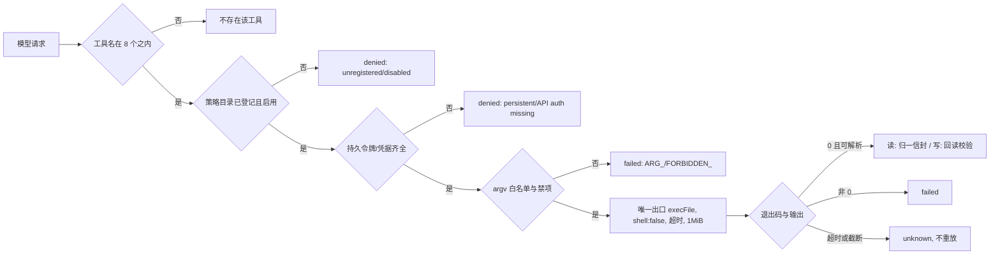

# Gitee 接入详细设计

## 文档信息

| 项 | 内容 |
|---|---|
| 文档编号 | CORP-DSH-DESIGN-010 |
| 文档名称 | Gitee 接入详细设计 |
| 版本 | V0.2.0 |
| 文档状态 | 草案 |
| 密级 | — |
| 编制 | DSH 平台组（代拟） |
| 审核 | 待定 |
| 批准 | 待定 |
| 最后更新 | 2026-10-29 |
| 门禁 | G1 |
| 模块状态 | 可用（离线用例全绿；企业 CLI 未联调，见 §12） |

> 编制依据：2026-10-20 依据两点事实——Gitee 侧已有完全兼容 `gh` 的 CLI；架构 P7 要求复用既有资产。据此以 CLI 为接入形态，并去掉原方案中 `mcp-gitee` 缺少 `linux-arm64` 资产导致的交叉编译风险。2026-10-29 按实现反写：`packages/forge-gitee` 的 11 个源模块、8 个工具与离线用例已落地，本版把命令面、配置、失败模式与共存形态改成**可执行的事实**。**仍未核验**：该 CLI 在银河麒麟 aarch64 上的产物、凭据注入方式、`--json` 输出稳定性、真实企业实例联调。
>
> 关联文档：[总体架构 §7.3](../../architecture/platform-architecture.md)、[实施计划](../../plans/rollout-plan.md) P1-4、[策略与审计](forge-policy.md)、[DevOps 接入详细设计](forge-devops.md)（同形不同语义的另一侧）。

## 1. 结论

用已有的 `gh` 兼容 CLI 查询 Gitee 的仓库、Issue 与合并请求，并在策略门禁之后提供默认禁用的受控写与交付判定；不自建 MCP，也不交叉编译。落地形态是**独立单安装单元** `@heluo/forge-gitee`：自带 `cordis.patch.yml` + 构建期闭包，装一个包即可挂载。

与 GitHub 面（`@heluo/forge-devops`）**按 provider 分流**，不是"同一个适配器换个字段名"：动作命名空间 `gitee.*`、字段表 `GITEE_*`（snake_case）、GitHub 语义字段进黑名单；两边不共享源码，只共享不变量与契约测试（§13）。

四条决定性判断：

1. **provider 靠常量声明，不靠调用点推断**。`GITEE_PROVIDER='gitee'` 落在每个信封与返回体上；`gitee-guard` 在入口断言动作前缀，非 `gitee.*` 动作直接拒绝且**零子进程**。
2. **共存 = 服务域隔离，不是叠加同一实例**。`forge-policy` 是单实例服务：两行同名策略装进同一服务域时，后者的 `apply` 抛 `POLICY_SERVICE_CONFLICT`；若两行还同 `id`，loader 会先按 id 覆盖 `config`，先装的那层插件直接掉线且只有一行 warning（r4 QA 的 D-2）。因此本包补丁层把策略行 id 改为 `heluo-policy-gitee`，两行都声明 `isolate: { policy: gitee }`，让 Gitee 的策略实例落在自己的服务域；GitHub 面留在 root 域，两者互不覆盖、各自看得见自己的目录。叠加（各装各的）是默认可行形态，并层（唯一策略行）仍然支持但需同时删掉插件行的 `isolate`。四种形态（单装 / 叠加 / 去掉 isolate 的反证 / 并层）都落成离线用例（§11），跨包 id 与 label 对齐由 `tests/plugin-patch-layers.test.mjs` 静态守住。
3. **受控重复 + 静态门禁替代抽公共包**。唯一子进程出口、幂等键公式、审查渲染各自实现，用禁项扫描、枚举一致性、出口唯一性测试防漂移（§13）。
4. **配置只 4 个扁平键**。本轮无前端、无 HTTP 面、无配置页；CLI 名已由企业确认，r3 的"发现编排"收益在本包不成立。

边界：查询为已实现基线；五个受控动作默认不登记、不执行（`denied`），开闸属单独范围批准。不代理用户权限，授权由 Gitee 服务端校验；包内没有合并、关闭、发版、触发流水线的入口。

## 2. 目标与非目标

**目标**

- 只读查询仓库、Issue、PR，命令面固定到 argv 动词，参数与 `--json` 子集白名单。
- 复用 `gh` 的命令与参数习惯，降低学习与维护成本。
- 凭据只经环境变量注入，不落在 CLI 自己的配置文件里；输出按令牌值脱敏。
- 与 DevOps 接入共用同一套策略门禁与审计字段，但**语义分表**，不互相回退。
- 结果为可判定状态：`succeeded`/`failed`/`partial`/`unknown`（读）与 `done`/`failed`/`denied`/`unknown`（写）。
- 装得上、退得掉：单安装单元 + 精确回滚步骤写在装之前。

**非目标**

- 不自动合并、不关闭 Issue/PR、不发版、不触发流水线；不执行 `git` 动作。
- 不实现 Gitee API 客户端，不提供泛化 `run`/`exec`/`shell`/`api` 入口。
- 不提供跨仓库批量抓取与镜像；不做前端或配置页。
- 不把 §13 的受控写草案当作已启用能力。

## 3. 需求与依赖

| 需求/验收 | 关系 | 说明 |
|---|---|---|
| REQ 代码托管只读查询 | 直接实现 | 仓库、Issue、PR（3 个只读工具） |
| 验收 A8 Gitee 只读闭环 | 支撑 | 查询链路可判定 + 失败可归因 |
| 计划 P1-4 | **改写** | 由"arm64 交叉编译 MCP"改为"CLI 适配与命令面" |
| 全流程工程闭环 | 部分实现 | 受控写/审查/交付判定已实现、默认禁用；关闭动作只判定不执行 |

| 依赖 | 类型 | 版本约束 | 缺失时的行为 |
|---|---|---|---|
| `gh` 兼容 CLI | 工具 | 由 Gitee 团队提供 | `SPAWN_FAILED` 明确失败；`preflight()` 不猜路径 |
| `@heluo/forge-policy` | 包 | `workspace:*`（安装单元闭包成真版本） | 装配期抛 `GITEE_POLICY_UNAVAILABLE`，不降级只读 |
| 宿主 `tools` 服务 | 服务 | `engines.dsh: >=0.2.1-rc.2` | 装配期抛 `GITEE_HOST_UNAVAILABLE` |
| 令牌环境变量 | 环境 | 默认 `GH_TOKEN`，可配多名 | `AUTH_MISSING`，零子进程 |

## 4. 扩展形态与边界

| 项 | 内容 |
|---|---|
| 形态 | 工具面接入：8 个具名工具 + 固定命令面 + 策略门禁（无独立服务端、无常驻进程、无前端） |
| 运行位置 | 本机 Host；唯一子进程出口 `src/gitee-cli.mjs` |
| 分层 | 出口（`gitee-cli`）→ 适配器（`gitee-adapter`）→ 语义（`gitee-read`/`gitee-actions`/`gitee-review`/`gitee-delivery`）→ 门禁（`gitee-guard`）→ 注册（`gitee-tools`）→ 装配（`index`），另有 `runtime-config`/`gitee-session` |
| 使用的 seam 或服务 | `tools`（注册）、`policy`（目录 + 审计 + `executeAction`）；不写 `tools` 映射到策略（重复准入与重复审计） |
| 不修改的核心 | 无；不导入 `forge-devops` 任何源码 |
| 装配顺序 | 配置校验 → 宿主能力 → 策略 → 读目录自检 → 配置解析（读环境变量）→ runner → adapter → guard → session → service → 工具定义 → `provide`（`gitee`/`giteeAdapter`）→ 注册 8 个工具 → `effect` 清理 |

## 5. 接口与配置

### 5.1 配置（4 个扁平键）

| 配置项 | 类型 | 默认值 | 必填 | 说明 |
|---|---|---|---|---|
| `cliPath` | string | `gh` | 否 | 可执行文件名/路径；拒绝 `scheme://`、控制字符与 `.cmd`/`.bat`/`.ps1`/`.com`/`.vbs` 包装脚本 |
| `host` | string | 空（无默认） | 否 | 企业 Gitee 主机名（可带端口）；拒绝协议前缀、路径与 userinfo；未配置即进 `missing` |
| `timeoutMs` | number | `20000` | 否 | 1000–600000 的整数；超时按"可能已执行"降级 `unknown` |
| `authEnv` | string[] | `['GH_TOKEN']` | 否 | 最多 8 个变量名；按序取第一个有值项 |

`validateGiteeConfig()` 是补丁层、宿主 `ConfigStandard` 与 `resolveGiteeConfig()` 的唯一口径：未知键拒绝、非法值按未配置处理并进 `missing`（不静默放行）。`describeGiteeConfig()` 只输出枚举、数字与变量名，路径只留文件名。

### 5.2 命令面（枚举到 argv 动词）

| 用途 | 命令 | 参数白名单 | `--json` 子集 |
|---|---|---|---|
| 仓库详情 | `repo view` | `--json`、`--host` | `name`、`path`、`description`、`url`、`default_branch`、`private`、`updated_at` |
| 仓库清单 | `repo list` | `--json`、`--limit` | `name`、`path`、`url`、`private`、`updated_at` |
| Issue 详情 | `issue view` | `--json`、`--host` | `number`、`title`、`state`、`url`、`updated_at`、`labels`、`comments` |
| Issue 清单 | `issue list` | `-R`、`--json`、`--state`、`--limit` | `number`、`title`、`url`、`state` |
| PR 详情 | `pr view` | `--json`、`--host` | `number`、`title`、`state`、`url`、`updated_at`、`head`、`base`、`draft`、`mergeable`、`comments` |
| PR 清单 | `pr list` | `-R`、`--json`、`--state`、`--limit` | `number`、`title`、`url`、`head`、`state` |
| Issue 创建/评论 | `issue create` / `issue comment` | `-R`、`--title`、`--body` | —（人类文本，解析编号/链接） |
| PR 创建/评论 | `pr create` / `pr comment` | `-R`、`--title`、`--body`、`--head`、`--base`、`--draft` | — |

禁项（出现即拒绝且零子进程）：动词 `pr merge`/`pr close`/`pr review --approve`/`issue close`/`issue delete`/`repo delete`/`repo create`/`release`/`workflow`/`api`/`auth`/`config`/`gist`；参数 `--web`/`--template`/`-f`/`--raw-field`/`--field`/`--input`/`--body-file`/`--method`/`--approve`/`--request-changes`/`--merge`/`--close`/`--delete`/`--admin`/`--paginate`/`--jq`/`--hostname`。

`--json` 子集与字段表是**同一个对象**（不是抄一份），表改则子集跟着改，不存在两处漂移。

### 5.3 结果信封

| 面 | 形状 | 状态 |
|---|---|---|
| 读 | `{provider, action, status, source_revision, observed_at, target, result_refs, missing_fields, detail}` | `succeeded` / `failed` / `partial` / `unknown`；准入拒绝单列 `denied`（`rule: policy-denied` 等） |
| 写 | `{provider, action, status, target, targetRefs, evidence, rule, reason, message}` | `done` / `failed` / `denied` / `unknown`；`done` 必须"CLI 成功 + 回读一致" |

固定原因枚举（自由文本只进 `message`/`detail`，不新增枚举值）：读侧 `AUTH_MISSING`、`GITEE_PERSISTENT_TOKEN`、`HOST_NOT_ENTERPRISE`、`SPAWN_FAILED`、`NONZERO_EXIT`、`UNSUPPORTED_FIELD`、`ARG_NOT_WHITELISTED`、`ARG_INVALID`、`JSON_FIELD_NOT_DECLARED`、`FORBIDDEN_ARGV`、`TIMEOUT`、`MALFORMED_RESULT`、`OUTPUT_TRUNCATED`、`NO_STRUCTURED_STATUS`、`MISSING_SOURCE_REVISION`、`MIXED_PROVIDER_FIELDS`、`POLICY_DENIED`、`GITEE_STATUS_DISPOSED`；写侧另有 `REPLAY_BLOCKED`、`READBACK_MISMATCH`、`READBACK_UNAVAILABLE`、`HUMAN_CONFIRMATION_FORBIDDEN`、`COMMIT_MESSAGE_INVALID`、`REVIEW_INVALID`。

## 6. 权限、凭据与数据

| 项 | 处理方式 | 生命周期 | 失败时 |
|---|---|---|---|
| 访问令牌 | 只从环境变量注入（`authEnv` 名单，按序取首个有值项）；不写 CLI 配置文件 | 随调用 | 全部为空即 `AUTH_MISSING`，零子进程 |
| 命令与参数 | 审计记录动作、目标与结论；令牌与绝对路径不留 | 90 天（策略侧口径） | 不影响执行（审计舱缺失时策略按 `POLICY_*` 拒绝，见补丁层注释） |
| 查询结果 | 会话内使用；输出按令牌值脱敏后再返回 | 单次 | 失败即降级为信封，丢弃部分结果 |
| CLI 配置目录 | 装配期探测持久令牌；命中即**阻断**（`GITEE_PERSISTENT_TOKEN`，`denied`） | 每次装配 | 阻断并提示清理后改用环境变量 |
| 幂等台账 | 进程内 `Map`（TTL 6 小时），**不落盘** | 进程生命周期 | 跨进程不复用，避免误判"已建单" |

`gh` 习惯把令牌写进自己的配置目录，因此这一项是**阻断**而不是告警：检测到持久令牌时任何动作都不执行。

策略目录：补丁层预置 3 条 `kind: read`（`gitee.repository.read`/`gitee.issue.read`/`gitee.pr.read`）、**0 条 write**。五个受控动作（`gitee.issue.write`、`gitee.pr.write`、`gitee.review.publish`、`gitee.review.record`、`gitee.delivery.judge`）靠"不登记"实现默认禁用：未登记即 `denied`（`unregistered-action`）且适配器 0 次调用。开写须由所属 profile 显式追加动作，写/确认类还需审批台账条目；默认分发层不替任何人预置授权。

审计 provider 槽：`forge-policy` 的审计字段白名单不含 `provider`，gitee 侧以动作前缀 `gitee.*` 与固定 `subject='gitee'` 自证，门禁后断言，不一致即 `GITEE_AUDIT_PROVIDER_MISMATCH`（不改策略包）。

## 7. 流程

- **读**：`read(action, target, params)` → 适配器 `argvFor` → runner → 归一到信封；`provider` 不符、主机不是企业域、缺 `source_revision` 分别降级为 `unknown`/`failed`，**不编版本**。
- **写**：确认（`confirm{repo,object}` 形状）→ 幂等键 `sha256(changeId|objectType|title)` 前 16 位 → 门禁 `executeAction` → 子进程 → 回读条目比对（编号/链接/正文一致才算 `done`）。
- **并发**：允许并发调用，环境变量按调用隔离；幂等台账命中返回 `reused` 且远端 0 次调用。
- **超时/取消**：到点终止，按结果未知处理，不保留部分输出，不自动重试（写动作永不重放）。

## 8. 失败模式

| 场景 | 行为 | 用户可见结果 | 是否可重试 |
|---|---|---|---|
| CLI 未安装/起不来 | `preflight()` 失败，`SPAWN_FAILED` | 明确报错（不含绝对路径） | 安装后重试 |
| 令牌缺失或过期 | 拒绝，零子进程 | `AUTH_MISSING` + `missing` 清单 | 配好环境变量后重试 |
| CLI 配置目录含持久令牌 | 阻断 | `GITEE_PERSISTENT_TOKEN`（`denied`） | 清理后重试 |
| 主机不是企业地址 | 拒绝 | `HOST_NOT_ENTERPRISE` | 修配置后重试 |
| 动作未登记（默认写） | 拒绝，适配器 0 调用 | `denied` + `rule: unregistered-action` | 范围批准后追加目录 |
| 参数越界/禁项 | 拒绝，零子进程 | `ARG_NOT_WHITELISTED`/`FORBIDDEN_ARGV` | 改成白名单内调用 |
| 输出非 JSON 或缺版本 | 降级 | `MALFORMED_RESULT`/`MISSING_SOURCE_REVISION`（`unknown`） | 否（先查 CLI 版本） |
| 输出超 1 MiB | 截断降级 | `OUTPUT_TRUNCATED`（`unknown`） | 收窄 `--json` 或 `--limit` |
| 超时 | 终止子进程 | `unknown` + `TIMEOUT` | 人工确认后重试（写不自动重放） |
| 回读不一致 | `failed`，不重放 | `READBACK_MISMATCH` | 人工核对远端 |
| 结果混入 GitHub 语义字段 | 不采信 | `MIXED_PROVIDER_FIELDS` | 否（修 provider 口径） |

## 9. 可观测性

| 事件 | 字段 | 去向 | 保留 |
|---|---|---|---|
| 查询执行 | 动作、目标、退出码、耗时、`reason` | 策略审计 | 90 天（策略侧口径） |
| 写动作 | 动作、目标、`rule`、确认与幂等结论、回读结果 | 策略审计（`subject='gitee'`） | 90 天 |
| 拒绝 | 原因码、动作 | 策略审计 | 90 天 |
| 配置告警 | 检测到持久令牌的位置（不含值）、`describeGiteeConfig()` 摘要 | 返回值/本机日志 | 30 天 |
| 动作证据 | `buildEvidence()`：`provider`、`command`、`at`、`hostVersion`、`target`、`sourceType`（`gitee-cli`/`policy-only`/`none`） | 写动作返回体 | 随动作 |

## 10. 测试矩阵

| 层级 | 覆盖 | 命令 |
|---|---|---|
| 单元/契约 | 入口与清单、配置、出口、适配器、只读信封、写动作、幂等、审查、交付、共存四形态、宿主 `register()` 判据 | `node --test "packages/forge-gitee/test/*.test.mjs"` |
| 装配 | 解析分发补丁层 → 真实装配策略 + 插件；空目录反向用例 | 同上（`patch-mount.test.mjs`） |
| 安装单元 | `buildBundle` 闭包、清单白名单、入口 sha256 与工作区逐字节一致 | `node --test "tests/bundle-gitee.test.mjs"` |
| 端到端 | 企业实机双端各完成一次仓库与 Issue 查询、一次受控写 | **NOT RUN**（见 §12） |

## 11. 打包、升级与回退

形态为**单安装单元**：清单声明 `dsh.bundle.patch: ./cordis.patch.yml`、`files` 白名单（`src`/补丁层/README）、`engines.dsh: >=0.2.1-rc.2`，并把 `@heluo/forge-policy` 声明为 `workspace:*` 依赖；构建期 `buildBundle` 把它闭包成真版本并进 `bundledDependencies`，产物为 `heluo-forge-gitee-0.1.0.tgz`（26 个条目，无编译产物、无 `lib/`、不带测试文件）。

补丁层两行、顺序即加载顺序：策略行（`id: heluo-policy-gitee`，3 条只读目录 + 内存审计舱 `allowNonDurable`）在前，插件行（`config: {}` 显式空配置，避免宿主把"缺席"当 `undefined` 交给校验器）在后。两行都用**包根名**：写成子路径宿主会静默跳过该包。两行同时声明 `isolate: { policy: gitee }`——策略实例进独立服务域，与 GitHub 面的 root 域互不可见（D-2 的修法；`isolate` 是 loader 的 entry 选项，`Dict<true|string>`，同 label 的 entry 共用一个域）。

共存形态：

| 形态 | 结果 | 建议 |
|---|---|---|
| 只装一个 | 各带自己的目录，互不干扰 | **推荐** |
| 同 profile 叠加两层 | 两个策略实例分处 `gitee` 域与 root 域，17 个工具全枚举、0 行激活失败 | **默认可行**（不改配置） |
| 同 profile 并层 | 3 条 `gitee.*` 并入既有那条 `heluo-policy` 行的 `catalog`，并删掉本包插件行的 `isolate` | 想统一审计出口时用 |
| 去掉 `isolate` 再叠加（反证） | 第二个策略 `apply` 抛 `POLICY_SERVICE_CONFLICT`（可见），本包插件按未登记 fail closed，先挂载方工具仍在 | 不采用 |

升级：命令面只增不删；`--json` 字段稳定性须在升级 CLI 前回归。回退：移除 profile 补丁层条目 → 重载 → `dsh plugin --profile web remove @heluo/forge-gitee`；不写缓存或临时文件，卸载后无残留（步骤与复核命令写在包 README"回滚"一节，装在装之前可读）。

## 12. 未决事项

| 问题 | 需要谁回答 | 影响 |
|---|---|---|
| 麒麟 aarch64 是否有可用产物 | Gitee 团队 | 方案可行性前提 |
| 是否支持环境变量注入、可否禁用自身配置存储 | Gitee 团队 | §6 凭据方式（当前按"阻断持久令牌"实现） |
| `--json` 字段是否稳定、是否与上游一致 | Gitee 团队、平台组 | §5.2 字段表与解析（F1） |
| 只读子命令清单与权限映射 | Gitee 团队 | §5.2 命令面 |
| 五个受控写的范围与 C3 分类 | 平台组、Gitee、PMO | 默认 `denied` 能否开闸 |
| CLI 双端实测与风险关闭证据 | 平台组、Gitee、PMO | G1 前仍须确认命令、凭据和双端运行证据 |

**NOT RUN（本轮未取得证据，不得据本文推断已验证）**

1. 企业实机联调：argv 形状、`--json` 字段、鉴权与权限模型。
2. Windows 实机与银河麒麟 aarch64 上的 CLI 产物与包装脚本行为（离线用例注入平台与假环境，**不是实机证据**）。
3. 真实 profile 的装入/重启/回滚（`dsh plugin add` 需要工作区外写权限，归主流程；本包只提供补丁层解析与装配证据）。
4. 持久审计 sink、审批台账与写动作开闸（范围批准后才验）。
5. 宿主 rc.3（本机 rc.2）。

**需用户确认的设计选项（增益不明确，暂不采用，保留待定）**

| 选项 | 可能的增益 | 代价 | 当前处理 |
|---|---|---|---|
| 保留 MCP 形态作为备份 | 兼容旧工具面 | 交叉编译风险回到方案里 | 不采用 |
| 自建 Gitee API 客户端 | 摆脱 CLI 依赖 | 与 P7 冲突，多一层维护 | 不采用 |
| 缓存仓库元数据 | 减少调用 | 权限变更后数据不新鲜 | 不采用 |
| 跨仓库批量抓取 | 效率 | 触发频控与权限问题 | 不采用 |
| 抽出 `@heluo/forge-actioncore` 消除与 devops 的受控重复 | 单一出口/幂等键/渲染只有一份 | 本轮需改 devops（PRD 非目标禁止），且两份尚在同步演进 | 下一轮若两边同步演进再评估（§13） |
| 配置页 | 免手改补丁层 | 本轮无前端面，4 个键的价值不足以开页面 | 不采用（PRD T5） |

若 CLI 在麒麟不可用或不满足只读查询、凭据注入等已确认前提，关闭 Gitee 命令并提交替代形态评审；不自动回到 MCP 方案，也不恢复交叉编译工作项。

## 13. 工程闭环、审查与 provider 分流

依据[需求 §2.3](../../requirements/requirements-baseline.md)、[全流程设计](forge-devops-lifecycle.md)及[工具契约](../../contracts/engineering-tools.md)，工程闭环面的实现如下，且全部默认禁用：

- **对象与追溯**：Issue/PR 的创建与评论以变更号为幂等键；commit message 以 `[变更号]` 开头（`expectedCommitFormat()`），校验只看首行前缀与说明是否齐。
- **审查**：`review.md` 落 `docs/teamflow/<变更号>/review.md`，四段（问题/风险/意见/结论）+ AI 与人工**两栏物理分节**，写模型名与被审 `commit`；人工栏只能经 `recordHumanConfirmation()` 写入（`origin` 白名单），模型自填即 `REVIEW_HUMAN_FILL_FORBIDDEN`；写盘前命中令牌/内网主机/绝对路径即 `REVIEW_REDACTION_BLOCKED`；`stale` 是"被审 sha 已不是当前 sha"的派生结果，不落盘，避免"确认后被改成通过"的窗口。
- **交付判定**：`judgeCloseReadiness()` 只判定不执行——验收、已合入、无未完成交付、针对当前 commit 的人工确认四项；`unknown` 不计入通过；包里没有 close/merge 入口（白名单天然缺失）。
- **更强模型交叉审查**：AI 意见与人工确认分开留痕并绑定版本；不让模型自填确认人，不把聊天"同意"冒充 Gitee 的正式批准。

**与 `@heluo/forge-devops` 的分流与受控重复（R-2）**：唯一子进程出口、幂等键公式、审查渲染三处在两个包各有一份实现——本轮 PRD 非目标禁止改写 devops，因此不抽公共包，改用静态门禁替代：`test/adapter.test.mjs` 断言 `src/` 零 GitHub 语义标识与字段分表、`test/cli.test.mjs` 断言出口唯一性（`execFile` 只出现在 `gitee-cli.mjs`）、`test/session.test.mjs` 断言幂等键逐字一致（`sha256(changeId|objectType|title)` 前 16 位，否则双 provider 同变更会二次建单）。下一轮若两边同步演进，再评估抽出 `@heluo/forge-actioncore`。
