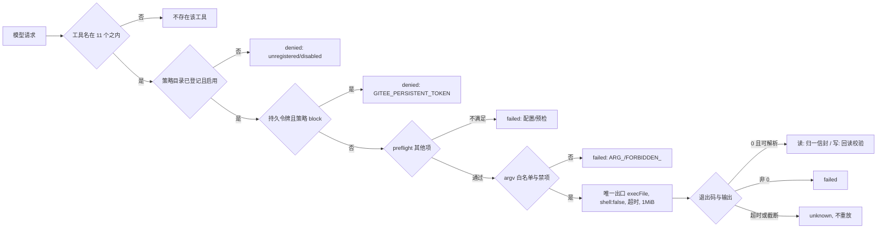

# Gitee 接入详细设计

## 文档信息

| 项 | 内容 |
|---|---|
| 文档编号 | CORP-DSH-DESIGN-010 |
| 文档名称 | Gitee 接入详细设计 |
| 版本 | V0.5.0 |
| 文档状态 | 草案 |
| 密级 | — |
| 编制 | DSH 平台组（代拟） |
| 审核 | 待定 |
| 批准 | 待定 |
| 最后更新 | 2026-11-06 |
| 门禁 | G1 |
| 模块状态 | 可用（离线用例全绿；设置页与配置端点为 r15 新增，企业 CLI 未联调，见 §12） |

> 编制依据：2026-10-20 依据两点事实——Gitee 侧已有完全兼容 `gh` 的 CLI；架构 P7 要求复用既有资产。据此以 CLI 为接入形态，并去掉原方案中 `mcp-gitee` 缺少 `linux-arm64` 资产导致的交叉编译风险。2026-10-29 按实现反写：`packages/forge-gitee` 的 14 个源模块、11 个工具与离线用例已落地，本版把命令面、配置、失败模式与共存形态改成**可执行的事实**。2026-11-03（r10）按「按平台切库」收敛：本包升为 Gitee 侧唯一实现，新增提交信息单源 `src/git-message.mjs` 与本地 git 命令面 `src/gitee-git.mjs`；devops 退回 dop 四工具并删除 gh 侧七个模块——提交信息校验与关闭就绪判定不再各写一份。2026-11-03（r12）增 `src/gitee-snapshot.mjs` 只读版本快照 `forge_gitee_delivery_snapshot`：只经 `runGit` 出口、argv 写死、不接受调用方目录，用 `contentId` 表达「验的是哪一份代码」；截断/超时/未支持形态/采样期间有写入者时一律 `unknown`。**仍未核验**：该 CLI 在银河麒麟 aarch64 上的产物、凭据注入方式、`--json` 输出稳定性、真实企业实例联调。
>
> 2026-11-06（r15）补设置页与配置端点：新增 `src/config-access.mjs`（本条目三层读面与保存栅栏）、`src/http.mjs`（`GET/POST /api/forge-gitee/config`）、`client.js`（设置页「企业 Gitee」分区，id `gitee`、order 50）；`src/index.mjs` 改为 faces 单点换页，保存成功后重建读面并把结果作为 `applied` 返回。**仍未核验**：设置页在真实 profile 装入后的渲染（`heluo-r15-uat` 由主 agent 执行，脚本 `scripts/uat-profile.mjs --plan` 只打印计划）。
>
> 关联文档：[总体架构 §7.3](../../architecture/platform-architecture.md)、[实施计划](../../plans/rollout-plan.md) P1-4、[策略与审计](forge-policy.md)、[DevOps 接入详细设计](forge-devops.md)（同形不同语义的另一侧）。

## 1. 结论

用已有的 `gh` 兼容 CLI 查询 Gitee 的仓库、Issue 与合并请求，并在策略门禁之后提供默认禁用的受控写与交付判定；不自建 MCP，也不交叉编译。落地形态是**独立单安装单元** `@heluo/forge-gitee`：自带 `cordis.patch.yml` + 构建期闭包，装一个包即可挂载。

与 GitHub 面（`@heluo/forge-devops`）**按 provider 分流**，不是"同一个适配器换个字段名"：动作命名空间 `gitee.*`、字段表 `GITEE_*`（snake_case）、GitHub 语义字段进黑名单；两边不共享源码，只共享不变量与契约测试（§13）。

四条决定性判断：

1. **平台靠常量声明，不靠调用点推断**。`GITEE_PLATFORM='gitee'` 落在每个信封与返回体上；`gitee-guard` 在入口断言动作前缀，非 `gitee.*` 动作直接拒绝且**零子进程**。本包只服务 Gitee 一个平台，「结果来自别的 provider」不是可发生的事实，因此没有对应原因码，字段表也只有白名单一份。
2. **共存 = 同一策略行单实例，不是服务域隔离**。r4 曾用 `isolate: { policy: gitee }` 把两个 bundle 隔到不同服务域，代价是同装后有两份策略实例、两套读面事实。r10 改为：两份补丁层写**同一个** `id: heluo-policy` 与**逐字相同**的 6 条并集目录、两处都**不写** `isolate`——loader 按 id 覆盖 `config`（r4 QA 的 D-2 实测），两处内容相同，幸存者就不取决于装配顺序；同装后只有一个策略实例、14 个工具全枚举。单边编辑目录会让幸存配置取决于装配顺序，因此逐字一致由 `tests/plugin-patch-layers.test.mjs` 静态守死，装配后果由 `test/coexistence.test.mjs` 用真实策略服务复现（一实例 / 14 工具 / 卸载归零）。
3. **受控重复 + 静态门禁替代抽公共包**。唯一子进程出口、幂等键公式、审查渲染各自实现，用禁项扫描、枚举一致性、出口唯一性测试防漂移（§13）。
4. **配置只 5 个扁平键**。本轮无前端、无 HTTP 面、无配置页；CLI 名已由企业确认，r3 的"发现编排"收益在本包不成立。r10 再放宽两处：`host` 与 `authEnv` 都不再是必填前提——未配 `authEnv` 时 `preflight()` 返回 `ok: true, tokenSource: 'none'`（公开仓库可匿名读，企业实例的鉴权失败由服务端裁决，不在客户端假装"没令牌也能读"）。

边界：查询为已实现基线；四个受控写与 `git push` 共**五个**受控写默认不登记、不执行（`denied`），开闸属单独范围批准。`git commit` 是**本地动作**、不进策略目录：任何 enabled 的非读动作恒需审批（`packages/forge-policy/src/approvals.mjs:102`），而提交必须发生，两者冲突；首行 `[变更号]` 由 `git-message.mjs` 强校验（不合规即 `COMMIT_MESSAGE_INVALID`）。`gitee.delivery.judge` 是**只读判定**：随包登记、开箱可用，但只判定不执行（`executed: false`、`remote_calls: 0`），不构成写能力开闸。不代理用户权限，授权由 Gitee 服务端校验；包内没有合并、关闭、发版、触发流水线的入口。

## 2. 目标与非目标

**目标**

- 只读查询仓库、Issue、PR，命令面固定到 argv 动词，参数与 `--json` 子集白名单。
- 复用 `gh` 的命令与参数习惯，降低学习与维护成本。
- 本地 git 只做两件事：按 `[变更号]` 规则提交、推送既有提交（另有 `head`/`branch` 两条只读）；不提供任意命令入口。
- 凭据优先由 `gh` 从系统凭据库（服务名 `gitee-cli-go`）读取；`authEnv` 只是无桌面凭据库或 CI 的兜底注入通道。本包不写 CLI 配置文件，输出按令牌值脱敏。
- 与 DevOps 接入共用同一套策略门禁与审计字段，但**语义分表**，不互相回退。
- 结果为可判定状态：`succeeded`/`failed`/`partial`/`unknown`（读）与 `done`/`failed`/`denied`/`unknown`（写）。
- 装得上、退得掉：单安装单元 + 精确回滚步骤写在装之前。

**非目标**

- 不自动合并、不关闭 Issue/PR、不发版、不触发流水线；git 动词白名单只有 `commit`/`head`/`branch`/`push`，没有 `checkout`/`merge`/`rebase`/`tag`。
- 不实现 Gitee API 客户端，不提供泛化 `run`/`exec`/`shell`/`api` 入口。
- 不提供跨仓库批量抓取与镜像；不做前端或配置页。
- 不把 §13 的受控写草案当作已启用能力。

## 3. 需求与依赖

| 需求/验收 | 关系 | 说明 |
|---|---|---|
| REQ 代码托管只读查询 | 直接实现 | 仓库、Issue、PR（3 个只读工具） |
| 验收 A8 Gitee 只读闭环 | 支撑 | 查询链路可判定 + 失败可归因 |
| 计划 P1-4 | **改写** | 由"arm64 交叉编译 MCP"改为"CLI 适配与命令面" |
| 全流程工程闭环 | 部分实现 | 受控写/审查/交付判定已实现；五个受控写（含 `gitee.git.push`）默认禁用，交付判定随包登记为只读、默认可用（只判定不执行）；`git commit` 是本地动作，只受提交信息规则约束 |

| 依赖 | 类型 | 版本约束 | 缺失时的行为 |
|---|---|---|---|
| `gh` 兼容 CLI | 工具 | 由 Gitee 团队提供 | `SPAWN_FAILED` 明确失败；`preflight()` 不猜路径 |
| `@heluo/forge-policy` | 包 | `workspace:*`（安装单元闭包成真版本） | 装配期抛 `GITEE_POLICY_UNAVAILABLE`，不降级只读 |
| 宿主 `tools` 服务 | 服务 | `engines.dsh: >=0.2.1-rc.2` | 装配期抛 `GITEE_HOST_UNAVAILABLE` |
| 令牌环境变量 | 环境 | `authEnv` 默认空（不注入任何变量），需要时点名多个 | 缺令牌不拒绝：`ok:true`、`tokenSource:'none'`；`AUTH_MISSING` 由子进程 401/403 归一，有子进程且可能已产生副作用 |

## 4. 扩展形态与边界

| 项 | 内容 |
|---|---|
| 形态 | 工具面接入：11 个具名工具 + 固定命令面 + 策略门禁（无独立服务端、无常驻进程、无前端） |
| 运行位置 | 本机 Host；唯一子进程出口 `src/gitee-cli.mjs`（gitee CLI 与 git **共用**：`run()` / `runGit()`，`shell: false`、固定 argv、超时、1 MiB 截断、凭据脱敏都在这一处） |
| 分层 | 出口（`gitee-cli`）→ 适配器（`gitee-adapter`/`gitee-git`）→ 语义（`gitee-read`/`gitee-actions`/`gitee-review`/`gitee-delivery`/`git-message`）→ 门禁（`gitee-guard`）→ 注册（`gitee-tools`）→ 装配（`index`），另有 `runtime-config`/`gitee-session` |
| 使用的 seam 或服务 | `tools`（注册）、`policy`（目录 + 审计 + `executeAction`）；不写 `tools` 映射到策略（重复准入与重复审计） |
| 不修改的核心 | 无；不导入 `forge-devops` 任何源码 |
| 装配顺序 | 配置校验 → 宿主能力 → 策略 → 读目录自检 → 配置解析（读环境变量）→ runner → gitee adapter / git adapter → guard → session → service → 工具定义 → `provide`（`gitee`/`giteeAdapter`/`giteeGit`）→ 注册 11 个工具 → `effect` 清理 |

## 5. 接口与配置

### 5.1 配置（5 个扁平键）

| 配置项 | 类型 | 默认值 | 必填 | 说明 |
|---|---|---|---|---|
| `cliPath` | string | `gh` | 否 | 可执行文件名/路径；拒绝 `scheme://`、控制字符与 `.cmd`/`.bat`/`.ps1`/`.com`/`.vbs` 包装脚本 |
| `host` | string | 空（无默认） | 否 | 企业 Gitee 主机名（可带端口）；拒绝协议前缀、路径与 userinfo。r10 起**不再必填**；2026-11-04 起**仅用于诊断与企业域校验**——本 CLI 没有 `--host` 参数，主机实际取自它自己的 `~/.gitee-cli/config.json` 的 `base_url`，本包不拼进 argv 也不注入环境 |
| `timeoutMs` | number | `20000` | 否 | 1000–600000 的整数；超时按"可能已执行"降级 `unknown` |
| `authEnv` | string[] | `[]` | 否 | 最多 8 个变量名；按序取第一个有值项。为空只表示本插件不注入变量：`GITEE_TOKEN` 仍在子进程环境白名单内，`gh` 还会查系统凭据库；`tokenSource: 'none'` 是客户端观测值，不等于未认证（**不阻断**） |
| `persistentToken` | `'warn' \| 'block'` | `'warn'` | 否 | CLI 配置目录含持久令牌时的策略：`warn` 只提示并从执行环境剥离，`block` 才拒绝执行（合规场景保留） |

`validateGiteeConfig()` 是补丁层、宿主 `ConfigStandard` 与 `resolveGiteeConfig()` 的唯一口径：未知键拒绝、非法值按未配置处理并进 `missing`（不静默放行）。`missing` 只收"提供了但非法"的键——r10 之后**空配置是合法状态**：`preflight()` 返回 `{ok: true, provider: 'gitee', tokenSource: 'none', mayHaveSideEffect: false}`，读若因未鉴权被服务端拒绝，如实降级为 `AUTH_MISSING`/`failed`，而不是在客户端假装"没令牌也能读"。`describeGiteeConfig()` 只输出枚举、数字与变量名，路径只留文件名。

### 5.2 命令面（枚举到 argv 动词）

| 用途 | 命令 | 参数白名单 | 本地投影清单（归一后交付的键） |
|---|---|---|---|
| 仓库详情 | `repo view <仓库>` | `--json`（无值） | `name`、`path`、`path_with_namespace`、`description`、`default_branch`、`visibility`、`web_url`、`last_activity_at`、`archived`、`ssh_url_to_repo`、`http_url_to_repo` |
| 仓库清单 | `repo list` | `--json`（无值）、`--limit` | `created_at`、`description`、`fork_from_path`、`http_url`、`id`、`last_activity_at`、`name`、`path_with_namespace`、`ssh_url` |
| Issue 详情 | `issue view <编号> -R` | `--json`（无值）、`-R` | `author`、`created_at`、`description`、`id`、`labels`、`priority`、`state`、`title` |
| Issue 清单 | `issue list` | `-R`、`--json`（无值）、`--state`、`--limit` | `description`、`id`、`labels`、`title`、`updated_at` |
| PR 详情 | `pr view <编号> -R` | `--json`（无值）、`-R` | `iid`、`title`、`state`、`web_url`、`updated_at`、`source_branch`、`target_branch`、`merge_status`、`merged_at`、`user_notes_count` |
| PR 清单 | `pr list` | `-R`、`--json`（无值）、`--state`、`--limit` | `iid`、`title`、`state`、`web_url`、`source_branch`、`target_branch`、`merge_status` |
| Issue 创建/评论 | `issue create` / `issue comment` | `-R`、`--title`、`--body` | —（人类文本，解析编号/链接） |
| PR 创建/评论 | `pr create` / `pr comment` | `-R`、`--title`、`--body`、`--head`、`--base`、`--draft` | — |

禁项（出现即拒绝且零子进程）：动词 `pr merge`/`pr close`/`pr review --approve`/`issue close`/`issue delete`/`repo delete`/`repo create`/`release`/`workflow`/`api`/`auth`/`config`/`gist`；参数 `--web`/`--template`/`-f`/`--raw-field`/`--field`/`--input`/`--body-file`/`--method`/`--approve`/`--request-changes`/`--merge`/`--close`/`--delete`/`--admin`/`--paginate`/`--jq`/`--hostname`。

第四列是**本地投影清单**，第三列的 `--json` 是**无值开关**：2026-11-03 实测 `repo view --json name,path` 与裸 `repo view --json` 输出逐字相同，逗号字段清单被忽略，因此 argv 里永远只有 `--json` 一个 token。清单与字段表是同一个对象（`GITEE_FIELD_PROJECTIONS`，不是抄一份），名字越界仍按 `JSON_FIELD_NOT_DECLARED` 拒绝且零子进程。

**命名空间与参数落位**（2026-11-04 按 `docs/contracts/gh-cli-spec.md` 校正）：仓库标识允许嵌套命名空间（`osc/ard/ard-sdk` 这类两段以上，企业实测即三段），读/写/git 三条路径共用同一个形状源。单对象命令的位置参数**只有编号**，仓库走全局 `-R`（`issue view 12 -R osc/ard/ard-sdk`）；`repo list` **不接受位置参数**（它列的是令牌可见的仓库，不是某个仓库的清单）。`--state` 词表**按命令分表**：`issue list` 是 `created/processing/rejected/finished/all`，`pr list` 是 `opened/closed/merged/all`。本 CLI **没有 `--host` 参数**，主机来自 CLI 自己的 `~/.gitee-cli/config.json` 的 `base_url`。

**剥壳**：实测出现三种包裹——`issue list` 是 `{data:{list:[…]}, meta:{…}}`、`pr list` 是 `{data:[…], meta:{…}}`、`repo view` 是扁平对象；对象读同样接受 `{data:{…}}`。`meta.total_count` 作为附加事实带进读载荷（清单被 `--limit` 截住时说明总量；CLI 未返回时为 `null`），其余 `meta` 键丢弃，且**不**进 `missing_fields`——那不是"取不到的字段"。认不出的壳按 `MALFORMED_RESULT` 处理，不把 `data`/`meta` 当数据交付。

**编号与状态语义**：PR 用 `iid`（`id` 是全局号，`iid` 才对得上 URL 里的编号），Issue 用 `id`（实测载荷**没有** `number`）；分支是 `source_branch`/`target_branch`，可合并性是 `merge_status`，评论数是 `user_notes_count`。状态值实测是 `opened`，归一到既有词表 `open`/`closed`；未实测的状态值（如 `merged`）原样保留，不新增词、不猜同义词。

**事实版本**：Issue/PR 取 `updated_at`；仓库实测**没有** `updated_at`，取 `last_activity_at`（CLI 给出的唯一时间事实，见 §12）。取不到才降级 `MISSING_SOURCE_REVISION`。`issue view`/`pr view`/`repo list` 的输出形状**未实测**：投影里取不到的键一律进 `missing_fields`，不按别的平台的习惯补齐，也不回落成 `number` 之类的猜法。

#### 5.2.1 本地 git 命令面（r10 新增）

`gitee-git.mjs` 把本地 git 也收进**同一个出口**（`gitee-cli.runGit()`）：`argv` 由固定表 `gitArgvFor(verb, params)` 生成，调用点不拼串；`shell: false`、`GIT_TERMINAL_PROMPT=0`（禁止交互式索要密码）、`cwd` 只从配置来。

| 动词 | 用途 | 允许的参数 | 约束 |
|---|---|---|---|
| `commit` | 提交已暂存改动 | `changeId`、`message` | `message` 必须先过 `assertCommitMessage()`（首行 `[变更号]`、描述非空），不合规即 `COMMIT_MESSAGE_INVALID`，零子进程 |
| `head` | 读当前 commit | — | 只读，供判定与证据取 sha |
| `branch` | 读当前分支 | — | 只读 |
| `push` | 推送既有提交 | `remote`（默认 `origin`）、`branch` | 远端写，动作 `gitee.git.push`：未登记即 `denied`，登记后仍需 `confirm{repo,object}` 与审批台账条目 |

`commit` 是**本地动作**（不进策略目录，理由见 §1 边界），`push` 是**远端写**（进 `CONFIRM_REQUIRED_ACTIONS`）。两者都不接受任意参数：`--force`/`-f`、`--no-verify`、`--amend`、`--tags` 等不在表内，原样拒绝。

### 5.3 结果信封

| 面 | 形状 | 状态 |
|---|---|---|
| 读 | `{provider, action, status, source_revision, observed_at, target, result_refs, missing_fields, detail}` | `succeeded` / `failed` / `partial` / `unknown`；准入拒绝单列 `denied`（`rule: policy-denied` 等） |
| 写 | `{provider, action, status, target, targetRefs, evidence, rule, reason, message}` | `done` / `failed` / `denied` / `unknown`；`done` 必须"CLI 成功 + 回读一致"；五个写的返回体**不含** `executed` 键 |
| 判定 | 与写同形，另带 `executed`（仅在判定体显式声明时输出，当前只有 `gitee.delivery.judge` 声明 `executed: false`） | `done` / `failed` / `denied` / `unknown`；`executed` 恒 `false`、`remote_calls` 恒 `0`；`unknown` 不计入通过 |

读载荷另带 `kind`/`command` 与 `object`（对象读）或 `items`/`count`/`total_count`（清单读，`total_count` 来自 CLI 的 `meta.total_count`；取不到时恒为 `null`，表示未知，不伪造 `0`）与 `truncated`；这些是载荷键，不占上述固定七项，也不冒充 `missing_fields`。清单读的 `source_revision` 恒为 `null`：列表是查询快照，不承诺单对象修订号，对象读才要求 `created_at`/`updated_at`/`last_activity_at`。

固定原因枚举（自由文本只进 `message`/`detail`，不新增枚举值）：读侧 `AUTH_MISSING`、`GITEE_PERSISTENT_TOKEN`、`HOST_NOT_ENTERPRISE`、`SPAWN_FAILED`、`NONZERO_EXIT`、`ITEM_NOT_FOUND`、`UNSUPPORTED_FIELD`、`ARG_NOT_WHITELISTED`、`ARG_INVALID`、`JSON_FIELD_NOT_DECLARED`、`FORBIDDEN_ARGV`、`TIMEOUT`、`MALFORMED_RESULT`、`OUTPUT_TRUNCATED`、`NO_STRUCTURED_STATUS`、`MISSING_SOURCE_REVISION`、`POLICY_DENIED`、`GITEE_STATUS_DISPOSED`；写侧另有 `REPLAY_BLOCKED`、`READBACK_MISMATCH`、`READBACK_UNAVAILABLE`、`ITEM_NOT_FOUND`、`AUTH_TRANSPORT_UNAVAILABLE`、`HUMAN_CONFIRMATION_FORBIDDEN`、`COMMIT_MESSAGE_INVALID`、`REVIEW_INVALID`。没有「结果来自别的 provider」这类原因码：本包只服务 Gitee 一个平台，那不是可发生的事实。git 侧原因码由 `GIT_REASONS` 单列（提交信息不合规、argv 越界、非零退出、超时、认证传输不可用），不混进读侧枚举。`ITEM_NOT_FOUND` 只在服务端明确表达“对象不存在”（404 或 500 + 未找到文本）时出现；同样的 500 但无该文本仍归 `NONZERO_EXIT`，两者不能互借。

### 5.4 设置页与配置端点（r15）

配置面在浏览器里由本包自己的 `client.js` 承载，服务端由 `src/config-access.mjs` + `src/http.mjs` 承载；两者不经过任何第三方 UI 包。

**非法配置 fail-closed（r16 / PR #215 review）**：生效层只要有一项不合法（`GITEE_CONFIG_INVALID`），装配期直接抛同一个码而不是拿内置默认值投影重建运行时——否则继承层的 `persistentToken: 'block'` 会被悄悄洗成默认 `warn`，配置错的后果变成安全策略放宽。刷新侧表现为 `GITEE_REBUILD_FAILED` + `degradeFaces()`，读面关闭而不是降级到默认值。

**读面（`createGiteeAccess`）**：`GITEE_ENTRY_ID='heluo-gitee'`，五个键 `GITEE_CONFIG_KEYS`（`cliPath`/`host`/`timeoutMs`/`authEnv`/`persistentToken`），页面可编辑 `GITEE_PAGE_FIELDS=['cliPath','timeoutMs']`。快照形状 `{revision, readAt, entryId, plugin:{name,version}, writable:{ok,reason,documentPath}, ready, reason, guidance:'设置 → 企业 Gitee', editable, missing, entries, host:{platform,arch,node}}`；`entries[field]` 给三层：`inherited`（公共参数层）、`override`（本机覆盖层）、`value`（最终生效），`origin ∈ {config,default,unset}` 表示**最终值**的来源（与 devops `resolveField` 同口径）。`revision` 是规范化后的内容哈希前 16 位，用来做保存栅栏；栅栏校验在 `editor.edit` 的串行临界区内按**锁内当前层**比对，并只叠加本次提交的键（`applyFields`），两个并发保存不会互相恢复对方的旧值。

**写面（`save({revision,fields})`）**：八步固定顺序——可写面 → revision 栅栏（不符即 `CONFLICT`，`configEditor.edit` 0 次）→ 形状校验 → `validateGiteeConfig`（非法值 `INVALID` 且**写盘 0 次**）→ 等值跳过（`edit` 0 次）→ `editor.edit` 只把"要写成什么"交给 editor（兄弟条目注释与键序不动）→ 写后回读 → 新快照。`fields` 里的 `null` 表示删除该键的本机覆盖（恢复继承），未知键一律 `INVALID`。

**端点**：`GITEE_API_PREFIX='/api/forge-gitee'`、`GITEE_CONFIG_ROUTE='/api/forge-gitee/config'`、预检头 `x-forge-gitee-request: 1`、体积上限 `GITEE_MAX_BODY=64*1024`（超限 **413**）。GET 回快照并带 `x-forge-gitee-at`；`?refresh=1` 先重建读面再回快照；POST 只认 `{revision, fields}`，成功体 `{ok:true, snapshot, applied}`，其中 `applied` 由 service 给出：重建成功 `{ok:true}`，重建失败 `{ok:false, reason:'GITEE_REBUILD_FAILED'}`——"已保存"与"已应用"是两个结论，不互相顶替。错误映射 `CONFLICT→409`、`INVALID→422`、`UNAVAILABLE→503`；响应头一律 `cache-control: no-store` + `x-content-type-options: nosniff`，不开 CORS。

**读面重建**：`src/index.mjs` 用 `buildFaces()` 一次算出 `{resolved,runner,adapter,guard,git}` 并冻结，service 的每个方法都从 `faces.*` 取依赖（不在 `apply` 顶部解构）；`rebuildFaces()` 是唯一换页点，失败即 `degradeFaces()` 并把原因码报给页面。装配期的初始读面取自**配置面快照**（`mergedRuntimeOf(access.snapshot())`）而不是 loader 给的 `config`——否则页面上配的 `cliPath` 在运行期仍会走默认 `gh`。

**分区**：`client.js` 导出 `{apply, inject, GiteeSection, StatusLine, Tag, LayerCell}`，`inject=['slots','locale']`；两段式挂载 `ctx.slots.inject('settings.section', () => ctx.slots.register({name:'settings.section', id:'gitee', order:50, label:()=>t('nav'), locale:'gitee', inject:()=>({t})}, GiteeSection))`。`ensureStyle()` 必须返回 disposer（无 `document` 时返回 `null`）：返回元素会让整条 entry 抛 `Invalid effect`。三层表只有 `cliPath`/`timeoutMs` 可编辑，`host`/`authEnv`/`persistentToken` 是只读行（`readOnly` 而非 `disabled`，值不出现在页面文本里）；「检查」只给一个披露块，写明"未执行：未获批准的只读探测，本页不发起请求"。

## 6. 权限、凭据与数据

| 项 | 处理方式 | 生命周期 | 失败时 |
|---|---|---|---|
| 访问令牌 | 优先由 `gh` 从系统凭据库读取；`authEnv` 名单按序取首个有值项，只作兜底注入；本包不写 CLI 配置文件 | 随调用 | 名单为空只表示不注入；`gh` 仍查系统凭据库。服务端拒绝时如实降级 `AUTH_MISSING`（有子进程，可能已产生副作用） |
| 命令与参数 | 审计记录动作、目标与结论；令牌与绝对路径不留 | 90 天（策略侧口径） | 不影响执行（审计舱缺失时策略按 `POLICY_*` 拒绝，见补丁层注释） |
| 查询结果 | 会话内使用；输出按令牌值脱敏后再返回 | 单次 | 失败即降级为信封，丢弃部分结果 |
| CLI 配置目录 | 装配期探测持久令牌；默认**告警**并从执行环境剥离，`persistentToken: 'block'` 才阻断（`GITEE_PERSISTENT_TOKEN`，`denied`） | 每次装配 | 告警后照常执行；`block` 模式拒绝并提示删除明文令牌后改用 `gh auth login` |
| 幂等台账 | 进程内 `Map`（TTL 6 小时），**不落盘** | 进程生命周期 | 跨进程不复用，避免误判"已建单" |

`gh` 习惯把令牌写进自己的配置目录。r10 起默认不再因此拒绝执行（企业里该文件常常只读且没有可用环境变量，阻断会把"本来能用的环境"变成不可用）：默认 `warn` 只提示并从执行环境剥离令牌，合规场景把 `persistentToken` 设为 `block` 恢复硬拒绝。

策略目录：补丁层预置 **5 条 `kind: read`（本包 3 读 + 1 只读判定 + 1 条 devops 的 `change.read`，与 devops 补丁层逐字相同）、0 条 write**，对应工具面 **11 个 = 3 读 + 1 只读判定 + 1 版本快照 + 4 受控写 + 2 git**。版本快照 `forge_gitee_delivery_snapshot` 是本地只读动作、不进策略目录（它只读工作区版本，不碰远端也不写文件），因此不改变上面的读目录条数。本包四条是读动作 `gitee.repository.read`/`gitee.issue.read`/`gitee.pr.read`（`target` 分别为 `repository`/`issue`/`pull-request`）与 `gitee.delivery.judge`：后者只判定不执行，`target` 逐字 `change`，`egress: 'allow'` 为必需项——门禁统一以 `platform-write` 发起裁决，条目缺席 `egress` 时编译成默认 `confirm`，无审批台账即永远拿不到 `done`；`kind: read` 让它不进审批台账，判定返回体 `executed` 恒 `false`、`remote_calls` 恒 `0`。第 5 条 `change.read` 写进本包目录不是越界，而是为了让两份补丁层**逐字相同**：目录是并集，装谁都不缺自己那条。

**五个**受控写（`gitee.issue.write`、`gitee.pr.write`、`gitee.review.publish`、`gitee.review.record`、`gitee.git.push`）靠"不登记"实现默认禁用：未登记即 `denied`（`unregistered-action`）且适配器 0 次调用。开写须由所属 profile 显式追加动作，写/确认类还需审批台账条目；默认分发层不替任何人预置授权。`gitee.git.push` 是唯一新增动作，进 `CONFIRM_REQUIRED_ACTIONS`——远端写一律要 `confirm{repo,object}` 逐字匹配。

读动作的 fail-closed 不因判定放宽：`apply()` 的 `assertReadCatalog` 仍只要求上述 3 条读动作，缺 `gitee.delivery.judge` 时挂载照常成功、只有判定工具降级为 `denied`（`unregistered-action`），挂载语义与错误码不变。

审计 provider 槽：`forge-policy` 的审计字段白名单不含 `provider`，gitee 侧以动作前缀 `gitee.*` 与固定 `subject='gitee'` 自证，门禁后断言，不一致即 `GITEE_AUDIT_PROVIDER_MISMATCH`（不改策略包）。

## 7. 流程

- **读**：`read(action, target, params)` → 适配器 `argvFor`（`--json` 开关 + 本地投影选择）→ runner → 剥壳与投影 → 归一到信封；`provider` 不符、主机不是企业域、缺 `source_revision` 分别降级为 `unknown`/`failed`，**不编版本**。
- **写**：确认（`confirm{repo,object}` 形状）→ 幂等键 `sha256(changeId|action|objectType|target|title)` 前 16 位（变更号大写，目标与标题都做 NFKC 归一；目标的反斜杠/尾部斜杠与 `!12`/`#12` 写法归一，不做大小写折叠）→ 门禁 `executeAction` → 子进程 → 回读条目比对（编号/链接/正文一致才算 `done`）。键必须包含动作与目标：同一变更、同一标题可能落在不同对象上（`review.publish` 写远端 PR 评论，`review.record` 写本地 `review.md`），缺任一项都会让后一次写命中前一次的 `done` 台账并静默返回旧结果。
- **下一步**：`denied`/`failed`/`unknown` 信封带 `next_action`（固定动词，映射集中在 `src/gitee-next-action.mjs`；状态不是 `done` 就必须有下一步，常规由 `reason` 映射，交付判定未通过这类无原因码的确定失败由调用方显式给 `complete-delivery-criteria`；沿用 `@heluo/forge-devops` 失败面的措辞风格，gitee 侧独有处置（如 `use-native-http-credential`、`register-policy-action`、`verify-remote-state`）才新增动词）；`done` 不带。动作未登记时 `next_action: register-policy-action`，`detail` 指明到所属 profile 的 `heluo-policy` 目录登记并补审批台账条目。
- **快照**：`NOT_A_REPOSITORY` 时对一层直接子目录做只读探测（`rev-parse --show-toplevel` + `rev-parse HEAD`，argv 写死、候选上限 8、跳过隐藏与依赖/产物目录、不跟随软链），只认子目录自身为仓库根；命中仅改写提示与下一步，不改变 `failed` 结论，不带回绝对路径或 stderr。
- **git**：`commit` 先过 `git-message`（首行 `[变更号]`、描述非空），不合规零子进程；合规则经 `runGit()` 单一出口执行，成功以"新 HEAD 与提交前不同"为据。`push` 是远端写：门禁 `executeAction`（动作 `gitee.git.push`，未登记即 `denied`）→ `confirm{repo,object}` 逐字匹配 → `runGit()`；失败不重放，超时按 `unknown`。push 非零退出时先做认证传输判定：先剔除 `remote:` 服务端诊断行，再命中 MSYS/sh 命名管道崩溃特征即 `AUTH_TRANSPORT_UNAVAILABLE`（failed，`next_action: use-native-http-credential`，detail 说明"不是用户名缺失、命令未离开本机"），普通 401/403 与孤立 `could not read Username` 仍按 `COMMAND_FAILED`；本地 commit/head/branch 不参与该归类。
- **并发**：允许并发调用，环境变量按调用隔离；幂等台账命中返回 `reused` 且远端 0 次调用。
- **超时/取消**：到点终止，按结果未知处理，不保留部分输出，不自动重试（写动作永不重放）。

## 8. 失败模式

| 场景 | 行为 | 用户可见结果 | 是否可重试 |
|---|---|---|---|
| CLI 未安装/起不来 | `preflight()` 失败，`SPAWN_FAILED` | 明确报错（不含绝对路径） | 安装后重试 |
| 令牌缺失或过期 | 照常执行，由 `gh` 与服务端裁决 | `AUTH_MISSING`（服务端 401/403）或 CLI 非零退出 | 终端运行 `gh auth login`；无桌面凭据库或 CI 才用 `authEnv` |
| CLI 配置目录含持久令牌 | 默认 `warn` 照常执行；`persistentToken: 'block'` 才阻断 | `GITEE_PERSISTENT_TOKEN`（`denied`，仅 block） | 删除明文令牌后运行 `gh auth login` |
| 主机不是企业地址 | 拒绝 | `HOST_NOT_ENTERPRISE` | 修配置后重试 |
| 动作未登记（默认写） | 拒绝，适配器 0 调用 | `denied` + `rule: unregistered-action` + `next_action: register-policy-action` | 范围批准后在 `heluo-policy` 目录登记并补审批台账 |
| 交付判定条件未满足 | 只判定、不执行 | `failed` + `reason: null` + `next_action: complete-delivery-criteria` | 补齐阻塞的关闭条件后重新判定 |
| 对象不存在（404，或 500 + 未找到文本） | 不重试、不重放 | `failed` + `reason: ITEM_NOT_FOUND` + `next_action: check-target-exists`，`mayHaveSideEffect: false` | 核对编号/仓库后改目标重试 |
| 快照目录不是仓库、但一层子目录是仓库根 | 只读探测（固定 argv、最多 8 个候选） | 仍 `failed` + `GIT_SNAPSHOT_NOT_A_REPOSITORY`，message 提示「子目录 <名>/ 是仓库根（HEAD=<7 位>）」 | 切换会话工作目录后重试；探测不改变失败结论 |
| push 认证传输崩溃（Windows 沙箱/MSYS） | 命令未离开本机 | `failed` + `reason: AUTH_TRANSPORT_UNAVAILABLE` + `next_action: use-native-http-credential` | 改用钥匙串令牌 + URL 内嵌凭据走 HTTP 原生传输 |
| 参数越界/禁项 | 拒绝，零子进程 | `ARG_NOT_WHITELISTED`/`FORBIDDEN_ARGV` | 改成白名单内调用 |
| 输出非 JSON 或缺版本 | 降级 | `MALFORMED_RESULT`/`MISSING_SOURCE_REVISION`（`unknown`） | 否（先查 CLI 版本） |
| 输出超 1 MiB | 截断降级 | `OUTPUT_TRUNCATED`（`unknown`） | 收窄 `--limit` 或目标范围（`--json` 无值，不能用来收窄） |
| 超时 | 终止子进程 | `unknown` + `TIMEOUT` | 人工确认后重试（写不自动重放） |
| 回读不一致 | `failed`，不重放 | `READBACK_MISMATCH` | 人工核对远端 |
| 提交信息不合规 | 拒绝，零子进程 | `COMMIT_MESSAGE_INVALID` + `expectedFormat` | 改首行后重试 |
| 推送未登记 | 拒绝，适配器 0 调用 | `denied` + `rule: unregistered-action` | 范围批准后追加 `gitee.git.push` |
| 工作区/分支不满足推送前提 | 拒绝，零子进程 | `failed` + `detail.reason`（无路径） | 先 commit / 切分支后重试 |

## 9. 可观测性

| 事件 | 字段 | 去向 | 保留 |
|---|---|---|---|
| 查询执行 | 动作、目标、退出码、耗时、`reason` | 策略审计 | 90 天（策略侧口径） |
| 写动作 | 动作、目标、`rule`、确认与幂等结论、回读结果 | 策略审计（`subject='gitee'`） | 90 天 |
| 拒绝 | 原因码、动作 | 策略审计 | 90 天 |
| 配置告警 | 检测到持久令牌的位置（不含值）、`describeGiteeConfig()` 摘要 | 返回值/本机日志 | 30 天 |
| 动作证据 | `buildEvidence()`：`provider`、`command`、`at`、`hostVersion`、`target`、`sourceType`（`gitee-cli`/`policy-only`/`none`） | 写动作返回体 | 随动作 |

## 10. 测试矩阵

| 层级 | 覆盖 | 命令 |
|---|---|---|
| 单元/契约 | 入口与清单、配置、出口（gitee CLI 与 git 共用）、适配器、只读信封、写动作、幂等、审查、交付、提交信息单源、git 动词表、共存形态、宿主 `register()` 判据 | `node --test "packages/forge-gitee/test/*.test.mjs"` |
| 装配 | 解析分发补丁层 → 真实装配策略 + 插件：3 读 + 1 只读判定可用、5 个写动作 denied（含 `gitee.git.push`）、同装单实例 / 14 工具；空目录反向用例 | 同上（`patch-mount.test.mjs`、`coexistence.test.mjs`） |
| 安装单元 | `buildBundle` 闭包、清单白名单、入口 sha256 与工作区逐字节一致、宿主 peer 不进包 | `node --test "tests/bundle-gitee.test.mjs"` |
| 设置页（r15） | 三层读面与 `origin` 口径、409 栅栏（editor 0 次）、422 写盘 0 次、等值跳过、`null` 删键、写后回读不一致降级；端点常量/预检头/413/`applied` 透传/409·422·503 映射；保存后读面立即生效、`?refresh=1` 是唯一重建入口；浏览器半真执行（Loader 装载、分区 id/order、三列同屏、只读值不出现在文本里） | `node --test "packages/forge-gitee/test/*.test.mjs"`、`node scripts/check-client-module.mjs packages/forge-gitee/client.js`、`node --test tests/ui-contract.test.mjs` |
| 端到端 | 企业实机双端各完成一次仓库与 Issue 查询、一次受控写 | **NOT RUN**（见 §12） |
| 设置页实机 | `heluo-r15-uat` 独立 profile 装入 → `--dump-config` → 启动日志核对 → 回滚 | **NOT RUN**（计划与证据核对见 `scripts/uat-profile.mjs --plan/--verify`，执行由主 agent 完成） |

## 11. 打包、升级与回退

形态为**单安装单元**：清单声明 `dsh.bundle.patch: ./cordis.patch.yml`、`files` 白名单（`src`/`client.js`/补丁层/README）、`engines.dsh: >=0.2.1-rc.2`，并把 `@heluo/forge-policy` 声明为 `workspace:*` 依赖；构建期 `buildBundle` 把它闭包成真版本并进 `bundledDependencies`，产物为 `heluo-forge-gitee-0.1.0.tgz`（无编译产物、无 `lib/`、不带测试文件；条目数随 `src` 白名单增减）。

浏览器半（r15）：`dsh.client = {platform:'web', immediately:true, inject:['slots','locale']}`，`exports['./client'] = './client.js'`，`peerDependencies = {react:'>=18'}` 且 `peerDependenciesMeta.react.optional = true`——react 由宿主 Web 外壳提供，写进 peer 是为了装错环境时立刻报错，而不是在页面里炸成 `Cannot find module`。构建期的 `HOST_PEERS` 规则只放行"键在白名单 + `optional:true` + 具体 semver 范围"的 peer，peer 不进闭包、不进 `bundledDependencies`、不出现在 tarball 的 `node_modules/` 里；其余 peer 仍是 `unclosed peerDependencies`。

补丁层两行、顺序即加载顺序：策略行（`id: heluo-policy`，**6 条并集目录** = 本包 3 读 + 1 只读判定 + devops 的 `change.read` / `change.list`，加内存审计舱 `allowNonDurable`）在前，插件行（`id: heluo-gitee`、`name: '@heluo/forge-gitee'`，`config: {}` 显式空配置，避免宿主把"缺席"当 `undefined` 交给校验器）在后。两行的 `name` 都用**包根名**：写成子路径宿主会静默跳过该包。**两行都不写 `isolate`**：两个 bundle 同处 root 域、共用唯一一个策略实例（派生的策略行 id 与 `isolate` 一律不出现，验收用 grep 兜底）。同一行 `id` 与逐字相同的目录是与 devops 补丁层的硬约定——`tests/plugin-patch-layers.test.mjs` 静态比较两处原文。

目录**随包分发**：5 条条目写在包内 `cordis.patch.yml`，由 `buildBundle` 原样打进 tgz（`tests/bundle-gitee.test.mjs` 解包断言含 `gitee.delivery.judge` / `target: change` / `egress: 'allow'`），装包即登记，不靠 profile 手改。

共存形态：

| 形态 | 结果 | 建议 |
|---|---|---|
| 只装一个 | 6 条并集目录 + 自己的插件行；本包工具 11 个，目录里除自己四条外还有两条 devops 的变更读（多几条读不会放行任何写） | **推荐** |
| 同 profile 叠加两层（默认） | 两行同 `id`，loader 留下**唯一**一个策略实例；两处目录逐字相同，幸存者不取决于装配顺序；14 个工具全枚举、0 行激活失败 | **默认可行**（不改配置） |
| 单边改过目录再叠加（反证） | 幸存配置取决于装配顺序：后装的那份若缺条目，本包插件按未登记 `GITEE_ACTION_UNREGISTERED` fail closed，先挂载方工具仍在 | 不采用（门禁会红） |
| 想回到 r4 的隔离形态 | 需要 `isolate` + 另一个策略行 id，等于重新引入两份策略实例与两套读面事实 | 不采用（r10 已收敛） |

升级：命令面只增不删；CLI 的输出形状（包裹层级、字段名、状态值写法）须在升级 CLI 前回归——r11 的投影表就是从 2026-11-03 实测反写出来的，字段名变化会直接表现为 `missing_fields` 变多或整条降级 `unknown`。回退：移除 profile 补丁层的**插件行**（`id: heluo-gitee`）→ 重载 → `dsh plugin --profile web remove @heluo/forge-gitee`；不写缓存或临时文件，卸载后无残留（步骤与复核命令写在包 README"回滚"一节，装在装之前可读）。**策略行 `heluo-policy` 与 devops 共用**：另一个包仍装着时不得删除它，只有两个包都卸载后才可整条移除。

## 12. 未决事项

| 问题 | 需要谁回答 | 影响 |
|---|---|---|
| 麒麟 aarch64 是否有可用产物 | Gitee 团队 | 方案可行性前提 |
| 是否支持环境变量注入、可否禁用自身配置存储 | Gitee 团队 | §6 凭据方式（当前按"阻断持久令牌"实现） |
| `issue view`/`pr view`/`repo list` 的实际输出形状（`repo view`/`issue list`/`pr list` 已于 2026-11-03 实测） | Gitee 团队、平台组 | §5.2 投影清单与剥壳（F1 余项） |
| 仓库目标只接受 `owner/repo` 两段，而实测仓库位于三级命名空间（`osc/ard/ard-sdk`）：`-R`/位置参数能否寻址 | Gitee 团队 | §5.2 目标形状（未实测，当前按形状拒绝） |
| 只读子命令清单与权限映射 | Gitee 团队 | §5.2 命令面 |
| 五个受控写（含 `gitee.git.push`）的范围与 C3 分类 | 平台组、Gitee、PMO | 默认 `denied` 能否开闸 |
| CLI 双端实测与风险关闭证据 | 平台组、Gitee、PMO | G1 前仍须确认命令、凭据和双端运行证据 |

**NOT RUN（本轮未取得证据，不得据本文推断已验证）**

1. 企业实机联调：三段只读载荷（`repo view`/`issue list`/`pr list`）已于 2026-11-03 实测并按实测反写；**仍未实机**的是 `issue view`/`pr view`/`repo list` 的 argv 与输出形状、写命令的 argv、鉴权与权限模型。
2. Windows 实机与银河麒麟 aarch64 上的 CLI 产物与包装脚本的表现（离线用例注入平台与假环境，**不是实机证据**）。
3. 真实 profile 的装入/重启/回滚（`dsh plugin add` 需要工作区外写权限，归主流程；本包只提供补丁层解析与装配证据）。
4. 持久审计 sink、审批台账与写动作开闸（范围批准后才验）。
5. 宿主 rc.3（本机 rc.2）。
6. CLI 版本号与升级回归：三段载荷取自 2026-11-03 的一次实测，未记录 CLI 版本；升级后需按 §11 的口径回归输出形状。

**需用户确认的设计选项（增益不明确，暂不采用，保留待定）**

| 选项 | 可能的增益 | 代价 | 当前处理 |
|---|---|---|---|
| 保留 MCP 形态作为备份 | 兼容旧工具面 | 交叉编译风险回到方案里 | 不采用 |
| 自建 Gitee API 客户端 | 摆脱 CLI 依赖 | 与 P7 冲突，多一层维护 | 不采用 |
| 缓存仓库元数据 | 减少调用 | 权限变更后数据不新鲜 | 不采用 |
| 跨仓库批量抓取 | 效率 | 触发频控与权限问题 | 不采用 |
| 抽出 `@heluo/forge-actioncore` 消除与 devops 的受控重复 | 单一出口/渲染只有一份 | 本轮需改 devops（PRD 非目标禁止），且两份尚在同步演进；gitee 幂等键已按动作+目标扩展，与 devops 的公式不再要求逐字相同 | 下一轮若两边同步演进再评估（§13） |
| 配置页 | 免手改补丁层 | 本轮无前端面，5 个键的价值不足以开页面 | 不采用（PRD T5） |

若 CLI 在麒麟不可用或不满足只读查询、凭据注入等已确认前提，关闭 Gitee 命令并提交替代形态评审；不自动回到 MCP 方案，也不恢复交叉编译工作项。

## 13. 工程闭环、审查与 provider 分流

依据[需求 §2.3](../../requirements/requirements-baseline.md)、[全流程设计](forge-devops-lifecycle.md)及[工具契约](../../contracts/engineering-tools.md)，工程闭环面的实现如下：五个受控写默认禁用，交付判定随包登记为只读、默认可用，但不产生任何远端写；`git commit` 是唯一"必须发生"的动作，因此只受提交信息规则约束、不进策略目录：

- **提交信息单源**：首行 `[变更号]` 前缀、变更号形态与描述非空只在 `src/git-message.mjs` 实现一次（`COMMIT_REASONS` / `CommitMessageError` / `expectedCommitFormat()` / `verifyCommitMessage()` / `assertCommitMessage()`）；`gitee-delivery.mjs` 反向 re-export，devops 侧旧的 `commit-message.mjs` 已删除——不再有第二份原因码表。
- **本地 git 面**：`gitee-git.mjs` 收 `commit`/`head`/`branch`/`push` 四个动词，argv 固定表 + 解析集中一处；`commit` 用 `git-message` 校验，`push` 走 `gitee.git.push` 动作门禁。

- **对象与追溯**：Issue/PR 的创建与评论以变更号为幂等键；commit message 以 `[变更号]` 开头（`expectedCommitFormat()`），校验只看首行前缀与说明是否齐。
- **审查**：`review.md` 落 `docs/teamflow/<变更号>/review.md`，四段（问题/风险/意见/结论）+ AI 与人工**两栏物理分节**，写模型名与被审 `commit`；人工栏只能经 `recordHumanConfirmation()` 写入（`origin` 白名单），模型自填即 `REVIEW_HUMAN_FILL_FORBIDDEN`；写盘前命中令牌/内网主机/绝对路径即 `REVIEW_REDACTION_BLOCKED`；`stale` 是"被审 sha 已不是当前 sha"的派生结果，不落盘，避免"确认后被改成通过"的窗口。
- **交付判定**：`judgeCloseReadiness()` 只判定不执行——验收、已合入、无未完成交付、针对当前 commit 的人工确认四项；`unknown` 不计入通过。判定器**不校验变更号真实性**：变更号只用于组织提交信息与台账坐标，是否存在、属于哪张工单由提交人、评审人与远端 Issue/PR 记录决定；`ready: true` 只是"四项条件成立"，不构成平台对变更真实性的背书。这是设计如此，不是校验缺口。条件未满足时信封是 `status: failed` + `reason: null` + `next_action: complete-delivery-criteria`（有明确的"补齐关闭条件"动作，不伪装成参数或策略错误）。它与写共用门禁但不共用权限事实：`gitee.delivery.judge` 随包登记为只读（`kind: read`、`target` 逐字 `change`、`egress: 'allow'`），信封带 `executed: false` 与 `remote_calls: 0` 作为"只判定"的运行时证据；包里没有 close/merge 入口（白名单天然缺失）。
- **更强模型交叉审查**：AI 意见与人工确认分开留痕并绑定版本；不让模型自填确认人，不把聊天"同意"冒充 Gitee 的正式批准。

**与 `@heluo/forge-devops` 的分流与受控重复（R-2）**：r10 按平台切库之后，同一个事实只有一份实现——提交信息校验在 `src/git-message.mjs`、关闭就绪判定在 `src/gitee-delivery.mjs`、仓库/Issue/PR 的读写都在本包；devops 的 `commit-message`/`report`/`review`/`gh-adapter`/`actions`/`repo-ref`/`repository-resolver` 七个模块连同其用例一起删除（删除清单与理由逐条登记在交付说明与 `delivery-selfcheck.test.mjs` 的文件清单里，不静默减少覆盖）。**刻意保留**的受控重复只有两条：失败面脱敏（devops 的 `failure-face.mjs` 与本包出口的 `scrubSecrets`）与策略目标准入（`policy-guard` 与本包 `gitee-guard`）——两者 egress/confirm 语义不同，合并会把两类平台的写语义搅在一起；AGENTS.md §4 也要求包间不跨源码导入。守门：`test/adapter.test.mjs` 断言 `src/` 零 GitHub 语义标识与字段分表、`test/cli.test.mjs` 断言出口唯一性（`execFile` 只出现在 `gitee-cli.mjs`，git 复用同文件的 `runGit` 而不是新起一个出口）、`test/session.test.mjs` 断言幂等键逐字一致（`sha256(changeId|action|objectType|target|title)` 前 16 位）；`test/actions.test.mjs` 另断言 `review.publish` 与 `review.record` 同变更同提交时键不同，防止跨对象误判 `reused`。
