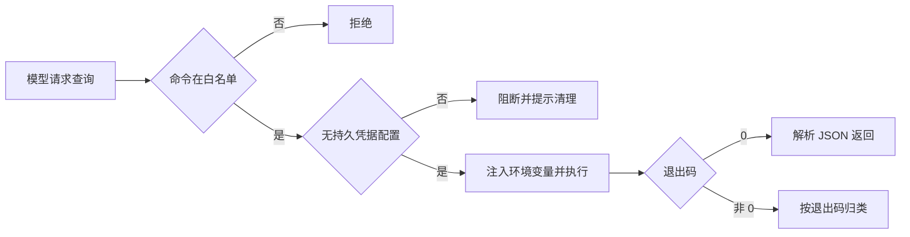

# Gitee 接入详细设计

## 文档信息

| 项 | 内容 |
|---|---|
| 文档编号 | CORP-DSH-DESIGN-010 |
| 文档名称 | Gitee 接入详细设计 |
| 版本 | V0.1 |
| 文档状态 | 草案 |
| 密级 | 内部 |
| 编制 | DSH 平台组（代拟） |
| 审核 | 待定 |
| 批准 | 待定 |
| 最后更新 | 2026-10-20 |
| 门禁 | G1 |
| 模块状态 | 规划 |

> 编制依据：2026-10-20 依据两点事实——Gitee 侧已有完全兼容 `gh` 的 CLI；架构 P7 要求复用既有资产。据此本设计以 CLI 为接入形态，并去掉原方案中 `mcp-gitee` 缺少 `linux-arm64` 资产导致的交叉编译风险。**未核验**：该 CLI 在银河麒麟 aarch64 上的产物、凭据注入方式、`--json` 输出稳定性。三项交由 Gitee 团队与平台组补充。
>
> 关联文档：[总体架构 §7.3](../../architecture/platform-architecture.md)、[实施计划](../../plans/rollout-plan.md) P1-4、[策略与审计](forge-policy.md)。

## 1. 结论

用已有的 `gh` 兼容 CLI 查询 Gitee 的仓库、Issue 与合并请求，通过受控命令白名单接入，不自建 MCP，也不交叉编译。

这条替换掉了原计划里风险最高的一项：`mcp-gitee` 没有 `linux-arm64` 发布资产，麒麟端需要自行编译。CLI 若能直接运行，这项风险与工作量一起消失。

边界：本期只读；不代理用户权限，授权由 Gitee 服务端校验。

## 2. 目标与非目标

**目标**

- 只读查询仓库、Issue、PR，命令面固定。
- 复用 `gh` 的命令与参数习惯，降低学习与维护成本。
- 凭据经环境注入，不落在 CLI 自己的配置文件里。
- 与 DevOps 接入共用同一套策略门禁与审计字段。

**非目标**

- 不做写操作（建分支、提 PR、改 Issue）。
- 不实现 Gitee API 客户端。
- 不提供跨仓库的批量抓取与镜像。

## 3. 需求与依赖

| 需求/验收 | 关系 | 说明 |
|---|---|---|
| REQ 代码托管只读查询 | 直接实现 | 仓库、Issue、PR |
| 验收 A7 只读闭环 | 支撑 | 查询链路可判定 |
| 计划 P1-4 | **改写** | 由"arm64 交叉编译 MCP"改为"CLI 适配与命令面" |

| 依赖 | 类型 | 版本约束 | 缺失时的行为 |
|---|---|---|---|
| `gh` 兼容 CLI | 工具 | 由 Gitee 团队提供 | 工具面不可用，明确报错 |
| 企业策略插件 | 包 | 同批次 | 命令面不开放 |
| 凭据 broker | 包 | 同批次 | 无凭据即拒绝 |

## 4. 扩展形态与边界

| 项 | 内容 |
|---|---|
| 形态 | 工具面接入：技能提示 + 命令白名单 + 策略校验（无独立服务端、无常驻进程） |
| 运行位置 | 本机 Host，经 bash 工具调用 CLI |
| 目标 DSH 与 SDK | 随目标版本 |
| 使用的 seam 或服务 | bash 工具、策略门禁、凭据注入、审计事件 |
| 不修改的核心 | 无 |

## 5. 接口与配置

| 配置项 | 类型 | 默认值 | 必填 | 说明 |
|---|---|---|---|---|
| `gitee.cliPath` | string | `gh` | 是 | 兼容 CLI 路径 |
| `gitee.host` | string | 空 | 是 | 企业 Gitee 主机名，禁止公网 |
| `gitee.allowedCommands` | string[] | `[]` | 是 | 只读子命令白名单 |
| `gitee.timeoutMs` | number | `60000` | 否 | 单次命令上限 |
| `gitee.authEnv` | string | `GH_TOKEN` | 否 | 注入凭据的环境变量名 |

```bash title="命令面（示意）"
gh repo view <owner/repo> --json name,defaultBranchRef
gh issue list --repo <owner/repo> --state open --json number,title,state
gh pr list --repo <owner/repo> --state open --json number,title,author
gh pr view <number> --repo <owner/repo> --json files,statusCheckRollup
```

## 6. 权限、凭据与数据

| 项 | 处理方式 | 生命周期 | 失败时 |
|---|---|---|---|
| 访问令牌 | 环境变量注入；不写 CLI 配置文件 | 随调用 | 未注入即拒绝 |
| 命令与参数 | 审计，仓库名可留、令牌不留 | 90 天 | 不影响执行 |
| 查询结果 | 会话内使用，不落日志 | 单次 | 失败即丢弃 |
| CLI 配置目录 | 启动时校验无持久令牌，有则告警 | 每次启动 | 阻断并提示 |

最后一行是这套方案唯一比 MCP 更容易出问题的地方：`gh` 习惯把令牌写进自己的配置目录，必须显式禁止。

## 7. 流程



**并发**：允许并发查询，环境变量按调用隔离。

**超时**：到点终止，按结果未知处理。

**取消**：终止子进程，不保留部分输出。

## 8. 失败模式

| 场景 | 行为 | 用户可见结果 | 是否可重试 |
|---|---|---|---|
| CLI 未安装 | 工具面不可用 | 明确报错 | 安装后重试 |
| 令牌缺失或过期 | 拒绝 | 引导重新授权 | 授权后重试 |
| 无仓库权限 | 归类为授权失败 | 说明无权限 | 否 |
| CLI 配置文件含令牌 | 阻断 | 提示清理并改用环境变量 | 清理后重试 |
| 主机名不是企业地址 | 拒绝启动 | 明确报错 | 修配置后重试 |
| 输出非 JSON | 记录并降级 | 提示格式不符 | 否 |

## 9. 可观测性

| 事件 | 字段 | 去向 | 保留 |
|---|---|---|---|
| 查询执行 | 子命令、仓库、退出码、耗时 | 审计 | 90 天 |
| 拒绝 | 原因、子命令 | 审计 | 90 天 |
| 配置告警 | 检测到的持久令牌位置（不含值） | 本机日志 | 30 天 |

## 10. 测试矩阵

| 层级 | 覆盖 | 命令 |
|---|---|---|
| 单元 | 白名单、主机校验、持久凭据检测 | `node --test` |
| 契约 | 命令面与团队澄清清单一致 | 契约用例 |
| 集成 | 未授权、超时、非 JSON | 本地仿 CLI |
| 端到端 | 双端各完成一次仓库与 Issue 查询 | 手工 |

## 11. 打包、升级与回退

形态为配置与技能资产，不新增常驻进程；CLI 由 Gitee 团队或平台组分发。

升级：命令面只增不删；`gh` 版本升级前需回归 JSON 字段稳定性。

回退：移除白名单即关闭工具面；不影响其他能力。

## 12. 未决事项

| 问题 | 需要谁回答 | 影响 |
|---|---|---|
| 麒麟 aarch64 是否有可用产物 | Gitee 团队 | 方案可行性前提 |
| 是否支持环境变量注入、可否禁用自身配置存储 | Gitee 团队 | 第 6 节凭据方式 |
| `--json` 字段是否稳定、是否与上游一致 | Gitee 团队、平台组 | 第 8 节解析 |
| 只读子命令清单与权限映射 | Gitee 团队 | 第 5 节命令面 |
| 计划 P1-4 与风险表第 13 条如何改写 | 平台组、PMO | 排期与验收 |

### 需用户确认的设计选项（增益不明确，暂不采用，保留待定）

| 选项 | 可能的增益 | 代价 | 当前处理 |
|---|---|---|---|
| 保留 MCP 形态作为备份 | 兼容旧工具面 | 交叉编译风险回到方案里 | 不采用 |
| 对写操作开白名单 | 覆盖提 PR 场景 | 超出本期只读范围 | 不采用 |
| 自建 Gitee API 客户端 | 摆脱 CLI 依赖 | 与 P7 冲突，多一层维护 | 不采用 |
| 缓存仓库元数据 | 减少调用 | 权限变更后数据不新鲜 | 不采用 |
| 跨仓库批量抓取 | 效率 | 触发频控与权限问题 | 不采用 |

以上五项均不影响主链路。若麒麟产物不成立，回落到原 MCP 方案并保留交叉编译工作项，届时需重新评估排期，不在此设计中静默替换。