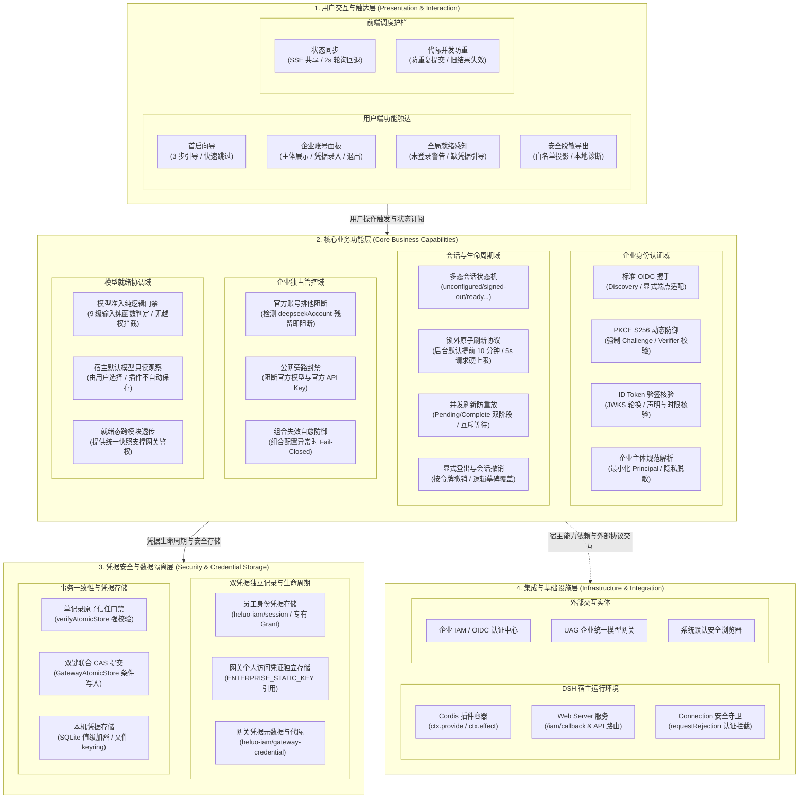
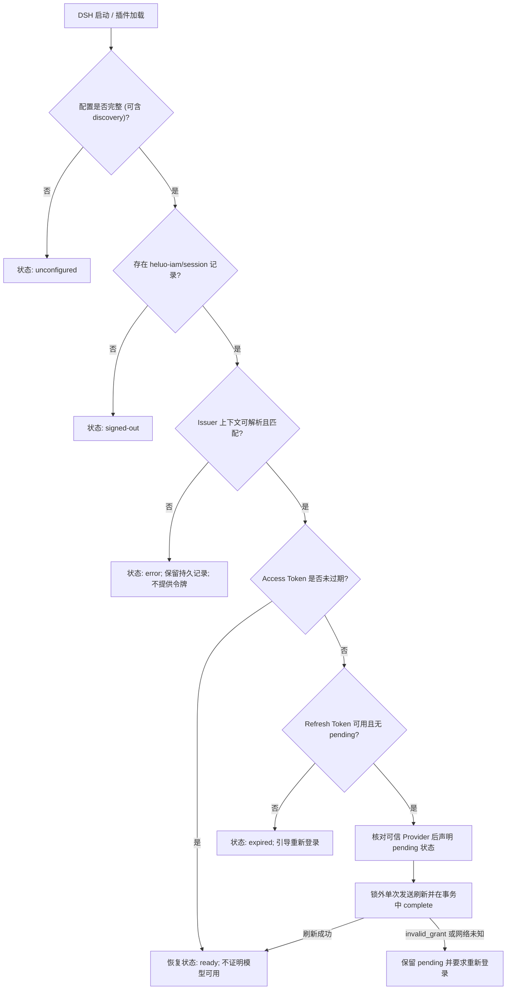
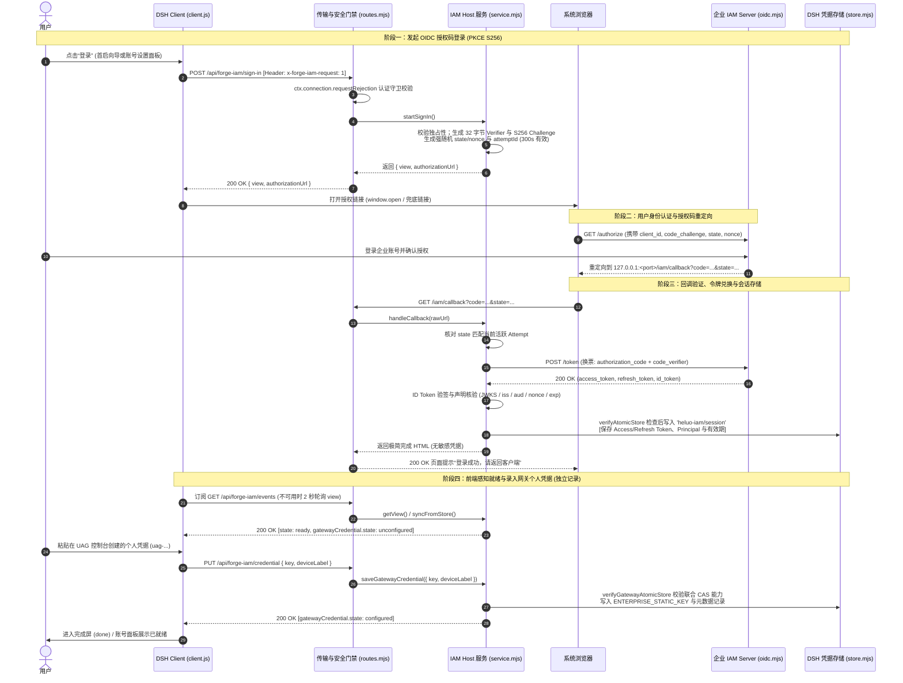
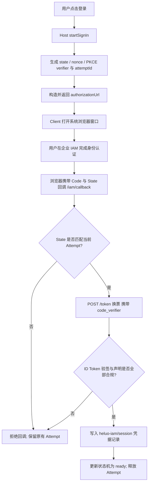
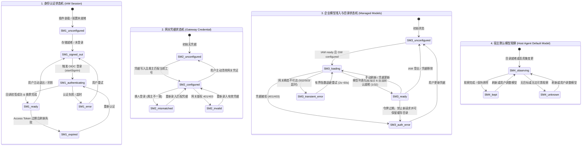
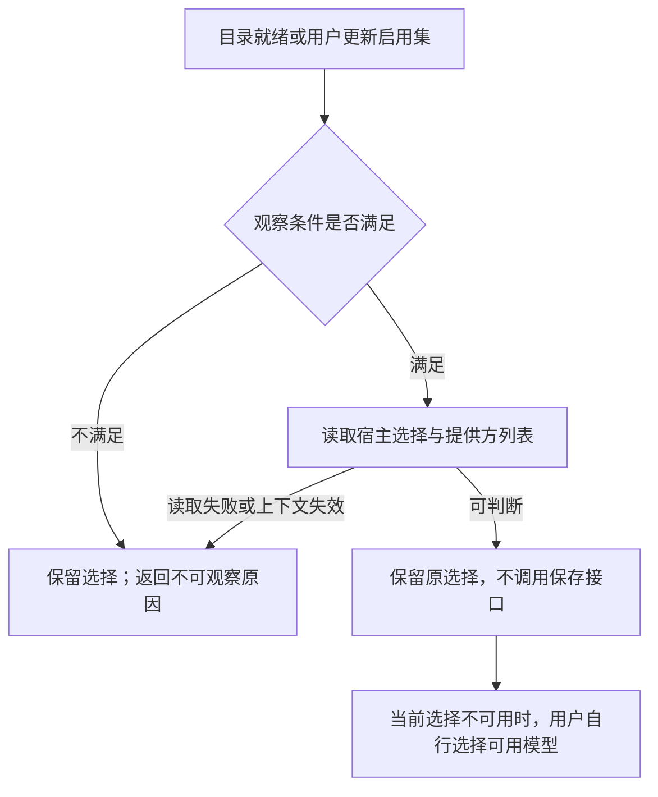

# IAM 接入详细设计

## 文档信息

| 项 | 内容 |
|---|---|
| 文档编号 | CORP-DSH-DESIGN-002 |
| 文档名称 | IAM 接入详细设计 |
| 版本 | V3.11.0 |
| 文档状态 | 草案 |
| 密级 | — |
| 编制 | DSH 平台组（代拟） |
| 负责 | 平台组（代拟） |
| 审核 | 待定 |
| 批准 | 待定 |
| 最后更新 | 2026-11-27 |
| 门禁 | G0 认领；G1 接入与生命周期契约；G2 双端联调准入 |
| 模块状态 | 可用（设计阶段；实现与验证见设计索引 §2.2） |

> **规范基准与安全边界**：本设计依据 DSH 运行环境（基准版本 `0.2.1-rc.2` / `0.2.1-rc.3`）与企业统一认证技术标准编制。系统确立 **O3「企业 IAM 独占登录」** 架构，组合层禁用官方账号体系与公网模型旁路。核心能力包括：`ctx.credentials` 凭据读写与授权记录、`ctx.webServer` 独立回调路由、`dsh-llm-pi-ai` 网关协议适配、`exclusive` 排他性断言及宿主默认模型只读观察。未联调项与跨平台实机差异严格保持隔离，不作为生产就绪断言。
>
> **关联文档**：[总体架构](../../architecture/platform-architecture.md)、[网关契约](../../contracts/gateway-contract.md)、[双模式凭据](../credential-modes.md)、[企业组合包](forge-enterprise.md)、[模型网关](forge-gateway.md)、[设计索引](../README.md)、[需求基线](../../requirements/requirements-baseline.md)、[IAM 独立问询函](../../collaboration/iam-confirmation-letter.md)、[机密客户端隔离设计](../iam-confidential-isolated.md)、[机密认证契约](../../contracts/iam-client-auth-isolated.md)。

---

## 1. 概述与核心结论

### 1.1 系统定位与核心结论

`@heluo/forge-iam` 是 DeepSeek Harness（DSH）的企业统一身份认证与凭据管理扩展包。其核心安全目标是建立**企业 IAM 独占登录体系（O3 规范）**，杜绝公网回落与数据外泄：

1. **企业唯一登录源**：企业 IAM 为系统唯一认证入口，官方账号体系（`deepseek-account` 等）由 `@heluo/forge-enterprise` 在组合层禁用，切断官方 API Key 旁路；
2. **三层准入解耦**：严格区分应用外壳展示、员工身份凭据和模型执行授权：
   - **外壳展示**：未登录不拦截 DSH 本地外壳与工作区启动；
   - **身份凭据**：企业 IAM 登录会话（存储于 `heluo-iam/session`）仅证明员工身份合法性与有效期；
   - **模型执行凭证**：个人模型调用凭证（`ENTERPRISE_STATIC_KEY`）由统一模型网关控制台签发并录入，与 IAM 会话分记录加密、独立管理生命周期；
3. **入口强鉴权与 Fail-Closed**：企业模型与工具调用必须在入口处校验当前身份与授权有效性；凭据失效或环境异常时严格遵循 Fail-Closed 原则拒绝调用，并向用户提供明确的重新认证指引。

### 1.2 规范约束与生产准入基线

为满足企业生产级合规与安全要求，系统遵循以下架构约束基线：

1. **预注册客户端**。要求刷新请求认证客户端的企业部署使用 `authMode=confidential`。授权码换票与刷新按登记的 `token_endpoint_auth_method` 使用同一客户端认证，授权码使用 PKCE S256。明确允许两个 grant 均无客户端认证的部署可用 `public` / `none`。目标部署的登记与计划续期须联调验证。 [issue #408 的 IAM 核对结论](https://github.com/hrygo/heluo-forge/issues/408#issuecomment-7034227656) 能力基线按 ADR-32 固定在 IAM 6.0.3 版本反馈：厂商 21 项回函、内部校验回函(3)、接入确认函 C1—C11 与 D1—D3、最终确认函 13 题；6.3.0 与 AIGS 的能力只作演进观察，不构成本设计的前提。同一版本内答复冲突时取企业 IAM 团队较新日期的书面答复，无先后可取时按不假设能力存在处理。
2. **令牌生命周期与轮换**：
   - 企业 IAM 签发访问令牌（Access Token），有效期设计基线为 7200 秒。刷新成功后旧访问令牌即时作废。
   - 刷新令牌（Refresh Token）的滑动有效期设计基线为 7300 秒，无绝对上限。轮换成功后旧刷新令牌即时作废。
   - Host 默认在两种令牌中较早的已知到期点前 10 分钟启动后台续期，短有效期适用提前量上限。调度规则与适用条件见[后台续期时机与恢复余量](#731-后台续期时机与恢复余量)。
3. **撤销与退出语义闭环**：
   - 访问令牌通过专用端点 `GET /idp/oauth2/revokeToken?access_token=...` 实现单令牌实时幂等撤销；
   - 刷新令牌服务端不开放撤销接口，依赖服务端自然失效（7300 秒）；
   - 默认退出流程执行“撤销访问令牌 + 本地清理会话记录 + 写入逻辑墓碑”，严禁默认调用影响同浏览器全局会话的 RP 登出；
4. **新会话默认模型由用户选择**：模型目录刷新、启用集变更和登录状态变化均不自动修改宿主默认模型。当前选择不可用时，用户在宿主中选择可用模型。

| 能力领域 | 规范设计基线 | 当前验证现状与实施边界 |
|---|---|---|
| **个人网关凭据** | 与会话分别存储并加密，绑定员工工号属主（ownerSubject），网关强校验属主匹配 | 本地验证状态见设计索引 §2.2；端到端联调待网关环境验证 |
| **会话刷新机制** | 锁内原子声明 pending、锁外单飞请求、条件提交 complete，多进程防并发重放 | 双进程刷新用例与超时熔断已通过自动化验证；端到端网络时延待实机测试 |
| **会话退出机制** | 单设备定向撤销访问令牌，保留个人长期 Key，如实记录撤销状态 | 本地清理与墓碑写入已闭环；端到端撤销端点联调待企业端点配合 |
| **默认模型选择** | 宿主默认模型由用户选择，插件只读观察，不自动保存 | 离线用例覆盖目录刷新、启用集变更和手动选择保留；不以模拟测试代替真实宿主验证 |

---

## 2. 目标与非目标

### 2.1 目标

- **企业 IAM 独占身份建立**：企业 IAM 为系统唯一认证源；组合层全面禁用官方登录入口、模型路由与官方 API Key 旁路；
- **标准授权码与 PKCE 强化**：基于系统默认浏览器完成授权码重定向交互，回调由本机 Loopback 端点（`/iam/callback`）处理；强制实施 PKCE S256 防御授权码拦截攻击；
- **规范 OIDC 声明校验**：支持 OIDC Discovery 与显式端点配置；严格校验 `state`、`nonce`、`iss`、`aud`、JWT 签名（RS256/PS256/ES256）及有效期时钟容差；
- **锁外安全刷新与防重放**：会话令牌写入宿主受保护凭据存储；通过“原子声明 pending → 锁外单次换票 → 条件提交 complete”协议防御并发刷新击穿与重放；
- **双凭据生命周期隔离与感知**：账户面板与 3 步向导明确区分员工身份与网关个人访问凭证，双准入就绪状态实时可视；
- **退出与单令牌撤销**：退出时按配置尝试撤销当前访问令牌，确认后清理本地会话并写入逻辑墓碑；撤销失败或结果未知时保留 pending 或原记录，不报告清理成功，默认保留个人长期网关 Key；
- **用户选择对话模型**：目录就绪后提供已启用的企业模型；新对话模型由用户在宿主中选择，原选择不可用时不自动替换。

### 2.2 非目标

- **不接管应用外壳启动**：不拦截 DSH 桌面进程的启动与本地文件操作；未登录仅阻断企业模型与受限能力；
- **不保留任何公网旁路**：不提供面向公网官方服务的附加登录（additive）或回退模式；
- **不做多账号即时共存**：单运行实例仅维护一份当前登录会话，不支持多租户/多角色并发并存；
- **不代理代管网关凭证**：个人网关 Key 由用户在统一控制台自主签发与吊销，客户端不代为生成；
- **不修改 DSH 内核代码**：完全基于 Cordis 扩展机制与标准 SDK 挂载，不维护 DSH 内核 Fork 分支；
- **不做营销化引导流程**：首启引导聚焦于企业认证、网关凭据配置与环境确认，不做用量计费或商业宣传。

---

## 3. 需求契约与环境依赖

### 3.1 需求映射与验收指标

| 需求编号 | 架构关系 | 契约与实施指标 |
|---|---|---|
| **REQ-01** | 核心支撑 | 预注册客户端，授权码与刷新使用登记的认证方法，授权码使用 PKCE S256 和 loopback 回调。未登录或网关凭据缺失时阻断企业模型 |
| **REQ-02** | 核心支撑 | 令牌原子轮换；多进程并发遵守 pending/complete 互斥协议；网络换票执行 5 秒硬超时界限 |
| **REQ-05** | 核心支撑 | 身份令牌与调用 Key 独立管理；网关配额用尽不盲目重试；绑定变化重试的实际派发时序仍待验证 |
| **REQ-17** | 核心支撑 | IAM 服务或凭据存储缺失时，企业调用严格执行 Fail-Closed 阻断，拒绝静默降级 |
| **C1 / C4** | 安全约束 | 仅允许连通指定企业模型网关；不保留公网路由；日志及错误回显严禁泄露令牌、密钥或正文 |

### 3.2 宿主环境与组件依赖

| 依赖组件 | 依赖类型 | 适用版本 / 规范 | 异常与缺失处理机制 |
|---|---|---|---|
| `dsh-credentials` / 本地凭据服务 | 基础服务 | 随目标 DSH 挂载 | 无法读写持久化凭据；插件拒绝进入 `ready`，明确报错 |
| `dsh-web-server`（`ctx.webServer`） | 基础服务 | 随目标 DSH 挂载 | 无法注册 `/iam/callback` 回调；登录流程阻断 |
| `dsh-settings` | 基础服务 | 随目标 DSH 挂载 | 设置项无法持久化；回退为内存只读模式 |
| `dsh-llm-pi-ai` | 协议适配 | 随目标 DSH 挂载 | 缺乏模型执行适配器；模型调用无法生效，不影响身份登录 |
| `dsh-attachment`（`ctx.attachments`） | 基础服务 | 随目标 DSH 挂载 | 无法投影图片输入：历史含图片的请求在发送前被上游以 `UNSUPPORTED_CONTENT` 拒绝，该会话此后无法完成任何请求 |
| `dsh-agent-default-model` | 只读观察依赖 | 随目标 DSH 挂载 | 缺失时不观察宿主默认模型；用户仍在宿主中选择可用模型 |
| 企业 IAM OIDC 认证中心 | 外部服务 | 标准 OIDC / RFC 6749 | 未配置或不可达时显示 `unconfigured` / `unreachable` |
| `@heluo/forge-enterprise` | 方案协同 | 同批次方案包 | 组合层打入禁用补丁；本包排他性断言检查 `deepseekAccount`，其他官方行与旁路须另行核验 |
| 网关接入设计 | 方案协同 | 同批次方案 | `forge-gateway` 保留设计与配置入口；当前模型请求与门禁由 IAM 的受控模型运行时承载，凭据探测未实现 |

---

## 4. 架构设计与系统边界

### 4.1 功能架构全景

系统自顶向下分为用户交互层、业务核心功能层、凭据安全数据层与集成基础设施层四大层级：



#### 功能架构职能分解矩阵

| 架构层级 | 功能域 | 核心职能模块 | 业务价值与安全控制目标 |
|---|---|---|---|
| **1. 用户交互与触达层** | 用户端功能触达 | 3 步首启向导、企业账号与模型双面板、全局状态横幅、安全脱敏诊断导出 | 统一规范开箱体验，提供一站式账号管理、Key 录入与安全退出入口；诊断信息严格白名单脱敏 |
| | 前端调度护栏 | 同页共享 SSE、2 秒回退轮询、代际并发防重护栏 | 同步客户端与 Host 状态；各组件基于代际废弃过时响应，不承诺跨组件或跨进程即时一致 |
| **2. 核心业务功能层** | 企业身份认证域 | 标准 OIDC 握手、PKCE S256 动态防御、ID Token 验签核验、企业主体规范解析 | 落地企业统一认证，强制 S256 防御授权码拦截攻击；严格基于 JWKS 验签提取员工 Principal |
| | 会话与生命周期域 | 多态会话状态机、锁外原子刷新协议、并发刷新防重放、显式登出与会话撤销 | 后台提前续期留出故障恢复时间。原子 `pending` / `complete` 协议防止并发换票。退出时按规范撤销访问令牌 |
| | 企业独占管控域 | 官方账号排他阻断、公网旁路封禁、组合失效自愈防御 | 落实 O3 企业独占登录原则；启动时强校验官方服务残留，发现违规立即 Fail-Closed 阻断 |
| | 模型就绪协调域 | 模型准入纯逻辑门禁、宿主默认模型只读观察、就绪态跨模块透传 | 提供纯函数模型前提准入判定；保留宿主默认模型，由用户选择可用模型 |
| **3. 凭据安全与数据层** | 双模式凭据存储隔离 | 身份凭据存储区（Session）、网关凭据独立存储区（Static Key）、网关元数据专区 | 身份令牌与网关凭据分区存储、互不覆盖：登出与刷新不清除长效凭据，凭据重置不影响 IAM 登录。路线 B 下令牌仅由 Host 传输层按需读取用于请求头组装，不新增视图字段 |
| | 事务一致性与凭据存储 | 单记录原子信任门禁、双键联合 CAS 提交、SQLite 值级加密 | 确保凭据写盘具备原子互斥能力；网关 Key 与元数据通过 CAS 联合一致性提交；拒绝明文降级 |
| **4. 集成与基础设施层** | DSH 宿主环境 | Cordis 插件容器、Web Server 路由服务、Connection 安全守卫 | 依托 Cordis 声明生命周期所有权；通过宿主连接守卫拦截未授权跨域接口调用 |
| | 外部交互实体 | 企业 IAM 服务端、UAG 模型网关控制台、系统默认浏览器 | 对接企业标准 IdP 完成授权码重定向；由用户自主签发个人令牌，保持职责清晰 |

### 4.2 扩展形态与插件宿主集成

- **扩展形态**：Host 服务插件（Node.js / Cordis） + Client 界面插件（React / Web & Desktop 双端）；
- **执行宿主**：本机 Host 执行核心鉴权与协议交互；Client 负责界面渲染、用户触发与状态同步；
- **宿主集成缝**：`ctx.credentials`、`ctx.webServer`、`ctx.connection`、`ctx.settings`、`ctx.slots`、`llm`、`agentDefaultModel`；
- **核心独立性**：不修改 DSH 内核，不分发修改版 DSH，官方账号体系仅通过组合层禁用实现隔离。

### 4.3 官方账号禁用与独占断言

| Row id（目标 Profile） | 官方包名 | 处理策略 | 实施动因 |
|---|---|---|---|
| `deepseek-account` | `@deepseek-ai/dsh-deepseek-account-platform` | `disabled: true` | 官方登录与账号状态；内网不可用 |
| `llm-deepseek-account` | `@deepseek-ai/dsh-llm-deepseek-account` | `disabled: true` | 官方账户模型路由 |
| `llm-deepseek` | `@deepseek-ai/dsh-llm-deepseek-api-key` | `disabled: true` | 官方 API Key 旁路入口 |
| `ui-settings-account` | `@deepseek-ai/dsh-client-ui-settings-account` | `disabled: true` | 官方账户页与侧边栏入口 |

补丁层在目标 Profile 下共停用七行：上表四项之外，还有 `llm-pi-ai`（自由添加网关）、`ui-settings-models`（自由配置模型入口）与 `credentials`（官方明文凭据提供方）。后三行同样构成旁路，不因本表只列账号相关四行而省略。

装配期的官方行核验由 `@heluo/forge-enterprise` 的补丁与 `OFFICIAL_ROWS` 断言承担：缺席的行记为 `absent`，Loader 警告跳过不等于已禁用。插件自身的运行期独占断言位于 `src/exclusive.mjs`，按 `exclusiveServices`（默认 `['deepseekAccount']`）逐个检查宿主服务；任一残留即拒绝受保护操作，并在装配日志给出具体服务名。企业补丁把其余官方行登记进该列表后，运行期也能覆盖到那些行；未登记的行仍只能由装配期断言发现。环境变量旁路（如 `DEEPSEEK_API_KEY`）在组合装配时检测：`exclusive.mjs` 的 `detectEnvBypass` 只读取变量名，`apply` 在 `requireExclusive` 未关闭时以固定文案告警一次，文案不含变量值。检测默认只告警，是否拒绝启动尚未实现，须由用户裁决后另行变更。`exclusive-violation` 审计事件及持久落点仍是待验证目标，不能由本地诊断或拒绝行为推断已交付。

### 4.4 客户端 UI 交互设计

- **首启 3 步通用向导**：依次呈现“1. 登录企业账号 → 2. 启用 AI 服务 → 3. 完成设置”（`步骤 X / 3`），支持跳过或稍后配置，已登录且已就绪时标记 `done`，零研发工具硬编码；
- **账号与模型双分区**：`企业账号`（`forge-iam`，`order: -10`）展示当前主体、令牌到期时间、AI 服务状态（已就绪且闲置时自动折叠为平静单行 `AI 服务 · 已就绪`）与一键脱敏诊断，保持通用账号视角纯净，不包含任何研发扩展凭据条；`企业模型`（`forge-models`，`order: 10`）承载模型目录同步、手动模型增删与单模型参数微调（未登录或 AI 服务未就绪时引导前往「设置 → 企业账号」）；
- **全局状态横幅**：未登录或缺网关凭据时展示明确警示并引导前往设置，不静默挂起会话；
- **插槽挂载体系**：在 `settings.section` 注册 `forge-iam`（`order: -10`，不声明研发子槽位）与 `forge-models`（`order: 10`），并为两者注册同名 `settings.section.icon` 矢量图标；同时挂载 `shell.overlay` 并认领 `settings.launcher` 单占位插槽。
- **浏览器兼容提示**：客户端在 `shell.overlay` 检测 `AbortSignal.any`；缺少时提示工作区等功能可能不可用，并建议使用新版 Chrome 或 Chromium。提示可在当前页面关闭，不阻断其他操作；接口存在不代表浏览器全部功能已验收。插件未能加载时无法展示此提示。

#### 4.4.1 左下角企业账号启动器（settings.launcher）规格

1. **品牌视觉**：采用精炼盘龙盾徽标识 `packages/forge-iam/icon.svg`。展开态采用 28×28px 圆形容器内嵌 18×18px 盾徽；折叠态（Rail, 56px）采用 36×36px 圆角卡片内嵌 22×22px 盾徽；
2. **复合状态指示点（7px 实心）**：
   - 🟢 **绿色（双就绪）**：`state === 'ready'` 且 `gatewayCredential.state === 'configured'`；
   - 🟡 **黄色（缺少凭据）**：`state === 'ready'` 但网关凭据未配置或属主不匹配；
   - 🔴 **红色（凭据异常）**：`state === 'expired'` 或 `state === 'error'`；
   - ⚪ **灰色（未登录态）**：`state === 'signed-out'` 或 `state === 'unconfigured'`；
3. **原生弹窗菜单**：已登录态点击弹出毛玻璃卡片，支持展示主体工号、跳转网关设置、复制脱敏诊断信息以及安全退出设备。

### 4.5 回调与浏览器交互规范

#### 4.5.1 回调监听归属

配置 `callbackPort` 时，授权码回调由插件自建回环监听接收，端口可由操作系统分配或固定；宿主 `webServer` 的端口变化不影响回调地址。省略该配置时使用宿主回调，作为开发与兼容形态。

| 项 | 终态口径 |
|---|---|
| 登记形态 | 管理台登记回调 URL **前缀**：合法形态 `http://127.0.0.1:` 与 `http://127.0.0.1/`，`https` 同样可用；另确认支持固定端口预登记与精确匹配、支持多端口登记，固定端口因此是可选形态。2026-11-23 答复指出 OIDC 授权流程**不校验** `redirect_uri`（OAuth 授权流程才校验），登记值不产生拒绝行为，登记只作管理台留痕 |
| 监听 | `callbackPort: 0` 由系统分配回环端口；`1024–65535` 固定该端口。插件只绑定回环地址，只接受 `GET <redirectPath>`（默认 `/iam/callback`） |
| 生命周期 | 监听随登录尝试建立，尝试结束（成功、取消、超时、签出、provider 更换）即停止接受连接；不常驻 |
| 地址族 | `callbackAddress` 默认 `auto`：始终先试 IPv4 回环，仅当本机没有 IPv4 回环时才试 IPv6；也可固定 `127.0.0.1` 或 `::1`。IPv6 需另登记前缀 `http://[::1]`，地址写作 `http://[::1]:<port><redirectPath>` |
| 校验归属 | 回调合法性由客户端承担：插件只使用自己绑定的回环地址，Host 必须等于实际监听主机、路径必须逐字节相等、对端必须是回环，其他主机写法一律拒绝。`redirect_uri` 不受服务端约束，授权码被转投时的唯一边界是 PKCE S256，见 [ADR-33](../../architecture/platform-architecture.md#14-架构决策记录) |
| 显式 URI | 配置 `callbackPort` 时，仅固定端口允许显式 `redirectUri`，且必须与固定回环地址逐字节相等；省略 `callbackPort` 时可使用宿主回调 URI。显式 URI 必须与所选实时回调 Origin 同源，不符以 `IAM_CONFIG_INVALID` 拒绝 |
| 端口冲突 | 绑定失败记 `IAM_CALLBACK_PORT_UNAVAILABLE`，登录发起即拒；不回落宿主端口，不改写 `redirect_uri`。地址族只在 `EADDRNOTAVAIL`／`EAFNOSUPPORT` 时切换，端口占用不切换 |
| Origin 来源 | 省略 `callbackPort` 时取宿主实时 Origin；配置后取已绑定回环监听的实时 Origin，二者不互相回落。所选 Origin 缺失、获取异常或不是有效 HTTP(S) 地址时，以 `IAM_CALLBACK_UNAVAILABLE` 拒绝登录，不生成授权链接。复用登录链接前重新核验地址，来源失效或变更时取消旧尝试 |

企业部署默认采用系统分配端口（`callbackPort: 0`）：服务端不校验回调地址后，前缀登记不再提供约束，系统分配端口的价值只剩避免端口被占用；路径、主机与回环属性全部由插件校验。需要固定端口审计时才改为登记固定端口。两种形态不在同一部署交替使用，也不在失败时互相回落。

启用 `callbackPort` 后，回调不再注册到宿主 `webServer`；管理 API 仍留在宿主。

平台差异集中在套接字语义上。`check.yml` 的 `forge-iam callback` 作业在 `ubuntu-24.04` 与 `windows-2022` 上跑同一组回调用例，覆盖随机端口绑定、固定端口被占用时拒绝、排空关闭与 IPv6 回环真实请求；两平台均通过，Windows 上端口占用同样触发 `EADDRINUSE`。绑定回环地址是否触发 Windows 防火墙提示尚未实机确认。

#### 4.5.2 回调校验与响应

- **回调只读与校验**：回调接口仅支持 `GET` 方法，严格校验 `state` 匹配当前活跃 Attempt；换票 POST 请求携带 `code_verifier` 由服务端直接验票，Verifier 绝不暴露于 URL；
- **同源管理守卫**：所有 `/api/forge-iam/*` 管理端点受宿主 `ctx.connection.requestRejection` 守卫保护，严格校验 `x-forge-iam-request: 1` 标头，写入请求体限制最大 8 KiB；
- **回调完成响应**：回调返回终态结果页，呈现状态、只读结果与下一步指引；页面不写入任何 Token、授权码、state 或 Verifier。成功页在客户端专用登录窗口发起时才包含一段带 nonce 的最小脚本：先清除窗口名标记再尝试关闭该窗口，被浏览器拒绝时保留手动关闭指引，不提供无反馈的按钮。脚本不依赖 `window.opener`、不读取也不跳转任何 URL；同标签页退路到达的回调页从未设置该标记，因此承载工作界面的标签页不会被关闭。窗口名只是「可否自行关闭」的提示，不承担任何身份或授权语义。
- **结果页 CSP**：失败页保持 `default-src 'none'; style-src 'unsafe-inline'` 且不含脚本；成功页仅额外放行该次响应的 `script-src 'nonce-…'`，nonce 每次响应重新生成，不引入外部脚本、不放开 `unsafe-inline` 脚本。失败、取消与未确认一律不自动关闭、不显示成功。

### 4.6 架构选型论证：为什么不用 `authorization` flow

DSH 内置的 `ctx.authorization` flow 面向“单次凭据唤起与 commit 录入”设计；而企业 IAM 必须接管浏览器重定向回调、后台原子定时轮换、单令牌撤销以及跨多组件的长期会话维护。因此采用 **Host Service + 内部状态机 + 同源管理 API** 模式，实现会话与 Attempt 状态的唯一主权管理。

### 4.7 client secret 生命周期与轮换规范

管理员通过[凭据接入指南](../../../packages/forge-iam/docs/credential-access.md#9-管理员预置与轮换-iam-客户端密钥)为目标 Host 所用账号与命名空间预置密钥。内置凭据组合读专用加密记录，核对 issuer、clientId、方法和来源。私版保存非秘密引用。

每次写入产生新 revision。模式、方法、引用或 revision 变化后使用新登录，Host 拒绝采用旧会话的 AT 和 RT。已经发出的刷新请求仍遵循原防重放协议。

IAM 回函给出的轮换生效窗口最长为两分钟，既发访问令牌按有效期自然过期。核对服务端生效后再用新凭据登录。目标部署的实际生效和撤销语义由 G1 联调确认。

---

## 5. 接口与配置契约

### 5.1 配置项规范

配置对象在挂载插件时传入，格式校验遵循 [`packages/forge-iam/src/config.mjs`](<../../../packages/forge-iam/src/config.mjs>)：

| 配置项 | 类型 | 默认值 | 必填 | 语义与安全约束说明 |
|---|---|---|---|---|
| `clientId` | string | 空 | 是 | 企业预注册客户端唯一标识 |
| `authMode` | string | `public` | 否 | 认证模式；支持 `public` 与 `confidential` |
| `clientAuthMethod` | string | `none` | 条件 | `public` 只允许 `none`。机密模式显式选择 IAM 登记的 `client_secret_basic` 或 `client_secret_post` |
| `clientSecretRef` | string | 空 | 条件 | 机密模式必填的小写记录选择器，对应 `iam-client-secret/<ref>` |
| `allowInsecureClientAuthHttp` | boolean | `false` | 否 | 仅机密模式接受。读取 HTTP Discovery 或通过 HTTP 发送客户端认证 POST 均须显式设为 `true` |
| `discoveryUrl` | string | 空 | 条件 | OIDC Discovery 地址。核心配置齐备时仅在需要补齐可选端点时查询，并核对 issuer |
| `issuer` | string | 空 | 条件 | 显式配置时必填，作为发行者 Pin 用于 ID Token 校验 |
| `authorizationEndpoint` | string | 空 | 条件 | 显式授权请求端点 |
| `tokenEndpoint` | string | 空 | 条件 | 显式换票请求端点 |
| `jwksUri` | string | 空 | 条件 | 显式公钥集地址，用于验签算法核验 |
| `revocationEndpoint` | string | 空 | 否 | 令牌撤销端点。缺失时使用匹配 issuer 的发现文档值 |
| `revocationMode` | string | `access_token_query` | 否 | 回调清理和退出共用的撤销协议。`access_token_query` 使用企业访问令牌撤销 GET，`rfc7009` 使用 OAuth 表单 POST。IAM 6.0.3 反馈只有按访问令牌一条路径且刷新令牌不可撤销，企业部署固定使用 `access_token_query` |
| `endSessionEndpoint` | string | 空 | 条件 | RP 退出端点。启用 RP 时由显式配置或匹配 issuer 的发现文档提供 |
| `userInfoEndpoint` | string | 空 | 否 | 有身份字段映射时读取的 UserInfo 端点。缺失时按需发现 |
| `scopes` | string[] | `['openid', 'profile', 'offline_access']` | 是 | 申请授权范围，必须显式包含 `openid`。IAM 6.0.3 反馈的换票响应直接返回 `refresh_token`，未把 `offline_access` 列为必要条件，企业部署模板显式设置不含该项的 `scopes`（不依赖插件默认值）；兼容默认值保持不变 |
| `redirectPath` | string | `/iam/callback` | 否 | 本机 Loopback 回调绝对路径 |
| `callbackPort` | number | 空 | 否 | 省略时沿用宿主 Origin（开发/兼容）；`0` 由系统分配回环端口；1024–65535 固定该端口 |
| `callbackAddress` | string | `auto` | 否 | `auto` 始终先试 `127.0.0.1`，仅在该地址族不可用时退到 `::1`；也可固定其中之一。IPv6 需 IAM 额外登记 `http://[::1]` |
| `redirectUri` | string | 空 | 否 | 显式 HTTP(S) 回调 URI，Origin 必须匹配所选实时回调 Origin；固定端口时必须等于 `http://<callbackAddress>:<callbackPort><redirectPath>`，系统分配端口时不可设置；省略 `callbackPort` 时可使用宿主地址 |
| `gatewayConsoleUrl` | string | 空 | 否 | UAG 网关个人访问凭证控制台链接，仅用于界面指引 |
| `defaultProvider` | string | `enterprise` | 否 | 企业模型提供方标识 |
| `defaultModel` | string | 空 | 否 | 企业模型目录的首选项与只读观察目标；不写宿主默认模型 |
| `refreshSkewSeconds` | number | 60 | 否 | 前台按需取票的预刷新窗口（秒）。后台剩余有效期短于 4 分钟时使用该提前量，最长为剩余时间的一半。完整规则见[后台续期时机与恢复余量](#731-后台续期时机与恢复余量) |
| `attemptTimeoutSeconds` | number | 300 | 否 | 单次登录 Attempt 超时时间（秒） |
| `httpTimeoutMs` | number | 10000 | 否 | HTTP 请求默认超时上限（毫秒）；刷新与撤销请求设 5000ms 硬上限 |
| `logoutMode` | string | `local` | 否 | `local` 完成本地退出与已配置的撤销。`rp` 还可生成全局登出地址 |
| `requireExclusive` | boolean | `true` | 否 | 排他性强断言开关；检测到官方服务残留时阻断就绪 |
| `iamTokenHeader` | string | `X-IAM-Token` | 否 | 网关身份头名，须为 RFC 7230 token；改名前确认网关接受新头 |
| `consumerTypeHeader` | string | `X-Consumer-Type` | 否 | 消费方类型头名，同样须为 token |
| `consumerType` | string | `personal` | 否 | 消费方类型值；个人版固定 `personal`，AIGS 迁移时整体改为目标值 |
| `exclusiveServices` | string[] | `['deepseekAccount']` | 否 | 必须保持缺席的宿主服务名列表；命中即判 `exclusive-violation` 并告警具体服务名 |
| `profileFields` | object | 空 | 否 | UserInfo 字段映射，仅接受 `workNo`/`name` 键，值为 claim 名 token；空表示不取画像 |

授权请求恒定携带 `code_challenge` 与 `code_challenge_method=S256`；`pkce`、`pkceMethod`、`codeChallengeMethod`、`disablePkce` 一律按禁止配置项处理，不能通过配置关闭或降级。2026-11-23 答复确认 `S256` 可正常发码、`plain` 与 `S256` 均可用且不强制，并说明**省略该参数时按 `plain` 处理**；因此参数必须显式携带，不能依赖默认值。本实现固定使用 S256，不提供 `plain` 降级。`redirect_uri` 不受服务端校验后，S256 是授权码被转投时唯一有效的防护，见 ADR-33。

含旧配置项 `allowInsecureHttp` 的有效 profile 仍可使用；该项按未知键忽略，不出现在规范化结果中。新配置不得设置该项，调用方不得依赖其开关行为。

Host 在读取机密模式的 Discovery 前检查其协议，并在换票、刷新和撤销 POST 前检查实际端点。HTTP 需要显式开启，刷新在写入 pending 前先行检查。认证和拒绝语义见[客户端认证契约](../../contracts/iam-client-auth-isolated.md)。

### 5.2 现行接口规范

#### 5.2.1 Host 服务接口（`ctx.iam`）

由 `createIamService(config, options)` 创建并注册为 `ctx.iam`：

| 方法 | 参数 | 返回值与语义说明 |
|---|---|---|
| `getView()` | 无 | 同步返回当前 `IamView` 快照（不含敏感令牌） |
| `watch(signal)` | `AbortSignal` | 异步迭代器，订阅视图快照与变更流通知 |
| `hydrate()` / `syncFromStore()` | 无 | 异步从安全存储恢复会话状态及网关凭据元数据；discovery-only 冷启动先解析 Discovery issuer，再读取并校验已保存记录 |
| `startSignIn()` | 无 | 开启或复用活跃 Attempt，返回 `{ view, authorizationUrl }` |
| `cancelSignIn()` | 无 | 取消当前 Attempt 并恢复前序状态 |
| `handleCallback(rawUrl)` | `rawUrl: string` | 接收并处理回调 URL，执行状态校对、换票与验签落盘 |
| `signOut()` | 无 | 执行登出，按规范撤销访问令牌并写入逻辑墓碑 |
| `resolveToken()` | 无 | 获取当前有效 Access Token（必要时触发锁外刷新）；绝不返回 Refresh Token |
| `getSession()` | 无 | 同步返回不含令牌的身份与时效快照，不触发存储同步或刷新 |
| `getAccessToken()` | 无 | `resolveToken()` 的别名，按需取得访问令牌 |
| `getPrincipal()` | 无 | 返回 `{ issuer, subject }` 最小身份标识 |
| `saveGatewayCredential(input)` | `{ key, deviceLabel, baseURL }` | 基于条件比对（CAS）原子写入网关 Key 与元数据 |
| `clearGatewayCredential()` | 无 | 原子清除网关凭证并写入墓碑记录 |
| `reconcileDefaultModel()` | 无 | 宿主默认模型状态只读采样，不修改选择 |

#### 5.2.2 同源 HTTP 路由（`/api/forge-iam/*`）

全部挂载于 `ctx.webServer`；除桥接端点外均受 Connection 鉴权保护，同源写入端点要求 `x-forge-iam-request: 1` 与 `content-type: application/json`：

| 端点与方法 | 鉴权与约束 | 返回数据及语义 |
|---|---|---|
| `GET /api/forge-iam/session` | 同源校验 | 返回只读身份快照（`getSession()`），不触发刷新，永不含令牌 |
| `POST /api/forge-iam/token` | 同源 + Header | 返回 `{ token, expiresAt }`；响应头显式禁用缓存 |
| `POST /api/forge-iam/bridge/token` | Loopback + Bearer 能力值 | 供 CLI 使用的受限换票通道，返回 `{ token, expiresAt }` |
| `GET /api/forge-iam/view` | 同源校验 | 返回完整 `IamView` 快照，供前端回退轮询与状态读取 |
| `GET /api/forge-iam/events` | 同源校验 | SSE 推送 `watch()` 视图；同页组件共享连接，失败时回退轮询 |
| `POST /api/forge-iam/sign-in` | 同源 + Header | 触发登录流程，返回 `{ view, authorizationUrl }` |
| `POST /api/forge-iam/cancel` | 同源 + Header | 取消在途登录尝试，返回最新 `IamView` |
| `POST /api/forge-iam/sign-out` | 同源 + Header | 执行退出流程，返回登出结果对象 |
| `GET /api/forge-iam/credential` | 同源校验 | 返回网关凭据状态视图对象 `{ credential }` |
| `PUT /api/forge-iam/credential` | 同源 + Header (≤ 8 KiB) | 保存个人网关凭据，返回更新后的 `IamView` |
| `DELETE /api/forge-iam/credential` | 同源 + Header | 清除网关凭据，返回更新后的 `IamView` |
| `POST /api/forge-iam/models/manual` | 同源 + Header | 增删手动模型条目（`{ action: 'add' \| 'remove', id }`），返回操作结果与最新 `IamView`；浏览器侧已在独立「企业模型」页（`forge-models`）提供手动添加与删除交互（离线单测与合成宿主探针覆盖，未实机验证） |
| `GET /api/forge-iam/ext-credentials` | 同源校验 | 返回已注册扩展凭据的状态投影（不含令牌明文） |
| `PUT /api/forge-iam/ext-credentials/<extensionId>` | 同源 + Header | 保存扩展托管令牌，返回投影与最新列表；令牌值不回显 |
| `DELETE /api/forge-iam/ext-credentials/<extensionId>` | 同源 + Header | 清除扩展托管令牌，返回投影与最新列表 |

#### 5.2.3 最小只读订阅接缝（source/mock 已实现）

系统定义了轻量级只读订阅接缝（`iam-view-observer` 与 `iam-view-consumer`）：
- **数据白名单**：仅对外投射 12 项非敏感字段，禁止包含令牌、Verifier、密钥或网关 Key 原文；
- **唯一刷新主权**：订阅监听仅观察快照变更，后台定时同步严格收敛于 Host 单飞任务，禁止客户端每帧强制刷新；
- **代际隔离**：网络中断或订阅取消时即时清理异步等待队列，废弃过时响应。

### 5.3 生产目标接口定义（V1 Remote Target）

```ts
export type IamState =
  | 'unconfigured'
  | 'signed-out'
  | 'authenticating'
  | 'ready'
  | 'expired'
  | 'unreachable'
  | 'error';

export interface IamPrincipal {
  readonly issuer: string;
  readonly subject: string;
  readonly displayName?: string;
  readonly groups?: readonly string[];
}

export interface GatewayCredentialView {
  readonly state: 'unconfigured' | 'configured' | 'invalid' | 'owner-mismatch';
  readonly ownerSubject?: string | null;
  readonly deviceLabel?: string | null;
  readonly enteredAt?: string | null;
  readonly suggestedExpiry?: string | null;
  readonly storage?: string | null;
  readonly matchesAccount?: boolean;
  readonly lastProbeAt?: string;
}

export interface IamView {
  readonly state: IamState;
  readonly principal?: IamPrincipal;
  readonly accessExpiresAt?: string;
  /** 会话是否仍能自行续期；`unavailable` 表示滑动刷新窗口已过，必须重新登录 */
  readonly renewal?: 'available' | 'unavailable' | 'none';
  readonly refreshExpiresAt?: string;
  readonly gatewayCredential: GatewayCredentialView;
  readonly authorizationUrl?: string;
  readonly attemptId?: string;
  readonly modelAccess?: {
    readonly defaultModelId?: string | null;
    readonly hostDefaultModel?: string | null;
    readonly manualTruncated?: number;
    readonly models?: ReadonlyArray<{ readonly id: string; readonly source?: 'gateway' | 'manual' }>;
  } | null;
  readonly error?: { readonly code: string; readonly message: string };
}
```

### 5.4 机密客户端接入契约

| 核心事项 | 规范基准 | 边界约束与实现状态 |
|---|---|---|
| **客户端登记** | `client_id`、客户端类型、授权码和刷新 grant 权限、`token_endpoint_auth_method` | 部署须逐项与 IAM 核对 |
| **密钥托管** | 管理员预置专用加密记录，Host 绑定可信只读来源 | 缺少来源、记录或绑定时拒绝机密操作 |
| **轮换** | 同一绑定更新密钥后重新登录 | 新密钥不用于旧刷新令牌 |
| **令牌撤销** | 普通退出由访问令牌自证，回调失败清理的撤销 POST 使用客户端认证 | 按各自端点的确认结果推进会话 |
| **协议完整性** | 授权码换票和刷新统一使用登记的客户端认证，授权码强制 PKCE S256 | 密钥仅用于请求和加密存储 |

### 5.5 跨模块身份与令牌读取规范

#### 5.5.1 分层架构与唯一刷新者原则

| 消费主体 | 接入端点 | 权限与数据边界 |
|---|---|---|
| **Host 插件与服务** | `ctx.iam.getSession()` / `getAccessToken()` | 身份与时效只读；令牌按需获取并由 Host 单飞刷新 |
| **同源 HTTP** | `GET /api/forge-iam/session`、`POST /api/forge-iam/token` | 身份快照与独立令牌端点；经 Connection 守卫，令牌端点要求请求头 |
| **桥接 HTTP** | `POST /api/forge-iam/bridge/token` | 本机 loopback 与能力值准入；经 Host 取得令牌，不经过同源 Connection 守卫 |
| **CLI / 脚本 / 子进程** | `heluo-forge auth whoami` / `auth token` | 标准输出最小身份或单行有效令牌；可选择 Host 桥接或只读存储 |

四个入口共用会话记录分类与不含令牌的身份投影；身份读取和取令牌是独立操作。Host 的 `getSession()` 与同源 `/session` 投影 Host 当前内存快照，CLI `whoami` 读取持久记录，因此并发变化时快照时点和状态可以不同。同源 HTTP 与桥接 HTTP 取令牌均调用 Host 的 `getAccessToken()`；传输鉴权、输出格式及错误映射各自保留，不能据此要求四个入口的响应逐字相同。

**唯一刷新者原则**。只有 Host 发起刷新。CLI 的 `auth` 命令只读。设置 `HELUO_FORGE_IAM_URL` 后，`auth token` 通过 loopback 桥接请求 Host，未设置时直读本地记录。离线读取 V2 核对专用记录的绑定及 revision。

#### 5.5.2 CLI 访问规范与退出码

- **Host 桥接通道**：设置 `HELUO_FORGE_IAM_URL` 后，读取凭据库中的 `HELUO_IAM_BRIDGE_TOKEN` 能力值向 Host 请求令牌，共享 Host 刷新结果。Host 核验 issuer 信任上下文；CLI 回读会话并核对当前令牌与 Host 响应。缺少 `sessionInstanceId` 的会话不被采用；退出 pending、结果未确认或回读不匹配时拒绝返回令牌，Host 不可达不自动改走离线直读；
- **能力值初始化**：Host 使用受信联合存储在同一条件提交中初始化能力引用和加密内部记录 `heluo-iam/bridge-capability`；并发冲突只允许读取已完成的结果。两者不一致、提交结果未知或凭据绑定失效时拒绝，未知提交不自动重发；
- **离线直读通道**：未配置 Host 地址时，通过凭据包的只读入口读取有效令牌，不等待刷新，也不返回刷新 pending 的旧令牌；令牌临近过期或已过期时要求通过 Host 续期或重新认证；
- **标准退出码**：`0`（成功）；`2`（未登录）；`3`（令牌过期、需要重新认证或会话无效）；`4`（存储、Host 或会话核验失败）；`64`（命令行用法错误）。

#### 5.5.3 跨模块读取五大不变量

1. **身份与令牌彻底分离**：`getSession()`、`/session`、`whoami` 的任何字段均严禁包含令牌原文；
2. **唯一刷新所有权**：仅 Host 服务有权发起刷新，消除并发刷新踢出风险；
3. **失败显式中断**：无会话、会话无效及需重新认证分别使用 `IAM_NOT_SIGNED_IN`、`IAM_INVALID_GRANT`、`IAM_REAUTH_REQUIRED`；HTTP 取令牌映射为 401，CLI 分别映射为退出码 2、3、3。存储或 Host 故障按其错误映射处理，不回显历史令牌；
4. **全链路防泄漏**：令牌严禁进入日志、环境变量、界面视图或诊断数据；令牌端点响应声明 `no-store`；
5. **CLI 令牌时钟保护**：CLI 直读及桥接响应后的存储回读均拒绝距到期不超过 30 秒的令牌；`whoami` 的身份状态与 Host 的会话快照不使用该提前期。Host 按配置的刷新提前量判断是否刷新。

路线 B 的 Host 传输层可读取当前令牌用于 `X-IAM-Token` 组装，该消费不改变上表读取面，也不新增令牌字段。令牌同时参与模型访问后，`POST /api/forge-iam/token` 的暴露面须单独评审，收紧或保留需书面决定。

### 5.6 宿主能力核验与状态订阅

- **Remote 接缝**：生产 Client 未接 Remote/watch；隔离只读观察接缝不由普通 `apply` 注册为 Remote 贡献；
- **状态流式推送**。Host 的 `getView()` 与 `watch()` 首帧按当前时钟投影有效会话。Host 在访问令牌到期时推送 `expired`，在已知刷新窗口结束时推送 `renewal=unavailable`。窗口结束时，有效的访问令牌保持 `ready`。续期替换当前期限，退出或销毁结束期限通知。
- **页面状态核验**。同页组件共享一条 `/api/forge-iam/events` 连接。连接不可用时按 2 秒共享轮询并尝试恢复。组件已采纳的初始、HTTP 核验和 SSE 快照均参与期限排程。到达有效访问期限、过期会话的已知刷新期限或窗口恢复前台时，页面共享一次有界的 `/api/forge-iam/view` 读取。已知期限到达后显示「正在核验企业会话」。Host 确认 `expired` 且 `renewal=available` 时显示「企业会话待续期」。期限缺失或无法解析时使用 Host 状态，继续依靠 SSE 和前台核验。
- **快照顺序**。共享 HTTP 核验成功后重建旧 SSE 连接，旧连接排队的帧不再生效。GET 返回前到达的有效 SSE 帧仍优先。连接、订阅、操作代际与面板视图修订防止迟到的读取或目录回执回写。
- **连接守卫**：全量事件与管理端点均受宿主 Connection 守卫拦截保护。

### 5.7 跨进程失效与撤销边界

- **本地即时生效**：`signOut()` 触发时立即自增代际 `authEpoch` 并注销在途尝试，同一进程内的后续读取与刷新即刻失败；「立即」只覆盖本进程。
- **跨进程收敛不是即时阻断**：登出进程向共享存储写入会话墓碑标记；其他并行进程在**下一次同步点**读到墓碑后清除会话。同步点是 `hydrate()`、`GET /api/forge-iam/view`（`src/routes.mjs` 的 view 分支）与观察者的 2 秒轮询（`src/iam-view-observer.mjs`）。`resolveToken()`（`src/service-token.mjs`）只读进程内会话状态，不逐次回读共享存储，因此系统不承诺「其他进程下次取令牌即被阻断」；需要跨进程即时撤权的场景必须另有机制，本系统不提供。
- 远端撤销报告 `ok`、`failed` 或 `unknown`。企业默认按 D1 撤销访问令牌，刷新令牌依赖服务端自然过期。配置 `rfc7009` 时优先撤销刷新令牌，接受 HTTP 200 回执。撤销失败或未知时，其他进程持有的旧访问令牌可能持续有效至 `accessExpiresAt`。下游缓存的失效时机由相应服务决定。
- **未受信凭据来源不写墓碑**：provider 非受信时不写持久墓碑、不发起远端撤销，只清理运行时状态，并如实报告 `IAM_CREDENTIALS_CLEAR_FAILED` 或撤销状态 `unknown`。
- **视图不是撤权屏障**：`getView()`／`getPrincipal()` 只读缓存快照，不构成即时撤权保证，安全判据不得以其作为「已阻断」的证据。

---

## 6. 凭据存储与安全隔离

### 6.1 双模式凭据隔离模型

员工身份凭据与模型调用凭据采用独立记录、独立用途和独立生命周期；新部署的记录可由同一本地 SQLite 库保存，每个值独立加密。此设计不提供按应用或物理介质隔离：

```text
DSH 凭据存储 (ctx.credentials)
├── GrantRecord (heluo-iam/session)
│   └── payload: IamGrantV1 { issuer, subject, accessToken, refreshToken, ... }
│       └── [用途]: 仅供员工身份建立、会话轮换与生命周期绑定；不镜像模型 Key
│
├── CredentialRef (ENTERPRISE_STATIC_KEY)
│   └── value: "uag-..." (值级加密的存储引用)
│       └── [用途]: 仅供 UAG 模型网关鉴权；由用户独立录入，IAM 不签发、不轮换
│
└── GrantRecord (heluo-iam/gateway-credential)
    └── payload: { version: 2, ownerSubject, deviceLabel, valueDigest, writeOperationId }
        └── [用途]: 记录网关 Key 的绑定元数据与写入代际；不存 Key 原文
```

### 6.2 凭据生命周期与存储矩阵

| 数据项 | 物理载体与存储键 | 生命周期管理规范 | 失效与异常处置策略 |
|---|---|---|---|
| **Refresh Token** | `GrantRecord` (`heluo-iam/session`) | 轮换后旧值作废；最长持续至登出或自然过期（7300s） | 写入失败阻断进入 `ready`；存储不可用时 Fail-Closed |
| **Access Token** | 内存及 `heluo-iam/session`；不镜像到网关 Key 记录 | 短生命周期（按 IAM TTL 7200 秒）；路线 B 推理请求按契约携带 | 过期前 60 秒静默刷新；刷新失败要求重登 |
| **网关个人访问凭证** | `CredentialRef` (`ENTERPRISE_STATIC_KEY`) | 长期凭据（建议 90 天有效期） | 未配置或失效阻断模型调用；登出默认保留 |
| **授权码与 Verifier** | 仅 Host 内存活跃 Attempt | 单次尝试有效（≤ 300 秒） | 兑换一次即作废；超时立即从内存销毁 |
| **ID Token** | 仅 `logoutMode=rp` 落盘，其余仅内存验签 | 仅维持至会话退出 | 验签失败直接阻断登录；不向第三方泄露 |
| **最小主体 Principal** | 内存结构体 `{ issuer, subject }` | 会话运行期 | 严禁向模型上下文注入真实姓名/工号等 PII 数据 |
| **网关元数据** | `GrantRecord` (`heluo-iam/gateway-credential`) | 随个人访问凭证同步存在 | 换人登录检测属主不匹配时立即阻断网关调用 |
| **凭据绑定** | 网关元数据内的 `issuer`、`baseURL` 与 `ownerSubject`（记录版本 3） | 与企业配置的权威地址、可信 IAM issuer 及当前主体同生命周期 | 任一项变化或无法证明时进入 `rebind-required`，阻止发送并要求一次性重录；旧 Key 不发往新目标 |

### 6.2.1 个人访问凭证与目标绑定

网关个人访问凭证只有在能证明"它属于哪个目标"时才可使用。绑定的三个锚点全部由 Host 读取，不来自界面输入：

| 锚点 | 来源 | 说明 |
|---|---|---|
| 可信 issuer | 归一化配置的 `issuer` 或经校验的发现元数据 | 授权文档与发现地址都不作为 issuer 锚点 |
| 目标地址 | 企业配置的权威网关地址；未配置时取保存时归一化的地址 | 权威地址存在时，保存请求携带的地址不一致则整单拒绝，不写入该请求里的 Key |
| 主体 | 当前授权记录的主体 | 换人登录即不匹配，保持既有阻断 |

判定规则：记录版本 3 且三个锚点全部一致才视为已绑定；版本 1/2 的记录无法证明绑定，一律进入 `rebind-required`。绑定不成立时发送路径直接以 `IAM_GATEWAY_CREDENTIAL_REBIND_REQUIRED` 拒绝，**不发送、不猜测、不自动迁移**；旧 Key 保留在存储中，只由用户显式重录替换。企业配置从 A 切到 B 再切回 A 时，当前记录绑定的是 B，因此 A 同样需要一次重录，而不是沿用"存储中的某个 Key"。地址复用（同一 URL 背后换了网关实例）无法由本地证明，降级为按运维窗口轮换凭证。

### 6.3 值级加密与存储后端

新部署的 `ref` 与 `record` 分别保存为 SQLite 记录，值以 AES-256-GCM 加密；数据库并非全库加密。当前内置 SQLite 存储格式如下（`PRAGMA user_version = 1`）：

```sql
CREATE TABLE secret (
  id TEXT PRIMARY KEY,
  kind TEXT NOT NULL,
  owner TEXT NOT NULL DEFAULT '',
  envelope BLOB NOT NULL,
  kid TEXT NOT NULL,
  revision INTEGER NOT NULL,
  updated_at TEXT NOT NULL
);
CREATE TABLE meta (key TEXT PRIMARY KEY, value TEXT NOT NULL);
```

| 数据 | 格式与边界 |
|---|---|
| `secret.id` | 明文完整存储键：`<service>/<accountPrefix>/ref/<ref>` 或 `<service>/<accountPrefix>/record/<scope>/<id>`；默认前缀为 `heluo-forge/iam` |
| `secret.kind`、`owner` | 明文种类 `ref` 或 `record`；`ref` 的 `owner` 为空，`record` 优先取 `payload.subject` 的有效字符串，否则取 `payload.ownerSubject` 的有效字符串，均不可用时为空。属主字段不得放置令牌等秘密 |
| `secret.envelope`、`kid` | 每个值独立加密；`kid` 为明文密钥标识，也包含在密文信封中 |
| `secret.revision`、`updated_at` | 明文写入代际与 ISO 8601 更新时间；首次写入为 1，更新时递增 |
| `meta.active`、`key_auth`、`lock` | 活动密钥标识、密钥绑定校验资料和写入逻辑锁元数据；`lock` 在持锁期间或异常遗留时存在 |

`envelope` 按字节顺序保存 `HFSE` 魔数（4 字节）、格式版本 `1`（1 字节）、算法标识 `1`（1 字节）、`kid` 长度（1 字节）、ASCII `kid`、随机 IV（12 字节）、认证标签（16 字节）及密文。附加认证数据（AAD）为 UTF-8 字符串 `HFSE|1|<kind>|<id>|<owner>|<kid>`；更改行的存储键、种类或属主等绑定内容会导致认证失败，完整目录的配对备份可恢复到新位置。读写经过统一加密适配层；可注册后端须通过契约与跨进程验证，不能凭自报能力获得 IAM 信任。

以存储目录为 `D`，新数据库位于 `D/credentials.sqlite`，密钥位于同级 `D.keys/keyring.json`；发现旧 `D/keyring.json`、已有数据库缺少密钥或密钥绑定时拒绝使用，保留原物，不自动迁移、绑定或重建。文件保存版本化 `{ v: 1, active, keys }`，每个值是 32 字节随机密钥的 Base64 编码，密钥本身未再加密。在支持 POSIX 权限的平台，目录须为 `0700`，数据库与密钥文件须为 `0600` 且属于当前用户。明文元数据包含存储键和可能的主体标识；同账户进程能读取密钥，分目录不提供应用隔离，权限位不验证扩展 ACL；Windows ACL 和目标系统行为须实机验证。

`meta.active` 是建库后活动密钥的唯一真源。先将新密钥写入版本化 keyring，再原子切换活动 `kid`；旧密钥保留供已有密文读取。读取不重封、不创建密钥；未知密钥返回 `CRED_KEY_UNAVAILABLE`，密文认证或 AAD 不匹配返回 `CRED_DECRYPT_FAILED`。`meta.key_auth` 保存按 `kid` 计算的 HMAC-SHA-256 绑定校验，新库初始化时建立；缺少密钥绑定的旧库拒绝访问，不自动建立绑定。该校验不能代替备份，也不能阻止同账户进程访问。没有对应密钥或其备份时密文不可恢复。新存储首次写入时生成 `k1`，重启后继续使用；轮换由存储层显式调用，不按时间自动执行。旧值在下次写入时重封，当前没有批量重封或旧密钥安全退役功能。

首次建库通过初始化标记协调并发写入；中断后无法确认完整性时保留原物并拒绝写入，已完整初始化的数据库和活动密钥通过校验后可继续使用。POSIX 平台在活动密钥切换前同步密钥文件和所在目录，同步失败时不切换；Windows 目录持久性待实证。

Linux 使用当前绝对路径形式的 `XDG_DATA_HOME`；未设置或无效时使用用户目录下的 `.local/share`，不回退旧默认目录。Host 与 CLI 使用同一 `D`、service 和 accountPrefix 并确定相同密钥位置；不自动迁移或合并存储。停止所有相关进程后，备份须同时保存整个 `D` 和 `D.keys`；恢复至不存在的目标位置时保留对应布局并核对权限，不覆盖已有存储。备份含未加密密钥，服务端过期或撤销的令牌不会因恢复而重新有效。默认目录、备份与旧存储保护边界见[凭据包说明](../../../packages/forge-credentials-keychain/README.md)。

| 存储错误 | 含义与处置 |
|---|---|
| `CRED_KEY_UNAVAILABLE` | 已有库缺少所需 keyring 或 `kid`；保留原物，不生成替代密钥 |
| `CRED_DECRYPT_FAILED` | 密文、绑定上下文或密钥认证失败；拒绝受影响的读取或写入 |
| `CRED_KEY_PERMISSIONS` / `CRED_STORE_PERMISSIONS` | 支持 POSIX 权限的平台发现密钥文件或存储路径权限、属主不符；拒绝访问，不自动修复 |
| `CRED_LEGACY_STORE` | 发现同目录 keyring 或已有数据库缺少密钥绑定；保留原物并拒绝访问 |
| `CRED_LOCK_TIMEOUT` / `CRED_LOCK_RECOVERY_FAILED` | 锁争用超时或无法安全记录锁回收条件；拒绝本次操作 |

以上为存储层错误。Host、HTTP 和 CLI 可按入口契约映射错误：例如读取时保留 `CRED_KEY_UNAVAILABLE` / `CRED_DECRYPT_FAILED`，其他存储错误通常收敛为 `IAM_CREDENTIALS_UNAVAILABLE`。错误映射不改变存储的保留与拒绝行为。

只支持单机本地文件系统、同一 PID namespace 的协作进程。所有修改和轮换使用同一逻辑锁；数据库事务仅覆盖短暂的锁定、条件检查与提交，不跨异步 I/O。数据写入与逻辑锁删除在同一 `EXCLUSIVE` 事务内完成，读写争用采用有界异步等待。未提交操作已结束而释放锁受阻时，发布绑定 PID 和随机 token 的私有完成标记，由后续写事务复核后回收；否则仅在确认持锁进程不存在时回收，活动或未知操作不得接管。退出先持久化随机 `signOutOperation` pending，再撤销对应快照。同一 Host 退出时封住刷新请求的发送入口。确认匹配的刷新操作尚未发出时，将刷新 pending 原子转为退出 pending 并撤销原授权。已发出的轮换在响应通过校验后转为退出 pending 并撤销新授权，退出期间禁止发布或取用续期令牌。只有撤销确认后才条件写入墓碑，失败、未知或崩溃均保留 pending 并拒绝旧令牌。并发新登录不会被迟到的退出删除。单记录原子门禁与网关联合原子门禁分别核验，任一未就绪均拒绝对应写入。

旧 `credentials.json` 和 `credentials.key` 不读取、不迁移、不修改，也不阻止使用 SQLite 存储；旧版用户需在新存储中重新登录或录入凭据。已有且完整的新布局 SQLite 存储继续使用原数据库和密钥，不因应用更新重建或重新初始化。旧同目录 keyring 与缺少密钥绑定的旧数据库不兼容，保留原物并拒绝访问。三平台、Electron 宿主及企业 IAM/网关验证状态以[设计索引](../README.md#22-实现与验证入口)为准。

### 6.4 网关联合变更当前原型

网关个人访问凭证与元数据通过 `GatewayAtomicStore` 接口实施快照比对与条件写入（CAS）：
- 提交前在不可让出的同步临界区内核验 Provider 实例、认证代际与排除卸载状态；
- 元数据使用版本 2，引入强随机 `writeOperationId` 与摘要 `valueDigest` 实现写入防重与错配校验；旧网关 V1 读取结果为 `invalid-credential`，记录和 Key 保留且不覆盖，保存与清除返回 `IAM_GATEWAY_LEGACY_READ_ONLY`；
- 执行清除时写入墓碑记录，保留操作审计痕迹；未具备核验原子能力时返回 `IAM_GATEWAY_ATOMIC_UNVERIFIED`（503）；
- 提交后的状态确认不复用提交前的读取，旧读取的迟到结果不得覆盖新状态。确认读取有界等待；保存时须核对本次写入代际与当前会话，无法确认则返回 `IAM_GATEWAY_WRITE_UNKNOWN`，不补偿或自动重放。

---

## 7. 核心流程与时序规范

### 7.1 启动恢复流程



**发行者绑定规则**：显式 issuer 模式在启动时不发起网络请求探测端点。discovery-only 模式在恢复已保存会话前拉取一次 Discovery 文档解析 issuer；拉取失败时保留记录且不恢复身份，文档 issuer 与记录不匹配时同样保留记录、不恢复身份且不提供令牌。会话复用要求具备 `sessionInstanceId` 和已知匹配的 `issuer` 上下文；直接调用 `resolveToken()` 不补齐 issuer 上下文。

### 7.2 登录认证与数据流时序

#### 7.2.1 端到端核心时序

`service.mjs` 在此图中代表整个 Host 服务：它只是装配入口，会话状态、协议校验、刷新、勘定、登录与退出分别由 `src/service-*.mjs` 承担，模块与职责对应见[模块 README](../../../packages/forge-iam/README.md#host-分轴模块)。




#### 7.2.2 登录流程判定



- **单 Attempt 约束**：实例内维持唯一活跃 Attempt，超时时间 300 秒，并发触发复用当前尝试；
- **授权码单次消费**：授权码兑换仅执行一次，失败绝不重放；
- **双状态分离**：登录仅代表身份就绪；模型可用性完全取决于 `ENTERPRISE_STATIC_KEY` 的配置。

### 7.3 会话刷新与防重放协议

1. **预核验**：读取当前会话快照，锁外比对旧 Grant Issuer 与当前元数据一致性；
2. **原子声明 Pending**：在单记录事务内写入操作代际标记 `refreshOperation={version, state:'pending', id, base}`；
3. **锁外请求换票**：退出临界锁，在 5 秒网络超时内向 Token 端点发送换票请求；
4. **条件提交 Complete**：再次进入事务，比对记录无外部篡改后写入新令牌，并将标记更新为 `complete`。

旧 grant 含 `resource` 而刷新结果删除该字段时，完整会话身份不一致，等待者和桥接拒绝本次结果；不复制旧 `resource`，也不自动迁移。

并发请求通过 Promise 共享换票结果；等待者设置 5 秒截止，超时不自动抢占，旧 Refresh Token 一旦使用即失效，杜绝重试风暴。

#### 7.3.1 后台续期时机与恢复余量

会话可续期且访问令牌仍有效时，Host 取访问令牌与已知刷新令牌中较早的到期时间排程。距截止至少 4 分钟时，目标提前量为 10 分钟。距截止短于 4 分钟时采用 `refreshSkewSeconds`。两种情况下提前量均以排程时剩余时间的一半为上限。配置为 `0` 且已知刷新令牌先到期或同时到期时，按 1 秒计算提前量，再应用同一上限。

默认提前 10 分钟以终端持续运行、网络稳定为部署前提，为 IAM 短时故障留出恢复时间。半程策略给停机或断网后的换票留出约一小时余量。按两种令牌同刻签发、有效期分别为 7200 秒和 7300 秒的设计基线，以下余量从计划启动续期时算起。 [issue #317](https://github.com/hrygo/heluo-forge/issues/317) · [IAM 回函 C9、C10、D3](../../collaboration/iam-access-confirmation.md#8-刷新与重用)

| 后台续期策略 | 签发后计划启动 | 距原访问令牌到期 | 距刷新令牌到期 |
|---|---:|---:|---:|
| 半程续期 | 60 分钟 | 60 分钟 | 61 分 40 秒 |
| 到期前 10 分钟（默认） | 110 分钟 | 10 分钟 | 11 分 40 秒 |
| 到期前 60 秒 | 119 分钟 | 1 分钟 | 2 分 40 秒 |

访问令牌列给出未发生换票或撤销时的名义余量。在途模型流遇到同一会话的轮换时，须在原授权截止前确认轮换回执，单次等待上限为 5 秒。退出和已观察到的撤权立即收回本机准入。刷新令牌列给出 Host 从断网或休眠恢复后仍可换票的名义余量。实际余量受恢复和换票耗时约束，滑动窗口耗尽后须重新登录。 [流中授权边界](#816-流中授权边界)

按设计基线，持续在线的单会话每天约轮换 13 次，半程策略下约为 24 次。真实 IAM 返回的期限、设备唤醒与断网恢复，以及网关已受理的 SSE 流跨轮换的表现，由企业环境联调核验。

OAuth 安全最佳实践规定公共客户端刷新令牌的重放防护，并建议授权服务器设置空闲过期。微软 MSAL 的桌面指引采用优先取缓存、临期静默刷新。AWS SDK 的临时凭据示例为后台预取单独设置提前量。设计参考核验于 2026-11-18。 [RFC 9700 §4.14.2](https://www.rfc-editor.org/rfc/rfc9700.html#section-4.14.2) · [Microsoft MSAL](https://learn.microsoft.com/en-us/entra/msal/dotnet/acquiring-tokens/acquire-token-silently) · [AWS SDK](https://docs.aws.amazon.com/sdk-for-java/latest/developer-guide/credential-caching.html)

### 7.4 会话退出与令牌撤销

```text
用户点击退出
  └── 1. 取消本实例在途 Attempt，并使本地会话代际失效
  └── 2. 核验受信存储、发行者及 Grant 快照，在同记录锁内写入 signOutOperation pending
  └── 3. 按需发现可选撤销端点并条件绑定该端点，准备客户端认证，在锁外撤销令牌
  └── 4. 撤销确认后重取锁并核对 pending，再写入无敏感信息的逻辑墓碑；未配置撤销端点时可本地完成，结果为 skipped
  └── 5. 仅本地清理确认后切换至 signed-out；显式配置 logoutMode=rp 时才生成全局登出 URL
      撤销失败、未知或提交不确定时保留 pending / 原记录，清除本实例内存会话，报告 error 和未知或失败，不重发旧令牌
```

- 企业 D1 使用 `GET /idp/oauth2/revokeToken?access_token=...`，凭访问令牌完成幂等撤销。显式 RFC 7009 路径使用原授权绑定的客户端认证，以表单 POST 优先撤销刷新令牌。
- 退出 pending 沿用原记录格式。需要可选 Discovery 时，先绑定已核验的原授权、发现来源、撤销协议和资源，再条件绑定解析出的规范化端点。机密 RFC 7009 请求在发送前因端点协议被拒绝时，保留原授权的退出意图，修正端点后可在相同绑定下显式重试。已绑定撤销端点的 pending 仍要求端点精确匹配。重试核验同一持久记录及当前存储信任。面板同步和普通令牌读取发现退出 pending 后拒绝取用，按原登录和存储记录保留重试归属。未绑定撤销上下文的旧标记只支持通过显式配置且与已核验 issuer 同源的 D1 端点重试。
- 退出确认完成时写会话墓碑，保留已配置的 `ENTERPRISE_STATIC_KEY`。RP 登出链接仅在退出后回读仍无登录时返回。可选端点发现失败、存储不可读或已发生新登录时，仍保留已经确认的本地退出结果。

### 7.5 模型门禁纯判定与只读编排

#### 7.5.1 门禁纯函数判定（`evaluateModelGate`）

位于 [`packages/forge-iam/src/model-gate.mjs`](<../../../packages/forge-iam/src/model-gate.mjs>)，不触发网络与配置修改：

| 判定顺序 | 判定输入条件 | 输出动作及原因码 |
|---|---|---|
| 1 | `signedIn !== true` | 拒绝：`not-signed-in`（不提供切换目标，忽略环境 API Key） |
| 2 | 已登录但 `gatewayCredential !== 'present'` | 拒绝：`gateway-credential-missing`（引导录入凭据） |
| 3 | 未声明目标企业模型 | 拒绝：`no-enterprise-model` |
| 4 | 企业模型被禁用或无可用提供方 | 拒绝：`enterprise-model-unavailable` |
| 5 | 用户尚未做出模型选择 | 放行并建议切换：`selection-absent-switched` |
| 6 | 当前选择不可用（如已被禁用的官方模型） | 放行并建议切换：`selection-disabled-switched` |
| 7 | 当前选择已是合规企业模型 | 放行且保持现有选择：`keep-explicit-enterprise` |
| 8 | 同 Provider 的其他模型（显式选择保留） | 放行：`keep-explicit-enterprise` 或 `selection-not-explicit-switched` |
| 9 | 可用但不属于企业的第三方提供方 | 拒绝：`selection-outside-enterprise`（交企业策略裁定，不静默替换） |

#### 7.5.2 宿主只读编排

宿主常规状态观察 `reconcileDefaultModel()` 遵循只读原则，仅对 Provider 状态与选择执行纯观察采样并返回只读结果。当前模型调用拦截由 IAM 的 `managed-models` 运行时执行，企业网关负责最终授权；`forge-gateway` 不作为独立运行时网关层挂载。

### 7.6 状态机全景与协同流转规范

系统运行时由 4 个相互解耦但通过条件强绑定的状态机协同构成：

1. **SM1: 企业身份认证状态机（IAM Session）**：管理用户 OIDC 握手、令牌有效性与生命周期；
2. **SM2: 网关静态凭据状态机（Gateway Credential）**：管理凭据存储中 `ENTERPRISE_STATIC_KEY` 的持有、录入与属主一致性；
3. **SM3: 企业模型准入与目录状态机（Managed Models & Catalog）**：管理网关模型发现、已启用模型集、目录首选项推导与瞬态故障重试；
4. **SM4: 宿主新会话默认模型观察（Host Agent Default Model）**：只读观察 DSH 宿主的选择；模型由用户在宿主中选择，插件不写入该设置。

#### 7.6.1 四层联动状态机拓扑



#### 7.6.2 新会话默认模型只读观察



#### 7.6.3 状态转换与安全不变量矩阵

| 状态机 | 源状态 | 触发事件 / 输入 | 守卫条件 (Guards) | 目标状态 | 伴随动作与安全不变量 |
|---|---|---|---|---|---|
| **SM1: IAM** | `signed-out` | 用户发起登录 | 配置完整、无冲突残留 | `authenticating` | 生成单次消费 Attempt 与 PKCE S256 Challenge，超时 300 秒 |
| **SM1: IAM** | `authenticating` | 回调成功换票 | state 匹配、ID Token 验签通过 | `ready` | 写入 session 凭据；触发 SM3 准入评估 |
| **SM1: IAM** | `ready` | 访问令牌超时 | 静默刷新失败且已过有效期 | `expired` | 阻止新模型请求、取消旧授权；同一主体与网关的目录可作为 stale 缓存保留 |
| **SM1: IAM** | `ready` | 用户点击退出 | 撤销及本地清理已确认，或未配置撤销端点且本地清理已确认 | `signed-out` | 写会话墓碑并清除内存会话，触发 SM3 清空目录；保留网关 Key |
| **SM1: IAM** | `ready` | 用户点击退出 | 撤销失败、未知或本地提交未确认 | `error` | 清除本实例内存会话；保留 pending 或原记录，不报告本地清理完成、不重发旧令牌 |
| **SM2: GW** | `unconfigured` | 录入静态 Key | 输入非空、工号属主匹配且联合存储受信 | `configured` | 写入凭据存储；触发 SM3 重新刷新 |
| **SM2: GW** | `configured` | 换人登录检测 | 存储属主与当前 principal 不一致 | `mismatched-owner` | 阻断网关请求；禁止跨工号静默使用旧凭据 |
| **SM3: 模型** | `unconfigured` | 轮询/事件感知 | `SM1===ready` 且 `SM2===configured` | `loading` | 发起网关 `/models` 发现；设置 10 秒超时硬上限 |
| **SM3: 模型** | `loading` | 目录拉取成功 | 返回合法 JSON 模型数组 | `ready` | 首次启用一个目录模型并保存启用集；触发 SM4 只读观察 |
| **SM3: 模型** | `loading` | 网关不可达/超时 | HTTP 502/503 或网络异常 | `error` (transient) | 启动有界指数退避（2s, 5s, 15s, 30s, 60s），网络恢复自愈 |
| **SM3: 模型** | `loading` | 凭据鉴权失败 | HTTP 401/403 | `error` (auth) | 立即终止重试，不发起额外重放，向用户清晰定位凭据问题 |
| **SM3: 模型** | `loading` | 本次同步被本地取消 | 身份变化、令牌到期或请求被取代 | `error` (`ENTERPRISE_MODEL_SYNC_CANCELLED`) | 不进入退避；取消只作用于当前身份，会话恢复后重新同步 |
| **SM3: 模型** | `ready` | 登出 / 凭据移除 | 会话或凭据不可用 | `unconfigured` | 清空目录并移除后端；令牌过期时则阻止调用，目录可保留为 stale 缓存 |
| **SM4: 宿主** | `observing` | 目录就绪或启用集变更 | 观察完成 | `kept` | 保留原选择及推理设置，不调用宿主保存接口；`kept` 不证明模型可用 |
| **SM4: 宿主** | `observing` | 读取失败、无目标或上下文失效 | 无法可靠观察 | `unknown` | 保留原选择；接口返回相应固定原因码 |
| **SM4: 宿主** | 任意 | 用户需要使用企业模型 | 账号及模型准入就绪 | 不由插件改写 | 用户在宿主中选择已启用模型；不可用选择可能导致 `session/model-unavailable` |

---

## 8. 异常与失败模式

| 异常场景 | 系统行为机制 | 用户可见结果 | 恢复与重试途径 |
|---|---|---|---|
| IAM 未配置 | 进入 `unconfigured` 状态，不发起任何网络调用 | 界面提示“联系 IT 管理员配置企业 IAM” | 否，配置修正后重启 |
| 浏览器未唤起 | Attempt 保持有效直到 300 秒超时或主动取消 | 界面展示“打开登录页”备用链接，账户页可复制链接 | 是，点击链接手动打开 |
| 回调端口不可达 | Attempt 失败，记录原因日志 | 提示“请检查本机 127.0.0.1 端口与防火墙规则” | 是，排查网络后重试 |
| 用户主动取消 | 终止本实例 Attempt，不发任何补偿撤销请求 | 恢复到未登录或取消前界面快照 | 是，可再次发起登录 |
| `state` / `nonce` 错配 | 立即丢弃回调请求，不发起令牌兑换 | 提示“登录校验失败，请重新发起登录” | 是，重新点击登录 |
| 授权码被重放/已消费 | 拒绝处理并作废当前 Attempt，不换票 | 提示“授权码已失效，请重新登录” | 是，重新发起登录 |
| ID Token 验签失败 | 拒绝登录并分类记录日志（算法/密钥/声明异常） | 提示“企业身份签名校验未通过” | 否，需检查服务端配置 |
| JWKS `kid` 轮换未命中 | 执行一次短退避重试拉取最新公钥集 | 界面短暂停留，不向用户误报会话过期 | 是，内部单次重试 |
| 换票网络超时 / 5xx | 授权码单次消费作废，按未知结果处理 | 提示“企业认证服务响应超时，请重试” | 是，重新发起登录 |
| 换票 `invalid_grant` | 清理本地尝试会话 | 提示“企业授权已被拒绝或已过期” | 否，重新发起认证 |
| 刷新请求超时 / 429 | 保持 `pending` 状态，不返回旧 Access Token | 提示“会话刷新未确认，请重新登录” | 否，重新发起登录 |
| 刷新请求在建连时被拒绝且确认未发出 | 原子匹配本次 `pending` 并确认恢复原 grant；访问令牌仍有效时可继续使用 | 已过期时提示 IAM 暂不可用 | 同一授权在期限内退避续期 |
| 刷新令牌已过期、访问令牌仍有效 | 无未决操作且当前授权有效时，继续使用已签发的访问令牌至实际截止时间 | 续期不可用 | 否 |
| 刷新遇到 `invalid_grant`（含旧 RT 重用） | 终止本地授权并标记需重新登录，不重试旧 RT，不假设服务端已撤链 | 提示“企业登录已过期，请重新登录” | 否，重新发起登录 |
| Token 端点返回 401 | 保留 pending 并停止旧会话续期。诊断记录标准 OAuth 码或响应分类及本次认证方法 | 根据客户端登记、日志和 IAM 服务端证据定位原因 | 否，纠正配置后重新登录 |
| 刷新成功后旧 AT 被服务端作废 | 原子切换后不再使用旧 AT；并发请求收到 401 时做一次有界重取，不重复刷新 | 请求短暂失败后恢复，或提示重试 | 是，单次重取 |
| 刷新响应丢失/写盘失败 | 状态不确定，已有 `pending` 标记阻止重放旧令牌 | 提示“登录状态同步失败，请重新登录” | 否，重新发起登录 |
| 多进程并发刷新冲突 | 遵循 pending/complete 等待协议，超时不抢占 | 自动等待新令牌生效，超时提示重登 | — |
| 账号被企业禁用 / 403 | 停止模型调用，保留可归因安全错误 | 提示“账号权限不足或已被企业禁用” | 否，联系企业管理员 |
| 网关接口返回 401 | 网关凭据失效，不刷新 IAM 会话，不自动重放 | 提示“网关凭据无效，请前往 UAG 控制台核查” | 否，重新录入个人访问凭证 |
| 网关接口返回 403 | 策略拒绝访问指定模型或资源 | 提示“无权调用该模型，请联系管理员分配配额” | 否，联系企业管理员 |
| 网关接口返回 429（限流） | 不自动重发请求 | 提示“请求过于频繁，请稍后重试” | 是，稍后重试 |
| 网关接口返回 429（额度或路由冷却） | 不自动重发请求，按响应体 `code` 区分 | 提示“所选模型的额度已用尽，请更换模型或联系管理员” | 否，改用其他模型或补足额度 |
| 官方账号服务残留 | `checkExclusive` 报错，拒绝进入 ready | 提示“企业组合配置异常：官方账号服务未禁用” | 否，需修复部署配置 |
| 凭据存储不可写/损坏 | 拒绝就绪，保持文件原始内容不变 | 提示“凭据安全存储暂不可用，请检查系统密钥环或联系管理员。” | 否，需排查宿主权限 |


### 8.1 网关失败分类与换网关适配

企业模型调用根据失败对象与受控传输提供的证据归类。实现位于 `packages/forge-iam/src/gateway-failure.mjs`，`managed-models.mjs` 在流内 `finish` 块与抛出异常两条路径上共用 `failureCode()`。该入口先用 `USER_CODE_BY_INTERNAL` 将插件内部的 `IAM_*`／`CRED_*` 码映射为已登记用户码，再交给 `classifyFailure()` 归类网关证据。

#### 本地调用诊断

企业模型运行时将可观察到的调用失败写入 `$DSH_HOME/logs/forge-iam-model-failures.jsonl`（未设置时使用 `~/.dsh`）。每条记录包含时间、已登记的内部码或用户码、固定用户文案、派发状态及模型和会话标识的摘要；未知码不输出原值。派发前由插件自身拒绝时标记 `local`，其余下游失败标记 `unknown`，不凭未输出分片推断请求未发送。日志不保存异常原文、响应体、凭据或请求内容；目录和文件尽量使用仅当前用户权限，写入失败只发出固定告警，不改变模型调用结果。流的嵌套拦截共享失败标记，避免同一失败重复记录。准备阶段不包含会话标识。

诊断日志是尽力而为的本地文件，不属于策略审计记录，不保证磁盘故障时落盘；清理与留存由使用者管理。宿主调试视图没有已核验的本地事件扩展入口，仍由宿主负责；本地日志不代表 GUI 已支持该事件。

目录同步期间的适配器初始化异常使用 `adapter-initialization` 阶段和固定分类码记录，排除异常原文、堆栈和模型标识。目录状态反映 `/models` 的同步结果。适配器更新失败时，当前绑定下已装配且配置仍匹配的模型继续通过鉴权提供推理。

推理失败诊断可附带 `transport`，包括派发阶段、白名单网络错误、HTTP 状态、经范围校验的 `Retry-After` 毫秒值、是否已有输出和是否计划重试。`before-send` 表示已确认原始 POST 未发送，`response` 表示已收到 HTTP 响应，证据不足时记为 `unknown`。多个候选地址全部在建连时失败时，诊断只保留首个可识别的错误码。日志排除 URL、原始响应头和响应正文。

#### 8.1.1 分类顺序

| 顺序 | 证据来源 | 覆盖的典型形态 | 命中后的结论 |
|---|---|---|---|
| 1 | 插件自身错误码 | `finish` 块或异常已带已登记用户码（`ENTERPRISE_*` 或入口码） | 直接放行，不二次归类 |
| 2 | 模型层错误码 | `QUOTA`、`RATE_LIMIT`、`FreeUsageLimitError`、`RateLimitError` | 查 `LAYER_CODES` |
| 3 | 响应体词表 | OpenAI `error.code`／`error.type`、RFC 9457 `type`（取末段）、路由冷却码（`model_cooldown`） | 查 `BODY_CODES` |
| 4 | HTTP 状态码 | `status`、`statusCode`、`response.status`、`cause.*` | 401/403/429/4xx/5xx 分别归类 |
| 5 | socket 错误码 | 失败对象中的网络错误，或受控适配器确认的发送前连接错误 | `ENTERPRISE_GATEWAY_UNAVAILABLE` |
| 6 | 兜底 | 以上均无 | `ENTERPRISE_GATEWAY_CALL_FAILED` |

模型层与附件层的本地码先于状态码判定：`UNSUPPORTED_CONTENT`、`IMAGE_OFFLOAD_REQUIRED` 与全部 `ATTACHMENT_*` 归入 `ENTERPRISE_REQUEST_UNSUPPORTED`。它们表示请求未能在发出前组装完成，而不是网关给出了答复，因此不得借状态码或响应体改判为网关问题。

插件内部码在进入上述层级之前先做一次映射：`USER_CODE_BY_INTERNAL` 覆盖 `ERROR_STATUS` 中全部 `IAM_*` 与 `CRED_*` 码，把“哪个模块失败”换成“用户该做什么”。未映射的内部码不允许落到第 6 层——`gateway-failure.test.mjs` 逐码断言这一点。`IAM_GATEWAY_BINDING_CHANGED` 是内部码（`ERROR_STATUS` 409），只映射为 `IAM_MODEL_CONTEXT_CHANGED`，不直接呈现给用户。

响应体来源按 `responseBody`、`data`、`body`、`cause.responseBody` 依次尝试，并兼容模型层把响应体前缀进错误消息的形态（`429: {"code":…}`）。解析失败或超过 8 KiB 时放弃解析，不影响后续层级。

企业推理 POST 的 HTTP 401 在进入 SDK 前核验最多 8 KiB 响应体，保留明确的 `credential_revoked` 决定。普通 401 继续沿用原有失败分类。

#### 8.1.2 用户可见码表

| 错误码 | 触发条件 | HTTP | 用户可见文案 |
|---|---|---|---|
| `ENTERPRISE_GATEWAY_CREDENTIAL_REJECTED` | 无更具体错误证据的 401、`invalid_api_key`、`AUTH` | 401 | 网关未接受个人访问凭证，请在“设置 → 企业账号”检查或更换凭证。 |
| `ENTERPRISE_GATEWAY_IAM_TOKEN_REJECTED` | 明确的 `invalid_iam_token` | 401 | 企业身份令牌已失效，请重新登录后再试。 |
| `ENTERPRISE_GATEWAY_CREDENTIAL_REVOKED` | `credential_revoked` | 401 | 个人访问凭证已被回收，请联系管理员重新申领。 |
| `ENTERPRISE_GATEWAY_FORBIDDEN` | 403、`permission_error`、`PERMISSION` | 403 | 当前账号没有此模型的使用权限，请联系管理员。 |
| `ENTERPRISE_GATEWAY_CREDENTIAL_SUSPENDED` | `credential_suspended` | 403 | 个人访问凭证已被暂停，请联系管理员。 |
| `ENTERPRISE_GATEWAY_CREDENTIAL_UNSENDABLE` | 存储值超出 HTTP 头值合法字符集（fetch/Headers 的 ByteString 规则：拒 CR/LF、NUL、DEL、其余控制字符及高于 Latin-1 的字符；TAB 与 Latin-1 放行），发送前本地拦截，不进传输层 | 401 | 保存的网关凭证无法用于发送请求，请重新粘贴网关提供的凭证。 |
| `IAM_GATEWAY_CREDENTIAL_REBIND_REQUIRED` | 记录缺 issuer 或地址、issuer 或权威地址已变化（版本 1/2 记录一律如此） | 409 | 网关地址或企业身份已变更，请重新录入个人访问凭证。 |
| `IAM_GATEWAY_URL_MISMATCH` | 保存请求携带的地址与企业配置的权威地址不一致 | 400 | 保存的网关地址与企业配置不一致，本次未保存凭证。 |
| `IAM_GATEWAY_BINDING_INCOMPLETE` | 缺少可信 issuer 或目标地址，无法建立绑定 | 400 | 缺少可信的企业身份或网关地址，凭证未保存。 |
| `ENTERPRISE_GATEWAY_IDENTITY_MISMATCH` | `iam_token_mismatch` | 403 | 登录身份与凭证绑定账号不一致，请重新登录后重试。 |
| `ENTERPRISE_GATEWAY_CLIENT_NOT_RECOGNIZED` | `client_not_recognized` | 403 | 当前客户端的标识未被企业网关识别，请升级客户端或联系管理员核准。 |
| `ENTERPRISE_MODEL_NOT_ALLOWED` | `model_not_allowed`、本地门禁拒绝 | 403 | 此模型未由企业开放，请选择企业提供的模型。 |
| `ENTERPRISE_GATEWAY_RATE_LIMIT` | 429 且无额度类证据、`rate_limit_exceeded`、`rpm_limit_exceeded`、`tpm_limit_exceeded`、`RATE_LIMIT` | 429 | 请求过于频繁，请稍后重试。 |
| `ENTERPRISE_GATEWAY_QUOTA_EXHAUSTED` | `insufficient_quota`、`model_cooldown`、`FreeUsageLimitError`、`QUOTA` | 429 | 所选模型的额度已用尽，请更换模型或联系管理员。 |
| `ENTERPRISE_GATEWAY_BUDGET_EXHAUSTED` | `budget_exhausted` | 429 | 所选模型的预算已用尽，请联系管理员或更换模型。 |
| `ENTERPRISE_REQUEST_UNSUPPORTED` | 发出前无法按模型声明组装请求：`UNSUPPORTED_CONTENT`、`IMAGE_OFFLOAD_REQUIRED`、任一 `ATTACHMENT_*` | 400 | 这次请求的内容无法发送：所选模型可能不支持图片，或图片附件已不可用。之后的请求会自动省略图片，也可以更换支持图片的模型。 |
| `ENTERPRISE_GATEWAY_REQUEST_REJECTED` | 其余 4xx、`context_length_exceeded`、`INVALID_REQUEST` | 502 | 网关拒绝了本次请求，请检查网关地址或所选模型是否支持当前参数。 |
| `ENTERPRISE_GATEWAY_UNAVAILABLE` | 5xx、`NETWORK`、`TIMEOUT`、`OVERLOADED`、socket 错误 | 502 | 暂时无法连接企业模型，请稍后重试。 |
| `ENTERPRISE_IAM_UNAVAILABLE` | `IAM_UNREACHABLE`、`IAM_HTTP_ERROR`（认证服务未接受请求即失败） | 503 | 企业认证服务暂不可达，请稍后重试。 |
| `ENTERPRISE_IAM_RENEWAL_UNCONFIRMED` | 同一会话的续期结果或发送前授权核验未在截止前确认 | 503 | 企业账号续期未确认，请检查登录状态后重试。 |
| `ENTERPRISE_CREDENTIAL_STORAGE_UNAVAILABLE` | `CRED_KEY_UNAVAILABLE`、`CRED_DECRYPT_FAILED`、`IAM_CREDENTIALS_UNAVAILABLE`、联合存储未核验或写入未知 | 503 | 凭据安全存储暂不可用，请检查系统密钥环或联系管理员。 |
| `ENTERPRISE_GATEWAY_CALL_FAILED` | 无可识别证据的失败；已登记的 `IAM_*`／`CRED_*` 码不落此码 | 502 | 本次请求未完成，请重试；持续失败请联系管理员。 |

`ENTERPRISE_GATEWAY_UNAVAILABLE` 在网关层是唯一可断言“不可达”的码，仅在响应为 5xx 或存在 socket 级错误时产生；认证服务与凭据存储的不可达各有独立用户码（上表两条 503），不并入网关码。其余未知情况一律归入 `ENTERPRISE_GATEWAY_CALL_FAILED`，避免把额度或参数问题误报为网络故障；任何已登记的 `IAM_*`／`CRED_*` 码都不会落到该码。

#### 8.1.3 换网关适配流程

1. **取样**：在目标网关触发一次失败，取回响应体或模型层错误码。
2. **定位**：对照 §8.1.1 判断应命中的层级。若只命中第 4 层且语义不符，说明响应体词表缺少该网关的词汇。
3. **补表**：在 `LAYER_CODES` 或 `BODY_CODES` 增加一行映射（键为归一化形式：小写并去除分隔符），值是已登记的 `ENTERPRISE_*` 码。
4. **补用例**：在 `packages/forge-iam/test/gateway-failure.test.mjs` 增加一条正向断言；该用例会同时校验表键可命中、值已登记。

新增映射只改数据，不改分类流程。若某网关返回 4xx/5xx 却无可用词表，分类会落到状态码对应层级，语义按 HTTP 定义解释，不额外猜测。

#### 8.1.4 不变量

以下约束由 `gateway-failure.test.mjs` 的表驱动用例强制，任何一条被破坏都会失败：

1. 两个码表的键必须已经归一化，否则永远无法命中；
2. 两个码表与自身码集合的值必须是 `MESSAGES` 中已登记的错误码；
3. 每个词表项都必须能通过一次失败对象命中；
4. 无证据的失败不得归类为 `ENTERPRISE_GATEWAY_UNAVAILABLE`；
5. 响应体只参与归类，不进入用户可见文案、日志或诊断快照；
6. `ERROR_STATUS` 中每个 `IAM_*`／`CRED_*` 码在 `USER_CODE_BY_INTERNAL` 都有映射，且映射值必须同时具备文案与 HTTP 状态。

#### 8.1.5 重试边界

目录同步的后台退避只覆盖 `ENTERPRISE_GATEWAY_UNAVAILABLE` 与 `ENTERPRISE_GATEWAY_RATE_LIMIT`；`QUOTA_EXHAUSTED` 与 `CALL_FAILED` 不参与自动重试，避免在额度耗尽或原因未知时反复撞击网关。

目录同步的退避优先采用网关给出的 `Retry-After`（秒数或 HTTP-date，经范围校验），超过 60 秒则不排程、直接把失败留在界面上；未给出或不可解析时按 2 秒、5 秒指数退避。**总计 3 次尝试（首次 + 2 次重试）**。`/models` 请求不产生计费或业务副作用，因此这条重试独立于推理侧：推理在网关已受理后不自动重发，`Retry-After` 仅进入失败诊断。

模型调用的绑定恢复与连接恢复共用一次自动重试预算。绑定变化由 `IAM_GATEWAY_BINDING_CHANGED` 触发，目录重建共享一次进行中的操作，等待上限 5 秒。两类恢复都在重新派发前复核取消状态、授权会话与模型准入。

连接恢复仅接受受控适配器对绑定网关发起的一次原始推理 POST。受控适配器关闭 SDK 自动重试与自动跟随重定向，只有使用 Node 内置 `fetch`、直接提供地址、无逐请求自定义传输且未收到 HTTP 响应的调用可以确认未发送。允许的失败证据包括 `getaddrinfo` 阶段的 `EAI_AGAIN`、`connect` 阶段的 `ECONNREFUSED` 或 `ETIMEDOUT`，以及 Undici 的 `UND_ERR_CONNECT_TIMEOUT`。Node 的多地址连接失败只有在每项均通过上述判据时才可恢复。满足判据时随机等待 200–400 毫秒再尝试，等待期间可取消。[Node 网络连接文档](https://nodejs.org/docs/latest-v24.x/api/net.html)、[Undici 错误说明](https://undici.nodejs.org/api/Errors)、[AWS 退避与抖动实践](https://aws.amazon.com/builders-library/timeouts-retries-and-backoff-with-jitter/)（核验于 2026-11-18）。

收到 HTTP 响应、已有输出或派发状态不明时，原调用继续输出或报告失败。普通 `429` 和 `503` 回执的 `Retry-After` 用于诊断。网关拒绝后的自动重试以可核验的未受理且无副作用语义，或覆盖推理与计费的端到端幂等契约为前提，并遵守响应提供的退避提示和总等待预算。鉴权、撤权、额度耗尽和取消直接沿用各自的终止路径。真实网关的受理、计费及流恢复待联调。[网关目标契约](../../contracts/gateway-contract.md#412-阶段能力矩阵)、[RFC 9110 重试语义](https://www.rfc-editor.org/rfc/rfc9110.html#section-9.2.2)、[RFC 9110 Retry-After](https://www.rfc-editor.org/rfc/rfc9110.html#section-10.2.3)（核验于 2026-11-18）。

同地址换 Key 不是绑定变化：`baseURL` 与主体不变时直接采用新 Key 并更新本地快照，不重建适配器。绑定快照只由这两个字段构成，`generation` 仅是 Key 的写入版本。

#### 8.1.6 流中授权边界

同一授权会话在后台续期读凭据期间自然从 `ready` 变为 `expired` 时，已经开始的续期继续使用原凭据存储、单飞和原子轮换检查。准备或发送新模型请求时，如果访问令牌已到期且会话仍可续期，运行时有界等待 IAM 单飞续期，成功后复核授权会话实例、有效访问令牌、Key 归属和模型准入。

访问令牌仍有效时，宿主仅在可信存储中的 `pending` 与已采用授权的完整基线相符时保留该会话。拥有续期的 Host 共享原换票结果，其他 Host 只读等待同一操作的回执。网关已受理的流在输出时协同读取会话记录，发现该操作后暂停向下游交付分片，包括工具调用。回执在原授权截止前核验通过且等待未满五秒时，原 HTTP 流继续。新模型请求在同一个五秒预算内等待回执并重新核对会话、有效令牌、网关凭据和模型，仅派发一次。确认换票成功时采用新令牌。原记录仅在原子回读证明请求未发出并已恢复时可再次采用。

等待者取消或超时不取消其他请求正在共享的续期。退出开始后立即撤销本机模型准入，观察到当前网关凭据已撤销时立即中止相关模型调用。同主体重新登录产生新的授权会话实例，旧调用不得使用新会话。

回答开始前由 `refusal()` 判定：账号状态、凭据配置、上下文代际（`version`）、后端可用性与模型门禁任一不符即拒绝，`prepareCall` 与 `stream` 之间发生代际变化时先按当前后端重新准备一次，仅当重新准备失败才报 `IAM_MODEL_CONTEXT_CHANGED`。回答进行中改用 `authorizationRefusal()`，只检查销毁、账号与凭据可用性、凭证吊销与主体一致；模型选择、Key 轮换与上下文代际变化不再中止已经开始的回答。中止的边界是授权身份（主体与凭据状态），不是凭据的写入代次：同地址换 Key 只触发目录重建，已开始的回答保留其传输。主体变化按 `IAM_LOGIN_REQUIRED` 处理，且不会重新准备：重试只在同一主体内发生，不把调用转到另一个人名下。

#### 8.1.7 已知限制

1. 响应体不含可识别词汇时只能按 HTTP 状态归类：429 将统一报为限流，无法区分额度与瞬时限流。
2. 厂商新增错误词汇需要显式补表；遗漏时落到第 6 层，语义中性但不精确。
3. 进一步提升精度依赖网关在响应体中给出机器可读原因码，属网关侧契约，客户端无法单方面解决。
4. 同地址换 Key 依赖地址规范化可靠；若同一 URL 背后已换成另一个网关，旧 Key 会收到 401，按 `ENTERPRISE_GATEWAY_CREDENTIAL_REJECTED` 处理。
5. 跨进程写入仍是最终一致：绑定变化时可按上述条件尝试重建，不承诺首个请求已在派发前自愈，也不承诺无锁原子性。
6. Key 解析只要求会话可继续：访问令牌或刷新令牌任一仍有效即放行，只有两者都过期才按 `IAM_NOT_SIGNED_IN` 拒绝。

---

## 9. 安全审计与可观测性

### 9.1 审计事件规范

下表是审计事件、落点与留存的设计目标，格式、持久化及留存尚未由当前 IAM 实现或目标环境验证，不代表本机已输出对应事件：

| 事件标识 | 记录字段与载荷 | 输出去向 | 留存周期 |
|---|---|---|---|
| `iam.login` | 主体标识（`iss` + `sub`）、终端形态、耗时、结果类别 | 本地审计日志 | 90 天 |
| `iam.refresh` | 主体标识、耗时、换票结果、操作代际 ID | 本地审计日志 | 90 天 |
| `iam.credential` | 网关凭据状态、设备标签、耗时（绝不记录 Key 原文） | 本地审计日志 | 90 天 |
| `iam.logout` | 主体标识、撤销结果状态、是否调用 RP 登出 | 本地审计日志 | 90 天 |
| `iam.violation` | 独占冲突组件标识、违规配置项、策略拒绝原因 | 本地审计日志 | 30 天 |

### 9.2 数据脱敏与合规底线

1. **绝对脱敏规则**：日志、审计事件、错误回显及诊断导出中，**绝对禁止记录** Access Token、Refresh Token、网关 Key、Authorization Code、PKCE Verifier、ID Token 原文及未经白名单过滤的 JWT Claims；
2. **PII 数据防泄漏**：审计关联仅采用 `iss` 与 `sub` 哈希；严禁将员工姓名、邮箱、部门等个人身份数据注入模型推理请求中；
3. **审计门禁责任**：本地审计写入失败不阻断登录流程；集中合规模式下若必要集中审计服务不可用，由 `@heluo/forge-policy` 执行 Fail-Closed 阻断。

---

## 10. 验证矩阵与实测记录

### 10.1 分级测试矩阵

| 测试层级 | 覆盖范围与断言目标 | 执行命令 / 形式 |
|---|---|---|
| **单元测试** | 状态机推演、PKCE/URL 生成、ID Token 验签、错误脱敏、配置校验、网关状态机、纯门禁表 | `node --test` |
| **契约测试** | Discovery 解析、Token/Revocation 端点通信、`ENTERPRISE_STATIC_KEY` 引用读写、官方 row id 断言 | 契约自动化用例 |
| **集成测试** | 令牌轮换、网络抖动、5xx/429、写盘故障、撤销失败、双进程并发、存储不可用时 Fail-Closed、网关凭据录入/清除 | 本地 Mock OIDC + 双进程夹具 |
| **负向测试** | 非法 `state`/`nonce`/`aud`/`iss`、`alg=none`、过期 ID Token、授权码重放、PKCE 降级；粘贴非法网关 Key | 脚本注入与异常断言 |
| **端到端测试** | Windows、UOS、麒麟平台完成登录、刷新、退出、网关凭据配置与调用；首启 3 步完成/跳过；官方入口隐藏验证 | 双端桌面环境手工 + 自动化探针 |
| **组合测试** | 官方行禁用后 Shell/设置/引导可用性（当前为六个官方行加明文凭据行，见[企业组合包设计 §5.1](forge-enterprise.md#51-官方行默认禁用)）；环境变量 `DEEPSEEK_API_KEY` 旁路阻断实测 | 真实 DSH Profile 挂载夹具 |

### 10.2 自动化回归验证边界

- **管理 API 认证**：仅在 Connection 同步返回 `undefined` 时放行，401/403 明确拒绝，异常或缺失报 503（`test/routes.test.mjs`）；
- **卸载生命周期**：框架 effect 触发后注销 `ctx.iam`、服务进入 `signed-out`，保留持久凭据记录（`test/service.test.mjs`）；
- **凭据事件隔离**：监听器同步异常不阻断后续执行，异步拒绝被收敛且不污染已完成提交（`test/lifecycle.test.mjs`）；
- **客户端交互契约**：Overlay 遮罩显式接收事件；登录后持续监听退出；完成屏不被重复轮询回退（`test/client-shape.test.mjs`）；
- **剪贴板安全保障**：账户页仅导出白名单枚举与诊断布尔，无网络外发，不导出凭据与敏感字段（`test/client-clipboard-behavior.test.mjs`）。

### 10.3 关键安全矩阵断言

- **授权码重放阻断**：换票成功后再次携带相同参数请求，被 `IAM_STATE_MISMATCH` 拦截，不再触发 Token 端点；
- **错误脱敏兜底**：当服务端回显请求体或回调包含恶意参数时，抛出的错误及 `getView()` 严格脱敏；
- **RP 登出完整性**：开启 `logoutMode: 'rp'` 时生成的登出 URL 携带合规的 `id_token_hint` 与重定向地址；
- **撤销失败闭合**：远端撤销接口报 503 或结果未知时保留 pending，不宣称本地清理成功或进入 `signed-out`，也不重发旧令牌。

### 10.4 双进程并发刷新实测

在 `packages/forge-iam/test/dual-process-refresh.test.mjs` 中验证：两个独立子进程共享同一凭据存储文件：
- 面对过期 Token 时，IdP 仅收到 **1 次**刷新请求；
- 两进程均成功取得轮换后的新 Token，旧 Token 在服务端完成消费；
- 刷新响应超时时，已提交的 pending 标记有效阻止二次重放。

`packages/forge-iam/test/model-transport-sqlite.test.mjs` 使用真实 SQLite、环回 HTTP 与合成 IAM，验证 7200 秒访问令牌在到期前 10 分钟触发单、双 Host 续期。覆盖原 HTTP 流暂停与继续、新请求一次派发、双 Host 同时达到续期点只换票一次、超时与迟到回执、退出和已观测网关凭据撤销。

### 10.5 插件生命周期与禁用实测

在宿主进程探针 `iam-absent-and-disabled-fail-closed`（DSH `0.2.1-rc.2`）中实测：
- 卸载插件（`fiber.dispose()`）后，`ctx.get('iam')` 立即销毁，纯门禁判定回到拒绝；
- 注入官方 `deepseekAccount` 时，状态机直接转入 `error`，`checkExclusive` 准确报出独占冲突；
- 证实插件的挂载与卸载具备完整的生命周期管控。

---

## 11. 打包、交付与升级回退

### 11.1 包结构与依赖规范

- **工程标识**：`@heluo/forge-iam`，声明 `private: true`；
- **构建边界**：Host 插件与 Client 插件独立构建，清单准确声明 `engines.dsh`；
- **存储解耦**：本机凭据存储由独立模块 `@heluo/forge-credentials-keychain` 承载，解耦依赖与更新。

### 11.2 升级策略

- **配置向前兼容**：配置字段保持向下兼容，仅增不减；
- **存储版本递进**：凭据记录使用带版本的序列化格式（`IamGrantV1`、网关元数据 `version: 2`），遇到旧格式执行保护，不盲目覆写；
- **补丁防回灌校验**：DSH 升级后重新打入并校验官方禁用补丁，防止官方行被系统默认覆盖回灌。

### 11.3 卸载与回退保护

- **规范注销顺序**：卸载前显式调用 `signOut` 撤销访问令牌并写入逻辑墓碑，再执行模块卸载；
- **个人资产保留**：停用与卸载保留工作区和会话文件，保留个人长期 `ENTERPRISE_STATIC_KEY`；
- **严禁公网回退**：内网环境下官方登录完全不可用，企业模块回退时严禁降级为官方登录。

---

## 12. 未决事项与决策台账

### 12.1 待决技术事项清单

> 第 15—20 项的实现或答复已落地，保留在表内作决策留痕；仍受外部答复约束的部分照常计入待决。

| 序号 | 待决技术事项 | 责任方 | 影响范围与推进准入 |
|---|---|---|---|
| 1 | `resource` 参数与细粒度 Audience 划分：6.0.3 反馈明确不支持，本条转为 6.3.0 及以后的能力观察 | IAM 团队 | 仅在启用 MCP 等多受众场景时重估；当前不外发 `resource` 参数，不列为 V1 待答复项 |
| 2 | Refresh 轮换、重用检测与撤销的端点表现：6.0.3 反馈已书面确认轮换、滑动 7300 秒、重用返回 `invalid_grant` 且仅拒绝当次、并发首个成功 | IAM 团队 + 平台组 | 只剩真实端点表现与休眠恢复待实测，不再是能力待确认项 |
| 3 | IAM 客户端类型、两个 grant 权限、客户端认证方法、PKCE S256 及回调登记 | IAM + 平台组 | 以实际登记校验部署配置。预置密钥后新登录，正常计划续期记录 `refresh-committed`，新令牌可用且会话保持 `ready` |
| 4 | 回调路由在复杂反向代理与 SSH 端口转发环境下的穿透性 | 平台组 | 评估复杂开发网络环境下的 Loopback 回调可用性 |
| 5 | 禁用官方行后 Shell、设置与 Onboarding 完整性双端验证 | 平台组 | 验证 O3 独占方案在各宿主版本上的 GUI 稳定性 |
| 6 | Node 24 内置 SQLite 在 Windows、麒麟与 Electron 宿主中的兼容性和耐久性 | 平台组 | 验证目标平台存储行为；本机离线测试不代表目标平台通过 |
| 7 | 目标机发现旧凭据存储后的处置流程 | 平台组 | 旧 JSON/key、同目录 keyring 和缺少密钥绑定的旧库保留且不读取、不迁移、不删除或覆盖 |
| 8 | UAG 个人凭据状态精确探测与深链自助申请集成 | 网关团队 | 优化凭据失效时的用户端自助引导体验 |
| 9 | IAM 与 UAG 之间 SCIM 同步时效性（离职即时作废窗口） | 网关 + IAM | 评估员工离职后模型访问权的最大残留时间窗口 |
| 10 | 撤销实现改造联调：`GET ?access_token=` 撤销端点企业环境验证 | 平台组 + IAM | 验证服务端撤销回执、错误码及脱敏一致性 |
| 11 | 刷新令牌不可撤销的用户端文案与审计字段呈现规范 | 平台组 | 保证界面与审计如实呈现“访问令牌已撤销 / 刷新令牌自然过期” |
| 12 | 机密客户端的凭据预置与轮换 | 平台组 + IAM | 核对目标终端预置、服务端轮换生效、旧会话拒绝和新登录 |
| 13 | 实际签发响应是否与书面基线一致（AT 7200 秒、RT 滑动 7300 秒），以及是否返回 `refresh_expires_in` | IAM 团队 + 平台组 | 书面基线已由 6.0.3 反馈给出，本条只核验真实响应与休眠、断网恢复；调整提前量时按[后台续期时机与恢复余量](#731-后台续期时机与恢复余量)复核恢复目标 |
| 14 | UserInfo 工号与姓名字段的最终口径：同一版本答复并存 `work_no`/`pinyin`（2026-10-28 最终确认函）与 `employeeNumber`/`name`/`givenName`（2026-10-26 内部校验回函）两种写法 | IAM 团队 | 取较新日期的 `work_no`/`pinyin` 为默认候选映射，联调确认前不把任一字段名写入契约；统一账户页展示名与审计主体显示名 |
| 15 | 回调前缀匹配的边界：合法前缀限定为 `http://127.0.0.1:` 与 `http://127.0.0.1/`，`https` 同样可用；`127.0.0.1.evil.com`、`127.0.0.10`、`localhost` 均被拒。大小写、尾斜杠与非数字端口未验 | IAM 团队 | 2026-11-23 答复：OIDC 授权流程不校验 `redirect_uri`，OAuth 授权流程校验。边界改为客户端职责，见 ADR-33；OAuth 流程的拒绝样例仍未提供，转 FB-IAM-09 |
| 16 | PKCE 参数细节：2026-11-23 答复为 S256 可正常发码、`plain` 与 `S256` 均可用且不强制、省略参数按 `plain`、未登记参数静默忽略；厂商回函所称“不支持 PKCE”与实测不符 | IAM 团队 + 平台组 | 2026-11-23 答复：S256 可正常发码，省略 `code_challenge_method` 按 `plain`。参数显式携带、不降级；仍待我方一次真实往返留证 |
| 17 | 网关身份头名与 consumer 类型的配置化，以及切换为 `Authorization: Bearer` 的适配边界 | 平台组 | 已实现：`iamTokenHeader`/`consumerTypeHeader`/`consumerType` 三键配置化，默认值保持现值；改为 `Authorization: Bearer` 的适配随 AIGS 立项 |
| 18 | 官方旁路环境变量（如 `DEEPSEEK_API_KEY`）的运行期检测与处置口径 | 平台组 | 已实现检测与告警（`detectEnvBypass`、`formatEnvBypassWarning`）；阻断未实现，须用户裁决，不能以关闭检测换取可用性 |
| 19 | UserInfo 工号姓名字段映射的配置化落点 | 平台组 | 已实现：插件配置 `profileFields` 与私版 `HELUO_IAM_PROFILE_FIELDS` 均落为同一映射，仅接受 `workNo`/`name`；未配置时不读取 UserInfo。字段名仍等第 14 项答复 |
| 20 | 运行期独占断言的覆盖面扩展：从单一 `deepseekAccount` 服务到装配可见的官方行结论 | 平台组 | 已实现：`exclusiveServices` 列表化（默认 `['deepseekAccount']`），企业可把官方行对应服务登记进去；未登记的行仍由装配期断言覆盖 |

### 12.2 已审定不采用的设计选项

| 候选选项 | 潜在优势 | 否决原因与安全代价 | 终态决策 |
|---|---|---|---|
| **Additive 附加登录** | 兼顾个人版与企业版切换 | 破坏 O3 企业独占边界，带来公网凭据旁路泄露风险 | **明确不采用**，如需个人版另立独立 Profile |
| **多账号共存模式** | 支持多角色即时切换 | 大幅增加本地存储、状态机与前端上下文复杂度 | **明确不采用**，仅维护单用户当前会话 |
| **MCP Token Broker** | 为每个 MCP 分发独立令牌 | 扩大一期范围，需要企业 IAM 签发细粒度 audience | **明确不采用**，仅预留 `tokenFor` 接口声明 |
| **静默 SSO 自动登录** | 减少用户手动点击登录 | 依赖企业浏览器策略，失败路径隐蔽且难以排障 | **明确不采用**，坚持显式点击授权 |
| **CLI 纯命令行登录** | 满足无桌面终端场景 | 不属于当前主要目标终端范围 | **明确不采用**，当前聚焦 Web 与 Desktop 双端 |
| **营销级 Onboarding** | 视觉体验更丰富完整 | 增加前端工作量与品牌评审成本 | **明确不采用**，保持标准 3 步实用引导 |

---

## 13. 企业模型设置与执行闭环（代拟）

企业模型设置与执行链路由现行 IAM 扩展承载。用户在「设置 → 企业账号」（`forge-iam`，`order: -10`）配置兼容 OpenAI 协议的统一模型网关地址（支持通过 `managedModels.baseURL` 预置）与个人调用 Key，在独立「设置 → 企业模型」（`forge-models`，`order: 10`）同步模型列表、配置单模型参数与管理手动声明条目。网关目录由 `GET ${baseURL}/models` 提供元数据（例如 `baseURL` 为 `https://gateway.corp.example/v1` 时，请求路径为 `/v1/models`）；目录结果或用户追加的模型 ID 均不构成企业授权，实际调用由网关裁决。网关地址与个人访问凭证在受保护的联合事务内保存，目录及已准备调用绑定配置代际；已启动的流在同主体且授权仍有效时，不因保存 Key 或切换、停用模型而中止。显式退出、会话过期或凭据授权丢失会中止本地流。企业组合关闭原生通用模型提供商与自由配置界面。

执行门禁覆盖新请求与已准备调用。新请求在同一授权会话仍可续期时可有界等待现有单飞，成功后以新的有效访问令牌通过门禁。用户退出、会话真正过期、凭据清除使旧授权失效，已派发的本地流式传输随之中止。登录失效抛出 `IAM_LOGIN_REQUIRED`，续期超时与瞬态认证服务故障保留服务不可用提示。凭证缺失、模型受限、网关鉴权拒绝及配额不足分别提示。

访问令牌已过期时，推理前最多等待续期 5 秒。首次读库阻塞期间，可接收本 Host 已发布的同一登录轮换结果，或在预算内独立回读另一 Host 已提交且基线匹配的结果。受控传输在最后取票或发送前确认访问令牌到期时，尚无模型 POST 的原调用可使用相同的单次续期机会。等待与最终取票共用五秒预算。续期后复核当前登录、网关地址和凭据代际、模型准入及持久 grant，以新令牌设置 `X-IAM-Token`。已派发请求继续使用当次传输的授权和取消规则。

超时、取消、退出、存储换绑或替换登录使该次等待失效。仍有效的访问令牌可通过持久复核直接使用，无需等待尚未声明轮换的续期预检。轮换未决或绑定与权限不再匹配时拒绝发送。复核与网络交付之间仍依赖网关鉴权。已收到 HTTP 鉴权拒绝的请求直接结束。

网关已接受的推理流在授权期限临近时共享本 Host 的有界持久复核。只有在旧期限内核验到同一登录、同一受信存储且基线匹配的已提交轮换，才能更新本地流式截止时间。复核只读取持久授权，继续使用原 HTTP 连接。无有效后继、未决轮换、会话替换、退出或迟到读取均不能延长原流；当前用户退出仍立即取消本机流。

目录同步只更新元数据。已准入的目录请求和模型设置保存均复核同一持久登录与存储绑定。访问令牌到期时，可等待该登录已在途的续期，在匹配的持久回执确认后继续。SQLite 写入取得凭据库的逻辑写锁后再次检查该登录。IAM 和网关凭据归属校验通过后，宿主先从本机记录恢复已启用的手动模型和同一账号、同一网关下已缓存的启用模型，再请求 `GET ${baseURL}/models`。恢复只装配内存中的适配器。目录请求在途、返回错误或响应非法时，已恢复的模型仍可发起推理。所有推理请求继续校验 IAM、凭据归属、启用集及网关推理权限，已知凭据撤销、账号切换和会话失效会阻断调用。

目录错误在设置页按目录接口提示。有最近一次成功目录时，以 `modelAccess.stale` 和 `syncedAt` 标注缓存；连接故障、超时或限流等可重试错误继续退避，`retryAt` 记录下一次重试。目录取消记 `ENTERPRISE_MODEL_SYNC_CANCELLED`，下一次同步使用当前会话的取消信号。成功目录替换缓存，包括成功返回空列表。身份或网关变化及显式退出会清空宿主缓存。浏览器端缓存按 `principal + 网关地址` 分键，退出和账号切换时删除旧缓存。窗口重新可见或获得焦点时触发一次受 30 秒节流的目录重同步。

### 13.1 模型启用与单模型个性化参数（代拟）

1. **目录与本机声明**：模型目录由 `GET ${baseURL}/models` 提供网关元数据；用户可追加声明目录外的模型 ID，该声明只表示本人希望在本机配置并使用该模型，**不构成任何企业授权**。声明条目与目录条目共用同一登录、凭据、启用校验与同一错误归因；是否真正可调用由企业网关裁决。目录为该 ID 提供元数据时以目录为准，否则使用默认容量与用户覆盖。目录条目按网关声明解释：`capabilities` 的上下文长度、最大输出、输入模态与流式能力按声明值采用，用户覆盖优先，未声明或声明不可用时才回落基线，元数据不可用不判目录非法；声明 `streaming: false` 的模型保留展示但不进入可选集合；`compliance` 的合规等级与部署区域仅用于界面展示，不参与授权判定；`capabilities`/`compliance` 的 JSON 字段名尚未在契约中冻结，解析器接受已记录的别名。目录条目按 ID 严格稳定排序，客户端只做长度上限（≤ 200）与去重，不限制字符集（`@`、`+` 与非 ASCII 标识符均合法）；单条畸形或重复判为目录非法，不替换已有目录；目录超出防御上限（500 条）时截断并记录，手动声明条目（上限 100 条）不参与目录 500 条裁剪；
2. **首跑启用模型**：首次获取目录且账号未保存过启用集时，以默认参数启用目录首个模型并尝试保存；管理员配置的 `defaultModel` 在目录中存在时优先启用。添加手动模型本身不自动启用；此记录不修改宿主默认模型，用户需在对话中选择模型；
3. **启用集合即为可用集合**：当前生效的 `modelOptions` 中的 Key 即代表已启用模型；未启用的模型仅在设置列表中展示，不暴露在对话模型选择器中；`prepareCall`、`resolveModel` 与 `stream` 强校验启用状态，未启用统一以 `ENTERPRISE_MODEL_NOT_ALLOWED` 拒绝；显式保存空集合代表用户主动停用全部模型；
4. **模型配置独立存储与归属绑定**：模型配置尝试保存于独立存储键 `heluo-iam/model-selection`（格式为 `{ version: 1, type: 'heluo-iam-model-selection', subject, models, defaultModelId, manual }`），内容不含任何敏感密钥。读写操作校验当前有效授权的 `subject`，换人登录不继承前人配置，按未保存处理；`manual` 仅记录本机声明来源与时间，畸形时仅局部降级该字段，不使既有启用集失效。持久化失败可返回 `persisted: false`，当前运行时仍采用本次变更，刷新目录或重启后可能恢复旧记录；提交的启用集与手动列表是整条记录的替换，因此任何写入都先成功读取已存记录：存储读取失败抛 `IAM_MODEL_SELECTION_UNREADABLE`（映射为 `ENTERPRISE_CREDENTIAL_STORAGE_UNAVAILABLE`）并拒绝写入，不以本会话的空或部分状态覆盖真实记录。只有记录属于他人或载荷无法解析时才按未保存处理；
5. **单模型个性化参数覆盖**：
   - 允许覆盖模型显示名称、上下文窗口、最大输出 Token、输入模态与推理强度区间；
   - 网关未返回容量且未自定义覆盖时，默认上下文窗口采用 `200000`（`200K`），默认最大输出 Token 采用 `64000`（`64K`）；
   - 推理强度限定为 `off`、`low`、`medium`、`high`、`xhigh`、`max` 六档连续区间，未声明档位及 `minimal` 显式置 `null`；
   - 界面支持一键套用推荐默认参数（200K 上下文、64K 输出、开启低中高推理区间）并即时生效；
6. **面板与运行时一致性收敛**：客户端面板以宿主当前运行态为准，账号变更或配置重载时刷新；持久化成功后可跨重启恢复，写入失败按回执提示。浏览器本地存储仅用作临时缓存，不反向覆盖宿主配置；
7. **列表行快捷停用**：已启用模型的行上直接提供停用入口，无须展开精细配置；该动作与「一键启用」对称，改完启用集立即提交整份集合。停用不改变宿主默认模型；如果当前对话正在使用该模型，用户需自行选择其他已启用模型。停用最后一个模型提交显式空集合，重新启用前对话无企业模型可选。一次提交携带整份启用集，行上停用会连同其他未保存的面板修改一并生效，提示如实说明。

8. **保存时机与提交串行化**：启用、停用、容量预设、输入模态、推理档位等离散操作在选定后立即提交整份启用集，不依赖保存按钮；显示名称与容量输入框只在失焦时提交，提交值与该字段最近一次持久化值相同时不发请求，避免点进点出各写一次。同一时刻只有一次请求在途，途中的改动排队，应答返回后按最后一版草稿重发；先到的应答不得覆盖之后产生的草稿。请求失败时保留草稿并提示原因；运行时已应用但持久化失败时提示可能恢复旧配置。「保存模型配置」按钮保留为立即提交与失败重试入口，仅在存在未提交的文本草稿时出现。
9. **网关地址单点归一化**：基地址归一化只有一个实现，裁尾斜杠、不补写版本段；拒绝 userinfo、query 与 fragment；HTTP 和 HTTPS 地址不受主机是否为回环地址的限制。HTTP 不提供传输加密或端点身份认证，Key 与业务内容可能被窃取或篡改。
10. **流式心跳不续命，空闲上限按首字留量**：网关以 15 秒一行的 SSE 注释保活；宿主空闲看门狗按解析后的事件计时，注释行不产生事件，仅首个响应字节产生一次 `start`（`scripts/probe/sse-heartbeat-probe.mjs` 实测）。因此受管配置的空闲上限取宿主默认 300 秒，不用 60 秒这类紧上界惩罚长思考；链路真断时仍由该上限收尾。

### 13.2 手动模型条目（代拟）

- **目录与声明协同**：`manual` 条目仅记录本机声明，不随目录刷新移除；若目录后来返回同 ID，以目录元数据为准并标为 `source: 'gateway'`，同时以 `hasManualEntry` 保留可删除的手动声明。删除手动声明会停用该模型、移除其配置并按当前生效选择重指 `defaultModelId`；同 ID 的网关目录条目仍保留。删除不存在的声明是幂等成功，不写库。
- **目录不可用时的声明与启用**：目录同步被拒或不可达时，已保存的手动声明与启用集仍从本机记录还原并可在面板中查看、增删与启用；启用集保存不要求已有目录或已建适配器，改由手动条目重建适配器，重建失败仍保留声明并回 `rebuildError`。此时目录中的条目不可见，保存启用集不删除这些不可见但已启用的条目，避免把「本次看不到」当作「网关已撤下」；目录成功读取后（包括成功返回空列表）仍按目录裁剪，网关已撤下的条目不会随下一次保存复活。
- **应用入口（已实施，未实机验证）**：`updateManualModel` 已由 `createIamService` 暴露，并经 `POST /api/forge-iam/models/manual`（同源 + `x-forge-iam-request` 预检头）开放；浏览器侧（`packages/forge-iam/client.js`）已在独立「企业模型」页（`forge-models`，`order: 10`）提供手动添加表单、手动条目或声明的徽标与删除按钮、`manualTruncated` 警告以及 `rebuildError` 降级提示。实际增删后写入失败返回 `persisted: false` 并提示用户；对不存在的手动 ID 执行 `remove` 则返回 `removed: false, persisted: false`，不发生变更或写入，也不按写入失败提示。离线单测与合成宿主探针不代表目标 GUI 已验证。
- **扩展凭据托管服务（已实施，目标环境待验）**：宿主侧经 `forgeIamCredentialBroker` 提供者接线（`registerDescriptor` / `resolveChildEnv` / `saveToken` / `clearToken` / 状态投影），并有 `GET`、`PUT`、`DELETE /api/forge-iam/ext-credentials[/<extensionId>]` 三个同源端点；研发扩展 Token 的前端交互内聚在 `@heluo/forge-devops` 与 `@heluo/forge-gitee` 各自面板底部（`设置 → 企业研发工具` 内），`设置 → 企业账号` 不承载研发扩展项。扩展令牌与元数据使用共享凭据 provider，不构成物理隔离；按扩展在进程内排队，引用与元数据分两次写入，失败时尽力回滚并校验摘要，不是跨记录联合原子事务。目标平台的权限、隔离和恢复边界与 GUI 联动须另行验证。
- **存储与安全边界**：手动条目存入 `heluo-iam/model-selection.manual`，不存放密钥或网关地址；不改变登录、凭据与启用校验，无法绕过企业网关授权（同权进程内 JS 可绕过进程内门禁；最终裁决仍在企业网关）。当前行为尚待在真实企业网关与目标客户端实机验证。

### 13.3 企业路由的宿主接缝装配（代拟）

企业模型调用由本包自建的 `PiAiAdapter`（`createNativeGatewayAdapter`）承载，不是宿主内置 `llm-pi-ai` 插件的实例，因此官方插件为该适配器装配的接缝必须由本包自行装配。缺一条不会报错，只会让能力静默消失：

- **附件服务 `resolveAttachments`**：经 `ctx.inject(['attachments'])` 动态绑定宿主附件服务，与 `credentials` 同样在服务出现时绑定、卸载时清除。适配器在请求历史含图片且该接缝缺失时，于发送前抛出 `UNSUPPORTED_CONTENT`（“pi-ai image input requires the durable attachment service”），请求不会到达网关；由于历史图片在每条请求中重放，该会话此后任何消息都无法完成。装配正确后同一会话即可继续，无须新建会话。
- **请求头接缝 `prepareHeaders`**：转发 `llm-pi-ai/request-headers` waterfall，供其他插件在调用前追加请求头（客户端标识、追踪）。缺失时企业模型调用绕过该 waterfall，依赖它注入请求头的插件对企业流量静默失效。
- **原图路径提示 `resolveImageAccess` 未装配**：仅少一条写入请求的只读原图路径提示，模型仍能收到图片本身，不影响调用成立。

接缝由 `managed-models.test.mjs` 与 `model-selection-host.test.mjs` 断言：适配器与受管运行时原样传递传入的接缝，未提供时不伪造替代函数，插件入口在服务绑定、替换、解绑时逐次跟随。缺失任一已装配接缝按装配缺陷处理，不以“企业网关不支持”归因。

图片预算取宿主的 `llm-pi-ai` 默认值（单图重编码上限 1 MiB、请求内 base64 合计 20 MiB、像素预算 2048²）：企业网关的请求体上限没有公开依据，把预算放大到 10 倍只会把本地可拦截的问题变成网关侧的请求拒绝。

网关确实拒绝含图片请求时的降级：首个能把失败归为 `ENTERPRISE_REQUEST_UNSUPPORTED` 或 `ENTERPRISE_GATEWAY_REQUEST_REJECTED`、且尚未向用户输出任何内容的请求，会以图片占位文本重试一次。只有该次重试成功才记住降级——顺带失败的参数或长度错误不构成“图片有问题”的证据，否则真正的错误修好后图片仍会被静默省略。记住之后，同一会话的同一目标（`provider` + 模型）后续请求直接按占位文本组装，不再先失败一次；换成其他模型则重新尝试图片，降级按会话与目标分键。5xx、网络错误与其他码不触发降级；降级通过 `IMAGE_REQUEST_REFUSED` 写入宿主日志，便于区分网关不接受图片与真的不可达。未知失败（`ENTERPRISE_GATEWAY_CALL_FAILED`）记 `warn`，已归类的失败记 `debug`。
