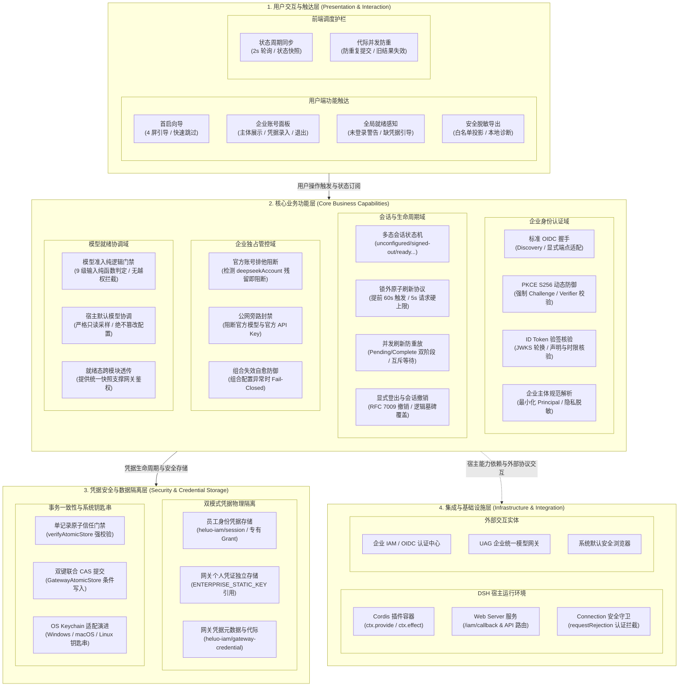
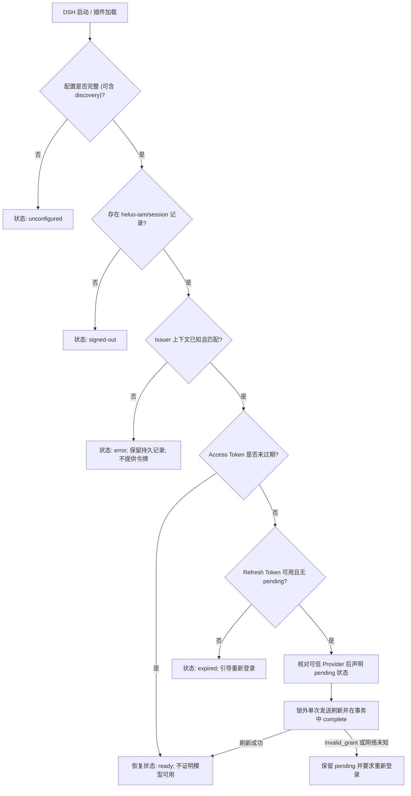
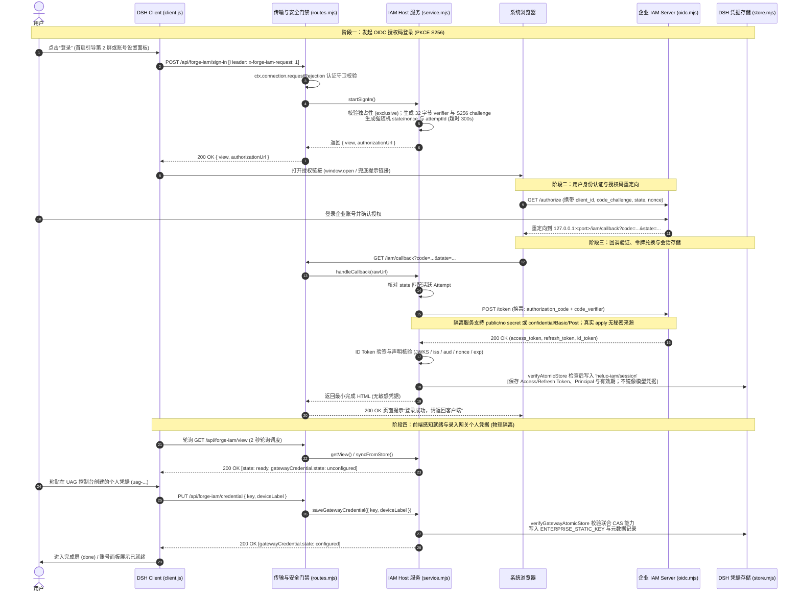
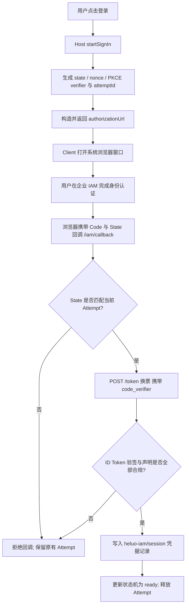

# IAM 接入详细设计

## 文档信息

| 项 | 内容 |
|---|---|
| 文档编号 | CORP-DSH-DESIGN-002 |
| 文档名称 | IAM 接入详细设计 |
| 版本 | V1.17.7 |
| 文档状态 | 草案 |
| 密级 | — |
| 编制 | DSH 平台组（代拟） |
| 审核 | 待定 |
| 批准 | 待定 |
| 最后更新 | 2026-11-04 |
| 门禁 | G0 认领；G1 接入与生命周期契约；G2 双端联调准入 |
| 模块状态 | 可用（设计阶段；实现与验证见设计索引 §2.2） |

> **编制依据**：2026-10-21 对目标环境已安装 DSH `0.2.1-rc.2` 做运行时与包文档核验，并同日由用户确认采用 **O3「企业 IAM 独占登录」**；官方登录在企业内网不可用，因此不保留官方登录、官方模型、官方 API Key 与官方账户 UI 旁路。已核验：`ctx.credentials` 的 `resolve` / `set` / `readRecord` / `modifyRecord` / `deleteRecord` 与 `GrantRecord.payload`；`ctx.authorization` 的 flow 注册、单次尝试与 commit 语义；`ctx.webServer.register` 及官方账号包对 `/oauth/callback` 的占用；`dsh-llm-pi-ai` 的 `apiKeyEnv` 每请求解析；`dsh-credentials-local` 的 0600 YAML 存储；官方账号、模型与 UI 包名及目标 profile 的 row id。**未核验**：IAM 的 `resource`、RFC 7009 撤销与 RP 登出的程序化接口、网关端到端撤权时延；禁用四行后 shell/onboarding 是否完整；回调路由与 launch token/RPC 认证的交互；`engines.dsh` 断言形态；Windows/UOS/麒麟实机。以上未核验项不写成已实现。
>
> **关联文档**：[总体架构](../../architecture/platform-architecture.md)、[网关契约](../../contracts/gateway-contract.md)、[双模式凭据](../credential-modes.md)、[企业组合包](forge-enterprise.md)、[模型网关](forge-gateway.md)、[设计索引](../README.md)、[需求基线](../../requirements/requirements-baseline.md)、[IAM 独立问询函](../../collaboration/iam-confirmation-letter.md)、[机密客户端隔离设计](../iam-confidential-isolated.md)、[机密认证契约](../../contracts/iam-client-auth-isolated.md)。

---

## 1. 概述与核心结论

### 1.1 核心结论

本模块的安全目标是**企业 IAM 独占登录（O3）**：未登录时企业模型与工具均应拒绝执行。官方入口由 `@heluo/forge-enterprise` 在组合层禁用，不提供公网回落。当前实现没有接入真实模型与工具执行门禁，不能据此认定企业调用已被阻断；现行能力与证据见[设计索引 §2.2](../README.md#22-实现与验证入口)。

安全体系严格区分企业身份、能力授权和应用外壳准入：
1. **外壳准入**：应用外壳正常启动与展示，不接管 DSH 打开入口；
2. **身份与授权分流**：企业 IAM 会话（存储于 `heluo-iam/session`）仅证明员工身份；个人模型调用凭据（`ENTERPRISE_STATIC_KEY`）由控制台签发并录入，二者生命周期独立；
3. **执行入口校验**：企业调用须在执行入口验证当前身份与授权，失败时拒绝并提供重新登录引导。账户页的登录状态不构成执行入口的实现证据。

生产准入必须具备：IAM 登录、刷新、撤销与当前授权生命周期的正式契约；目标平台的存储、界面与官方入口禁用验证；真实网关授权和执行链路验证。账户页与四步引导属于现行界面，生产钥匙串（Keychain）与安全迁移属于未实现目标；不提供附加登录（additive）模式。

### 1.2 生产目标与现行实现的差距

> **2026-10-28 IAM 回函口径校正（设计目标，不是已实现）**：厂商 6.0.3/6.3 书面回函均不支持公共客户端/PKCE S256；内部校验回函 §02 仅称授权码 PKCE 能力（允许 `plain`），§08 未答，不能推出免 Secret 公共客户端。V1 生产形态改为预注册机密客户端 + `client_secret` 存系统钥匙串，保留 PKCE 代码但当前无法关闭；实际隔离服务已接入 public/V1 与 confidential/Basic/Post/V2，所有模式仍强制 S256；真实 apply 未接秘密来源，厂商方法与平台存储仍待核验，不能作为生产准入证据。依据与逐项冲突见 [IAM 台账 §4.5.5](../../collaboration/iam-confirmation-letter.md#455-新版回函的来源冲突与待核验边界)。

> **2026-11-03 IAM 接入确认（设计约束，不是已实现）**：企业 IAM 团队对[接入确认函 C1—C11](<../../collaboration/iam-access-confirmation.md>) 逐项书面答复。设计按以下事实收敛：全企业共用一个 `client_id`；`client_secret` 只能人工轮换，更新后最迟两分钟生效，且不使已发出的访问令牌失效（按 7200 秒自然过期）；刷新必须携带 secret，轮换后旧刷新令牌实际不可用；登出作用于浏览器会话，全局退出会作废该会话下全部应用令牌；刷新成功后旧访问令牌实时作废；旧刷新令牌重用只拒绝本次请求（401 `invalid_grant`），不作废授权链。由此新增三项未闭环：无法按 RP 隔离后的单令牌撤销替代（D1）、轮换缓存窗口内新旧 secret 的并存语义（D2）、刷新令牌是否滑动续期及绝对期限（D3）。原“客户端可调用的撤销/登出接口”问题因员工离职/停用不属于 DSH 项目管理范畴而撤回，接口存在性并入 D1。真实联调未开始，本设计只记录约束与差距。

**隔离消费进展**：非秘密会话见证、独立许可核心、自有合成工具/命令与模型已分段实现和验收；根16项通过实际IAM工厂、mock IdP及公开测试导出组合验证，最终证据见[PLAN-007](<../../plans/2026-11-02-iam-consumer-isolated.md>)。独立审阅与本批完整检查已通过。明确issuer的public/Basic/Post分段证据与public/Basic实际联合证据不能混写；不同issuer/person整体替换不等于同issuer纯换人。首次discovery-only不在callback补票，ready不等于可消费；真实profile与提供方授权未接通。

生产需求见[基线 §4.6](../../requirements/requirements-baseline.md#46-模型访问身份与专用凭证要求)，候选路线及时间语义见[评审稿](../../architecture/gateway-identity-review.md)，IAM 原函覆盖评估见[问询函 §8](../../collaboration/iam-confirmation-letter.md#8-本轮需求覆盖评估与补充确认清单平台内部)。

| 现行能力或已有描述 | 生产准入要求 | 差距与现状 |
|---|---|---|
| 静态 Key 录入、清除、状态与本地 ownerSubject | 个人路线由网关认证当前人并核对 Key owner；本地记录不能证明归属 | 待 IAM/网关能力及 DSH 承载核验；当前 Key 仅作物理独立存储 |
| 会话 access/refresh 取用及本地单飞刷新 | 网关目标授权、跨客户端稳定人员映射、停用后五分钟拒绝新请求 | 既有本地单机/双进程实现不能证明端到端满足；IAM 已答手动停用理论实时、按人/令牌/会话三级注销，但撤销接口与网关时延未证实 |
| 本地退出、可选 RP 和单 token 撤销描述 | 默认只退出当前设备授权，接受撤销后五分钟内覆盖全部刷新后代及 AT，不牵连其他设备/应用或全局 SSO | IAM 答复 RP 登出作用于浏览器会话，同会话其他应用一并失效，无法按 RP 隔离；默认退出不得直接调用全局登出，单授权撤销接口待 D1 |
| 离线/故障清理 | 本地立即停止并取消在途，服务端未确认如实展示；只有仍保证有效授权与五分钟上限时可继续调用 | 待正式契约及双端实机联调 |

---

## 2. 目标与非目标

### 2.1 目标

- **企业 IAM 唯一登录**：企业 IAM 是唯一有效登录途径；官方登录入口、官方模型路由、官方 API Key 路由均在组合层禁用。
- **可信身份建立**：企业 IAM 建立可信身份与目标授权；个人调用凭据路线在能力核验后选定。
- **标准授权码 + 回调**：系统浏览器完成授权交互；授权码换票走本机 Loopback 回调（默认 `/iam/callback`）；V1 以机密客户端 + 系统钥匙串落地，保留强制 PKCE S256 机制。
- **严格 OIDC 校验**：支持 OIDC discovery 与显式端点；严格校验 `state`、`nonce`、`iss`、`aud`、JWT 签名算法（RS256/PS256/ES256）、`exp`/`nbf` 及时间容差。
- **原子安全存储与锁外刷新**：令牌记录写入 DSH 凭据服务；刷新采用“原子声明 pending → 锁外单次请求 → 条件提交 complete”防重放协议；等待者不接管，调用方不接触 refresh token。
- **双模式凭据分离展示**：账户页展示主体、到期、状态、网关凭据状态与登录/取消/退出；首启 4 屏引导（可跳过）；未登录或网关凭据未配置时明确提示模型未就绪。
- **显式退出与撤销**：退出清理本地逻辑记录；撤销/登出接口确认前不发送未经验证的请求，也不默认调用会牵连同浏览器会话其他应用的全局登出；服务端撤销闭环未确认时如实展示状态。默认保留个人长期网关 Key。

### 2.2 非目标

- **不接管外壳打开入口**：不拦截“打开 DSH”进程本身；未登录仅导致企业能力不可用。
- **不保留任何官方公网旁路**：不提供官方登录、官方模型、官方 API Key 或其他公网回退途径。
- **不做多账号与复杂登录**：不做 additive 双登录、多账号并存、MCP token broker 或 CLI 登录。
- **不代发代管网关凭据**：不签发、不刷新、不自动轮换 UAG 网关凭据；客户端不模拟控制台。
- **不修改 DSH 内核**：不修改 DSH 源码，不创建 fork；若禁用官方行破坏核心功能，暂停 O3 并提交方案评审，不引入内核补丁。
- **不做营销级引导**：首启 onboarding 固定为标准 4 屏，不做品牌营销、用量账单或充值页。

---

## 3. 需求契约与环境依赖

### 3.1 支撑需求与验收指标

| 需求/验收 | 关系 | 详细说明 |
|---|---|---|
| REQ-01 / A1、A14 | 支撑 | 授权码 + Loopback 回调；V1 机密客户端，PKCE S256 校验；`state`/身份校验异常时拒绝；未登录或网关凭据未配置时企业模型不可用 |
| REQ-02 / A2 | 支撑 | 刷新成功后原子更新令牌；多进程遵守 pending/complete 协议；5 秒请求及等待界限不覆盖全部存储 I/O，不构成总耗时 SLA |
| REQ-05 / A2、A3 | 支撑 | 严格区分身份、Key、授权及故障模式；额度用尽不自动重试，已执行或未知结果不重放 |
| REQ-17 / A12 | 支撑 | IAM/凭据/必要审计缺失时，企业调用 fail-closed 明确拒绝而非静默降级 |
| C1、C4 | 约束 | 仅允许走企业模型网关；不保留公网路由；日志绝不记录正文、令牌或个人密钥 |

### 3.2 宿主环境与组件依赖

> **随包事实复核依据**：2026-10-21 在 `0.2.1-rc.2` 上核验；2026-10-25 在 `0.2.1-rc.3` 复核，默认组合挂载 `@deepseek-ai/dsh-credentials-local`（`dsh --dump-config` 的 row id `credentials`）；本机 `dsh --version` = `0.2.1-rc.3`。

| 依赖组件 | 类型 | 版本约束 | 缺失时的行为与安全边界 |
|---|---|---|---|
| `dsh-credentials` + `dsh-credentials-local` | 包 | 随目标 DSH 提供 | 无法读写凭据记录；插件不进入 ready，明确报错退出 |
| `dsh-web-server`（`ctx.webServer`） | 包 | 随目标 DSH 提供 | 无法注册回调路由；登录流程不可用 |
| `dsh-settings` | 包 | 随目标 DSH 提供 | 设置不可持久化；按只读配置启动或报错 |
| `dsh-llm-pi-ai` | 包 | 随目标 DSH 提供 | 无模型消费路由；不影响账号登录本身 |
| `dsh-agent-default-model` | 包 | 随目标 DSH 提供 | 不自动设默认模型；由用户手动选择 |
| IAM OIDC 授权服务器 | 服务 | 标准 OIDC 协议 | 未配置即显示 `unconfigured`；不阻断其他无关插件加载 |
| `@heluo/forge-enterprise` | 包 | 同批次方案包 | 负责在组合层禁用官方账号包；若在位则本模块报独占冲突 |
| `@heluo/forge-gateway` | 包 | 同批次方案包 | 提供实际模型网关拦截与凭据探测；缺少时模型无法执行 |

---

## 4. 架构设计与系统边界

### 4.1 功能架构全景

`forge-iam` 的功能架构聚焦于**企业身份认证、会话生命周期管控、凭据安全物理隔离与企业独占性防护**，自顶向下划分为**用户交互层、核心业务功能层、凭据安全数据层与集成基础设施层**四大层级：



#### 功能架构职能分解矩阵

| 架构层级 | 功能域 | 核心职能模块 | 业务价值与安全控制目标 |
|---|---|---|---|
| **1. 用户交互与触达层** | 用户端功能触达 | 4 屏首启向导、企业账号面板、全局状态横幅、安全脱敏诊断导出 | 规范开箱体验，提供一站式账号查看、Key 录入与安全退出入口；诊断信息严格白名单脱敏，严禁外发或泄漏密钥 |
| | 前端调度护栏 | 2 秒周期性轮询调度器、代际并发防重护栏 | 确保客户端视图与 Host 状态实时一致；通过请求代际推进防范用户重复点击，自动废弃过时响应 |
| **2. 核心业务功能层** | 企业身份认证域 | 标准 OIDC 握手、PKCE S256 动态防御、ID Token 验签核验、企业主体规范解析 | 落地企业统一认证，强制 S256 防御授权码拦截攻击；严格基于 JWKS 验签，抽取规范化员工身份 Principal |
| | 会话与生命周期域 | 多态会话状态机、锁外原子刷新协议、并发刷新防重放、显式登出与会话撤销 | 管控完整会话生命周期；提前 60 秒静默刷新，双阶段 Pending/Complete 协议防止并发击穿与重放；遵循 RFC 7009 尽力撤销 |
| | 企业独占管控域 | 官方账号排他阻断、公网旁路封禁、组合失效自愈防御 | 落实 O3 企业独占登录原则；启动时强校验官方服务残留，发现违规立即 Fail-Closed，彻底杜绝公网旁路与数据外泄 |
| | 模型就绪协调域 | 模型准入纯逻辑门禁、宿主默认模型协调、就绪态跨模块透传 | 提供纯函数模型前提准入判定；严格以只读方式观察宿主模型设置，绝不篡改用户配置，与 `@heluo/forge-gateway` 职责正交 |
| **3. 凭据安全与数据层** | 双模式凭据物理隔离 | 身份凭据存储区（Session）、网关凭据独立存储区（Static Key）、网关元数据专区 | 彻底切断员工身份令牌与模型访问凭据的物理关联；IAM Access Token 不作模型镜像，个人 Key 物理独立保护 |
| | 事务一致性与钥匙串 | 单记录原子信任门禁、双键联合 CAS 提交、OS Keychain 适配演进 | 确保凭据写盘具备原子互斥能力；网关 Key 与元数据通过 CAS 联合一致性提交；杜绝明文降级，推动系统钥匙串落地 |
| **4. 集成与基础设施层** | DSH 宿主环境 | Cordis 插件容器、Web Server 路由服务、Connection 安全守卫 | 依托 Cordis 声明生命周期所有权；通过宿主连接守卫拦截非法跨域与未授权接口调用 |
| | 外部交互实体 | 企业 IAM 服务端、UAG 模型网关控制台、系统默认浏览器 | 对接企业标准 IdP 完成授权码重定向；由用户自主在 UAG 控制台签发个人令牌，保持职责清晰 |

### 4.2 扩展形态与插件宿主集成

| 架构项 | 详细内容 |
|---|---|
| 扩展形态 | Host 服务插件（Node.js / Cordis） + Client 界面插件（React / Web & Desktop） |
| 运行位置 | 本机 Host 执行核心业务逻辑；Client 负责界面渲染、用户触发与状态轮询 |
| 目标环境 | 见仓库根 `.dsh-version`（基准核验版本 `0.2.1-rc.2` / `0.2.1-rc.3`） |
| 宿主 Seam / 服务 | `ctx.credentials`、`ctx.webServer`、`ctx.connection`、`ctx.settings`、`ctx.slots`、`llm`、`agentDefaultModel` |
| 不修改的核心 | DSH 内核、凭据存储底层实现、模型调用链路、官方账号包源码（仅组合层禁用） |
| 登录入口形态 | 当前为 Host `ctx.iam` + 同源 HTTP API（`/api/forge-iam/*`） + Client 2 秒轮询；Client Remote/watch 尚未接入 |
| 回调机制 | `ctx.webServer` 注册 `redirectPath`（默认 `/iam/callback`）；不复用官方 `/oauth/callback` |

### 4.3 官方账号禁用与独占断言

| Row id（目标 profile） | 官方包名 | 处理策略 | 实施原因 |
|---|---|---|---|
| `deepseek-account` | `@deepseek-ai/dsh-deepseek-account-platform` | `disabled: true` | 官方登录与账号状态；内网环境不可用 |
| `llm-deepseek-account` | `@deepseek-ai/dsh-llm-deepseek-account` | `disabled: true` | 官方 `deepseek-account` 模型路由 |
| `llm-deepseek` | `@deepseek-ai/dsh-llm-deepseek-api-key` | `disabled: true` | 官方 API Key 旁路入口 |
| `ui-settings-account` | `@deepseek-ai/dsh-client-ui-settings-account` | `disabled: true` | 官方账户页、侧边栏入口与 onboarding |

禁用补丁由 `@heluo/forge-enterprise` 在组合层打入。官方账号包已占用 `/oauth/callback`，本模块使用独立的 `/iam/callback`，不依赖“官方行一定已被禁用”来避免路由冲突。

本模块启动时通过 `src/exclusive.mjs` 主动检查 `ctx.get('deepseekAccount')`：若发现服务残留，立即记录 `exclusive-violation` 审计事件，拒绝进入 `ready` 状态，不提供模型凭据引用。确保组合层禁用失败时显式阻断，绝不静默保留官方身份。

### 4.4 客户端 UI 交互设计

| 交互场景 | 界面行为与契约约束 |
|---|---|
| 首启引导 | 未标记“已跳过/已完成”时弹出 4 屏：1.欢迎 → 2.登录 → 3.网关凭据（控制台入口/设备命名/粘贴） → 4.完成；欢迎屏可跳过；已配置凭据标记 `done`，否则标记 `skipped` |
| 未登录状态 | 顶部显示登录横幅与账号入口，不阻断外壳使用；隐藏或禁用企业模型由策略包及网关包负责 |
| 登录中状态 | 显示 Attempt 尝试状态与取消按钮；浏览器未正常唤起时展示“打开登录页”备用链接；账户页可复制该链接 |
| 已登录未配置凭据 | 显示“模型未就绪”横幅并引导至“设置 → 企业账号”；不将此状态误报为登录失败 |
| 已登录状态 | 账户页显示身份主体、Access 到期时间、网关凭据状态/设备标签/录入时间/存储来源/控制台入口/清除按钮；支持退出登录与脱敏诊断导出 |
| 官方界面拦截 | 隐藏全部官方账户页、官方登录按钮、官方模型选择与官方 API Key 入口 |
| 插槽挂载点 | 注册于 `settings.section`（order: 30）与 `shell.overlay`；不占用单占位 `settings.launcher` |

**前端契约细节**：
- `shell.overlay` 默认为穿透层（`pointer-events: none`），引导弹窗遮罩层必须显式声明 `pointerEvents: 'auto'`，否则内部按钮与输入框无法点击。
- 登录横幅轮询与组件生命周期绑定，进入 `ready` 后仍持续监听退出与失效事件；引导界面的 `ready` 轮询只在 `step < 2` 时推进，避免重复快照将已完成界面拉回登录屏。
- 账户页“复制脱敏诊断”仅导出当前视图白名单字段（布尔标记、状态枚举、缺失项数量、错误码），严禁导出主体、URL、Token、Code、Verifier、Secret 或网关 Key 原文。

### 4.5 回调与浏览器交互规范

- **回调 URI**：由 Host 实时 `webServer` 的 origin 与配置的 `redirectPath` 组合生成。`startSignIn()` 不信任客户端传递的 callbackOrigin。显式配置的 `redirectUri` 路径必须与 `redirectPath` 完全一致。
- **回调只读与 PKCE 验票**：回调接口仅接受 `GET`，严格匹配活跃 Attempt 的 `state`；授权换票 POST 请求携带当前尝试的 `code_verifier` 由 IAM 服务端校验，绝不允许浏览器将 verifier 暴露在 URL 中。
- **同源管理保护**：管理 API（`/api/forge-iam/*`）必须通过宿主 `ctx.connection.requestRejection` 守卫；要求 `x-forge-iam-request: 1` 自定义请求头；凭据写入接口限制 JSON 体最大为 8 KiB。
- **浏览器拉起**：Web 端通过用户点击预开标签页；Desktop 端现行 interim 采用 `window.open` + 兜底链接。回调页面仅返回最小纯文本/HTML 提示（“登录成功，请返回客户端”），不加载外部资源，不向页面写入 Token。

### 4.6 架构选型论证：为什么不用 `authorization` flow

DSH 内置的 `ctx.authorization` flow 适合“任意界面单次唤起凭据录入并提交 commit”；但 `forge-iam` 必须覆盖浏览器重定向回调、令牌后台原子轮换、主动撤销以及跨多组件的账户生命周期。Flow 的 commit 语义仅覆盖首次获取，无法优雅支撑长周期会话管理。

因此，V1 采用与官方账号包同构的 **Host Service + 内部状态机 + 同源管理 API** 模式，避免同一插件内部维护两套冲突的 Attempt 状态。

---

## 5. 接口与配置契约

### 5.1 配置项规范

配置对象在挂载插件时直接传入，不包裹额外的 `iam` 前缀层。配置校验规则见 [`packages/forge-iam/src/config.mjs`](<../../../packages/forge-iam/src/config.mjs>)。

| 配置项 | 类型 | 默认值 | 必填 | 详细语义说明 |
|---|---|---|---|---|
| `clientId` | string | 空 | 是 | 预注册客户端标识；public 无 secret，隔离 confidential 显式 Basic/Post |
| `authMode` | string | `public` | 否 | 认证模式；实际服务支持 public 与受信隔离 confidential，真实 apply 不提供秘密来源 |
| `clientAuthMethod` | string | `none` | 否 | 客户端认证方法；Public 必须为 `none`；Confidential 支持 basic/post |
| `clientSecretRef` | string | 空 | 条件 | 机密客户端逻辑选择器；必须与具体受信来源精确匹配，配置不能自证来源 |
| `discoveryUrl` | string | 空 | 条件 | OIDC discovery 地址；与显式端点配置二选一 |
| `issuer` | string | 空 | 条件 | 显式端点时必填；作为发行者 Pin，用于 ID Token `iss` 校验 |
| `authorizationEndpoint` | string | 空 | 条件 | 显式授权端点；若与 discovery 同时配置则显式优先 |
| `tokenEndpoint` | string | 空 | 条件 | 显式令牌换票端点 |
| `jwksUri` | string | 空 | 条件 | 显式公钥集地址，用于 ID Token 签名校验 |
| `revocationEndpoint` | string | 空 | 否 | RFC 7009 令牌撤销端点；未配置时退出仅作本地清理 |
| `endSessionEndpoint` | string | 空 | 否 | RP 登出端点；`logoutMode=rp` 时必填 |
| `scopes` | string[] | `['openid', 'profile', 'offline_access']` | 是 | 申请 Scope 列表；必须包含 `openid` |
| `redirectPath` | string | `/iam/callback` | 否 | 本机回调绝对路径；不可为站点根或带尾斜杠 |
| `redirectUri` | string | 空 | 否 | 显式绝对回调 URI；非 loopback 必须 HTTPS，生产须与 IAM 登记值逐字一致 |
| `postLogoutRedirectUri` | string | 空 | 否 | RP 登出回跳地址；仅允许 loopback 上的 HTTP 或全量 HTTPS |
| `gatewayResource` | string | 空 | 否 | 授权/令牌请求的可选 `resource` 参数；静态 Key 模式下缺省 |
| `gatewayConsoleUrl` | string | 空 | 否 | UAG 个人凭据控制台入口链接；仅用于界面引导，不参与鉴权 |
| `defaultProvider` | string | `enterprise` | 否 | 只读模型采样目标 Provider |
| `defaultModel` | string | 空 | 否 | 只读模型采样目标 Model；为空时不注册模型协调监听 |
| `refreshSkewSeconds` | number | 60 | 否 | Token 到期前预刷新窗口（秒） |
| `attemptTimeoutSeconds` | number | 300 | 否 | 登录 Attempt 有效期（秒） |
| `httpTimeoutMs` | number | 10000 | 否 | 网络请求超时时间（毫秒）；刷新与撤销请求另设 5000ms 硬上限 |
| `logoutMode` | string | `local` | 否 | 登出模式：`local`（本地清理+尽力撤销）或 `rp`（跳转 RP 登出） |
| `requireExclusive` | boolean | `true` | 否 | 独占断言开关；发现官方账号服务在位时拒绝就绪 |
| `allowInsecureHttp` | boolean | `false` | 否 | 仅测试开启；仅放行 `127.0.0.1`、`localhost`、`::1` |

### 5.2 现行接口规范（V0.4.1 Interim）

当前代码运行形态为 **Host Service（Node.js） + 同源 HTTP API + Client 2 秒轮询**。

#### 5.2.1 Host 服务接口（`ctx.iam`）

由 `createIamService(config, options)` 创建并注册为 `ctx.iam`，供宿主及路由调用：

| 方法 | 参数 | 返回值与语义说明 |
|---|---|---|
| `getView()` | 无 | 同步返回当前的 `IamView` 状态快照 |
| `watch(signal)` | `AbortSignal` | 当前已实现的Host观察器：初始快照加notify更新，取消或dispose后清理等待；不主动替代HTTP存储同步 |
| `hydrate()` / `syncFromStore()` | 无 | 异步从凭据存储恢复或同步会话及网关凭据状态 |
| `startSignIn()` | 无 | 创建（或复用）活跃 Attempt，返回 `{ view, authorizationUrl }` |
| `cancelSignIn()` | 无 | 取消当前实例的活跃 Attempt，返回更新后的 `IamView` |
| `handleCallback(rawUrl)` | `rawUrl: string` | 接收回调完整 URL，校对 State，执行换票与验签，落库后返回 |
| `signOut()` | 无 | 执行退出流程，返回 `{ view, logoutUrl, revocation, revocationError? }` |
| `resolveToken()` | 无 | 返回当前有效的 Access Token（按需触发锁外刷新）；不暴露 Refresh Token |
| `getPrincipal()` | 无 | 返回 `{ issuer, subject }` 最小主体标识，供审计与策略使用 |
| `saveGatewayCredential(input)` | `{ key, deviceLabel }` | 联合 CAS 写入网关个人 Key 与元数据，返回 `IamView` |
| `clearGatewayCredential()` | 无 | 联合 CAS 写入网关凭据墓碑记录，返回 `IamView` |
| `reconcileDefaultModel()` | 无 | 宿主只读模型协调采样，返回 `{ mode: 'read-only', written: false, ... }` |

#### 5.2.2 同源 HTTP 路由（`/api/forge-iam/*`）

挂载于 `ctx.webServer`，均经 `ctx.connection.requestRejection` 守卫放行，变更接口要求 `x-forge-iam-request: 1` 标头：

| 路径与方法 | 输入 Body | 返回状态与数据 |
|---|---|---|
| `GET /api/forge-iam/session` | 无 | 200 OK 返回 §5.5.2 的身份快照；不触发同步或刷新，永不含令牌 |
| `POST /api/forge-iam/token` | 无 | 200 OK 返回 `{ token, expiresAt }`；要求 `x-forge-iam-request: 1`，响应不缓存 |
| `POST /api/forge-iam/bridge/token` | loopback + `authorization: Bearer <能力值>` | 200 OK 返回 `{ token, expiresAt }`；不缓存 |
| `GET /api/forge-iam/view` | 无 | 200 OK 返回 `IamView` 快照（可能触发后台过期刷新） |
| `POST /api/forge-iam/sign-in` | `{}` | 200 OK 返回 `{ view, authorizationUrl }` |
| `POST /api/forge-iam/cancel` | `{}` | 200 OK 返回 `{ view }` |
| `POST /api/forge-iam/sign-out` | `{}` | 200 OK 返回退出结果对象（失败返回 503） |
| `GET /api/forge-iam/credential` | 无 | 200 OK 返回 `{ credential }` 网关凭据视图 |
| `PUT /api/forge-iam/credential` | `{ key, deviceLabel? }` | 200 OK 返回 `{ view }`（体积限制 ≤ 8 KiB） |
| `DELETE /api/forge-iam/credential`| 无 | 200 OK 返回 `{ view }` |

#### 5.2.3 最小只读订阅接缝（source/mock 已实现）

已按用户批准的 source/mock 范围完成私有接缝：[观察组](<../../../packages/forge-iam/src/iam-view-observer.mjs>)与[消费者](<../../../packages/forge-iam/src/iam-view-consumer.mjs>)，仅经测试入口导出，契约见 [IAM-004](<../../contracts/iam-view-observer-isolated.md>)。18 项定向用例通过；完整检查 2599 项中 2597 通过、0 失败、2 项平台跳过。

真实 Client 仍走 §5.2 的 HTTP 轮询；真实 Remote 注册、宿主调用上下文、资源策略与生产准入未开放；不采纳 §5.3 整套未来协议。

| 决定 | 本批方案 | 状态与保留动作 |
|---|---|---|
| 数据边界 | 复用当前 [createView](<../../../packages/forge-iam/src/state.mjs>) 非秘密视图，按既有 12 字段白名单投影 | 已实现；不发布新 DTO、不改当前 HTTP 响应，不新增主体、登录链接、attempt、probe 或换票字段 |
| 管理面访问 | 测试传输签发独立校验器；退出 IAM 仍可读登录页；不接受 DTO 自报 owner | 已实现（模拟）；真实 Host 调用上下文未接，不用 RPC 认证替代企业许可 |
| 访问实现 | 真实 Gateway 调用上下文与资源策略；`remoteAccess.allows` 在 Remote 外默认 true，不能单独当认证 | 未实施；缺可信上下文、资源声明或逐帧撤销语义时保留 HTTP，不用 Boolean 或缓存快照补票 |
| 同步归属 | Host 观察组持有单飞同步周期，复用 `syncFromStore → loadGatewayCredential → getView` 与现有缓存/退避；无订阅即停 | 已实现；不删 Client 轮询，不以强制 `hydrate` 替代周期同步，不自建第二套刷新或授权状态 |
| 传输与版本 | 状态观察使用独立测试传输；登录、退出、凭据与尝试取消继续走 HTTP；权限失败或未知不降级重试 | 已实现隔离传输；真实 Remote 未接，包下限不变，rc.5 行为不推及 rc.2/rc.3 |

状态同步不是纯内存读：[syncFromStore](<../../../packages/forge-iam/src/service.mjs>) 在 Access Token 已过期、Refresh Token 可用且满足 30 秒退避时，会后台调用 `resolveToken`。迁移须保留该既有条件与去重，不得每帧强制刷新；停止观察也不声称撤回已发送请求。

新增字段、精确 Remote 端点、codec 及资源声明仍归后续字段契约。本段只锁定设计取舍，不制造 SDK 方法；真实注册位置、字段与资源声明仍待契约与准入，不重开 A—E。

### 5.3 生产目标接口定义（V1 Remote Target）

以下 TypeScript 契约描述未来的 Remote/watch 目标模型（当前 Client 暂未接入 Remote，以 §5.2 为准）：

```ts
export type IamState =
  | 'unconfigured'
  | 'signed-out'
  | 'authenticating'
  | 'ready'
  | 'expired'
  | 'unreachable'
  | 'error';

export interface IamPrincipal {
  readonly issuer: string;
  readonly subject: string;
  readonly displayName?: string;
  readonly groups?: readonly string[];
}

export interface GatewayCredentialView {
  readonly state: 'unconfigured' | 'configured' | 'invalid' | 'owner-mismatch';
  readonly ownerSubject?: string | null;
  readonly deviceLabel?: string | null;
  readonly enteredAt?: string | null;
  readonly suggestedExpiry?: string | null;
  readonly storage?: string | null;
  readonly matchesAccount?: boolean;
  readonly lastProbeAt?: string;
}

export interface IamView {
  readonly state: IamState;
  readonly principal?: IamPrincipal;
  readonly accessExpiresAt?: string;
  readonly gatewayCredential: GatewayCredentialView;
  readonly authorizationUrl?: string;
  readonly attemptId?: string;
  readonly error?: { readonly code: string; readonly message: string };
}

export interface IamAccount {
  startSignIn(client: { version: string }, callbackOrigin: string, loginSource: 'web' | 'desktop'): Promise<IamView>;
  cancelSignIn(attemptId: string): Promise<IamView>;
  signOut(client: { version: string }): Promise<IamView>;
  getView(): Promise<IamView>;
  watch(signal: AbortSignal): AsyncIterable<IamView>;
  getPrincipal(): IamPrincipal | undefined;
  setGatewayCredential(input: { value: string; label?: string }): Promise<IamView>;
  clearGatewayCredential(): Promise<IamView>;
  probeGatewayCredential(): Promise<IamView>;
  tokenFor(resource: string): Promise<{ token: string; expiresAt: number }>;
}
```

### 5.4 机密客户端迁移与 Secret 生命周期（P0 阻断事项）

> **当前状态**：实际隔离服务已接入 Basic/Post、V2 会话、刷新与撤销。真实 apply 不注入秘密来源，缺少具体受信来源仍抛出 `IAM_CLIENT_AUTH_UNVERIFIED`；隔离通过不等于生产迁移完成，禁止靠部署配置绕过来源与存储门禁。

落地生产前必须补齐的闭环事项：

| 事项 | 生产要求与验收指标 | 当前工程状态 |
|---|---|---|
| Client 注册 | 全企业共用一个 `client_id`，不按部门或设备拆分；明确注册范围与客户端容量 | 已按 C1 确认；注册材料与测试入口待联调 |
| Secret 下发 | 由管理员受控渠道安全下发至本机系统钥匙串；严禁写入配置文件或明文源码 | 仅测试夹具内存模拟 |
| 钥匙串存储 | 必须由 OS Keychain 提供保护；钥匙串不可用时 fail-closed；拒绝明文 fallback | Keychain 生产适配器未实现 |
| 轮换与吊销 | 人工轮换、更新后最迟两分钟生效；轮换不作废旧访问令牌（按 7200 秒自然过期），旧刷新令牌因必带 secret 而实际不可用；client_secret 泄露不在评估范围（用户 2026-11-03 决定） | 流程未制定；缓存窗口语义待 D2 |
| 程序化撤销与登出 | 客户端可调用的单授权撤销接口、鉴权、回执与最坏时延 | 未确认（D1）；登出无法按 RP 隔离 |
| 首次引导 | 登录前必须预置 Secret，否则阻断登录流程；禁止在前端 4 屏中由普通用户手工录入 | 流程待设计 |
| 协议验收 | `/token`、刷新与撤销均携带合规的客户端凭据；Secret 不进日志、不进错误堆栈 | 隔离实际服务已验，企业端点未验 |

---

### 5.5 跨模块身份与令牌读取（B+E 方案）

> 2026-11-04 用户确认。本节只定读取面；代码侧目前仅 `resolveToken()`、`getPrincipal()`、`getView()`、`watch()` 存在，其余接口未实现。

问题：登录完成后，其他插件、服务与 CLI 没有公开读法。`ctx.iam` 上虽然有方法，但没有契约、没有消费方、没有令牌出口，用户信息只有 `subject`。

#### 5.5.1 分层与唯一刷新者

| 消费方 | 入口 | 能拿到 |
|---|---|---|
| Host 插件与服务 | `ctx.iam.getSession()` / `getAccessToken()` | 身份、时效；令牌须显式取 |
| 浏览器插件、同源页面 | `GET /api/forge-iam/session`、`POST /api/forge-iam/token` | 身份；令牌单独端点 |
| CLI、脚本、子进程 | `heluo-forge auth whoami` / `auth token` | 同上 |

**只有 IAM 服务刷新令牌。** 其余入口一律只读：已确认的轮换语义是旧刷新令牌使用即作废，并发刷新会互相踢掉会话。CLI 在 Host 不在时只返回未过期访问令牌，过期即报错要求回到 Host 重新登录。

#### 5.5.2 Host 服务方法

| 方法 | 参数 | 返回 | 语义 |
|---|---|---|---|
| `getSession()` | 无 | `{ status, signedIn, principal, accessExpiresAt, scope }` | 只读身份快照，永不含令牌 |
| `getAccessToken()` | 无 | `Promise<string>` | 等价现有 `resolveToken()`；按需刷新，单飞 |
| `subscribe(listener)` | `(snapshot) => void` | 取消函数 | 现有 `watch()` 的监听别名，供非生成器消费方 |
| `getPrincipal()` | 无 | `{ issuer, subject }` | 保留，向后兼容 |

`status` 沿用 `IamState`（unconfigured、signed-out、authenticating、ready、expired、unreachable、error）。

#### 5.5.3 同源 HTTP

| 路径与方法 | 请求约束 | 成功 | 失败 |
|---|---|---|---|
| `GET /api/forge-iam/session` | 同源放行（`ctx.connection.requestRejection`） | 200 `getSession()` | 409 未配置；503 凭据不可用 |
| `POST /api/forge-iam/token` | 同源 + `x-forge-iam-request: 1` | 200 `{ token, expiresAt }` | 401 `IAM_NOT_SIGNED_IN`；409 `IAM_REAUTH_REQUIRED` |

两者均返回 `cache-control: no-store` 与 `x-content-type-options: nosniff`；令牌端点只接受 POST，不支持表单编码，不提供 GET 形态。

#### 5.5.4 CLI

| 命令 | 输出 | 退出码 |
|---|---|---|
| `heluo-forge auth whoami [--json]` | 身份与状态（与 `getSession()` 同形） | 0 |
| `heluo-forge auth token` | 仅令牌一行 | 0；未登录 2；已过期 3；后端不可用 4；用法错误 64 |

两条路径，优先 Host 在线：

- **Host 在线**：`HELUO_FORGE_IAM_URL` 指向运行中的 DSH（如 `http://127.0.0.1:49196`）时，CLI 从凭据库取能力值 `HELUO_IAM_BRIDGE_TOKEN`，`POST /api/forge-iam/bridge/token`，由 Host 刷新并返回令牌。存储里的访问令牌即使已过期也能拿到新票，刷新仍只发生在 Host。
- **离线直读**：未配置地址时，`HELUO_FORGE_CREDENTIALS_FILE` 指向文件后端、或用原生钥匙串，经 `@heluo/forge-credentials-keychain` 的 provider 读 `heluo-iam/session`，只返回未过期令牌，不刷新、不写回。

桥路由为何单独开一个口：管理 API 由 DSH Connection 的浏览器鉴权守卫，CLI 无法持有该凭据（核验过 `connection` 只提供浏览器 cookie 与进程内 token，`subprocess.terminalEnvironment` 只返回平台与默认 shell）。因此新增的唯一通道要求 loopback 对端加凭据库中的能力值，按常量时间比较；能力值可用即意味着调用方本来就能读同一凭据库，这不是第二套授权模型，也不扩大既有暴露面。能力值在首次请求时惰性生成（32 字节随机，base64url），写入同一凭据库的 `HELUO_IAM_BRIDGE_TOKEN` 引用。

子进程环境不注入令牌，需要时由调用方执行 `auth token` 取值。

#### 5.5.5 不变量

1. 身份与令牌分离：`getSession()`、`/session`、`whoami` 的任何字段都不含令牌原文。
2. 刷新所有权在 Host：其他路径只读，跨进程不并发刷新。
3. 失败要响：未登录返回 401 与 `IAM_NOT_SIGNED_IN`，不返回空串或上次令牌。
4. 令牌不落日志、不进环境变量、不进视图；端点响应不缓存。
5. 会话快照按 `accessExpiresAt` 复用，提前 30 秒视为过期，与现有时钟偏斜一致；无有效快照时不返回旧值。

#### 5.5.6 安全边界

同用户身份的进程本就可读凭据 seam，本层不是隔离机制，价值在统一格式、保证时效、避免各模块自行解析记录或随手打印令牌。要真正提升隔离，需要企业侧按模块签发不同 scope，或把钥匙串访问收敛到单一 helper，两者都未实现。HTTP 只对 loopback 与同源放行，不提供跨机访问，也不作为企业授权点。

#### 5.5.7 实施与验收

| 步骤 | 内容 | 验收 |
|---|---|---|
| 1 | `getSession()` 与 `GET /session` | 响应体不含令牌字段或令牌样例；未登录时返回 409 或 401，同样不含令牌 |
| 2 | `POST /token` 与 CLI `auth token`（Host 在线） | 缺请求头被拒；响应带不缓存头；CLI 输出的过期时间与 Host 会话一致 |
| 3 | CLI 离线兜底 | 以假 seam 断言未发生写回；令牌过期时非零退出并报 `IAM_REAUTH_REQUIRED` |
| 4 | 文档与契约 | 设计索引、文档登记与相对链接通过检查器 |

第 1 步已实施：`getSession()` 与 `GET /api/forge-iam/session`，含 2 项服务用例与 2 项路由用例。
第 2 步已实施：`POST /api/forge-iam/token`、`getAccessToken()` 与 CLI 的 Host 在线路径（loopback 桥 + 凭据库能力值），含路由与 CLI 用例。
第 3 步已实施：`heluo-forge auth whoami` / `auth token` 离线直读，5 项用例覆盖身份投影、过期拒绝、退出码与不含令牌。
第 4 步随本版完成（路由与 CLI 写入正文、登记同步）。`displayName`、`groups` 是否落盘另立字段契约，不在本节范围；本节也不重新讨论是否改用 `ctx.authorization` flow，结论见 §4.6。

---

## 6. 凭据存储与安全隔离

### 6.1 双模式凭据物理隔离模型

本方案核心原则是将 **员工身份凭据** 与 **模型调用凭据** 在物理存储上彻底隔离：

```text
DSH 凭据存储 (ctx.credentials)
├── GrantRecord (heluo-iam/session)
│   └── payload: IamGrantV1 { issuer, subject, accessToken, refreshToken, ... }
│       └── [用途]: 仅供员工身份建立、会话轮换与生命周期绑定；不镜像模型 Key
│
├── CredentialRef (ENTERPRISE_STATIC_KEY)
│   └── value: "uag-..." (明文或系统钥匙串引用)
│       └── [用途]: 仅供 UAG 模型网关鉴权；由用户独立录入，IAM 不签发、不轮换
│
└── GrantRecord (heluo-iam/gateway-credential)
    └── payload: { version: 2, ownerSubject, deviceLabel, valueDigest, writeOperationId }
        └── [用途]: 记录网关 Key 的绑定元数据与写入代际；不存 Key 原文
```

### 6.2 凭据生命周期与存储矩阵

| 数据项 | 物理存储方式 | 生命周期范围 | 异常/失效处理机制 |
|---|---|---|---|
| Refresh Token | `GrantRecord.payload`（key: `heluo-iam/session`） | 持续至轮换、显式退出或过期 | 写入失败不进入 ready；钥匙串不可用时 fail closed |
| Access Token | 仅保存在内存与 `heluo-iam/session`；无网关镜像 | 短生命周期（按 IAM TTL） | 刷新失败时保留 pending，要求重新登录 |
| 网关个人 Key | `CredentialRef`（key: `ENTERPRISE_STATIC_KEY`） | 长期凭据（建议 90 天） | 未配置或无效时拒绝企业模型调用；不自动重签 |
| 授权码与 Verifier | 仅存 Host 内存活跃 Attempt | 单次尝试有效（≤ 300 秒） | 兑换一次即作废；超时或回调失败立即丢弃 |
| ID Token | 仅 `logoutMode=rp` 时落盘保存；其余仅内存验证 | 持续至会话退出 | 校验失败直接拒绝登录；缺失时不执行 RP 登出 |
| 身份 Principal | 内存最小主体 `{ issuer, subject }` | 会话运行期 | 绝不向模型请求上下文中注入个人身份字段 |
| 审计日志 | 本地结构化审计文件 | 30~90 天 | 本地写审计失败不阻断登录；必要审计由 policy 门禁守卫 |
| 官方旧 Grant | 保留既有记录，不主动读取、不自动迁移 | 直至用户手动清理 | 官方行禁用后无法调用；控制台不提供静默删除旁路 |

### 6.3 存储后端与 OS Keychain 演进

1. **现行存储事实**：目标 DSH 默认的 `@deepseek-ai/dsh-credentials-local` 将凭据以 0600 YAML 明文写入 `$DSH_HOME/.credentials.yaml`，同 UID 进程均可读取。
2. **生产 Keychain 方向**：`@heluo/forge-credentials-keychain` 的候选库为 `@napi-rs/keyring`：Windows 接入 Credential Manager，UOS/麒麟接入系统 Secret Service（拒绝 keyutils 静默回退）。候选库可读写不代表已满足完整枚举、Windows 长 grant、跨进程事务或网关双键原子提交；实施顺序与 G1/G2 停止条件见[多端凭据方案](<../../plans/2026-11-03-credential-multiplatform.md>)，原生样机不签发 IAM trust。
3. **真实系统钥匙串验证证据及边界**：
   - **macOS Spike（2026-10-24，darwin-arm64）**：利用 `/usr/bin/security` 跑通测试契约，验证了 stdin 管道双次输入写入、未命中返回码 44、argv 不泄露口令，10/10 步骤通过。该验证用适配器不等于生产实现。
   - **跨进程可见性实测（2026-10-24）**：验证子进程 A 写入、父进程读取、子进程 C 删除，证实按用户账户共享条目，不依赖特定进程，6/6 步骤通过；没有证明读改写互斥或多键崩溃原子性。
   - **Linux aarch64 探测（2026-10-24，Ubuntu 24.04.5）**：默认平台 backend 报 `KEYCHAIN_UNAVAILABLE`，仅证明该调用拒绝，不能证明默认组合无明文回退。2026-11-03 [#125](https://github.com/hrygo/heluo-forge/issues/125) 报告默认组合仍可激活 local 并写盘；含 `secret` 的文件本身不证明企业 AT/RT 已落盘。本轮为源码与报告核对，未重跑该实机复现。
4. **旧明文迁移策略**：当前 `migrateLegacyFileToKeychain()` 入口一律 fail closed。在未严格证明目标后端跨进程互斥与原文件安全隔离前，不盲目执行迁移；遗留文件存在也不等于本次运行发生静默回退。

### 6.4 网关联合变更（当前原型）

针对网关个人 Key 与元数据分散保存的问题，现行原型要求通过 `GatewayAtomicStore` 接口执行快照比对与条件提交（CAS）：
- 提交前在不可让出的同步临界段内执行 guard 校验，核验当前 Provider 实例、认证代际与排除卸载状态；
- 元数据升级为格式 2，包含随机 `writeOperationId`（代际防重）与 `valueDigest`（防错配检测）；
- 成功清除时写入逻辑墓碑，不作物理删除；
- 若缺乏经过核验的联合原子后端，默认直接拒绝变更并返回 `IAM_GATEWAY_ATOMIC_UNVERIFIED`（HTTP 503）。

---

## 7. 核心流程与时序规范

### 7.1 启动恢复流程



**发行者绑定规则**：启动时不主动发起网络请求探测 IAM 端点。旧会话复用要求显式配置 `issuer` 或本实例已验证的元数据上下文。若缺少发行者上下文，不恢复身份、不返回 Access Token，但保留持久存储文件以待人工排查。

### 7.2 登录认证与数据流时序

#### 7.2.1 端到端核心时序



#### 7.2.2 登录流程判定



- **单 Attempt 约束**：每个 Host 实例维护唯一活跃 Attempt，超时时间为 300 秒；`startSignIn()` 对并发调用复用当前 Attempt。
- **授权码单次消费**：授权码兑换仅执行一次，失败绝不重放相同 code。
- **双状态分离**：登录成功仅代表 IAM 身份 ready；企业模型能否调用取决于 `ENTERPRISE_STATIC_KEY` 是否配置。

### 7.3 会话刷新与防重放协议

1. **预读取与验证**：读取当前会话记录，锁外获取 metadata，严格校对旧 grant issuer 与 metadata issuer 一致；
2. **声明 Pending**：在单记录事务内写入带有唯一操作 ID 的 `refreshOperation={version, state:'pending', id, base}` 标记；
3. **锁外请求**：退出锁后，在 5 秒请求超时内向 Token 端点发送刷新换票；
4. **条件提交 Complete**：再次进入事务，核对记录未被外部篡改后写入新令牌，并将标记更新为 `complete`。

并发调用通过 Promise 共享结果；等待者设置 5 秒单调时钟截止，超时绝不自动接管，不重放旧 refresh token。若刷新遇到 `invalid_grant`，保持 pending 并要求用户重新登录。

**IAM 6.0.3/6.3 的答复语义（2026-11-03，未联调）**：

- 每次刷新轮换刷新令牌，旧刷新令牌即时作废；
- 刷新成功后旧访问令牌**实时作废**，刷新完成后不得再用旧 AT 发新请求；并发取用需串行化，或对 401 做一次有界重取，不能把每个 401 都当成会话失效；
- 旧刷新令牌重用返回 401 `invalid_grant`，只拒绝本次请求，**不作废整条授权链**；本地不得重试旧刷新令牌，也不得假设服务端已撤销其他令牌；
- 刷新必须携带 `client_secret`；secret 不可用（keychain 故障、未注入）时刷新直接失败，不能按网络错误重试。

### 7.4 会话退出与令牌撤销

```text
用户点击退出
  └── 1. 取消本实例在途 Attempt
  └── 2. 读取持久存储的 Grant 快照并锁定
  └── 3. 向 discovery 或显式配置的撤销端点尽力撤销刷新令牌（local 模式；端点能力未确认，结果只作 best-effort）
  └── 4. 在凭据存储中写入无敏感信息的逻辑墓碑记录 ({ version: 1, type: 'tombstone' })
  └── 5. 清除 Host 内存中会话副本，状态机切换至 signed-out
  └── 6. 仅当显式配置 logoutMode=rp（且产品已向用户说明范围）时，才生成全局登出 URL
```

- **撤销语义**：D1 确认前没有已验证可用的单授权撤销入口；现有 best-effort 发送不代表远端撤销成功。本地清理完成不等于服务端撤销，界面与审计必须标“远端未确认”。不得把全局登出当作单授权撤销：C6 明确其作用域是浏览器会话，会牵连同会话下的其他应用。
- **刷新令牌撤销**：C4 说明后台可按令牌下线访问令牌或刷新令牌，但未确认客户端可调用的接口。现有 local 退出会向 discovery 或显式配置的撤销端点尽力发送刷新令牌撤销；台账记录的 RFC 7009 端点仅支持访问令牌（待最终核实），因此结果只记 ok/failed/unknown，不能当作远端已撤销。D1 确认前不新增撤销请求类型，也不因成功响应推断后代失效。
- **Key 保护**：退出登录默认保留已配置的 `ENTERPRISE_STATIC_KEY`，避免频繁重新录入。
- **生命周期拥有**：插件通过 Cordis `ctx.effect` 注册资源清理，确保插件禁用（dispose）时优雅解绑路由并清理内存，但不物理删除磁盘持久凭据。

### 7.5 模型门禁纯判定与只读编排

#### 7.5.1 门禁纯函数判定（`evaluateModelGate`）

位于 [`packages/forge-iam/src/model-gate.mjs`](<../../../packages/forge-iam/src/model-gate.mjs>)，不读配置、不发网络、不改写宿主：

| 判定顺序 | 判定输入条件 | 输出动作及原因码 |
|---|---|---|
| 1 | `signedIn !== true` | 拒绝：`not-signed-in`（不提供切换目标，忽略环境 API Key） |
| 2 | 已登录但 `gatewayCredential !== 'present'` | 拒绝：`gateway-credential-missing`（引导录入凭据） |
| 3 | 未声明目标企业模型 | 拒绝：`no-enterprise-model` |
| 4 | 企业模型被禁用或无可用提供方 | 拒绝：`enterprise-model-unavailable` |
| 5 | 用户尚未做出模型选择 | 放行并建议切换：`selection-absent-switched` |
| 6 | 当前选择不可用（如已被禁用的官方模型） | 放行并建议切换：`selection-disabled-switched` |
| 7 | 当前选择已是合规企业模型 | 放行且保持现有选择：`keep-explicit-enterprise` |
| 8 | 同 Provider 的其他模型（显式选择保留） | 放行：`keep-explicit-enterprise` 或 `selection-not-explicit-switched` |
| 9 | 可用但不属于企业的第三方提供方 | 拒绝：`selection-outside-enterprise`（交企业策略裁定，不静默替换） |

#### 7.5.2 宿主只读编排（当前实现）

宿主运行环境遵循**严格只读**原则：`reconcileDefaultModel()` 仅对当前 Provider 状态与选择执行纯观察采样，返回 `{ mode: 'read-only', written: false, verified: false, reason }`。

真实 Host 代码绝不调用 `agentDefaultModel.saveSelection`，绝不覆写用户已有设置。真实企业模型调用拦截与授权策略由独立的 `@heluo/forge-gateway` 网关层执行。

---

## 8. 异常与失败模式

| 异常场景 | 系统行为机制 | 用户可见结果 | 恢复与重试途径 |
|---|---|---|---|
| IAM 未配置 | 进入 `unconfigured` 状态，不发起任何网络调用 | 界面提示“联系 IT 管理员配置企业 IAM” | 否，配置修正后重启 |
| 浏览器未唤起 | Attempt 保持有效直到 300 秒超时或主动取消 | 界面展示“打开登录页”备用链接，账户页可复制链接 | 是，点击链接手动打开 |
| 回调端口不可达 | Attempt 失败，记录原因日志 | 提示“请检查本机 127.0.0.1 端口与防火墙规则” | 是，排查网络后重试 |
| 用户主动取消 | 终止本实例 Attempt，不发任何补偿撤销请求 | 恢复到未登录或取消前界面快照 | 是，可再次发起登录 |
| `state` / `nonce` 错配 | 立即丢弃回调请求，不发起令牌兑换 | 提示“登录校验失败，请重新发起登录” | 是，重新点击登录 |
| 授权码被重放/已消费 | 拒绝处理并作废当前 Attempt，不换票 | 提示“授权码已失效，请重新登录” | 是，重新发起登录 |
| ID Token 验签失败 | 拒绝登录并分类记录日志（算法/密钥/声明异常） | 提示“企业身份签名校验未通过” | 否，需检查服务端配置 |
| JWKS `kid` 轮换未命中 | 执行一次短退避重试拉取最新公钥集 | 界面短暂停留，不向用户误报会话过期 | 是，内部单次重试 |
| 换票网络超时 / 5xx | 授权码单次消费作废，按未知结果处理 | 提示“企业认证服务响应超时，请重试” | 是，重新发起登录 |
| 换票 `invalid_grant` | 清理本地尝试会话 | 提示“企业授权已被拒绝或已过期” | 否，重新发起认证 |
| 刷新请求超时 / 429 | 保持 `pending` 状态，不返回旧 Access Token | 提示“会话刷新未确认，请重新登录” | 否，重新发起登录 |
| 刷新遇到 `invalid_grant`（含旧 RT 重用） | 终止本地授权并标记需重新登录，不重试旧 RT，不假设服务端已撤链 | 提示“企业登录已过期，请重新登录” | 否，重新发起登录 |
| 刷新成功后旧 AT 被服务端作废 | 原子切换后不再使用旧 AT；并发请求收到 401 时做一次有界重取，不重复刷新 | 请求短暂失败后恢复，或提示重试 | 是，单次重取 |
| 刷新响应丢失/写盘失败 | 状态不确定，已有 `pending` 标记阻止重放旧令牌 | 提示“登录状态同步失败，请重新登录” | 否，重新发起登录 |
| 多进程并发刷新冲突 | 遵循 pending/complete 等待协议，超时不抢占 | 自动等待新令牌生效，超时提示重登 | — |
| 账号被企业禁用 / 403 | 停止模型调用，保留可归因安全错误 | 提示“账号权限不足或已被企业禁用” | 否，联系企业管理员 |
| 网关接口返回 401 | 网关凭据失效，不刷新 IAM 会话，不自动重放 | 提示“网关凭据无效，请前往 UAG 控制台核查” | 否，重新录入个人 Key |
| 网关接口返回 403 | 策略拒绝访问指定模型或资源 | 提示“无权调用该模型，请联系管理员分配配额” | 否，联系企业管理员 |
| 网关接口返回 429 | 不自动重发请求，解析并展示退避窗口 | 提示“请求超出速率限制，请于 X 秒后重试” | 是，到达限制时间后重试 |
| 官方账号服务残留 | `checkExclusive` 报错，拒绝进入 ready | 提示“企业组合配置异常：官方账号服务未禁用” | 否，需修复部署配置 |
| 凭据存储不可写/损坏 | 拒绝就绪，保持文件原始内容不变 | 提示“凭据安全存储异常，请检查文件权限” | 否，需排查宿主权限 |

---

## 9. 安全审计与可观测性

### 9.1 审计事件规范

本模块向本机审计子系统输出结构化事件，必要时对齐 OpenTelemetry 格式：

| 事件名称 | 记录字段内容 | 目标去向 | 保留周期 |
|---|---|---|---|
| `iam.login` | 主体标识（`iss` + `sub`）、来源端（web/desktop）、耗时、结果类别 | 本机审计日志 | 90 天 |
| `iam.refresh` | 主体标识、耗时、结果状态、操作代际 ID | 本机审计日志 | 90 天 |
| `iam.credential` | 网关凭据状态、设备标签、耗时（绝不记录 Key 原文） | 本机审计日志 | 90 天 |
| `iam.logout` | 主体标识、撤销结果状态、是否执行 RP 登出 | 本机审计日志 | 90 天 |
| `iam.violation` | 独占冲突 row id、缺失配置项、安全策略违规原因 | 本机审计日志 | 30 天 |

### 9.2 数据脱敏与合规底线

1. **绝对脱敏要求**：日志、审计事件、错误消息与诊断导出中，**绝对禁止记录** Access Token、Refresh Token、网关 Key、Authorization Code、PKCE Verifier、ID Token 原文及未经白名单过滤的 JWT Claims。
2. **身份标识范围**：审计主体关联仅采用 `iss` 与 `sub` 哈希；严禁将员工姓名、邮箱、部门等 PII 数据注入模型执行请求中。
3. **审计门禁责任**：本地审计写入失败不阻断登录流程；但在企业合规模式下，若必要集中审计服务不可用，由 `@heluo/forge-policy` 依法拒绝企业模型执行。

---

## 10. 验证矩阵与实测记录

### 10.1 分级测试矩阵

| 测试层级 | 覆盖范围与断言目标 | 执行命令 / 形式 |
|---|---|---|
| 单元测试 | 状态机推演、PKCE/URL 生成、ID Token 验签算法、错误脱敏、配置校验、网关凭据状态机、纯门禁决策表 | `node --test` |
| 契约测试 | Discovery 解析、Token/Revocation 端点通信、`ENTERPRISE_STATIC_KEY` 引用读写、官方 row id 断言 | 契约自动化用例 |
| 集成测试 | 仿 IAM 场景：令牌轮换、网络抖动、5xx/429、写盘故障、撤销失败、双进程并发；钥匙串 fail closed；网关凭据录入/清除 | 本地 Mock OIDC + 双进程夹具 |
| 负向测试 | 非法 `state`/`nonce`/`aud`/`iss`、`alg=none`、过期 ID Token、授权码重放、PKCE 降级；粘贴非法网关 Key | 脚本注入与异常断言 |
| 端到端测试 | Windows、UOS、麒麟平台完成登录、刷新、退出、网关凭据配置与调用；首启 4 屏完成/跳过；官方入口隐藏验证 | 双端桌面环境手工 + 自动化探针 |
| 组合测试 | 官方四行禁用后 Shell/设置/引导可用性；环境变量 `DEEPSEEK_API_KEY` 旁路阻断实测 | 真实 DSH Profile 挂载夹具 |

### 10.2 自动化回归验证边界

| 核验项目 | 核心结论 | 关联测试证据文件 |
|---|---|---|
| 管理 API 认证 | 仅在 Connection 同步返回 `undefined` 时放行；401/403 明确拒绝；异常或缺失报 503 | `test/routes.test.mjs` |
| 卸载生命周期 | 框架 effect 触发后注销 `ctx.iam`、服务进入 `signed-out`，保留持久凭据记录 | `test/service.test.mjs` |
| 凭据事件隔离 | 监听器同步异常不阻断后续执行，异步拒绝被收敛且不污染已完成提交 | `test/lifecycle.test.mjs` |
| 客户端交互契约 | Overlay 遮罩显式接收事件；登录后持续监听退出；完成屏不被重复轮询回退 | `test/client-shape.test.mjs` |
| 用户剪贴板安全 | 账户页仅导出白名单枚举与诊断布尔；无网络外发，不导出凭据与敏感字段 | `test/client-clipboard-behavior.test.mjs` |

### 10.3 关键安全矩阵断言（#13 AC2 / AC5 / AC7，2026-10-24）

在 `packages/forge-iam/test/security-matrix.test.mjs` 中固化以下断言：
- **授权码重放阻断**：成功换票后再次携带相同回调参数请求，被 `IAM_STATE_MISMATCH` 拦截，不再触发 Token 端点；
- **错误脱敏兜底**：当服务端回显请求体或回调包含恶意参数时，抛出的错误及 `getView()` 严格脱敏，不泄漏凭据；
- **RP 登出完整性**：开启 `logoutMode: 'rp'` 时生成的登出 URL 携带合规的 `id_token_hint` 与重定向地址；
- **撤销失败闭合**：远端撤销接口报 503 时，本地清理仍顺利执行，状态更新为 `signed-out`，并归因保留 `IAM_REVOCATION_FAILED`。

### 10.4 双进程并发刷新实测（#13 AC3，2026-10-24）

在 `packages/forge-iam/test/dual-process-refresh.test.mjs` 中验证：两个独立子进程共享同一凭据存储文件：
- 面对过期 Token 时，IdP 仅收到 **1 次**刷新请求；
- 两进程均成功取得轮换后的新 Token，旧 Token 在服务端完成消费；
- 刷新响应超时时，已提交的 pending 标记有效阻止二次重放。

### 10.5 插件生命周期与禁用实测（#20 AC4 / #13 AC8，2026-10-24）

在真实宿主进程探针 `iam-absent-and-disabled-fail-closed`（DSH `0.2.1-rc.2`，darwin-arm64）中实测：
- 卸载插件（`fiber.dispose()`）后，`ctx.get('iam')` 立即销毁，纯门禁判定回到拒绝；
- 注入官方 `deepseekAccount` 时，状态机直接转入 `error`，`checkExclusive` 准确报出独占冲突；
- 证实插件的挂载与卸载具备完整的生命周期管控。

---

## 11. 打包、交付与升级回退

### 11.1 包结构与依赖规范

- **工程标识**：`@heluo/forge-iam`，设置 `private: true`；
- **入口分工**：Host 插件与 Client 插件独立构建打包，`package.json` 声明 `engines.dsh`；
- **存储解耦**：系统钥匙串能力由独立的 `@heluo/forge-credentials-keychain` 提供，与本包解耦，便于独立迭代。

### 11.2 升级策略

- **配置兼容性**：配置字段保持向下兼容，仅增不减；
- **记录版本演进**：凭据记录使用带版本的序列化格式（`IamGrantV1`、元数据 `version: 2`），检测到旧版本格式时执行只读保护，不盲目覆写；
- **补丁再校验**：DSH 升级后重新执行官方行禁用补丁，并通过回归用例验证官方行未发生回灌。

### 11.3 卸载与回退保护

- **优雅注销**：企业卸载流程先调用显式 `signOut`，尽力撤销远端会话后写入逻辑墓碑，再卸载插件；
- **数据保留底线**：普通停用保留工作区和会话文件，保留已录入的 `ENTERPRISE_STATIC_KEY`；
- **严禁公网回退**：企业内网环境下官方登录完全不可用，企业包回退时绝不可降级为官方登录，避免产生安全漏洞。

---

## 12. 未决事项与决策台账

### 12.1 待决技术事项清单

| 序号 | 待决技术问题 | 责任方 | 影响范围 |
|---|---|---|---|
| 1 | IAM 是否支持 `resource` 参数；若不支持如何通过 audience 方案替代 | IAM 团队 | 未来 MCP 服务的细粒度鉴权方案；V1 网关暂不依赖 |
| 2 | Refresh 轮换、重用检测与多端撤销的服务端真实闭环能力——2026-11-03 已答轮换、旧 RT 即时作废、重用返回 401 `invalid_grant`；撤销接口与端到端时延未确认 | IAM 团队 | 决定本地会话失效窗口期与撤销一致性保证 |
| 3 | 机密客户端模式下 Secret 的安全下发、轮换与受控存储通道——2026-11-03 已答单 client_id、人工轮换、缓存最迟两分钟、旧 AT 不随轮换作废；新旧 secret 并存窗口待补充；client_secret 泄露不在评估范围（用户 2026-11-03 决定） | IAM + IT | 决定 V1 生产形态能否正式脱离公共客户端原型 |
| 4 | 回调路由在代理、反向代理与 SSH 端口转发环境下的可达性 | 平台组 | 影响复杂开发环境下的登录体验 |
| 5 | 禁用官方四行后 Shell、设置与 Onboarding 完整性双端验证 | 平台组 | O3 方案不修改 DSH 内核的核心前提 |
| 6 | `@napi-rs/keyring` 在 Windows/UOS/麒麟上的产物兼容性与 Secret Service 支持 | 平台组 | 决定生产环境能否完全替代明文 YAML 存储 |
| 7 | 旧 0600 明文 YAML 文件安全迁移的删除时机与回滚保障 | 安全团队 | 解决升级过程中的凭据残留风险 |
| 8 | UAG 个人凭据状态能否精确探测与深链自助开通 | 网关团队 | 影响凭据失效时的用户排障体验 |
| 9 | IAM 与 UAG 之间 SCIM 同步的时效性（离职即时作废窗口） | 网关 + IAM | 决定员工离职后模型调用的最大潜在残留时间 |
| 10 | 客户端可调用的令牌撤销与 RP 登出接口：端点、鉴权、回执与失败语义 | IAM 团队 | 决定退出能否服务端闭环；未确认前只做本地退出并标注未确认 |
| 11 | 无法按 RP 隔离时，是否提供单令牌/单授权撤销接口作为替代 | IAM 团队 | 决定默认退出能否在不调用全局登出的前提下撤销本授权 |
| 12 | secret 轮换缓存窗口（两分钟）内新旧值是否并存 | IAM 团队 | 决定轮换演练的重试策略与设备更新时间窗 |
| 13 | 刷新令牌是否滑动续期、有无绝对有效期或空闲超时 | IAM 团队 | 决定桌面会话最长空闲时长与频繁重登风险 |

### 12.2 已审定不采用的设计选项

| 候选选项 | 潜在优势 | 否决原因与代价 | 当前处理结论 |
|---|---|---|---|
| Additive 附加登录 | 兼顾个人版与企业版切换 | 破坏 O3 企业独占边界，带来公网凭据旁路泄露风险 | **明确不采用**，如需个人版另立独立 Profile |
| 多账号共存模式 | 支持多角色即时切换 | 大幅增加本地存储、状态机与前端上下文复杂度 | **明确不采用**，仅维护单用户当前会话 |
| MCP Token Broker | 为每个 MCP 分发独立令牌 | 扩大一期范围，需要企业 IAM 签发细粒度 audience | **明确不采用**，仅预留 `tokenFor` 接口声明 |
| 静默 SSO 自动登录 | 减少用户手动点击登录 | 依赖企业浏览器策略，失败路径隐蔽且难以排障 | **明确不采用**，坚持显式点击授权 |
| CLI 纯命令行登录 | 满足无桌面终端场景 | 不属于当前主要目标终端范围 | **明确不采用**，当前聚焦 Web 与 Desktop 双端 |
| 营销级 Onboarding | 视觉体验更丰富完整 | 增加前端工作量与品牌评审成本 | **明确不采用**，保持标准 4 屏实用引导 |
