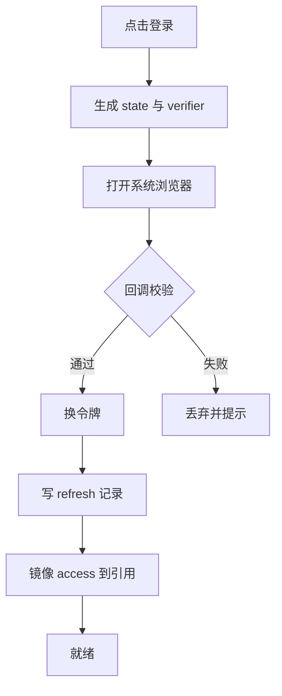

# IAM 接入详细设计

## 文档信息

| 项 | 内容 |
|---|---|
| 文档编号 | CORP-DSH-DESIGN-002 |
| 文档名称 | IAM 接入详细设计 |
| 版本 | V0.1.1 |
| 文档状态 | 草案 |
| 密级 | — |
| 编制 | DSH 平台组（代拟） |
| 审核 | 待定 |
| 批准 | 待定 |
| 最后更新 | 2026-10-20 |
| 门禁 | G0 |
| 模块状态 | 规划 |

> 编制依据：2026-10-20 对目标环境已安装 DSH 包做**字符串级核验**（从打包产物提取包名与类型/方法标识）：`dsh-credentials`、`dsh-credentials-local`、`dsh-llm-pi-ai`、`dsh-llm-retry`、`dsh-settings`、`dsh-client-ui-settings-account`、`dsh-mcp-client`；`CredentialRef` 与 `CredentialKey` 品牌类型；`modifyRecord` / `deleteRecord` 及"提交后触发"的事件语义；模型命名空间键形如 `llm-pi-ai`。
> **未核验**：提供者注册与事件订阅的准确 API 名、跨进程互斥的运行时语义、账户设置页的 slot 标识。以上均按字符串存在性推断，未做运行时实测，因此第 4、5 节出现的 API 形状标为"待实测"。
>
> 关联文档：[总体架构 §7.1](../../architecture/platform-architecture.md)、[网关契约 §4](../../contracts/gateway-contract.md)、[双模式凭据设计](../credential-modes.md)、[设计索引](../README.md)。

## 1. 结论

本模块解决一件事：让 DSH 在本机稳定地拿到企业身份与可用令牌，并且只把"可用凭据"交给调用方。

边界：身份由 IAM 判定，本模块不评估权限；令牌按资源签发，本模块不解释业务含义；凭据落盘走 DSH 既有凭据服务，不自建存储。

还缺三件事才能进实现：提供者与事件 API 的运行时实测、账户页 slot 标识、IAM 侧 `resource` 参数与轮换能力的书面确认。

## 2. 目标与非目标

**目标**

- 用授权码 + PKCE 在本机完成登录，回调只监听 loopback。
- 按 `(resource, scope)` 提供令牌，调用方不接触 refresh token。
- 令牌与刷新记录进入 DSH 凭据服务，受其生命周期管理。
- 退出时清理本地状态并按 RFC 7009 撤销。

**非目标**

- 不做企业授权判定，不做角色映射的权威源。
- 不实现静态 Key 签发（见备选方案与双模式设计）。
- 不改 DSH 核心，不 fork。

## 3. 需求与依赖

| 需求/验收 | 关系 | 说明 |
|---|---|---|
| REQ 登录与单点 | 支撑 | 授权码 + PKCE，loopback 回调 |
| REQ 令牌最小化 | 支撑 | 按资源取令牌，客户端不持上游密钥 |
| REQ 可撤销 | 支撑 | 退出即撤销，重登不残留 |
| 验收 A6 身份链路 | 支撑 | 令牌来源可追溯到 IAM 会话 |

| 依赖 | 类型 | 版本约束 | 缺失时的行为 |
|---|---|---|---|
| `dsh-credentials` | 包 | 随目标 DSH | 不启动 IAM 模块，明确报错 |
| `dsh-settings` | 包 | 随目标 DSH | 配置只读，切换模式不可用 |
| IAM 授权服务器 | 服务 | OIDC + PKCE | 未配置即"未就绪"，不阻断其他插件 |
| 网关验签能力 | 服务 | 见 GW-001 | 影响令牌是否可直用，不影响登录 |

## 4. 扩展形态与边界

| 项 | 内容 |
|---|---|
| 形态 | Host 插件 + Client 插件（账户页与登录引导） |
| 运行位置 | 本机 Host；客户端只做展示与触发 |
| 目标 DSH 与 SDK | 随目标版本；接口以实测为准 |
| 使用的 seam 或服务 | 凭据服务（`CredentialRef`/`CredentialKey`）、设置服务、账户设置页 slot、模型提供者命名空间 |
| 不修改的核心 | 凭据服务实现、模型调用链、上游 `llm-pi-ai` |

设计取舍：不新建存储，复用 `dsh-credentials`。理由是它的记录已带生命周期与提交后事件，自建存储会与它争夺同一份凭据的真相来源。

## 5. 接口与配置

| 配置项 | 类型 | 默认值 | 必填 | 说明 |
|---|---|---|---|---|
| `iam.issuer` | string | 空 | 是 | 授权服务器标识，用于 `iss` 校验 |
| `iam.clientId` | string | 空 | 是 | 本机公共客户端标识 |
| `iam.scopes` | string[] | `openid profile` | 是 | 基础 scope，不含资源 scope |
| `iam.callbackPort` | number | 0 | 否 | 0 表示随机端口，仅监听 127.0.0.1 |
| `iam.refreshSkewSeconds` | number | 60 | 否 | 到期前预刷新阈值 |
| `iam.gatewayResource` | string | 空 | 否 | 网关资源标识；空时不镜像到模型引用 |
| `iam.logoutMode` | `local` \| `rp` | `local` | 否 | 是否发起 RP 登出 |

```ts title="导出面（示意，API 名待实测）"
export interface IamSession {
  readonly state: 'unconfigured' | 'ready' | 'expired' | 'error';
  login(): Promise<void>;
  logout(): Promise<void>;
  tokenFor(resource: string): Promise<{ token: string; expiresAt: number }>;
}
```

不复制 IAM 与网关的字段表：令牌字段、错误码见[网关契约 §4](../../contracts/gateway-contract.md)与 IAM 提供的接口文档。

## 6. 权限、凭据与数据

| 项 | 处理方式 | 生命周期 | 失败时 |
|---|---|---|---|
| refresh token | `CredentialKey` 记录，存系统凭据库或受控文件 | 直到撤销或轮换 | 写入失败即回滚会话，不进入就绪 |
| access token | 内存 + 镜像到 `CredentialRef` | ≤60 分钟 | 刷新失败按错误码分流 |
| 授权码与 verifier | 仅内存 | 单次登录 | 校验失败即丢弃 |
| 日志 | 主体、资源、结果、耗时；不含令牌 | 按 DSH 日志策略 | 写日志失败不影响主流程 |

镜像只由凭据镜像组件写入，其他模块只读；跨模式写入禁止，见[双模式设计 §5](../credential-modes.md)。

## 7. 流程



**并发**：刷新在凭据锁内 single-flight，锁内网络硬超时 5 秒；后到者复用结果，不允许并发轮换。

**超时**：换令牌 10 秒，刷新 5 秒，探测 3 秒；超时按"未执行"处理，不重放已执行调用。

**取消与退出**：退出先停新请求，再清镜像与按资源缓存，再撤销，最后关连接。撤销失败只记录，不阻塞本地退出。

## 8. 失败模式

| 场景 | 行为 | 用户可见结果 | 是否可重试 |
|---|---|---|---|
| 用户在浏览器取消 | 不写任何状态 | 回到未登录 | 可重新发起 |
| `state` 或 `nonce` 不符 | 丢弃回调 | 提示登录失败 | 可重新发起 |
| 换令牌 `invalid_grant` | 清空会话 | 提示重新登录 | 否 |
| 刷新网络错误 | 退避，不登出 | 保留会话并提示 | 是，有上限 |
| refresh 被重用 | 视为失陷，清空 | 要求重新登录 | 否 |
| 凭据服务不可用 | 不进入就绪 | 明确报错 | 待服务恢复 |

## 9. 可观测性

| 事件 | 字段 | 去向 | 保留 |
|---|---|---|---|
| 登录成功/失败 | 主体、时间、失败原因类别 | 本机审计 | 按策略 |
| 令牌刷新 | 资源、结果、耗时 | 本机审计 | 90 天 |
| 镜像更新 | 旧到期、新到期（不含值） | 本机审计 | 90 天 |
| 退出与撤销 | 主体、撤销结果 | 本机审计 | 按策略 |

任何事件都不含令牌、verifier 与 Key 明文。

## 10. 测试矩阵

| 层级 | 覆盖 | 命令 |
|---|---|---|
| 单元 | 回调校验、错误分类、镜像写入方向、预刷新阈值 | `node --test` |
| 契约 | 请求参数与错误码映射与 IAM 文档一致 | 契约用例 |
| 集成 | 并发刷新收敛、退出顺序、凭据服务缺失 | 本地仿 IAM |
| 端到端 | 双端各完成一次登录、刷新、退出 | 手工 + 脚本 |

## 11. 打包、升级与回退

包名 `@heluo/forge-iam`，`private: true`，声明 `engines.dsh`。Host 与 Client 分别入口，Client 只依赖公开类型面。

升级：配置项只增不删；新增 scope 需用户重新授权，界面提示。

回退：禁用插件即回到未登录状态；已写入的凭据记录保留，重新启用可直接复用，避免重复登录。

## 12. 未决事项

| 问题 | 需要谁回答 | 影响 |
|---|---|---|
| 提供者注册与事件订阅的准确 API | 平台组（实测） | 第 4、5 节接口形状 |
| 跨进程互斥的运行时语义 | 平台组（实测） | 并发刷新是否正确 |
| 账户设置页 slot 标识 | 平台组（实测） | Client 插件挂载点 |
| IAM 是否支持 `resource` 参数 | IAM 团队 | 按资源取令牌是否成立 |
| refresh 轮换策略与重用检测 | IAM 团队 | 第 8 节两条失败分支 |

### 需用户确认的设计选项（增益不明确，暂不采用，保留待定）

| 选项 | 可能的增益 | 代价 | 当前处理 |
|---|---|---|---|
| 内置常驻 token broker 单例 | 减少重复换令牌 | 增加进程内状态与失效清理 | 不采用，先按"调用时取、锁内刷新" |
| 同一用户多账号并存（个人 + 服务账号） | 免切换 | 凭据记录与界面都要扩 | 不采用，仅单账号 |
| 静默 SSO（复用浏览器已有企业会话） | 少一次点击 | 依赖 IAM 与浏览器策略，失败路径变多 | 不采用，保留为后续选项 |
| 界面常驻显示到期倒计时 | 提前感知失效 | 干扰界面，收益有限 | 不采用 |
| 提供 CLI 登录（无 GUI 环境） | 覆盖服务器场景 | 与本期终端范围不符 | 不采用 |
| 令牌缓存落盘（跨进程共享 access token） | 减少刷新 | 增加泄露面与一致性负担 | 不采用，仅落 refresh |

以上六项均不影响主链路实现；如后续确认增益成立，再单独评估并更新本设计。