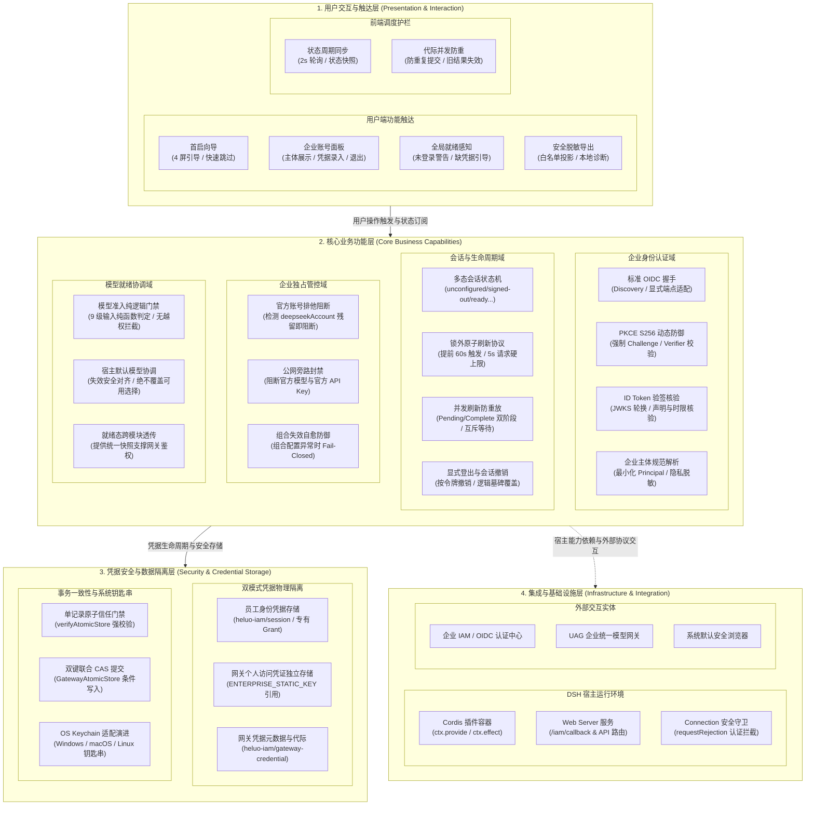
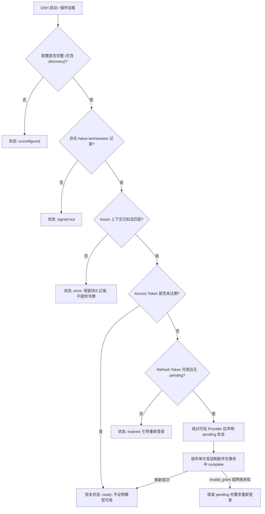
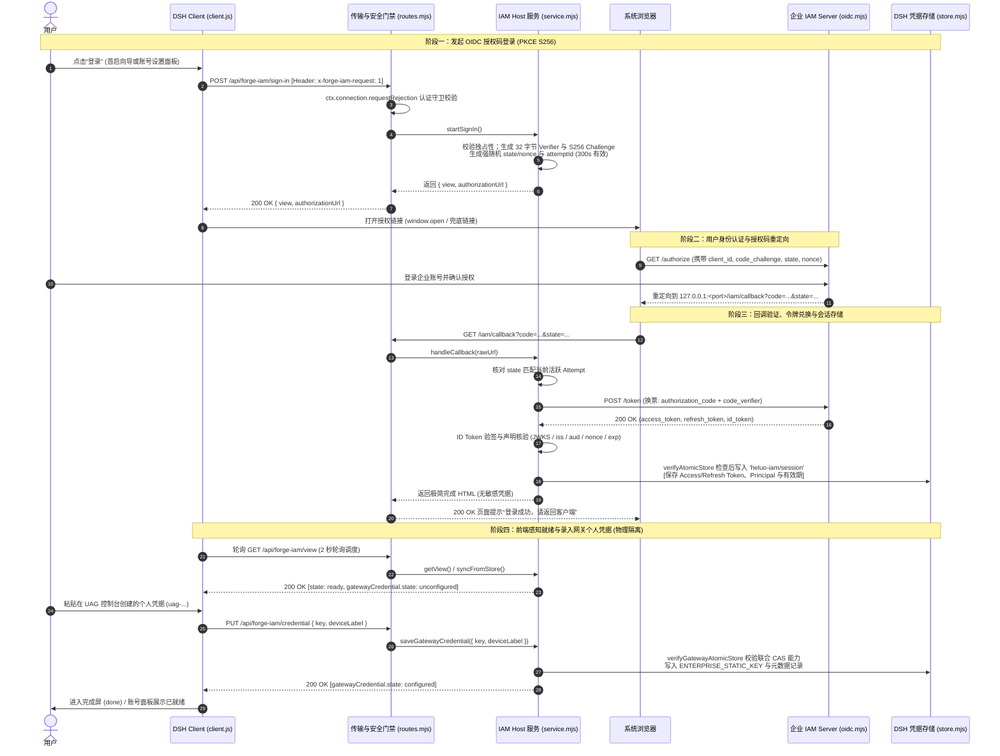
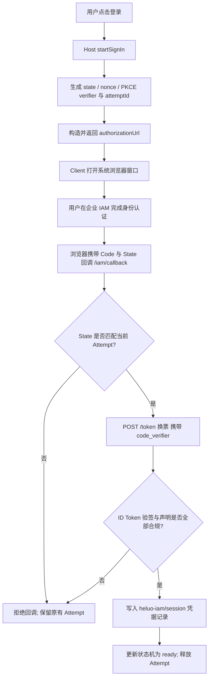
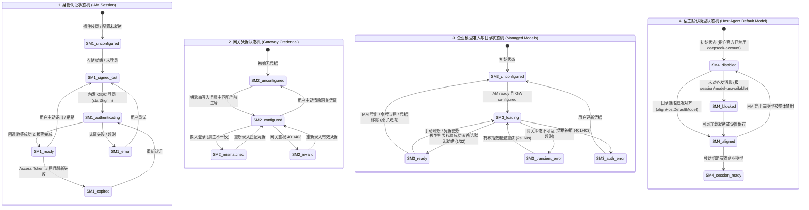
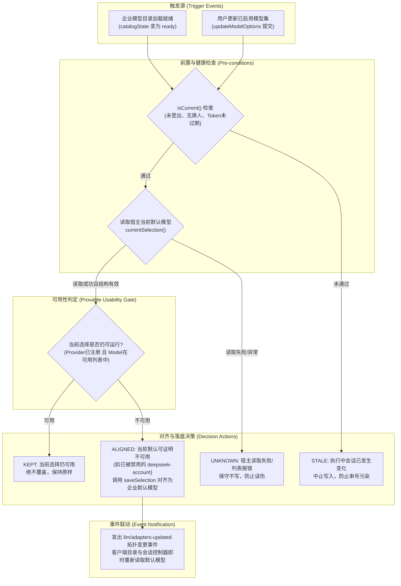

# IAM 接入详细设计

## 文档信息

| 项 | 内容 |
|---|---|
| 文档编号 | CORP-DSH-DESIGN-002 |
| 文档名称 | IAM 接入详细设计 |
| 版本 | V1.23.0 |
| 文档状态 | 草案 |
| 密级 | — |
| 编制 | DSH 平台组（代拟） |
| 审核 | 待定 |
| 批准 | 待定 |
| 最后更新 | 2026-11-06 |
| 门禁 | G0 认领；G1 接入与生命周期契约；G2 双端联调准入 |
| 模块状态 | 可用（设计阶段；实现与验证见设计索引 §2.2） |

> **规范基准与安全边界**：本设计依据 DSH 运行环境（基准版本 `0.2.1-rc.2` / `0.2.1-rc.3`）与企业统一认证技术标准编制。系统确立 **O3「企业 IAM 独占登录」** 架构，组合层禁用官方账号体系与公网模型旁路。核心已核验能力包括：`ctx.credentials` 凭据读写与授权记录、`ctx.webServer` 独立回调路由、`dsh-llm-pi-ai` 网关协议适配、`exclusive` 排他性断言及新会话默认模型失效对齐。未联调项与跨平台实机差异严格保持隔离，不作为生产就绪断言。
>
> **关联文档**：[总体架构](../../architecture/platform-architecture.md)、[网关契约](../../contracts/gateway-contract.md)、[双模式凭据](../credential-modes.md)、[企业组合包](forge-enterprise.md)、[模型网关](forge-gateway.md)、[设计索引](../README.md)、[需求基线](../../requirements/requirements-baseline.md)、[IAM 独立问询函](../../collaboration/iam-confirmation-letter.md)、[机密客户端隔离设计](../iam-confidential-isolated.md)、[机密认证契约](../../contracts/iam-client-auth-isolated.md)。

---

## 1. 概述与核心结论

### 1.1 系统定位与核心结论

`@heluo/forge-iam` 是 DeepSeek Harness（DSH）的企业统一身份认证与凭据管理扩展包。其核心安全目标是建立**企业 IAM 独占登录体系（O3 规范）**，杜绝公网回落与数据外泄：

1. **企业唯一登录源**：企业 IAM 为系统唯一认证入口，官方账号体系（`deepseek-account` 等）由 `@heluo/forge-enterprise` 在组合层禁用，切断官方 API Key 旁路；
2. **三层准入解耦**：严格区分应用外壳展示、员工身份凭据和模型执行授权：
   - **外壳展示**：未登录不拦截 DSH 本地外壳与工作区启动；
   - **身份凭据**：企业 IAM 登录会话（存储于 `heluo-iam/session`）仅证明员工身份合法性与有效期；
   - **模型执行凭证**：个人模型调用凭证（`ENTERPRISE_STATIC_KEY`）由统一模型网关控制台签发并录入，二者在物理存储与生命周期上彻底隔离；
3. **入口强鉴权与 Fail-Closed**：企业模型与工具调用必须在入口处校验当前身份与授权有效性；凭据失效或环境异常时严格遵循 Fail-Closed 原则拒绝调用，并向用户提供明确的重新认证指引。

### 1.2 规范约束与生产准入基线

为满足企业生产级合规与安全要求，系统遵循以下架构约束基线：

1. **预注册机密客户端**：企业采用单一预注册 `client_id`，凭据密钥 `client_secret` 托管于操作系统安全钥匙串，禁止写入代码或明文配置文件；强制基于 PKCE S256 执行授权码防拦截保护；
2. **令牌生命周期与轮换**：
   - 访问令牌（Access Token）由企业 IAM 统一签发（有效周期 7200 秒），提前 60 秒触发锁外静默刷新；刷新成功后旧访问令牌即时作废；
   - 刷新令牌（Refresh Token）遵循滑动续期机制（有效期 7300 秒，无绝对上限），旧刷新令牌在轮换后即时作废；
3. **撤销与退出语义闭环**：
   - 访问令牌通过专用端点 `GET /idp/oauth2/revokeToken?access_token=...` 实现单令牌实时幂等撤销；
   - 刷新令牌服务端不开放撤销接口，依赖服务端自然失效（7300 秒）；
   - 默认退出流程执行“撤销访问令牌 + 本地清理会话记录 + 写入逻辑墓碑”，严禁默认调用影响同浏览器全局会话的 RP 登出；
4. **新会话默认模型对齐**：内网环境下官方模型不可用，系统在目录就绪时若检测到宿主默认模型可证明不可用，自动对齐为企业默认模型，且绝不覆盖用户已有的可用选择。

| 能力领域 | 规范设计基线 | 当前验证现状与实施边界 |
|---|---|---|
| **个人网关凭据** | 独立物理存储，绑定员工工号属主（ownerSubject），网关强校验属主匹配 | 现行原型支持钥匙串隔离存储与属主比对；端到端联调待网关环境验证 |
| **会话刷新机制** | 锁外原子声明 pending、单飞请求、条件提交 complete，多进程防并发重放 | 双进程刷新用例与超时熔断已通过自动化验证；端到端网络时延待实机测试 |
| **会话退出机制** | 单设备定向撤销访问令牌，保留个人长期 Key，如实记录撤销状态 | 本地清理与墓碑写入已闭环；端到端撤销端点联调待企业端点配合 |
| **默认模型对齐** | 宿主默认模型失效时自动对齐企业默认模型，保护用户已有显式可用选择 | 运行时对齐与状态机流转已完全覆盖离线测试；待双端桌面集成实测 |

---

## 2. 目标与非目标

### 2.1 目标

- **企业 IAM 独占身份建立**：企业 IAM 为系统唯一认证源；组合层全面禁用官方登录入口、模型路由与官方 API Key 旁路；
- **标准授权码与 PKCE 强化**：基于系统默认浏览器完成授权码重定向交互，回调由本机 Loopback 端点（`/iam/callback`）处理；强制实施 PKCE S256 防御授权码拦截攻击；
- **规范 OIDC 声明校验**：支持 OIDC Discovery 与显式端点配置；严格校验 `state`、`nonce`、`iss`、`aud`、JWT 签名（RS256/PS256/ES256）及有效期时钟容差；
- **锁外安全刷新与防重放**：会话令牌写入宿主受保护凭据存储；通过“原子声明 pending → 锁外单次换票 → 条件提交 complete”协议防御并发刷新击穿与重放；
- **双凭据物理隔离与感知**：账户面板与 4 屏向导明确区分员工身份与网关个人访问凭证，双准入就绪状态实时可视；
- **确定性退出与单令牌撤销**：退出时显式调用撤销接口使当前访问令牌实时失效，清除本地凭据并写入逻辑墓碑，默认保留个人长期网关 Key；
- **开箱即用默认模型自愈**：企业模型目录加载就绪后，自动将宿主已失效的默认模型对齐为企业首选模型，保障新对话立即可用。

### 2.2 非目标

- **不接管应用外壳启动**：不拦截 DSH 桌面进程的启动与本地文件操作；未登录仅阻断企业模型与受限能力；
- **不保留任何公网旁路**：不提供面向公网官方服务的附加登录（additive）或回退模式；
- **不做多账号即时共存**：单运行实例仅维护一份当前登录会话，不支持多租户/多角色并发并存；
- **不代理代管网关凭证**：个人网关 Key 由用户在统一控制台自主签发与吊销，客户端不代为生成；
- **不修改 DSH 内核代码**：完全基于 Cordis 扩展机制与标准 SDK 挂载，不维护 DSH 内核 Fork 分支；
- **不做营销化引导流程**：首启引导聚焦于企业认证、网关凭据配置与环境确认，不做用量计费或商业宣传。

---

## 3. 需求契约与环境依赖

### 3.1 需求映射与验收指标

| 需求编号 | 架构关系 | 契约与实施指标 |
|---|---|---|
| **REQ-01** | 核心支撑 | 授权码 + Loopback 回调；预注册机密客户端；PKCE S256 强制校验；未登录或网关凭据缺失时阻断企业模型 |
| **REQ-02** | 核心支撑 | 令牌原子轮换；多进程并发遵守 pending/complete 互斥协议；网络换票执行 5 秒硬超时界限 |
| **REQ-05** | 核心支撑 | 严格物理隔离身份令牌与调用 Key；网关配额用尽不盲目重试，已提交请求不隐式重放 |
| **REQ-17** | 核心支撑 | IAM 服务或凭据存储缺失时，企业调用严格执行 Fail-Closed 阻断，拒绝静默降级 |
| **C1 / C4** | 安全约束 | 仅允许连通指定企业模型网关；不保留公网路由；日志及错误回显严禁泄露令牌、密钥或正文 |

### 3.2 宿主环境与组件依赖

| 依赖组件 | 依赖类型 | 适用版本 / 规范 | 异常与缺失处理机制 |
|---|---|---|---|
| `dsh-credentials` / 本地凭据服务 | 基础服务 | 随目标 DSH 挂载 | 无法读写持久化凭据；插件拒绝进入 `ready`，明确报错 |
| `dsh-web-server`（`ctx.webServer`） | 基础服务 | 随目标 DSH 挂载 | 无法注册 `/iam/callback` 回调；登录流程阻断 |
| `dsh-settings` | 基础服务 | 随目标 DSH 挂载 | 设置项无法持久化；回退为内存只读模式 |
| `dsh-llm-pi-ai` | 协议适配 | 随目标 DSH 挂载 | 缺乏模型执行适配器；模型调用无法生效，不影响身份登录 |
| `dsh-agent-default-model` | 配置服务 | 随目标 DSH 挂载 | 无法自动对齐新会话模型；由用户手动选择可用模型 |
| 企业 IAM OIDC 认证中心 | 外部服务 | 标准 OIDC / RFC 6749 | 未配置或不可达时显示 `unconfigured` / `unreachable` |
| `@heluo/forge-enterprise` | 方案协同 | 同批次方案包 | 组合层打入禁用补丁；若官方行残留则本包触发排他性阻断 |
| `@heluo/forge-gateway` | 方案协同 | 同批次方案包 | 提供实际模型网关流量校验与凭据探测；缺失时阻断模型路由 |

---

## 4. 架构设计与系统边界

### 4.1 功能架构全景

系统自顶向下分为用户交互层、业务核心功能层、凭据安全数据层与集成基础设施层四大层级：



#### 功能架构职能分解矩阵

| 架构层级 | 功能域 | 核心职能模块 | 业务价值与安全控制目标 |
|---|---|---|---|
| **1. 用户交互与触达层** | 用户端功能触达 | 4 屏首启向导、企业账号面板、全局状态横幅、安全脱敏诊断导出 | 统一规范开箱体验，提供一站式账号管理、Key 录入与安全退出入口；诊断信息严格白名单脱敏 |
| | 前端调度护栏 | 2 秒周期性轮询调度器、代际并发防重护栏 | 维持客户端视图与 Host 状态实时一致；基于请求代际自动废弃过时响应 |
| **2. 核心业务功能层** | 企业身份认证域 | 标准 OIDC 握手、PKCE S256 动态防御、ID Token 验签核验、企业主体规范解析 | 落地企业统一认证，强制 S256 防御授权码拦截攻击；严格基于 JWKS 验签提取员工 Principal |
| | 会话与生命周期域 | 多态会话状态机、锁外原子刷新协议、并发刷新防重放、显式登出与会话撤销 | 管控完整会话生命周期；提前 60 秒静默刷新，双阶段 Pending/Complete 协议防止并发击穿；按规范撤销访问令牌 |
| | 企业独占管控域 | 官方账号排他阻断、公网旁路封禁、组合失效自愈防御 | 落实 O3 企业独占登录原则；启动时强校验官方服务残留，发现违规立即 Fail-Closed 阻断 |
| | 模型就绪协调域 | 模型准入纯逻辑门禁、宿主默认模型协调、就绪态跨模块透传 | 提供纯函数模型前提准入判定；在默认模型失效时安全对齐，绝不覆盖用户显式可用选择 |
| **3. 凭据安全与数据层** | 双模式凭据物理隔离 | 身份凭据存储区（Session）、网关凭据独立存储区（Static Key）、网关元数据专区 | 切断员工身份令牌与模型访问凭据的物理关联；IAM Access Token 不作模型镜像，个人访问凭证物理独立保护 |
| | 事务一致性与钥匙串 | 单记录原子信任门禁、双键联合 CAS 提交、OS Keychain 适配演进 | 确保凭据写盘具备原子互斥能力；网关 Key 与元数据通过 CAS 联合一致性提交；拒绝明文降级 |
| **4. 集成与基础设施层** | DSH 宿主环境 | Cordis 插件容器、Web Server 路由服务、Connection 安全守卫 | 依托 Cordis 声明生命周期所有权；通过宿主连接守卫拦截未授权跨域接口调用 |
| | 外部交互实体 | 企业 IAM 服务端、UAG 模型网关控制台、系统默认浏览器 | 对接企业标准 IdP 完成授权码重定向；由用户自主签发个人令牌，保持职责清晰 |

### 4.2 扩展形态与插件宿主集成

- **扩展形态**：Host 服务插件（Node.js / Cordis） + Client 界面插件（React / Web & Desktop 双端）；
- **执行宿主**：本机 Host 执行核心鉴权与协议交互；Client 负责界面渲染、用户触发与状态同步；
- **宿主集成缝**：`ctx.credentials`、`ctx.webServer`、`ctx.connection`、`ctx.settings`、`ctx.slots`、`llm`、`agentDefaultModel`；
- **核心独立性**：不修改 DSH 内核，不分发修改版 DSH，官方账号体系仅通过组合层禁用实现隔离。

### 4.3 官方账号禁用与独占断言

| Row id（目标 Profile） | 官方包名 | 处理策略 | 实施动因 |
|---|---|---|---|
| `deepseek-account` | `@deepseek-ai/dsh-deepseek-account-platform` | `disabled: true` | 官方登录与账号状态；内网不可用 |
| `llm-deepseek-account` | `@deepseek-ai/dsh-llm-deepseek-account` | `disabled: true` | 官方账户模型路由 |
| `llm-deepseek` | `@deepseek-ai/dsh-llm-deepseek-api-key` | `disabled: true` | 官方 API Key 旁路入口 |
| `ui-settings-account` | `@deepseek-ai/dsh-client-ui-settings-account` | `disabled: true` | 官方账户页与侧边栏入口 |

模块启动时通过 `src/exclusive.mjs` 主动检测 `ctx.get('deepseekAccount')`：一旦发现服务残留，立即输出 `exclusive-violation` 审计事件，拒绝进入 `ready` 状态，阻断凭据透传，确保禁用失败时立即 Fail-Closed。

### 4.4 客户端 UI 交互设计

- **首启 4 屏向导**：依次呈现“1. 欢迎 → 2. 身份认证 → 3. 网关凭据录入 → 4. 完成就绪”，支持快速跳过，已配置凭据标记 `done`；
- **账号设置面板**：展示当前工号、发行者、令牌到期时间、网关凭据状态、设备标签与一键脱敏导出；
- **全局状态横幅**：未登录或缺网关凭据时展示明确警示并引导前往设置，不静默挂起会话；
- **插槽挂载体系**：挂载于 `settings.section`（order: 30）、`shell.overlay`，并由本模块认领 `settings.launcher` 单占位插槽。

#### 4.4.1 左下角企业账号启动器（settings.launcher）规格

1. **品牌视觉**：采用精炼盘龙盾徽标识 `packages/forge-iam/icon.svg`。展开态采用 28×28px 圆形容器内嵌 18×18px 盾徽；折叠态（Rail, 56px）采用 36×36px 圆角卡片内嵌 22×22px 盾徽；
2. **复合状态指示点（7px 实心）**：
   - 🟢 **绿色（双就绪）**：`state === 'ready'` 且 `gatewayCredential.state === 'configured'`；
   - 🟡 **黄色（缺少凭据）**：`state === 'ready'` 但网关凭据未配置或属主不匹配；
   - 🔴 **红色（凭据异常）**：`state === 'expired'` 或 `state === 'error'`；
   - ⚪ **灰色（未登录态）**：`state === 'signed-out'` 或 `state === 'unconfigured'`；
3. **原生弹窗菜单**：已登录态点击弹出毛玻璃卡片，支持展示主体工号、跳转网关设置、复制脱敏诊断信息以及安全退出设备。

### 4.5 回调与浏览器交互规范

#### 4.5.1 回调监听归属

授权码回调由插件自建回环监听接收，端口由操作系统分配；宿主 `webServer` 的端口变化不影响回调地址。

| 项 | 终态口径 |
|---|---|
| 登记形态 | IAM 管理台登记的是回调 URL **前缀**，只需 `http://127.0.0.1`；端口与路径由客户端决定，不逐条登记 |
| 监听 | `callbackPort: 0` 由系统分配回环端口；`1024–65535` 固定该端口。插件只绑定回环地址，只接受 `GET <redirectPath>`（默认 `/iam/callback`） |
| 生命周期 | 监听随登录尝试建立，尝试结束（成功、取消、超时、签出、provider 更换）即停止接受连接；不常驻 |
| 地址族 | `callbackAddress` 默认 `auto`：始终先试 IPv4 回环，仅当本机没有 IPv4 回环时才试 IPv6；也可固定 `127.0.0.1` 或 `::1`。IPv6 需另登记前缀 `http://[::1]`，地址写作 `http://[::1]:<port><redirectPath>` |
| 校验归属 | 服务端只接受两种前缀：`http://127.0.0.1:` 与 `http://127.0.0.1/`，`https` 同样可用；其他写法非法。主机被字面量约束，端口与路径自由。插件只使用自己绑定的回环地址，Host 必须等于实际监听主机、路径必须逐字节相等、对端必须是回环 |
| 显式 URI | 显式 `redirectUri` 只在固定端口下允许，且必须逐字节相等，否则以 `IAM_CONFIG_INVALID` 拒绝 |
| 端口冲突 | 绑定失败记 `IAM_CALLBACK_PORT_UNAVAILABLE`，登录发起即拒；不回落宿主端口，不改写 `redirect_uri`。地址族只在 `EADDRNOTAVAIL`／`EAFNOSUPPORT` 时切换，端口占用不切换 |
| 兼容形态 | 省略 `callbackPort` 时沿用宿主实时 Origin，仅用于开发与兼容 |

启用 `callbackPort` 后，回调不再注册到宿主 `webServer`；管理 API 仍留在宿主。

平台差异集中在套接字语义上。`check.yml` 的 `forge-iam callback` 作业在 `ubuntu-24.04` 与 `windows-2022` 上跑同一组回调用例，覆盖随机端口绑定、固定端口被占用时拒绝、排空关闭与 IPv6 回环真实请求；两平台均通过，Windows 上端口占用同样触发 `EADDRINUSE`。绑定回环地址是否触发 Windows 防火墙提示尚未实机确认。

#### 4.5.2 回调校验与响应

- **回调只读与校验**：回调接口仅支持 `GET` 方法，严格校验 `state` 匹配当前活跃 Attempt；换票 POST 请求携带 `code_verifier` 由服务端直接验票，Verifier 绝不暴露于 URL；
- **同源管理守卫**：所有 `/api/forge-iam/*` 管理端点受宿主 `ctx.connection.requestRejection` 守卫保护，严格校验 `x-forge-iam-request: 1` 标头，写入请求体限制最大 8 KiB；
- **回调完成响应**：回调成功后仅返回纯文本/极简 HTML 页面（“登录成功，请返回客户端”），不向页面写入任何 Token 凭据。

### 4.6 架构选型论证：为什么不用 `authorization` flow

DSH 内置的 `ctx.authorization` flow 面向“单次凭据唤起与 commit 录入”设计；而企业 IAM 必须接管浏览器重定向回调、后台原子定时轮换、单令牌撤销以及跨多组件的长期会话维护。因此采用 **Host Service + 内部状态机 + 同源管理 API** 模式，实现会话与 Attempt 状态的唯一主权管理。

### 4.7 client secret 生命周期与轮换规范

1. **凭据分发**：企业统一预注册機密客户端，Secret 经运维受控通道写入终端操作系统凭据库，禁止进入代码、配置文本、日志或环境变量；
2. **服务端轮换窗口**：Secret 轮换保存后由服务端定时任务刷新至 Redis 集群（最迟两分钟生效）；在生效窗口期内仅旧 Secret 有效，刷新后仅新 Secret 有效，集群内不存在新旧并存交错；
3. **轮换保护机制**：轮换窗口期内暂停发起新登录，保留后台自动刷新；遇到新密钥未生效时等待两分钟重试，不发起秒级重试风暴；
4. **历史令牌保护**：Secret 轮换不导致已签发的访问令牌失效，现有访问令牌依自身有效期（最长 7200 秒）正常运行。

---

## 5. 接口与配置契约

### 5.1 配置项规范

配置对象在挂载插件时传入，格式校验遵循 [`packages/forge-iam/src/config.mjs`](<../../../packages/forge-iam/src/config.mjs>)：

| 配置项 | 类型 | 默认值 | 必填 | 语义与安全约束说明 |
|---|---|---|---|---|
| `clientId` | string | 空 | 是 | 企业预注册客户端唯一标识 |
| `authMode` | string | `public` | 否 | 认证模式；支持 `public` 与 `confidential` |
| `clientAuthMethod` | string | `none` | 否 | 客户端认证方法；`public` 必须为 `none`，`confidential` 支持 `client_secret_basic` / `post` |
| `clientSecretRef` | string | 空 | 条件 | 机密客户端钥匙串选择器，必须精确对应受信任来源 |
| `discoveryUrl` | string | 空 | 条件 | OIDC Discovery 地址；与显式端点配置二选一 |
| `issuer` | string | 空 | 条件 | 显式配置时必填，作为发行者 Pin 用于 ID Token 校验 |
| `authorizationEndpoint` | string | 空 | 条件 | 显式授权请求端点 |
| `tokenEndpoint` | string | 空 | 条件 | 显式换票请求端点 |
| `jwksUri` | string | 空 | 条件 | 显式公钥集地址，用于验签算法核验 |
| `revocationEndpoint` | string | 空 | 否 | 访问令牌撤销端点（`GET /idp/oauth2/revokeToken?access_token=...`） |
| `scopes` | string[] | `['openid', 'profile', 'offline_access']` | 是 | 申请授权范围，必须显式包含 `openid` |
| `redirectPath` | string | `/iam/callback` | 否 | 本机 Loopback 回调绝对路径 |
| `callbackPort` | number | 空 | 否 | 省略时沿用宿主 Origin（开发/兼容）；`0` 由系统分配回环端口；1024–65535 固定该端口 |
| `callbackAddress` | string | `auto` | 否 | `auto` 始终先试 `127.0.0.1`，仅在该地址族不可用时退到 `::1`；也可固定其中之一。IPv6 需 IAM 额外登记 `http://[::1]` |
| `redirectUri` | string | 空 | 否 | 显式回调 URI；仅固定端口下允许，必须等于 `http://<callbackAddress>:<callbackPort><redirectPath>`；非 loopback 必须采用 HTTPS |
| `gatewayConsoleUrl` | string | 空 | 否 | UAG 网关个人访问凭证控制台链接，仅用于界面指引 |
| `defaultProvider` | string | `enterprise` | 否 | 企业模型提供方标识 |
| `defaultModel` | string | 空 | 否 | 企业首选默认模型标识 |
| `refreshSkewSeconds` | number | 60 | 否 | 访问令牌过期前预刷新提前量（秒） |
| `attemptTimeoutSeconds` | number | 300 | 否 | 单次登录 Attempt 超时时间（秒） |
| `httpTimeoutMs` | number | 10000 | 否 | HTTP 请求默认超时上限（毫秒）；刷新与撤销请求设 5000ms 硬上限 |
| `logoutMode` | string | `local` | 否 | 登出模式：`local`（撤销本机访问令牌 + 本地清理）或 `rp`（跳转全局登出） |
| `requireExclusive` | boolean | `true` | 否 | 排他性强断言开关；检测到官方服务残留时阻断就绪 |
| `allowInsecureHttp` | boolean | `false` | 否 | 开发测试开关；仅允许放行 Loopback 地址 |

### 5.2 现行接口规范

#### 5.2.1 Host 服务接口（`ctx.iam`）

由 `createIamService(config, options)` 创建并注册为 `ctx.iam`：

| 方法 | 参数 | 返回值与语义说明 |
|---|---|---|
| `getView()` | 无 | 同步返回当前 `IamView` 快照（不含敏感令牌） |
| `watch(signal)` | `AbortSignal` | 异步迭代器，订阅视图快照与变更流通知 |
| `hydrate()` / `syncFromStore()` | 无 | 异步从安全存储恢复会话状态及网关凭据元数据 |
| `startSignIn()` | 无 | 开启或复用活跃 Attempt，返回 `{ view, authorizationUrl }` |
| `cancelSignIn()` | 无 | 取消当前 Attempt 并恢复前序状态 |
| `handleCallback(rawUrl)` | `rawUrl: string` | 接收并处理回调 URL，执行状态校对、换票与验签落盘 |
| `signOut()` | 无 | 执行登出，按规范撤销访问令牌并写入逻辑墓碑 |
| `resolveToken()` | 无 | 获取当前有效 Access Token（必要时触发锁外刷新）；绝不返回 Refresh Token |
| `getPrincipal()` | 无 | 返回 `{ issuer, subject }` 最小身份标识 |
| `saveGatewayCredential(input)` | `{ key, deviceLabel }` | 基于条件比对（CAS）原子写入网关 Key 与元数据 |
| `clearGatewayCredential()` | 无 | 原子清除网关凭证并写入墓碑记录 |
| `reconcileDefaultModel()` | 无 | 宿主默认模型状态采样与失效对齐协调 |

#### 5.2.2 同源 HTTP 路由（`/api/forge-iam/*`）

全部挂载于 `ctx.webServer`，受 Connection 鉴权保护，写入端点要求 `x-forge-iam-request: 1`：

| 端点与方法 | 鉴权与约束 | 返回数据及语义 |
|---|---|---|
| `GET /api/forge-iam/session` | 同源校验 | 返回只读身份快照（`getSession()`），不触发刷新，永不含令牌 |
| `POST /api/forge-iam/token` | 同源 + Header | 返回 `{ token, expiresAt }`；响应头显式禁用缓存 |
| `POST /api/forge-iam/bridge/token` | Loopback + Bearer 能力值 | 供 CLI 使用的受限换票通道，返回 `{ token, expiresAt }` |
| `GET /api/forge-iam/view` | 同源校验 | 返回完整 `IamView` 快照（供前端 2 秒轮询） |
| `POST /api/forge-iam/sign-in` | 同源 + Header | 触发登录流程，返回 `{ view, authorizationUrl }` |
| `POST /api/forge-iam/cancel` | 同源 + Header | 取消在途登录尝试，返回最新 `IamView` |
| `POST /api/forge-iam/sign-out` | 同源 + Header | 执行退出流程，返回登出结果对象 |
| `GET /api/forge-iam/credential` | 同源校验 | 返回网关凭据状态视图对象 `{ credential }` |
| `PUT /api/forge-iam/credential` | 同源 + Header (≤ 8 KiB) | 保存个人网关凭据，返回更新后的 `IamView` |
| `DELETE /api/forge-iam/credential` | 同源 + Header | 清除网关凭据，返回更新后的 `IamView` |

#### 5.2.3 最小只读订阅接缝（source/mock 已实现）

系统定义了轻量级只读订阅接缝（`iam-view-observer` 与 `iam-view-consumer`）：
- **数据白名单**：仅对外投射 12 项非敏感字段，禁止包含令牌、Verifier、密钥或网关 Key 原文；
- **唯一刷新主权**：订阅监听仅观察快照变更，后台定时同步严格收敛于 Host 单飞任务，禁止客户端每帧强制刷新；
- **代际隔离**：网络中断或订阅取消时即时清理异步等待队列，废弃过时响应。

### 5.3 生产目标接口定义（V1 Remote Target）

```ts
export type IamState =
  | 'unconfigured'
  | 'signed-out'
  | 'authenticating'
  | 'ready'
  | 'expired'
  | 'unreachable'
  | 'error';

export interface IamPrincipal {
  readonly issuer: string;
  readonly subject: string;
  readonly displayName?: string;
  readonly groups?: readonly string[];
}

export interface GatewayCredentialView {
  readonly state: 'unconfigured' | 'configured' | 'invalid' | 'owner-mismatch';
  readonly ownerSubject?: string | null;
  readonly deviceLabel?: string | null;
  readonly enteredAt?: string | null;
  readonly suggestedExpiry?: string | null;
  readonly storage?: string | null;
  readonly matchesAccount?: boolean;
  readonly lastProbeAt?: string;
}

export interface IamView {
  readonly state: IamState;
  readonly principal?: IamPrincipal;
  readonly accessExpiresAt?: string;
  readonly gatewayCredential: GatewayCredentialView;
  readonly authorizationUrl?: string;
  readonly attemptId?: string;
  readonly hostDefaultModel?: string;
  readonly error?: { readonly code: string; readonly message: string };
}
```

### 5.4 机密客户端接入契约

| 核心事项 | 规范基准 | 边界约束与实现状态 |
|---|---|---|
| **Client 标识** | 全企业统一单一 `client_id` | 统一标识管理，不按端拆分 |
| **Secret 托管** | 操作系统安全钥匙串受控存储 | 严禁明文入库；钥匙串不可用时 Fail-Closed |
| **轮换保障** | 服务端人工更新，双分钟缓存生效窗口 | 窗口期内暂停新登录，后台刷新平滑过渡 |
| **令牌撤销** | 单令牌实时端点 `GET /idp/oauth2/revokeToken` | 撤销即时生效；刷新令牌服务端自然过期（7300s） |
| **协议完整性** | 换票、刷新与撤销请求均携带合法凭证参数 | 强制 PKCE S256，密钥严格排除于错误堆栈之外 |

### 5.5 跨模块身份与令牌读取规范

#### 5.5.1 分层架构与唯一刷新者原则

| 消费主体 | 接入端点 | 权限与数据边界 |
|---|---|---|
| **Host 插件与服务** | `ctx.iam.getSession()` / `getAccessToken()` | 身份与时效只读；令牌按需获取并由 Host 单飞刷新 |
| **浏览器前端与插件** | `GET /api/forge-iam/session`、`POST /api/forge-iam/token` | 身份快照与独立令牌端点，禁止混部 |
| **CLI / 脚本 / 子进程** | `heluo-forge auth whoami` / `auth token` | 标准输出最小身份或单行有效令牌 |

**唯一刷新者原则**：系统中**仅允许 Host 服务持有刷新主权**。CLI 与其他消费方严格只读；当 Host 在线时通过 Loopback 桥接换票，Host 离线时仅允许直读未过期令牌，绝不在外部并发消费刷新令牌。

#### 5.5.2 CLI 访问规范与退出码

- **Host 在线通道**：通过读取环境变量 `HELUO_FORGE_IAM_URL` 与凭据库中的 `HELUO_IAM_BRIDGE_TOKEN` 能力值，向 Host 发起换票，共享 Host 刷新结果；
- **离线直读通道**：在未配置 Host 地址时，直接通过钥匙串适配器读取未过期令牌，过期则明确阻断并引导启动桌面端重新认证；
- **标准退出码**：`0`（成功）；`2`（未登录）；`3`（令牌过期）；`4`（后端存储不可用）；`64`（命令行用法错误）。

#### 5.5.3 跨模块读取五大不变量

1. **身份与令牌彻底分离**：`getSession()`、`/session`、`whoami` 的任何字段均严禁包含令牌原文；
2. **唯一刷新所有权**：仅 Host 服务有权发起刷新，消除并发刷新踢出风险；
3. **失败即时显式中断**：未登录或失效时立即返回 401 及 `IAM_NOT_SIGNED_IN`，严禁回显历史过期令牌；
4. **全链路防泄漏**：令牌严禁进入日志、环境变量、界面视图或诊断数据；端点响应强制声明 `no-store`；
5. **有效性快照时钟保护**：本地快照在到期前 30 秒即视为失效，拒绝陈旧快照。

### 5.6 宿主能力核验与状态订阅

- **Remote 注册**：基于 `typertGateway` 标准机制声明与注销；
- **状态流式推送**：支持基于 `/api/forge-iam/events`（SSE）推送 `watch()` 视图，在代理缓冲等异常场景自动回退为 2 秒轮询机制；
- **连接守卫**：全量事件与管理端点均受宿主 Connection 守卫拦截保护。

### 5.7 跨进程失效与撤销边界

- **本地即时生效**：`signOut()` 触发时立即自增代际 `authEpoch` 并注销在途尝试；
- **跨进程快速收敛**：任一进程登出后，共享存储写入墓碑标记，其他并行进程下次请求立即阻断；
- **三态如实报告**：退出结果如实呈现本地清理状态及远端撤销状态（`ok` / `failed` / `unknown`），未获服务端确认不误报为完全撤销。

---

## 6. 凭据存储与安全隔离

### 6.1 双模式凭据物理隔离模型

系统确立**员工身份凭据**与**模型调用凭据**在物理存储上的绝对隔离：

```text
DSH 凭据存储 (ctx.credentials)
├── GrantRecord (heluo-iam/session)
│   └── payload: IamGrantV1 { issuer, subject, accessToken, refreshToken, ... }
│       └── [用途]: 仅供员工身份建立、会话轮换与生命周期绑定；不镜像模型 Key
│
├── CredentialRef (ENTERPRISE_STATIC_KEY)
│   └── value: "uag-..." (系统钥匙串存储引用)
│       └── [用途]: 仅供 UAG 模型网关鉴权；由用户独立录入，IAM 不签发、不轮换
│
└── GrantRecord (heluo-iam/gateway-credential)
    └── payload: { version: 2, ownerSubject, deviceLabel, valueDigest, writeOperationId }
        └── [用途]: 记录网关 Key 的绑定元数据与写入代际；不存 Key 原文
```

### 6.2 凭据生命周期与存储矩阵

| 数据项 | 物理载体与存储键 | 生命周期管理规范 | 失效与异常处置策略 |
|---|---|---|---|
| **Refresh Token** | `GrantRecord` (`heluo-iam/session`) | 轮换后旧值作废；最长持续至登出或自然过期（7300s） | 写入失败阻断进入 `ready`；存储不可用时 Fail-Closed |
| **Access Token** | 内存及 `heluo-iam/session` (不入网关) | 短生命周期（按 IAM TTL 7200 秒） | 过期前 60 秒静默刷新；刷新失败要求重登 |
| **网关个人访问凭证** | `CredentialRef` (`ENTERPRISE_STATIC_KEY`) | 长期凭据（建议 90 天有效期） | 未配置或失效阻断模型调用；登出默认保留 |
| **授权码与 Verifier** | 仅 Host 内存活跃 Attempt | 单次尝试有效（≤ 300 秒） | 兑换一次即作废；超时立即从内存销毁 |
| **ID Token** | 仅 `logoutMode=rp` 落盘，其余仅内存验签 | 仅维持至会话退出 | 验签失败直接阻断登录；不向第三方泄露 |
| **最小主体 Principal** | 内存结构体 `{ issuer, subject }` | 会话运行期 | 严禁向模型上下文注入真实姓名/工号等 PII 数据 |
| **网关元数据** | `GrantRecord` (`heluo-iam/gateway-credential`)| 随个人访问凭证同步存在 | 换人登录检测属主不匹配时立即阻断网关调用 |

### 6.3 存储后端与 OS Keychain 演进策略

1. **安全底线**：生产环境必须依托操作系统原生钥匙串（Windows Credential Manager、macOS Keychain、Linux Secret Service）实现凭据受控加密，拒绝明文 YAML 存储；
2. **Fail-Closed 约束**：当系统钥匙串服务不可用时，系统严格执行 Fail-Closed 阻断，严禁未经显式安全授权静默回退至不安全的未加密明文介质；
3. **防并发篡改**：凭据读写与 CAS 联合提交必须具备跨进程互斥保护，防止崩溃或多进程并发导致的数据撕裂。

### 6.4 网关联合变更当前原型

网关个人访问凭证与元数据通过 `GatewayAtomicStore` 接口实施快照比对与条件写入（CAS）：
- 提交前在不可让出的同步临界区内核验 Provider 实例、认证代际与排除卸载状态；
- 元数据升级为版本 2，引入强随机 `writeOperationId` 与摘要 `valueDigest` 实现写入防重与错配校验；
- 执行清除时写入墓碑记录，保留操作审计痕迹；未具备核验原子能力时返回 `IAM_GATEWAY_ATOMIC_UNVERIFIED`（503）。

---

## 7. 核心流程与时序规范

### 7.1 启动恢复流程



**发行者绑定规则**：系统启动时不主动发起网络请求探测端点。旧会话复用要求必须具备已知匹配的 `issuer` 上下文；缺失时保持凭据文件以供排查，但不恢复身份且不提供令牌。

### 7.2 登录认证与数据流时序

#### 7.2.1 端到端核心时序

`service.mjs` 在此图中代表整个 Host 服务：它只是装配入口，会话状态、协议校验、刷新、勘定、登录与退出分别由 `src/service-*.mjs` 承担，模块与职责对应见[模块 README](../../../packages/forge-iam/README.md#host-分轴模块)。




#### 7.2.2 登录流程判定



- **单 Attempt 约束**：实例内维持唯一活跃 Attempt，超时时间 300 秒，并发触发复用当前尝试；
- **授权码单次消费**：授权码兑换仅执行一次，失败绝不重放；
- **双状态分离**：登录仅代表身份就绪；模型可用性完全取决于 `ENTERPRISE_STATIC_KEY` 的配置。

### 7.3 会话刷新与防重放协议

1. **预核验**：读取当前会话快照，锁外比对旧 Grant Issuer 与当前元数据一致性；
2. **原子声明 Pending**：在单记录事务内写入操作代际标记 `refreshOperation={version, state:'pending', id, base}`；
3. **锁外请求换票**：退出临界锁，在 5 秒网络超时内向 Token 端点发送换票请求；
4. **条件提交 Complete**：再次进入事务，比对记录无外部篡改后写入新令牌，并将标记更新为 `complete`。

并发请求通过 Promise 共享换票结果；等待者设置 5 秒截止，超时不自动抢占，旧 Refresh Token 一旦使用即失效，杜绝重试风暴。

### 7.4 会话退出与令牌撤销

```text
用户点击退出
  └── 1. 取消本实例在途 Attempt
  └── 2. 读取持久存储的 Grant 快照并锁定
  └── 3. 调用撤销接口实时废止访问令牌（GET ?access_token=…；记录 ok/failed/unknown）
  └── 4. 在凭据存储中写入无敏感信息的逻辑墓碑记录 ({ version: 1, type: 'tombstone' })
  └── 5. 清除 Host 内存中会话副本与本地访问令牌、刷新令牌，状态机切换至 signed-out
  └── 6. 仅当显式配置 logoutMode=rp 时，才生成全局登出 URL
```

- **单令牌撤销语义**：采用 `GET /idp/oauth2/revokeToken?access_token=...`，令牌自证、幂等且实时生效；服务端刷新令牌不提供撤销接口，依赖自然过期（7300 秒）；
- **本机信任边界**：撤销不再要求 client secret，任何能写凭据存储的本机进程都可以清会话并撤销访问令牌。这是 D1 的既定取舍：退出不是提权操作，但不能再把“需要 secret”当作退出路径的防护；
- **数据留存底线**：退出登录清除登录态并写墓碑记录，但默认保留已配置的 `ENTERPRISE_STATIC_KEY`，避免频繁重新录入。

### 7.5 模型门禁纯判定与只读编排

#### 7.5.1 门禁纯函数判定（`evaluateModelGate`）

位于 [`packages/forge-iam/src/model-gate.mjs`](<../../../packages/forge-iam/src/model-gate.mjs>)，不触发网络与配置修改：

| 判定顺序 | 判定输入条件 | 输出动作及原因码 |
|---|---|---|
| 1 | `signedIn !== true` | 拒绝：`not-signed-in`（不提供切换目标，忽略环境 API Key） |
| 2 | 已登录但 `gatewayCredential !== 'present'` | 拒绝：`gateway-credential-missing`（引导录入凭据） |
| 3 | 未声明目标企业模型 | 拒绝：`no-enterprise-model` |
| 4 | 企业模型被禁用或无可用提供方 | 拒绝：`enterprise-model-unavailable` |
| 5 | 用户尚未做出模型选择 | 放行并建议切换：`selection-absent-switched` |
| 6 | 当前选择不可用（如已被禁用的官方模型） | 放行并建议切换：`selection-disabled-switched` |
| 7 | 当前选择已是合规企业模型 | 放行且保持现有选择：`keep-explicit-enterprise` |
| 8 | 同 Provider 的其他模型（显式选择保留） | 放行：`keep-explicit-enterprise` 或 `selection-not-explicit-switched` |
| 9 | 可用但不属于企业的第三方提供方 | 拒绝：`selection-outside-enterprise`（交企业策略裁定，不静默替换） |

#### 7.5.2 宿主只读编排

宿主常规状态观察 `reconcileDefaultModel()` 遵循只读原则，仅对 Provider 状态与选择执行纯观察采样并返回只读结果。真实企业模型调用拦截与授权策略由独立的 `@heluo/forge-gateway` 网关层执行。

### 7.6 状态机全景与协同流转规范

系统运行时由 4 个相互解耦但通过条件强绑定的状态机协同构成：

1. **SM1: 企业身份认证状态机（IAM Session）**：管理用户 OIDC 握手、令牌有效性与生命周期；
2. **SM2: 网关静态凭据状态机（Gateway Credential）**：管理系统钥匙串中 `ENTERPRISE_STATIC_KEY` 的持有、录入与属主一致性；
3. **SM3: 企业模型准入与目录状态机（Managed Models & Catalog）**：管理网关模型发现、已启用模型集、首选默认模型推导与瞬态故障重试；
4. **SM4: 宿主新会话默认模型状态机（Host Agent Default Model）**：管理 DSH 宿主层 `ctx.agentDefaultModel` 的落盘与当前会话绑定。

#### 7.6.1 四层联动状态机拓扑



#### 7.6.2 新会话默认模型对齐判定流转



#### 7.6.3 状态转换与安全不变量矩阵

| 状态机 | 源状态 | 触发事件 / 输入 | 守卫条件 (Guards) | 目标状态 | 伴随动作与安全不变量 |
|---|---|---|---|---|---|
| **SM1: IAM** | `signed-out` | 用户发起登录 | 配置完整、无冲突残留 | `authenticating` | 生成单次消费 Attempt 与 PKCE S256 Challenge，超时 300 秒 |
| **SM1: IAM** | `authenticating` | 回调成功换票 | state 匹配、ID Token 验签通过 | `ready` | 写入 session 凭据；触发 SM3 准入评估 |
| **SM1: IAM** | `ready` | 访问令牌超时 | 静默刷新失败且已过有效期 | `expired` | 不发模型请求；立即触发 SM3 执行 `clearCatalog()` 双清 |
| **SM1: IAM** | `ready` | 用户点击退出 | 任意 | `signed-out` | 撤销访问令牌、写墓碑记录；内存双清，触发 SM3 清空目录 |
| **SM2: GW** | `unconfigured` | 录入静态 Key | 格式合规且工号属主匹配 | `configured` | 写入平台钥匙串；触发 SM3 重新刷新 |
| **SM2: GW** | `configured` | 换人登录检测 | 存储属主与当前 principal 不一致 | `mismatched-owner` | 阻断网关请求；禁止跨工号静默使用旧凭据 |
| **SM3: 模型** | `unconfigured` | 轮询/事件感知 | `SM1===ready` 且 `SM2===configured` | `loading` | 发起网关 `/models` 发现；设置 10 秒超时硬上限 |
| **SM3: 模型** | `loading` | 目录拉取成功 | 返回合法 JSON 模型数组 | `ready` | 首登选定第 1 个模型；串行化落盘；触发 SM4 模型对齐 |
| **SM3: 模型** | `loading` | 网关不可达/超时 | HTTP 502/503 或网络异常 | `error` (transient) | 启动有界指数退避（2s, 5s, 15s, 30s, 60s），网络恢复自愈 |
| **SM3: 模型** | `loading` | 凭据鉴权失败 | HTTP 401/403 | `error` (auth) | 立即终止重试，不发起额外重放，向用户清晰定位凭据问题 |
| **SM3: 模型** | `loading` | 本次同步被本地取消 | 身份变化、令牌到期或请求被取代 | `error` (`ENTERPRISE_MODEL_SYNC_CANCELLED`) | 不进入退避；取消只作用于当前身份，会话恢复后重新同步 |
| **SM3: 模型** | `ready` | 登出 / 令牌过期 | 任意失效事件 | `unconfigured` | **原子双清**：同步将目录置空并销毁后端，绝无幽灵 Ready 态 |
| **SM4: 宿主** | `disabled` | 收到 SM3 ready | 宿主默认可证明不可用 | `aligned` | 调用 `saveSelection` 对齐为企业默认；发更新事件 |
| **SM4: 宿主** | `disabled` | 未选模型直接发消息 | 宿主指向已禁用 Provider | `blocked` | 抛出 `session/model-unavailable`（对齐后彻底杜绝此路径） |
| **SM4: 宿主** | `aligned` | 正常提问发消息 | 会话已绑定有效企业模型 | `session-ready` | 适配器取推理强度下界，流式对话正常返回 |

---

## 8. 异常与失败模式

| 异常场景 | 系统行为机制 | 用户可见结果 | 恢复与重试途径 |
|---|---|---|---|
| IAM 未配置 | 进入 `unconfigured` 状态，不发起任何网络调用 | 界面提示“联系 IT 管理员配置企业 IAM” | 否，配置修正后重启 |
| 浏览器未唤起 | Attempt 保持有效直到 300 秒超时或主动取消 | 界面展示“打开登录页”备用链接，账户页可复制链接 | 是，点击链接手动打开 |
| 回调端口不可达 | Attempt 失败，记录原因日志 | 提示“请检查本机 127.0.0.1 端口与防火墙规则” | 是，排查网络后重试 |
| 用户主动取消 | 终止本实例 Attempt，不发任何补偿撤销请求 | 恢复到未登录或取消前界面快照 | 是，可再次发起登录 |
| `state` / `nonce` 错配 | 立即丢弃回调请求，不发起令牌兑换 | 提示“登录校验失败，请重新发起登录” | 是，重新点击登录 |
| 授权码被重放/已消费 | 拒绝处理并作废当前 Attempt，不换票 | 提示“授权码已失效，请重新登录” | 是，重新发起登录 |
| ID Token 验签失败 | 拒绝登录并分类记录日志（算法/密钥/声明异常） | 提示“企业身份签名校验未通过” | 否，需检查服务端配置 |
| JWKS `kid` 轮换未命中 | 执行一次短退避重试拉取最新公钥集 | 界面短暂停留，不向用户误报会话过期 | 是，内部单次重试 |
| 换票网络超时 / 5xx | 授权码单次消费作废，按未知结果处理 | 提示“企业认证服务响应超时，请重试” | 是，重新发起登录 |
| 换票 `invalid_grant` | 清理本地尝试会话 | 提示“企业授权已被拒绝或已过期” | 否，重新发起认证 |
| 刷新请求超时 / 429 | 保持 `pending` 状态，不返回旧 Access Token | 提示“会话刷新未确认，请重新登录” | 否，重新发起登录 |
| 刷新遇到 `invalid_grant`（含旧 RT 重用） | 终止本地授权并标记需重新登录，不重试旧 RT，不假设服务端已撤链 | 提示“企业登录已过期，请重新登录” | 否，重新发起登录 |
| 刷新成功后旧 AT 被服务端作废 | 原子切换后不再使用旧 AT；并发请求收到 401 时做一次有界重取，不重复刷新 | 请求短暂失败后恢复，或提示重试 | 是，单次重取 |
| 刷新响应丢失/写盘失败 | 状态不确定，已有 `pending` 标记阻止重放旧令牌 | 提示“登录状态同步失败，请重新登录” | 否，重新发起登录 |
| 多进程并发刷新冲突 | 遵循 pending/complete 等待协议，超时不抢占 | 自动等待新令牌生效，超时提示重登 | — |
| 账号被企业禁用 / 403 | 停止模型调用，保留可归因安全错误 | 提示“账号权限不足或已被企业禁用” | 否，联系企业管理员 |
| 网关接口返回 401 | 网关凭据失效，不刷新 IAM 会话，不自动重放 | 提示“网关凭据无效，请前往 UAG 控制台核查” | 否，重新录入个人访问凭证 |
| 网关接口返回 403 | 策略拒绝访问指定模型或资源 | 提示“无权调用该模型，请联系管理员分配配额” | 否，联系企业管理员 |
| 网关接口返回 429（限流） | 不自动重发请求 | 提示“请求过于频繁，请稍后重试” | 是，稍后重试 |
| 网关接口返回 429（额度或路由冷却） | 不自动重发请求，按响应体 `code` 区分 | 提示“所选模型的额度已用尽，请更换模型或联系管理员” | 否，改用其他模型或补足额度 |
| 官方账号服务残留 | `checkExclusive` 报错，拒绝进入 ready | 提示“企业组合配置异常：官方账号服务未禁用” | 否，需修复部署配置 |
| 凭据存储不可写/损坏 | 拒绝就绪，保持文件原始内容不变 | 提示“凭据安全存储异常，请检查文件权限” | 否，需排查宿主权限 |


### 8.1 网关失败分类与换网关适配

企业模型调用的失败归类与具体网关实现解耦：分类只读取调用失败对象上的证据，不依赖某一厂商的错误词汇。实现位于 `packages/forge-iam/src/gateway-failure.mjs`，`managed-models.mjs` 在流内 `finish` 块与抛出异常两条路径上共用同一分类入口。

#### 8.1.1 分类顺序

| 顺序 | 证据来源 | 覆盖的典型形态 | 命中后的结论 |
|---|---|---|---|
| 1 | 插件自身错误码 | `finish` 块或异常已带 `ENTERPRISE_*` 码 | 直接放行，不二次归类 |
| 2 | 模型层错误码 | `QUOTA`、`RATE_LIMIT`、`FreeUsageLimitError`、`RateLimitError` | 查 `LAYER_CODES` |
| 3 | 响应体词表 | OpenAI `error.code`／`error.type`、RFC 9457 `type`（取末段）、路由冷却码（`model_cooldown`） | 查 `BODY_CODES` |
| 4 | HTTP 状态码 | `status`、`statusCode`、`response.status`、`cause.*` | 401/403/429/4xx/5xx 分别归类 |
| 5 | socket 错误码 | `ECONNREFUSED`、`ENOTFOUND`、`ETIMEDOUT` 等 | `ENTERPRISE_GATEWAY_UNAVAILABLE` |
| 6 | 兜底 | 以上均无 | `ENTERPRISE_GATEWAY_CALL_FAILED` |

响应体来源按 `responseBody`、`data`、`body`、`cause.responseBody` 依次尝试，并兼容模型层把响应体前缀进错误消息的形态（`429: {"code":…}`）。解析失败或超过 8 KiB 时放弃解析，不影响后续层级。

#### 8.1.2 用户可见码表

| 错误码 | 触发条件 | HTTP | 用户可见文案 |
|---|---|---|---|
| `ENTERPRISE_GATEWAY_CREDENTIAL_REJECTED` | 401、`invalid_api_key`、`AUTH` | 401 | 网关未接受个人访问凭证，请在“设置 → 企业账号”检查或更换凭证。 |
| `ENTERPRISE_GATEWAY_FORBIDDEN` | 403、`permission_error`、`PERMISSION` | 403 | 当前账号没有此模型的使用权限，请联系管理员。 |
| `ENTERPRISE_GATEWAY_RATE_LIMIT` | 429 且无额度类证据、`rate_limit_exceeded`、`RATE_LIMIT` | 429 | 请求过于频繁，请稍后重试。 |
| `ENTERPRISE_GATEWAY_QUOTA_EXHAUSTED` | `insufficient_quota`、`model_cooldown`、`FreeUsageLimitError`、`QUOTA` | 429 | 所选模型的额度已用尽，请更换模型或联系管理员。 |
| `ENTERPRISE_GATEWAY_REQUEST_REJECTED` | 其余 4xx、`context_length_exceeded`、`INVALID_REQUEST` | 502 | 网关拒绝了本次请求，请检查网关地址或所选模型是否支持当前参数。 |
| `ENTERPRISE_GATEWAY_UNAVAILABLE` | 5xx、`NETWORK`、`TIMEOUT`、`OVERLOADED`、socket 错误 | 502 | 暂时无法连接企业模型，请稍后重试。 |
| `ENTERPRISE_GATEWAY_CALL_FAILED` | 无可识别证据的失败 | 502 | 本次请求未完成，请重试；持续失败请联系管理员。 |

`ENTERPRISE_GATEWAY_UNAVAILABLE` 是唯一可断言“不可达”的码，仅在响应为 5xx 或存在 socket 级错误时产生；其余未知情况一律归入 `ENTERPRISE_GATEWAY_CALL_FAILED`，避免把额度或参数问题误报为网络故障。

#### 8.1.3 换网关适配流程

1. **取样**：在目标网关触发一次失败，取回响应体或模型层错误码。
2. **定位**：对照 §8.1.1 判断应命中的层级。若只命中第 4 层且语义不符，说明响应体词表缺少该网关的词汇。
3. **补表**：在 `LAYER_CODES` 或 `BODY_CODES` 增加一行映射（键为归一化形式：小写并去除分隔符），值是已登记的 `ENTERPRISE_*` 码。
4. **补用例**：在 `packages/forge-iam/test/gateway-failure.test.mjs` 增加一条正向断言；该用例会同时校验表键可命中、值已登记。

新增映射只改数据，不改分类流程。若某网关返回 4xx/5xx 却无可用词表，分类会落到状态码对应层级，语义按 HTTP 定义解释，不额外猜测。

#### 8.1.4 不变量

以下约束由 `gateway-failure.test.mjs` 的表驱动用例强制，任何一条被破坏都会失败：

1. 两个码表的键必须已经归一化，否则永远无法命中；
2. 两个码表与自身码集合的值必须是 `MESSAGES` 中已登记的错误码；
3. 每个词表项都必须能通过一次失败对象命中；
4. 无证据的失败不得归类为 `ENTERPRISE_GATEWAY_UNAVAILABLE`；
5. 响应体只参与归类，不进入用户可见文案、日志或诊断快照。

#### 8.1.5 重试边界

目录同步的后台退避只覆盖 `ENTERPRISE_GATEWAY_UNAVAILABLE` 与 `ENTERPRISE_GATEWAY_RATE_LIMIT`；`QUOTA_EXHAUSTED` 与 `CALL_FAILED` 不参与自动重试，避免在额度耗尽或原因未知时反复撞击网关。

#### 8.1.6 已知限制

1. 响应体不含可识别词汇时只能按 HTTP 状态归类：429 将统一报为限流，无法区分额度与瞬时限流。
2. 厂商新增错误词汇需要显式补表；遗漏时落到第 6 层，语义中性但不精确。
3. 进一步提升精度依赖网关在响应体中给出机器可读原因码，属网关侧契约，客户端无法单方面解决。

---

## 9. 安全审计与可观测性

### 9.1 审计事件规范

模块向本机审计系统输出标准结构化事件，对齐 OpenTelemetry 格式：

| 事件标识 | 记录字段与载荷 | 输出去向 | 留存周期 |
|---|---|---|---|
| `iam.login` | 主体标识（`iss` + `sub`）、终端形态、耗时、结果类别 | 本地审计日志 | 90 天 |
| `iam.refresh` | 主体标识、耗时、换票结果、操作代际 ID | 本地审计日志 | 90 天 |
| `iam.credential` | 网关凭据状态、设备标签、耗时（绝不记录 Key 原文） | 本地审计日志 | 90 天 |
| `iam.logout` | 主体标识、撤销结果状态、是否调用 RP 登出 | 本地审计日志 | 90 天 |
| `iam.violation` | 独占冲突组件标识、违规配置项、策略拒绝原因 | 本地审计日志 | 30 天 |

### 9.2 数据脱敏与合规底线

1. **绝对脱敏规则**：日志、审计事件、错误回显及诊断导出中，**绝对禁止记录** Access Token、Refresh Token、网关 Key、Authorization Code、PKCE Verifier、ID Token 原文及未经白名单过滤的 JWT Claims；
2. **PII 数据防泄漏**：审计关联仅采用 `iss` 与 `sub` 哈希；严禁将员工姓名、邮箱、部门等个人身份数据注入模型推理请求中；
3. **审计门禁责任**：本地审计写入失败不阻断登录流程；集中合规模式下若必要集中审计服务不可用，由 `@heluo/forge-policy` 执行 Fail-Closed 阻断。

---

## 10. 验证矩阵与实测记录

### 10.1 分级测试矩阵

| 测试层级 | 覆盖范围与断言目标 | 执行命令 / 形式 |
|---|---|---|
| **单元测试** | 状态机推演、PKCE/URL 生成、ID Token 验签、错误脱敏、配置校验、网关状态机、纯门禁表 | `node --test` |
| **契约测试** | Discovery 解析、Token/Revocation 端点通信、`ENTERPRISE_STATIC_KEY` 引用读写、官方 row id 断言 | 契约自动化用例 |
| **集成测试** | 令牌轮换、网络抖动、5xx/429、写盘故障、撤销失败、双进程并发、钥匙串 Fail-Closed、网关凭据录入/清除 | 本地 Mock OIDC + 双进程夹具 |
| **负向测试** | 非法 `state`/`nonce`/`aud`/`iss`、`alg=none`、过期 ID Token、授权码重放、PKCE 降级；粘贴非法网关 Key | 脚本注入与异常断言 |
| **端到端测试** | Windows、UOS、麒麟平台完成登录、刷新、退出、网关凭据配置与调用；首启 4 屏完成/跳过；官方入口隐藏验证 | 双端桌面环境手工 + 自动化探针 |
| **组合测试** | 官方行禁用后 Shell/设置/引导可用性（当前为六个官方行加明文凭据行，见[企业组合包设计 §5.1](forge-enterprise.md#51-官方行默认禁用)）；环境变量 `DEEPSEEK_API_KEY` 旁路阻断实测 | 真实 DSH Profile 挂载夹具 |

### 10.2 自动化回归验证边界

- **管理 API 认证**：仅在 Connection 同步返回 `undefined` 时放行，401/403 明确拒绝，异常或缺失报 503（`test/routes.test.mjs`）；
- **卸载生命周期**：框架 effect 触发后注销 `ctx.iam`、服务进入 `signed-out`，保留持久凭据记录（`test/service.test.mjs`）；
- **凭据事件隔离**：监听器同步异常不阻断后续执行，异步拒绝被收敛且不污染已完成提交（`test/lifecycle.test.mjs`）；
- **客户端交互契约**：Overlay 遮罩显式接收事件；登录后持续监听退出；完成屏不被重复轮询回退（`test/client-shape.test.mjs`）；
- **剪贴板安全保障**：账户页仅导出白名单枚举与诊断布尔，无网络外发，不导出凭据与敏感字段（`test/client-clipboard-behavior.test.mjs`）。

### 10.3 关键安全矩阵断言

- **授权码重放阻断**：换票成功后再次携带相同参数请求，被 `IAM_STATE_MISMATCH` 拦截，不再触发 Token 端点；
- **错误脱敏兜底**：当服务端回显请求体或回调包含恶意参数时，抛出的错误及 `getView()` 严格脱敏；
- **RP 登出完整性**：开启 `logoutMode: 'rp'` 时生成的登出 URL 携带合规的 `id_token_hint` 与重定向地址；
- **撤销失败闭合**：远端撤销接口报 503 时，本地清理仍顺利执行，状态更新为 `signed-out`，并归因保留 `IAM_REVOCATION_FAILED`。

### 10.4 双进程并发刷新实测

在 `packages/forge-iam/test/dual-process-refresh.test.mjs` 中验证：两个独立子进程共享同一凭据存储文件：
- 面对过期 Token 时，IdP 仅收到 **1 次**刷新请求；
- 两进程均成功取得轮换后的新 Token，旧 Token 在服务端完成消费；
- 刷新响应超时时，已提交的 pending 标记有效阻止二次重放。

### 10.5 插件生命周期与禁用实测

在宿主进程探针 `iam-absent-and-disabled-fail-closed`（DSH `0.2.1-rc.2`）中实测：
- 卸载插件（`fiber.dispose()`）后，`ctx.get('iam')` 立即销毁，纯门禁判定回到拒绝；
- 注入官方 `deepseekAccount` 时，状态机直接转入 `error`，`checkExclusive` 准确报出独占冲突；
- 证实插件的挂载与卸载具备完整的生命周期管控。

---

## 11. 打包、交付与升级回退

### 11.1 包结构与依赖规范

- **工程标识**：`@heluo/forge-iam`，声明 `private: true`；
- **构建边界**：Host 插件与 Client 插件独立构建，清单准确声明 `engines.dsh`；
- **存储解耦**：系统钥匙串能力由独立模块 `@heluo/forge-credentials-keychain` 承载，解耦依赖与更新。

### 11.2 升级策略

- **配置向前兼容**：配置字段保持向下兼容，仅增不减；
- **存储版本递进**：凭据记录使用带版本的序列化格式（`IamGrantV1`、网关元数据 `version: 2`），遇到旧格式执行保护，不盲目覆写；
- **补丁防回灌校验**：DSH 升级后重新打入并校验官方禁用补丁，防止官方行被系统默认覆盖回灌。

### 11.3 卸载与回退保护

- **规范注销顺序**：卸载前显式调用 `signOut` 撤销访问令牌并写入逻辑墓碑，再执行模块卸载；
- **个人资产保留**：停用与卸载保留工作区和会话文件，保留个人长期 `ENTERPRISE_STATIC_KEY`；
- **严禁公网回退**：内网环境下官方登录完全不可用，企业模块回退时严禁降级为官方登录。

---

## 12. 未决事项与决策台账

### 12.1 待决技术事项清单

| 序号 | 待决技术事项 | 责任方 | 影响范围与推进准入 |
|---|---|---|---|
| 1 | IAM 是否支持 `resource` 参数及细粒度 Audience 划分 | IAM 团队 | 支撑后续 MCP 服务的细粒度鉴权；V1 网关暂不依赖 |
| 2 | Refresh 轮换、重用检测与撤销的服务端联调闭环 | IAM 团队 | 确认刷新令牌自然失效（7300s）的真实端点表现 |
| 3 | 机密客户端 Secret 下发、受控轮换与生效时延演练 | IAM + IT | 验证服务端双分钟 Redis 缓存生效时延及演练保障 |
| 4 | 回调路由在复杂反向代理与 SSH 端口转发环境下的穿透性 | 平台组 | 评估复杂开发网络环境下的 Loopback 回调可用性 |
| 5 | 禁用官方行后 Shell、设置与 Onboarding 完整性双端验证 | 平台组 | 验证 O3 独占方案在各宿主版本上的 GUI 稳定性 |
| 6 | `@napi-rs/keyring` 在国产平台（UOS/麒麟）产物兼容性 | 平台组 | 决定生产环境能否完全替代明文 YAML 存储 |
| 7 | 历史 0600 明文 YAML 文件安全迁移与擦除策略 | 安全团队 | 解决版本升级过程中的旧凭据物理残留风险 |
| 8 | UAG 个人凭据状态精确探测与深链自助申请集成 | 网关团队 | 优化凭据失效时的用户端自助引导体验 |
| 9 | IAM 与 UAG 之间 SCIM 同步时效性（离职即时作废窗口） | 网关 + IAM | 评估员工离职后模型访问权的最大残留时间窗口 |
| 10 | 撤销实现改造联调：`GET ?access_token=` 撤销端点企业环境验证 | 平台组 + IAM | 验证服务端撤销回执、错误码及脱敏一致性 |
| 11 | 刷新令牌不可撤销的用户端文案与审计字段呈现规范 | 平台组 | 保证界面与审计如实呈现“访问令牌已撤销 / 刷新令牌自然过期” |
| 12 | Secret 轮换窗口期暂停新登录与等待两分钟重试逻辑实机演练 | 平台组 | 验证轮换期间客户端调度的稳定性 |
| 13 | 刷新令牌滑动续期临界点（休眠/断网超过余量）的实机确认 | 平台组 | 明确自然过期后的用户端重新认证提示体验 |
| 14 | UserInfo 工号与姓名标准声明字段最终口径对齐 | IAM 团队 | 统一账户页展示名与审计主体显示名 |
| 15 | 回调前缀匹配的边界：合法前缀限定为 `http://127.0.0.1:` 与 `http://127.0.0.1/`，`https` 同样可用；`127.0.0.1.evil.com`、`127.0.0.10`、`localhost` 均被拒。大小写、尾斜杠与非数字端口未验 | IAM 团队 | 用真实 IAM 补负面用例，确认非法写法的拒绝形态 |

### 12.2 已审定不采用的设计选项

| 候选选项 | 潜在优势 | 否决原因与安全代价 | 终态决策 |
|---|---|---|---|
| **Additive 附加登录** | 兼顾个人版与企业版切换 | 破坏 O3 企业独占边界，带来公网凭据旁路泄露风险 | **明确不采用**，如需个人版另立独立 Profile |
| **多账号共存模式** | 支持多角色即时切换 | 大幅增加本地存储、状态机与前端上下文复杂度 | **明确不采用**，仅维护单用户当前会话 |
| **MCP Token Broker** | 为每个 MCP 分发独立令牌 | 扩大一期范围，需要企业 IAM 签发细粒度 audience | **明确不采用**，仅预留 `tokenFor` 接口声明 |
| **静默 SSO 自动登录** | 减少用户手动点击登录 | 依赖企业浏览器策略，失败路径隐蔽且难以排障 | **明确不采用**，坚持显式点击授权 |
| **CLI 纯命令行登录** | 满足无桌面终端场景 | 不属于当前主要目标终端范围 | **明确不采用**，当前聚焦 Web 与 Desktop 双端 |
| **营销级 Onboarding** | 视觉体验更丰富完整 | 增加前端工作量与品牌评审成本 | **明确不采用**，保持标准 4 屏实用引导 |

---

## 13. 企业模型设置与执行闭环（代拟）

企业模型设置与执行链路在现行 IAM 扩展内闭环落地。用户在企业账号页配置兼容 OpenAI 协议的统一模型网关地址（支持通过 `managedModels.baseURL` 预置）与个人调用 Key。模型清单严格且仅能通过标准接口 `GET /v1/models` 获取，严禁手工填写模型 ID 绕过网关目录。网关地址与个人访问凭证在受保护的联合事务内保存，目录及已准备调用绑定配置代际；配置变更、登出或凭证过期立即废除在途调用，关闭原生通用模型提供商与自由配置界面。

执行门禁覆盖新请求与已准备调用：用户退出、会话过期、凭据清除均使旧调用失效并中止本地流式传输。登录失效抛出 `IAM_LOGIN_REQUIRED`；凭证缺失、模型受限、网关鉴权拒绝及配额不足分类精确提示，严禁将登出映射为 API Key 无效，且不进行无意义的自动重放。

展示层与授权层分离：目录同步失败时保留最近一次成功目录，以 `modelAccess.stale`、`retryAt`、`syncedAt` 标注，页面显示“已缓存 N 个模型”和重试状态，不因断网清空列表；可重试的失败继续退避重试并保留调用能力：缓存目录仍可调用时照常重试，倒计时随每次尝试更新并在链结束时清除，不会留下一个已经过去的时间；不可重试的失败（凭证被拒、目录非法、同步被取消）保留目录但关闭模型表面，其中取消记 `ENTERPRISE_MODEL_SYNC_CANCELLED`，既不重试也不描述为网关不可达；仅身份或网关变化、显式退出才清空。取消信号只覆盖被取消的那一次工作，不跨会话存活：同一身份在令牌续期或重新登录后重新建立，避免恢复后每次同步都在本地中断。浏览器端缓存按 `principal + 网关地址` 分键，面板与启动器两处退出、以及账号切换都会立即删除，旧的无主缓存不继承。窗口重新可见或获得焦点时触发一次受 30 秒节流的目录重同步。

### 13.1 模型启用与单模型个性化参数（代拟）

1. **目录源唯一定律**：模型清单严格且仅能来自网关 `GET /v1/models`，目录条目按 ID 严格稳定排序，刷新不受网关响应次序变化影响；
2. **首跑默认模型自动落盘**：首次获取目录且账号未保存过任何选择时，自动选定目录首个模型写入持久化存储（以默认参数启用），确保新会话无需复杂配置即处于可用状态；管理员配置的 `defaultModel` 存在时优先采用；
3. **启用集合即为可用集合**：持久化记录中的 Key 即代表已启用模型；未启用的模型仅在设置列表中展示，不暴露在对话模型选择器中；`prepareCall`、`resolveModel` 与 `stream` 强校验启用状态，未启用直接以 `ENTERPRISE_MODEL_NOT_ALLOWED` 拒绝；显式保存空集合代表用户主动停用全部模型；
4. **模型配置独立存储与归属绑定**：模型配置持久化于独立存储键 `heluo-iam/model-selection`（格式为 `{ subject, models, defaultModelId }`），内容不含任何敏感密钥。读写操作严格校验当前有效授权的 `subject`，换人登录不继承前人配置，按未保存处理并重新生成首跑默认；
5. **单模型个性化参数覆盖**：
   - 允许覆盖模型显示名称、上下文窗口、最大输出 Token、输入模态与推理强度区间；
   - 网关未返回容量且未自定义覆盖时，默认上下文窗口采用 `200000`（`200K`），默认最大输出 Token 采用 `64000`（`64K`）；
   - 推理强度限定为 `off`、`low`、`medium`、`high`、`xhigh`、`max` 六档连续区间，未声明档位及 `minimal` 显式置 `null`；
   - 界面支持一键套用推荐默认参数（200K 上下文、64K 输出、开启低中高推理区间）并即时生效；
6. **面板与运行时一致性收敛**：客户端面板以宿主持久化存储为唯一准入真源，账号变更或配置重载时即时刷新，浏览器本地存储仅用作临时缓存，严禁反向污染宿主配置；
7. **列表行快捷停用**：已启用模型的行上直接提供停用入口，无须展开精细配置；该动作与「一键启用」对称，改完启用集立即提交整份集合。停用默认模型时，宿主在同一次提交内重算默认模型并同步宿主新会话默认（SM4），面板以返回视图为准刷新徽章；停用最后一个模型提交显式空集合，SM3 允许该状态、SM4 回落为未对齐，重新启用前新对话无企业模型可用，故提示必须点明该后果。一次提交携带整份启用集，行上停用会连同其他未保存的面板修改一并生效，提示如实说明。
