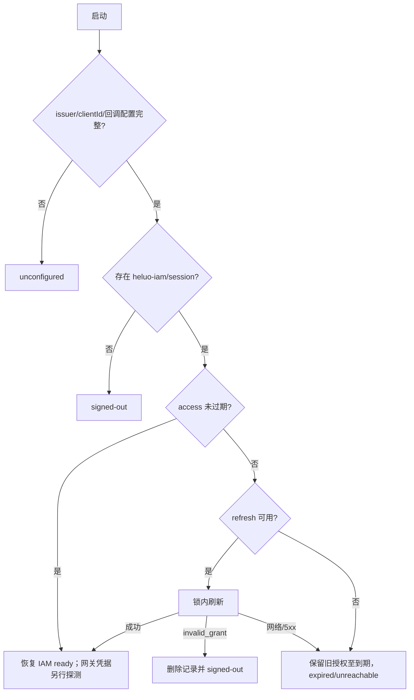
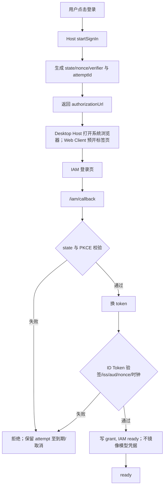

# IAM 接入详细设计

## 文档信息

| 项 | 内容 |
|---|---|
| 文档编号 | CORP-DSH-DESIGN-002 |
| 文档名称 | IAM 接入详细设计 |
| 版本 | V1.0.6 |
| 文档状态 | 草案 |
| 密级 | — |
| 编制 | DSH 平台组（代拟） |
| 审核 | 待定 |
| 批准 | 待定 |
| 最后更新 | 2026-10-23 |
| 门禁 | G0 认领；G1 接入与生命周期契约；G2 双端联调准入 |
| 模块状态 | 可用（Host + Client 骨架；OIDC mock 流程已验，真实联调待；实现与验证见设计索引 §2.2） |

> 编制依据：2026-10-21 对目标环境已安装 DSH `0.2.1-rc.2` 做运行时与包文档核验，并同日由用户确认采用 **O3「企业 IAM 独占登录」**；官方登录在企业内网不可用，因此不保留官方登录、官方模型、官方 API Key 与官方账户 UI 旁路。已核验：`ctx.credentials` 的 `resolve` / `set` / `readRecord` / `modifyRecord` / `deleteRecord` 与 `GrantRecord.payload`；`ctx.authorization` 的 flow 注册、单次尝试与 commit 语义；`ctx.webServer.register` 及官方账号包对 `/oauth/callback` 的占用；`dsh-llm-pi-ai` 的 `apiKeyEnv` 每请求解析；`dsh-credentials-local` 的 0600 YAML 存储；官方账号、模型与 UI 包名及目标 profile 的 row id。**未核验**：IAM 的 `resource`、refresh 轮换/重用检测、RFC 7009 撤销与 RP 登出；禁用四行后 shell/onboarding 是否完整；回调路由与 launch token/RPC 认证的交互；`engines.dsh` 断言形态；Windows/UOS/麒麟实机。以上未核验项不写成已实现。
>
> 关联文档：[总体架构](../../architecture/platform-architecture.md)、[网关契约](../../contracts/gateway-contract.md)、[双模式凭据](../credential-modes.md)、[企业组合包](forge-enterprise.md)、[模型网关](forge-gateway.md)、[设计索引](../README.md)、[需求基线](../../requirements/requirements-baseline.md)、[IAM 独立问询函](../../collaboration/iam-confirmation-letter.md)。

## 1. 结论

本模块把企业 IAM 做成 DSH 在企业内网的**唯一登录**：未登录时企业模型与企业工具全部不可用。官方 DeepSeek 登录、官方模型路由、官方 API Key 与官方账户 UI 由 `@heluo/forge-enterprise` 在组合层禁用，本模块不保留任何回落路径。

登录解决的是“企业身份与能力授权”，不是“打开 DSH 的准入”：应用外壳可以打开，但任何企业模型/工具调用在未登录时 fail closed，并给出重新登录入口。**当前目标将身份认证与网关模型授权分开管理**：个人模型调用必须有可信当前身份；A 纯令牌 / B Key＋令牌待评审，B 中 Key 由控制台签发，不能单独放行。

2026-10-22 裁决后已进入 interim 实现；上线前仍缺四类事：IAM 侧登录/刷新/撤销/RP 登出的书面确认（本轮已恢复网关目标授权及单授权生命周期为前置，resource 并非唯一路径）；禁用官方四行后 shell/onboarding 的实测；keychain provider 与 UI 挂载点的双端实测；网关凭据录入/探测与真实 UAG 联调。首版按 O3 独占实现 4 屏 onboarding（欢迎、登录、网关凭据、完成）+ 账户页；生产使用 keychain provider，旧 0600 记录迁移成功后删除；不实现附加登录（additive）模式。

### 1.1 本轮目标与原基线实现的差距

2026-10-23 仅更新文档。需求见[基线 §4.6](../../requirements/requirements-baseline.md#46-模型访问身份与专用凭证要求)，候选路线及时间语义见[评审稿](../../architecture/gateway-identity-review.md)，IAM 原函覆盖评估见[§8](../../collaboration/iam-confirmation-letter.md#8-本轮需求覆盖评估与补充确认清单平台内部)。需求方已确认，提供方能力、实际字段及技术路线待核验。

| 原基线/已有描述 | 本轮必须满足 | 状态 |
|---|---|---|
| 静态 Key 录入、清除、状态与本地 ownerSubject | A 不要求 Key；B 由网关认证当前人并比较 Key owner，本地记录不能证明归属 | 待 IAM/网关能力及 DSH 承载核验 |
| 会话 access/refresh 取用及本地单飞 | 网关目标授权、跨客户端稳定人员映射、停用后五分钟拒绝新请求 | 既有本地实现不能证明端到端满足 |
| 本地退出、可选 RP 和单 token 撤销描述 | 默认只退出当前设备授权，接受撤销后五分钟内覆盖全部刷新后代及 AT，不牵连其他设备/应用或全局 SSO | 关键能力待 IAM 核实，不以 RP 全局登出补足 |
| 离线/故障清理 | 本地立即停止并取消在途，服务端未确认如实展示；只有仍保证有效授权与五分钟上限时可继续调用 | 待正式契约及双端联调 |

下文涉及既有接口、配置、`ENTERPRISE_STATIC_KEY`、无网关 token 镜像和固定 onboarding 的描述，保留为 2026-10-22 interim 基线及当时目标，**不是本轮认证路线已经实现的证明**。未选路前不虚构新接口；具体已实现/未实现仍以 §4、§5.0 与设计索引的实测记录为准。本轮安全准入以本节及网关契约为准，旧的 Key-only 或仅本地退出不能作可投产回退。

## 2. 目标与非目标

**目标**

- 企业 IAM 是唯一登录；官方登录入口、官方模型路由、官方 API Key 路由均不可用。
- 企业 IAM 建立可信身份与目标授权；个人 A/B 路线按能力选定，原 Key-only 实现待调整，不在本轮实现。
- 授权码 + PKCE（S256），系统浏览器，loopback 回调；回调挂在现有 `webServer` 的独立路径。
- OIDC discovery 或显式端点；discovery `issuer` 必须与配置一致；校验 `state`、`nonce`、`iss`、`aud`、签名算法、`exp`/`nbf` 与时钟容差。
- 令牌记录进入 DSH 凭据服务；刷新在锁内 single-flight；调用方只拿 access token，不接触 refresh token。
- 账户/首启界面展示必要授权状态；B 才需要个人 Key 录入/清除，Key 由控制台签发。探测是否可用以实测记录为准。
- 账户页展示主体、到期、状态、网关凭据状态与登录/取消/退出；首启 4 屏，可跳过；未登录或网关凭据未配置时隐藏/禁用企业模型。
- 退出按 §1.1 清理本地并撤销当前授权，默认保留长期个人 Key；服务端撤销当前授权及所有刷新后代能力未确认时不得声称已闭环。

**非目标**

- 不接管“打开 DSH”的入口门禁；未登录时只是企业能力不可用。
- 不保留官方登录、官方模型、官方 API Key 或其他公网回落路由。
- 不做 additive 双登录、多账号并存、MCP token broker、CLI 登录。
- 不签发、不刷新、不自动轮换 UAG 网关凭据；不在客户端模拟控制台或调用未获支持的创建/列表接口。
- 不修改 DSH 核心，不 fork；若禁用官方行导致 shell 不可用，暂停 O3 并另提组合层替代方案评审，不在本设计默认接受核心补丁。
- 首版 onboarding 固定 4 屏，不做品牌营销页、余额/充值/用量页；完整品牌化另行评估。

## 3. 需求与依赖

| 需求/验收 | 关系 | 说明 |
|---|---|---|
| REQ-01 / A1、A14 | 支撑 | 授权码 + PKCE、loopback 回调、错误 `state`/身份校验拒绝；未登录或网关凭据未配置时无企业模型 |
| REQ-02 / A2 | 支撑 | 刷新成功无需重启；双进程不互相触发 `invalid_grant`；锁内刷新超时目标 ≤5 秒 |
| REQ-05 / A2、A3 | 支撑 | 按契约区分身份、Key、授权、用途及故障；额度不自动重试，已执行或未知结果不重放 |
| REQ-17 / A12 | 支撑 | IAM/凭据/必要审计缺失时，企业调用拒绝而不是降级 |
| C1、C4 | 约束 | 只走企业网关；不保留公网路由；日志不含正文与令牌 |

| 依赖 | 类型 | 版本约束 | 缺失时的行为 |
|---|---|---|---|
| `dsh-credentials` + `dsh-credentials-local` | 包 | 随目标 DSH `0.2.1-rc.2` | 无法读写记录；不进入 ready，明确报错 |
| `dsh-web-server`（`ctx.webServer`） | 包 | 随目标 DSH | 无法注册回调；登录不可用 |
| `dsh-settings` | 包 | 随目标 DSH | 配置不可写；按只读配置启动或报错 |
| `dsh-llm-pi-ai` | 包 | 随目标 DSH | 无模型路由；不影响登录本身 |
| `dsh-agent-default-model` | 包 | 随目标 DSH | 不自动设默认模型；用户手动选择 |
| IAM OIDC 授权服务器 | 服务 | OIDC + PKCE；网关目标授权待确认，resource 或等效 audience/client 配置 | 未配置即 `unconfigured`；不阻断其他插件 |
| `@heluo/forge-enterprise` | 包 | 同批次 | 官方行可能仍在位；本模块 `requireExclusive` 报独占冲突 |
| `@heluo/forge-gateway` | 包 | 同批次 | 所选个人路线缺少必要授权或消费方时，模型不可用 |

## 4. 扩展形态与边界

> 实现状态（2026-10-22）：本节的 Remote 命名空间、`watch` 状态流与登录后默认模型选择是 V1 目标，当前代码只提供 Host service、`/api/forge-iam/*` interim 路由和 Client 2 秒轮询；不要按本节描述认为 Remote 已可用。`iam.defaultModel` / `iam.defaultProvider` 当前仅保留配置，不自动切换模型。当前代码已移除 `ENTERPRISE_ACCESS_TOKEN` 镜像及对应测试；网关凭据的录入、清除与状态展示已按 `ENTERPRISE_STATIC_KEY` 实现（非敏感元数据记录 `heluo-iam/gateway-credential`），凭据探测未实现；Remote/watch 与默认模型切换仍为 V1 目标。

| 项 | 内容 |
|---|---|
| 形态 | Host 服务插件 + Client UI 插件 |
| 运行位置 | 本机 Host；Client 只做展示、触发与状态订阅 |
| 目标 DSH 与 SDK | `0.2.1-rc.2`；接口核验日期 2026-10-21 |
| 使用的 seam 或服务 | `credentials`、`webServer`、`settings`、`llm-pi-ai`（消费方）、`agentDefaultModel` |
| 不修改的核心 | 凭据服务实现、模型调用链、`webServer` 实现、官方账号包（仅组合层禁用） |
| 登录入口 | Host 服务 `ctx.iam` + Remote 方法（Client 命名空间 `iam`）+ `watch` 状态流 |
| 回调 | `webServer` 上的 `redirectPath`（默认 `/iam/callback`）；不复用官方 `/oauth/callback` |

### 4.1 官方行禁用与独占断言

| Row id（目标 profile） | 包 | 处理 | 原因 |
|---|---|---|---|
| `deepseek-account` | `@deepseek-ai/dsh-deepseek-account-platform` | `disabled: true` | 官方登录与账号状态；内网不可用 |
| `llm-deepseek-account` | `@deepseek-ai/dsh-llm-deepseek-account` | `disabled: true` | 官方 `deepseek-account` 模型路由 |
| `llm-deepseek` | `@deepseek-ai/dsh-llm-deepseek-api-key` | `disabled: true` | 官方 API Key 旁路 |
| `ui-settings-account` | `@deepseek-ai/dsh-client-ui-settings-account` | `disabled: true` | 官方账户页、侧栏入口与 onboarding |

禁用由 `@heluo/forge-enterprise` 的补丁完成；row id 以目标 profile 实际值为准。补丁目标不存在时 Loader 会警告并跳过，**跳过不等于已禁用**，G0 必须在 desktop 与 web 两个 profile 各核验一次。官方账号 provider 已占用 `/oauth/callback`，本模块使用 `/iam/callback`，不依赖“官方行一定已被禁用”来避免冲突。

本模块启动时检查 `ctx.get('deepseekAccount')`：若仍存在，记录 `exclusive-violation` 审计事件，不把状态标为 `ready`，不写模型凭据引用；由企业包修正组合。这样组合层禁用失败时是显式失败，而不是静默保留官方身份。

### 4.2 为什么不用 `authorization` flow

`ctx.authorization` 的 flow 适合“任意界面发起一次凭据获取”，并提供单次尝试与 commit 确认；本模块还要覆盖浏览器回调、刷新轮换、撤销与账户生命周期，flow 的 commit 只覆盖第一次写入。V1 采用与官方账号包同构的 Host service + Remote + `watch`，避免同一插件维护两套 attempt 状态。

若后续需要被通用凭据 UI 发现，再单独评估注册 `authorization` flow 作为适配层，不把 flow 作为本设计的写入前提。

### 4.3 回调与浏览器

- 回调 URI = Client 传入的 `callbackOrigin` + `iam.redirectPath`；Host 校验 origin 与 `webServer` 实际 origin 一致（loopback 或受支持的本地转发 origin），且必须是 IAM 预注册的精确 URI；不使用随机端口，不另起监听器。
- 回调只接受 `GET`，校验 `state` 与 PKCE；按官方账号包行为，回调请求以 state/PKCE 校验而非 RPC 认证，但需在目标 profile 实测 launch token/连接层是否放行。管理 API（`/api/forge-iam/*`）必须通过 DSH Connection 的 `requestRejection`（Host/Origin 策略与浏览器/API 凭据）；`ctx.connection` 不可用时 fail closed 返回 503，不以自定义请求头或本地 Origin 比较替代身份认证。回调保留自己的 Host 校验；Origin/Host 策略本身也由 Connection 负责，避免自定义 scheme（Desktop `dsh-app://`）被本地比较误判。
- Desktop 目标是由 Host 打开系统浏览器（Windows `start`、麒麟 `xdg-open`）；该能力**尚未实现**，当前 Client 统一用 `window.open` + 同窗兜底，Desktop WebView 行为未实测。Web 由页面在点击手势中预开标签页，弹窗被拦截时展示可复制链接。
- 回调页只返回最小 HTML，不加载外部资源，不把 code/token 写入页面或日志；当前完成后显示提示，不自动关闭标签页。

### 4.4 UI 范围

| 场景 | 行为 |
|---|---|
| 首启 | 无“已跳过/已完成”标记时显示 4 屏：欢迎、登录、网关凭据（控制台入口/设备命名建议/粘贴）、完成；欢迎可跳过；已配置凭据时完成标记写 `done`，否则写 `skipped`；探测未实现，不以探测结果作为完成条件 |
| 未登录 | 显示登录横幅与账户入口，不做全屏入口拦截；隐藏/禁用企业模型由策略/网关包负责，本模块尚未接线（见 §10） |
| 登录中 | 显示 attempt 状态与取消；浏览器未拉起时提供“打开登录页”链接（复制链接未实现） |
| 已登录但凭据未配置 | 显示“模型未就绪”横幅并引导到“设置 → 企业账号”；Client 无设置导航 API，暂不是可点击深链；不把此状态写成登录失败 |
| 已登录 | 账户页显示主体、状态、access 到期、网关凭据状态/设备标签/录入时间/建议到期/存储来源/控制台入口/清除；退出。RP 登出在 `logoutMode=rp` 且配置 `endSessionEndpoint` 时执行（Client 跳转）；下次刷新时间、官方旧记录清理、复制诊断与默认模型切换仍未实现 |
| 官方 UI | 不显示官方账户页、官方登录入口、官方模型/API Key 入口 |
| 挂载点 | 实际使用 `settings.section` + `shell.overlay`；不占用单占位 `settings.launcher`（避免替换官方设置触发器）；`sidebar.footer.action` 未发现，不硬编码 DOM |

Client 契约（2026-10-22 核验并修复）：`shell.overlay` 是 `pointer-events:none` 的穿透层，onboarding 遮罩必须显式 `pointerEvents:'auto'`，否则遮罩、dialog 与按钮全部不可点击；登录横幅的轮询绑定组件生命周期而不是 `visible`，否则进入 `ready` 后不再观察退出/失效；onboarding 的 `ready` 轮询只在 `step < 2` 时推进，重复的相同快照不得把已完成界面拉回登录屏。样式使用宿主主题 token（`--dsw-alias-bg-layer-1`、`--dsw-alias-label-primary`、`--dsw-alias-state-warn-primary`），不依赖未声明的 `--dsh-*` 私有变量。包里提供 `locale/en.json`、`locale/zh.json` 的 `meta.title`/`meta.description` 与 `icon.svg`，供插件管理面在不激活插件时显示；`icon.svg` 逐字节取自预置品牌资产 `docs/assets/branding/cyber-long/components/forge-iam-symbol.svg`，不另绘自造图标；界面文案仍是硬编码中文，全量 locale 化属于未完成的发布准入项。

4 屏 onboarding 不是品牌营销页；不做余额、充值、用量页。复制诊断信息只含主体、状态、到期、网关凭据状态、错误类别与版本，不含 token、code、verifier、ID Token 或网关 Key。

当前实现为“欢迎、登录、网关凭据、完成”四屏：登录后进入网关凭据屏，录入成功或“稍后配置”进入完成屏；凭据探测与“探测成功才算完成”尚未实现，完成标记只反映是否已配置，未配置时企业模型仍不可用。

## 5. 接口与配置

> 状态（2026-10-22）：本节的 `IamAccount`/`IamView` TypeScript 是 V1 Remote 目标，不是当前可用接口；当前实现只有 Host service 与 interim `/api/forge-iam/*` 路由，实际形态见 §5.0。


| 配置项 | 类型 | 默认值 | 必填 | 说明 |
|---|---|---|---|---|
| `iam.discoveryUrl` | string | 空 | 条件 | OIDC discovery；与显式端点二选一 |
| `iam.issuer` | string | 空 | 条件 | 显式端点时必填；用于 ID Token `iss` 校验 |
| `iam.authorizationEndpoint` | string | 空 | 条件 | 显式端点；与 discovery 同时配置时优先 |
| `iam.tokenEndpoint` | string | 空 | 条件 | 换 token |
| `iam.jwksUri` | string | 空 | 条件 | ID Token 验签 |
| `iam.revocationEndpoint` | string | 空 | 否 | RFC 7009；空则只做本地退出 |
| `iam.endSessionEndpoint` | string | 空 | 否 | RP 登出；`logoutMode=rp` 时必填 |
| `iam.clientId` | string | 空 | 是 | 本机公共客户端标识，无 client secret |
| `iam.scopes` | string[] | `openid profile offline_access` | 是 | 基础 scope；不含资源 scope |
| `iam.redirectPath` | string | `/iam/callback` | 否 | Host 回调路径；不得为站点根或以 `/` 结尾（DSH 路由为不带尾斜杠的绝对路径） |
| `iam.redirectUri` | string | 空 | 否 | 绝对回调 URI；path 必须等于 `redirectPath`，非 loopback 必须 HTTPS，生产必须与 IAM 注册值精确匹配 |
| `iam.postLogoutRedirectUri` | string | 空 | 否 | `logoutMode=rp` 时使用；绝对 http(s)，HTTP 仅限 loopback |
| `iam.gatewayResource` | string | 空 | 否 | 原基线预留；不证明当前实现支持网关目标令牌，新路线取用方式待确认 |
| `iam.gatewayConsoleUrl` | string | 空 | 否 | UAG 个人凭证控制台入口；仅用于引导与深链，不参与鉴权 |
| `iam.defaultProvider` | string | `enterprise` | 否 | 预留；当前不自动设置 |
| `iam.defaultModel` | string | 空 | 否 | 预留；当前不自动设置 |
| `iam.refreshSkewSeconds` | number | 60 | 否 | 到期前预刷新阈值 |
| `iam.attemptTimeoutSeconds` | number | 300 | 否 | 登录 attempt 总时限 |
| `iam.httpTimeoutMs` | number | 10000 | 否 | discovery / 换 token / 撤销单次请求上限；锁内 refresh 另以 5000ms 为硬上限 |
| `iam.logoutMode` | `local` / `rp` | `local` | 否 | 是否发起 RP 登出 |
| `iam.requireExclusive` | boolean | `true` | 否 | 官方账号仍存在时拒绝就绪 |
| `iam.allowInsecureHttp` | boolean | `false` | 否 | 显式允许 HTTP；即使开启也仅对 loopback（`localhost`/`127.0.0.1`/`::1`）生效，生产必须关闭 |

**导出面（V1）**

```ts
export type IamState =
  | 'unconfigured'
  | 'signed-out'
  | 'authenticating'
  | 'ready'
  | 'expired'
  | 'unreachable'
  | 'error';

export interface IamClientMetadata {
  readonly version: string;
  readonly locale: string;
  readonly utcOffsetSeconds: number;
}

export interface IamPrincipal {
  readonly issuer: string;
  readonly subject: string;
  readonly displayName?: string;
  readonly groups?: readonly string[];
}

export interface GatewayCredentialView {
  /** 当前 interim 状态；探测结果（suspended/policy_denied/model_not_allowed/unreachable）属 V1 */
  readonly state: 'unconfigured' | 'configured' | 'invalid' | 'owner-mismatch';
  readonly ownerSubject?: string | null;
  readonly deviceLabel?: string | null;
  readonly enteredAt?: string | null;
  readonly suggestedExpiry?: string | null;
  /** provider 来源；非 keychain 时账户页提示“未受系统保护” */
  readonly storage?: string | null;
  readonly matchesAccount?: boolean;
  /** V1：最近一次探测时间与探测状态 */
  readonly lastProbeAt?: string;
}

export interface IamView {
  readonly state: IamState;
  readonly principal?: IamPrincipal;
  readonly accessExpiresAt?: string;
  readonly gatewayCredential: GatewayCredentialView;
  readonly authorizationUrl?: string;
  readonly attemptId?: string;
  readonly error?: { readonly code: string; readonly message: string };
}

export interface IamAccount {
  startSignIn(
    client: IamClientMetadata,
    callbackOrigin: string,
    loginSource: 'web' | 'desktop',
  ): Promise<IamView>;
  cancelSignIn(attemptId: string): Promise<IamView>;
  signOut(client: IamClientMetadata): Promise<IamView>;
  getView(): Promise<IamView>;
  watch(signal: AbortSignal, includeIdentityChanges?: boolean): AsyncIterable<IamView>;
  getPrincipal(): IamPrincipal | undefined;
  /** 录入/更新 UAG 个人凭证；只写系统凭据库，不签发、不刷新 */
  setGatewayCredential(input: {
    value: string;
    label?: string;
  }): Promise<IamView>;
  /** 清除已保存的网关凭据；不影响 IAM 会话 */
  clearGatewayCredential(): Promise<IamView>;
  /** 用当前凭据做一次最小探测；不重放原请求 */
  probeGatewayCredential(): Promise<IamView>;
  /** Host-only；V1 不用于模型网关，仅保留给未来按资源调用/MCP */
  tokenFor(resource: string): Promise<{ token: string; expiresAt: number }>;
}
```

Client 通过 `iam` Remote 命名空间调用 `startSignIn` / `cancelSignIn` / `signOut` / `getView` / `setGatewayCredential` / `clearGatewayCredential` / `probeGatewayCredential` 并订阅 `watch`；`tokenFor` 不暴露给浏览器，`getPrincipal` 供 Host 内部 policy/audit 使用，Client 从 `IamView.principal` 取展示所需的最小主体。断线重连后重新 `getView`，不依赖内存事件重放。V1 中 `setGatewayCredential`/`clearGatewayCredential`/`probeGatewayCredential` 是目标接口；当前 interim Host 已实现录入/清除/状态读取（`saveGatewayCredential`/`clearGatewayCredential`/`loadGatewayCredential`，状态并入 `IamView.gatewayCredential`），`probeGatewayCredential` 未实现（探测归网关包）。

### 5.0 当前 interim 接口（V0.4.1）

> 以下 TypeScript 是 V1 目标；当前实现的实际形态：
> `createIamService(config, options)` 返回 Host 对象；`getView()` 同步返回快照，`startSignIn()` 无参并返回 `{ view, authorizationUrl }`，`cancelSignIn()`/`signOut()` 无参，`handleCallback(rawUrl)` 接收完整回调 URL，`syncFromStore()` 在 `/view` 前同步共享记录，`watch(signal)` 仅 Host 内部可用。Client 通过 interim same-origin HTTP 调用，不经过 Remote。`IamView` 当前字段为 `state`、`configured`、`signedIn`、`canSignOut`、`canSignIn`、`missing`、`error: string|null`、`exclusive: string`、`principal: string|null`、`accessExpiresAt: string|null`、`gatewayCredential: object|null`、`gatewayConsoleUrl: string|null`；不包含 `authorizationUrl`/`attemptId`，授权 URL 由 `startSignIn` 的返回值单独给出。网关凭据的 Host 方法为 `saveGatewayCredential({key, deviceLabel})`、`clearGatewayCredential()`、`loadGatewayCredential({force})`，状态随 `IamView.gatewayCredential` 返回（`state`、`deviceLabel`、`ownerSubject`、`enteredAt`、`suggestedExpiry`、`storage`、`matchesAccount`）；`probeGatewayCredential` 未实现。仅当 access 过期且 refresh 可用时，`syncFromStore` 才会在后台刷新（30 秒退避）。

### 5.1 凭据记录

`GrantRecord.payload` 由本插件解释，存储为带版本的对象；`modifyRecord` 是唯一写入路径。IAM access token 只保存在 GrantRecord，**不再 `set` 为模型网关镜像**；网关凭据写入独立的 `CredentialRef: ENTERPRISE_STATIC_KEY`，不放进 GrantRecord。

**IamGrantV1（示意）**

```ts
interface IamGrantV1 {
  version: 1;
  issuer: string;
  subject: string;
  clientId: string;
  refreshToken: string;
  refreshExpiresAt?: string;
  accessToken: string;
  accessExpiresAt: string;
  scope: string;
  /** 未配置 iam.gatewayResource 时缺省；静态 Key 模式不使用 */
  resource?: string;
  obtainedAt: string;
  authTime?: string;
  /** 仅 logoutMode=rp 时保存；含身份 claims，按敏感数据对待 */
  idToken?: string;
}
```

记录 key 为 `heluo-iam/session`；版本不匹配时拒绝读取并要求重新登录，不在字段缺失时猜测迁移。官方账号的旧记录不自动删除：官方路由已禁用，token 无法用于企业调用；账户页提供“清理官方登录记录”操作，删除前需用户确认。

## 6. 权限、凭据与数据

| 项 | 处理方式 | 生命周期 | 失败时 |
|---|---|---|---|
| refresh token | `GrantRecord.payload`；生产 `@heluo/forge-credentials-keychain`，仅 dev/pilot 可显式接受 0600 fallback | 直到撤销或轮换 | 写入失败不进入 ready；keychain 不可用 fail closed |
| access token | 原 interim 仅 GrantRecord；无网关镜像 | 原 ≤60 分钟为历史建议，不是已核实 TTL；本轮按五分钟端到端约束确认 | 刷新/写入失败按错误分类 |
| 网关个人凭据 | 系统凭据库中的 `ENTERPRISE_STATIC_KEY`；记录 `ownerSubject` + 设备标签，不放入 GrantRecord | 用户更换/清除；建议 90 天 | 未配置/无效 fail closed；不自动刷新、不自动重建 |
| 授权码与 verifier | 仅内存，单次 attempt | ≤5 分钟 | 校验失败即丢弃 |
| ID Token | 仅 `logoutMode=rp` 保存；否则不落盘 | 到退出 | 缺失则不允许 RP 登出 |
| 主体与 groups | 内存中的最小 principal | 会话 | 不注入模型上下文 |
| 日志 | 主体、资源、结果、耗时、错误类别 | 90 天（认证）/30 天（配置错误） | 本地写失败不阻断；必要审计由 policy 执行 |
| 官方旧 grant | 不读取、不刷新、不用于调用 | 直到用户清理 | 清理失败保留并提示 |

**存储事实**：目标 DSH 默认组合的 `dsh-credentials-local` 把 `refs` 与 `records` 写在 `$DSH_HOME/.credentials.yaml`，权限 0600、内容为明文 YAML；同 UID 的 Agent 工具进程可以读取。OS keychain provider 未随 `0.2.1-rc.2` 提供。因此本设计新增独立 `@heluo/forge-credentials-keychain`，生产必须注册；生产计划使用 `@napi-rs/keyring`：Windows 走 Credential Manager，UOS/麒麟固定 Secret Service 并拒绝 keyutils 静默回退；当前包仅实现 file backend，OS adapter 未实现。keychain 不可用时企业登录 fail closed；仅 dev/pilot 可显式接受 0600 fallback。账户页已返回并展示 `gatewayCredential.storage`（`keychain`/`file` 等），非 keychain 时显示“未受系统保护”，见 §4.4。旧 0600 记录在 keychain 可用后迁移，迁移成功才删除明文；不新写明文。若 provider 无法插拔，暂停 Q15 的 keychain 实现并重评，不静默降级。

**本机 spike（2026-10-24，darwin-arm64，`/usr/bin/security`）**：用 `@heluo/forge-credentials-keychain` 的 security-cli 适配器（非生产、需 `allowUnvettedPlatformAdapter: true` 显式开启）在真实系统钥匙串上跑通 backend 契约，实测到的事实：

| 观察 | 结果 |
|---|---|
| 可用性探测 | `security list-keychains` 退出码 0，搜索列表两条（只记条数，不记字面路径） |
| 未命中条目 | `find-generic-password` 退出码 **44**，stderr `SecKeychainSearchCopyNext: The specified item could not be found in the keychain.` |
| 写入与覆盖 | `add-generic-password -U` 新建或覆盖同名条目；口令经 **stdin 双次输入**写入（把口令写两行管道给 `... -U -w`），**不必**出现在 argv |
| 删除 | 命中退出码 0；未命中退出码 **44**（幂等） |
| 明文检查 | spike 过程中除证据 JSON 外没有新文件；临时目录内任何文件都不含口令值 |
| 枚举 | `dump-keychain` 不是稳定接口，适配器对 `list()` 直接报 `KEYCHAIN_LIST_UNSUPPORTED`，**不返回空表**——否则会把"读不到"伪装成"没有记录"，迁移因此在该适配器下不可用 |
| 负向 | argv 传输（`secretTransport: 'argv'`）未显式允许时拒绝写入且不调用 CLI |
| 清理 | 结束时删除测试条目并复核 `find-generic-password` 回到 44（无残留） |

复跑命令：`node scripts/probe/run-keychain-spike.mjs`（10/10 步通过；`node --test tests/keychain-spike.test.mjs` 在非 darwin 或 `DSH_KEYCHAIN_SPIKE=0` 时跳过）。

**旧 0600 明文迁移演练（#13 AC4，2026-10-24，darwin-arm64，`/usr/bin/security`）**：迁移协调器 `migrateLegacyFileToKeychain()`（`packages/forge-credentials-keychain/src/migrate.mjs`）把旧 0600 文件里的 `${service}/${accountPrefix}/record|ref/…` 条目写进钥匙串，规则是 fail closed：

| 情况 | 处理 |
|---|---|
| keychain 不可用 | 不迁移、不写明文、不动旧文件（`keychain-unavailable`） |
| 目标条目已有**不同**值 | 拒绝覆盖（`target-conflict`），旧文件保留 |
| 目标条目已有**相同**值 | 幂等跳过写入 |
| 写入后回读不一致或回读失败 | 立即停止、旧文件保留、目标条目留待人工核查（`read-back-mismatch`） |
| 全部回读一致 | 才删除旧文件；删除失败按"已迁移但旧文件仍在"报缺口（`legacy-delete-failed`） |
| 任何返回值与消息 | 不含秘密值（`redactSecrets`，金丝雀检查） |

本机演练（`node scripts/probe/run-keychain-migration-rehearsal.mjs`，**9/9 步通过**）只碰副本：旧文件是探针在临时目录自建的 0600 合成记录，钥匙串条目 service 固定为探针专用名、account 随机，结束删除并复核无残留。实测：迁移后回读值与旧值一致、旧文件删除、临时目录无新增明文；不可用后端下副本原样保留（仍是 0600）；回读不一致与目标冲突都按上表停止；证据 JSON 金丝雀检查通过。**未验**：Windows 凭据管理器与 UOS/麒麟 Secret Service 上的迁移、`@napi-rs/keyring` 产物、以及真实用户凭据的迁移（本轮按批准决策只演练副本，不读取、不删除任何真实凭据记录）。

**跨进程可见性补测（#13 AC4，2026-10-24，darwin-arm64，真钥匙串）**：既有证据都在**同一个进程**里完成往返，而跨进程是另一类风险——backend 里只要存在任何进程内状态（缓存、句柄、按 pid 命名），本进程往返会通过、CLI 与桌面应用之间却读不到对方记录。`node scripts/probe/run-keychain-cross-process-probe.mjs` 把写、读、删拆到不同进程，**6/6 步通过**：

| 步骤 | 实测 |
|---|---|
| 子进程 A 写入 | 退出码 0（记录由 A 创建） |
| 父进程读取 | 值一致（只比较、不打印；报告里只有布尔与长度） |
| 第三个进程读取 | 命中（`PRESENT`）——记录确实按用户共享，不依赖创建它的进程 |
| 子进程 C 删除 | 退出码 0 |
| 删除后再读 | 不存在（跨进程删除生效） |
| 清场 | 复核无残余钥匙串条目 |

**未验**不变：Windows/UOS/麒麟适配器与其上的跨进程行为、`@napi-rs/keyring` 产物、真实用户凭据（本轮同样只碰探针自建条目）。

**Linux aarch64 平台探测（#13 AC4，2026-10-24，Ubuntu 24.04.5 / aarch64 / Node 22.23.2，远端任务副本）**：从包公开入口调用 API（未改源码、未读真实凭据），10/10 探测通过：

| 探测 | 实测 |
|---|---|
| 默认平台后端 | `kind: unavailable`；`get`、provider 构造、默认 `apply` 均抛 `KEYCHAIN_UNAVAILABLE`，**无明文回退**，未产生任何文件；文案明示 `OS keychain adapter is not implemented on this platform (linux); provide a reviewed backend` |
| file backend 未 opt-in | `KEYCHAIN_INSECURE_FILE_REFUSED`，未创建文件 |
| 显式 `allowInsecureFile: true` | 写入合成 grant 后 `stat` 模式为 `0600`；同实例与新建实例读回一致 |
| 损坏文件 | 读写均报 `KEYCHAIN_FILE_CORRUPT`，原字节不变，不重置也不静默降级 |
| 真实文件系统失败 | 以普通文件作父路径时上浮真实 `EEXIST`，未产生部分文件 |
| 迁移目标不可用 | `keychain-unavailable`；旧副本 `legacyRetained: true`、`legacyDeleted: false`，前后 SHA-256 与权限不变 |
| 迁移回读不一致 | `read-back-mismatch`；旧副本字节与 0600 不变 |
| 迁移成功 | `migrated`；事件序为 预读 → `set` → 相等回读 → `unlink`，删除前断言两次目标读取均已完成 |

限制：迁移目标与"可用后端"都是注入的测试后端，**不是 Linux OS keychain**——未验证 Secret Service/libsecret 的持久性，未在 Node 24 复跑，也不是麒麟/UOS 验收。证据在远端任务目录 `20261024T122800Z-linux-aarch64-probe`（`scripts/keychain-linux.mjs`、`artifacts/keychain-results.json`）。

**不能据此声称的事**：这不是生产适配器，也不能替代 Windows/UOS/麒麟 实测——`@napi-rs/keyring` 的产物、Secret Service 可用性、keyutils 静默回退策略仍需在目标平台核验（见 §12 未决事项）；macOS 只用来验证 seam 与失败语义，以及"凭据不出现在 argv、不落明文"这两条可迁移结论。生产适配器未落地前，企业登录仍按 keychain 不可用 fail closed 处理。

开发 fallback 的文件读写使用各操作独立快照，避免无锁读取污染锁内事务。文档锁争用超过 10 秒报 `KEYCHAIN_LOCK_TIMEOUT`，不按 PID/时间自动接管：检查旧锁后再重命名不能排除另一等待者已取得新锁的竞态。异常退出留下锁时，须先停止使用同一文件的所有进程，再人工确认和恢复；不把该最小 fallback 当作生产锁与 OS adapter 的实现。

镜像/副本说明：V1 不再把 IAM access token 写入 `ENTERPRISE_ACCESS_TOKEN`；IAM token 只存在于 GrantRecord 与内存。网关凭据 `ENTERPRISE_STATIC_KEY` 由同一 keychain provider 保护；在 dev/pilot 的 0600 fallback 下仍为明文，账户页已按 `storage` 来源提示“未受系统保护”（OS keychain adapter 未实现，生产仍按 fail closed 处理）。`llm-pi-ai` 每次请求重新解析该引用，用户更换 Key 后无需重启；不要把“内存中的 Key”写成唯一副本。

## 7. 流程

### 7.1 启动恢复



启动不主动打 IAM：配置缺失即 `unconfigured`；已有 access token 未过期则直接恢复 IAM ready；过期且 refresh 可用时，在首次需要或 `/view` 轮询中后台刷新（30 秒退避），避免离线启动被网络等待拖住，也符合“IAM 不可达时保留仍有效的授权至原到期”。网关凭据不阻塞 IAM ready；模型调用前另查 `ENTERPRISE_STATIC_KEY`，未配置即提示配置，已配置的有效性由网关包按需探测，本模块不探测。

### 7.2 登录



- 每次登录一个 `attemptId`；同一账户同时只允许一个 attempt，第二次返回“已有登录进行中”，不并行打开两个浏览器流程。
- attempt 总时限 300 秒；用户取消、关闭对话框或进程退出时清理 attempt，迟到的回调按无效处理。
- 回调换 token 使用 `httpTimeoutMs`；授权码只兑换一次，失败不重放同一 code。
- 登录成功后只代表 IAM ready；模型是否可用取决于 `ENTERPRISE_STATIC_KEY` 是否已配置（其有效性由网关包探测，本模块不探测）。二者状态分开，不把“未配置网关凭据”显示成“登录失败”。
- 登录成功后设置 `iam.defaultModel` 为 V1 目标；当前未实现，配置项不生效。

#### 7.2.1 禁用 IAM 插件与独占冲突的实测（#13 AC8 / AC1，2026-10-24）

探针 `iam-absent-and-disabled-fail-closed`（`dsh 0.2.1-rc.2`，darwin-arm64，node v26.11.1，profile `sdk`）在**真实宿主进程**里做三件事，探针总况 28/28 通过、2 blocked：

| 步骤 | 机制 | 实测结果 |
|---|---|---|
| IAM 缺席 | 探针进程内 `ctx.get('iam')` 不存在 | 门禁 `not-signed-in` → 企业调用**拒绝**（无 break-glass） |
| 真实挂载 | `ctx.plugin(forge-iam apply, {})` 挂真实插件（无 discoveryUrl，不发起网络） | 服务注册成功、`getView().state === 'unconfigured'`，门禁仍拒绝 |
| **禁用（dispose）** | `fiber.dispose()` 卸载同一插件 | `ctx.get('iam')` 再次消失，状态回到"缺席即拒绝"——**禁用 IAM 插件后企业调用 fail closed** |
| 独占冲突 | 子作用域夹具提供 `deepseekAccount`，再挂真实 IAM 插件（错误注入；机制是真实的） | 真实状态机进入 `error`（**不 ready**），`checkExclusive` 返回 `exclusive-violation` |
| 当前 profile | 对 live ctx 直接调用 `checkExclusive(ctx, {requireExclusive: true})` | `ok`——`sdk` profile 没有官方账号服务；冲突路径由上一行的注入证明 |

以上只覆盖 Host 侧调用闭合；`DEEPSEEK_API_KEY` 旁路与"官方模型不可选"的运行时面仍受探针 profile 无官方模型行限制，保持 blocked（见 [forge-enterprise §5.1.1](forge-enterprise.md#511-禁用实验本机实测-2026-10-24)）。

### 7.3 模型门禁与默认模型切换

门禁是**纯判定**（`packages/forge-iam/src/model-gate.mjs`）：不读配置、不调用宿主、不写设置；宿主侧把登录态、网关凭据状态、当前默认选择与可用提供方注入进来，返回 `{allow, reason, switchTo?, notes}`。

| 判定顺序 | 条件 | 结果 |
|---|---|---|
| 1 | 未登录 | 拒绝 `not-signed-in`，**不提供切换目标**；环境里有官方 API Key 也一律忽略，不构成旁路 |
| 2 | 已登录但网关凭据非 `present` | 拒绝 `gateway-credential-missing`，引导录入而不回落 |
| 3 | 未声明企业模型 | 拒绝 `no-enterprise-model` |
| 4 | 声明的企业模型被禁用或没有可用提供方 | 拒绝 `enterprise-model-unavailable` |
| 5 | 尚未选择 | 放行并切到企业模型 `selection-absent-switched` |
| 6 | 当前选择不可用（含被禁用的官方模型） | 放行并切到企业模型 `selection-disabled-switched` |
| 7 | 当前已是企业模型 | 放行且**不切换** `keep-explicit-enterprise` |
| 8 | 同提供方的其他模型：显式选择保留；非显式收敛到企业默认 | `keep-explicit-enterprise` / `selection-not-explicit-switched` |
| 9 | 可用但不属于企业的提供方 | 拒绝 `selection-outside-enterprise`，交企业侧裁定，不静默改用 |

输入不合法（非对象、提供方列表不是数组、`enterprise`/`selection` 缺 provider/model）直接抛 `MODEL_GATE_INPUT_INVALID`，不"默默放行"。空输入的默认结果是**拒绝**。

**本机实测（2026-10-24，DSH 0.2.1-rc.2，darwin-arm64）**：宿主 `agentDefaultModel.currentSelection()` 返回 `{provider: "deepseek-official", model: "deepseek-flash"}`（字段就是 provider/model），而同进程 `llm.listProviders()` 为 **0 个**——即官方行禁用后，默认选择仍停留在官方模型上，这正是决策表里"当前指向已禁用官方模型"的真实状态，不是假设。把该实测状态喂给门禁：拒绝 `not-signed-in`（并注明官方 API Key 被忽略）。同一探针里用合成输入验证了切换分支：`signedIn + gatewayCredential=present + enterprise=enterprise-probe` 且当前选择为 `deepseek/deepseek-chat` 时返回 `selection-disabled-switched` 并给出 `switchTo`。

**未验**：对**真实** `agentDefaultModel.saveSelection` 的写入（受控写未获准；本轮的写入路径以记录式 sink 演练，见 §7.2.2）；"登录后企业模型可用"的正向路径需要企业网关与企业凭据；官方旧默认模型的迁移/清理策略仍未定（见 §12）。

#### 7.3.1 默认模型的写入接线（#13 AC6，`applyModelSelection()`，2026-10-24）

判定与写入分离：`evaluateModelGate()` 只判定，`applyModelSelection()` 只负责把判定落到设置，并在写入前**独立复查**一次"绝不覆盖用户显式企业选择"——即使判定对象被伪造要求切换，接线也必须自己挡住。

| 情况 | 结果 |
|---|---|
| 判定未放行（如未登录） | 不写 `no-write-gate-denied` |
| 判定放行但没有 `switchTo`（如"当前已是企业模型"） | 不写 `no-write-no-target` |
| 当前选择**显式**且仍可用（含企业模型本身） | 不写 `no-write-keep-explicit-enterprise`（独立复查，不看判定脸色） |
| 当前已是目标模型 | 不写 `no-write-already-enterprise`（幂等） |
| 当前选择读取失败或无法解析 | 不写 `no-write-selection-unprovable`（无法证明将覆盖什么就不写） |
| 写入抛错 | `selection-write-failed`，如实报错不谎报成功 |
| 写入后回读不一致 / 未提供读取器 | `written: true, verified: false`，按**未验证缺口**报告，不写成"已切换" |
| 写入且回读一致 | `selection-written`，`verified: true` |

**实测（2026-10-24，DSH `0.2.1-rc.2`，darwin-arm64，node v26.11.1，profile `sdk`）**：探针 `model-selection-write-guard-on-measured-host`（探针 29/29 通过、2 blocked）用**宿主实测状态**驱动接线，写入落点是记录式 sink（**不写真实设置**）：

| 输入 | 实测结果 |
|---|---|
| 宿主实测判定（未登录，`not-signed-in`） | `written: false`，`no-write-gate-denied` |
| 合成"已登录 + 网关凭据 + 企业模型"，当前选择 = **实测到的官方模型**（不可用） | `written: true`、`verified: true`，尝试写入 `enterprise-probe/probe-model`，写次数 1 |
| 合成"当前是显式企业选择"＋伪造的切换判定 | `written: false`，`no-write-keep-explicit-enterprise` |
| 步骤前后再读真实 `agentDefaultModel.currentSelection()` | 与步骤前一致（`liveSelectionUntouched: true`）——只读校验证明本次演练没有改动正在使用的会话设置 |

离线用例 `packages/forge-iam/test/model-selection.test.mjs`（7 项）覆盖上表全部分支、写入失败与回读不一致、非法输入报错。

### 7.4 刷新

- 触发：access token 距到期 ≤`refreshSkewSeconds`，或账户页/首个请求需要 token。
- 把“读记录 → 判断有效期 → 刷新 → 写回”放进 `ctx.credentials.modifyRecord('heluo-iam/session')`；锁内先复查，后到者复用结果。discovery/JWKS 预取在锁外；grant 写入后重读；记录缺失、access token 不匹配或读取失败时要求重登，不返回旧 token，也不因此删除另一实例的新 grant。V1 不再发布模型凭据镜像。
- 锁内网络刷新硬超时 5 秒；超时/断网时释放锁，保留未过期 access token，按退避重试；已过期则 `expired` 并要求重登。
- `invalid_grant`：删除记录、清运行时副本、`signed-out`；不重试。
- refresh 轮换：若 IAM 返回新 refresh token，先写记录再使用；写失败或响应丢失导致旧 token 可能已失效时，按“会话不确定”处理，清空并要求重登，**不得**用旧 refresh token 再试。
- 双进程：两个进程共用一份记录；后到者在锁内重新读取，不各刷新一次；任何一方都不得把旧 refresh token 写回。

### 7.5 退出与撤销

> 2026-10-23 适用性：本节原流程是 interim 基线说明。默认目标是当前授权及刷新后代撤销，不自动调用全局 RP 登出；本地删除/只撤 AT 不能证明服务端五分钟内终结当前授权。旧代码行为未在本轮修改。相关能力未闭环则不开放相应路径。


顺序：停止本实例新请求 → 取消进行中的登录 → 锁内读取最新 grant 并尽力撤销 refresh token（网络上限 5 秒）→ 清运行时副本 → 删除记录 → 再清副本 → 发布 `signed-out` → 审计。默认不删除已保存的 `ENTERPRISE_STATIC_KEY`；用户显式“清除网关凭据”才删除。

当前实现（2026-10-22）用删除后的再次清理与发布后的 grant 复核配对，覆盖共享刷新、迟到 hydrate/refresh 副本及插件卸载的指定交错；过时 callback/读取不再覆盖新生命周期。`credentials` seam 只承诺单 record 的互斥，不提供 record/ref 多键原子事务；这些终态回归不是所有跨进程时序的线性一致性证明，仍须经过生产凭据后端与企业并发验收。

- 撤销按 [RFC 7009 §2.2](https://www.rfc-editor.org/rfc/rfc7009.html#section-2.2) 以成功状态判定，忽略成功正文，允许空、非 JSON 或 JSON 正文；失败 HTTP 响应仍报告失败。规范核验日期：2026-10-22。

- `logoutMode=local` 只做本地退出与尽力撤销；不保证 IAM 的浏览器 SSO 会话结束。
- `logoutMode=rp` 需要 `endSessionEndpoint` 与保存的 ID Token；跳转参数按 IAM 文档，`post_logout_redirect_uri` 必须预注册。
- 撤销失败不回滚本地退出，也不谎报“已撤销”；记录失败类别，账户页提示“本地已退出，服务端撤销未确认”，并保留支持入口。
- 显式退出或企业卸载流程执行撤销与清理；普通插件卸载/重载释放运行时资源并清理派生的副本，但保留 GrantRecord 与已保存的 `ENTERPRISE_STATIC_KEY`，下次启动由 `hydrate` 恢复。退出不宣称已吊销 UAG Key。
- 插件生命周期由 `ctx.effect` 拥有：Cordis `4.0.5` 对普通 `function apply` 走构造器分支，只接管 `Service.init`，**不收集** `apply` 的返回值；因此 `service.dispose()`、`ctx.provide('iam')` 撤销与 webServer fiber 停止都必须显式登记为 effect。`dispose()` 复用已创建的 grant store（`store ?? ensureStore()`），避免卸载与框架撤销 `ctx.provide('credentials')` 并发时因重新解析 seam 而漏清运行时副本。
- 禁用/卸载企业能力时由企业 bundle 先调用显式退出，再移除插件；不删除用户工作区或会话数据。

## 8. 失败模式

| 场景 | 行为 | 用户可见结果 | 是否可重试 |
|---|---|---|---|
| IAM 未配置 | `unconfigured`，不发起任何调用 | 提示联系 IT 配置 | 否，修配置后重启 |
| 浏览器未拉起 | 保留 attempt 到超时或取消 | 提供“重新打开链接”和可复制链接 | 是 |
| 回调路径不可达（webServer 未就绪） | attempt 失败，记录原因 | 提示检查本机 127.0.0.1 与防火墙 | 修环境后重试 |
| 用户取消 | 清理 attempt，不写记录 | 回到 `signed-out` | 是 |
| `state`/`nonce` 不符 | 丢弃回调，不换 token | 登录失败，提示重试 | 是 |
| 授权码重放/已使用 | 不重放，清理 attempt | 提示重新登录 | 是 |
| ID Token 验签/`iss`/`aud`/算法失败 | 拒绝登录，记录安全类别 | 配置或安全错误，不进入循环重登 | 修配置后重试 |
| JWKS `kid` 未命中 | 视为密钥轮换，短退避后重取 JWKS | 暂时不可用，不冒充登录过期 | 是，有上限 |
| 换 token 网络超时/5xx | 不重放同一 code；按未知结果处理 | 提示重试登录 | 是 |
| 换 token `invalid_grant` | 清理会话 | 提示重新登录 | 否 |
| 刷新网络错误/429 | 保留未过期 access token，退避 | 保留会话并提示 | 是，有上限 |
| 刷新 `invalid_grant` | 删除记录与运行时副本 | 要求重新登录 | 否 |
| 刷新轮换后写盘失败/响应丢失 | 视为会话不确定，清空 | 要求重新登录 | 否 |
| 双进程并发刷新 | 锁内复查，后到者复用 | 无感 | — |
| 账号禁用/403 | 停止企业调用，保留可归因错误 | 提示账号无权限或已禁用 | 否，联系管理员 |
| 网关 401 | 不刷新 IAM、不重放；网关包提示检查/重建 UAG 凭据 | 提示检查 Key 或到 UAG 控制台核查 | 否 |
| 网关 403 | 不刷新，不重试 | 挂起则联系管理员；策略拒绝展示原因 | 否 |
| 网关 429 | 不自动重试 | 展示 `reset_at` 或 `Retry-After`；无法区分层级时提示到控制台查看 | 否 |
| 官方账号仍存在（独占冲突） | 不写运行时副本、不 ready，记审计 | 提示企业组合未正确禁用官方登录 | 修组合后重启 |
| 凭据文件不可写/损坏 | 不进入 ready，保留旧值 | 明确报错与支持入口 | 修权限/文件后重试 |

## 9. 可观测性

| 事件 | 字段 | 去向 | 保留 |
|---|---|---|---|
| 登录开始/成功/失败/取消 | 主体（成功时）、issuer、来源端、耗时、错误类别 | 本机审计；必要时 OTel | 90 天 |
| 刷新成功/失败 | 主体、resource、结果、耗时、错误类别 | 本机审计 | 90 天 |
| 网关凭据配置/探测/清除 | 状态、设备标签、耗时、错误类别（不含 Key） | 本机审计 | 90 天 |
| 退出/撤销 | 主体、撤销结果、是否 RP 登出 | 本机审计 | 90 天 |
| 独占冲突/配置错误 | 缺失项、冲突 row id | 本机审计 | 30 天 |

任何事件都不含 access/refresh token、网关 Key、授权码、verifier、ID Token 原文或完整 claims。主体关联使用 `iss` + `sub`；不把姓名、邮箱、部门写进模型上下文。

本地审计写失败不阻断登录；但部署要求的必要审计不可用时，由 `@heluo/forge-policy` 按 A12 拒绝企业调用，本模块不把“本地日志成功”当作审计通过。

## 10. 测试矩阵

| 层级 | 覆盖 | 命令 |
|---|---|---|
| 单元 | 状态机、PKCE/URL 构造、ID Token 校验、错误分类、记录版本与迁移、keychain 选择/迁移判定、网关凭据状态映射、`ownerSubject` 绑定、默认模型选择 | `node --test` |
| 契约 | discovery/端点、token/revocation 请求与错误码；`ENTERPRISE_STATIC_KEY` 缺失/无效；官方 row id 缺失告警 | 契约用例 |
| 集成 | 仿 IAM：刷新轮换、重用检测、慢响应、断网、5xx、429、写盘失败、撤销失败、双进程并发；keychain 不可用 fail closed、0600 迁移成功/失败；网关凭据录入/探测/清除、账号切换不沿用 | 本地仿 IAM + 双进程夹具 |
| 负向 | 错误 `state`/`nonce`/`aud`/`iss`、`alg=none`、过期 ID Token、授权码重放、PKCE 降级、时钟偏差；粘贴无效 Key、探测 401/403/400 | 契约/集成 |
| 端到端 | Windows、UOS、麒麟各完成登录、刷新、退出、网关凭据录入与调用；首启 4 屏（含网关凭据）跳过/完成；未登录无模型；官方登录入口不可见；升级后官方行不回灌 | 手工 + 脚本 |
| 组合 | 禁用四行后 shell/settings/onboarding/模型选择可用；`DEEPSEEK_API_KEY` 不构成旁路；禁用插件后企业调用拒绝 | 组合夹具 |

端到端必须记录至少一个拒绝反例及其可观察结果；不在真实生产 IAM 上做破坏性用例。

### 10.1 2026-10-22 专项核验与回归

| 项 | 结论 | 证据 |
|---|---|---|
| 管理 API 认证 | 未认证请求在进入 service 前被拒绝（401/403）；无 `ctx.connection` 时 503 fail closed；回调不受浏览器 Cookie 限制 | `routes.test.mjs` 连接认证用例 |
| 卸载生命周期 | 框架 effect 卸载后 `ctx.iam` 撤销、service 进入 `signed-out`、运行时副本清除、GrantRecord 与网关凭据保留 | `service.test.mjs` 构造器分支 + `ctx.effect` 回归 |
| keychain Config | 归一化结果可再次校验，注入 backend 可经框架激活 | `apply.test.mjs` 幂等用例 |
| credentials 事件 | 同步抛错不再截断后续监听器，异步拒绝被收敛且不改变已提交写入 | `apply.test.mjs` 隔离用例 |
| Client 交互 | overlay 可点击；`ready` 后仍观察退出；完成屏不被重复轮询回退 | React 19 + jsdom 受控渲染（非 DSH 内嵌 React 18 实机） |

以上为仓库内自动回归与安装包契约核验；未执行真实 profile 卸载、企业 IAM 联调或 Windows/UOS/麒麟实机。

### 10.2 2026-10-24 安全矩阵（#13 AC2 / AC5 / AC7）

新增 `packages/forge-iam/test/security-matrix.test.mjs`（10 例；**当时实测**该包共 209 例通过、行覆盖 92.59%、分支 82.74%；2026-10-24 复测该包共 217 例通过，覆盖率未复测），把此前只有实现、没有断言的四处行为锁进回归：

| 组 | 断言 | 对应 AC |
|---|---|---|
| 授权码重放 | 成功后再次提交同一回调用例被拒（`IAM_STATE_MISMATCH`），不再到达 token 端点，已存 grant 的 refresh token 不被轮换 | AC2 |
| 脱敏 | token 端点用 `error_description` 原样回显请求体、回调携带 token 形态的 `error_description` 时，抛出的消息与 `view()` 均不含授权码、verifier、token；失败路径不落任何 grant 记录 | AC2 / AC4 边界 |
| RP 登出 | `logoutMode: 'rp'` + `endSessionEndpoint` 时 `signOut()` 返回的 `logoutUrl` 带 `client_id`、`id_token_hint`、`post_logout_redirect_uri`，且记录被清除 | AC5 |
| 撤销失败 | 撤销端点 503 时本地退出仍完成（`signed-out`），同时 `view().error` 保留 `IAM_REVOCATION_FAILED` 归因 | AC5 |
| 失败闭合 | 六条路径（IAM 不可达、JWKS 无签名 key、token 端点 403、429、写盘失败、回调源不可用）均落到非 `ready`、`principal` 为空、无 grant 记录 | AC7 |

边界：全部用例跑在仿 IAM 与内存凭据上，负面输入由脚本注入；不构成真实 IdP、系统浏览器、keychain 或双端实机证据。

### 10.3 2026-10-24 双进程刷新（#13 AC3 / 计划 P0-4）

新增 `packages/forge-iam/test/dual-process-refresh.test.mjs`（4 例）：两个**真实子进程**共享一个"JSON 文件 + 目录排它锁"的凭据存储替身，各自 `hydrate()` 后调用 `resolveToken()`，断言落在"IdP 看到几次刷新"和"存储最终持有什么"上，而不是进程内的 promise 复用。

| 断言 | 结果 |
|---|---|
| 两个进程同时遇到过期的 access token：IdP 只看到 **1 次**刷新；两个进程都拿到可用 token；存储里是轮换后的新 refresh token，旧 token 在 IdP 侧已消费 | PASS |

### 10.4 2026-10-24 插件生命周期矩阵（#20 AC4）

`packages/forge-iam/test/lifecycle.test.mjs`（4 例）把"注册→卸载→再注册"与"进程退出"两条轴补上，用最小 Cordis 上下文（`provide` / `effect` / `inject`）模拟 fiber 卸载顺序：

| 断言 | 结果 |
|---|---|
| `apply` 提供 `ctx.iam`；卸载后 `ctx.iam` 被移除，旧服务后续调用抛 `IAM_DISPOSED`；再次 `apply` 得到**新的**服务实例且状态为 `signed-out` | PASS |
| 卸载会释放插件注册的路由（真实宿主 `webServer.register()` 返回**处置函数**，不是 `{dispose}` 对象；这条在写用例时先核对了目标版本实现） | PASS |
| 凭据后端不可读时视图不报 `ready`、仍允许发起登录；卸载照常完成 | PASS |
| 子进程发起登录尝试后 `dispose()`，进程在 10 秒内自然退出（尝试超时是 30 秒，定时器没被清就会挂住） | PASS |

**未验**：真实 DSH 进程内的插件热卸载与重载（`dsh plugin` 装/卸）仍只有本机探针层面的 `--dump-config` 证据，没有"运行中卸载再挂载后服务可用"的实测。
| 刷新响应被拖到 8 秒：进程在约 5.1 秒失败而不是挂住（`REFRESH_TIMEOUT_MS = 5000`），存储中的 grant 不被改写 | PASS |
| IdP 已轮换但响应被丢弃：进程不报成功、也不会存下它没收到的 token；再次刷新得到 `IAM_REAUTH_REQUIRED`，记录被清除，重新登录可在同一存储上恢复 | PASS |
| 存储文件不含授权码、verifier、nonce、attempt | PASS |

边界：凭据存储是文件 + 目录锁的测试替身，**不是**真实 keychain 的跨进程事务；IdP 是本地仿服务；5 秒是模块常量而非可配置 SLA。真实 keychain（Windows 凭据管理器/UOS/麒麟）下的双进程行为、429 与断网下的重试退避仍需在目标平台实测；本轮不构成 AC9 的双端证据。
授权码重放的服务端一次性由 IdP 保证，本组只证明本模块自己不复用已被消费的 attempt。官方行禁用不影响本矩阵（用例直接构造 service，不经 patch 层）。

## 11. 打包、升级与回退

包名 `@heluo/forge-iam`，`private: true`，Host 与 Client 分别入口，声明 `engines.dsh`；`engines` 的具体断言形态待实测。凭据保护由独立 `@heluo/forge-credentials-keychain` 提供，版本与 IAM 分开，便于单独升级/回退。产物不含 DSH 源码补丁；禁用四行实验失败时暂停 O3，不改内核。

升级：配置项只增不删；记录 `version` 迁移；新增 scope 需要重新授权，界面明确提示；DSH 升级后重新应用官方行禁用补丁，并跑“官方行是否回灌”用例。

回退：禁用 `@heluo/forge-iam` 时，企业卸载流程先调用显式 `signOut`（撤销 refresh token、删除记录、清理运行时副本），再移除插件；普通 `dispose` 停止订阅、释放内存并清理派生的运行时副本，但保留 GrantRecord 与已保存的 `ENTERPRISE_STATIC_KEY`；下次启动由 `hydrate` 恢复。进程异常退出导致引用残留时，最多持续到 access token 到期，由 A12/policy 兜底。官方行仍由企业包禁用，官方登录在内网不可用，因此回退到官方登录不是可用路径。若整体回退企业包，需同时恢复官方行并确认内网是否可达；不可达时保留企业包而不是制造一个坏掉的登录入口。

卸载：先显式 `signOut`，尽力撤销、删除 `heluo-iam/session`、清理运行时副本；网关凭据默认保留，由用户显式清除；官方旧 grant 由用户确认后清理；不删除工作区、会话或用户文件。

## 12. 未决事项

| 问题 | 需要谁回答 | 影响 |
|---|---|---|
| IAM 是否支持 `resource`；不支持时如何按 audience/预注册 client 替代 | IAM 团队 | 未来 MCP 服务的 `aud` 是否成立；V1 模型网关不适用 |
| refresh 轮换、重用检测、撤销与 RP 登出的实际能力 | IAM 团队 | 第 7.3/7.4 节失败分支与残余授权窗口 |
| IAM 是否允许公共客户端 + loopback redirect URI；是否强制 client secret | IAM 团队 | 本机登录形态是否成立；必要时改为预注册多客户端 |
| 回调路由与 launch token/RPC 认证的交互；SSH 转发/反向代理下 `callbackOrigin` 的支持 | 平台组（实测） | 回调是否可达、是否误暴露 |
| 禁用四行后 shell/onboarding/模型选择是否完整 | 平台组（实测） | O3 是否可在不修改核心的前提下成立 |
| keychain provider 是否可插拔；`@napi-rs/keyring` 在 Windows/UOS/麒麟的产物与 Secret Service 可用性 | 平台组（实测） | 生产存储是否成立；不可插拔则暂停 Q15，不静默降级 |
| 旧 0600 记录迁移的删除时机、失败回滚与审计 | 平台组、安全 | 迁移是否可恢复、明文残留窗口 |
| `engines.dsh` 的断言形态与目标版本范围 | 平台组（实测） | 安装/升级门禁 |
| `settings.section`、`shell.overlay` 已按 slot 类型注册；不占用单占位 `settings.launcher`（避免替换官方设置触发器）；`conversation.input.dock`、`settings.models.sign-in` 与真实挂载未验；原 `sidebar.footer.action` 在 DSH `0.2.1-rc.2` 源码中未发现 | 平台组（源码核验，未挂载实测） | Client 挂载点与首启入口 |
| 代理、内部 CA、Windows 防火墙下的 IAM/网关可达性 | 平台组、IT | 登录成功率与支持成本 |
| 官方旧 grant 与旧默认模型的迁移/清理策略 | 平台组、安全 | 升级体验与残留身份 |
| UAG 控制台深链/回跳；凭据状态能否定位到具体 Key | 网关团队 | 401 自助修复与开通体验 |
| IAM → UAG SCIM `active=false` 是否可用、时延与责任 | IAM + 网关 | 离职/停用撤权窗口；TTL 只作兜底 |
| 网关 `privacy_mode`、TTL 上限与 Kong 明文补偿 | 网关 + 安全 | C4、长期凭据与库泄露风险；详见网关契约 §4.5/§7 |

### 需用户确认的设计选项（本版不采用，保留待定）

| 选项 | 可能的增益 | 代价 | 当前处理 |
|---|---|---|---|
| additive 附加登录（保留官方登录） | 兼顾个人版/演示 | 官方模型路由与 C1/A1 冲突；双登录支持成本 | 不采用；如后续有个人版，另立 profile 设计 |
| 多账号并存（个人 + 服务账号） | 免切换 | 记录、缓存、UI 都要扩 | 不采用，仅单账号 |
| MCP token broker | 未来 MCP 按资源取 token | 范围扩大，需独立批准 | 不采用；`tokenFor` 仅 Host 预留，V1 不用于网关 |
| 静默 SSO | 少一次点击 | 依赖 IAM/浏览器策略，失败路径变多 | 不采用；`logoutMode=local` 下不承诺结束浏览器 SSO |
| CLI 登录 | 无 GUI 环境 | 与本期终端范围不符 | 不采用 |
| 完整品牌 onboarding | 首启体验更完整 | UI 工作量与品牌评审 | 首版固定 4 屏，不做营销级 onboarding |

以上选项不影响 O3 主链路；如后续确认增益成立，再单独评估并更新本设计。