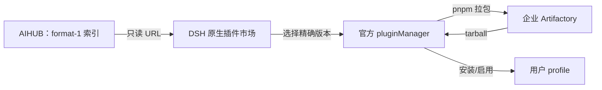

# 企业插件市场（轻量原生索引模式）

## 文档信息

| 项 | 内容 |
|---|---|
| 文档编号 | CORP-DSH-DESIGN-007 |
| 文档名称 | 企业插件市场（轻量原生索引模式） |
| 版本 | V2.1.0 |
| 文档状态 | 评审稿 |
| 密级 | — |
| 编制 | DSH 平台组（代拟） |
| 审核 | 待定 |
| 批准 | 待定 |
| 最后更新 | 2026-10-21 |
| 门禁 | G1 索引契约；G2 三目标安装 |

> 编制依据：2026-10-21 用户决定改用 DSH 原生「插件市场 → 索引源」，由 AI 开发者平台（AIHUB）维护并托管 format-1 索引 JSON；不再建设生成器、`current/policy/evidence`、CI 单写发布与租约。AIHUB 交付项以 [issue #12](https://github.com/hrygo/heluo-forge/issues/12) 跟踪。
>
> 关联文档：[索引契约](<../services/market-index.md>)、[ADR-11／13](<../../architecture/plugin-registry-source-decision.md>)、[需求与场景基线](<../../requirements/requirements-baseline.md>)、[P0 取证单](<../../plans/market-p0-verification.md>)。
>
> 核验边界：2026-10-21 只读核对 DSH `0.2.1-rc.2` 的 `pluginMarket`、`pluginManager` 与索引解析器；未做企业 Artifactory 拉包、三目标安装或 AIHUB 索引实机验收。本文是评审稿，不代表企业已批准或安装已开放。

## 1. 一页速览

| 问题 | 答案 |
|---|---|
| 用户从哪里进 | DSH 原生「插件市场 → 索引源」 |
| 添加什么 | AIHUB 提供的 format-1 索引 JSON 的只读 URL |
| 看到什么 | 索引里的插件、精确版本、说明与图标 |
| 怎么装 | 原生市场选择版本 → 官方 `pluginManager` → pnpm → 企业 Artifactory |
| 谁维护索引 | AI 开发者平台（AIHUB） |
| 谁存包体 | 企业 Artifactory |
| 本项目做什么 | 索引契约、校验工具、验收与文档；不建生成器、服务或 CI 发布链路 |
| 主要边界 | 原生信任模型：没有写前授权、租约、逐版本证据或全通道强制 |



一句话：**AIHUB 给目录，DSH 原生市场给入口，Artifactory 给包体；本项目只定义目录长什么样、怎么验收。**

## 2. 目标与非目标

**目标**

- 用户无需安装额外市场插件，直接用原生索引源浏览与安装企业插件。
- 索引只包含企业批准、已发布到 Artifactory 的精确稳定版本。
- 索引格式、更新时限、撤回行为可验收；JSON 错误可被发现。
- 安装路径复用官方 manager 与 pnpm，不新增安装器或代理。

**非目标**

- 不做逐用户/逐角色写前授权，不引入 `installEnabled`、15 分钟租约、`no-store` 复核。
- 不生成 `policy/evidence/current`，不保存逐版本 integrity/来源证据。
- 不建市场服务、数据库、下载代理、审批后台或 CI 单写流水线。
- 不承诺原子升级、自动回滚或远程卸载已装代码。
- 不证明 REQ-14/G2 的“全通道覆盖”。

## 3. 角色与责任

| 角色 | 负责 | 不负责 |
|---|---|---|
| AI 开发者平台（AIHUB） | 插件预创建、建仓、审查、发布 npm、维护并托管索引、按时更新/撤回 | 终端安装、DSH 运行时 |
| 平台组 | 索引契约、校验工具、三目标验收、文档 | 替 AIHUB 维护索引内容 |
| 企业 Artifactory | 包体存储、Scope/ACL、同版不可变、公网单向缓存 | 目录展示、授权决策 |
| DSH 原生市场 | 读取索引、展示、调用 manager | 包体检查、企业审批 |
| 用户 | 添加可信索引 URL、选择版本、承担安装权限 | 判断包是否合规 |

## 4. 用户操作

### 4.1 添加索引

1. 打开「插件市场 → 索引源」。
2. 粘贴 AIHUB 提供的只读 URL。
3. 确认来源可信（原生会提示“索引由第三方提供，安装后以你的权限运行”）。
4. 保存后，市场从该索引加载插件。

索引 URL 由用户手工添加；若发行侧支持预置，也可由发行预置。本项目不修改原生配置 API，不承诺自动注入。

### 4.2 浏览与安装

- 市场按索引展示插件、版本与说明；默认选择最新稳定版。
- 安装使用索引中的精确 `name@version` 与 `source.registry`。
- 安装结果、启用与 Client 可用性由官方 manager 与 DSH 本体决定；本项目不另造状态机。

### 4.3 更新

- AIHUB 发布新版本后更新索引；用户刷新市场看到新版本。
- 原生不提供通用 `upgrade` API 时，更版按“卸载旧版 → 安装新精确版本”操作；不承诺原子升级或保留原排序。

### 4.4 撤回

- 从索引删除版本或整个插件条目；原生市场刷新后不再提供该版本。
- 需要立即阻断下载时，同时在 Artifactory 撤销/隔离该版本。
- 已安装代码不会因删索引自动卸载；是否处置由终端运维决定。

## 5. 索引契约摘要

完整字段、示例与更新时限见 [DESIGN-012](<../services/market-index.md>)。最小要求：

```json
{
  "format": 1,
  "title": { "en": "Enterprise Plugins", "zh": "企业插件" },
  "plugins": [{
    "name": "@heluo/forge-example",
    "versions": [{
      "version": "1.2.0",
      "publishTimestamp": 1760000000,
      "source": { "type": "npm", "registry": "http://artifactory.corp.example/artifactory/api/npm/npm-virtual/" }
    }]
  }]
}
```

- `title` 必须含 `en`；版本必须精确、稳定、去重、降序。
- `source` 只允许 npm；registry 指向企业 Artifactory。
- 索引不得包含 token；图标不得用公网 CDN。

## 6. 安装行为与限制

| 能力 | 行为 |
|---|---|
| 精确版本 | 只安装索引中列出的 `name@version`，不接受 tag/range |
| 来源 | 只用 `source.registry`；不回落公网或其它源 |
| 依赖 | 首版建议只放自包含包；原生不会替企业做依赖/peer 检查 |
| 三目标 | 由 AIHUB/平台在发布前自行验证；原生索引没有 OS/CPU 字段 |
| 更版 | 优先原生能力；没有通用 upgrade 时先卸载再安装 |
| 失败 | 按 pnpm/manager 实际错误停止；本项目不提供自动恢复 |

## 7. 安全边界

**原生模型能保证的**

- 索引 URL 由用户/发行显式添加；原生提示第三方来源风险。
- 包体从企业 Artifactory 获取；Scope/ACL 与同版不可变由私服执行。
- 索引只列已批准版本；删除条目可停止新的目录安装。

**不能保证的**

- 不能阻止用户添加其它索引源、用 CLI 或任意 spec 安装。
- 不能在每次写前复核“当前许可”；索引一旦可读，其中的版本即可安装。
- 不能验证 tarball 与索引条目的一致性（format-1 没有 integrity 字段）；依赖 Artifactory 不可变与网络边界。
- 不能强制三目标兼容；只能在发布前人工/平台检查。
- 不能远程卸载已装代码。
- 不能宣称 REQ-14/G2 通过或“全通道准入”。

**HTTP 例外**

企业 Artifactory 可走内网 HTTP（已批准例外）；索引 URL 优先 HTTPS，若使用 HTTP 需 P0 M8 的书面结论；icon/homepage/repository 仍要求 HTTPS。HTTP 下 token 与包体元数据无传输加密，补偿措施是最小 Scope、受控网络、私服不可变与安装后核验；该例外不扩展到公网。

## 8. 失败与撤回

| 场景 | 行为 |
|---|---|
| 索引不可达/JSON 非法 | 原生市场报错或保留上次可用目录；不自动改用其它源 |
| 索引缺少目标版本 | 无法安装；不回落公网/其它版本 |
| Artifactory 缺包/无权限 | 安装失败；检查 Scope 与 `.npmrc`，不匿名重试 |
| 版本撤回 | 删索引条目 + 私服阻断；已装代码独立处置 |
| 索引更新中断 | AIHUB 必须保留上一份完整 JSON；不得半份覆盖 |
| 原生更版失败 | 记录实际阶段；手工卸载/重装，不自动回滚 |

## 9. 验收

轻量模式以“能加、能看、能装、能撤”为验收，不以本地单测替代实机：

1. 在 Win10 amd64、UOS 20 amd64、麒麟 aarch64 各一台，添加 AIHUB 索引 URL，能看到插件。
2. 三目标各安装同一精确版本成功，且包来自 Artifactory。
3. 删除一个版本后刷新，市场不再显示，且无法再安装该版本。
4. 错误 JSON（缺 `title.en`、版本重复、`source.type: git`）不被展示或给出明确错误。
5. 索引断网时市场不崩溃；恢复后能重新加载。
6. 记录 AIHUB 索引负责人、更新时限与撤回回执。

## 10. AIHUB 交付项

AIHUB 需要提供：稳定只读 URL、合法 format-1 JSON、企业 registry 映射、新版本/撤回时限、三目标联调与负责人。完整字段、示例、验收清单与待确认问题见 [issue #12](https://github.com/hrygo/heluo-forge/issues/12)。

## 11. 历史参考实现（不属目标）

`packages/forge-market/` 与附录 A 是旧的 Gitee 归档参考实现（自定义市场插件、HTTP 服务、安装流水线与策略接口）。轻量模式不使用它们，也不要求企业发行预置该插件；保留仅为历史追踪与旧契约测试。目标链路只使用 DSH 原生市场。

```text
packages/forge-market/
├── cordis.patch.yml          挂载声明（顶层数组，- insert: …）：只写 serviceUrl、allowedHosts、timeoutMs；可选项留空不写
├── client.js                 客户端面板：列表、加载与缓存状态
├── src/
│   ├── index.mjs             插件入口：注册工具与 HTTP 路由
│   ├── market-tools.mjs      十个工具的定义与执行
│   ├── client.mjs            服务客户端：超时、错误码映射
│   ├── catalog.mjs           条目与版本归一化、排序、过滤
│   ├── installer.mjs         版本规划、域名白名单、摘要、路径白名单
│   ├── install.mjs           安装流水线：下载、摘要、解包、清单比对
│   ├── tarball.mjs           tar.gz 解包：体积上限、截断与路径校验
│   ├── persist.mjs           落盘：目标目录约束
│   ├── cache.mjs             离线缓存：时间戳与过期判定
│   ├── local-catalog.mjs     离线目录：从 JSON 文件读取条目
│   ├── live-check.mjs        真实仓库验收：拉归档并按规则判定
│   ├── routes.mjs            宿主路由：catalog、detail、缓存回退
│   ├── registration.mjs      生成 profile 登记行与说明
│   ├── config.mjs            Config 的 standard-schema 校验（cordis 的契约）
│   ├── validate.mjs          包格式与 patch 内容校验
│   └── policy.mjs            安装策略与 engines 范围判定
├── scripts/live-check.mjs    验收脚本入口（手动执行，不进 CI）
└── test/                     单元、契约、端到端与测试支撑
```

## 附录 A 历史参考实现（Gitee 归档）

以下为旧实现契约，不属轻量模式目标；保留供旧契约测试与追溯。

> **可跳过。** 本附录记录现有代码、旧错误码与历史实测，供维护与迁移使用；它不是目标方案的一部分，也不证明 npm 能力。

### A.1 现有安装流水线

1. `market_install` 选定版本，向服务请求解析结果。
2. 下载归档，有期望摘要时比对；当前允许缺摘要继续，不满足强制摘要目标。
3. 内存解包，剥离归档顶层目录并按白名单筛选；配置 `targetDir` 时才落盘。
4. 校验包名与可得版本，拦截安装脚本与不安全 patch；宿主与 `engines.dsh` 都可得时才查兼容性。
5. 返回 loader 行与登记步骤，附 `version/tag/directory`；插件不写 profile，由操作者或 `plugin_manager` 登记。
6. 旧 `downloads` 在发放归档地址时计数，不等于下载或安装成功。

已知缺口：`downloadInfo` 除 `version-revoked` 外出错会退回按 repo/tag 生成的直连 Gitee 地址（含 401/403/网络失败），这是待迁移修复的旁路，不是获准降级。域名白名单不等于 group/版本授权，缺摘要也可能继续。

安装结果里 `mode: installed` 只表示文件写入 `targetDir`；未配置目录时为 `verify-only`。落盘逐文件写入，无事务、无回滚、无原子替换；同版本重装不是已验证的恢复流程。目录按 `targetDir/<scope-name>/` 分隔，否则第二个插件会覆盖第一个。

### A.2 失败原因

当前安装、校验与登记失败返回 `reason`；调用方据此提示，**不把这些归档错误码当作 npm 目标 API**。写入超时若无法确认副作用，先核对状态，不因“可重试”自动重放。

| 原因 | 阶段 | 含义 | 是否可重试 |
|---|---|---|---|
| `archive-too-large` | 解包 | 解压后超过体积上限 | 否 |
| `bad-archive` | 解包 | 不是可解压的 tar.gz | 否 |
| `bad-cache` | 配置 | 缓存文件不是预期结构 | 可忽略 |
| `bad-entries` | 配置 | 写缓存的内容不是数组 | 否 |
| `patch-not-array` | 清单 | `cordis.patch.yml` 顶层不是数组；loader 会拒绝挂载 | 否 |
| `bad-id` | 登记 | 无法从包名推导 loader 行 id | 否 |
| `bad-manifest` | 清单 | package.json 不是合法 JSON | 否 |
| `bad-name` | 登记 | 包名不是 @scope/name | 否 |
| `incompatible-dsh` | 安装 | 包的 `engines.dsh` 与当前 DSH 版本不符，拒绝安装并列出要求 | 升级 DSH |
| `bad-version` | 规划 | 目录里的版本不是 `x.y.z` 或 `x.y.z-pre`，标签也会随之出错 | 否 |
| `bad-plan` | 规划 | 安装计划缺仓库或标签 | 否 |
| `bad-repo` | 规划 | 仓库地址不是合法 URL | 否 |
| `bad-tag` | 提交 | 标签不是 vX.Y.Z | 否 |
| `digest-mismatch` | 下载 | 归档摘要与声明不一致 | 否 |
| `download-failed` | 下载 | 下载归档失败，含连接中断 | 可重试 |
| `empty-archive` | 解包 | 归档里没有文件 | 否 |
| `extract-failed` | 解包 | 解包抛错 | 否 |
| `host-not-allowed` | 规划 | 仓库域名不在 allowedHosts 内 | 否 |
| `install-script` | 校验/安装 | 清单声明 `preinstall`/`install`/`postinstall`；评审与安装都拒绝 | 否 |
| `install-script-blocked` | 策略 | 策略层拒绝安装脚本（`policy.mjs` 的 `allowInstallScripts`，保留给宿主接线） | 否 |
| `invalid-name` | 策略 | 包名不符合 @scope/name | 否 |
| `missing-dependency` | 下载 | 未注入下载或解包实现 | 否 |
| `missing-engines` | 条目 | 未声明 engines.dsh | 否 |
| `missing-fields` | 条目 | 条目缺 name 或 version | 否 |
| `patch-unresolved-name` | 清单 | insert 行名像文件却缺 `./`，挂载时会被当包名 | 否 |
| `patch-missing-target` | 清单 | insert 行用 `./x` 指向归档里不存在的文件 | 否 |
| `patch-name-mismatch` | 清单 | `cordis.patch.yml` 的 insert 行名与 `package.json` 的 `name` 不一致 | 否 |
| `missing-manifest` | 清单 | 归档里没有 package.json | 否 |
| `name-mismatch` | 清单 | 清单包名与规划不一致 | 否 |
| `no-allowed-host` | 提交/规划/验收 | 未配置 `allowedHosts`；空列表按拒绝处理，不视为放开所有域名 | 否 |
| `no-digest` | 下载 | 服务未给出摘要，无法校验 | 否 |
| `no-installed-version` | 更新 | 未提供已安装版本 | 否 |
| `no-latest-version` | 更新 | 目录里没有可用版本（含全部已撤回） | 否 |
| `installed-revoked` | 更新 | 已安装的版本被撤回，建议换到可用版本 | 是（换版本） |
| `not-found` | 条目 | 目录里没有这个包名 | 核对名称 |
| `no-path` | 配置 | 缓存或落盘未配置路径 | 否 |
| `no-registry` | 策略 | 策略未配置制品源 | 否 |
| `identity-unavailable` | 我的提交 | 未配置 submitter，服务端无法判断“我的”范围 | 配置身份后重试 |
| `no-repo` | 规划 | 条目没有仓库地址也没有归档地址 | 否 |
| `no-service-url` | 配置 | 既没有 serviceUrl 也没有 catalogFile | 否 |
| `no-target` | 配置 | 落盘未配置目录 | 否 |
| `not-installed` | 登记 | 目标目录里没有该包，或版本与请求不符 | 先安装 |
| `no-version` | 规划 | 条目没有可用版本，或请求的版本不存在 | 否 |
| `outside-range` | 条目 | 当前 DSH 超出声明范围 | 否 |
| `outside-target` | 落盘 | 目标路径解析后跑出落盘目录 | 否 |
| `prerelease-blocked` | 策略 | 预发布版本被策略禁止 | 否 |
| `requires-newer-dsh` | 条目 | 当前 DSH 低于声明下限 | 升级后重试 |
| `scope-not-allowed` | 策略 | 包名不在受信范围 | 否 |
| `truncated-archive` | 解包 | 文件体短于头部声明长度 | 可重试 |
| `unparsable` | 条目 | engines 或当前 DSH 版本无法解析 | 否 |
| `unsafe-path` | 解包 | 条目含越界或非白名单路径 | 否 |
| `version-mismatch` | 清单 | 清单版本与规划不一致 | 否 |
| `version-pinned` | 策略 | 版本与钉住的版本不符 | 否 |
| `verification-failed` | 提交 | 提交前自检未通过，见返回的 `steps` | 修正后重试 |
| `version-revoked` | 规划 | 该版本已撤回，不再发放归档地址 | 否 |
| `write-failed` | 落盘 | 写缓存或文件失败 | 可重试 |

未知原因按不可重试处理；新增原因必须同步本表与 `test/reasons.test.mjs`。服务端 4xx 时透传其错误码作为 `reason`，原始响应体放在 `server` 字段，因此取值也可能来自 DESIGN-012 附录 A.5。

| `action` | 含义 |
|---|---|
| `re-login` | 令牌失效，重新登录 |
| `request-access` | 有身份但无权限，申请范围或角色 |
| `retry` | 服务不可达或超时，稍后重试 |
| `choose-another-version` | 目标版本已撤回，选别的版本 |
| `upgrade-dsh` | 包要求更高版本的 DSH，先升级宿主 |
| `fix-the-package` | 包本身不合格，按 `steps` 修正 |
| `check-the-name` | 检查包名拼写后重试 |
| `contact-admin` | 未归类的失败，交平台组 |

### A.3 未接线的策略 API

`policy.mjs` 有两类函数，容易误以为都在生效：

| 函数 | 状态 | 说明 |
|---|---|---|
| `checkEngines` | 已接线 | 安装时校验 `engines.dsh` |
| `parseEngines` | 已接线 | 解析版本范围 |
| `checkInstall` | **未接线** | 作用域、预发布、安装脚本、版本钉住四条策略；需要宿主提供 `registryUrl` 与策略对象，参考实现不自行编造 |
| `parsePackageName` | **未接线** | 仅被 `checkInstall` 使用 |
| `satisfiesRange` | **未接线** | 未被其他模块直接调用，但由已接线的 `checkEngines` 在 `policy.mjs` 内部调用；测试中的登记按跨模块引用口径统计 |

未接线不等于可删：宿主接入策略层时按此签名调用。文档与代码一致性由 `test/policy-wiring.test.mjs` 守护。

### A.4 bundle 选择与挂载契约

`install_bundle` 装完还要能“选中”，取决于包清单而不只是补丁：

| 字段 | 本包取值 | 作用 |
|---|---|---|
| `dsh.bundle.patch` | `./cordis.patch.yml` | 指明 bundle 补丁文件 |
| `dsh.client` | `{ platform: 'web', immediately: true, inject: [] }` | 声明浏览器侧入口 |
| `exports['./client']` | `./client.js` | 客户端模块入口 |
| 补丁 insert 行 `name` | 必须是包名 | 行名与包名不一致时选中即失败 |

`dsh.client.inject` 只决定激活顺序，不声明依赖；空数组表示不要求排在任何插件之后，不代表面板没有依赖。

2026-10-20 在 `media` profile 实机安装并启动，记录四条“装不上/装上了不出现”的约定：

| 项 | 正确写法 | 违反时的现象 |
|---|---|---|
| `cordis.patch.yml` 顶层 | 数组：`- insert: …` | 安装即报 `must be a top-level YAML array` |
| `engines.dsh` | 覆盖运行时版本；`0.2.1-rc.2` 小于 `0.2.1`，故写 `>=0.2.0` | 安装被拒，提示版本不兼容 |
| `inject` | 数组：`['tools']`；可选服务用 `ctx.get(name)` | 写成 `{ required, optional }` 会被当作两个服务名，插件永远 pending |
| `Config` | `Config['~standard'].validate(config)` 的 standard-schema 对象 | 激活时报 `Cannot read properties of undefined (reading 'validate')` |

可选服务的陷阱：`apply` 里用 `ctx.get('webServer')` 取不到时不能直接跳过，因为激活顺序不保证服务已就绪；应使用 `ctx.inject(['webServer'], callback)`。本包曾因此静默不注册路由，请求落到 SPA 回退返回 404。

### A.5 归档实测、登记与行 id

2026-10-20 用本地 HTTP 服务提供的真实 `.tar.gz` 跑通下载→解包→路径校验→安装→生成登记行，过程中发现两处会让真实归档装不上：

| 缺陷 | 现象 | 处理 |
|---|---|---|
| macOS 生成的 tar 带 `._*`、`.DS_Store` | 顶层目录被判成不止一个 → 不剥离 → 整包被白名单过滤干净 → `missing-manifest` | 解包时忽略这些元数据文件，顶层目录按出现次数取多数 |
| 运行时版本是 `0.2.1-rc.2` | `parseEngines` 只认 `x.y.z`，预发布被判 `unparsable` → 所有插件都装不上 | 允许 `-rc.N` 后缀，按基础版本比较（近似，非完整 semver 预发布序） |

登记行生成后给出两种落地方式（参数已对照 2026-10-20 的 `dsh plugin` 帮助文本）：

| 方式 | 参数 | 说明 |
|---|---|---|
| `plugin_manager` `install_bundle` | `target` 取**插件目录绝对路径** | 由工具完成包安装与补丁选择 |
| `dsh plugin --profile <name> add <说明符>` | 包名、Git 地址或 tarball 路径；**不加 `file:` 前缀**，相对路径亦可 | `dsh plugin` 是**把参数转发给 profile 目录里的 pnpm**，不是自带安装器：tarball 用 `npm pack` 产物即可；profile 首次使用时自动初始化；目标环境需有 pnpm（缺失时 exit 127） |

真机实测（2026-10-24，远程 MacBook，DSH `0.2.1-rc.2`/`rc.3`，profile `web`）：六包用 `dsh plugin --profile web add ./artifacts/tarballs/<pkg>-0.1.0.tgz`（相对路径）安装均 exit 0；卸载用 `remove <包名>`（不是路径）。装完只有声明 `dsh.bundle.patch` 的包注册补丁层——本包因此把 `forge-market` 行插进配置树，`policy`/`iam`/`sdd`/`credentials-keychain` 只作为普通依赖存在、不进配置树；证据与状态矩阵见[企业组合包设计 §11](forge-enterprise.md#11-打包升级与回退)。

`registration.row.id` 必须匹配 `[a-z0-9][a-z0-9-]*` 且在同一 profile 内唯一：

| 包名 | 行 id |
|---|---|
| `@heluo/foo` | `heluo-foo` |
| `@heluo/foo-bar` | `heluo-foo-bar` |
| `@heluo/foo_bar` | `heluo-foo-bar-2f99f4` |
| `@heluo/foo.bar` | `heluo-foo-bar-72a50c` |

规则：作用域与包名转小写、非字母数字折成 `-`；**原名含 `-` 以外需要改写的字符时，追加包名 sha256 前 6 位**。否则 `foo_bar`、`foo.bar` 与 `foo-bar` 会得到同一 id，后装覆盖先装。简单名保持可读，需要改写时才带哈希。

### A.6 受保护的行 id

以下只是**当前 Gitee 参考 `validate.mjs` 的规则**，不自动成为 npm 包的 DSH 规范，也不证明当前 HTTP 服务已执行该索引门禁。

| 行 id | 保护对象 |
|---|---|
| `forge-iam` | 身份与会话 |
| `forge-policy` | 策略判定 |
| `dsh-credentials` | 凭据存储 |
| `dsh-sandbox-policy` | 沙箱策略 |
| `dsh-permission-presets` | 权限档位 |

判定不依赖书写风格：块式、流式（`- {id: forge-iam}`）、键序不同都能命中，宁可误报不可漏报；代价是正文出现形如 `id: forge-iam` 的字符串也会违规，属刻意取舍。路径规则只覆盖 `../` 与盘符，`./` 是 loader 支持的相对引用；绝对文件路径与 `~` 展开不在文本规则覆盖内，最终仍靠代码审查与摘要校验。

### A.7 当前状态字段

| 对象 | 当前参考状态 |
|---|---|
| 条目 | 待审 → 已上架 → 已撤回 |
| 版本 | 可用 / 被替代 / 已撤回；`superseded` 表示已有更新版，`revoked` 表示撤回 |
| 本地参考安装 | 未装 / 已装 / 有更新 / 安装失败；`mode: installed` 只代表文件落盘 |

旧工具允许选择被替代版本，`version-revoked` 拒绝已撤回版本；这不证明 npm/原生入口具备等价撤回控制。

### A.8 当前面板与历史视图

面板挂在 `plugins.bundle.config` 的 keyed slot，按 `renderSlot(..., { entryKey: pkg.name })` 派发，**键必须与包名逐字一致**；官方实验 bundle 也用完整带 scope 的包名。现场出现的 `dshmarket` 这类短键不会被派发，属注册方问题，不构成本包先例。

slot 类型允许 `view: 'summary' | 'page'`，但当前插件管理页只在 bundle 详情里以 `page` 派发；`summary` 未见调用点。`client.js` 仍按 `view` 分支，是防御性代码。

2026-10-20 实测三状态：

| 场景 | 面板显示 |
|---|---|
| 服务在线 | 两条条目（标题、`@scope/name`、版本、★、下载量、说明） |
| 服务断开、有缓存 | “服务不可达，显示缓存列表。”+ 条目 |
| 服务断开、无缓存 | “市场服务不可达，稍后重试。” |

以下五页表属于**旧界面规划**，不是 npm 目标的必建页面；当前面板只读，写操作走工具：

| 页面 | 内容 | 关键交互 |
|---|---|---|
| 市场列表 | 卡片：名称、一句话说明、下载量、star、版本 | 搜索、按下载量或 star 排序 |
| 插件详情 | 旧目录的说明、场景、维护人、版本、`engines.dsh`、仓库链接 | 旧详情页选版/安装/更新规划，当前仍走工具 |
| 提交 | 当前工具只接受仓库地址、版本标签、说明与场景 | 旧服务返回待审，不用于 npm 目标自动收录 |
| 我的提交 | 条目与状态：待审、通过、退回（附理由） | 退回可改后重提；需要 `submitter`，否则返回 `identity-unavailable` |
| 未收录诊断 | 扫描到但未通过校验的仓库与错误码 | 仅管理员可见 |

「我的提交」按 `submitter` 过滤：服务端没有账号体系，该值由调用方自报，只用于分组展示，不构成权限。

### A.9 参考测试

`node --test packages/forge-market/test/*.test.mjs` 覆盖排序、版本选择、路径/摘要/patch、旧 API 字段、失败码、策略接线与包形态；`tests/integration/` 覆盖本地归档安装。它们只证明旧参考实现，不证明 npm 目标。
