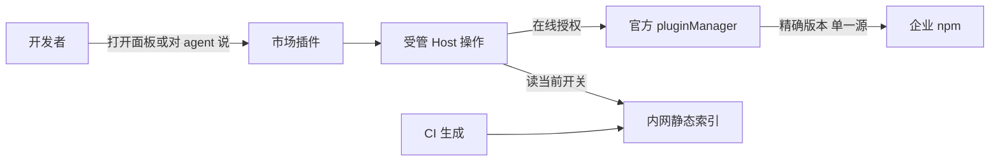

# 企业插件市场插件详细设计

## 文档信息

| 项 | 内容 |
|---|---|
| 文档编号 | CORP-DSH-DESIGN-007 |
| 文档名称 | 企业插件市场插件详细设计 |
| 版本 | V1.2.0 |
| 文档状态 | 评审稿 |
| 密级 | — |
| 编制 | DSH 平台组（代拟） |
| 审核 | 待定 |
| 批准 | 待定 |
| 最后更新 | 2026-10-21 |
| 门禁 | G2 |
| 模块状态 | 已有 Gitee 归档开发参考实现；本版 npm 目标未实现，企业准入未验 |

> 编制依据：2026-10-21 用户确认企业 npm 统一制品源、源／包双层白名单与兼容稳定版自动收录，并选定首版只收自包含、Windows／麒麟双端通用包。来源决策见 [ADR-11／12](<../../architecture/plugin-registry-source-decision.md>)；字段与发布契约见 [DESIGN-012](<../services/market-index.md>)。
>
> 核验边界：2026-10-21 只读核对 DSH `0.2.1-rc.2` 的 `pluginMarket`、`pluginManager` 接口与随包说明；Node 24.21.0 / pnpm 11.28.5 隔离复现用于版本保存语义。未做企业 registry、双端安装或全通道验收。`0.2.1-rc.2` 是接口核验版本，不是企业发行批准。
>
> 关联：[市场服务](<../services/market-index.md>)、[Gitee 接入](<forge-gitee.md>)、[总体架构 §7.5](<../../architecture/platform-architecture.md#75-分发与治理>)、[功能架构图](<../../assets/plugin-market-architecture.html>)。

## 1. 一页速览

**一句话**：市场只做三件事——把管理员批准的包变成可浏览目录、把检查过的稳定版交给官方安装器、在每次写入前确认“现在还允许装”。

| 先看这张表 | 结论 |
|---|---|
| 谁批准 | 管理员只批 registry 地址与精确包名；不批版本 |
| 自动收什么 | 自包含、Windows／麒麟双端通用、稳定 SemVer 的根版本 |
| 装什么 | 精确 `name@version`，来自该 profile 唯一的企业 registry |
| 不装什么 | 带外部运行依赖、单平台、预发布、要脚本或编译、矩阵未覆盖 |
| 何时拒绝 | 许可过期、不可达、已撤回、矩阵不符、通道未证明 → 只读浏览 |
| 现在做到哪 | 只有 Gitee 归档参考实现；npm 目标未实现，企业准入未验 |

**主链路**：受控名单 → 自动检查 → 原生索引与证据 → 受管安装 → 分阶段核对。


**关键数字**：单次准入决定 ≤ 60 秒；控制许可 ≤ 15 分钟；既有 CI 每 5 分钟续期；每 profile 1 个规范 registry；2 类平台（Windows、麒麟 aarch64）。

**怎么读**：

| 你是 | 建议顺序 |
|---|---|
| 评审 / 管理员 | §2 → §7 → §8 → §11 |
| 开发 / 集成 | §4 → §5 → §9 → 附录 A |
| 运维 / 迁移 | §10 → §12 → 附录 A |
| 插件作者 | §1.3 发布旅程 → §5 → §7 |

### 1.1 市场是什么：一个插件 + 两条流水线

市场**不是一个新服务**，也不是单独一个插件。它由四块组成，只有第一块是 DSH 插件：

| 组成 | 是不是 DSH 插件 | 作用 | 谁提供 |
|---|---|---|---|
| `@heluo/forge-market` | **是**：Host 插件 + Web Client 面板，附配置 bundle | 唯一用户入口：市场页面与 agent 工具 | 平台组，随企业 DSH 发行预装 |
| 原生索引 + policy/evidence + `current` | 否，静态文件 | 目录、检查证据、安装开关 | CI 生成，内网 HTTPS 托管 |
| 企业私有 npm | 否，企业服务 | 真正存放包体 | 企业仓库/IT |
| `pluginManager` + pnpm | 否，DSH 内置 | 真正执行安装 | DSH 本体 |

所以：**用户看到的是插件，背后是一条“名单 → 自动检查 → 静态索引 → 官方安装”的流水线。** 市场本身不托管包体、不代理下载，也不常驻审批。



**一个前提**：市场插件本身随企业 DSH 发行或由 IT 预置到 profile，**不能由市场自己安装自己**。若 profile 里没有它，需要走企业软件分发或管理员预置。

### 1.2 消费者旅程：安装并使用一个插件

| 步骤 | 开发者看到/操作 | 系统在后台做什么 | 失败时 |
|---|---|---|---|
| 1. 进入 | 「插件」页 → 企业市场，或对 agent 说“装 X” | 复用同一受管操作 | 面板不可用 → 只读缓存或提示 |
| 2. 浏览 | 名称、来源（内部/镜像）、版本、兼容矩阵、检查状态 | 读索引与缓存；缓存不代表可装 | 目录过期 → 标注，禁止新装 |
| 3. 选择 | 默认最新合规稳定版，可选仍合规旧版 | 只接受精确版本，不接受分支/tag | 未准入 → 说明原因 |
| 4. 安装 | 点“安装” | `no-store` 取 `current`，核验 revision/矩阵/单源/版本，决定 ≤ 60 秒 | 授权过期/不可达 → 拒绝写入 |
| 5. 执行 | 进度：取制品 → 安装 → 保存启用 → 激活 | 调官方 `installBundle` 精确 spec，不自动补依赖 | 失败 → 停在真实阶段并给原因 |
| 6. 完成 | “已可用”，或“需重启 DSH” | 分别核对 Host 激活与 Client 可用 | 不确定 → `pending/unknown`，不自动重装 |

之后使用与普通 DSH 插件完全一致：在插件页启用/停用、配置，或由 agent 调用其工具。市场只负责“装上”，不改变插件的运行方式。

**更新/回退**：同一入口选新版本即可，后台是“移除 → 重判 → 安装”；可能提示需重启，且重新启用可能改变插件层顺序。失败会明确显示“旧版已移除、需要恢复”，只允许恢复当前仍许可的旧版。

### 1.3 发布者旅程：把一个插件送进市场

**先纠正一个常见误解**：市场没有“上传插件”按钮，也不托管包体。发布 = 把合规包发布到企业 npm + 让管理员把包名加入名单。

| 步骤 | 谁做 | 做什么 | 结果 |
|---|---|---|---|
| 1. 建仓 | 开发者 | 在固定 Gitee group 建内部仓库；建仓需管理员批准 | 有源码与提交历史 |
| 2. 开发 | 开发者 | 自包含、双端可用、en/zh `meta`、授权 icon、`exports/files`、patch、`engines.dsh` | 可构建的 bundle |
| 3. 发制品 | 开发者/CI | 企业流水线构建并发布到**企业 npm** 的内部 scope；同名同版本不可变，附 commit/build 证据 | 包体进入唯一制品源 |
| 4. 登记 | 市场管理员 | 把精确包名加入 `packages`，`origin: internal`；一次性，不逐版审批 | 名单包含该包 |
| 5. 自动准入 | CI 生成器 | 发现稳定版，检查自包含/双端/真实包/显示资源/完整性 | 通过则生成索引与证据 |
| 6. 生效 | 系统 | 原子切换 `current` | 市场可见、可安装 |
| 7. 发新版 | 开发者 | 重复第 3 步发布新版本 | 自动检查，无需再找管理员 |
| 8. 撤回 | 管理员/安全 | 从名单移除或加入风险撤销 | 先发布拒绝快照关闭安装 |

**公网镜像包**：不需要内部 Gitee。企业私服同步后，管理员以 `origin: public-mirror` 登记精确包名即可，后续同样自动检查。

**被拒怎么办**：生成器会给出具体原因（如“存在外部运行依赖”“麒麟目标失败”“缺 icon”）；修正后发新版本，或由管理员复核名单。首版不接受带外部运行依赖、单平台、需终端脚本/编译的包。

**边界**：登记名单不等于任何版本获准；包发布成功也不等于自动上架——还要通过检查并切换 `current`。

## 2. 目标与非目标

**目标**

- 名单驱动：管理员增删包，目录自动反映；每个未收录项都有可查原因。
- 自动准入：检查通过的稳定版自动收录，不逐版人工签字、不手录摘要。
- 可解释安装：精确版本、单一来源、分阶段结果；失败能说清停在哪一步。
- 可恢复：升级失败有明确的“旧版已移除”状态和当前许可内的恢复路径。
- 内网闭环：终端不连公网，内部 scope 不代理公网同名包。

**非目标**

- 不重写市场 UI 框架，不自造包管理器或安装器。
- 不做在线构建、代码编辑或离线安装包分发。
- 不开放任意公网来源；官方市场只在等价治理下复用。
- 不新建 PostgreSQL、IAM、逐版审批后台或安装 journal。
- 首版不支持带外部运行依赖、单平台或需现场编译的插件。

## 3. 需求与依赖

| 需求/验收 | 关系 | 说明 |
|---|---|---|
| REQ 可治理分发 | 支撑 | registry 与插件包双层白名单，稳定版自动检查并固定精确版本 |
| REQ 推荐能力落地 | 直接实现 | 自动目录与安装入口，同步或包名获准不跳过版本检查 |
| 验收 A10 分发 | 支撑 | 安装可复现、可受控回退，阶段结果不混淆 |

| 依赖 | 类型 | 版本约束 | 缺失时的目标行为 |
|---|---|---|---|
| 受控清单、内网索引及当前控制元数据 | CI/静态发布 | DESIGN-012 唯一字段/原子发布契约；绑定当前 revision 与发行矩阵 | 目录缓存仅浏览；控制元数据在线不可达或无法核验则拒绝安装/升级/回退，不要求旧 HTTP 服务 |
| 企业私有 npm | 企业既有服务 | 产品、认证与 ACL 待核验；单 profile 单一规范 HTTPS 聚合入口，`fallbackRegistries: []` | 拒绝新取包，不回退公网/Gitee 或换企业源 |
| 企业 Gitee | 内部定制源码服务 | 固定 group 的真实身份待核验 | 阻断依赖新源码证据的内部定制发布；不要求公网包补传 group |
| `dsh-plugin-manager` | 上游包 | 随目标 DSH 实测；不据宽 engines 推断兼容 | 无安装能力，降级为提示 |
| `dsh-host-plugin-inventory` | 上游包 | 随目标 DSH | 无法复核已装阶段时保留未知，不冒充成功 |

### 3.1 与现有 Gitee 归档的关系

现有代码可以复用零件，但整体链路不是 npm 目标方案：

| 参考实现部分 | 取用方式 | 目标适配与当前边界 |
|---|---|---|
| `cordis.patch.yml` 挂载声明 | 借鉴 | 保留宿主 seam，配置须另行核验，不写入凭据 |
| 卡片列表、搜索、详情页 | 按需借鉴 | 品牌化及指标来源/时间标注；当前只有列表面板 |
| 安装、更新与生命周期 | 优先复用官方 manager | 精确 npm spec + 企业 registry；当前自有归档安装器不是此实现 |
| 全量公网市场目录 | 不直接取用 | 受控清单内包的稳定版本自动检查；同步不等于收录 |
| 技能索引导出 | 不取用 | 本期不做技能市场 |
| 公网 topic 抓取 | 不取用 | CI 只读白名单企业 registry；Gitee 仅关联内部定制证据 |
| 提交页、诊断页 | 非最小前置 | 管理员清单变更与 CI 诊断优先，不新造逐版申请流程 |
| Host/UI 适配 | 薄适配 | 复用官方索引/manager，呈现兼容与阶段结果，不把补投结果变成重复安装 |

包名内部独立，不沿用上游名称；若拷贝代码须保留 MIT 许可与出处并附 NOTICE。参考与目标取用方式不是逐文件复用已经完成的证据。

## 4. 目标工作流

### 4.1 生成：从名单到目录

1. **读输入**：受控清单 + 发行基线（`matrixId`、现有 profile 基线），记录 revision。
2. **只看企业源**：按包名映射只读对应企业 registry 的元数据与 tarball，不跟随自报 URL。
3. **逐候选检查**：稳定 SemVer、自包含、peer 基线、真实包结构与展示资源、双端矩阵 smoke。
4. **组装产物**：原生 format-1 索引 + policy/evidence sidecar + `current` 指针与开关。
5. **原子发布**：先写不可变完整快照，再切换 `current`；陈旧任务不覆盖新结果。
6. **轻量续期**：既有 CI 每 5 分钟复核输入并续期，不重跑长扫描；失败则自然到期只读。

### 4.2 安装：从点击到可用

1. 用户在官方目录或工具中选择包与版本，只表达意图。
2. 共用 Host operation 解析受管 profile：单源、矩阵、包名、精确根版。
3. `no-store` 读取当前控制元数据，判定有效期取 `min(60 秒, current.expiresAt)`。
4. 通过后调用官方 `pluginManager.installBundle(精确 spec, { registry, enabled, saveExact })`。
5. 分阶段核对：取到制品、包安装、启用保存、Host 激活、Client 可用。
6. 展示真实阶段；不确定时保持 `pending/unknown`，不自动重装。

### 4.3 更版与恢复

1. 预检：目标是否准入、旧版是否仍可恢复、包是否可移除。
2. `removeBundle` 移除旧版；失败即停。
3. 重新在线判定当前许可；目标已撤回则停止。
4. 安装精确目标版；失败、取消或超时显示 `old-removed / recovery-required`，只允许恢复当前仍许可的精确旧版。

> 完整停止条件见 §7.3；不要把更版理解为原子升级。

## 5. 契约与官方接口

### 5.1 归属：schema 只在 DESIGN-012

- 清单、sidecar、`current`、`policyRevision`、`matrixId` 的字段与校验**唯一归属** [DESIGN-012 §3](<../services/market-index.md#3-目标契约>)，本文不复制第二套 schema。
- 原生 format-1 只承载其支持的字段：`version`、`publishTimestamp`、`source`、`engines` 与展示字段；**没有** `integrity`、OS/CPU、policy 或授权字段。
- 完整性、来源、检查结果放在独立 sidecar；`current` 是企业发布指针，不是原生索引。
- 本文的“拟建企业 operation”是**拟实现内部接口，不是 DSH 现有 Service**，也不向原生索引添加字段。

### 5.2 已核验的官方接口

| 官方证据 | 已确认边界 | 未确认/非承诺 |
|---|---|---|
| `Service.listService(pluginMarket)` | 原生 npm source 只有 `type/registry`；`MarketVersion` 无 `integrity/policy`，安装目标为 `spec/registry`；`search` 有目录缓存 | `refresh` 或目录 TTL 不是实时安装授权；sidecar 不是官方索引字段 |
| `Service.listService(pluginManager)` | `installBundle`、`removeBundle`、`listBundles/listPlugins`、`waitForInstall` 与 `cancelInstall`；公开 `InstallBundleOptions.saveExact/enabled/requestId/registry` | 无通用 update API、无已核验的全局白名单 hook；企业 operation 尚未实现 |
| `Config.listConfigs` 的真实 manager 条目 | `registry`、`fallbackRegistries` 为公开配置；后者默认含公网镜像，受管发行必须显式设 `[]` | 本文不修改 profile，也不声称已配置；禁止自动 peer 补装等发行基线不是额外虚构的 manager Config |
| 官方 manager README | HMR 已装包直装拒绝、无 HMR 启动包不可在线移除、重新启用追加末尾、失败保留已完成步骤；`waitForInstall` 返回 `null` 不证明失败 | 通用 Discover 无 upgrade 动作；不把 Official 专用更新 UI 当通用能力 |
| 官方插件规范 `host-plugin/ui-plugin/user-actions` | 本地化元信息、授权 icon 与导出、实际 tarball、模块表 React、主题/locale/owner cleanup、单一 Host operation | 2026-10-21 Client Slots 查询超时；历史 §A.8 证据不等于本次重验 |

完整性、来源与结构检查由生成器与企业 registry 保存，不向 format-1 硬塞摘要来假装官方已校验。同名同版本必须不可变；CI 包体核验与 pnpm 实装一致性须双端验收。内部定制关联固定 Gitee group/repo/commit/构建，公网镜像保留 upstream/扫描/许可。

### 5.3 当前模块结构

以下是**当前 Gitee 归档参考实现**的文件分工，不是 npm 目标安装器；本版不修改这些模块。

```text
packages/forge-market/
├── cordis.patch.yml          挂载声明（顶层数组，- insert: …）：只写 serviceUrl、allowedHosts、timeoutMs；可选项留空不写
├── client.js                 客户端面板：列表、加载与缓存状态
├── src/
│   ├── index.mjs             插件入口：注册工具与 HTTP 路由
│   ├── market-tools.mjs      十个工具的定义与执行
│   ├── client.mjs            服务客户端：超时、错误码映射
│   ├── catalog.mjs           条目与版本归一化、排序、过滤
│   ├── installer.mjs         版本规划、域名白名单、摘要、路径白名单
│   ├── install.mjs           安装流水线：下载、摘要、解包、清单比对
│   ├── tarball.mjs           tar.gz 解包：体积上限、截断与路径校验
│   ├── persist.mjs           落盘：目标目录约束
│   ├── cache.mjs             离线缓存：时间戳与过期判定
│   ├── local-catalog.mjs     离线目录：从 JSON 文件读取条目
│   ├── live-check.mjs        真实仓库验收：拉归档并按规则判定
│   ├── routes.mjs            宿主路由：catalog、detail、缓存回退
│   ├── registration.mjs      生成 profile 登记行与说明
│   ├── config.mjs            Config 的 standard-schema 校验（cordis 的契约）
│   ├── validate.mjs          包格式与 patch 内容校验
│   └── policy.mjs            安装策略与 engines 范围判定
├── scripts/live-check.mjs    验收脚本入口（手动执行，不进 CI）
└── test/                     单元、契约、端到端与测试支撑
```

参考实现的离线目录模式（`catalogFile`）与服务模式二选一：前者从本地 JSON 读旧协议条目，供演示与隔离验证；目录只读，安装仍访问归档。它**不是** npm 索引或来源门禁；目标缓存只供浏览，不能授权安装。

## 6. 页面与交互

### 6.1 目标最小交互

复用官方目录与 manager，只加薄协调层：展示清单内包、来源、双端交集、稳定版本，以及当前是“可写”还是 `browse-only`。默认最新合规稳定版，可选仍合规历史版。更版按钮不得假装调用不存在的通用 upgrade API。

**显示资源**（自身与内部定制包）：

- en/zh 的 `meta.title`、`meta.description`；原创或获准再分发的 icon。
- `exports` 含 `./locale/*.json` 与 `./icon`；`files` 覆盖运行模块、patch、locale、icon 等资源。
- 以**实际 npm tarball**验收：核对清单、资源可读、DSH 中英文展示；本地 link 成功不算通过。

第三方包缺显示资源时明确回退到名称/描述/通用图并留下诊断，不一刀切拒收；安全与兼容检查仍必须通过。索引 `icon` 只用内网同源或相对地址，或省略。

**UI 规范**：文案走 locale，控件继承 host 主题；slot 按已核验声明使用，timer/listener/请求由 owner 清理。Host operation、UI、工具共用同一套参数、权限与失败语义；授权与脚本审批只属于用户，agent 不得自授。

### 6.2 当前面板

当前只有只读列表面板：按 `plugins.bundle.config` 的 keyed slot 展示条目与缓存回退，不提供安装、提交或评审按钮；写操作走 agent 工具。历史三状态（在线／缓存／不可达）与 slot 细节见 §A.8。

## 7. 安装、更版与恢复（目标）

### 7.1 开启写入前：发行与 profile 基线

平台发行/运维必须确认：

- 同一规范 HTTPS 企业 registry，`fallbackRegistries: []`，不跨源。
- 不自动补 peer、不放行终端生命周期脚本或隐式编译。
- 无未受控 pnpmfile、override 或其他改变解析/执行的配置。
- 现有 profile 的 manifest 与 lock 一致，且无未核验的遗留浮动运行依赖。

这是企业发行前置，**不是**虚构的 DSH Config。条件不满足即 `browse-only`，存量不自动清理。

### 7.2 新安装

1. 薄 UI/工具只传选择意图；共享 Host 解析受管 profile 与目标基线，不接受调用者任意 registry/spec。
2. 拒绝范围、dist-tag、路径/Git/tarball 别名与预发布根版。
3. 每次写前 `no-store` 读取 current：校验证书、非重定向、整组摘要、`installEnabled`，以及 revision/matrix/单源/包名/精确根版/撤回状态。
4. **GET 成功不等于授权新鲜**：要求 `generatedAt <= now < expiresAt` 且租约不超过 15 分钟；过期、时钟异常、不可达或不一致一律拒绝本次写入。
5. 调用真实 `installBundle('package@精确版', { registry: 单一入口, enabled, saveExact: true, requestId })`；不带 `approvedBuilds`、不授版本豁免。
6. 分别核对取到制品、包安装、启用保存、Host 激活、Client 可用；pnpm 退出码 0、文件落盘或变化事件都不等于整体成功。

`saveExact: true` 是公开 Host API 的防御设置；既有实测中显式精确 spec 已保存精确根版，仍须复核目标双端的 manifest、lock 与实装结果。

### 7.3 更版、回退与手工恢复

| 步骤 | 必须执行 | 停止条件与结果 |
|---|---|---|
| 预检 | 读取 inventory，确定精确旧版、原 enabled、可移除性与旧版恢复资格；在线准入目标 | 无目标准入、无恢复资格、官方管理组件或不可移除包 → 拒绝此路径，保留原状；不先删再问 |
| 移除 | HMR 可移除包调用 `removeBundle(name)`，不以安装覆盖代替 | 任何移除失败即停并核对剩余状态，不继续安装、不自动 re-enable |
| 无 HMR 启动包 | 在线拒绝硬移；要求维护窗口停机，经官方 CLI remove/install 后 restart，并执行同等准入 | 不借 Official 专用覆盖流程绕过；停机路径未验则维持 `browse-only` |
| 步间再准入 | 移除成功后、安装前再次 `no-store` 读取 current 并重判 | revision 变化、目标撤回或不可达 → 停止，标 `old-removed/recovery-required` |
| 安装目标 | `installBundle(精确 spec, { registry, enabled: 原 enabled, saveExact, requestId })` | 失败/取消须明确“旧包已移除、需要恢复”；不声称原子回滚、不自动重试 |
| 手工恢复 | 只给当前仍许可、registry 仍保留的精确旧版与官方步骤，执行前同样在线准入 | 旧版已撤回或未知 → 不恢复；无合规版本则人工处置并说明不可用 |

四点必须说清：

- HMR 下对已装包直接 `installBundle` 会返回 `already-installed`；真实 SDK 没有通用 update，通用 Discover 也没有 upgrade 动作。
- 移除后若仍被视作已装，先停下核对 inventory 与 profile 引用，不把重复安装当作覆盖。
- 停用或移除被其他插件依赖的包前，先确认依赖影响；无法确认即停止，不留下半禁用状态。
- 重新安装/启用会把 bundle 加到选择末尾，可能改变层优先级；保存 `enabled` 不等于恢复原排序。移除与安装之间不建事务或 journal，以“可解释的部分完成 + 手工恢复”为边界。

### 7.4 失联、并发与未知

共享 Host 只保留**一次操作**的内存 `requestId` 与阶段关联，以及进行中互斥；UI 与工具重复到达时合并核对或拒绝第二次写。它不是完成结果库，也不做持久恢复。

失联时先用官方 `waitForInstall(requestId)` 与 `listBundles/listPlugins` 核对。`null` 只表示该请求不再活跃，**不等于失败、成功或取消**，不能据此重装。状态仍不明时保留 `pending/unknown`，人工核对后再发独立意图。

授权判定点是**提交官方 manager 的每个写调用前**。提交后发生的新撤回不承诺零窗口或原子撤销：能取消的尽力 `cancelInstall`，再按官方结果与 inventory 处置，不能用取消成功推断此前移除已恢复。

## 8. 权限与安全

| 项 | 目标处理 |
|---|---|
| 清单 | 管理员维护 registry 与精确包名映射；CI 自动检查稳定版；不含 token，不逐版录摘要 |
| 来源与出口 | 单 profile 单一规范 HTTPS registry，空 fallback；tarball/重定向限内网；内部 scope 不代理公网；公网镜像无需内部 Gitee repo |
| 写入准入 | 每次写前 `no-store` 读当前控制元数据，按 revision/matrix/单源/包名/精确根版重判；≤ 60 秒，不由目录 TTL 授权 |
| 通道边界 | 原生索引只筛目录；全通道覆盖未证明则 `browse-only` 并停用受管安装，**不算 REQ-14/G2 通过** |
| 凭据 | 企业 registry 认证独立核验、受控注入，不进清单/索引/URL/日志；不假设市场 IAM token 可直接用于 npm |
| 撤回 | 目录下架、取包阻断、已装处置三层分开；删索引或 npm deprecate 不等于阻断 |

补充两条：

- 受管 UI/工具只是入口之一；原生任意 spec、其他市场、手工 CLI、本地/Git/tarball 都必须做负向验收，不能用“隐藏按钮”证明授权边界。
- 物理边界由企业 registry ACL、内网/终端策略承担；不承诺防恶意本机管理员，也不承诺远程卸载已装代码。

## 9. 失败模式

下表为目标行为；当前参考实现的错误码见 §A.2，两者不混用。

| 场景 | 目标行为 | 用户可见与重试边界 |
|---|---|---|
| current 不可达/不一致、已过期或时钟异常 | 目录可缓存浏览；新安装/升级/回退均拒绝 | `browse-only`，GET 成功也不绕过012 expiresAt，不以旧 revision/TTL/缓存授权 |
| registry/精确包/根版未准入、matrix 不符或 decision 过期 | 写前拒绝；revision 变化重新在线判定 | 不换源/spec，不发起逐版人工审批 |
| profile 基线或全通道覆盖未证实 | 关闭受管安装并显示 `browse-only` | 不自动清理存量，不冒充 REQ-14/G2 通过 |
| 权限不足/凭据失效/企业 registry 缺包 | 按实际错误停止 | 不匿名、跨企业源、公网或 Gitee 回退 |
| 非自包含、终端脚本/隐式编译或自动 peer 补装要求 | 首版不支持，不收录/不安装 | 普通带依赖 DSH 包不称非法；上游 CI 的 build/test 不因键名拒收 |
| 单平台/未覆盖矩阵/预发布根版 | 不收录、不提供安装目标 | 已构建双端资源经核验可接受，宿主 rc 另按矩阵 |
| 完整性/来源/包结构不合格或同版换字节 | 隔离候选，安装检出时停止后续步骤 | 发布新版本，不覆盖历史摘要、不伪造 SDK digest 门禁 |
| tarball/重定向越出内网或内部 scope 向公网补查 | 拒绝并记录出口违规 | 修复仓库/发行配置，不放宽终端公网 |
| 移除失败 | 停在失败步骤，核对已保存/已卸载/剩余状态 | 不继续安装目标、不自动 re-enable |
| 已移除旧版后目标撤回/安装失败/取消 | `old-removed/recovery-required` | 当前仍许可旧版才可手工恢复，无原子/自动回滚保证 |
| 无 HMR 启动包/官方不可移除管理组件 | 前者停机维护路径；后者拒绝本更版路径 | 不在线硬移或伪装通用 upgrade |
| 安装部分完成/失联 | 官方 `waitForInstall` 与 inventory 核对，仍不明则 `pending/unknown` | `null` 不证明失败/取消，不能自动重装 |
| 可选结果上报失败 | 仅稳定幂等标识补投结果 | 不改写安装阶段，不持久化可恢复安装 journal，不重装 |

## 10. 可观测性

| 事实 | 目标记录与去向 | 口径边界 |
|---|---|---|
| 清单/索引生成 | 清单版本、企业源、精确包/版本、检查时间、结果及证据；CI/受控发布 | 记录自动收录/排除原因，不伪造逐版人工审批 |
| 列表/详情 | 索引版本、缓存/新鲜度；官方市场或薄 Host 可观察日志 | 目录 GET 不等于下载 |
| 下载 | registry 终端 tarball 请求/传输 | 与 upstream 同步及 metadata GET 分开，pnpm 缓存命中不是新下载 |
| 安装 | 精确目标、官方完整结果及可观察的安装/启用/Host/Client 阶段 | 不以 pnpm exit 0、变化事件或旧 `downloads` 证明成功；unknown 保留 |
| 可选结果补投 | 稳定事件标识、阶段、payload/幂等结果 | 失败只重投结果，不重装；具体契约另定 |

当前参考服务只统计归档地址发放，star 取目录值，字段保留但不覆盖 npm。保留期与脱敏由责任方另定，不新增 PG 作为统计前置。

## 11. 测试与验收

### 11.1 现有测试覆盖

| 层级 | 覆盖 | 入口与状态 |
|---|---|---|
| 单元/契约 | 排序、版本选择、路径/摘要/patch、旧 API 字段、失败码、策略接线、包形态 | `node --test packages/forge-market/test/*.test.mjs`；已有离线用例 |
| 集成 | 服务不可用、摘要不一致、非法路径、本地 HTTP 归档下载解包落盘 | 仿服务与临时目录；不替代 npm 企业链路 |
| 历史挂载 | 面板在线/缓存/不可达三状态 | §A.8，2026-10-20 测试 profile，已卸载恢复 |

### 11.2 目标验收（均未验）

| 审查项 | 必测反例 | 通过条件/证据 | 责任与门禁 | 失败时 fail-closed |
|---|---|---|---|---|
| 双名单与自动稳定根版 | 同源未准包、异源同名包、dist-tag/范围/插件预发布、管理员未逐版签字 | 只对双名单内包自动收录检查通过的精确稳定根版；默认最新兼容稳定，可选仍合规历史版 | 平台/仓库管理员，G1 契约、G2 链路 | 排除并留原因，不手录 digest、不逐版审批 |
| 自包含与 peer | 普通 runtime/optional/bundled 依赖、缺基线 peer、自动 peer 补装 | 实际发布清单四类字段空/不存在；仅矩阵确认的已提供 DSH 公开 peer，无终端第三方解析 | 平台/安全/CI，G2 | 首版不支持，不fallback，不称 DSH 非法 |
| 终端脚本/编译 | preinstall/install/postinstall、安装时触发的 prepare/构建、binding.gyp 隐式 native 编译、请求 approvedBuilds | 终端不执行这些动作；上游 CI 专用 build/test 键可存在；预构建资源仍满足双端/完整性 | CI/安全，G2 | 不收录/拒绝安装，不自动批准脚本或版本豁免 |
| 全目标交集 | 只 Windows、只麒麟或缺某个 DSH 目标，native optional 分流、伪定 Windows x64 | 固定 matrixId 全目标结构/双端入口 smoke 通过；Windows 实际 CPU 经 G1 明确，麒麟 aarch64；rc 只在矩阵核验 | 平台/IT，G1 基线、G2 实机 | 无完整证据不收录，不作每版人工签字或无 bug 承诺 |
| 实际 tarball/显示资源 | 源码文件齐但 npm 包漏 patch/locale/icon/runtime；内部包套模板；第三方缺 icon | 自身/内部定制 en/zh meta、授权 icon、exports/files、资源读验与 DSH 显示通过；第三方明确 fallback/诊断；索引 icon 仅同源/相对内网资源或省略 | 发布/平台，G2 | 自身/内部包缺项阻断；第三方缺显示资源不一刀切拒收，安全异常仍拒绝 |
| profile 单源与存量 | 不同 canonical registry 混装、fallback 含公网、lock/manifest 不一致、遗留浮动依赖、peer 自动补装、未受控 pnpmfile/override | 一个规范 HTTPS 聚合入口、空 fallback、有效配置及存量均核验；多入口分不同 profile | 发行/运维/IT，G1/G2 | `browse-only`，不自动修剪存量、不跨源 |
| 写前实时授权 | TTL 内已撤回、一直在线返回旧 current、过期/时钟异常、旧 policy/matrix、decision 到期、提交后才撤回 | 每次提交manager调用前 no-store 验 current/全部关联与开关；期限=min(判定+60秒,expiresAt)，按012轻量续期；调用前revision变重判，提交后可取消安装尽力取消再核对；fetchedAt不是授权 | 平台/CI/安全，G2 | 过期/未知拒绝新写，离线只读；不伪称内部commit hook、零撤回窗口或原子撤销 |
| 全通道与停用 | 原生任意 spec、其他市场、plugin_manager、手工 CLI、local/Git/tarball、停用受管插件、缓存直接取包 | G1 列全可达路径，G2 逐路负向，registry/网络/既有终端策略证明声明边界；没有虚构全局 SDK hook | 平台/IT/安全/仓库，G1/G2 | 受管安装关闭、`browse-only`，但不算 REQ-14/G2 通过 |
| npm 来源/完整性 | 公网 tarball/重定向、内部 scope 公网同名、同版换包、伪造 metadata | 同名同版唯一包体；所有取包仅企业内网，CI 实物核验及 pnpm 获取一致；012 证据可追溯 | 仓库/CI/安全，G2 | 隔离/拒绝，不新增 tarball/proxy 或手录 digest |
| HMR 更版与 enabled | 已装直接 install、原 disabled、重新入选后排序变化 | 显式准入与恢复资格预检→remove→再次准入→精确 install；保存 enabled，披露末尾入选可能改优先级 | 平台，G2 双端 | 移除失败即停，未知先核对，不声称原子升级 |
| 移除后失败/撤回/取消 | 移除成功后目标撤回、源断、取消，旧版也撤回 | 明确 `old-removed/recovery-required`；当前仍准入的精确旧版才给手工恢复，恢复也写前在线复核 | 平台/运维，G2 | 不继续被撤回目标，不自动重装，不恢复已撤回旧版 |
| no-HMR/不可移除 | 启动包在线 remove、官方管理组件不可卸 | 启动包走停机官方 CLI/restart 并同等准入；管理组件拒绝该更版路径 | 平台/运维，G2 | 不在线硬移或照搬 Official 覆盖更新 |
| 失联与并发 | UI/工具重复、waitForInstall 返回 null、Host 激活失败但 pnpm 为 0 | 共用内存 requestId/阶段关联，进行中重复不启动二写；官方等待与 inventory 核对，完成结果不持久保存 | 平台，G2 | `pending/unknown`；null 不等失败/取消，不自动重装 |
| UI/Tools 及生命周期 | UI 绕过准入、agent 批脚本、卸载残留 timer/listener/slot、CDN React、硬编码主题/文案 | 同一 Host operation/权限/失败语义；授权用户专属、DSH 模块表、locale/host主题、owner cleanup；英/中文/卸载验证 | 平台/安全，G2 | 阻断写或不准入相应能力，不以隐藏按钮替代权限 |

旧测试只证明旧参考实现与局部文档契约，不证明 npm 生成器、真实企业 registry、current 在线准入、双端或全通道控制。

## 12. 迁移与未决

### 12.1 里程碑

| 阶段 | 交付 | 判据 |
|---|---|---|
| M1 | 发行矩阵、profile 单源与企业接入核验 | G1 固定 Windows 实际 CPU、麒麟 aarch64 与 DSH matrixId；凭据/HTTPS 聚合源/空 fallback、存量基线和跨通道路径可核对；未知不开放写入 |
| M2 | 按 DESIGN-012 §3 实现清单/索引/sidecar/current 原子发布 | 自包含稳定版全目标交集自动检查；实际包/显示资源/完整性/来源有证据，无逐版人工签字/手录 digest，失败不发布半份或恢复撤销许可 |
| M3 | 共用拟建企业 operation、薄 UI/工具与官方 manager | 每次写前 no-store 当前准入/最长60秒；精确单源新装及 remove→重判→install、enabled/优先级/no-HMR/手工恢复可解释；unknown不重装 |
| M4 | §11.2 G2 双端正反向验收与旧参考隔离 | 两类包仅企业内网取包、无终端第三方依赖/脚本；跨通道及停用、撤回/缓存/失联有证据，不满足即 browse-only但不算准入通过 |

旧 `serviceUrl/allowedHosts/repo/tag/archiveUrl` 与提交/评审协议的迁移需显式设计；不只改 URL 就称 npm 兼容，也不以新增 PG、IAM、后台或 journal 替代上述最小路径。

### 12.2 未决事项

| 问题 | 需要谁回答 | 影响与截止 | 当前状态 |
|---|---|---|---|
| 企业 registry 实际产品/聚合入口、认证、scope 权威路由、tarball/重定向内网与保留 | 仓库维护方、IT、安全 | G1 取证，G2 前负向验收 | 接入未验；单 profile 单规范 HTTPS 源、空 fallback、不跨源已定，不是来源重选 |
| 发行 matrixId、Windows CPU、实际目标 DSH 清单与双端 smoke 环境 | 平台组、IT、发行维护方 | G1 固定基线，G2 双端取证 | 麒麟 aarch64 已知；Windows CPU 未验；0.2.1-rc.2仅接口核验版，不自动批准上线 |
| 清单维护权限、012 产物托管/原子发布实现与当前元数据可用性 | 平台组、仓库管理员、CI/分发维护方 | 按 DESIGN-012 §3 实现，G2 验证 | schema 归012；自包含/交集/每写在线准入已定，生成器/operation尚未实现 |
| profile 基线与原生/任意 spec/工具/CLI、local/Git/tarball及停用覆盖 | 发行/运维、平台、IT、安全、仓库维护方 | G1 列路径，G2 开放前正反向取证 | 未验即 browse-only/关闭受管安装，不算REQ-14/G2通过；不自动清理存量、不造SDKhook |
| remove→install、no-HMR停机与当前许可旧版手工恢复 | 平台组、运维、IT | G2 双端验收 | 顺序与失败关闭已定，非原子、priority变化、old-removed/unknown须实测；不可移除管理组件拒绝更版 |
| 内部定制 group/repo/commit/构建与公网 upstream/扫描/许可 | Gitee/流水线/仓库维护方、安全 | 自动收录前分来源检查 | 真实来源证据未验；旧真实 Gitee 归档缺口保留，不再是 npm 主路前置 |
| 实际tarball资源与DSH英/中文显示、locale/theme/owner cleanup | 平台组、发布方 | G2 发行前验证 | 本包显示资源链尚未完整；第三方允许明确fallback，不免除安全/兼容门禁；本次Client查询超时 |
| 指标覆盖/保留、可选结果补投 | 平台组、仓库维护方、安全 | 展示/回报启用前明确口径 | 旧机器/日归档请求计数保留，不覆盖 npm，不批准账户口径或持久安装journal |
| 当前面板与参考代码复用 | 平台组 | npm适配实现前评估 | §A.8 历史三状态保留，参考代码未逐文件比对，完整页面未实现 |
| 旧补丁 `disabled: true` 规则 | 平台组 | 规则迁移前复核 | 当前自检/安装一律拒绝，需profile侧控制；不自动套为所有第三方包的DSH规范 |

### 12.3 明确不做

| 选项 | 当前处理 | 理由 |
|---|---|---|
| 完全自研前端/安装器 | 不采用 | 薄 Host/UI 复用官方索引与 manager |
| 新增 PG/IAM、逐版本评审后台、发布申请或复杂 journal | 不作为最小前置 | 无此次新增批准，独立需求另行评审 |
| Gitee 下载代理/本地 tarball 主源或新鉴权 proxy | 不新增 | 企业 npm + 官方 manager/pnpm，强制边界复用既有设施 |
| 市场内在线构建 | 不采用 | 企业流水线构建并发布私有 npm |
| 人工推荐位、技能与插件合并展示 | 不纳入本次 | 无已确认增益，不影响白名单稳定版主链路 |

## 附录 A 当前参考实现（Gitee 归档）

> **可跳过。** 本附录记录现有代码、旧错误码与历史实测，供维护与迁移使用；它不是目标方案的一部分，也不证明 npm 能力。

### A.1 现有安装流水线

1. `market_install` 选定版本，向服务请求解析结果。
2. 下载归档，有期望摘要时比对；当前允许缺摘要继续，不满足强制摘要目标。
3. 内存解包，剥离归档顶层目录并按白名单筛选；配置 `targetDir` 时才落盘。
4. 校验包名与可得版本，拦截安装脚本与不安全 patch；宿主与 `engines.dsh` 都可得时才查兼容性。
5. 返回 loader 行与登记步骤，附 `version/tag/directory`；插件不写 profile，由操作者或 `plugin_manager` 登记。
6. 旧 `downloads` 在发放归档地址时计数，不等于下载或安装成功。

已知缺口：`downloadInfo` 除 `version-revoked` 外出错会退回按 repo/tag 生成的直连 Gitee 地址（含 401/403/网络失败），这是待迁移修复的旁路，不是获准降级。域名白名单不等于 group/版本授权，缺摘要也可能继续。

安装结果里 `mode: installed` 只表示文件写入 `targetDir`；未配置目录时为 `verify-only`。落盘逐文件写入，无事务、无回滚、无原子替换；同版本重装不是已验证的恢复流程。目录按 `targetDir/<scope-name>/` 分隔，否则第二个插件会覆盖第一个。

### A.2 失败原因

当前安装、校验与登记失败返回 `reason`；调用方据此提示，**不把这些归档错误码当作 npm 目标 API**。写入超时若无法确认副作用，先核对状态，不因“可重试”自动重放。

| 原因 | 阶段 | 含义 | 是否可重试 |
|---|---|---|---|
| `archive-too-large` | 解包 | 解压后超过体积上限 | 否 |
| `bad-archive` | 解包 | 不是可解压的 tar.gz | 否 |
| `bad-cache` | 配置 | 缓存文件不是预期结构 | 可忽略 |
| `bad-entries` | 配置 | 写缓存的内容不是数组 | 否 |
| `patch-not-array` | 清单 | `cordis.patch.yml` 顶层不是数组；loader 会拒绝挂载 | 否 |
| `bad-id` | 登记 | 无法从包名推导 loader 行 id | 否 |
| `bad-manifest` | 清单 | package.json 不是合法 JSON | 否 |
| `bad-name` | 登记 | 包名不是 @scope/name | 否 |
| `incompatible-dsh` | 安装 | 包的 `engines.dsh` 与当前 DSH 版本不符，拒绝安装并列出要求 | 升级 DSH |
| `bad-version` | 规划 | 目录里的版本不是 `x.y.z` 或 `x.y.z-pre`，标签也会随之出错 | 否 |
| `bad-plan` | 规划 | 安装计划缺仓库或标签 | 否 |
| `bad-repo` | 规划 | 仓库地址不是合法 URL | 否 |
| `bad-tag` | 提交 | 标签不是 vX.Y.Z | 否 |
| `digest-mismatch` | 下载 | 归档摘要与声明不一致 | 否 |
| `download-failed` | 下载 | 下载归档失败，含连接中断 | 可重试 |
| `empty-archive` | 解包 | 归档里没有文件 | 否 |
| `extract-failed` | 解包 | 解包抛错 | 否 |
| `host-not-allowed` | 规划 | 仓库域名不在 allowedHosts 内 | 否 |
| `install-script` | 校验/安装 | 清单声明 `preinstall`/`install`/`postinstall`；评审与安装都拒绝 | 否 |
| `install-script-blocked` | 策略 | 策略层拒绝安装脚本（`policy.mjs` 的 `allowInstallScripts`，保留给宿主接线） | 否 |
| `invalid-name` | 策略 | 包名不符合 @scope/name | 否 |
| `missing-dependency` | 下载 | 未注入下载或解包实现 | 否 |
| `missing-engines` | 条目 | 未声明 engines.dsh | 否 |
| `missing-fields` | 条目 | 条目缺 name 或 version | 否 |
| `patch-unresolved-name` | 清单 | insert 行名像文件却缺 `./`，挂载时会被当包名 | 否 |
| `patch-missing-target` | 清单 | insert 行用 `./x` 指向归档里不存在的文件 | 否 |
| `patch-name-mismatch` | 清单 | `cordis.patch.yml` 的 insert 行名与 `package.json` 的 `name` 不一致 | 否 |
| `missing-manifest` | 清单 | 归档里没有 package.json | 否 |
| `name-mismatch` | 清单 | 清单包名与规划不一致 | 否 |
| `no-allowed-host` | 提交/规划/验收 | 未配置 `allowedHosts`；空列表按拒绝处理，不视为放开所有域名 | 否 |
| `no-digest` | 下载 | 服务未给出摘要，无法校验 | 否 |
| `no-installed-version` | 更新 | 未提供已安装版本 | 否 |
| `no-latest-version` | 更新 | 目录里没有可用版本（含全部已撤回） | 否 |
| `installed-revoked` | 更新 | 已安装的版本被撤回，建议换到可用版本 | 是（换版本） |
| `not-found` | 条目 | 目录里没有这个包名 | 核对名称 |
| `no-path` | 配置 | 缓存或落盘未配置路径 | 否 |
| `no-registry` | 策略 | 策略未配置制品源 | 否 |
| `identity-unavailable` | 我的提交 | 未配置 submitter，服务端无法判断“我的”范围 | 配置身份后重试 |
| `no-repo` | 规划 | 条目没有仓库地址也没有归档地址 | 否 |
| `no-service-url` | 配置 | 既没有 serviceUrl 也没有 catalogFile | 否 |
| `no-target` | 配置 | 落盘未配置目录 | 否 |
| `not-installed` | 登记 | 目标目录里没有该包，或版本与请求不符 | 先安装 |
| `no-version` | 规划 | 条目没有可用版本，或请求的版本不存在 | 否 |
| `outside-range` | 条目 | 当前 DSH 超出声明范围 | 否 |
| `outside-target` | 落盘 | 目标路径解析后跑出落盘目录 | 否 |
| `prerelease-blocked` | 策略 | 预发布版本被策略禁止 | 否 |
| `requires-newer-dsh` | 条目 | 当前 DSH 低于声明下限 | 升级后重试 |
| `scope-not-allowed` | 策略 | 包名不在受信范围 | 否 |
| `truncated-archive` | 解包 | 文件体短于头部声明长度 | 可重试 |
| `unparsable` | 条目 | engines 或当前 DSH 版本无法解析 | 否 |
| `unsafe-path` | 解包 | 条目含越界或非白名单路径 | 否 |
| `version-mismatch` | 清单 | 清单版本与规划不一致 | 否 |
| `version-pinned` | 策略 | 版本与钉住的版本不符 | 否 |
| `verification-failed` | 提交 | 提交前自检未通过，见返回的 `steps` | 修正后重试 |
| `version-revoked` | 规划 | 该版本已撤回，不再发放归档地址 | 否 |
| `write-failed` | 落盘 | 写缓存或文件失败 | 可重试 |

未知原因按不可重试处理；新增原因必须同步本表与 `test/reasons.test.mjs`。服务端 4xx 时透传其错误码作为 `reason`，原始响应体放在 `server` 字段，因此取值也可能来自 DESIGN-012 附录 A.5。

| `action` | 含义 |
|---|---|
| `re-login` | 令牌失效，重新登录 |
| `request-access` | 有身份但无权限，申请范围或角色 |
| `retry` | 服务不可达或超时，稍后重试 |
| `choose-another-version` | 目标版本已撤回，选别的版本 |
| `upgrade-dsh` | 包要求更高版本的 DSH，先升级宿主 |
| `fix-the-package` | 包本身不合格，按 `steps` 修正 |
| `check-the-name` | 检查包名拼写后重试 |
| `contact-admin` | 未归类的失败，交平台组 |

### A.3 未接线的策略 API

`policy.mjs` 有两类函数，容易误以为都在生效：

| 函数 | 状态 | 说明 |
|---|---|---|
| `checkEngines` | 已接线 | 安装时校验 `engines.dsh` |
| `parseEngines` | 已接线 | 解析版本范围 |
| `checkInstall` | **未接线** | 作用域、预发布、安装脚本、版本钉住四条策略；需要宿主提供 `registryUrl` 与策略对象，参考实现不自行编造 |
| `parsePackageName` | **未接线** | 仅被 `checkInstall` 使用 |
| `satisfiesRange` | **未接线** | 未被其他模块直接调用，但由已接线的 `checkEngines` 在 `policy.mjs` 内部调用；测试中的登记按跨模块引用口径统计 |

未接线不等于可删：宿主接入策略层时按此签名调用。文档与代码一致性由 `test/policy-wiring.test.mjs` 守护。

### A.4 bundle 选择与挂载契约

`install_bundle` 装完还要能“选中”，取决于包清单而不只是补丁：

| 字段 | 本包取值 | 作用 |
|---|---|---|
| `dsh.bundle.patch` | `./cordis.patch.yml` | 指明 bundle 补丁文件 |
| `dsh.client` | `{ platform: 'web', immediately: true, inject: [] }` | 声明浏览器侧入口 |
| `exports['./client']` | `./client.js` | 客户端模块入口 |
| 补丁 insert 行 `name` | 必须是包名 | 行名与包名不一致时选中即失败 |

`dsh.client.inject` 只决定激活顺序，不声明依赖；空数组表示不要求排在任何插件之后，不代表面板没有依赖。

2026-10-20 在 `media` profile 实机安装并启动，记录四条“装不上/装上了不出现”的约定：

| 项 | 正确写法 | 违反时的现象 |
|---|---|---|
| `cordis.patch.yml` 顶层 | 数组：`- insert: …` | 安装即报 `must be a top-level YAML array` |
| `engines.dsh` | 覆盖运行时版本；`0.2.1-rc.2` 小于 `0.2.1`，故写 `>=0.2.0` | 安装被拒，提示版本不兼容 |
| `inject` | 数组：`['tools']`；可选服务用 `ctx.get(name)` | 写成 `{ required, optional }` 会被当作两个服务名，插件永远 pending |
| `Config` | `Config['~standard'].validate(config)` 的 standard-schema 对象 | 激活时报 `Cannot read properties of undefined (reading 'validate')` |

可选服务的陷阱：`apply` 里用 `ctx.get('webServer')` 取不到时不能直接跳过，因为激活顺序不保证服务已就绪；应使用 `ctx.inject(['webServer'], callback)`。本包曾因此静默不注册路由，请求落到 SPA 回退返回 404。

### A.5 归档实测、登记与行 id

2026-10-20 用本地 HTTP 服务提供的真实 `.tar.gz` 跑通下载→解包→路径校验→安装→生成登记行，过程中发现两处会让真实归档装不上：

| 缺陷 | 现象 | 处理 |
|---|---|---|
| macOS 生成的 tar 带 `._*`、`.DS_Store` | 顶层目录被判成不止一个 → 不剥离 → 整包被白名单过滤干净 → `missing-manifest` | 解包时忽略这些元数据文件，顶层目录按出现次数取多数 |
| 运行时版本是 `0.2.1-rc.2` | `parseEngines` 只认 `x.y.z`，预发布被判 `unparsable` → 所有插件都装不上 | 允许 `-rc.N` 后缀，按基础版本比较（近似，非完整 semver 预发布序） |

登记行生成后给出两种落地方式（参数已对照 2026-10-20 的 `dsh plugin` 帮助文本）：

| 方式 | 参数 | 说明 |
|---|---|---|
| `plugin_manager` `install_bundle` | `target` 取**插件目录绝对路径** | 由工具完成包安装与补丁选择 |
| `dsh plugin --profile <name> add <路径>` | 绝对路径，**不加 `file:` 前缀** | DSH 接受包名、Git 地址、tarball 或绝对本地路径 |

`registration.row.id` 必须匹配 `[a-z0-9][a-z0-9-]*` 且在同一 profile 内唯一：

| 包名 | 行 id |
|---|---|
| `@heluo/foo` | `heluo-foo` |
| `@heluo/foo-bar` | `heluo-foo-bar` |
| `@heluo/foo_bar` | `heluo-foo-bar-2f99f4` |
| `@heluo/foo.bar` | `heluo-foo-bar-72a50c` |

规则：作用域与包名转小写、非字母数字折成 `-`；**原名含 `-` 以外需要改写的字符时，追加包名 sha256 前 6 位**。否则 `foo_bar`、`foo.bar` 与 `foo-bar` 会得到同一 id，后装覆盖先装。简单名保持可读，需要改写时才带哈希。

### A.6 受保护的行 id

以下只是**当前 Gitee 参考 `validate.mjs` 的规则**，不自动成为 npm 包的 DSH 规范，也不证明当前 HTTP 服务已执行该索引门禁。

| 行 id | 保护对象 |
|---|---|
| `forge-iam` | 身份与会话 |
| `forge-policy` | 策略判定 |
| `dsh-credentials` | 凭据存储 |
| `dsh-sandbox-policy` | 沙箱策略 |
| `dsh-permission-presets` | 权限档位 |

判定不依赖书写风格：块式、流式（`- {id: forge-iam}`）、键序不同都能命中，宁可误报不可漏报；代价是正文出现形如 `id: forge-iam` 的字符串也会违规，属刻意取舍。路径规则只覆盖 `../` 与盘符，`./` 是 loader 支持的相对引用；绝对文件路径与 `~` 展开不在文本规则覆盖内，最终仍靠代码审查与摘要校验。

### A.7 当前状态字段

| 对象 | 当前参考状态 |
|---|---|
| 条目 | 待审 → 已上架 → 已撤回 |
| 版本 | 可用 / 被替代 / 已撤回；`superseded` 表示已有更新版，`revoked` 表示撤回 |
| 本地参考安装 | 未装 / 已装 / 有更新 / 安装失败；`mode: installed` 只代表文件落盘 |

旧工具允许选择被替代版本，`version-revoked` 拒绝已撤回版本；这不证明 npm/原生入口具备等价撤回控制。

### A.8 当前面板与历史视图

面板挂在 `plugins.bundle.config` 的 keyed slot，按 `renderSlot(..., { entryKey: pkg.name })` 派发，**键必须与包名逐字一致**；官方实验 bundle 也用完整带 scope 的包名。现场出现的 `dshmarket` 这类短键不会被派发，属注册方问题，不构成本包先例。

slot 类型允许 `view: 'summary' | 'page'`，但当前插件管理页只在 bundle 详情里以 `page` 派发；`summary` 未见调用点。`client.js` 仍按 `view` 分支，是防御性代码。

2026-10-20 实测三状态：

| 场景 | 面板显示 |
|---|---|
| 服务在线 | 两条条目（标题、`@scope/name`、版本、★、下载量、说明） |
| 服务断开、有缓存 | “服务不可达，显示缓存列表。”+ 条目 |
| 服务断开、无缓存 | “市场服务不可达，稍后重试。” |

以下五页表属于**旧界面规划**，不是 npm 目标的必建页面；当前面板只读，写操作走工具：

| 页面 | 内容 | 关键交互 |
|---|---|---|
| 市场列表 | 卡片：名称、一句话说明、下载量、star、版本 | 搜索、按下载量或 star 排序 |
| 插件详情 | 旧目录的说明、场景、维护人、版本、`engines.dsh`、仓库链接 | 旧详情页选版/安装/更新规划，当前仍走工具 |
| 提交 | 当前工具只接受仓库地址、版本标签、说明与场景 | 旧服务返回待审，不用于 npm 目标自动收录 |
| 我的提交 | 条目与状态：待审、通过、退回（附理由） | 退回可改后重提；需要 `submitter`，否则返回 `identity-unavailable` |
| 未收录诊断 | 扫描到但未通过校验的仓库与错误码 | 仅管理员可见 |

「我的提交」按 `submitter` 过滤：服务端没有账号体系，该值由调用方自报，只用于分组展示，不构成权限。

### A.9 参考测试

`node --test packages/forge-market/test/*.test.mjs` 覆盖排序、版本选择、路径/摘要/patch、旧 API 字段、失败码、策略接线与包形态；`tests/integration/` 覆盖本地归档安装。它们只证明旧参考实现，不证明 npm 目标。
