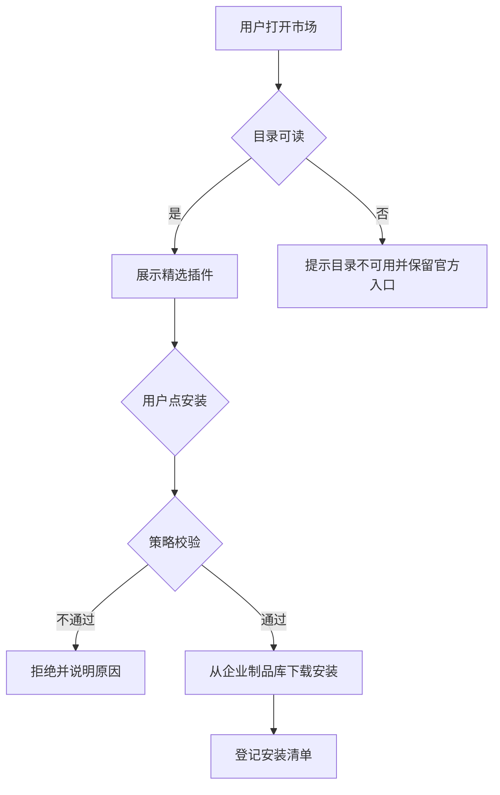

# 私有插件市场详细设计

## 文档信息

| 项 | 内容 |
|---|---|
| 文档编号 | CORP-DSH-DESIGN-007 |
| 文档名称 | 私有插件市场详细设计 |
| 版本 | V0.2 |
| 文档状态 | 草案 |
| 密级 | 内部 |
| 编制 | DSH 平台组（代拟） |
| 审核 | 待定 |
| 批准 | 待定 |
| 最后更新 | 2026-10-20 |
| 门禁 | G2 |
| 模块状态 | 规划 |

> 编制依据：2026-10-20 与用户确认目标——私有市场是企业内部的精选目录与分发渠道，官方插件市场保持可用。已核验 `dsh-plugin-manager`、`dsh-plugin-market`、`dsh-plugin-market-index`、`dsh-host-plugin-inventory` 等包存在。**未核验**：市场插件的配置项、自定义目录的接入方式、上架元数据字段。
>
> 关联文档：[总体架构 §2 P5](../../architecture/platform-architecture.md)、[市场目录服务](../services/market-index.md)、[设计索引](../README.md)。

## 1. 结论

私有市场做三件事：**精选**（只上架对企业有用的）、**展示**（说明用途、适用场景、维护人）、**分发**（从这个渠道装到）。

官方市场继续可用。私有市场是并行渠道，不是防火墙：它决定"我们推荐什么"，不决定"用户只能装什么"。

还缺三件事才能实现：市场插件的配置项、自定义目录的接入方式、上架审核由谁做。

## 2. 目标与非目标

**目标**

- 企业内有统一的插件入口：浏览、看说明、安装。
- 上架的每个插件都有来源、维护人和适用场景。
- 分发走企业制品库，安装可审计、可回退。
- 与官方市场并存，用户可继续从官方安装其他插件。

**非目标**

- 不禁止或屏蔽官方市场。
- 不重写市场界面，复用 DSH 已有市场 UI。
- 不做计费、评分与社区功能。
- 不强制所有插件都从内部渠道安装。

## 3. 需求与依赖

| 需求/验收 | 关系 | 说明 |
|---|---|---|
| REQ 可治理分发 | 支撑 | 内部渠道可控、可追溯 |
| REQ 推荐能力落地 | 支撑 | 精选插件真正被用起来 |
| 验收 A10 分发 | 支撑 | 安装可重复、可回退 |

| 依赖 | 类型 | 版本约束 | 缺失时的行为 |
|---|---|---|---|
| `dsh-plugin-market` | 上游包 | 随目标 DSH | 无市场界面，降级为命令行安装 |
| 企业制品库 | 服务 | 企业现有 | 上架包无法下载，提示明确原因 |
| 市场目录服务 | 服务 | 见 DESIGN-012 | 只显示已安装，不显示可安装 |
| 企业身份 | 服务 | OIDC | 未登录不可浏览目录 |

## 4. 扩展形态与边界

| 项 | 内容 |
|---|---|
| 形态 | 配置 bundle：内部源、目录地址、上架策略 |
| 运行位置 | 本机 Host |
| 目标 DSH 与 SDK | 随目标版本 |
| 使用的 seam 或服务 | 市场包、插件管理器、宿主清单 |
| 不修改的核心 | 安装器、市场 UI、索引协议 |

## 5. 接口与配置

| 配置项 | 类型 | 默认值 | 必填 | 说明 |
|---|---|---|---|---|
| `market.registryUrl` | string | 空 | 是 | 企业制品库地址，仅内网 |
| `market.catalogUrl` | string | 空 | 是 | 企业插件目录地址 |
| `market.officialEnabled` | boolean | `true` | 否 | 是否保留官方市场入口 |
| `market.allowedScopes` | string[] | `['@heluo']` | 是 | 允许上架的范围 |
| `market.allowPrerelease` | boolean | `false` | 否 | 是否允许 rc 版本上架 |
| `market.allowInstallScripts` | boolean | `false` | 否 | 是否允许安装脚本 |
| `market.pinned` | object | `{}` | 否 | 包到固定版本的映射 |

```yaml title="市场配置（示意）"
market:
  registryUrl: https://npm.corp.example/
  catalogUrl: https://plugins.corp.example/catalog.json
  officialEnabled: true
  allowedScopes: ['@heluo']
  allowPrerelease: false
  allowInstallScripts: false
```

`officialEnabled: true` 是默认值，也是设计意图：内部市场不切断官方来源。仅当安全事件需要临时收敛时才可关闭，且必须写明原因与恢复条件。

## 6. 权限、凭据与数据

| 项 | 处理方式 | 生命周期 | 失败时 |
|---|---|---|---|
| 制品库令牌 | 只读令牌，经环境注入 | 随会话 | 明确报错 |
| 上架元数据 | 名称、版本、说明、维护人、场景 | 随目录版本 | 不影响已安装插件 |
| 安装清单 | 包名、版本、来源、时间 | 180 天 | 不影响安装 |
| 浏览记录 | 不采集个人浏览明细 | — | — |

## 7. 流程



**并发**：安装串行，避免同名包并发写入。

**超时**：目录请求超时即展示缓存或提示不可用，不阻塞已安装插件。

**回退**：保留上一版本，可回退；回退同样走策略校验。

## 8. 失败模式

| 场景 | 行为 | 用户可见结果 | 是否可重试 |
|---|---|---|---|
| 目录不可用 | 保留官方入口 | 提示内部目录暂不可用 | 可重试 |
| 制品库不可达 | 安装失败 | 提示检查网络或源地址 | 可重试 |
| 包不在受信范围 | 拒绝上架与安装 | 提示策略限制 | 否 |
| 版本不兼容 | 拒绝安装 | 列出 DSH 版本要求 | 升级后重试 |
| 含安装脚本 | 默认拒绝 | 提示需管理员开启 | 否 |
| 校验失败 | 丢弃并重新下载 | 提示包损坏 | 可重试 |

## 9. 可观测性

| 事件 | 字段 | 去向 | 保留 |
|---|---|---|---|
| 安装成功 | 包、版本、来源、耗时 | 本机日志 + 清单 | 180 天 |
| 安装拒绝 | 原因、包名 | 本机日志 | 180 天 |
| 目录不可用 | 目录地址、错误类型 | 本机日志 | 30 天 |

## 10. 测试矩阵

| 层级 | 覆盖 | 命令 |
|---|---|---|
| 单元 | 范围判定、版本比较、脚本策略 | `node --test` |
| 契约 | 目录字段与市场包一致 | 契约用例 |
| 集成 | 目录不可用、不受信范围、不兼容版本 | 本地仿制品库 |
| 端到端 | 双端各完成一次浏览、安装与回退 | 手工 |

## 11. 打包、升级与回退

包名 `@heluo/forge-market`，`private: true`，声明 `engines.dsh`。

升级：目录地址与范围只增不删；收紧策略视为安全变更，需写明原因。

回退：禁用本包后回到只有官方市场的状态，已安装插件保留可用。

## 12. 未决事项

| 问题 | 需要谁回答 | 影响 |
|---|---|---|
| 市场插件的配置项与自定义目录接入方式 | 平台组（实测） | 第 5 节能否生效 |
| 上架审核由谁做、按什么标准 | 平台组、安全 | 精选流程 |
| 目录元数据字段（说明、场景、维护人） | 平台组、IT | DESIGN-012 的 schema |
| 是否需要同步官方目录做对比展示 | 平台组 | 展示形态 |
| 关闭官方入口的触发条件 | 安全团队 | `officialEnabled` 例外 |

## 13. 候选实现评估（2026-10-20 调研）

结论：**可以 fork `bradeGithub/DSH-Plugins-Marketplace` 作为界面与安装外壳，替换其数据来源**。该仓库是 MIT、DSH 原生、仍在活跃维护，且已把"市场数据"抽成独立产物，正好是我们需要替换的那一层。

| 候选 | 事实（核验日期 2026-10-20） | 与我们目标的差距 |
|---|---|---|
| [DSH-Plugins-Marketplace](https://github.com/bradeGithub/DSH-Plugins-Marketplace) | MIT；182★；10 fork；32 open issues；2026-10-20 仍在推送；JavaScript；`cordis.patch.yml` 以 `inject: [webServer]` 挂载；预生成 `registry.json`（18 MB）与 `skills.json`（47 MB）；带 `scripts/`、`install.sh`、`install.ps1` | 数据源是 GitHub `topic:dsh-plugin` 全量抓取，非企业精选；未接企业内部制品库；仓库体积约 2.4 GB（多为生成物） |
| [plugin-registry](https://github.com/vlln/plugin-registry) | MIT；58★；**2026-10-03 已归档**；TypeScript；"薄控制台、0 patch" | 已停止维护；定位是管理官方 repository 插件，不含市场目录与安装流 |
| [dsh-mcp-connector-registry](https://github.com/duhu2000/dsh-mcp-connector-registry) | 提供上架指南与市场注册文档 | 只覆盖 MCP 连接器一类，不是插件市场整体 |
| [Open VSX](https://github.com/eclipse/openvsx) | 服务端 + Web + CLI 的完整市场实现，厂商中立 | 面向 VS Code 扩展，协议与安装链不兼容 DSH，移植成本高于收益 |
| [Verdaccio](https://github.com/verdaccio/verdaccio) | 私有 npm 制品库，带浏览与搜索界面 | 只解决分发与包浏览，没有"精选说明、场景、维护人"这层 |

### fork 的改造点

1. **换数据源**：`registry.json` 由脚本从 GitHub 抓取生成，改为读取仓库内受评审的 `catalog.json`（名称、说明、场景、维护人、固定版本）叠加企业制品库的版本信息。
2. **换下载源**：安装与更新指向企业制品库，不再走 GitHub 归档包。
3. **保留界面与安装链**：市场卡片、一键安装、版本检测、更新提示复用上游，这部分与我们的目标一致。
4. **裁剪生成物**：不把 18 MB 与 47 MB 的预生成 JSON 带进 fork，改为构建期生成，避免仓库体积失控。
5. **保留官方市场**：本插件与上游市场插件并存，不接管官方源。

### 待核验

| 项 | 为什么重要 | 谁核验 |
|---|---|---|
| 运行时是否强制访问 GitHub 拉取目录 | 内网环境不可达，必须能改成本地或内网地址 | 平台组（读源码/实测） |
| `registry.json` 的字段能否容纳场景与维护人 | 决定是扩展字段还是另建目录（DESIGN-012） | 平台组 |
| 安装流程对包来源的假设（GitHub 归档 vs npm） | 决定改造量 | 平台组 |
| 上游更新节奏与合并冲突成本 | 决定长期维护方式（fork 跟随或转为内部实现） | 平台组 |

### 需用户确认的设计选项（增益不明确，暂不采用，保留待定）

| 选项 | 可能的增益 | 代价 | 当前处理 |
|---|---|---|---|
| 屏蔽官方市场 | 完全可控 | 用户失去上游能力，须自建全部插件 | 不采用，双源并存 |
| 自建市场 UI | 展示自由 | 与上游 UI 重复维护 | 不采用，复用上游界面 |
| 插件评分与评论 | 社区感 | 超出内部治理范围 | 不采用 |
| 强制全部走内部渠道 | 统一治理 | 与"官方可用"目标冲突 | 不采用 |
| 自动同步官方插件到内部源 | 一处可装 | 镜像责任与合规风险 | 不采用 |

以上五项均不影响主链路；若后续确认增益，再单独评估。