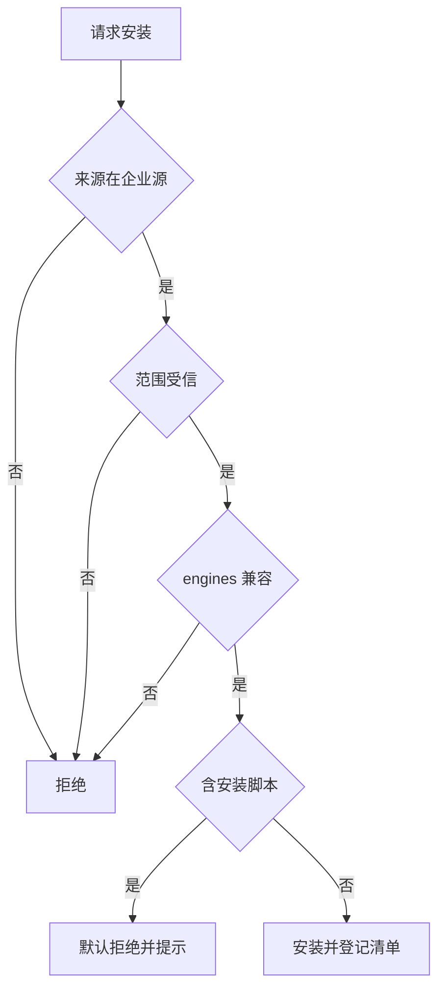

# 私有市场接入详细设计

## 文档信息

| 项 | 内容 |
|---|---|
| 文档编号 | CORP-DSH-DESIGN-007 |
| 文档名称 | 私有市场接入详细设计 |
| 版本 | V0.1 |
| 文档状态 | 草案 |
| 密级 | 内部 |
| 编制 | DSH 平台组（代拟） |
| 审核 | 待定 |
| 批准 | 待定 |
| 最后更新 | 2026-10-20 |
| 门禁 | G2 |
| 模块状态 | 规划 |

> 编制依据：2026-10-20 字符串级核验到 `dsh-plugin-manager`、`dsh-plugin-market`、`dsh-plugin-market-index`、`dsh-host-plugin-inventory`、`dsh-client-ui-plugin-market`、`dsh-client-ui-plugin-manager` 等包存在，说明市场与安装能力已由上游提供，本包只需配置与策略。**未核验**：可配置项清单、索引字段、安装时的脚本执行边界。
>
> 关联文档：[总体架构 §2 P5](../../architecture/platform-architecture.md)、[工程结构与长期迭代设计 §4](../../engineering/repository-structure-design.md)、[设计索引](../README.md)。

## 1. 结论

本包把上游已有的市场与安装能力指到企业自己的制品库上，并加上安装策略：只允许企业源、只允许受信范围、只允许兼容版本。

按"复用既有资产"的原则，本设计不新建制品库，也不新建下载通道。企业已有制品库（2026-10-20 用户确认），它就是唯一源；地址与只读令牌方式仍由 IT 补充。

还缺三件事才能进实现：企业制品库的地址与令牌方式、索引字段是否够用、安装脚本是否允许执行。

## 2. 目标与非目标

**目标**

- 只从企业制品库安装，公网源不可回落。
- 只允许受信范围（`@heluo` 与企业自有 scope）的包。
- 安装前校验 `engines.dsh` 兼容性，不兼容即拒绝。
- 无网络或源不可用时，明确失败而不是退回公网。

**非目标**

- 不实现制品库、不实现索引服务端（见第 12 节待确认项）。
- 不做跨部门的多市场隔离。
- 不提供公网包的镜像与代理。

## 3. 需求与依赖

| 需求/验收 | 关系 | 说明 |
|---|---|---|
| REQ 可治理分发 | 支撑 | 只从企业源安装 |
| REQ 版本可控 | 支撑 | 兼容性与固定版本 |
| 验收 A10 分发 | 支撑 | 安装可重复、可回退 |

| 依赖 | 类型 | 版本约束 | 缺失时的行为 |
|---|---|---|---|
| `dsh-plugin-manager` | 上游包 | 随目标 DSH | 市场能力不可用 |
| `dsh-plugin-market` | 上游包 | 随目标 DSH | 仅能本地安装 |
| 企业 npm 制品库 | 服务 | 企业现有版本 | 明确报错，不回落公网 |

## 4. 扩展形态与边界

| 项 | 内容 |
|---|---|
| 形态 | 配置 bundle：源地址、scope 映射、安装策略 |
| 运行位置 | 本机 Host |
| 目标 DSH 与 SDK | 随目标版本 |
| 使用的 seam 或服务 | 市场包、插件管理器、宿主清单 |
| 不修改的核心 | 安装器、市场 UI、索引协议 |

## 5. 接口与配置

| 配置项 | 类型 | 默认值 | 必填 | 说明 |
|---|---|---|---|---|
| `market.registryUrl` | string | 空 | 是 | 企业制品库地址，仅内网 |
| `market.allowedScopes` | string[] | `['@heluo']` | 是 | 允许安装的范围 |
| `market.allowPrerelease` | boolean | `false` | 否 | 是否允许 rc 版本 |
| `market.autoUpdate` | boolean | `false` | 否 | 是否自动更新 |
| `market.allowInstallScripts` | boolean | `false` | 否 | 是否允许安装脚本 |
| `market.pinned` | object | `{}` | 否 | 包到固定版本的映射 |
| `market.offline` | boolean | `false` | 否 | 仅用本地缓存 |

```yaml title="市场配置（示意）"
market:
  registryUrl: https://npm.corp.example/
  allowedScopes: ['@heluo', '@corp']
  allowPrerelease: false
  autoUpdate: false
  allowInstallScripts: false
```

## 6. 权限、凭据与数据

| 项 | 处理方式 | 生命周期 | 失败时 |
|---|---|---|---|
| 制品库令牌 | 只读令牌，经环境注入，不写配置文件 | 随会话 | 明确报错 |
| 安装清单 | 记录包名、版本、来源、时间 | 180 天 | 不影响安装 |
| 本地缓存 | 只存已校验包 | 随缓存策略 | 缓存损坏即重新下载 |

## 7. 流程



**并发**：安装串行，避免同一包并发写入。

**超时**：下载超时即失败，不进入半安装状态。

**回退**：保留上一版本，可回退；回退同样校验兼容性。

## 8. 失败模式

| 场景 | 行为 | 用户可见结果 | 是否可重试 |
|---|---|---|---|
| 源不可达 | 失败，不回落公网 | 提示检查网络或源地址 | 可重试 |
| 包不在受信范围 | 拒绝 | 提示策略限制 | 否 |
| 版本不兼容 | 拒绝 | 列出 DSH 版本要求 | 升级后重试 |
| 含安装脚本 | 默认拒绝 | 提示需管理员开启 | 否 |
| 校验失败 | 丢弃并重新下载 | 提示包损坏 | 可重试 |

## 9. 可观测性

| 事件 | 字段 | 去向 | 保留 |
|---|---|---|---|
| 安装成功 | 包、版本、来源、耗时 | 本机日志 + 清单 | 180 天 |
| 安装拒绝 | 原因、包名 | 本机日志 | 180 天 |
| 回退 | 从版本、到版本 | 本机日志 + 清单 | 180 天 |

## 10. 测试矩阵

| 层级 | 覆盖 | 命令 |
|---|---|---|
| 单元 | 范围判定、版本比较、脚本策略 | `node --test` |
| 契约 | 索引字段与市场包一致 | 契约用例 |
| 集成 | 源不可达、不受信范围、不兼容版本 | 本地仿制品库 |
| 端到端 | 双端各完成一次安装与回退 | 手工 |

## 11. 打包、升级与回退

包名 `@heluo/forge-market`，`private: true`，仅含配置，声明 `engines.dsh`。

升级：源地址与范围只增不删；收紧策略视为安全变更，需在说明中写明。

回退：禁用本包后市场入口消失，已安装包保留可用。

## 12. 未决事项

| 问题 | 需要谁回答 | 影响 |
|---|---|---|
| 既有制品库的地址与只读令牌方式 | IT 团队 | 第 5 节必填项 |
| 制品库是否自带索引与元数据能力 | IT 团队 | `market-index` 服务是否仍需自建 |
| 索引字段是否满足展示与校验 | 平台组（实测） | 客户端展示内容 |
| 是否允许安装脚本 | 安全团队 | `allowInstallScripts` 默认值 |
| 离线缓存策略与容量 | IT 团队 | `offline` 与缓存 |

### 需用户确认的设计选项（增益不明确，暂不采用，保留待定）

| 选项 | 可能的增益 | 代价 | 当前处理 |
|---|---|---|---|
| 自建市场索引服务 | 完全可控的目录与校验 | 已有制品库通常够用，重复建设 | 不采用，复用制品库；见 §12 第二项 |
| 包签名与强制校验 | 防篡改 | 需签名链路与密钥管理 | 不采用，先靠受信源与范围 |
| 自动更新 | 用户省事 | 版本漂移难复现 | 不采用，默认固定版本 |
| 多部门独立市场 | 自治 | 治理碎片化 | 不采用 |
| 安装脚本白名单 | 提高兼容 | 执行任意脚本的风险面 | 不采用，默认拒绝 |

以上五项均不影响主链路；若后续确认增益，再单独评估。按"复用企业既有资产"的原则，需要自建的部分先由对应团队确认既有能力边界，再决定是否立项。