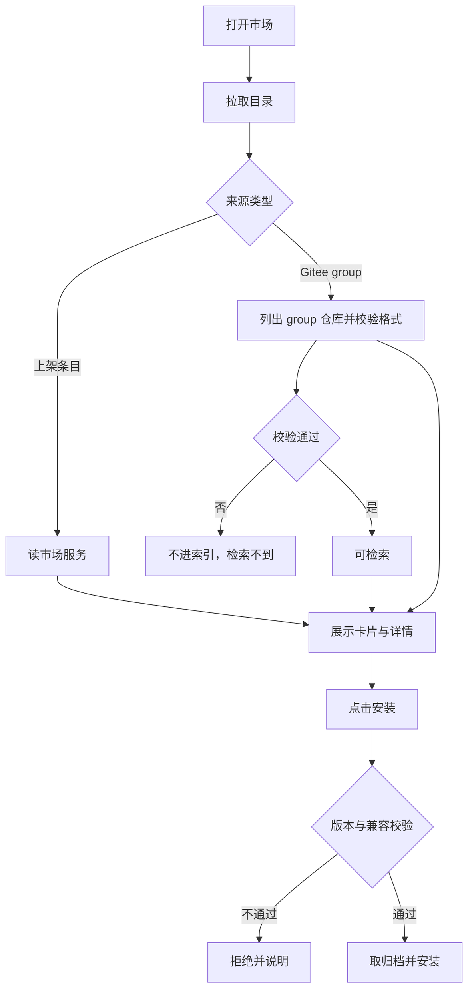
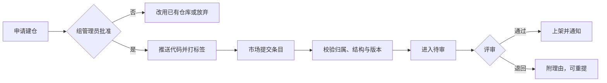

# 企业插件市场详细设计

## 文档信息

| 项 | 内容 |
|---|---|
| 文档编号 | CORP-DSH-DESIGN-007 |
| 文档名称 | 企业插件市场详细设计 |
| 版本 | V0.4.0 |
| 文档状态 | 草案 |
| 密级 | 内部 |
| 编制 | DSH 平台组（代拟） |
| 审核 | 待定 |
| 批准 | 待定 |
| 最后更新 | 2026-10-20 |
| 门禁 | G2 |
| 模块状态 | 规划 |

> 编制依据：2026-10-20 与用户确认目标——市场要供企业开发者浏览、下载、安装、上传插件，并从企业私有 Gitee 仓库发现插件；评价只看下载量与 star。已核验 `dsh-plugin-market`、`dsh-plugin-manager`、`dsh-client-ui-plugin-market` 等上游包存在，以及开源实现 `bradeGithub/DSH-Plugins-Marketplace`（MIT，2026-10-20 仍活跃）。同日用户确认：企业 Gitee 建立专门的公开 group 集中存放 DSH 插件。**未核验**：上游市场 UI 的扩展点、客户端面板注册方式、Gitee 仓库归档的安装可达性。
>
> 关联文档：[市场服务](../services/market-index.md)、[Gitee 接入](forge-gitee.md)、[总体架构 §2 P5](../../architecture/platform-architecture.md)。

## 1. 结论

市场是一个三件套，不是一个配置包：

1. **前端**：DSH 内的市场界面，负责浏览、详情、安装、提交与用量展示。
2. **服务**：目录与版本、发布审核、下载量统计，以及 Gitee 适配（见 DESIGN-012）。
3. **来源**：插件本体集中在企业 Gitee 的专门公开 group，组内打标签即为发布；制品库可选做缓存。

fork 开源实现只解决第 1 件里的浏览与安装。发现、上传、用量统计三块要自建，不能靠改数据源获得。

## 2. 目标与非目标

**目标**

- 开发者能在一个界面里完成：找插件、看说明、装、评、提交自己的插件。
- 插件来源是我们筛选过的企业 Gitee 仓库，不是公网全量。
- 上传有审核：提交 → 校验 → 审批 → 上架，状态可查。
- 用下载量与 Gitee star 量反映使用情况，不引入评论系统。
- 与官方市场并存，不接管官方源。

**非目标**

- 不做公网分发，不面向外部客户。
- 不做付费、许可证交易。
- 不做插件代码托管（用 Gitee），不做 CI 构建（用企业流水线）。
- 不做实时协作或聊天。

## 3. 需求与依赖

| 需求/验收 | 关系 | 说明 |
|---|---|---|
| REQ 可治理分发 | 支撑 | 上架、下架、版本可追溯 |
| REQ 推荐能力落地 | 直接实现 | 精选与用量驱动采用 |
| 验收 A10 分发 | 支撑 | 安装可重复、可回退 |

| 依赖 | 类型 | 版本约束 | 缺失时的行为 |
|---|---|---|---|
| 企业 Gitee | 服务 | 企业现有 | 无法发现与安装，市场只读缓存 |
| Gitee 兼容 CLI 或 API | 工具 | 企业现有 | 发现降级为手工登记 |
| 企业身份（IAM） | 服务 | OIDC | 未登录不可浏览 |
| 企业制品库 | 服务 | 企业现有 | 不做缓存，直接取 Gitee 归档 |
| 市场服务 | 服务 | DESIGN-012 | 前端只显示本地已安装 |

## 4. 扩展形态与边界

| 项 | 内容 |
|---|---|
| 形态 | 客户端插件（fork 改造）+ 独立服务 + Gitee 适配 |
| 运行位置 | 前端在本机 Host；服务在企业内网 |
| 目标 DSH 与 SDK | 随目标版本；前端依赖市场与设置 seam |
| 使用的 seam 或服务 | 市场包、插件管理器、客户端面板、HTTP 客户端 |
| 不修改的核心 | DSH 内核 |

## 5. 接口与配置

| 配置项 | 类型 | 默认值 | 必填 | 说明 |
|---|---|---|---|---|
| `market.serviceUrl` | string | 空 | 是 | 市场服务地址，仅内网 |
| `market.giteeHost` | string | 空 | 是 | 企业 Gitee 主机，禁止公网 |
| `market.giteeGroup` | string | 空 | 是 | 专门存放 DSH 插件的 group |
| `market.officialEnabled` | boolean | `true` | 否 | 是否保留官方市场入口 |
| `market.allowSelfPublish` | boolean | `true` | 否 | 是否允许开发者提交 |
| `market.mirrorToRegistry` | boolean | `false` | 否 | 是否把归档缓存到制品库 |

```yaml title="市场配置（示意）"
market:
  serviceUrl: https://plugins.corp.example
  giteeHost: gitee.corp.example
  giteeGroup: dsh-plugins
  officialEnabled: true
  allowSelfPublish: true
```

## 6. 权限、凭据与数据

| 项 | 处理方式 | 生命周期 | 失败时 |
|---|---|---|---|
| 用户身份 | OIDC 令牌，服务端校验主体 | 随会话 | 不可浏览、不可提交 |
| Gitee 访问 | 浏览：企业全员；建仓：向组管理员申请；提交：仓库必须属于该 group | 随会话 | 无仓库即无法提交，只能浏览 |
| 提交内容 | 仓库地址、标签、说明、截图 | 随条目 | 校验失败即退回 |
| 用量统计 | 下载次数、star 数、更新时间 | 长期 | 展示兜底为零 |
| 下载记录 | 条目、版本、主体、时间 | 180 天 | 不影响安装 |

## 7. 流程

### 7.1 发现与安装



### 7.2 上传与发布



建仓与上架是两道独立的门：前者管"能不能往这个 group 放东西"，由 Gitee 组管理员审批；后者管"能不能出现在市场里"，由平台组评审。市场服务不创建仓库，只校验仓库是否属于该 group。

### 7.3 用量统计


**并发**：同一条目的发布串行；计数用原子自增。

**超时**：目录请求超时展示缓存并标注；提交校验超时退回待重试。

## 8. 失败模式

| 场景 | 行为 | 用户可见结果 | 是否可重试 |
|---|---|---|---|
| 服务不可用 | 保留官方入口与本地已装 | 提示市场暂不可用 | 可重试 |
| Gitee 不可达 | 目录降级为缓存 | 标注信息可能过期 | 可重试 |
| 仓库无权限 | 该条目标记不可见 | 说明需授权 | 授权后重试 |
| 结构不合规 | 提交退回；扫描时也不进索引 | 指出缺失文件与错误码 | 修正后重提 |
| 版本与 DSH 不兼容 | 拒绝安装 | 列出要求版本 | 升级后重试 |
| star 同步失败 | 保留上次值 | 标注可能过期 | 可重试 |

## 9. 可观测性

| 事件 | 字段 | 去向 | 保留 |
|---|---|---|---|
| 浏览与详情 | 条目、主体、时间 | 服务日志 | 90 天 |
| 安装 | 条目、版本、来源、结果 | 服务日志 + 本机 | 180 天 |
| 提交与评审 | 条目、状态变化、评审人 | 服务日志 | 长期 |
| 计数变更 | 条目、类型、增量 | 服务日志 | 180 天 |

## 10. 测试矩阵

| 层级 | 覆盖 | 命令 |
|---|---|---|
| 单元 | 结构校验、版本兼容、计数与同步 | `node --test` |
| 契约 | 前端与服务字段一致；Gitee 适配字段 | 契约用例 |
| 集成 | 服务不可达、私库无权限、退回重提 | 本地夹具 + 仿 Gitee |
| 端到端 | 浏览 → 装 → 评 → 提交 → 上架 | 手工 |

## 11. 打包、升级与回退

前端随包分发（fork 后独立包名），服务容器部署，配置外置。

升级：目录字段只增不删；前端与服务的契约按版本兼容。

回退：停用服务回到"只有官方市场 + 本地已装"；已装插件不受影响。

## 12. 未决事项

| 问题 | 需要谁回答 | 影响 |
|---|---|---|
| 专门 group 的命名与管理员 | Gitee 团队、平台组 | 发现范围与管理责任 |
| 建仓申请的审批人与时限 | Gitee 组管理员 | 开发者从申请到能提交的等待时间 |
| 格式规范的维护与升版 | 平台组 | 存量插件是否需要返工 |
| 是否允许开发者自提交，还是仅平台组录入 | 平台组、安全 | `allowSelfPublish` |
| 评审由谁做、几个工作日 | 平台组、PMO | 上架时效 |
| star 同步频率与缓存 | 平台组 | 展示时效 |
| 是否把归档镜像到制品库 | IT、安全 | `mirrorToRegistry` |
| 上游 UI 的扩展点与面板注册方式 | 平台组（实测） | 前端改造量 |

### 需用户确认的设计选项（增益不明确，暂不采用，保留待定）

| 选项 | 可能的增益 | 代价 | 当前处理 |
|---|---|---|---|
| 完全自研前端 | 交互自由 | 重写浏览与安装，周期长 | 不采用，fork 后改造 |
| 只扫 group、不做市场服务 | 实现最轻 | 无法上传，无审核 | 不采用，与服务配套 |
| 上传即上架（无评审） | 快 | 质量与安全不可控 | 不采用 |
| 文字评论与星级 | 反馈更丰富 | 需审核与治理成本 | 不采用，只看下载量与 star |
| 市场内做在线构建 | 一条龙 | 与企业流水线重复 | 不采用 |

以上五项均不影响主链路；若后续确认增益，再单独评估。

## 13. fork 改造评估（2026-10-20 调研）

**结论**：fork [DSH-Plugins-Marketplace](https://github.com/bradeGithub/DSH-Plugins-Marketplace)（MIT，182★，2026-10-20 仍活跃）作为**浏览与安装外壳**；发现、上传、用量统计必须新建服务，fork 不覆盖。

| 能力 | fork 现状 | 我们的做法 |
|---|---|---|
| 浏览与详情 | 有 | 复用，换数据源为市场服务 |
| 安装与更新 | 有 | 复用，下载源改 Gitee 归档 |
| Gitee 私库发现 | 无（只抓 GitHub topic） | 新增适配器，扫专门 group 的仓库 |
| 上传与发布 | 无 | 新增提交入口 + 服务端审核流 |
| 用量统计 | 无 | 新增下载计数与 star 同步 |

改造要点：换数据源；换下载源；裁掉 18 MB、47 MB 预生成 JSON；补三个新模块。

### 待核验（按影响排序）

| 项 | 为什么重要 | 谁核验 |
|---|---|---|
| 运行时是否强制访问 GitHub 拉目录 | 内网不可达，决定是否必须换数据层 | 平台组（读源码） |
| 客户端面板扩展点 | 决定上传与评价界面怎么加 | 平台组（实测） |
| Gitee 归档能否直接被安装器消费 | 决定要不要镜像到制品库 | 平台组（试装） |
| 上游更新节奏 | 决定长期跟随或转内部实现 | 平台组 |