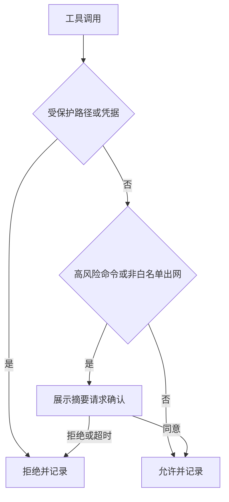

# 策略与审计详细设计

## 文档信息

| 项 | 内容 |
|---|---|
| 文档编号 | CORP-DSH-DESIGN-003 |
| 文档名称 | 策略与审计详细设计 |
| 版本 | V0.9.1 |
| 文档状态 | 草案 |
| 密级 | — |
| 编制 | DSH 平台组（代拟） |
| 审核 | 待定 |
| 批准 | 待定 |
| 最后更新 | 2026-10-24 |
| 门禁 | G2 |
| 模块状态 | 规划 |

> 编制依据：2026-10-20 对目标环境已安装 DSH 包做字符串级核验：`dsh-sandbox`、`dsh-sandbox-local`、`dsh-sandbox-policy`、`dsh-fs-sandbox`、`dsh-fs-observation-policy`、`dsh-bash-sandbox`、`dsh-pwsh-sandbox`、`dsh-sandbox-windows-acl`、`dsh-permission-presets`、`dsh-client-ui-permission-presets`、`dsh-client-ui-approval`、`dsh-tool-ask-user`、`dsh-tool-call-timeout-policy`、`dsh-spill-policy`。
> **2026-10-24 宿主接口契约核验**（目标环境 DSH `0.2.1-rc.2`，macOS arm64；读取 live Host 的 Service/Event 契约，**不是行为实验**）：
> - 工具派发管线为 `tools/pre-execute`（waterfall：放行/拒绝/取消/请求确认）→ `ctx.tools.guard`（同步、monotonic 拒绝，返回字符串即拒绝）→ `tools/execute`（around-dispatch）→ `tools/post-execute`（waterfall）→ 定义方 finalization → `tools/result`（**emit，仅观察**）。`guard` 位于 pre-execute 之后，且**任何 guard 不能强制放行另一 guard 的拒绝**。
> - `ctx.tools.restrict({ allow, deny })` 对空过滤器、未知名、scope 局部名、保留传输名直接失败；限制取交集，scope 内注册仍可见。
> - 人工 command 由独立服务 `ctx.commands`（`register` / `execute`）派发，**不经过 tools 管线**，须显式接线才能纳入同一门禁。
> - 审批由 `ctx.approval`（`setPolicy` / `request`）与 `approval/request`（waterfall）承担；子 Agent 深度由 `ctx.subagents.resolveMaxDepth` 约束。
> **2026-10-24 宿主行为实验（探针 9/9 通过）**：在目标环境用 `dsh --profile sdk` 叠加临时 patch 挂载探针插件，插件在真实进程内经 `ctx.tools` 派发调用。断言：guard 拒绝时工具体零调用且结果为错误、先注册的宽松 guard 不能放行后续拒绝、`tools/pre-execute` 的异步放行与拒绝决策均被采纳、`ask` 在无 agent 时降级为拒绝、`tools/result` 观察者抛错不影响结果与已发生副作用、卸载后工具不可见且再调用报 unknown tool、命令面由独立服务派发而工具管线 guard 未见到该次调用、`approval` 策略 `never` 返回 `rejected`。复跑：`node scripts/probe/run-host-probe.mjs`（无 `dsh` 时跳过，不伪装通过）。
> **2026-10-24 委派继承实验（探针 32/32 通过、1 blocked）**：在目标环境用宿主自己的 agent 工厂按 `parentAgent` + `origin=subagent` + `delegationDepth=1` 创建子 agent，并用**子作用域自己的工具管线**派发调用。实测三件事：① **作用域 guard 会约束子 Agent**——父作用域注册的 guard 在子作用域派发全局工具 `bash` 时照常拒绝（返回 guard 理由，工具体零调用）；② **父 agent 视图上的 `ctx.tools.restrict` 不继承**——父视图把 `bash` 拒绝掉后，子 agent 视图里 `bash` 仍然可见；③ 作用域内 `register` 的工具不进子 agent 视图（子作用域派发报 `unknown tool`），子作用域注册也不上浮到父视图，`dispose` 后限制与子注册都恢复。另实测委派服务路径：`subagents.startActivation({provider:'fork',…})` 接受并按 provider 建出子会话（`listChildren` 可见、`childId` 回填），子轮次因本 profile **无 LLM 提供方**以 `stopReason: error` 收束；`currentInitiator()` 只在显式边界内可读（边界外 `undefined`、`withInitiator` 内为父 agent id），宿主契约明确它只是进程内因果归属，既非存活证明也非授权。
> **2026-10-24 候选平台只读事实（Ubuntu 24.04.5 / Linux aarch64，未做沙箱实验）**：`bwrap` 0.9.0 可用；Landlock 在活跃 LSM 列表中，`landlock_create_ruleset(NULL, 0, LANDLOCK_CREATE_RULESET_VERSION)` 返回 ABI **8**；glibc 2.39；`node-pty` 未安装（`MODULE_NOT_FOUND`，不能据此判断 ABI 或不兼容）。这只说明 Linux aarch64 上存在可用的沙箱原语，未验证具体规则能否满足产品需求，也不改变"策略与沙箱叠加顺序仍未实验"的结论。
> **仍未实验**：有模型提供方的环境里“模型自决调用”是否可能绕开门禁（本轮 profile 无 LLM 提供方）、策略与沙箱的叠加顺序、审批 UI 的注册方式与超时语义、`$DSH_HOME` 的确切范围。
> **仍未核验**：策略与沙箱的叠加顺序、审批 UI 的注册方式与超时语义、`$DSH_HOME` 的确切范围。
>
> 关联文档：[总体架构 §7.2](../../architecture/platform-architecture.md)、[需求基线](../../requirements/requirements-baseline.md)、[设计索引](../README.md)。

## 1. 结论

本模块是企业侧的最后一道闸：在工具真正执行前判断"该不该做"，在数据离开本机前判断"能不能发"。

边界：它不实现沙箱（复用 DSH 沙箱），不实现审批界面（复用审批 UI），只决定策略与记录结果。安全依赖缺失时**关闭而非放行**。

还缺一件事才能进实现：策略与沙箱叠加顺序的确认（宿主钩子与子 Agent 继承语义已由探针跑通，见编制依据）。

## 2. 目标与非目标

**目标**

- 对文件访问、命令执行、网络外发三类动作做统一判断，结论只有允许、需确认、拒绝。
- 受保护路径（凭据、配置、会话记录）默认拒绝，且不因用户确认而放行。
- 外发前给出可读的"将要发出什么"，用户明确同意后才执行。
- 所有判断写审计，含结论与依据，不含正文。

**非目标**

- 不做沙箱隔离本身，不替换 DSH 的 fs 与 bash 沙箱。
- 不做企业权限判定，角色来自 IAM。
- 不做内容审查与数据分类分级。

## 3. 需求与依赖

| 需求/验收 | 关系 | 说明 |
|---|---|---|
| REQ 数据边界 C1–C4 | 支撑 | 模型上下文不含凭据，外发需确认 |
| REQ 审计可否回放 | 支撑 | 判断结论与依据可追溯 |
| 验收 A7 门禁 | 支撑 | 受保护路径零放行 |

| 依赖 | 类型 | 版本约束 | 缺失时的行为 |
|---|---|---|---|
| 沙箱策略包 | 包 | 随目标 DSH | 不启动策略模块，工具面整体禁用 |
| 审批 UI | 包 | 随目标 DSH | 需确认的动作直接拒绝 |
| 审计落点 | 配置 | 本地文件或转发 | 写失败即拒绝高风险动作 |

## 4. 扩展形态与边界

| 项 | 内容 |
|---|---|
| 形态 | Host 插件；确认识别用既有审批 UI，不自建对话框 |
| 运行位置 | 本机 Host |
| 目标 DSH 与 SDK | 随目标版本，钩子以实测为准 |
| 使用的 seam 或服务 | 工具调用拦截、沙箱策略、审批交互、会话事件 |
| 不修改的核心 | 沙箱实现、工具实现、模型调用链 |

取舍：策略判断与沙箱隔离分开。沙箱负责"做不到"，策略负责"不该做"，两者叠加取最严。

## 5. 接口与配置

| 配置项 | 类型 | 默认值 | 必填 | 说明 |
|---|---|---|---|---|
| `policy.audit.sink` | `none` \| `memory` | `none` | 是 | 必要审计落点；`memory` 为非持久开发落点，需 `allowNonDurable`；未配置即关闭受门禁动作 |
| `policy.audit.timeoutMs` | number | 2000 | 是 | 前置/补记写入超时；超时按不可写处理 |
| `policy.protectedPaths` | string[] | `$DSH_HOME/**`（`$DSH_HOME` 缺席时回落 `~/.dsh`） | 是 | 硬拒绝，不可通过确认放行；模板未解析即拒绝挂载 |
| `policy.confirmPaths` | string[] | 空 | 否 | 需确认的路径前缀 |
| `policy.egress` | `deny` \| `confirm` \| `allow` | `confirm` | 是 | 非白名单出网的默认动作 |
| `policy.egressAllowlist` | string[] | 空 | 否 | 主机名或域名后缀 |
| `policy.commandPatterns` | object[] | 空 | 否 | 高风险命令模式与动作 |
| `policy.auditSink` | `local` \| `forward` | `local` | 是 | 必要审计落点；落点不可用按 §8 关闭相关动作 |

策略不可用（未挂载、加载失败、必要依赖缺失）时一律 fail-closed；**不提供 fail-open 开关**，也不以"显式声明只读模式"作为降级通道。

```ts title="导出面（钩子名已按 2026-10-24 live Host 契约核验）"
export interface PolicyDecision {
  action: 'allow' | 'confirm' | 'deny';
  reason: string;
  rule: string;
}
export interface PolicyEngine {
  check(input: { kind: 'fs' | 'bash' | 'egress'; target: string; meta?: unknown }): Promise<PolicyDecision>;
}
```

宿主接线：`ctx.tools.guard()` 承载硬拒绝（**必须挂在作用域上**：guard 会约束该作用域下的子 Agent，而 agent 视图级的 `restrict` 不会传播给子 Agent，见编制依据 2026-10-24 实测）（受保护路径与凭据，返回拒绝理由即阻断，且任何 guard 不能放行另一 guard 的拒绝）；`ctx.on('tools/pre-execute')` 承载需确认动作（返回 `{ kind: 'ask', reason }`，由 `ctx.approval` 决定，无 agent 或通道不可用时降级为拒绝）；`ctx.on('tools/result')` 只做观察投影，不参与判定；命令面不经工具管线，须显式接线（见 #21）。插件以 `inject: ['tools']` 声明对工具服务的硬依赖，依赖缺失即不挂载。

### 5.1 受控动作目录与统一门禁

动作目录由策略维护者登记，不从工具自报的读写属性推导；**未登记或未开放即拒绝**，空清单等价于全部关闭。

| 登记字段 | 说明 |
|---|---|
| `action` | 业务动作标识，与[工程工具契约 §3](../../contracts/engineering-tools.md) 的动作标识同源，不另立命名 |
| `kind` | `read` \| `write` \| `confirm`，决定开关与确认要求 |
| `target` | 执行时必须按时给出的目标类型；缺失或错配一律拒绝 |
| `egress` | 是否出网；缺省沿用 `policy.egress` 与白名单 |
| `retry` | 默认 `none`；读可 `read_recheck`；写不允许自动重放 |
| `enabled` | 显式开放标记；只读、普通研发写、人工确认动作分别开关 |

**判定顺序**（与已核验的宿主管线一致）：`tools/pre-execute`（需确认动作返回 `{ kind: 'ask' }`，由 `ctx.approval` 决定）→ `ctx.tools.guard()`（硬拒绝，单调，任何放行 listener 都不能覆盖）→ 执行 → `tools/post-execute` → `tools/result`（只观察）。未知动作、未开放写、错目标，以及"工具自报 `readOnly`"式的越权企图都在 guard 处拒绝，执行器副作用计数为零。

| 执行路径 | 覆盖方式 |
|---|---|
| 业务工具（含 scoped 注册） | 注册即进管线，guard 对全局与 scoped 工具同样生效；按 `action` 判定而非工具名，别名与包装不改变结论 |
| 人工 command | command 由独立服务派发、**不经工具管线**（探针证据），必须显式接线：未登记的 command 默认拒绝，登记 command 内的动作仍走同一 `action` 判定 |
| 子 Agent | 实测（2026-10-24）：**作用域 guard 会继承**——父作用域 guard 在子作用域派发时照常拒绝且工具体零调用；**父 agent 视图的 `restrict` 不继承**，子视图仍看得见被父视图拒绝的工具；作用域内注册的工具不进子视图。因此约束必须落在**作用域 guard**（会继承）上，不能只靠父视图 `restrict`；有模型提供方的环境里“模型自决调用”仍未测，按“未证实即关闭”处理，不允许以委派绕过门禁 |
| bash/pwsh、脚本、通用 HTTP、`run_code` | 按类别受控（`shell.exec`、`http.egress`、`code.run`）：未登记即拒绝；不向任意解释器注入业务凭据；无法可靠约束时关闭该能力，不声称覆盖 DSH 之外的全部 Shell |

**失败与卸载**：业务工具插件对策略服务声明硬依赖；策略未挂载、被卸载或版本不符时工具插件不挂载，入口关闭且无可调用残留（卸载清理已由宿主探针验证）。不提供 fail-open、通用 `run(command)` 或正则黑名单式安全保证。

**结果语义**：[工程工具契约 §4.2](../../contracts/engineering-tools.md) 为唯一真源；最小要求是区分未执行拒绝、可能执行与 `partial`/`unknown`，保留 `operation_id`，重试默认 `none` 或 `read_recheck`，每个具体写仍须提供自身平台的回查证据。

### 5.2 受保护路径、别名归一与沙箱取严

受保护根按模板解析，默认 `$DSH_HOME/**`。实测（DSH 0.2.1-rc.2 / darwin-arm64）：宿主进程环境里有 `DSH_HOME` 与 `DSH_PROFILE_DIR`，没有 `DSH_AGENTS_HOME`；宿主自有的 `@deepseek-ai/dsh-home-paths` 在插件内**不可导入**，因此本插件只用环境变量契约，并在 `$DSH_HOME` 缺席时回落到宿主默认的 `~/.dsh`（该默认值来自宿主包内说明，不作为独立真源）。凭据按宿主契约位于 `$DSH_HOME/.env`，用户级指令链位于 `$DSH_HOME/AGENTS.md`。

| 规则 | 要求 |
|---|---|
| 模板解析 | 未解析的变量（如未设置的 `$DSH_AGENTS_HOME`）**拒绝挂载**，不静默少保护一个根 |
| 归一顺序 | 绝对化 → 词法折叠（`.`、`..`、重复分隔符）→ `realpath`（含最深已存在祖先，覆盖尚未创建的目标）→ 平台大小写归一（darwin/win32 不敏感） |
| 不可判定 | 非绝对路径、`ELOOP`、权限不足、路径参数缺失一律拒绝，不按放行处理 |
| 别名 | 相对穿越、symlink（含 Windows junction/reparse point）经同一归一化落到根内即拒绝；无法判定的按拒绝 |
| 硬拒绝优先 | 路径检查在确认阶段之前且不可翻转：即使该动作为 `confirm` 且已获批准，命中受保护路径仍然拒绝 |
| 未配置根 | 声明了路径参数的动作在没有任何受保护根时**关闭**（理由写明未配置），不降级为放行 |
| 与沙箱取严 | 沙箱与策略结论不一致取更严；沙箱或策略缺失、被禁用时，依赖路径保护的动作关闭并记录阻塞，不降级 |
| 不保证的终端 | 宿主无法给出可核验路径的调用（例如不透明远程执行）标阻塞，不放行 |

### 5.3 C3 外发确认

外发确认绑定一次具体的动作、目标与内容摘要，且只展示"将要发出什么"的范围，不展示正文与凭据值。

| 规则 | 要求 |
|---|---|
| 绑定 | 确认覆盖 `(action, target, contentDigest)`；任一变化即失效，必须重新确认 |
| 展示 | 动作、目标、内容字段名与摘要前缀；确认文本与错误回显都不得出现凭据值（金丝雀检查） |
| 拒绝 | 取消、过期、超时、通道不可用、无 UI、策略 `never` 全部按拒绝处理，不伪造同意 |
| 白名单 | 允许出网的主机只说明"可去"，不等于该次写已获授权；写仍逐动作判定 |
| 回退 | 内容摘要变化或目标变化后旧确认不可复用；重试沿用 §5.1 的 `retry` 语义 |

### 5.4 有限委托与可信确认生命周期

入口由用户明确触发并给出变更号；宿主可校验的上下文把委托绑定到**当前用户、变更、仓库、已开放动作与版本**。委托与确认的"可信"来自宿主给出的事实，不来自模型参数或正文。

| 规则 | 要求 |
|---|---|
| 委托来源 | 委托只能由宿主侧事实创建（`source = host`）；模型自填的 `approved`、`principal`、`readOnly`、`review_kind`、聊天内容或摘要一律不能创建委托 |
| 绑定范围 | 错人、错变更、错仓库、未开放或未登记动作一律拒绝；动作集只减不增 |
| 版本 | 内容、要求与 PR 版本变化后旧确认失效；**不以"执行前重读一次"冒充条件写** |
| 确认生命周期 | 确认绑定 `(action, target, contentDigest)` 与版本，一次性消费；取消、过期、版本漂移、已消费、来源不可信都按拒绝 |
| 恢复与分叉 | 宿主重启、会话分叉或子 Agent 重新验证身份与范围，最多维持同等或更小范围；临时表或聊天记录不能恢复写授权，依据不足时重新承接（重新委托） |
| C3 与人工确认 | C3 动作分类批准前自动研发写不生效；`approval = never`、answerer 缺失或异常都不产生同意；`allowed-once` 不等于真实人工 review |
| 不可证明即关闭 | 宿主无法证明某类确认时，相关动作确实不可调用（拒绝并给出缺口理由），不以提示词替代 |

**恢复/分叉/子 Agent 承接（#23 AC3，`resumeDelegation()`，2026-10-24）**：与 `authorizeDelegation` 一样只返回判定对象、从不抛错，任何无法复验的情况都按拒绝处理。

| 情况 | 判定 |
|---|---|
| 无委托 / 非宿主来源 / 已撤销 / 已过期 | `delegation-missing` / `delegation-untrusted-source` / `delegation-revoked` / `delegation-expired` |
| 快照来源是聊天、摘要、临时表或模型 | `delegation-resume-untrusted-source`（**不能恢复写授权**） |
| 未给当前身份、变更，或身份/变更与委托不符 | `delegation-resume-unverifiable` / `-principal-changed` / `-change-mismatch` |
| 仓库越界、版本漂移、版本项不属于委托 | `delegation-resume-repository-out-of-scope` / `-revision-drift` / `delegation-resume-unverifiable` |
| 子 Agent 承但没有宿主背书的 agent 身份 | `delegation-resume-unverifiable`（必须重新承接） |
| 请求动作集超出原委托 | `delegation-resume-scope-widened`（**只减不增**） |
| 复验通过 | `delegation-resumed`，返回收窄后的委托：范围＝请求子集，`expiresAt` **只继承不延长**，并记录 `resumeKind`/`forkedFrom`/`delegatedTo` |
| 缺少可复验依据 | `delegation-resume-unverifiable` → 调用方必须重新承接（重新委托），不得沿用旧快照 |

**实测（2026-10-24）**：

| 证据 | 结果 |
|---|---|
| 离线用例 `packages/forge-policy/test/delegation.test.mjs`（新增 6 项） | 身份/变更/仓库/版本漂移逐项拒绝；聊天/摘要/临时表/模型快照一律拒绝；范围放宽被拒、收窄返回 `scopeReduced` 且到期时间不变；收窄后的委托经 `authorizeDelegation` 仍按收窄范围执行（被移除的动作 `delegation-action-out-of-scope`）；fork/subagent 记录宿主背书来源，子 Agent 缺 agent 身份即拒绝；撤销/过期/退化输入全部 fail closed |
| 宿主探针 `delegation-resume-needs-host-facts`（`dsh 0.2.1-rc.2`，profile `sdk`） | 探针进程本身是"重启后的新会话"：内存无上次委托 → 写请求 `delegation-missing`；`source: 'chat'` 建委托被拒 `POLICY_DELEGATION_UNTRUSTED_SOURCE`；临时表快照承接被拒 `delegation-resume-untrusted-source`；宿主背书承接可放行且收窄生效；放宽为 `delegation-resume-scope-widened` |

覆盖率：`delegation.mjs` 行 100% / 分支 96.30% / 函数 100%。

### 5.5 必要审计前置与执行后缺口

必要审计是"执行的前提"，不是事后的旁路日志。**未配置可用审计落点时，所有受门禁约束的动作（含只读与 command）一律拒绝**；这是本设计的默认值，不做降级放行。

| 规则 | 要求 |
|---|---|
| 前置 | 只有判定为可执行的动作才写前置记录；记录不可写、落点缺失、`durable` 未声明或超时 → 拒绝且**零执行**；只读不豁免 |
| 记录最小化 | 只记独立允许字段（动作、目标、工具、判定、规则、`operation_id`、版本、时间、耗时）；凭据、业务正文、参数值、`stdout`/`stderr` 一律不入记录；出现禁用字段直接报错 |
| 执行后缺口 | 工具体已执行或可能已执行后补记失败：**保留执行结果与正式引用/unknown**，登记缺口并把后续动作限制为拒绝，直到责任方显式确认缺口；不得因此报告"未执行" |
| 观察与可选指标 | `tools/result` 观察监听器异常不影响前置必要审计；可选指标或日志失败只记缺口，不阻塞研发 |
| 恢复 | 不自动重放写；不声称本地审计与远端平台之间有跨系统事务 |
| 企业落点 | 企业审计落点未获准前，相关企业调用保持关闭（记录为阻塞，不临时改用本机文件充数） |

宿主接线（已核验）：前置记录写在 `ctx.on('tools/pre-execute')`，补记写在 `ctx.on('tools/post-execute')`——该 waterfall 的签名是 `(exec, result, next)`，默认决议 `{ kind: 'accept' }`（探针实测，写错签名会让工具调用失败）。`tools/result` 仍只做观察投影。

## 6. 权限、凭据与数据

| 项 | 处理方式 | 生命周期 | 失败时 |
|---|---|---|---|
| 策略文件 | 本地只读加载，变更需重启或显式重载 | 随配置 | 解析失败即 fail-closed |
| 审计记录 | 追加写，不含正文与令牌 | 90 天 | 必要审计写失败即关闭需该保障的动作（含只读查询与 command），不按"高风险动作"打折 |
| 用户确认 | 仅存结论与摘要，不存全文 | 会话 | 超时视为拒绝 |
| 凭据 | 不读取、不转发、不记录 | — | 命中即拒绝 |

## 7. 流程



**并发**：判断无共享可变状态，可并发；审计写入串行，避免交错。

**超时**：确认等待默认 120 秒，超时按拒绝处理；判断本身 1 秒内完成，超时即拒绝。

**取消**：用户取消工具调用时不写"已执行"审计，只写"已取消"。

## 8. 失败模式

| 场景 | 行为 | 用户可见结果 | 是否可重试 |
|---|---|---|---|
| 策略文件缺失或损坏 | 全部拒绝 | 明确报错并指向配置 | 修复后重试 |
| 审计不可写（必要审计） | 拒绝一切需要该保障的动作，含只读查询与 command | 提示审计不可用 | 恢复后重试 |
| 本机日志或可选指标不可用 | 记录缺口，不阻塞研发，不放宽必要审计 | 显示缺口计数 | 恢复后自动继续 |
| 确认界面不可用 | 视为拒绝 | 提示无法确认 | 可重试 |
| 沙箱与策略结论冲突 | 取更严的一方 | 说明冲突规则 | 否 |
| 钩子未触发（实测发现） | 记为阻断缺陷，不降级放行 | 工具面禁用 | 修复后恢复 |

## 9. 可观测性

| 事件 | 字段 | 去向 | 保留 |
|---|---|---|---|
| 判断完成 | 工具、目标摘要、结论、规则、耗时 | 审计 | 90 天 |
| 用户确认 | 结论、摘要哈希、等待时长 | 审计 | 90 天 |
| 拒绝 | 规则、目标类别 | 审计 | 90 天 |
| 策略加载 | 版本、条目数、加载结果 | 本机日志 | 30 天 |

目标摘要只保留类别与哈希，不回写完整路径或命令文本。

### 9.1 过程观察与受控写分类

过程观察采用[指标事件契约](../../contracts/metrics-events.md)的独立投影，复用既有 OTel 出口，由 DevOps 汇聚，不新建包或指标服务。指标投影可独立关闭/降级，不携带安全审计中的内容哈希；必要审计失败仍执行原拒绝规则，不能因指标可降级而放行。

有限委托内普通研发写的目标见[需求 §2.3](../../requirements/requirements-baseline.md)。现行 C3 跨系统写 ask 在安全批准精确动作分类前仍有效；入口确认不自动豁免后续写。批准后需按动作/资源/版本验证授权，业务决定与正式人工评审仍需真实确认。缺原生可靠控制时禁用，不自建第二授权系统。

## 10. 测试矩阵


| 层级 | 覆盖 | 命令 |
|---|---|---|
| 单元 | 三类动作判定、fail-closed、规则优先级 | `node --test` |
| 契约 | 结论与审计字段稳定 | 契约用例 |
| 集成 | 命中受保护路径、确认超时、必要审计不可写零执行、补记失败保留结果并限制后续动作、委托越界与版本漂移零执行 | 本地夹具 |
| 等价路径负测 | 未登记 command 拒绝、bash/pwsh 与通用 HTTP 按类别受控、包装与别名不提权、不向解释器注入业务凭据 | 本地夹具 + 宿主探针 |
| 并发 | 并发判断无共享可变状态；审计串行不交错；并发拒绝不互相放行 | `node --test` |
| 退出与卸载 | 卸载后工具面与命令面无残留可调用入口；退出前审计已落盘 | 宿主探针 + 本地夹具 |
| 宿主探针 | guard 拒绝零副作用与单调性、pre-execute 异步决策、`ask` 无 agent 降级、`tools/result` 观察异常、命令面独立、`approval=never`、卸载清理，真实委派（子 agent 由宿主工厂按 `parentAgent`/`origin=subagent` 创建：作用域 guard 继承、父视图 `restrict` 不继承、子注册不上浮、dispose 清理）与 `subagents.startActivation` 路径，门禁集成合成查询（登记可执行 / 未开放 / 未登记 / 错目标 / 自报 `readOnly` 无效）、受保护路径（直接 / 穿越 / symlink 别名拒绝，根外放行）与 `$DSH_HOME` 解析事实 | `node scripts/probe/run-host-probe.mjs`（目标 DSH；无 `dsh` 跳过） |
| 端到端 | 双端各跑一次拒绝、一次确认、一次放行 | 手工 + 脚本 |

覆盖率门槛：≥70%；安全关键分支（受保护路径、确认超时、必要审计不可写、卸载清理）必须同时有正向与负向用例。未达到上述矩阵前不建包清单，模块保持"规划"。

## 11. 打包、升级与回退

包名 `@heluo/forge-policy`，`private: true`，声明 `engines.dsh`。策略文件随组合包下发，用户不可编辑。

回退：禁用插件后回到 DSH 默认策略，需在组合包中显式声明该后果，避免"禁用即放行"的误解。

## 12. 未决事项

| 问题 | 需要谁回答 | 阻塞的能力 | 截止门禁 |
|---|---|---|---|
| 有模型提供方的环境里，子 Agent 的“模型自决调用”能否绕开作用域 guard（本轮实测：guard 会继承且拒绝生效、委派服务能建出子会话，但 profile 无 LLM 提供方，子轮次以 error 收束） | 平台组（在接了模型行的 profile 复跑 + 真实委派） | P01、P02 的完整性结论（P02 的硬拒绝已实测） | G1 编码前 |
| 策略与沙箱的叠加顺序 | 平台组（实测） | 冲突时取严是否成立 | G1 编码前 |
| 审批 UI 的注册方式与超时语义 | 平台组（实测） | 确认流程（P02、P04） | G1 编码前 |
| `$DSH_HOME` 内部范围（哪些子目录含凭据、会话与指令）与 `$DSH_AGENTS_HOME` 是否在某些 profile 出现 | 平台组（实测） | 受保护路径默认集（P04） | G1 编码前 |
| 审计是否需要转发到集中平台 | 安全团队 | `auditSink` 默认值 | G2 前 |

### 需用户确认的设计选项（增益不明确，暂不采用，保留待定）

| 选项 | 可能的增益 | 代价 | 当前处理 |
|---|---|---|---|
| 策略 DSL（可编程规则） | 表达力强 | 解析器与测试成本高，规则可读性下降 | 不采用，用固定配置项 |
| 命令正则黑名单 | 拦截已知危险命令 | 误报高、易绕过，给人虚假安全感 | 不采用，只做白名单与非白名单出网 |
| 记录完整命令与路径 | 审计更完整 | 隐私暴露面扩大 | 不采用，只记类别与哈希 |
| 对每次工具调用做速率限制 | 抑制异常循环 | 与 DSH 已有超时策略重叠 | 不采用 |
| 默认全量阻断出网 | 最安全 | 首次使用几乎不可用，用户会关掉插件 | 不采用，默认 confirm |

以上五项均不影响主链路；若后续确认增益，再单独评估。禁用插件时的行为必须在组合包中写明，不能用"可禁用"代替策略保障。
