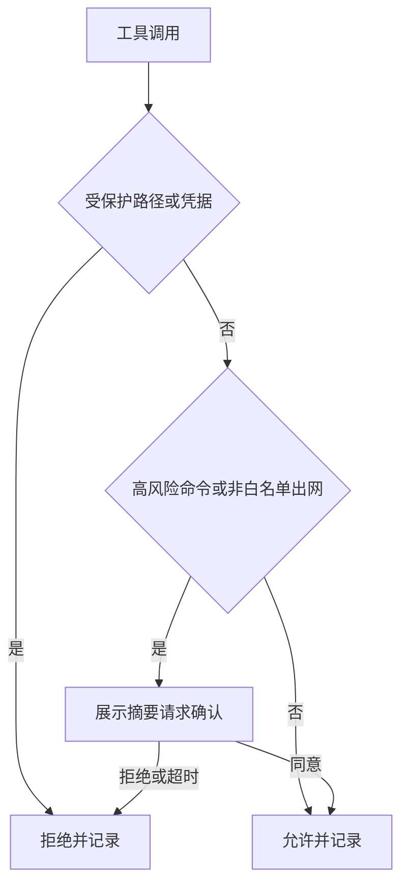

# 策略与审计详细设计

## 文档信息

| 项 | 内容 |
|---|---|
| 文档编号 | CORP-DSH-DESIGN-003 |
| 文档名称 | 策略与审计详细设计 |
| 版本 | V0.17.4 |
| 文档状态 | 草案 |
| 密级 | — |
| 编制 | DSH 平台组（代拟） |
| 负责 | 平台组（代拟） |
| 审核 | 待定 |
| 批准 | 待定 |
| 最后更新 | 2026-11-20 |
| 门禁 | G2 |
| 模块状态 | 可用 |

> 编制依据：2026-10-20 对目标环境已安装 DSH 包做字符串级核验：`dsh-sandbox`、`dsh-sandbox-local`、`dsh-sandbox-policy`、`dsh-fs-sandbox`、`dsh-fs-observation-policy`、`dsh-bash-sandbox`、`dsh-pwsh-sandbox`、`dsh-sandbox-windows-acl`、`dsh-permission-presets`、`dsh-client-ui-permission-presets`、`dsh-client-ui-approval`、`dsh-tool-ask-user`、`dsh-tool-call-timeout-policy`、`dsh-spill-policy`。
> **2026-10-24 宿主接口契约核验**（目标环境 DSH `0.2.1-rc.2`，macOS arm64；读取 live Host 的 Service/Event 契约，**不是行为实验**）：
> - 工具派发管线为 `tools/pre-execute`（waterfall：放行/拒绝/取消/请求确认）→ `ctx.tools.guard`（同步、monotonic 拒绝，返回字符串即拒绝）→ `tools/execute`（around-dispatch）→ `tools/post-execute`（waterfall）→ 定义方 finalization → `tools/result`（**emit，仅观察**）。`guard` 位于 pre-execute 之后，且**任何 guard 不能强制放行另一 guard 的拒绝**。
> - `ctx.tools.restrict({ allow, deny })` 对空过滤器、未知名、scope 局部名、保留传输名直接失败；限制取交集，scope 内注册仍可见。
> - 人工 command 由独立服务 `ctx.commands`（`register` / `execute`）派发，**不经过 tools 管线**，须显式接线才能纳入同一门禁。
> - 审批由 `ctx.approval`（`setPolicy` / `request`）与 `approval/request`（waterfall）承担；子 Agent 深度由 `ctx.subagents.resolveMaxDepth` 约束。
> **2026-10-24 宿主行为实验（探针 9/9 通过）**：在目标环境用 `dsh --profile sdk` 叠加临时 patch 挂载探针插件，插件在真实进程内经 `ctx.tools` 派发调用。断言：guard 拒绝时工具体零调用且结果为错误、先注册的宽松 guard 不能放行后续拒绝、`tools/pre-execute` 的异步放行与拒绝决策均被采纳、`ask` 在无 agent 时降级为拒绝、`tools/result` 观察者抛错不影响结果与已发生副作用、卸载后工具不可见且再调用报 unknown tool、命令面由独立服务派发而工具管线 guard 未见到该次调用、`approval` 策略 `never` 返回 `rejected`。复跑：`node scripts/probe/run-host-probe.mjs`（无 `dsh` 时跳过，不伪装通过）。
> **2026-10-24 委派继承实验（探针 32/32 通过、1 blocked）**：在目标环境用宿主自己的 agent 工厂按 `parentAgent` + `origin=subagent` + `delegationDepth=1` 创建子 agent，并用**子作用域自己的工具管线**派发调用。实测三件事：① **作用域 guard 会约束子 Agent**——父作用域注册的 guard 在子作用域派发全局工具 `bash` 时照常拒绝（返回 guard 理由，工具体零调用）；② **父 agent 视图上的 `ctx.tools.restrict` 不继承**——父视图把 `bash` 拒绝掉后，子 agent 视图里 `bash` 仍然可见；③ 作用域内 `register` 的工具不进子 agent 视图（子作用域派发报 `unknown tool`），子作用域注册也不上浮到父视图，`dispose` 后限制与子注册都恢复。另实测委派服务路径：`subagents.startActivation({provider:'fork',…})` 接受并按 provider 建出子会话（`listChildren` 可见、`childId` 回填），子轮次因本 profile **无 LLM 提供方**以 `stopReason: error` 收束；`currentInitiator()` 只在显式边界内可读（边界外 `undefined`、`withInitiator` 内为父 agent id），宿主契约明确它只是进程内因果归属，既非存活证明也非授权。
> **2026-10-24 候选平台只读事实（Ubuntu 24.04.5 / Linux aarch64，未做沙箱实验）**：`bwrap` 0.9.0 可用；Landlock 在活跃 LSM 列表中，`landlock_create_ruleset(NULL, 0, LANDLOCK_CREATE_RULESET_VERSION)` 返回 ABI **8**；glibc 2.39；`node-pty` 未安装（`MODULE_NOT_FOUND`，不能据此判断 ABI 或不兼容）。这只说明 Linux aarch64 上存在可用的沙箱原语，未验证具体规则能否满足产品需求，也不改变"策略与沙箱叠加顺序仍未实验"的结论。
> **仍未实验**：审批 UI 的注册方式与超时语义、`$DSH_HOME` 的确切范围。有模型提供方的环境里“模型自决调用”与策略×沙箱叠加顺序已于 2026-10-24 实测（见 §9.2.2/§9.2.3）。
> **仍未核验**：审批 UI 的注册方式与超时语义、`$DSH_HOME` 的确切范围。
> **2026-11-16 内网 UAT 观测**：活动 profile 未覆盖本插件，生效目录来自三份 bundle 补丁层折叠，只有六条只读动作，六个写动作全部 `deny / unregistered-action`；同日源码核验 `packages/forge-policy/src/catalog.mjs:66,68`、`installer.mjs:223-226`、`approvals.mjs:142`、`gate.mjs:65-88`。目标判定规则见[策略判定模型设计](../policy-model.md)，实现状态以设计索引为准。**该观测对应 P0 之前的实现**：审批与范围票据通道已在 r19 P0 删除，现行判定见 §5.1「现行实现」。
>
> 关联文档：[总体架构 §7.2](../../architecture/platform-architecture.md)、[需求基线](../../requirements/requirements-baseline.md)、[策略判定模型设计](../policy-model.md)、[设计索引](../README.md)。

## 1. 结论

本模块是企业侧的最后一道闸：在工具真正执行前判断"该不该做"，在数据离开本机前判断"能不能发"。

边界：它不实现沙箱（复用 DSH 沙箱），不实现确认界面（复用宿主 `userQuestions` 卡片），只决定策略与记录结果。安全依赖缺失时**关闭而非放行**。

P0 已交付受控写骨架：动作目录、IAM 身份校验、恒开审计、一次性收据与执行前复验、命令面同源判定；P1 交付人工确认卡片与决策复用；P2 交付内容闸（9 条内置规则、按动作字段映射、跨字段字节预算）；流程规则与受保护路径拦截待 P3。宿主钩子、子 Agent 继承语义以及策略×沙箱叠加顺序的历史探针见 §9.2.2/§9.2.3 与编制依据。

**判定模型**：目标模型按动作分类、内容规则、流程规则、身份与证据五轴判定；写动作按类别给默认决策，`gitee.git.push` 与 DOP 状态流转在开关开启后弹确认卡片。本文 §5.1 承载引擎侧的接口、目录与策略级批准；规则语义、默认值与内容/流程规则见[策略判定模型设计](../policy-model.md)。现行实现为分类默认决策 + 身份 + 审计三段，外加已接入的三条规则开关（内容闸与两条按次确认）。

**当前实现（P2，2026-11-20）**：七个策略开关只有 `contentGate`、`confirmPush`、`confirmDopWrite` 三个已实现，其余四个置 `true` 在装载期直接报错。需要人工确认卡片的动作只有 `gitee.git.push`（`confirmPush`）与 `change.clarification.write`（`confirmDopWrite`）两条，其余四条受控写在任何开关组合下都不弹卡；身份校验恒常开启，不占开关。确认等待默认 120000 ms（`confirmation.timeoutMs`），超时、通道不可用、应答非法分别映射 `POLICY_CONFIRM_TIMEOUT` / `_UNAVAILABLE` / `_INVALID_ANSWER`，一律不执行。来源为子代理的调用不再一律拒绝：命中的确认由存活的主会话根代问（卡片弹在主会话，正文标明「本次写入由子代理发起」），找不到唯一存活的根才以 `POLICY_CONFIRM_DELEGATED` 拒绝。已允许的调用按「工具名 + callId + 动作 + 参数摘要 + 正文摘要」复用同一结论，进程内最多 32 条、不落盘并绑定 IAM 主体；命中后仍须重过身份校验、一次性收据、执行前正文复验与执行后复验。正文读不到时摘要只是占位值，这样的结论既不进缓存也不查缓存，重试必须重新确认（D89）。没有桌面确认通道时装载照常完成并告警一次，需要卡片的写全部以 `POLICY_CONFIRM_UNAVAILABLE` 拒绝（fail-closed）。本文其余章节描述的是目标模型，未达成的部分仍以"待实现"标注。

**IAM隔离消费进展**：独立许可/私有operation算法B已通过62新例及210项policy全包回归，独立peer与arguments身份变异已关闭。普通apply未注入该算法；C合成工具/命令的共享installer、发送体与owned finalizer已通过31新例/241项policy回归及独立审阅/变异。D合成模型入口已通过29新例/270项policy回归，包含最终错误桥修复及独立审阅/桥接增量复核；E根16项已验证实际IAM工厂与mock IdP的联合执行，独立审阅与本批完整检查已通过。B/C/D局部fixture本身不是联合证据，E仍不证明生产授权；普通apply不启用合成模型。会话见证、许可字段与整体边界见[IAM-003](<../../contracts/iam-consumer-isolated.md>)和[PLAN-007](<../../plans/2026-11-02-iam-consumer-isolated.md>)。

## 2. 目标与非目标

**目标**

- 对文件访问、命令执行、网络外发三类动作做统一判断，结论只有允许、需确认、拒绝；写类动作再叠加内容与流程规则。
- 受保护路径检查是目标能力；当前内置动作没有路径参数，门禁不自动拦截文件路径。
- 外发前给出可读的"将要发出什么"，用户明确同意后才执行。
- 所有判断写审计，含结论与依据，不含正文。

**非目标**

- 不做沙箱隔离本身，不替换 DSH 的 fs 与 bash 沙箱。
- 不做企业权限判定，角色来自 IAM。
- 不做语义分析、数据分类分级或 DLP；内容规则是有上限的正则集合，不宣称覆盖全部变体。

## 3. 需求与依赖

| 需求/验收 | 关系 | 说明 |
|---|---|---|
| REQ 数据边界 C1–C4 | 支撑 | 模型上下文不含凭据，外发需确认 |
| REQ 审计可否回放 | 支撑 | 判断结论与依据可追溯 |
| 验收 A7 门禁 | 支撑 | 受保护路径零放行 |

| 依赖 | 类型 | 版本约束 | 缺失时的行为 |
|---|---|---|---|
| 沙箱策略包 | 包 | 随目标 DSH | 不启动策略模块，工具面整体禁用 |
| 交互卡片（`ctx.userQuestions`） | 服务 | 随目标 DSH | 需要确认的动作直接拒绝 |
| 审计落点 | 配置 | 本地文件或转发 | 写失败即拒绝高风险动作 |

## 4. 扩展形态与边界

| 项 | 内容 |
|---|---|
| 形态 | Host 插件；确认用宿主既有问答卡片（`ctx.userQuestions`），不自建对话框 |
| 运行位置 | 本机 Host |
| 目标 DSH 与 SDK | 随目标版本，钩子以实测为准 |
| 使用的 seam 或服务 | 工具调用拦截、沙箱策略、问答卡片、会话事件 |
| 不修改的核心 | 沙箱实现、工具实现、模型调用链 |

取舍：策略判断与沙箱隔离分开。沙箱负责"做不到"，策略负责"不该做"，两者叠加取最严。

## 5. 接口与配置

| 配置项 | 类型 | 默认值 | 必填 | 说明 |
|---|---|---|---|---|
| `policy.audit.sink` | `memory` \| `file` | `memory` | 是 | 审计落点；`memory` 为环形缓冲（`buffer` 条），`file` 按天轮转写入 `$DSH_HOME/logs/forge-policy-<date>.jsonl` 并按 `keepDays` 清理 |
| `policy.audit.buffer` | number | 1000 | `sink: memory` 时必填 | 环形缓冲容量 |
| `policy.audit.keepDays` | number | 7 | `sink: file` 时必填 | 文件审计舱按天保留天数 |
| `policy.audit.timeoutMs` | number | 2000 | 是 | 前置/补记写入超时；超时按不可写处理并中止本次调用 |
| `policy.protectedPaths` | string[] | 无（固定 `$DSH_HOME/**`，`$DSH_HOME` 缺席时回落 `~/.dsh`） | 否 | 不再可配置：受保护根固定为默认值，自定义值在装载期拒绝，避免"配了却不生效" |
| `policy.observation.export.enabled` | boolean | `false` | 否 | 过程观察导出开关；**默认关闭**，启用但缺少宿主发送方（`observationSink`）或未登记枚举时停在 `no-provider` / `unregistered-enums`，一次也不发 |
| `policy.observation.export.idempotentProvider` | boolean | `false` | 否 | 摄取方是否保证按 `event_id` 幂等；**true 才允许**响应未知时有限重送 |
| `policy.observation.enums` | object | 空 | 启用导出时必填 | 已登记枚举（`status`/`action` 至少各一项）；本仓库不发明枚举取值 |
| `policy.audit.requireDurable` | boolean | `false` | 否 | 是否要求持久审计落点；组织策略可强制为 `true`，本机不能改回 `false` |

未接入判定链路的配置面一律在装载期拒绝，报错带键路径并列出全部问题，不静默忽略：`categories`、`protectedPaths`、`paths.append`、`confirmation`、`content` 当前都属此列（取值等于默认值时视为未设置，宿主 loader 回灌的规范化配置因此可以原样通过）。旧配置键 `confirmPaths`、全局 `egress`、`egressAllowlist`、`commandPatterns`、`auditSink` 既不被读取也报未知键；配置它们不能建立相应保护。判定链路、文件审计舱与规则开关的现行实现见[实施计划 CORP-DSH-PLAN-024](../../plans/2026-11-19-policy-minimal-gates.md)与包内 [README](../../../packages/forge-policy/README.md)。

内容规则、动作上限与流程规则开关不来自本文件配置：内置集随包编译，组织层来自包内 `policy/` 数据目录的签名信封（§5.1.4），本机层只能收紧，不能放宽。

策略不可用（未挂载、加载失败、必要依赖缺失）时，依赖该策略的入口关闭；**不提供 fail-open 开关**，也不以"显式声明只读模式"作为降级通道。流程事实源（dop 变更状态、计划状态等）不可用不属于此列：它跳过相关流程规则、记录 `unevaluated` 并继续执行，见[判定模型 §7](../policy-model.md)。

```ts title="导出面（policy 服务，P0 现行）"
export interface PolicyService {
  /** 已编译的动作目录；只含目录登记的写动作 */
  catalog: ReadonlyMap<string, PolicyCatalogEntry>;
  actions(): string[];
  decide(request: { action: string; target?: string }): PolicyDecision;
  authorize(toolName: string, request?: { target?: string }): PolicyDecision;
  protectedPaths(): string[];
  checkPath(candidate: string): boolean;
  orgPolicy(): OrgPolicyState;
  policyVersion(): string;
  mode(): 'managed' | 'personal';
  contentRuleIds(): string[];
  auditRecords(): AuditRecord[];
  auditGaps(): AuditGap[];
  acknowledgeAuditGaps(): number;
  auditDegraded(): boolean;
  setAuditSink(sink: AuditSink): void;
  executeAction(commandCtx: unknown, action: string, exec: Exec, operation: () => Promise<unknown>): Promise<unknown>;
  registerCommand(commandCtx: unknown, definition: CommandDefinition): () => void;
  observations(): ObservationState;
}
export interface PolicyDecision {
  action: 'allow' | 'confirm' | 'deny';
  reason: string;
  rule: string;
}
```

宿主接线：`ctx.on('tools/pre-execute')` await 判定、身份与前置审计，返回 `{ kind: 'allow' }` 或 `{ kind: 'deny', reason }`；`ctx.tools.guard()` 同步核验并消费一次性收据（**必须挂在作用域上**：guard 会约束该作用域下的子 Agent，而 agent 视图级的 `restrict` 不会传播给子 Agent，见编制依据 2026-10-24 实测）；`ctx.on('tools/post-execute')` 与 `ctx.on('tools/result')` 结清同一条前置记录，后者只做兜底观察、不参与判定；命令面不经工具管线，由 `policy.registerCommand` 显式接线并复用同一屏障。插件以 `inject: ['tools']` 声明对工具服务的硬依赖，依赖缺失即不挂载。确认卡片不复用 `ctx.approval`：P1 起用 `ctx.userQuestions` 的问答卡片，见 §5.3。

### 5.1 受控动作目录与统一门禁

动作目录由策略维护者登记，不从工具自报的读写属性推导；对已映射到策略或显式调用门禁的动作，**未登记或未开放即拒绝**。未映射的普通宿主工具处于该策略范围之外，空目录本身不使它们自动受控。

目录 schema 只包含以下字段；未知键（含旧键 `revision`、`enabled`、`kind`、`egress`）在装载期拒绝。

| 登记字段 | 说明 |
|---|---|
| `action` | 业务动作标识，与[工程工具契约 §3](../../contracts/engineering-tools.md) 的动作标识同源，不另立命名 |
| `target` | 执行时必须按时给出的目标类型；缺失一律拒绝 |
| `category` | 类别覆盖；只能落在分类表已允许的范围内，决定默认决策 |

**目标判定顺序（P1–P3）**：按[判定模型 §3](../policy-model.md#3-判定对象与阶段)检查动作、受保护路径、内容与流程，合成决策后完成必要的确认卡片与前置审计；执行前复验身份、策略版本、目标与受保护路径，随后执行并结清。`tools/result` 只作同步兜底观察，不代替 awaited 决策；pending 结清前后续动作不得继续。未登记写动作（开关开启后）、缺失目标以及工具自报 `readOnly` 的越权企图必须零执行。

**现行实现（P0–P3）**：判定流水线常开 `resolve → identity → audit → receipt` 四段，`enforceProcessRules` 开启时在内容闸之前插入流程闸阶段，`contentGate` 开启时在审计之前插入内容闸阶段，`confirmPush`/`confirmDopWrite` 开启时再插入确认阶段。已登记动作按分类默认决策放行或拒绝，放行后必须解析出 IAM actor，然后先落前置审计记录、签发一次性收据，再由 `tools.guard` 同步核验；执行前 `recheck` 复验卸载、取消、参数与身份变化，执行后结清。未登记动作与未映射工具是 out-of-scope：直接放行，不读身份、不写审计。七条规则开关（`denyUnknownAction`、`denyHumanRecord`、`protectPaths`、`enforceProcessRules`、`contentGate`、`confirmPush`、`confirmDopWrite`）代码默认全关，已接入的四条（`enforceProcessRules`、`contentGate`、`confirmPush`、`confirmDopWrite`）可以开启，其余三条置真在装载期被拒绝；仍未接入判定链路的配置面（`categories`、`protectedPaths`、`paths.append`）同样在装载期拒绝，避免"配了却静默不生效"。`confirmation` 与 `content` 已接入，可按需设置。目标设计的其余部分按[实施计划](../../plans/2026-11-19-policy-minimal-gates.md)分阶段接入，未实现前不能视为当前可用接口。

| 执行路径 | 覆盖方式 |
|---|---|
| 业务工具（含 scoped 注册） | 已映射的工具进入统一动作判定；未映射的普通宿主工具为 `out-of-scope`，不能仅凭 guard 已安装就声称全部受控 |
| 人工 command | command 由独立服务派发、**不经工具管线**（探针证据），必须显式接线：未登记的 command 默认拒绝，登记 command 内的动作仍走同一 `action` 判定 |
| 子 Agent | 实测（2026-10-24）：**作用域 guard 会继承**——父作用域 guard 在子作用域派发时照常拒绝且工具体零调用；**父 agent 视图的 `restrict` 不继承**，子视图仍看得见被父视图拒绝的工具；作用域内注册的工具不进子视图。因此约束必须落在**作用域 guard**（会继承）上，不能只靠父视图 `restrict`；有模型提供方的环境里“模型自决调用”**已于 2026-10-24 实测不绕开门禁**（含经 `subagent` 的委托路径，见 §9.2.2/§9.3）；未获批准的动作仍一律关闭，不允许以委派绕过门禁 |
| bash/pwsh、脚本、通用 HTTP、`run_code` | 目标是明确映射后按类别受控；当前未映射的宿主工具不由本门禁自动覆盖。实际映射与执行约束须分别验证，不向任意解释器注入业务凭据 |

**失败与卸载**：业务工具插件对策略服务声明硬依赖；策略未挂载、被卸载或版本不符时工具插件不挂载，入口关闭且无可调用残留（卸载清理已由宿主探针验证）。不提供 fail-open、通用 `run(command)` 或正则黑名单式安全保证。

**结果语义**：[工程工具契约 §4.2](../../contracts/engineering-tools.md) 为唯一真源；最小要求是区分未执行拒绝、可能执行与 `partial`/`unknown`，保留 `operation_id`，重试默认 `none` 或 `read_recheck`，每个具体写仍须提供自身平台的回查证据。

#### 5.1.1 动作分类与默认决策

判定按动作类别给出默认决策，再叠加内容与流程规则；规则语义见[判定模型 §5](../policy-model.md)。动作标识与[工程工具契约 §3.1](../../contracts/engineering-tools.md) 的实现映射同源，不另立命名；`issue.create_or_update`、`pr.create_or_update`、`review.ai.publish`、`review.human.record`、`branch.create`、`commit.record`、`issue.close` 不是运行期标识，按这些名称登记不会生效。

下表是随包内置的动作词表与各自默认决策；**补丁层只登记其中六条写动作**，读动作不进目录（未登记即出闸），`git commit` 不进闸。

| 动作 | 类别 | 默认决策 | 确认方式（开关开启后） |
|---|---|---|---|
| `change.read` | 只读 | allow | 无（不登记，出闸放行） |
| `change.list` | 只读 | allow | 无（不登记，出闸放行） |
| `gitee.repository.read` | 只读 | allow | 无（不登记，出闸放行） |
| `gitee.issue.read` | 只读 | allow | 无（不登记，出闸放行） |
| `gitee.pr.read` | 只读 | allow | 无（不登记，出闸放行） |
| `gitee.delivery.judge` | 只读 | allow | 无（不登记，出闸放行） |
| `gitee.issue.write` | 研发写 | allow | 无；内容闸开启后逐次判定 |
| `gitee.pr.write` | 研发写 | allow | 无；内容闸开启后逐次判定 |
| `gitee.review.publish` | 评审写 | allow | 无；正文须标注 AI 来源与 PR 版本（HARD） |
| `change.clarification.write` | 研发写 | allow | `confirmDopWrite` 开启后弹确认卡片 |
| `gitee.git.push` | 远端写 | confirm | `confirmPush` 开启后弹确认卡片；开关未接入前按注册写放行 |
| `gitee.review.record` | 人工评审留痕 | deny | Agent 不可发起；宿主在人工确认后写入并记录 IAM subject |
| `git commit` | 本地动作 | 出闸 | 无；首行 `[变更号]` 由 `git-message.mjs` 校验 |

登记语义：

- **未登记即出闸**：目录中没有的动作属于本门禁作用域之外，直接放行、不读身份、不写审计（`out-of-scope`）；`denyUnknownAction` 开启后才改为 `unregistered-action` 硬拒绝。
- **默认决策不是批准**：`allow` 只表示"不因动作名本身拒绝"，进入身份与审计两段后才真正放行；内容与流程规则在 P1–P3 接入后仍逐次判定，HARD 命中不可被确认提升。
- **内容与流程规则不在本文复制**：内置规则集、阈值与降级语义见[判定模型 §6、§7](../policy-model.md)；分级阈值与误报只能在真实仓库上评估后冻结。
- **断言现状**：`packages/forge-policy/test/write-register.test.mjs` 断言本表的动作、类别与默认决策同代码词表逐条一致；`packages/forge-policy/test/apply.test.mjs`、`gate-path.test.mjs`、`execution-lifecycle.test.mjs`、`execution-audit.test.mjs` 覆盖判定、一次性收据、执行前复验与审计字段。

#### 5.1.2 策略级批准

批准对象是**策略版本与规则摘要**；内容规则集与流程规则集约束每次写动作。

| 字段 | 含义 | 约束 |
|---|---|---|
| `policy_version` | 被批准的策略版本 | 单调递增；与信封的 `policy_version` 一致 |
| `rules_digest` | 规范化信封的 SHA-256 | 执行期复算，不一致即拒绝 |
| `approved_by` | 签发人 | 取验签通过的信封 `issued_by`；签发时由 IAM 身份确定，本机不可手填 |
| `approved_at` | 签发时刻 | 取验签通过的信封 `issued_at`；ISO 时间 |
| `scope` | 适用范围 | 托管 / 个人；由签名信封（`policy/`）验签状态决定 |

不设 `expires_at`：组织策略随包更新而更新，过期机制只会让"忘记续期"变成全量停摆（项目负责人 2026-11-16 决定）。策略失效通过替换包完成，而不是等台账过期。

本机层没有"批准"语义：它只能收紧，不能放宽（[判定模型 §10](../policy-model.md)）；把组织判为 `confirm` 的动作改成 `allow` 的尝试在加载时被拒绝并记录 `policy_widening_rejected`。

执行期复验：每次执行复验身份仍在、策略未被替换、`rules_digest` 匹配、受保护路径未命中；任一不满足即拒绝且执行体零调用。受保护路径检查仍先于批准判断，不可翻转。

**机制边界**：策略签名证明"内容来自组织签发机且未被改动"，不证明规则正确，也不代替 IAM 与平台服务端权限。托管模式下签名缺失或验签失败只降级写动作，只读与本地研发不受影响。

**证据现状**：逐动作批准台账与对应用例已在 r19 P0 随确认与票据通道一并移除；策略级批准（本文 §5.1.2）尚未实现，P1 接入时按本节字段补用例，实现前不构成对本文的验证。

#### 5.1.3 策略签发与登记（2026-11-16）

组织策略的签发在仓库之外完成：受控签发机在签发时从已认证的 IAM 身份取得 subject，写入信封 `issued_by`，并用 ed25519 私钥对规范化信封签名，产出信封、签名和公钥三个文件（§5.1.4）。**平台不代填 `approved_by`，也不把"评审会开过了"当作签发。**

| 项 | 内容 |
|---|---|
| 签发内容 | 动作上限、内容规则、流程规则开关、`require_durable_audit` |
| 验签 | 装载期一次；失败即 `invalid`，只降级写动作 |
| 更新 | 替换 `policy/` 与 `keys/` 内文件，随补丁版本发版；`policy_version` 单调递增，回滚需显式确认 |
| 登记 | 信封的 `policy_version` 与摘要进入每条判定审计 |

动作分类通过策略版本表达；运行期动作标识以工程工具契约为准。

#### 5.1.4 组织策略数据目录（2026-11-16）

组织策略是数据而不是代码：动作上限、附加内容规则与流程规则开关随包内置在 `policy/` 目录，用户不可编辑。

| 路径 | 内容 |
|---|---|
| `policy/org-policy.json` | 签名信封（签发人、签发时间、上限、内容规则、流程规则） |
| `policy/org-policy.sig` | 对规范化信封的 ed25519 签名（base64） |
| `keys/org-policy.pub` | 组织公钥（PEM，编进包） |

```json
{
  "schema": "heluo.policy.org.v1",
  "policy_version": "2026.11.1",
  "issued_by": "iam-subject-example",
  "issued_at": "2026-11-16T00:00:00Z",
  "caps": { "gitee.git.push": "confirm", "gitee.review.publish": "allow" },
  "content_rules": [
    { "id": "ORG-AK-001", "pattern": "<正则>", "severity": "hard", "paths": [".*"] }
  ],
  "process_rules": { "pr_requires_acceptance_section": "hard", "require_durable_audit": false }
}
```

`issued_by` 是必填的非空字符串，值为签发时已认证的 IAM subject；`issued_at` 是必填的 ISO 时间。两者均由签发流程写入并受签名覆盖。验签及字段校验通过后，执行端分别以这两个字段生成批准记录的 `approved_by` 和 `approved_at`；缺失或格式无效按 `invalid` 处理，不得从本机输入、公钥或当前执行者推断。共享组织公钥只证明信封由持钥签发流程签名且内容未被篡改，签发人身份的真实性依赖该流程正确认证 IAM 身份并绑定 subject，不能由公钥独立证明。

内容规则的 `paths` 各项为正则表达式，`.*` 匹配所有路径；不按 glob 解释。

签名对象是信封的规范化序列化：对象键按字典序、UTF-8、无多余空白、数组顺序保持。验签方重新序列化后比对，不做字段级挑选——信封里任何字段被改动都会导致验签失败；`schema` 不在已知集合内按验签失败处理，不做向上兼容猜测。

装载由 `src/org-policy.mjs` 在 `apply` 阶段完成一次读取与验签，三态在 `installPolicy` 内一次确定，不暴露跨包服务、不做后台轮询与热更新。引擎按状态决定模式（身份矩阵见[判定模型 §8](../policy-model.md)）：`verified` 进入托管模式；`absent` 是"没有签名信封"的个人模式，不是失败；`invalid` 只降级写动作并记 `org_policy_invalid`，只读与本地研发照常。

**随包分发**：平台组负责签发，组织策略与公钥内置在 `@heluo/forge-policy`，随该包版本更新；签发私钥不进入交付物。分发决策见 ADR-28。

**不设有效期**：策略随包更新，旧信封不因时间到期而失效；`policy_version` 单调递增，回滚是合法运维动作但需显式确认。私钥不进仓库、不进 CI、不进交付物；公钥缺失按 `missing-key` 验签失败处理。轮换时新公钥随新版本分发，旧版本继续用旧公钥验签，不建在线吊销。

**移除后果**：删除 `policy/` 数据目录等同 `absent`——写动作按身份域回落（无 IAM 身份只读；有 IAM 身份按内置默认并过内容闸），只读不受影响。分发说明必须写明这一点，不能把"删掉策略文件"当作"临时放宽"的安全做法。

**企业分发内置首版信封**（项目负责人 2026-11-16 决定）：企业组合包预置一份已签名的 `policy/` 数据目录，装机即进入托管模式，不需要用户事后签名。

| 字段 | 首版内容 | 说明 |
|---|---|---|
| `policy_version` | `2026.11.1` | 审计里可回溯的规则版本锚点 |
| `issued_by` / `issued_at` | 签发时填写 | 已认证的 IAM subject 与签发时间，随信封签名 |
| `caps` | 空 | 上限沿用内置默认（六个只读 `allow`、四个写 `allow`、`gitee.git.push` 为 `confirm`、`gitee.review.record` 为 `deny`），首版不额外加严 |
| `content_rules` | 空 | 使用内置 HARD/SOFT 集；组织规则待内网实测后再追加，避免把未验证的正则当作组织要求 |
| `process_rules` | `pr_requires_acceptance_section: soft` | 变更号、保护分支与 force push 由内置集恒为 HARD |

首版信封的作用是**把机器纳入托管模式并给审计一个版本锚点**，不是追加限制；后续版本按实测逐步收紧。装机包内只有信封、签名与公钥，私钥留在签发机。

#### 5.1.5 内容闸的现行实现（P2）

内容闸只在 `contentGate` 开启时运行，扫描对象是**动作声明的字段**，不是整个参数对象：

| 动作 | 扫描字段 |
|---|---|
| `gitee.issue.write`、`gitee.pr.write` | `title`、`body` |
| `gitee.review.publish` | `body`、`comment` |
| `change.clarification.write` | `summary`、`description`、`aiAc` |
| `gitee.git.push` | `commits[].message`、`commits[].diff`（或 `exec.content()` 读到的提交区间正文） |
| `gitee.review.record` | 不扫描（人工留痕动作，Agent 不可发起） |

未在表中的动作退回全局白名单（`title`/`body`/`description`/`content`/`message`/`comment`/`review`/`summary`/`text`/`diff`/`patch` 与 `commits[].message|diff`）。九条内置规则分三档：`BUILTIN-PRIVATE-KEY`、`BUILTIN-CLOUD-ACCESS-KEY` 为 HARD（不可确认，命中即零执行）；`BUILTIN-CREDENTIAL-URL`、`BUILTIN-TOKEN` 为可确认（有卡片通道时并入分步确认，无通道即拒绝）；`BUILTIN-ENV-COMMIT`、`BUILTIN-INTERNAL-ADDRESS`、`BUILTIN-ABSOLUTE-HOME`、`BUILTIN-LONG-BASE64`、`BUILTIN-ENV-FILE` 为 SOFT（放行并记录；动作本身需要确认时并入同一张分步卡）。口令赋值与强制推送不在内容闸里判定——前者误报过高，后者属于 `gitee.git.push` 的参数校验。

一次调用的所有字段共享 256 KiB 预算（`content.maxBytes`）：超出预算的字段按已扫部分判定并记 `truncated`，二进制字段跳过；读不到的字段放行，并在审计的 `contentSkipped` 里记 `字段:原因`（如 `content:unreadable`、`body:truncated`、`commits[0]:redaction-unknown`），`truncated` 与 `contentSkipped` 在 asked/answered/begin 三处一致。Gitee 推送正文在公共 CLI 出口先脱敏，脱敏器按类别回报（`token`、`credential-url`）：读取层把类别交给内容闸映射回 `BUILTIN-TOKEN`、`BUILTIN-CREDENTIAL-URL`，可确认命中照常进入分步卡；无法分类的脱敏按未完整扫描记账后放行（D86）。普通对象正文在确认后与执行前用同一摘要复验，等待期间被改写即拒绝（D87）。扫描器自身抛错时按不可确认拒绝（`POLICY_CONTENT_SCAN_FAILED`），不把异常当作"没有命中"；正文读不到时按 D48 放行并在审计留 `content:unreadable`，但该结论不进入复用缓存（D89）。命中的规则 id 只进审计，命中值与正文既不进审计也不进卡片与错误文案，只保留首尾各 4 字符的脱敏摘录；CLI 出口的脱敏分两路上报：`redacted`/`redactionKinds` 只描述作为内容证据的 stdout，stderr 的脱敏单独记 `stderrRedacted`/`stderrRedactionKinds`，不参与正文判定（D86）。

### 5.2 受保护路径、别名归一与沙箱取严

本节自动硬拒绝为目标行为；当前内置动作未绑定路径参数，仅提供显式 `checkPath` 查询。

受保护根按模板解析，默认 `$DSH_HOME/**`。实测（DSH 0.2.1-rc.2 / darwin-arm64）：宿主进程环境里有 `DSH_HOME` 与 `DSH_PROFILE_DIR`，没有 `DSH_AGENTS_HOME`；宿主自有的 `@deepseek-ai/dsh-home-paths` 在插件内**不可导入**，因此本插件只用环境变量契约，并在 `$DSH_HOME` 缺席时回落到宿主默认的 `~/.dsh`（该默认值来自宿主包内说明，不作为独立真源）。凭据按宿主契约位于 `$DSH_HOME/.env`，用户级指令链位于 `$DSH_HOME/AGENTS.md`。

| 规则 | 要求 |
|---|---|
| 模板解析 | 未解析的变量（如未设置的 `$DSH_AGENTS_HOME`）**拒绝挂载**，不静默少保护一个根 |
| 归一顺序 | 绝对化 → **逐段物理解析**：每个组件先 `realpath`，遇到 `..` 时回退的是已解析路径的父目录（含最深已存在祖先，覆盖尚未创建的目标）→ 平台大小写归一（darwin/win32 不敏感）。不能先做词法折叠再 `realpath`：`/root/link/../x` 在 `link` 指向根内时，词法折叠会得到根外的 `/root/x`，而系统调用按物理语义落到根内的 `/root/<link 目标父目录>/x`（2026-10-24 独立审查发现，已按物理语义修正并加回归用例） |
| 不可判定 | 非绝对路径、`ELOOP`、权限不足、路径参数缺失一律拒绝，不按放行处理 |
| 别名 | 相对穿越、symlink（含 Windows junction/reparse point）经同一归一化落到根内即拒绝；无法判定的按拒绝 |
| 硬拒绝优先 | 路径检查在确认阶段之前且不可翻转：即使该动作为 `confirm` 且已获批准，命中受保护路径仍然拒绝 |
| 未配置根 | 声明了路径参数的动作在没有任何受保护根时**关闭**（理由写明未配置），不降级为放行 |
| 与沙箱取严 | 沙箱与策略结论不一致取更严；沙箱或策略缺失、被禁用时，依赖路径保护的动作关闭并记录阻塞，不降级 |
| 不保证的终端 | 宿主无法给出可核验路径的调用（例如不透明远程执行）标阻塞，不放行 |

### 5.3 受控写的确认卡片

确认只覆盖两件事：本地分支推送到远端（`gitee.git.push`）与 DOP 变更状态流转（`change.clarification.write`，即 `forge_devops_change_update`）。其余登记写动作不弹卡，只受内容与流程规则约束。两者各有独立开关（`confirmPush`、`confirmDopWrite`），默认关闭。

| 规则 | 要求 |
|---|---|
| 通道 | 走宿主的 `ctx.userQuestions` 问答卡片，不复用 `ctx.approval`：审批策略为 `never` 时审批服务在分发前就返回拒绝，卡片永远不会到达用户 |
| 绑定 | 卡片绑定 `(action, target, contentDigest)`；参数、目标或正文任一变化即失效，必须重新询问 |
| 展示 | 只展示动作名、目标与定位信息（仓库、分支走向、变更号），不展示正文与凭据值；不出现卡片通道以外的内部术语 |
| 答案 | 只接受卡片返回的允许或拒绝；取消、超时（默认 120 秒）、会话卸载、卡片通道异常一律按拒绝处理，不伪造同意 |
| 子 Agent | 子 Agent 不能自行发起确认（宿主对委派调用方抛 `DELEGATED_CALLER`），需要确认的动作由存活的主会话根代问——卡片落在主会话并标明来源；找不到唯一存活根时拒绝并说明原因 |
| 审计 | 询问与应答各写一条审计记录（`phase: asked` / `phase: answered`），确认结果本身也是决策证据 |
| 无 UI 场景 | 没有可用问答通道时按拒绝处理，不降级为"放行并记录" |


#### 5.3.1 子代理相关的宿主边界

子代理不是"另一个主会话"，宿主对它另有约束。以下三条事实决定了本插件的写法，也解释了为什么"拦子代理"不该做成开关：

| 编号 | 宿主事实 | 出处 | 对门禁的后果 |
|---|---|---|---|
| H1 | 调用方不属于存活根时，`userQuestions.ask` 直接抛 `DELEGATED_CALLER`（"human interaction is unavailable while the calling agent is owned by another live agent"） | `dsh-user-questions/lib/index.js` 的 `assertLiveRoot`（0.2.1-rc.5） | 子代理永远拿不到卡片；要人确认只能由主会话代问 |
| H2 | 父会话装有 `approval` 时，子会话的 `approval/policy` 被钉为 `never` 并写入子会话日志（`source: 'delegation'`），与父会话自身策略无关 | `dsh-subagent/lib/index.js` 的 `captureDelegatedPolicyOverrides` | 子代理里任何依赖宿主审批的操作都会被自动拒绝；因此本插件不调用 `approval`，确认一律走 `userQuestions`（ADR-29） |
| H3 | 子会话只继承父会话**显式**的沙箱覆盖（以及 `auto`/`danger-full-access` 档位），部署默认与一次性授权不继承 | 同上 | 父会话"能写"不等于子会话"能写"；门禁不因父会话放行过就放宽子会话的受控写判定 |

推论：把"子代理一律拒绝"做成开关（旧 `denyDelegatedWrites`）在团队流水线里会把全部子代理受控写打死，而它想防的风险已由 H1+H2 覆盖——子代理既拿不到卡片，也无法借宿主审批放行。该开关因此删除，改为单一策略：需要确认的写由主会话代问，找不到唯一存活的根才拒绝。

### 5.4 规则开关与准入

七条规则开关各自独立、默认全关，由部署者在插件配置里逐条开启；代码里没有隐式默认开启的拦截。每条开关必须能回答"宿主为什么覆盖不了"，答不出来就不加规则。子代理来源不设开关：一律按"能代问就代问、找不到根才拒绝"处理（见 §5.3.1）。

| 开关 | 拦截什么 | 为什么必须在策略层 |
|---|---|---|
| `denyUnknownAction` | 未登记的写动作（**严格白名单模式**） | 目录是白名单，登记之外的写动作默认不属于本门禁；默认放行，开启后才改为一律拒绝 |
| `denyHumanRecord` | Agent 写入人工评审留痕 | 留痕的语义要求由人发起，宿主无法从工具参数判断发起者 |
| `protectPaths` | 落在受保护根内的写入 | 沙箱管得住路径越界，管不住"动作语义上不该写这里" |
| `enforceProcessRules` | 违反 SDD 顺序的写；**已接入四條纯参数规则**：保护分支、强制推送、缺验收小节、审查来源 | 宿主持久化里没有 SDD 顺序，只有策略层知道 |
| `contentGate` | 正文命中凭据、私钥、内网地址、绝对路径等内容规则 | 沙箱只看路径，不看内容 |
| `confirmPush` | `gitee.git.push` 每次推送 | 宿主没有"这次推送要不要问人"的概念 |
| `confirmDopWrite` | DOP 变更状态流转 | 同上，状态流转需要业务侧确认 |

共同约束：开关只能收紧权限；置真但规则未实现时装载期拒绝（`rules.<key>: this rule is not implemented in this phase and cannot be enabled`）；事实源不可用时流程规则记 `unevaluated` 并继续，不把"不知道"当成"不满足"；审计恒开，与开关状态无关。

**流程闸的接线范围**：`enforceProcessRules` 当前只接**纯参数即可判定**的四条规则——`push-protected-branch`（`main`/`master`/`release/*` 拒绝）、`push-force`、`pr-acceptance-section`（软命中）、`review-ai-source`（评论式评审必须写明 AI 来源与目标版本）。`change-in-progress` 与 `plan-confirmed` 要读 dop 变更状态与计划状态，事实源未接入前**不参与判定**，避免"查不到状态"被误读成"不满足流程"。规则按 `actions` 限定作用域（推送规则不管建 PR、验收小节规则不管推送），软命中在有确认通道时升级为一张「流程条件」卡片，没有通道时放行并留审计。

### 5.5 必要审计前置与执行后缺口

必要审计是"执行的前提"，不是事后的旁路日志。**未配置可用审计落点时，受门禁约束的登记写动作与登记命令一律拒绝**；这是本设计的默认值，不做降级放行。审计随包默认启用 `memory` 落点，受控动作不会因为"没配审计"而不可用；落点不可写时中止调用并给出可操作提示。

| 规则 | 要求 |
|---|---|
| 前置 | 只有判定为可执行的动作才写前置记录；记录不可写、落点缺失、`durable` 未声明或超时 → 拒绝且**零执行**；只读不豁免 |
| 记录最小化 | 只记独立允许字段（动作、目标、工具、判定、规则、`operation_id`、版本、时间、耗时）；凭据、业务正文、参数值、`stdout`/`stderr` 一律不入记录；出现禁用字段直接报错 |
| 执行后缺口 | 工具体已执行或可能已执行后补记失败：**保留执行结果与正式引用/unknown**，登记缺口并把后续动作限制为拒绝，直到责任方显式确认缺口；不得因此报告"未执行" |
| 观察与可选指标 | `tools/result` 观察监听器异常不影响前置必要审计；可选指标或日志失败只记缺口，不阻塞研发 |
| 恢复 | 不自动重放写；不声称本地审计与远端平台之间有跨系统事务 |
| 企业落点 | 企业审计落点未获准前，相关企业调用保持关闭（记录为阻塞，不临时改用本机文件充数） |

宿主接线：`tools/pre-execute` await 前置审计并保存绑定同一执行对象、调用身份与参数摘要的私有收据；`tools.guard` 同步核验并消费一次，故较早 listener 返回 `allow` 也不能绕过必要审计。`tools/post-execute` 的 `(exec, result, next)` waterfall await 结清；它可能被其他 listener 短路，所以 `tools/result` 的同步观察回调另登记异步兜底结清。**emit 本身不是 awaited 屏障**：pending 在 observer 返回前登记，下一受控动作的 prepare 必须等待，guard 同时拒绝 pending 窗口；双路径按同一收据幂等结清。

`policy.registerCommand` 不借用工具事件，而直接调用同一准备、审计及结清屏障（路径与确认两段在 P1–P3 接入）。简单命令要求明确业务目标；结构化或带路径的命令提供可信 `resolveArguments(invocation)`，规范化参数作为处理函数第二参数。空输入不得以命令名充当目标。需要确认的命令在确认通道未联调前保持关闭。

卸载或取消发生在 audit begin 或下游 pre listener 的等待期间时，异步返回后须再次拒绝，不能依赖已被卸载的 guard。已获准而结果未明的调用在卸载时记录 `unknown` 缺口，不声称未执行或自动重放。参数摘要仅留私有内存，不写入最小审计记录。

## 6. 权限、凭据与数据

| 项 | 处理方式 | 生命周期 | 失败时 |
|---|---|---|---|
| 策略文件 | 本地只读加载，变更需重启或显式重载 | 随配置 | 解析失败即 fail-closed |
| 审计记录 | 追加最小字段，不含正文与令牌 | 本包未配置时无落点；发行补丁显式配置内存落点，随进程结束丢失；90 天为待验证目标 | 无可用落点或必要审计写失败即关闭需该保障的动作（含只读查询与 command），不按"高风险动作"打折 |
| 用户确认 | 仅存结论与摘要，不存全文 | 会话 | 超时视为拒绝 |
| 凭据 | 不读取、不转发、不记录 | — | 命中即拒绝 |

## 7. 流程



**并发**：判断无共享可变状态，可并发；审计写入串行，避免交错。

**超时**：确认等待默认 120 秒，超时按拒绝处理；判断本身 1 秒内完成，超时即拒绝。P0 没有确认阶段，判定与前置审计的等待由 `audit.timeoutMs`（默认 2 秒）约束。

**现行顺序（P0）**：判定（分类默认决策）→ 身份（IAM actor）→ 前置审计 → 一次性收据 → 执行 → 结清；执行前 `recheck` 复验卸载、取消、参数与身份变化。确认与内容/流程两个阶段在 P1–P3 接入。

**取消**：用户取消工具调用时不写"已执行"审计，只写"已取消"。

## 8. 失败模式

| 场景 | 行为 | 用户可见结果 | 是否可重试 |
|---|---|---|---|
| 策略文件缺失或损坏 | 全部拒绝 | 明确报错并指向配置 | 修复后重试 |
| 审计不可写（必要审计） | 拒绝受门禁约束的登记写动作与经本包登记的命令，中止本次调用 | 提示执行记录无法写入，指明检查权限/磁盘/路径 | 恢复后重试 |
| 本机日志或可选指标不可用 | 记录缺口，不阻塞研发，不放宽必要审计 | 显示缺口计数 | 恢复后自动继续 |
| 确认界面不可用 | 视为拒绝 | 提示无法确认 | 可重试 |
| 沙箱与策略结论冲突 | 取更严的一方 | 说明冲突规则 | 否 |
| 钩子未触发（实测发现） | 记为阻断缺陷，不降级放行 | 工具面禁用 | 修复后恢复 |

## 9. 可观测性

下表的留存期限是目标，不是当前默认实现的保证；分发补丁使用非持久内存审计，持久落点及留存能力待验证。

| 事件 | 字段 | 去向 | 保留 |
|---|---|---|---|
| 判断完成 | 工具、目标摘要、结论、规则、耗时 | 审计 | 90 天 |
| 用户确认 | 结论、摘要哈希、等待时长 | 审计 | 90 天 |
| 拒绝 | 规则、目标类别 | 审计 | 90 天 |
| 策略加载 | 版本、条目数、加载结果 | 本机日志 | 30 天 |

目标摘要只保留类别与哈希，不回写完整路径或命令文本。

### 9.1 过程观察与受控写分类

过程观察采用[指标事件契约](../../contracts/metrics-events.md)的独立投影，复用既有 OTel 出口，由 DevOps 汇聚，不新建包或指标服务。指标投影可独立关闭/降级，不携带安全审计中的内容哈希；必要审计失败仍执行原拒绝规则，不能因指标可降级而放行。

### 9.2 投影与有界导出（#36，2026-10-24）

实现落在 `packages/forge-policy/src/observe.mjs`（同包内部模块，**不新建包、不建服务、不建磁盘队列**），规则以[指标事件契约](../../contracts/metrics-events.md)为准：

| 能力 | 实现要点 | 证据 |
|---|---|---|
| 允许清单校验 | 只接受契约 §3.2 列出的字段；未知字段、未知事件、未知 `schema_version`、未登记枚举、错误类型、整条超 8 KiB 一律**整条拒绝**，拒绝只给原因码、不回显载荷；纯十六进制摘要不能伪装成引用 | `observe.test.mjs` 的 AC1 七例（含 `prompt`/`code`/`diff`/`stdout`/`token` 逐个、含哈希与超限） |
| 幂等与折叠 | 重送保持 `event_id`；按 `operation_id` + `result_version` 折叠，修订不是第二次动作，乱序与重复不扩大分母；两类 review 动作 `access_kind` 相同但 `action` 保留区分 | AC2 三例（含正反两种输入顺序） |
| 有界缓冲 | 内存上限 1000 条 / 4 MiB / 24 小时 TTL，先到即按原因计数拒绝；重复 `event_id` 不重复入队；**不落盘** | AC3 容量/字节/TTL 例 + "源码不含 `node:fs`" 静态断言 |
| 有界导出 | 默认关闭；只移除被明确确认的项（部分确认保留其余）；401/403 停止且不换身份重试；429/5xx 按服务端提示或指数退避（封顶 5 分钟、带抖动），连续 5 次暂停；响应未知时只有提供方保证幂等才有限重送 | AC3 五例 |
| 不阻塞 | 导出失败只落到返回值与状态，不抛出；loss 事件被拒绝时只计数，不递归生成 | AC4 两例 |

#### 9.2.1 接线与假端故障用例（2026-10-24 实测）

导出已接进插件运行路径，并把"是否启用"做成配置（`policy.observation.export.enabled`，默认 `false`）；端点、认证资源、批量与响应格式仍属契约明确"不由本仓库发明"的部分，因此**发送方必须来自宿主已有服务** `observationSink`。三种状态都可见，不会静默丢事件：

| 状态 | 触发条件 | 行为 |
|---|---|---|
| `disabled` | 默认 | 不建缓冲、不查发送方、`exportOnce()` 返回 `DISABLED` |
| `no-provider` | 启用但宿主没有发送方 | 一次也不发，返回 `NO_PROVIDER` |
| `unregistered-enums` | 启用但 `status`/`action` 枚举未登记 | 停在可见状态返回 `UNREGISTERED_ENUMS`，而不是逐个事件静默拒绝 |

**假端故障用例**（`scripts/probe/observe-export-probe.mjs`，真实 HTTP、真实 socket、真实计时，21 条断言）已在两端跑通：

| 环境 | 结果 |
|---|---|
| 本机 darwin-arm64 / Node `v26.11.1` | 21/21 通过 |
| Ubuntu 24.04 Linux aarch64 / Node `v24.21.0`（离线包） | 21/21 通过 |

覆盖：默认关闭不发请求；部分确认只移除确认项、未确认项以**同一 `event_id`** 重送；含 `prompt` 的事件在本地被拒且**不上网**；401 停止后不再发请求；429 遵循服务端 `Retry-After`（窗口内不发，窗口后送达）；响应未知（挂住）→ 暂停并保留事件。

**未验**：真实企业摄取端（认证资源、去重权威、部分确认格式、限流策略）仍未实测；假端只能证明客户端行为，**不能替代 AC5**。真实 DSH 进程内也没有可用的 `observationSink` 服务，故尚未在 `dsh --profile` 运行中启用过导出。

#### 9.2.2 模型自决调用的门禁实测（2026-10-24 实测）

设计索引原记"有模型提供方时子 Agent 的模型自决调用能否绕开作用域 guard"未测。本机 oMLX 提供真实模型后已可实测：`scripts/probe/model-guard-probe.mjs` 让**真实模型会话自行决定**调用 `bash` 写一个标记文件，判据取会话记录（`session.v4.jsonl.zstd`）里的 `tool/call` 与 `tool/result` 两条事件，不依赖 stdout（CLI 只回最终答复）。

| 模式 | 目录状态 | 模型调用 | 判定归因 | 副作用 |
|---|---|---|---|---|
| `control` | 不挂策略（正向对照） | 2 次 | — | 标记文件写入 |
| `unregistered` | 动作不在目录 | 1 次 | `unregistered-action` | 无 |
| `disabled` | 已登记且 `enabled: false` | 1 次 | `action-disabled` | 无 |
| `target-missing` | 已登记启用，但调用未带 `target` | 1 次 | `target-required` | 无 |

结论：三个启用策略的模式均被拦下、副作用为零；未挂策略的 `control` 正向对照写入了标记文件，证明模型确实会调用该工具。该证据只覆盖探针中的映射与调用路径。

同时暴露一处实现缺口（对应 P01/#21）：目录判定只读调用参数里的 `target`（`gate.mjs` 的 `exec.arguments?.target`），而真实工具不提供该参数——`bash` 用 `command`、`fs` 用 `path`。于是真实工具一旦映射进受控目录就永远停在 `target-required`：**命令面统一门禁必须先定义按工具派生的目标来源**，否则只能登记、无法放行。

**委托路径（`delegate` 模式，同日实测）**：父模型自己调用 `subagent` 工具，把"跑 bash 写标记文件"交给**子 Agent**。会话记录显示 2 份会话（父 + 子）、父会话 1 次 `subagent` 调用、子会话 9 次 `bash` 调用，**每一次都被 `unregistered-action` 拦下**，零副作用；子 Agent 还试过 `/bin/bash -c`、改用相对文件名、`touch`、`ls` 等变体，无一漏过。因此**把动作委托给子 Agent 不能绕开门禁**。

**未验**：企业环境与双端实机。

#### 9.2.3 策略与沙箱的叠加顺序（2026-10-24 实测）

同一个模型自决调用同时受策略门禁与沙箱执行器约束时谁先判定，用 `scripts/probe/sandbox-order-probe.mjs` 实测（判据同样取会话记录的 `tool/call`/`tool/result`）：

| 模式 | 策略 | 目标位置 | 结果 | 归因 |
|---|---|---|---|---|
| `inside-root` | 不挂 | 工作区内 | 写入成功（2 次调用；首次因模型只给 `justification` 被工具自身拒绝） | — |
| `outside-home` | 不挂 | 工作区外（`$HOME`） | 未写入 | 沙箱：`Operation not permitted` + `[sandbox: file access denied under workspace-write mode]` |
| `policy-first` | 挂（动作已登记启用、调用无 `target`） | **工作区内**（沙箱本会允许） | 未写入 | 策略：`target-required`，无沙箱信号 |

结论：**策略门禁在沙箱执行器之前判定**——策略拒绝的归因是策略规则、不带沙箱信号，且目标即使位于沙箱允许的工作区内也不产生副作用；沙箱自身边界独立成立（越界写由操作系统级拒绝，与策略无关）。两者叠加为"先策略、后沙箱，任一拒绝即零副作用"。

**未验**：企业环境的沙箱实现差异（本机 darwin 为 seatbelt；其他平台按其运行时能力核验）。

**写动作规则**：写动作按类别判定，并应用内容规则、流程规则与策略级批准（三者在 P1–P3 接入）；决策依据见 ADR-27。P0 只应用分类默认决策、身份校验与前置审计。

普通研发写的目标见[需求 §2.3](../../requirements/requirements-baseline.md)。内容闸不判定"谁可以写"，最终授权仍来自 IAM 与平台服务端权限，"缺原生可靠控制时禁用、不自建第二授权系统"继续成立。卡片确认不豁免内容与流程规则，业务决定与正式人工评审仍需真实确认。

## 10. 测试矩阵

下表是目标测试矩阵；P0 的实际覆盖见包内 `test/`（判定 `apply`/`catalog`/`config`，收据与复验 `gate-path`/`execution-lifecycle`，审计 `audit`/`audit-file`/`execution-audit`，命令面 `command`，组织信封 `org-envelope`，观察 `observe`，包体 `package-shape`）。


| 层级 | 覆盖 | 命令 |
|---|---|---|
| 单元 | 三类动作判定、fail-closed、规则优先级 | `node --test` |
| 契约 | 结论与审计字段稳定 | 契约用例 |
| 集成 | 命中受保护路径、确认超时、必要审计不可写零执行、补记失败保留结果并限制后续动作 | 本地夹具 |
| 等价路径负测 | 未登记 command 拒绝、bash/pwsh 与通用 HTTP 按类别受控、包装与别名不提权、不向解释器注入业务凭据 | 本地夹具 + 宿主探针 |
| 内容闸 | HARD 命中零执行且脱敏回显、规则数上限、256 KiB 截断、二进制跳过、内置集不可删除 | `node --test` |
| 流程与事实源 | 事实源不可用时动作继续并记 `unevaluated`、保护分支与 force push 恒判定、变更号缺失拒绝 | 本地夹具 |
| 策略层 | 组织验签失败只降级写、只读不中断、本机放宽被拒并记录、`rules_digest` 复算 | 本地夹具 + 宿主探针 |
| 退出与卸载 | 卸载后工具面与命令面无残留可调用入口；退出前审计已落盘 | 宿主探针 + 本地夹具 |
| 宿主探针 | guard 拒绝零副作用与单调性、pre-execute 异步决策、`ask` 无 agent 降级、`tools/result` 观察异常、命令面独立、`approval=never`、卸载清理，真实委派（子 agent 由宿主工厂按 `parentAgent`/`origin=subagent` 创建：作用域 guard 继承、父视图 `restrict` 不继承、子注册不上浮、dispose 清理）与 `subagents.startActivation` 路径，门禁集成合成查询（登记可执行 / 未开放 / 未登记 / 错目标 / 自报 `readOnly` 无效）、受保护路径（直接 / 穿越 / symlink 别名拒绝，根外放行）与 `$DSH_HOME` 解析事实 | `node scripts/probe/run-host-probe.mjs`（目标 DSH；无 `dsh` 跳过） |
| 端到端 | 双端各跑一次拒绝、一次确认、一次放行 | 手工 + 脚本 |

覆盖率门槛：≥70%；安全关键分支（受保护路径、确认超时、必要审计不可写、卸载清理）必须同时有正向与负向用例。包与门禁骨架已存在；未完成的企业环境和双端判据仍按各自状态验收。

## 11. 打包、升级与回退

包名 `@heluo/forge-policy`，`private: true`，声明 `engines.dsh`；信封与公钥存在时，`files` 必须包含 `policy` 与 `keys`（当前基线不含信封，条目暂不列出）。策略文件随包下发，用户不可编辑。组织调整规则只替换 `policy/` 与 `keys/` 内文件并随补丁版本发版，不动判定代码；不单独拆成数据包的理由见 §5.1.4。

回退：禁用插件后回到 DSH 默认策略，需在组合包中显式声明该后果，避免"禁用即放行"的误解。移除包内 `policy/` 数据目录不等于放宽策略——写动作按身份域回落（无 IAM 身份只读），分发说明必须写明这一点。

## 12. 未决事项

| 问题 | 需要谁回答 | 阻塞的能力 | 截止门禁 |
|---|---|---|---|
| 企业环境与双端实机下的门禁行为（本机已实测模型自决调用、委托路径与策略×沙箱叠加顺序，见 §9.2.2/§9.2.3） | 平台组（企业环境实测） | 企业侧门禁完整性结论 | G2前 |
| 企业模型面的门禁行为（本机 oMLX 只作机制证据，不代表企业模型面） | 平台组（企业环境实测） | 企业侧完整性结论 | G2 |
| 问答卡片的超时与并发语义（`userQuestions` 的渲染与回传已在隔离 profile 实测，超时与多卡并存未验） | 平台组（实测） | 确认卡片（P1） | P1 编码前 |
| `$DSH_HOME` 内部范围（哪些子目录含凭据、会话与指令）与 `$DSH_AGENTS_HOME` 是否在某些 profile 出现 | 平台组（实测） | 受保护路径默认集（P04） | G1 编码前 |
| 审计如何接入持久落点和集中平台 | 安全团队 | 持久落点契约与留存 | G2 前 |
| dop 变更状态、计划状态的可用字段与接口稳定性 | dop 提供方 | 流程规则（变更进行中、计划已确认） | P2 编码前 |
| IAM 身份视图中可作为 `principal` 的字段 | IAM 提供方 | 身份域与批准记录 | P1 编码前 |

### 需用户确认的设计选项（增益不明确，暂不采用，保留待定）

| 选项 | 可能的增益 | 代价 | 当前处理 |
|---|---|---|---|
| 策略 DSL（可编程规则） | 表达力强 | 解析器与测试成本高，规则可读性下降 | 不采用，用固定配置项 |
| 命令正则黑名单 | 拦截已知危险命令 | 误报高、易绕过，给人虚假安全感 | 不采用；内容规则只检查载荷（正文、路径、逐条待推送提交的补丁），不按命令文本拦截 |
| 记录完整命令与路径 | 审计更完整 | 隐私暴露面扩大 | 不采用，只记类别与哈希 |
| 对每次工具调用做速率限制 | 抑制异常循环 | 与 DSH 已有超时策略重叠 | 不采用 |
| 默认全量阻断出网 | 最安全 | 首次使用几乎不可用，用户会关掉插件 | 不采用；出网按动作类别与内容规则判定 |

以上五项均不影响主链路；若后续确认增益，再单独评估。禁用插件时的行为必须在组合包中写明，不能用"可禁用"代替策略保障。
