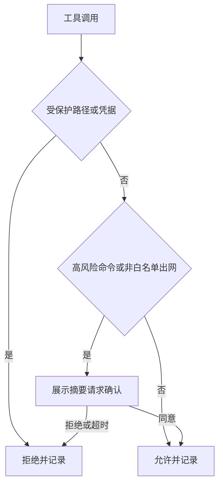

# 策略与审计详细设计

## 文档信息

| 项 | 内容 |
|---|---|
| 文档编号 | CORP-DSH-DESIGN-003 |
| 文档名称 | 策略与审计详细设计 |
| 版本 | V0.16.0 |
| 文档状态 | 草案 |
| 密级 | — |
| 编制 | DSH 平台组（代拟） |
| 审核 | 待定 |
| 批准 | 待定 |
| 最后更新 | 2026-11-16 |
| 门禁 | G2 |
| 模块状态 | 可用（门禁骨架；实现与验证见设计索引 §2.2） |

> 编制依据：2026-10-20 对目标环境已安装 DSH 包做字符串级核验：`dsh-sandbox`、`dsh-sandbox-local`、`dsh-sandbox-policy`、`dsh-fs-sandbox`、`dsh-fs-observation-policy`、`dsh-bash-sandbox`、`dsh-pwsh-sandbox`、`dsh-sandbox-windows-acl`、`dsh-permission-presets`、`dsh-client-ui-permission-presets`、`dsh-client-ui-approval`、`dsh-tool-ask-user`、`dsh-tool-call-timeout-policy`、`dsh-spill-policy`。
> **2026-10-24 宿主接口契约核验**（目标环境 DSH `0.2.1-rc.2`，macOS arm64；读取 live Host 的 Service/Event 契约，**不是行为实验**）：
> - 工具派发管线为 `tools/pre-execute`（waterfall：放行/拒绝/取消/请求确认）→ `ctx.tools.guard`（同步、monotonic 拒绝，返回字符串即拒绝）→ `tools/execute`（around-dispatch）→ `tools/post-execute`（waterfall）→ 定义方 finalization → `tools/result`（**emit，仅观察**）。`guard` 位于 pre-execute 之后，且**任何 guard 不能强制放行另一 guard 的拒绝**。
> - `ctx.tools.restrict({ allow, deny })` 对空过滤器、未知名、scope 局部名、保留传输名直接失败；限制取交集，scope 内注册仍可见。
> - 人工 command 由独立服务 `ctx.commands`（`register` / `execute`）派发，**不经过 tools 管线**，须显式接线才能纳入同一门禁。
> - 审批由 `ctx.approval`（`setPolicy` / `request`）与 `approval/request`（waterfall）承担；子 Agent 深度由 `ctx.subagents.resolveMaxDepth` 约束。
> **2026-10-24 宿主行为实验（探针 9/9 通过）**：在目标环境用 `dsh --profile sdk` 叠加临时 patch 挂载探针插件，插件在真实进程内经 `ctx.tools` 派发调用。断言：guard 拒绝时工具体零调用且结果为错误、先注册的宽松 guard 不能放行后续拒绝、`tools/pre-execute` 的异步放行与拒绝决策均被采纳、`ask` 在无 agent 时降级为拒绝、`tools/result` 观察者抛错不影响结果与已发生副作用、卸载后工具不可见且再调用报 unknown tool、命令面由独立服务派发而工具管线 guard 未见到该次调用、`approval` 策略 `never` 返回 `rejected`。复跑：`node scripts/probe/run-host-probe.mjs`（无 `dsh` 时跳过，不伪装通过）。
> **2026-10-24 委派继承实验（探针 32/32 通过、1 blocked）**：在目标环境用宿主自己的 agent 工厂按 `parentAgent` + `origin=subagent` + `delegationDepth=1` 创建子 agent，并用**子作用域自己的工具管线**派发调用。实测三件事：① **作用域 guard 会约束子 Agent**——父作用域注册的 guard 在子作用域派发全局工具 `bash` 时照常拒绝（返回 guard 理由，工具体零调用）；② **父 agent 视图上的 `ctx.tools.restrict` 不继承**——父视图把 `bash` 拒绝掉后，子 agent 视图里 `bash` 仍然可见；③ 作用域内 `register` 的工具不进子 agent 视图（子作用域派发报 `unknown tool`），子作用域注册也不上浮到父视图，`dispose` 后限制与子注册都恢复。另实测委派服务路径：`subagents.startActivation({provider:'fork',…})` 接受并按 provider 建出子会话（`listChildren` 可见、`childId` 回填），子轮次因本 profile **无 LLM 提供方**以 `stopReason: error` 收束；`currentInitiator()` 只在显式边界内可读（边界外 `undefined`、`withInitiator` 内为父 agent id），宿主契约明确它只是进程内因果归属，既非存活证明也非授权。
> **2026-10-24 候选平台只读事实（Ubuntu 24.04.5 / Linux aarch64，未做沙箱实验）**：`bwrap` 0.9.0 可用；Landlock 在活跃 LSM 列表中，`landlock_create_ruleset(NULL, 0, LANDLOCK_CREATE_RULESET_VERSION)` 返回 ABI **8**；glibc 2.39；`node-pty` 未安装（`MODULE_NOT_FOUND`，不能据此判断 ABI 或不兼容）。这只说明 Linux aarch64 上存在可用的沙箱原语，未验证具体规则能否满足产品需求，也不改变"策略与沙箱叠加顺序仍未实验"的结论。
> **仍未实验**：审批 UI 的注册方式与超时语义、`$DSH_HOME` 的确切范围。有模型提供方的环境里“模型自决调用”与策略×沙箱叠加顺序已于 2026-10-24 实测（见 §9.2.2/§9.2.3）。
> **仍未核验**：审批 UI 的注册方式与超时语义、`$DSH_HOME` 的确切范围。
> **2026-11-16 判定模型调整（项目负责人确认）**：内网 UAT 观测到活动 profile 未覆盖本插件、生效目录来自三份 bundle 补丁层折叠、只有六条只读动作、六个写动作全部 `deny / unregistered-action`；同日源码核验 `packages/forge-policy/src/catalog.mjs:66,68`、`installer.mjs:223-226`、`approvals.mjs:142`、`gate.mjs:65-88`。项目负责人逐项确认：写动作按类别给默认决策；`gitee.git.push` 逐次确认，其余写叠加内容与流程规则；组织策略以包内 `policy/` 数据目录的签名信封随包下发、不设有效期（2026-11-16 后复核：签发权与发版权同在平台组，节奏季度级，不单独成包）；写动作要求 IAM 身份；内容规则不超过 30 条正则且不做语义分析；流程事实源不可用时不阻断动作；企业分发随包内置首版签名信封。
>
> 关联文档：[总体架构 §7.2](../../architecture/platform-architecture.md)、[需求基线](../../requirements/requirements-baseline.md)、[策略判定模型设计](../policy-model.md)、[设计索引](../README.md)。

## 1. 结论

本模块是企业侧的最后一道闸：在工具真正执行前判断"该不该做"，在数据离开本机前判断"能不能发"。

边界：它不实现沙箱（复用 DSH 沙箱），不实现审批界面（复用审批 UI），只决定策略与记录结果。安全依赖缺失时**关闭而非放行**。

门禁骨架已实现；审批 UI 的注册与超时语义仍待核验。宿主钩子、子 Agent 继承语义以及策略×沙箱叠加顺序的历史探针见 §9.2.2/§9.2.3 与编制依据。

**判定模型（2026-11-16）**：动作开关只有一个比特，无法区分"写进去的是什么"与"在流程的哪一步写"。按[策略判定模型设计](../policy-model.md)，判定改为动作分类、内容规则、流程规则、身份与证据五轴：写动作按类别给默认决策，`gitee.git.push` 逐次确认。本文 §5.1 只承载引擎侧的接口、目录与策略级批准；规则语义、默认值与内容/流程规则清单不在本文复制。

**IAM隔离消费进展**：独立许可/私有operation算法B已通过62新例及210项policy全包回归，独立peer与arguments身份变异已关闭。普通apply未注入该算法；C合成工具/命令的共享installer、发送体与owned finalizer已通过31新例/241项policy回归及独立审阅/变异。D合成模型入口已通过29新例/270项policy回归，包含最终错误桥修复及独立审阅/桥接增量复核；E根16项已验证实际IAM工厂与mock IdP的联合执行，独立审阅与本批完整检查已通过。B/C/D局部fixture本身不是联合证据，E仍不证明生产授权；普通apply不启用合成模型。会话见证、许可字段与整体边界见[IAM-003](<../../contracts/iam-consumer-isolated.md>)和[PLAN-007](<../../plans/2026-11-02-iam-consumer-isolated.md>)。

## 2. 目标与非目标

**目标**

- 对文件访问、命令执行、网络外发三类动作做统一判断，结论只有允许、需确认、拒绝；写类动作再叠加内容与流程规则。
- 受保护路径（凭据、配置、会话记录）默认拒绝，且不因用户确认而放行。
- 外发前给出可读的"将要发出什么"，用户明确同意后才执行。
- 所有判断写审计，含结论与依据，不含正文。

**非目标**

- 不做沙箱隔离本身，不替换 DSH 的 fs 与 bash 沙箱。
- 不做企业权限判定，角色来自 IAM。
- 不做语义分析、数据分类分级或 DLP；内容规则是有上限的正则集合，不宣称覆盖全部变体。

## 3. 需求与依赖

| 需求/验收 | 关系 | 说明 |
|---|---|---|
| REQ 数据边界 C1–C4 | 支撑 | 模型上下文不含凭据，外发需确认 |
| REQ 审计可否回放 | 支撑 | 判断结论与依据可追溯 |
| 验收 A7 门禁 | 支撑 | 受保护路径零放行 |

| 依赖 | 类型 | 版本约束 | 缺失时的行为 |
|---|---|---|---|
| 沙箱策略包 | 包 | 随目标 DSH | 不启动策略模块，工具面整体禁用 |
| 审批 UI | 包 | 随目标 DSH | 需确认的动作直接拒绝 |
| 审计落点 | 配置 | 本地文件或转发 | 写失败即拒绝高风险动作 |

## 4. 扩展形态与边界

| 项 | 内容 |
|---|---|
| 形态 | Host 插件；确认识别用既有审批 UI，不自建对话框 |
| 运行位置 | 本机 Host |
| 目标 DSH 与 SDK | 随目标版本，钩子以实测为准 |
| 使用的 seam 或服务 | 工具调用拦截、沙箱策略、审批交互、会话事件 |
| 不修改的核心 | 沙箱实现、工具实现、模型调用链 |

取舍：策略判断与沙箱隔离分开。沙箱负责"做不到"，策略负责"不该做"，两者叠加取最严。

## 5. 接口与配置

| 配置项 | 类型 | 默认值 | 必填 | 说明 |
|---|---|---|---|---|
| `policy.audit.sink` | `none` \| `memory` | `none` | 是 | 必要审计落点；`memory` 为非持久开发落点，需 `allowNonDurable`；未配置即关闭受门禁动作 |
| `policy.audit.timeoutMs` | number | 2000 | 是 | 前置/补记写入超时；超时按不可写处理 |
| `policy.protectedPaths` | string[] | `$DSH_HOME/**`（`$DSH_HOME` 缺席时回落 `~/.dsh`） | 是 | 硬拒绝，不可通过确认放行；模板未解析即拒绝挂载 |
| `policy.observation.export.enabled` | boolean | `false` | 否 | 过程观察导出开关；**默认关闭**，启用但缺少宿主发送方（`observationSink`）或未登记枚举时停在 `no-provider` / `unregistered-enums`，一次也不发 |
| `policy.observation.export.idempotentProvider` | boolean | `false` | 否 | 摄取方是否保证按 `event_id` 幂等；**true 才允许**响应未知时有限重送 |
| `policy.observation.enums` | object | 空 | 启用导出时必填 | 已登记枚举（`status`/`action` 至少各一项）；本仓库不发明枚举取值 |
| `policy.audit.requireDurable` | boolean | `false` | 否 | 是否要求持久审计落点；组织策略可强制为 `true`，本机不能改回 `false` |

现行装配不读取 `confirmPaths`、全局 `egress`、`egressAllowlist`、`commandPatterns` 或 `auditSink` 这些旧配置键；配置它们不能建立相应保护。外发规则由动作类别与内容规则判定，不再由目录的 `egress` 字段单独决定。当前 `audit.sink` 仅支持 `none` 和非持久 `memory`，生产持久落点尚待设计与验证。

内容规则、动作上限与流程规则开关不来自本文件配置：内置集随包编译，组织层来自包内 `policy/` 数据目录的签名信封（§5.1.4），本机层只能收紧，不能放宽。

策略不可用（未挂载、加载失败、必要依赖缺失）时，依赖该策略的入口关闭；**不提供 fail-open 开关**，也不以"显式声明只读模式"作为降级通道。流程事实源（dop 变更状态、计划状态等）不可用不属于此列：它跳过相关流程规则、记录 `unevaluated` 并继续执行，见[判定模型 §7](../policy-model.md)。

```ts title="导出面（钩子名已按 2026-10-24 live Host 契约核验）"
export interface PolicyDecision {
  action: 'allow' | 'confirm' | 'deny';
  reason: string;
  rule: string;
}
export interface PolicyEngine {
  check(input: { kind: 'fs' | 'bash' | 'egress'; target: string; meta?: unknown }): Promise<PolicyDecision>;
}
```

宿主接线：`ctx.tools.guard()` 承载硬拒绝（**必须挂在作用域上**：guard 会约束该作用域下的子 Agent，而 agent 视图级的 `restrict` 不会传播给子 Agent，见编制依据 2026-10-24 实测）（受保护路径与凭据，返回拒绝理由即阻断，且任何 guard 不能放行另一 guard 的拒绝）；`ctx.on('tools/pre-execute')` 承载需确认动作（返回 `{ kind: 'ask', reason }`，由 `ctx.approval` 决定，无 agent 或通道不可用时降级为拒绝）；`ctx.on('tools/result')` 只做观察投影，不参与判定；命令面不经工具管线，须显式接线（见 #21）。插件以 `inject: ['tools']` 声明对工具服务的硬依赖，依赖缺失即不挂载。

### 5.1 受控动作目录与统一门禁

动作目录由策略维护者登记，不从工具自报的读写属性推导；对已映射到策略或显式调用门禁的动作，**未登记或未开放即拒绝**。未映射的普通宿主工具处于该策略范围之外，空目录本身不使它们自动受控。

| 登记字段 | 说明 |
|---|---|
| `action` | 业务动作标识，与[工程工具契约 §3](../../contracts/engineering-tools.md) 的动作标识同源，不另立命名 |
| `kind` | `read` \| `write` \| `confirm`，决定开关与确认要求 |
| `target` | 执行时必须按时给出的目标类型；缺失或错配一律拒绝 |
| `egress` | 动作的出网判定；未设置时编译为 `confirm` |
| `retry` | 缺省时读动作为 `read_recheck`，其他动作为 `none`；写不自动重放 |
| `enabled` | 显式开放标记；只读、普通研发写、人工确认动作分别开关 |

**判定顺序**：`tools/pre-execute` 复验组织批准（动作 + 实际资源 + 版本范围 + 当前时间）→ await 必要确认与前置审计 → `ctx.tools.guard()` 核验绑定收据、用新时间重验批准并单调硬拒绝 → 执行 → `tools/post-execute` await 结清 → `tools/result` 同步登记兜底观察。最后一步不是 awaited 决策；后续动作的 prepare/guard 另保证 pending 结清前不能继续。作用域内未知动作、未开放写、缺目标、批准不覆盖本次执行，以及工具自报 `readOnly` 的越权企图必须零执行。

| 执行路径 | 覆盖方式 |
|---|---|
| 业务工具（含 scoped 注册） | 已映射的工具进入统一动作判定；未映射的普通宿主工具为 `out-of-scope`，不能仅凭 guard 已安装就声称全部受控 |
| 人工 command | command 由独立服务派发、**不经工具管线**（探针证据），必须显式接线：未登记的 command 默认拒绝，登记 command 内的动作仍走同一 `action` 判定 |
| 子 Agent | 实测（2026-10-24）：**作用域 guard 会继承**——父作用域 guard 在子作用域派发时照常拒绝且工具体零调用；**父 agent 视图的 `restrict` 不继承**，子视图仍看得见被父视图拒绝的工具；作用域内注册的工具不进子视图。因此约束必须落在**作用域 guard**（会继承）上，不能只靠父视图 `restrict`；有模型提供方的环境里“模型自决调用”**已于 2026-10-24 实测不绕开门禁**（含经 `subagent` 的委托路径，见 §9.2.2/§9.3）；未获批准的动作仍一律关闭，不允许以委派绕过门禁 |
| bash/pwsh、脚本、通用 HTTP、`run_code` | 目标是明确映射后按类别受控；当前未映射的宿主工具不由本门禁自动覆盖。实际映射与执行约束须分别验证，不向任意解释器注入业务凭据 |

**失败与卸载**：业务工具插件对策略服务声明硬依赖；策略未挂载、被卸载或版本不符时工具插件不挂载，入口关闭且无可调用残留（卸载清理已由宿主探针验证）。不提供 fail-open、通用 `run(command)` 或正则黑名单式安全保证。

**结果语义**：[工程工具契约 §4.2](../../contracts/engineering-tools.md) 为唯一真源；最小要求是区分未执行拒绝、可能执行与 `partial`/`unknown`，保留 `operation_id`，重试默认 `none` 或 `read_recheck`，每个具体写仍须提供自身平台的回查证据。

#### 5.1.1 动作分类与默认决策（2026-11-16 调整）

写动作不再逐条登记为"待批准白名单"。判定按动作类别给出默认决策，再叠加内容与流程规则；规则语义见[判定模型 §5](../policy-model.md)。动作标识与[工程工具契约 §3.1](../../contracts/engineering-tools.md) 的实现映射同源，不另立命名；旧文档中的 `issue.create_or_update`、`pr.create_or_update`、`review.ai.publish`、`review.human.record`、`branch.create`、`commit.record`、`issue.close` 不是运行期标识，按旧名登记不会生效。

| 动作 | 类别 | 默认决策 | 确认方式 |
|---|---|---|---|
| `change.read`、`change.list` | 只读 | allow | 无 |
| `gitee.repository.read`、`gitee.issue.read`、`gitee.pr.read`、`gitee.delivery.judge` | 只读 | allow | 无 |
| `gitee.issue.write` | 研发写 | allow | 范围票据 |
| `gitee.pr.write` | 研发写 | allow | 范围票据 |
| `gitee.review.publish` | 评审写 | allow | 范围票据；正文须标注 AI 来源与 PR 版本（HARD） |
| `change.clarification.write` | 研发写 | allow | 范围票据 |
| `gitee.git.push` | 远端写 | confirm | 逐次确认 |
| `gitee.review.record` | 人工评审留痕 | deny | Agent 不可发起；宿主在人工确认后写入并记录 IAM subject |
| `git commit` | 本地动作 | 出闸 | 无；首行 `[变更号]` 由 `git-message.mjs` 校验 |

登记语义：

- **未登记即拒绝**：目录中没有的动作在 guard 处硬拒绝、零副作用（`unregistered-action`）；`deny` 类动作（`gitee.review.record`）即使登记也拒绝，理由是动作语义不允许 Agent 发起。
- **默认决策不是批准**：`allow` 只表示"不因动作名本身拒绝"，内容与流程规则仍逐次判定；HARD 命中不可被确认提升。
- **内容与流程规则不在本文复制**：内置规则集、阈值与降级语义见[判定模型 §6、§7](../policy-model.md)；分级阈值与误报只能在真实仓库上评估后冻结。
- **旧断言待改写**：`packages/forge-policy/test/write-register.test.mjs` 当前把 2026-10-24 的旧登记表钉成断言，代表旧模型；P0 实现时改写为默认决策与内容闸断言，改写前该测试不构成本设计的证据。

#### 5.1.2 策略级批准

批准对象是**这版策略**，不是单个动作。逐动作批准没有信息量：批准 `gitee.issue.write` 等于允许写任何正文，真正决定风险的是内容规则集与流程规则集。

| 字段 | 含义 | 约束 |
|---|---|---|
| `policy_version` | 被批准的策略版本 | 单调递增；与信封的 `policy_version` 一致 |
| `rules_digest` | 规范化信封的 SHA-256 | 执行期复算，不一致即拒绝 |
| `approved_by` | 签发人 | 取签发流程中的 IAM subject；本机不可手填 |
| `approved_at` | 签发时刻 | ISO 时间 |
| `scope` | 适用范围 | 托管 / 个人；由签名信封（`policy/`）验签状态决定 |

不设 `expires_at`：组织策略随包更新而更新，过期机制只会让"忘记续期"变成全量停摆（项目负责人 2026-11-16 决定）。策略失效通过替换包完成，而不是等台账过期。

本机层没有"批准"语义：它只能收紧，不能放宽（[判定模型 §10](../policy-model.md)）；把组织判为 `confirm` 的动作改成 `allow` 的尝试在加载时被拒绝并记录 `policy_widening_rejected`。

执行期复验：每次执行复验身份仍在、策略未被替换、`rules_digest` 匹配、受保护路径未命中；任一不满足即拒绝且执行体零调用。受保护路径检查仍先于批准判断，不可翻转。

**机制边界**：策略签名证明"内容来自组织签发机且未被改动"，不证明规则正确，也不代替 IAM 与平台服务端权限。托管模式下签名缺失或验签失败只降级写动作，只读与本地研发不受影响。

**证据现状**：`packages/forge-policy/test/approvals.test.mjs` 与 `approval-execution.test.mjs` 覆盖的是逐动作台账模型（挂载期校验、执行期复验）；P1 实现策略级批准时按新字段重写，重写前这些用例不构成对本文的验证。

#### 5.1.3 策略签发与登记（2026-11-16）

组织策略的签发在仓库之外完成：受控签发机用 ed25519 私钥对规范化信封签名，产出本包 `policy/` 目录下的三个文件（§5.1.4）。**平台不代填 `approved_by`，也不把"评审会开过了"当作签发。**

| 项 | 内容 |
|---|---|
| 签发内容 | 动作上限、内容规则、流程规则开关、`require_durable_audit` |
| 验签 | 装载期一次；失败即 `invalid`，只降级写动作 |
| 更新 | 替换 `policy/` 与 `keys/` 内文件，随补丁版本发版；`policy_version` 单调递增，回滚需显式确认 |
| 登记 | 信封的 `policy_version` 与摘要进入每条判定审计 |

逐动作送审表作为历史记录保留在 Git 中，不再是登记载体；动作分类的变化通过策略版本表达。文档里残留的旧业务名从未成为运行期标识，照它们登记不会放行任何调用。

#### 5.1.4 组织策略数据目录（2026-11-16）

组织策略是数据而不是代码：动作上限、附加内容规则与流程规则开关随包内置在 `policy/` 目录，用户不可编辑。

| 路径 | 内容 |
|---|---|
| `policy/org-policy.json` | 签名信封（上限、内容规则、流程规则） |
| `policy/org-policy.sig` | 对规范化信封的 ed25519 签名（base64） |
| `keys/org-policy.pub` | 组织公钥（PEM，编进包） |

```json
{
  "schema": "heluo.policy.org.v1",
  "policy_version": "2026.11.1",
  "issued_at": "2026-11-16T00:00:00Z",
  "caps": { "gitee.git.push": "confirm", "gitee.review.publish": "allow" },
  "content_rules": [
    { "id": "ORG-AK-001", "pattern": "<正则>", "severity": "hard", "paths": ["**"] }
  ],
  "process_rules": { "pr_requires_acceptance_section": "hard", "require_durable_audit": false }
}
```

签名对象是信封的规范化序列化：对象键按字典序、UTF-8、无多余空白、数组顺序保持。验签方重新序列化后比对，不做字段级挑选——信封里任何字段被改动都会导致验签失败；`schema` 不在已知集合内按验签失败处理，不做向上兼容猜测。

装载由 `src/org-policy.mjs` 在 `apply` 阶段完成一次读取与验签，三态在 `installPolicy` 内一次确定，不暴露跨包服务、不做后台轮询与热更新。引擎按状态决定模式（身份矩阵见[判定模型 §8](../policy-model.md)）：`verified` 进入托管模式；`absent` 是"没有签名信封"的个人模式，不是失败；`invalid` 只降级写动作并记 `org_policy_invalid`，只读与本地研发照常。

**内置而非独立数据包**：签发由平台组自己完成、节奏为季度级或更慢（项目负责人 2026-11-16 决定），独立包"规则更新不触碰引擎"的收益小于它新增的生命周期成本——多一份清单与设计文档、多一处装配顺序、多一条分发说明；而 `@heluo/forge-policy` 被四个业务包以 `workspace:` 依赖，补丁层还要为数据包多编排一行。拆包条件因此不是"职责不同"，而是"规则签发权与平台发版权分离"：若将来由组织安全口独立签发，把 `policy/` 与 `keys/` 移出成数据包即可，成本是移动三个文件加一次 loader 编排。

**不设有效期**：策略随包更新，旧信封不因时间到期而失效；`policy_version` 单调递增，回滚是合法运维动作但需显式确认。私钥不进仓库、不进 CI、不进交付物；公钥缺失按 `missing-key` 验签失败处理。轮换时新公钥随新版本分发，旧版本继续用旧公钥验签，不建在线吊销。

**移除后果**：删除 `policy/` 数据目录等同 `absent`——写动作按身份域回落（无 IAM 身份只读；有 IAM 身份按内置默认并过内容闸），只读不受影响。分发说明必须写明这一点，不能把"删掉策略文件"当作"临时放宽"的安全做法。

**企业分发内置首版信封**（项目负责人 2026-11-16 决定）：企业组合包预置一份已签名的 `policy/` 数据目录，装机即进入托管模式，不需要用户事后签名。

| 字段 | 首版内容 | 说明 |
|---|---|---|
| `policy_version` | `2026.11.1` | 审计里可回溯的规则版本锚点 |
| `caps` | 空 | 上限沿用内置默认（六个只读 `allow`、四个写 `allow`、`gitee.git.push` 为 `confirm`、`gitee.review.record` 为 `deny`），首版不额外加严 |
| `content_rules` | 空 | 使用内置 HARD/SOFT 集；组织规则待内网实测后再追加，避免把未验证的正则当作组织要求 |
| `process_rules` | `pr_requires_acceptance_section: soft` | 变更号、保护分支与 force push 由内置集恒为 HARD |

首版信封的作用是**把机器纳入托管模式并给审计一个版本锚点**，不是追加限制；后续版本按实测逐步收紧。装机包内只有信封、签名与公钥，私钥留在签发机。

### 5.2 受保护路径、别名归一与沙箱取严

受保护根按模板解析，默认 `$DSH_HOME/**`。实测（DSH 0.2.1-rc.2 / darwin-arm64）：宿主进程环境里有 `DSH_HOME` 与 `DSH_PROFILE_DIR`，没有 `DSH_AGENTS_HOME`；宿主自有的 `@deepseek-ai/dsh-home-paths` 在插件内**不可导入**，因此本插件只用环境变量契约，并在 `$DSH_HOME` 缺席时回落到宿主默认的 `~/.dsh`（该默认值来自宿主包内说明，不作为独立真源）。凭据按宿主契约位于 `$DSH_HOME/.env`，用户级指令链位于 `$DSH_HOME/AGENTS.md`。

| 规则 | 要求 |
|---|---|
| 模板解析 | 未解析的变量（如未设置的 `$DSH_AGENTS_HOME`）**拒绝挂载**，不静默少保护一个根 |
| 归一顺序 | 绝对化 → **逐段物理解析**：每个组件先 `realpath`，遇到 `..` 时回退的是已解析路径的父目录（含最深已存在祖先，覆盖尚未创建的目标）→ 平台大小写归一（darwin/win32 不敏感）。不能先做词法折叠再 `realpath`：`/root/link/../x` 在 `link` 指向根内时，词法折叠会得到根外的 `/root/x`，而系统调用按物理语义落到根内的 `/root/<link 目标父目录>/x`（2026-10-24 独立审查发现，已按物理语义修正并加回归用例） |
| 不可判定 | 非绝对路径、`ELOOP`、权限不足、路径参数缺失一律拒绝，不按放行处理 |
| 别名 | 相对穿越、symlink（含 Windows junction/reparse point）经同一归一化落到根内即拒绝；无法判定的按拒绝 |
| 硬拒绝优先 | 路径检查在确认阶段之前且不可翻转：即使该动作为 `confirm` 且已获批准，命中受保护路径仍然拒绝 |
| 未配置根 | 声明了路径参数的动作在没有任何受保护根时**关闭**（理由写明未配置），不降级为放行 |
| 与沙箱取严 | 沙箱与策略结论不一致取更严；沙箱或策略缺失、被禁用时，依赖路径保护的动作关闭并记录阻塞，不降级 |
| 不保证的终端 | 宿主无法给出可核验路径的调用（例如不透明远程执行）标阻塞，不放行 |

### 5.3 C3 外发确认

外发确认绑定一次具体的动作、目标与内容摘要，且只展示"将要发出什么"的范围，不展示正文与凭据值。

| 规则 | 要求 |
|---|---|
| 绑定 | 确认覆盖 `(action, target, contentDigest)`；任一变化即失效，必须重新确认 |
| 展示 | 动作、目标、内容字段名与摘要前缀；确认文本与错误回显都不得出现凭据值（金丝雀检查） |
| 拒绝 | 取消、过期、超时、通道不可用、无 UI、策略 `never` 全部按拒绝处理，不伪造同意 |
| 白名单 | 允许出网的主机只说明"可去"，不等于该次写已获授权；写仍逐动作判定 |
| 回退 | 内容摘要变化或目标变化后旧确认不可复用；重试沿用 §5.1 的 `retry` 语义 |

### 5.4 有限委托与可信确认生命周期

入口由用户明确触发并给出变更号；宿主可校验的上下文把委托绑定到**当前用户、变更、仓库、已开放动作与版本**。委托与确认的"可信"来自宿主给出的事实，不来自模型参数或正文。

| 规则 | 要求 |
|---|---|
| 委托来源 | 委托只能由宿主侧事实创建（`source = host`）；模型自填的 `approved`、`principal`、`readOnly`、`review_kind`、聊天内容或摘要一律不能创建委托 |
| 绑定范围 | 错人、错变更、错仓库、未开放或未登记动作一律拒绝；动作集只减不增 |
| 版本 | 内容、要求与 PR 版本变化后旧确认失效；**不以"执行前重读一次"冒充条件写** |
| 确认生命周期 | 确认绑定 `(action, target, contentDigest)` 与版本，一次性消费；取消、过期、版本漂移、已消费、来源不可信都按拒绝 |
| 恢复与分叉 | 宿主重启、会话分叉或子 Agent 重新验证身份与范围，最多维持同等或更小范围；临时表或聊天记录不能恢复写授权，依据不足时重新承接（重新委托） |
| C3 与人工确认 | C3 动作分类批准前自动研发写不生效；`approval = never`、answerer 缺失或异常都不产生同意；`allowed-once` 不等于真实人工 review |
| 不可证明即关闭 | 宿主无法证明某类确认时，相关动作确实不可调用（拒绝并给出缺口理由），不以提示词替代 |

**恢复/分叉/子 Agent 承接（#23 AC3，`resumeDelegation()`，2026-10-24）**：与 `authorizeDelegation` 一样只返回判定对象、从不抛错，任何无法复验的情况都按拒绝处理。

| 情况 | 判定 |
|---|---|
| 无委托 / 非宿主来源 / 已撤销 / 已过期 | `delegation-missing` / `delegation-untrusted-source` / `delegation-revoked` / `delegation-expired` |
| 快照来源是聊天、摘要、临时表或模型 | `delegation-resume-untrusted-source`（**不能恢复写授权**） |
| 未给当前身份、变更，或身份/变更与委托不符 | `delegation-resume-unverifiable` / `-principal-changed` / `-change-mismatch` |
| 仓库越界、版本漂移、版本项不属于委托 | `delegation-resume-repository-out-of-scope` / `-revision-drift` / `delegation-resume-unverifiable` |
| 子 Agent 承但没有宿主背书的 agent 身份 | `delegation-resume-unverifiable`（必须重新承接） |
| 请求动作集超出原委托 | `delegation-resume-scope-widened`（**只减不增**） |
| 复验通过 | `delegation-resumed`，返回收窄后的委托：范围＝请求子集，`expiresAt` **只继承不延长**，并记录 `resumeKind`/`forkedFrom`/`delegatedTo` |
| 缺少可复验依据 | `delegation-resume-unverifiable` → 调用方必须重新承接（重新委托），不得沿用旧快照 |

**实测（2026-10-24）**：

| 证据 | 结果 |
|---|---|
| 离线用例 `packages/forge-policy/test/delegation.test.mjs`（新增 6 项） | 身份/变更/仓库/版本漂移逐项拒绝；聊天/摘要/临时表/模型快照一律拒绝；范围放宽被拒、收窄返回 `scopeReduced` 且到期时间不变；收窄后的委托经 `authorizeDelegation` 仍按收窄范围执行（被移除的动作 `delegation-action-out-of-scope`）；fork/subagent 记录宿主背书来源，子 Agent 缺 agent 身份即拒绝；撤销/过期/退化输入全部 fail closed |
| 宿主探针 `delegation-resume-needs-host-facts`（`dsh 0.2.1-rc.2`，profile `sdk`） | 探针进程本身是"重启后的新会话"：内存无上次委托 → 写请求 `delegation-missing`；`source: 'chat'` 建委托被拒 `POLICY_DELEGATION_UNTRUSTED_SOURCE`；临时表快照承接被拒 `delegation-resume-untrusted-source`；宿主背书承接可放行且收窄生效；放宽为 `delegation-resume-scope-widened` |

覆盖率：`delegation.mjs` 行 100% / 分支 96.30% / 函数 100%。

### 5.5 必要审计前置与执行后缺口

必要审计是"执行的前提"，不是事后的旁路日志。**未配置可用审计落点时，所有受门禁约束的动作（含只读与 command）一律拒绝**；这是本设计的默认值，不做降级放行。

| 规则 | 要求 |
|---|---|
| 前置 | 只有判定为可执行的动作才写前置记录；记录不可写、落点缺失、`durable` 未声明或超时 → 拒绝且**零执行**；只读不豁免 |
| 记录最小化 | 只记独立允许字段（动作、目标、工具、判定、规则、`operation_id`、版本、时间、耗时）；凭据、业务正文、参数值、`stdout`/`stderr` 一律不入记录；出现禁用字段直接报错 |
| 执行后缺口 | 工具体已执行或可能已执行后补记失败：**保留执行结果与正式引用/unknown**，登记缺口并把后续动作限制为拒绝，直到责任方显式确认缺口；不得因此报告"未执行" |
| 观察与可选指标 | `tools/result` 观察监听器异常不影响前置必要审计；可选指标或日志失败只记缺口，不阻塞研发 |
| 恢复 | 不自动重放写；不声称本地审计与远端平台之间有跨系统事务 |
| 企业落点 | 企业审计落点未获准前，相关企业调用保持关闭（记录为阻塞，不临时改用本机文件充数） |

宿主接线：`tools/pre-execute` await 前置审计并保存绑定同一执行对象、调用身份与参数摘要的私有收据；`tools.guard` 同步核验并消费一次，故较早 listener 返回 `allow` 也不能绕过必要审计。`tools/post-execute` 的 `(exec, result, next)` waterfall await 结清；它可能被其他 listener 短路，所以 `tools/result` 的同步观察回调另登记异步兜底结清。**emit 本身不是 awaited 屏障**：pending 在 observer 返回前登记，下一受控动作的 prepare 必须等待，guard 同时拒绝 pending 窗口；双路径按同一收据幂等结清。

`policy.registerCommand` 不借用工具事件，而直接调用同一准备、路径、确认、审计及结清屏障。简单命令要求明确业务目标；结构化或带路径的命令提供可信 `resolveArguments(invocation)`，规范化参数作为处理函数第二参数。空输入不得以命令名充当目标。审批仍复用原生服务，真实命令确认通道与其 open-turn 前提未联调时保持关闭。

卸载或取消发生在审批、audit begin、下游 pre listener 的等待期间时，异步返回后须再次拒绝，不能依赖已被卸载的 guard。已获准而结果未明的调用在卸载时记录 `unknown` 缺口，不声称未执行或自动重放。参数摘要仅留私有内存，不写入最小审计记录。

## 6. 权限、凭据与数据

| 项 | 处理方式 | 生命周期 | 失败时 |
|---|---|---|---|
| 策略文件 | 本地只读加载，变更需重启或显式重载 | 随配置 | 解析失败即 fail-closed |
| 审计记录 | 追加最小字段，不含正文与令牌 | 本包未配置时无落点；发行补丁显式配置内存落点，随进程结束丢失；90 天为待验证目标 | 无可用落点或必要审计写失败即关闭需该保障的动作（含只读查询与 command），不按"高风险动作"打折 |
| 用户确认 | 仅存结论与摘要，不存全文 | 会话 | 超时视为拒绝 |
| 凭据 | 不读取、不转发、不记录 | — | 命中即拒绝 |

## 7. 流程



**并发**：判断无共享可变状态，可并发；审计写入串行，避免交错。

**超时**：确认等待默认 120 秒，超时按拒绝处理；判断本身 1 秒内完成，超时即拒绝。

**取消**：用户取消工具调用时不写"已执行"审计，只写"已取消"。

## 8. 失败模式

| 场景 | 行为 | 用户可见结果 | 是否可重试 |
|---|---|---|---|
| 策略文件缺失或损坏 | 全部拒绝 | 明确报错并指向配置 | 修复后重试 |
| 审计不可写（必要审计） | 拒绝一切需要该保障的动作，含只读查询与 command | 提示审计不可用 | 恢复后重试 |
| 本机日志或可选指标不可用 | 记录缺口，不阻塞研发，不放宽必要审计 | 显示缺口计数 | 恢复后自动继续 |
| 确认界面不可用 | 视为拒绝 | 提示无法确认 | 可重试 |
| 沙箱与策略结论冲突 | 取更严的一方 | 说明冲突规则 | 否 |
| 钩子未触发（实测发现） | 记为阻断缺陷，不降级放行 | 工具面禁用 | 修复后恢复 |

## 9. 可观测性

下表的留存期限是目标，不是当前默认实现的保证；分发补丁使用非持久内存审计，持久落点及留存能力待验证。

| 事件 | 字段 | 去向 | 保留 |
|---|---|---|---|
| 判断完成 | 工具、目标摘要、结论、规则、耗时 | 审计 | 90 天 |
| 用户确认 | 结论、摘要哈希、等待时长 | 审计 | 90 天 |
| 拒绝 | 规则、目标类别 | 审计 | 90 天 |
| 策略加载 | 版本、条目数、加载结果 | 本机日志 | 30 天 |

目标摘要只保留类别与哈希，不回写完整路径或命令文本。

### 9.1 过程观察与受控写分类

过程观察采用[指标事件契约](../../contracts/metrics-events.md)的独立投影，复用既有 OTel 出口，由 DevOps 汇聚，不新建包或指标服务。指标投影可独立关闭/降级，不携带安全审计中的内容哈希；必要审计失败仍执行原拒绝规则，不能因指标可降级而放行。

### 9.2 投影与有界导出（#36，2026-10-24）

实现落在 `packages/forge-policy/src/observe.mjs`（同包内部模块，**不新建包、不建服务、不建磁盘队列**），规则以[指标事件契约](../../contracts/metrics-events.md)为准：

| 能力 | 实现要点 | 证据 |
|---|---|---|
| 允许清单校验 | 只接受契约 §3.2 列出的字段；未知字段、未知事件、未知 `schema_version`、未登记枚举、错误类型、整条超 8 KiB 一律**整条拒绝**，拒绝只给原因码、不回显载荷；纯十六进制摘要不能伪装成引用 | `observe.test.mjs` 的 AC1 七例（含 `prompt`/`code`/`diff`/`stdout`/`token` 逐个、含哈希与超限） |
| 幂等与折叠 | 重送保持 `event_id`；按 `operation_id` + `result_version` 折叠，修订不是第二次动作，乱序与重复不扩大分母；两类 review 动作 `access_kind` 相同但 `action` 保留区分 | AC2 三例（含正反两种输入顺序） |
| 有界缓冲 | 内存上限 1000 条 / 4 MiB / 24 小时 TTL，先到即按原因计数拒绝；重复 `event_id` 不重复入队；**不落盘** | AC3 容量/字节/TTL 例 + "源码不含 `node:fs`" 静态断言 |
| 有界导出 | 默认关闭；只移除被明确确认的项（部分确认保留其余）；401/403 停止且不换身份重试；429/5xx 按服务端提示或指数退避（封顶 5 分钟、带抖动），连续 5 次暂停；响应未知时只有提供方保证幂等才有限重送 | AC3 五例 |
| 不阻塞 | 导出失败只落到返回值与状态，不抛出；loss 事件被拒绝时只计数，不递归生成 | AC4 两例 |

#### 9.2.1 接线与假端故障用例（2026-10-24 实测）

导出已接进插件运行路径，并把"是否启用"做成配置（`policy.observation.export.enabled`，默认 `false`）；端点、认证资源、批量与响应格式仍属契约明确"不由本仓库发明"的部分，因此**发送方必须来自宿主已有服务** `observationSink`。三种状态都可见，不会静默丢事件：

| 状态 | 触发条件 | 行为 |
|---|---|---|
| `disabled` | 默认 | 不建缓冲、不查发送方、`exportOnce()` 返回 `DISABLED` |
| `no-provider` | 启用但宿主没有发送方 | 一次也不发，返回 `NO_PROVIDER` |
| `unregistered-enums` | 启用但 `status`/`action` 枚举未登记 | 停在可见状态返回 `UNREGISTERED_ENUMS`，而不是逐个事件静默拒绝 |

**假端故障用例**（`scripts/probe/observe-export-probe.mjs`，真实 HTTP、真实 socket、真实计时，21 条断言）已在两端跑通：

| 环境 | 结果 |
|---|---|
| 本机 darwin-arm64 / Node `v26.11.1` | 21/21 通过 |
| Ubuntu 24.04 Linux aarch64 / Node `v24.21.0`（离线包） | 21/21 通过 |

覆盖：默认关闭不发请求；部分确认只移除确认项、未确认项以**同一 `event_id`** 重送；含 `prompt` 的事件在本地被拒且**不上网**；401 停止后不再发请求；429 遵循服务端 `Retry-After`（窗口内不发，窗口后送达）；响应未知（挂住）→ 暂停并保留事件。

**未验**：真实企业摄取端（认证资源、去重权威、部分确认格式、限流策略）仍未实测；假端只能证明客户端行为，**不能替代 AC5**。真实 DSH 进程内也没有可用的 `observationSink` 服务，故尚未在 `dsh --profile` 运行中启用过导出。

#### 9.2.2 模型自决调用的门禁实测（2026-10-24 实测）

设计索引原记"有模型提供方时子 Agent 的模型自决调用能否绕开作用域 guard"未测。本机 oMLX 提供真实模型后已可实测：`scripts/probe/model-guard-probe.mjs` 让**真实模型会话自行决定**调用 `bash` 写一个标记文件，判据取会话记录（`session.v4.jsonl.zstd`）里的 `tool/call` 与 `tool/result` 两条事件，不依赖 stdout（CLI 只回最终答复）。

| 模式 | 目录状态 | 模型调用 | 判定归因 | 副作用 |
|---|---|---|---|---|
| `control` | 不挂策略（正向对照） | 2 次 | — | 标记文件写入 |
| `unregistered` | 动作不在目录 | 1 次 | `unregistered-action` | 无 |
| `disabled` | 已登记且 `enabled: false` | 1 次 | `action-disabled` | 无 |
| `target-missing` | 已登记启用，但调用未带 `target` | 1 次 | `target-required` | 无 |

结论：三个启用策略的模式均被拦下、副作用为零；未挂策略的 `control` 正向对照写入了标记文件，证明模型确实会调用该工具。该证据只覆盖探针中的映射与调用路径。

同时暴露一处实现缺口（对应 P01/#21）：目录判定只读调用参数里的 `target`（`gate.mjs` 的 `exec.arguments?.target`），而真实工具不提供该参数——`bash` 用 `command`、`fs` 用 `path`。于是真实工具一旦映射进受控目录就永远停在 `target-required`：**命令面统一门禁必须先定义按工具派生的目标来源**，否则只能登记、无法放行。

**委托路径（`delegate` 模式，同日实测）**：父模型自己调用 `subagent` 工具，把"跑 bash 写标记文件"交给**子 Agent**。会话记录显示 2 份会话（父 + 子）、父会话 1 次 `subagent` 调用、子会话 9 次 `bash` 调用，**每一次都被 `unregistered-action` 拦下**，零副作用；子 Agent 还试过 `/bin/bash -c`、改用相对文件名、`touch`、`ls` 等变体，无一漏过。因此**把动作委托给子 Agent 不能绕开门禁**。

**未验**：企业环境与双端实机。

#### 9.2.3 策略与沙箱的叠加顺序（2026-10-24 实测）

同一个模型自决调用同时受策略门禁与沙箱执行器约束时谁先判定，用 `scripts/probe/sandbox-order-probe.mjs` 实测（判据同样取会话记录的 `tool/call`/`tool/result`）：

| 模式 | 策略 | 目标位置 | 结果 | 归因 |
|---|---|---|---|---|
| `inside-root` | 不挂 | 工作区内 | 写入成功（2 次调用；首次因模型只给 `justification` 被工具自身拒绝） | — |
| `outside-home` | 不挂 | 工作区外（`$HOME`） | 未写入 | 沙箱：`Operation not permitted` + `[sandbox: file access denied under workspace-write mode]` |
| `policy-first` | 挂（动作已登记启用、调用无 `target`） | **工作区内**（沙箱本会允许） | 未写入 | 策略：`target-required`，无沙箱信号 |

结论：**策略门禁在沙箱执行器之前判定**——策略拒绝的归因是策略规则、不带沙箱信号，且目标即使位于沙箱允许的工作区内也不产生副作用；沙箱自身边界独立成立（越界写由操作系统级拒绝，与策略无关）。两者叠加为"先策略、后沙箱，任一拒绝即零副作用"。

**未验**：企业环境的沙箱实现差异（本机 darwin 为 seatbelt；其他平台按其运行时能力核验）。

**责任方决定（2026-10-24，2026-11-16 调整）**：写分类由"逐动作受控写白名单"改为动作分类 + 内容/流程规则 + 策略级批准（ADR-27）。旧白名单只能表达"能不能写"，而实际风险在写进去的内容与写发生的时机；逐动作台账在真实使用中还退化为全量放行。

有限委托内普通研发写的目标见[需求 §2.3](../../requirements/requirements-baseline.md)。内容闸不判定"谁可以写"，最终授权仍来自 IAM 与平台服务端权限，"缺原生可靠控制时禁用、不自建第二授权系统"继续成立。入口确认不自动豁免内容与流程规则，业务决定与正式人工评审仍需真实确认。

## 10. 测试矩阵


| 层级 | 覆盖 | 命令 |
|---|---|---|
| 单元 | 三类动作判定、fail-closed、规则优先级 | `node --test` |
| 契约 | 结论与审计字段稳定 | 契约用例 |
| 集成 | 命中受保护路径、确认超时、必要审计不可写零执行、补记失败保留结果并限制后续动作、委托越界与版本漂移零执行 | 本地夹具 |
| 等价路径负测 | 未登记 command 拒绝、bash/pwsh 与通用 HTTP 按类别受控、包装与别名不提权、不向解释器注入业务凭据 | 本地夹具 + 宿主探针 |
| 内容闸 | HARD 命中零执行且脱敏回显、规则数上限、256 KiB 截断、二进制跳过、内置集不可删除 | `node --test` |
| 流程与事实源 | 事实源不可用时动作继续并记 `unevaluated`、保护分支与 force push 恒判定、变更号缺失拒绝 | 本地夹具 |
| 策略层 | 组织验签失败只降级写、只读不中断、本机放宽被拒并记录、`rules_digest` 复算 | 本地夹具 + 宿主探针 |
| 退出与卸载 | 卸载后工具面与命令面无残留可调用入口；退出前审计已落盘 | 宿主探针 + 本地夹具 |
| 宿主探针 | guard 拒绝零副作用与单调性、pre-execute 异步决策、`ask` 无 agent 降级、`tools/result` 观察异常、命令面独立、`approval=never`、卸载清理，真实委派（子 agent 由宿主工厂按 `parentAgent`/`origin=subagent` 创建：作用域 guard 继承、父视图 `restrict` 不继承、子注册不上浮、dispose 清理）与 `subagents.startActivation` 路径，门禁集成合成查询（登记可执行 / 未开放 / 未登记 / 错目标 / 自报 `readOnly` 无效）、受保护路径（直接 / 穿越 / symlink 别名拒绝，根外放行）与 `$DSH_HOME` 解析事实 | `node scripts/probe/run-host-probe.mjs`（目标 DSH；无 `dsh` 跳过） |
| 端到端 | 双端各跑一次拒绝、一次确认、一次放行 | 手工 + 脚本 |

覆盖率门槛：≥70%；安全关键分支（受保护路径、确认超时、必要审计不可写、卸载清理）必须同时有正向与负向用例。包与门禁骨架已存在；未完成的企业环境和双端判据仍按各自状态验收。

## 11. 打包、升级与回退

包名 `@heluo/forge-policy`，`private: true`，声明 `engines.dsh`，`files` 含 `policy` 与 `keys`。策略文件随包下发，用户不可编辑。组织调整规则只替换 `policy/` 与 `keys/` 内文件并随补丁版本发版，不动判定代码；不单独拆成数据包的理由见 §5.1.4。

回退：禁用插件后回到 DSH 默认策略，需在组合包中显式声明该后果，避免"禁用即放行"的误解。移除包内 `policy/` 数据目录不等于放宽策略——写动作按身份域回落（无 IAM 身份只读），分发说明必须写明这一点。

## 12. 未决事项

| 问题 | 需要谁回答 | 阻塞的能力 | 截止门禁 |
|---|---|---|---|
| 企业环境与双端实机下的门禁行为（本机已实测模型自决调用、委托路径与策略×沙箱叠加顺序，见 §9.2.2/§9.2.3） | 平台组（企业环境实测） | 企业侧门禁完整性结论 | G2前 |
| 企业模型面的门禁行为（本机 oMLX 只作机制证据，不代表企业模型面） | 平台组（企业环境实测） | 企业侧完整性结论 | G2 |
| 审批 UI 的注册方式与超时语义 | 平台组（实测） | 确认流程（P02、P04） | G1 编码前 |
| `$DSH_HOME` 内部范围（哪些子目录含凭据、会话与指令）与 `$DSH_AGENTS_HOME` 是否在某些 profile 出现 | 平台组（实测） | 受保护路径默认集（P04） | G1 编码前 |
| 审计如何接入持久落点和集中平台 | 安全团队 | 持久落点契约与留存 | G2 前 |
| dop 变更状态、计划状态的可用字段与接口稳定性 | dop 提供方 | 流程规则（变更进行中、计划已确认） | P2 编码前 |
| IAM 身份视图中可作为 `principal` 的字段 | IAM 提供方 | 身份域与批准记录 | P1 编码前 |

### 需用户确认的设计选项（增益不明确，暂不采用，保留待定）

| 选项 | 可能的增益 | 代价 | 当前处理 |
|---|---|---|---|
| 策略 DSL（可编程规则） | 表达力强 | 解析器与测试成本高，规则可读性下降 | 不采用，用固定配置项 |
| 命令正则黑名单 | 拦截已知危险命令 | 误报高、易绕过，给人虚假安全感 | 不采用；内容规则只检查载荷（正文、路径、待推送提交集合），不按命令文本拦截 |
| 记录完整命令与路径 | 审计更完整 | 隐私暴露面扩大 | 不采用，只记类别与哈希 |
| 对每次工具调用做速率限制 | 抑制异常循环 | 与 DSH 已有超时策略重叠 | 不采用 |
| 默认全量阻断出网 | 最安全 | 首次使用几乎不可用，用户会关掉插件 | 不采用；出网按动作类别与内容规则判定 |

以上五项均不影响主链路；若后续确认增益，再单独评估。禁用插件时的行为必须在组合包中写明，不能用"可禁用"代替策略保障。
