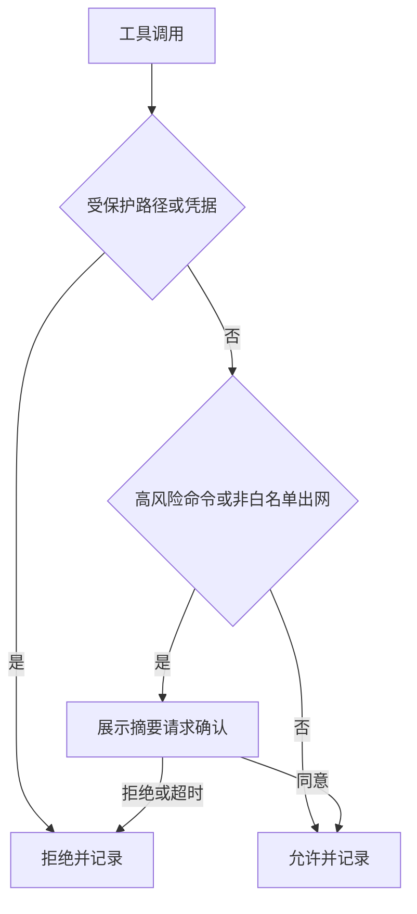

# 策略与审计详细设计

## 文档信息

| 项 | 内容 |
|---|---|
| 文档编号 | CORP-DSH-DESIGN-003 |
| 文档名称 | 策略与审计详细设计 |
| 版本 | V0.3.1 |
| 文档状态 | 草案 |
| 密级 | — |
| 编制 | DSH 平台组（代拟） |
| 审核 | 待定 |
| 批准 | 待定 |
| 最后更新 | 2026-10-24 |
| 门禁 | G2 |
| 模块状态 | 规划 |

> 编制依据：2026-10-20 对目标环境已安装 DSH 包做字符串级核验：`dsh-sandbox`、`dsh-sandbox-local`、`dsh-sandbox-policy`、`dsh-fs-sandbox`、`dsh-fs-observation-policy`、`dsh-bash-sandbox`、`dsh-pwsh-sandbox`、`dsh-sandbox-windows-acl`、`dsh-permission-presets`、`dsh-client-ui-permission-presets`、`dsh-client-ui-approval`、`dsh-tool-ask-user`、`dsh-tool-call-timeout-policy`、`dsh-spill-policy`。
> **2026-10-24 宿主接口契约核验**（目标环境 DSH `0.2.1-rc.2`，macOS arm64；读取 live Host 的 Service/Event 契约，**不是行为实验**）：
> - 工具派发管线为 `tools/pre-execute`（waterfall：放行/拒绝/取消/请求确认）→ `ctx.tools.guard`（同步、monotonic 拒绝，返回字符串即拒绝）→ `tools/execute`（around-dispatch）→ `tools/post-execute`（waterfall）→ 定义方 finalization → `tools/result`（**emit，仅观察**）。`guard` 位于 pre-execute 之后，且**任何 guard 不能强制放行另一 guard 的拒绝**。
> - `ctx.tools.restrict({ allow, deny })` 对空过滤器、未知名、scope 局部名、保留传输名直接失败；限制取交集，scope 内注册仍可见。
> - 人工 command 由独立服务 `ctx.commands`（`register` / `execute`）派发，**不经过 tools 管线**，须显式接线才能纳入同一门禁。
> - 审批由 `ctx.approval`（`setPolicy` / `request`）与 `approval/request`（waterfall）承担；子 Agent 深度由 `ctx.subagents.resolveMaxDepth` 约束。
> **2026-10-24 宿主行为实验（探针 9/9 通过）**：在目标环境用 `dsh --profile sdk` 叠加临时 patch 挂载探针插件，插件在真实进程内经 `ctx.tools` 派发调用。断言：guard 拒绝时工具体零调用且结果为错误、先注册的宽松 guard 不能放行后续拒绝、`tools/pre-execute` 的异步放行与拒绝决策均被采纳、`ask` 在无 agent 时降级为拒绝、`tools/result` 观察者抛错不影响结果与已发生副作用、卸载后工具不可见且再调用报 unknown tool、命令面由独立服务派发而工具管线 guard 未见到该次调用、`approval` 策略 `never` 返回 `rejected`。复跑：`node scripts/probe/run-host-probe.mjs`（无 `dsh` 时跳过，不伪装通过）。
> **仍未实验**：子 Agent 限制是否继承（需真实 agent 会话）、策略与沙箱的叠加顺序、审批 UI 的注册方式与超时语义、`$DSH_HOME` 的确切范围。
> **仍未核验**：策略与沙箱的叠加顺序、审批 UI 的注册方式与超时语义、`$DSH_HOME` 的确切范围。
>
> 关联文档：[总体架构 §7.2](../../architecture/platform-architecture.md)、[需求基线](../../requirements/requirements-baseline.md)、[设计索引](../README.md)。

## 1. 结论

本模块是企业侧的最后一道闸：在工具真正执行前判断"该不该做"，在数据离开本机前判断"能不能发"。

边界：它不实现沙箱（复用 DSH 沙箱），不实现审批界面（复用审批 UI），只决定策略与记录结果。安全依赖缺失时**关闭而非放行**。

还缺两件事才能进实现：子 Agent 限制继承的验证（宿主钩子其余语义已由探针跑通，见编制依据）、策略与沙箱叠加顺序的确认。

## 2. 目标与非目标

**目标**

- 对文件访问、命令执行、网络外发三类动作做统一判断，结论只有允许、需确认、拒绝。
- 受保护路径（凭据、配置、会话记录）默认拒绝，且不因用户确认而放行。
- 外发前给出可读的"将要发出什么"，用户明确同意后才执行。
- 所有判断写审计，含结论与依据，不含正文。

**非目标**

- 不做沙箱隔离本身，不替换 DSH 的 fs 与 bash 沙箱。
- 不做企业权限判定，角色来自 IAM。
- 不做内容审查与数据分类分级。

## 3. 需求与依赖

| 需求/验收 | 关系 | 说明 |
|---|---|---|
| REQ 数据边界 C1–C4 | 支撑 | 模型上下文不含凭据，外发需确认 |
| REQ 审计可否回放 | 支撑 | 判断结论与依据可追溯 |
| 验收 A7 门禁 | 支撑 | 受保护路径零放行 |

| 依赖 | 类型 | 版本约束 | 缺失时的行为 |
|---|---|---|---|
| 沙箱策略包 | 包 | 随目标 DSH | 不启动策略模块，工具面整体禁用 |
| 审批 UI | 包 | 随目标 DSH | 需确认的动作直接拒绝 |
| 审计落点 | 配置 | 本地文件或转发 | 写失败即拒绝高风险动作 |

## 4. 扩展形态与边界

| 项 | 内容 |
|---|---|
| 形态 | Host 插件；确认识别用既有审批 UI，不自建对话框 |
| 运行位置 | 本机 Host |
| 目标 DSH 与 SDK | 随目标版本，钩子以实测为准 |
| 使用的 seam 或服务 | 工具调用拦截、沙箱策略、审批交互、会话事件 |
| 不修改的核心 | 沙箱实现、工具实现、模型调用链 |

取舍：策略判断与沙箱隔离分开。沙箱负责"做不到"，策略负责"不该做"，两者叠加取最严。

## 5. 接口与配置

| 配置项 | 类型 | 默认值 | 必填 | 说明 |
|---|---|---|---|---|
| `policy.protectedPaths` | string[] | `$DSH_HOME/**` | 是 | 硬拒绝，不可通过确认放行 |
| `policy.confirmPaths` | string[] | 空 | 否 | 需确认的路径前缀 |
| `policy.egress` | `deny` \| `confirm` \| `allow` | `confirm` | 是 | 非白名单出网的默认动作 |
| `policy.egressAllowlist` | string[] | 空 | 否 | 主机名或域名后缀 |
| `policy.commandPatterns` | object[] | 空 | 否 | 高风险命令模式与动作 |
| `policy.auditSink` | `local` \| `forward` | `local` | 是 | 必要审计落点；落点不可用按 §8 关闭相关动作 |

策略不可用（未挂载、加载失败、必要依赖缺失）时一律 fail-closed；**不提供 fail-open 开关**，也不以"显式声明只读模式"作为降级通道。

```ts title="导出面（示意，钩子名待实测）"
export interface PolicyDecision {
  action: 'allow' | 'confirm' | 'deny';
  reason: string;
  rule: string;
}
export interface PolicyEngine {
  check(input: { kind: 'fs' | 'bash' | 'egress'; target: string; meta?: unknown }): Promise<PolicyDecision>;
}
```

## 6. 权限、凭据与数据

| 项 | 处理方式 | 生命周期 | 失败时 |
|---|---|---|---|
| 策略文件 | 本地只读加载，变更需重启或显式重载 | 随配置 | 解析失败即 fail-closed |
| 审计记录 | 追加写，不含正文与令牌 | 90 天 | 必要审计写失败即关闭需该保障的动作（含只读查询与 command），不按"高风险动作"打折 |
| 用户确认 | 仅存结论与摘要，不存全文 | 会话 | 超时视为拒绝 |
| 凭据 | 不读取、不转发、不记录 | — | 命中即拒绝 |

## 7. 流程



**并发**：判断无共享可变状态，可并发；审计写入串行，避免交错。

**超时**：确认等待默认 120 秒，超时按拒绝处理；判断本身 1 秒内完成，超时即拒绝。

**取消**：用户取消工具调用时不写"已执行"审计，只写"已取消"。

## 8. 失败模式

| 场景 | 行为 | 用户可见结果 | 是否可重试 |
|---|---|---|---|
| 策略文件缺失或损坏 | 全部拒绝 | 明确报错并指向配置 | 修复后重试 |
| 审计不可写（必要审计） | 拒绝一切需要该保障的动作，含只读查询与 command | 提示审计不可用 | 恢复后重试 |
| 本机日志或可选指标不可用 | 记录缺口，不阻塞研发，不放宽必要审计 | 显示缺口计数 | 恢复后自动继续 |
| 确认界面不可用 | 视为拒绝 | 提示无法确认 | 可重试 |
| 沙箱与策略结论冲突 | 取更严的一方 | 说明冲突规则 | 否 |
| 钩子未触发（实测发现） | 记为阻断缺陷，不降级放行 | 工具面禁用 | 修复后恢复 |

## 9. 可观测性

| 事件 | 字段 | 去向 | 保留 |
|---|---|---|---|
| 判断完成 | 工具、目标摘要、结论、规则、耗时 | 审计 | 90 天 |
| 用户确认 | 结论、摘要哈希、等待时长 | 审计 | 90 天 |
| 拒绝 | 规则、目标类别 | 审计 | 90 天 |
| 策略加载 | 版本、条目数、加载结果 | 本机日志 | 30 天 |

目标摘要只保留类别与哈希，不回写完整路径或命令文本。

### 9.1 过程观察与受控写分类

过程观察采用[指标事件契约](../../contracts/metrics-events.md)的独立投影，复用既有 OTel 出口，由 DevOps 汇聚，不新建包或指标服务。指标投影可独立关闭/降级，不携带安全审计中的内容哈希；必要审计失败仍执行原拒绝规则，不能因指标可降级而放行。

有限委托内普通研发写的目标见[需求 §2.3](../../requirements/requirements-baseline.md)。现行 C3 跨系统写 ask 在安全批准精确动作分类前仍有效；入口确认不自动豁免后续写。批准后需按动作/资源/版本验证授权，业务决定与正式人工评审仍需真实确认。缺原生可靠控制时禁用，不自建第二授权系统。

## 10. 测试矩阵


| 层级 | 覆盖 | 命令 |
|---|---|---|
| 单元 | 三类动作判定、fail-closed、规则优先级 | `node --test` |
| 契约 | 结论与审计字段稳定 | 契约用例 |
| 集成 | 命中受保护路径、确认超时、必要审计不可写零执行 | 本地夹具 |
| 宿主探针 | guard 拒绝零副作用与单调性、pre-execute 异步决策、`ask` 无 agent 降级、`tools/result` 观察异常、命令面独立、`approval=never`、卸载清理 | `node scripts/probe/run-host-probe.mjs`（目标 DSH；无 `dsh` 跳过） |
| 端到端 | 双端各跑一次拒绝、一次确认、一次放行 | 手工 + 脚本 |

## 11. 打包、升级与回退

包名 `@heluo/forge-policy`，`private: true`，声明 `engines.dsh`。策略文件随组合包下发，用户不可编辑。

回退：禁用插件后回到 DSH 默认策略，需在组合包中显式声明该后果，避免"禁用即放行"的误解。

## 12. 未决事项

| 问题 | 需要谁回答 | 阻塞的能力 | 截止门禁 |
|---|---|---|---|
| 子 Agent 限制是否继承（其余宿主行为实验已由探针跑通） | 平台组（探针 + 真实 agent 会话） | P01、P02 的准入结论 | G1 编码前 |
| 策略与沙箱的叠加顺序 | 平台组（实测） | 冲突时取严是否成立 | G1 编码前 |
| 审批 UI 的注册方式与超时语义 | 平台组（实测） | 确认流程（P02、P04） | G1 编码前 |
| `$DSH_HOME` 的确切范围 | 平台组（实测） | 受保护路径定义（P04） | G1 编码前 |
| 审计是否需要转发到集中平台 | 安全团队 | `auditSink` 默认值 | G2 前 |

### 需用户确认的设计选项（增益不明确，暂不采用，保留待定）

| 选项 | 可能的增益 | 代价 | 当前处理 |
|---|---|---|---|
| 策略 DSL（可编程规则） | 表达力强 | 解析器与测试成本高，规则可读性下降 | 不采用，用固定配置项 |
| 命令正则黑名单 | 拦截已知危险命令 | 误报高、易绕过，给人虚假安全感 | 不采用，只做白名单与非白名单出网 |
| 记录完整命令与路径 | 审计更完整 | 隐私暴露面扩大 | 不采用，只记类别与哈希 |
| 对每次工具调用做速率限制 | 抑制异常循环 | 与 DSH 已有超时策略重叠 | 不采用 |
| 默认全量阻断出网 | 最安全 | 首次使用几乎不可用，用户会关掉插件 | 不采用，默认 confirm |

以上五项均不影响主链路；若后续确认增益，再单独评估。禁用插件时的行为必须在组合包中写明，不能用"可禁用"代替策略保障。
