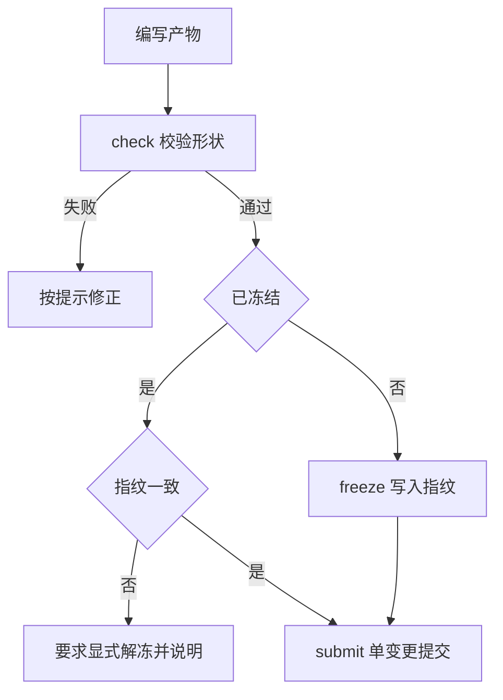

# 轻量 SDD 详细设计

## 文档信息

| 项 | 内容 |
|---|---|
| 文档编号 | CORP-DSH-DESIGN-008 |
| 文档名称 | 轻量 SDD 详细设计 |
| 版本 | V0.5.1 |
| 文档状态 | 草案 |
| 密级 | — |
| 编制 | DSH 平台组（代拟） |
| 审核 | 待定 |
| 批准 | 待定 |
| 最后更新 | 2026-10-26 |
| 门禁 | G2 |
| 模块状态 | 可用（本地校验骨架；CI 权威结论待企业接入） |

> 编制依据：2026-10-20 依据需求基线 REQ-18 的三条不变量（产物、冻结、原子提交流程）与既有工程约定；按架构 P7 复用企业既有 CI 与代码托管 CLI，不自建流水线。**未核验**：目标仓库的 CI 触发方式、原子提交在宿主平台的具体能力。
>
> 关联文档：[需求基线 §4](../../requirements/requirements-baseline.md)、[实施计划](../../plans/rollout-plan.md)、[设计索引](../README.md)。

## 1. 结论

SDD 只保证三件事：产物有固定形状、冻结后不可悄悄变更、提交是一个原子单元。其余流程让团队按习惯走。

边界：它不规定"先写规格再写代码"的顺序，不替代代码评审，也不新建流水线——提交与检查复用企业已有的仓库与 CI。

还缺两件事才能进实现：CI 触发方式确认、原子提交在宿主平台的可行边界。

## 2. 目标与非目标

**目标**

- 产物目录与文件命名固定，机器可校验。
- 冻结以指纹为准，指纹变化即视为变更。
- 一次提交只包含一个变更单元，可回退。
- 检查失败时给出可直接修的理由，而不是泛泛报错。

**非目标**

- 不强制流程顺序，不做流程引擎。
- 不替代代码评审与测试。
- 不自建 CI、不自建代码托管。

## 3. 需求与依赖

| 需求/验收 | 关系 | 说明 |
|---|---|---|
| REQ-18 轻量 SDD | 直接实现 | 最小企业指引 + 必要 CLI/CI 校验，优先复用，不固定工具数量 |
| 验收 A11 SDD | 支撑 | 三条不变量可判定 |

| 依赖 | 类型 | 版本约束 | 缺失时的行为 |
|---|---|---|---|
| 企业代码托管 CLI | 工具 | 企业现有版本 | 无法原子提交，降级为提示 |
| 企业 CI | 服务 | 企业现有 | 检查不可用即标注"未经 CI 验证"；本地只跑同一规则集的前置校验，不替代 CI 结论 |
| 目标仓库结构 | 配置 | 按项目 | 明确报错，不猜测 |

## 4. 扩展形态与边界

| 项 | 内容 |
|---|---|
| 形态 | 最小企业指引 + 必要 CLI/CI 校验，优先复用既有能力 |
| 运行位置 | 本机（同一规则集的前置校验）+ CI（同一检查任务的权威结论） |
| 目标 DSH 与 SDK | 随目标版本 |
| 使用的 seam 或服务 | 技能注入、bash 工具、企业仓库 CLI |
| 不修改的核心 | DSH 内核、CI 平台 |

规则集只有一个：本地 `sdd check` 与企业 CI 检查任务执行同一份规则与同一版本，本地结果只算前置校验，标注"未经 CI 验证"；两者结论不一致按缺陷处理。**不在本地复制一条流水线，也不维护第二套规则。**

## 5. 接口与配置

| 配置项 | 类型 | 默认值 | 必填 | 说明 |
|---|---|---|---|---|
| `sdd.root` | string | `docs/sdd` | 是 | 产物根目录 |
| `sdd.freezeFile` | string | `freeze.json` | 是 | 指纹清单 |
| `sdd.strict` | boolean | `true` | 否 | 校验失败是否阻断提交 |
| `sdd.vcsCli` | string | `gh` | 否 | 复用企业已有 CLI |

```bash title="命令面（示意）"
sdd init            # 建立产物骨架
sdd check           # 校验形状与指纹
sdd freeze          # 写入或更新指纹
sdd submit --one    # 单变更单元提交
```

### 5.1 交付清单（freeze）契约与校验规则

清单是"这次交付由哪些产物、在哪个版本上、测试覆盖到哪个版本"的唯一声明；校验**不靠文件名猜业务范围**。

| 清单字段 | 类型 | 必填 | 说明 |
|---|---|---|---|
| `version` | number | 是 | 清单位格式版本，当前 `1`；不认识的版本直接拒绝 |
| `unitId` | string | 是 | 交付单元标识；每个产物条目的 `unitId` 必须与它一致，混入其他单元即失败并指出文件 |
| `changeId` | string | 是 | 正式变更号；缺失即失败，不用正文或文件名代替 |
| `revision` | string | 是 | 冻结时的仓库版本；与当前版本不一致即视为冻结失效，需显式重新冻结 |
| `requirementRevision` | string | 否 | 需求版本；变化使旧确认与旧冻结失效 |
| `testedRevision` | string | 是 | 测试实际覆盖的版本；必须与清单 `revision` 完全一致，校验时再以 `currentRevision` 检查冻结是否失效；两份整体过期的测试声明互相一致也不算通过 |
| `stage` | string | 否 | `spec` / `implementation` / `archive`；**缺少阶段元数据时只跑 HARD 规则**，不阻断普通开发 |
| `artifacts[]` | object[] | 是 | `path`（相对根目录、禁止穿越）、`sha256`、`kind`、`unitId` |
| `testEvidence[]` | object[] | 否 | `ref`、`state`（`passed`/`failed`/`not-run`/`timeout`）、`testedRevision` |
| `createdAt` | string | 是 | 冻结时间（ISO 8601） |

| 规则 | 级别 | 判定 |
|---|---|---|
| 变更号、单元标识、版本字段缺失或格式不合法 | HARD | 失败，指出字段 |
| 产物缺文件、指纹不一致 | HARD | 失败，指出具体文件 |
| 产物条目属于其他交付单元 | HARD | 失败，列出多余文件并提示拆分 |
| 清单版本与当前仓库版本不一致 | HARD | 冻结失效，要求显式解冻/重新冻结；不静默沿用旧指纹 |
| 测试证据为 `not-run`/`timeout`/`failed`，或版本不一致 | HARD | `testedRevision` 必须等于 `revision`，已声明通过证据的版本也须匹配 `testedRevision`；不一致报 `test-revision-mismatch`，未提供 `currentRevision` 时仍校验清单内部一致性 |
| 路径为绝对路径或含 `..` 穿越 | HARD | 失败；路径规则与 `@heluo/forge-policy` 同源，不另建第二套 |
| 有阶段元数据时，同一交付的 spec 与 implementation 产物未同时进入清单 | HARD | 缺任意一种均报 `atomic-delivery`，无 `kind` 或仅 archive 同样失败；无阶段时不额外要求类别，归档缺失仍为 SOFT |
| 仅有 HARD 规则、无阶段元数据 | — | 正常运行，不强制固定流程 |

**执行位置**：`本地前置校验` 与 `CI 权威结论` 跑同一规则集、同一夹具应给出一致结果；本地结论标注"未经 CI 验证"，不替代 CI。

**原子性与并发**：`freeze` 先写临时文件再原子改名，进程退出不会留下半份有效清单；同一产物目录用 `O_EXCL` 文件锁串行，锁被占用即拒绝，**不自动回收**陈旧锁。

**指纹语义**：SHA-256 直接哈希产物原始字节，文本和二进制均不做解码、替换字符或换行归一化；清单本身仍按 UTF-8 JSON 读取。指纹一致只证明文件未被改动，**不证明业务正确**；每次显式变更都要重新冻结，旧冻结随仓库版本失效。格式版本仍为 `1`，合法 UTF-8 文本的旧指纹不变；旧实现对非 UTF-8 内容计算的指纹不再接受，需核实原始产物后显式重新冻结，不回退到有损解码来兼容。

## 6. 权限、凭据与数据

| 项 | 处理方式 | 生命周期 | 失败时 |
|---|---|---|---|
| 仓库凭据 | 复用既有 CLI 的登录态，不自存 | 随 CLI | 提示先登录 |
| 产物与指纹 | 仓库内文件 | 随仓库 | 校验失败即阻断 |
| 运行日志 | 只记命令与结果 | 30 天 | 不影响执行 |

## 7. 流程



**并发**：同一产物目录不允许多进程同时 freeze，用文件锁串行。

**超时**：CI 检查超时按失败处理，不标记通过。

**回退**：回退一次提交即回到上一个指纹状态，指纹随仓库版本走。

## 8. 失败模式

| 场景 | 行为 | 用户可见结果 | 是否可重试 |
|---|---|---|---|
| 产物缺文件 | 阻断并列出缺失项 | 明确到文件名 | 修正后重试 |
| 指纹不一致 | 阻断，需显式解冻 | 指出变化文件 | 解冻后重试 |
| CLI 未登录 | 阻断提交 | 提示登录命令 | 登录后重试 |
| CI 不可用 | 本地跑同一规则集并标注"未经 CI 验证" | 显示未验证状态，不作为通过 | 可重试 |
| 提交混入多个变更 | 拒绝并提示拆分 | 列出多余文件 | 拆分后重试 |

## 9. 可观测性

| 事件 | 字段 | 去向 | 保留 |
|---|---|---|---|
| 校验结果 | 产物数、失败项、耗时 | 本机日志 | 30 天 |
| 冻结 | 指纹摘要、文件数 | 本机日志 + 仓库 | 随仓库 |
| 提交 | 变更单元、文件列表 | 仓库历史 | 随仓库 |

## 10. 测试矩阵

| 层级 | 覆盖 | 命令 |
|---|---|---|
| 单元 | 形状校验、指纹计算、锁 | `node --test` |
| 契约 | 产物命名与目录固定 | 契约用例 |
| 集成 | 解冻、指纹变化、未登录 | 本地夹具 |
| 端到端 | 双端各完成一次 init → freeze → submit | 手工 |

## 11. 打包、升级与回退

包名 `@heluo/forge-sdd`，`private: true`，CLI 入口与技能目录随包分发，声明 `engines.dsh`。

升级：产物格式只增不破坏；指纹算法变更须版本标记，旧指纹仍可校验。

回退：禁用包后技能与命令消失，产物仍可用，不丢数据。

## 12. 未决事项

| 问题 | 需要谁回答 | 影响 |
|---|---|---|
| 企业 CI 的触发方式与权限 | IT 团队 | 流水线任务接入 |
| 原子提交在宿主平台的边界 | 平台组（实测） | `submit --one` 语义 |
| 产物根目录是否按项目可配 | 平台组 | `sdd.root` 默认值 |
| 是否需要与需求编号联动 | PMO | 产物元数据 |

### 需用户确认的设计选项（增益不明确，暂不采用，保留待定）

| 选项 | 可能的增益 | 代价 | 当前处理 |
|---|---|---|---|
| 完整流程引擎（阶段与门禁） | 强制顺序 | 与"只守不变量"冲突，维护重 | 不采用 |
| 在本地复制一套 CI | 离线可验 | 与既有 CI 双份维护 | 不采用 |
| 自动改写产物 | 省手工 | 引入不可预期变更 | 不采用 |
| 指纹存数据库 | 查询方便 | 与仓库版本脱节 | 不采用，随仓库 |
| 与多仓库联动 | 跨仓一致性 | 本期无此场景 | 不采用 |

以上五项均不影响主链路；若后续确认增益，再单独评估。按 P7，提交与检查继续复用企业既有仓库 CLI 与 CI，不自建流水线。

## 13. 企业指引与模型能力分工

以[全流程设计](forge-devops-lifecycle.md)和[需求 §2.3](../../requirements/requirements-baseline.md)为准：DSH 替代旧工具，不移植 Comet/oh-my-sdd Runtime，不规定第三方 Skill 链、固定阶段或新 CLI 规模。规范按条款筛选通用知识、企业差异及强制要求，由企业维护者确认有效性，按任务加载；模型不能自行废止硬要求。

保留既有产物、冻结、原子交付与追溯约束，优先复用可用校验器。更强模型交叉审查后由人确认，正式记录落 PR。技术修复返回实现上下文，之后重新审查；不在只读审查上下文写源码。旧工具在建 PR 后执行最终 `change done` 的行为不得继承。

方法交模型/Harness；输入、结果引用和权限见[工具契约](../../contracts/engineering-tools.md)。缺少原生能力时标明缺口，不自建通用编排引擎。工具、宿主及 CI 实际行为均待企业验证，本稿不声称完成联调。
