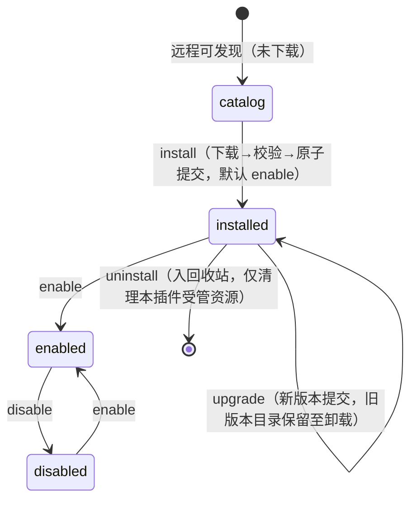
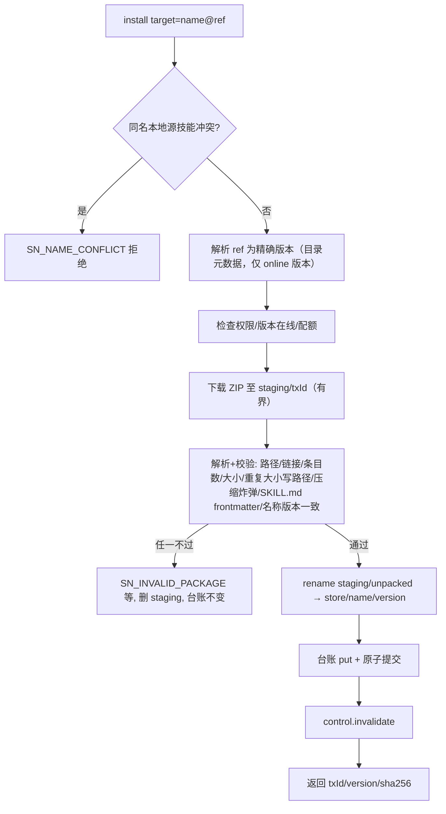

# 企业 Nacos Skill 发现、安装与 DSH 原生加载（forge-skill-nacos）详细设计

## 文档信息

| 项 | 内容 |
|---|---|
| 文档编号 | CORP-DSH-DESIGN-018 |
| 文档名称 | 企业 Nacos Skill 发现、安装与 DSH 原生加载详细设计 |
| 版本 | V0.2 |
| 文档状态 | 草案（代拟） |
| 密级 | — |
| 编制 | DSH 平台组（代拟） |
| 审核 | 待定 |
| 批准 | 待定 |
| 最后更新 | 2026-10-28 |
| 门禁 | G1 发现与安装闭环；G2 三目标实机 |
| 模块状态 | 规划（核心骨架源码与离线测试随首版 PR；企业 Nacos 未联调） |

> 编制依据（已核验，2026-10-26/28）：
>
> 1. 目标 DSH 源码只读核验（基线见仓库 `.dsh-version`）：`ctx.skills.registerProvider`（`SkillProvider.list/get`、`SkillProviderControl.signal/invalidate`、rank 合并与层遮蔽）、`dsh-skill-filesystem` 的 rank 100–600 与扫描面、`dsh-tool-skill` 目录 digest 与 `/name` 手势、`dsh-credentials` 记录接口（[DSH skills 服务](https://github.com/deepseek-ai/deepseek-harness/blob/master/packages/skill/skill/README.md)、[原生加载](https://github.com/deepseek-ai/deepseek-harness/blob/master/packages/skill/tool-skill/README.md)）。
> 2. Nacos 源码只读核验（`alibaba/nacos` tag `3.2.0` 与 `develop`）：`SkillClientController`（3.2 仅有 ZIP 下载，无摘要头、无目录列举）、`ConsoleSkillController`（list/detail 在 console 面）、client `/search` 为 3.3 起能力。响应模型的字段名以 P0 实测为准，代码中防御式解析并标注待实测。
> 3. 本仓库文档：[设计索引](../README.md)、[开发与发布约定](../../engineering/development-conventions.md)、[需求基线 §2](../../requirements/requirements-baseline.md#2-范围边界唯一真源)、[forge-policy 设计](forge-policy.md)、[forge-market 设计](forge-market.md)、[#97](https://github.com/hrygo/heluo-forge/issues/97)、[#12](https://github.com/hrygo/heluo-forge/issues/12)、[#28](https://github.com/hrygo/heluo-forge/issues/28)。
>
> 未核验（P0 前置，见 §12）：企业 Nacos 实际版本/部署/鉴权插件/TLS；目标 DSH 宿主真机挂载；Nacos console/client 响应字段名与鉴权头形态。
>
> 关联文档：PRD（CORP-DSH-REQ-006，[skill-nacos-prd.md](../../requirements/skill-nacos-prd.md)，交互效果图八页）；字段级外部契约随实现 PR 落 `docs/contracts/skill-nacos-contract.md`（待建），本文只引用不复制。

## 1. 结论

本模块以 Host 插件 `@heluo/forge-skill-nacos` 连接企业 Nacos，提供有权限边界的 Skill 目录发现、精确版本安装与 DSH 原生加载：安装后的技能经 `ctx.skills` Provider 进入原生目录、`skill` 工具与 `/技能名`，不改 DSH 核心。目录发现按 Nacos 版本走三条已核验路线之一（3.2 console 只读 list、≥3.3 client search、Config 轻量索引兜底），下载固定走 3.2 起即存在的 client OPEN API。进入生产仍缺三项：企业 Nacos 版本与最小权限入口的实机取证（P0）、Skill 包体经 Nacos 分发相对 S6/ADR-11/13 的范围差异批准、forge-policy 受控动作目录的登记与台账批准；批准前安装保持关闭（fail closed），只读发现不受影响。

## 2. 目标与非目标

**目标**（对应 [#97](https://github.com/hrygo/heluo-forge/issues/97) 目标 1–5）：

- 通过 DSH 扩展插件连接企业内部 Nacos，提供有权限边界的 Skill 搜索、详情、版本查询和安装入口。
- 状态严格分离：远程可发现 ≠ 已下载 ≠ 已安装 ≠ 已启用 ≠ 可调用；远程上架、目录刷新都不自动安装、启用或执行。
- 安装固定到精确版本，保留来源、内容摘要与操作结果；更版显式触发；失败不损坏旧版本。
- 启用后的技能复用 DSH 原生目录、`skill` 工具和 `/技能名`，完整保留相对资源路径。
- **作用域**（2026-10-28 需求确认）：安装可选全局或项目级；已安装列表显示作用域并可随时转换；作用域是台账字段，包体统一在受管目录，不写入项目源码树。

**非目标**：不修改或 fork DSH 核心；不替换 [#12](https://github.com/hrygo/heluo-forge/issues/12) 插件市场（Skill 不是插件，安装 Skill 不授工具权限）；不自建 Nacos/审批后台/身份系统；不执行包内脚本、不安装包声明的依赖；不承诺全通道撤销（已进入会话上下文的指令不在远程收回范围）；不做 20+ 外部 Agent 目录管理。

**范围差异声明（须批准，未批不开放安装）**：[需求基线 §2 S6](../../requirements/requirements-baseline.md#2-范围边界唯一真源) 与 ADR-11/13 确定企业 npm 为**插件**包体唯一制品源。本模块让 Nacos 承担 **Skill**（指令与资源包）分发：不执行代码、不授工具权限，与插件包体分属两个信任边界，不构成对 S6 的替换。未获批准前 `install` 类动作保持关闭。

## 3. 需求与依赖

| 需求/验收 | 关系 | 说明 |
|---|---|---|
| #97 T1 环境取证 | 前置 | 三条目录路线与 P0 取证单一一对应 |
| #97 T2 设计契约 | 本文档 | 字段契约后续落 `docs/contracts/`（待建） |
| #97 T3 发现与管理入口 | 支撑 | 工具面、目录刷新；网络仅在 Host |
| #97 T4 安装与原生加载 | 支撑 | 安装事务、Provider 行为 |
| #97 T5 安全审计 | 支撑 | 凭据边界、路径防御、审计日志 |
| #97 AC1–AC10 | 验收 | 测试矩阵逐条映射；证据回填按 #97 规则 |
| 基线 S8 / #28 | 相邻不冲突 | forge-sdd 静态技能与动态安装技能经 rank 与来源字段共存 |
| 基线 S6 / #12 | 边界差异 | 见 §2 范围差异声明 |

| 依赖 | 类型 | 版本约束 | 缺失时的行为 |
|---|---|---|---|
| `@deepseek-ai/cordis`（宿主运行时） | 宿主 | `engines.dsh` 与仓库 `.dsh-version` 同发布线 | 宿主不加载 |
| 宿主 `ctx.skills` / `ctx.tools` / `ctx.credentials` | 服务注入 | — | `inject` 缺失即不挂载（fail closed） |
| forge-policy 受控动作目录 | 设计对接 | 现行 | 安装类工具调用被门禁拒绝（fail closed） |
| 企业 Nacos Server | 外部服务 | ≥3.2.0 | 见 §8 网络失败行；不回落公网 |
| `ctx.credentials` 生产 backend（[forge-credentials-keychain](../../../packages/forge-credentials-keychain/README.md)） | 服务提供方 | 其平台适配器未就绪 | 凭据读写 fail closed，安装保持未开放 |

## 4. 扩展形态与边界

| 项 | 内容 |
|---|---|
| 形态 | Host 插件（Client 面板与 HTTP 路由另行准入；首版为服务 + 模型可见工具面） |
| 运行位置 | 本机 Host；全部网络请求在 Host 进程内执行，Client 与模型不持有 Nacos 凭据 |
| 目标 DSH 与 SDK | 基线见 `.dsh-version`；`engines.dsh` 与之同发布线 |
| 使用的 seam | `ctx.skills.registerProvider`（Provider 角色）、`ctx.tools.register`（工具）、`ctx.get('credentials')`（凭据记录，可选服务）、结构化日志回调 |
| 不修改的核心 | DSH 全部核心包；不触碰 agent-loop、session 事件、tool-skill 目录渲染 |
| 挂载方式 | 独立插件行；企业组合包是否纳入按 forge-enterprise 设计另行裁定 |

## 5. 接口与配置

### 5.1 外部接口（Nacos 侧）

字段级映射与响应模型落 `docs/contracts/skill-nacos-contract.md`（待建，随实现 PR）；实现代码中响应解析集中一处并标注待实测。接口清单与已核验事实：

| 用途 | 端点（Nacos 3.2.0 源码核验） | 面与权限 | 备注 |
|---|---|---|---|
| 技能 ZIP 下载（唯一包体通道） | `GET /v3/client/ai/skills?namespaceId&name&version\|label` | OPEN API，`READ`，带匿名放行标记 | 3.2.0 起存在；响应仅 ZIP 字节 + `Content-Disposition`，无摘要头（MD5/304 为后续版本能力，不作为依赖） |
| 目录列举（路线 A，3.2.x） | `GET /v3/console/ai/skills/list`、`GET /v3/console/ai/skills`（元数据含版本清单） | CONSOLE API，`READ` | 需受管只读 console 账号；能否发放属 P0 取证项 |
| 目录搜索（路线 B，≥3.3） | `GET /v3/client/ai/skills/search` | OPEN API，`READ` | 3.3 起存在；企业升级到已批准稳定版后启用 |
| 轻量索引（路线 C，兜底） | Nacos Config 既有 Client 配置读取接口，单一 dataId 承载 JSON 索引 | Config `READ` | 仅当 A/B 均不可行且经评审；索引由企业发布流程生成，含 name/描述/版本清单/sha256；不承载包体 |

约束：只请求配置声明的 `endpoint`；禁跟随 3xx 重定向；无任何公网回落。`catalogMode` 显式选择路线，默认 `console-list`，P0 取证后定稿；模式与实际版本不符时在首次目录刷新处失败（不静默换路线）。

### 5.2 配置（cordis.yml 插件 config）

| 配置项 | 类型 | 默认值 | 必填 | 说明 |
|---|---|---|---|---|
| `endpoint` | string | — | 是 | 企业 Nacos 地址（占位示例 `https://nacos.corp.example`） |
| `namespaceId` | string | — | 是 | 技能所在 namespace |
| `catalogMode` | `console-list` \| `client-search` \| `config-index` | `console-list` | 否 | 目录来源路线 |
| `configIndexDataId` | string | — | 路线 C 必填 | 索引 dataId |
| `credentialRecordId` | string | — | 是 | `ctx.credentials` 记录 id（owner 固定 `skill-nacos`），配置只含名字不含值 |
| `requestTimeoutMs` | number | `10000` | 否 | 单请求超时（正整数） |
| `catalogRefreshIntervalMs` | number | `300000` | 否 | 目录轮询周期；`0` 表示仅手动刷新 |
| `catalogCacheTtlMs` | number | `300000` | 否 | 目录缓存有效期，过期标 stale |
| `catalogPageSize` | number | `100` | 否 | 目录单页条数 |
| `pollMaxBackoffMs` / `pollJitterMs` | number | `60000` / `5000` | 否 | 刷新失败的退避上限与抖动 |
| `maxUncompressedBytes` | number | `20971520` | 否 | 单包解压后总大小上限 |
| `maxFileCount` | number | `512` | 否 | 单包文件数上限 |
| `downloadMaxBytes` | number | `33554432` | 否 | 单包 ZIP 下载字节上限 |
| `installStoreQuotaBytes` | number | `268435456` | 否 | 受管安装目录总配额 |
| `providerName` | string | `nacos` | 否 | Provider 在 `ctx.skills` 的注册名，须唯一 |

必填项缺失在插件加载时失败（fail loud）；数值边界由校验拒绝。`caFile`（企业 CA）列入 P0：Node 原生 fetch 的自定义 CA 通道待宿主内核选项核验，未就绪前只支持系统信任链并在配置校验中拒绝该项。

### 5.3 Host 服务与工具导出面

Host 服务 `skillNacos` 是业务唯一真源；工具与后续 Client 面板都是它的消费者，权限与错误语义一致：

- 服务方法：`searchCatalog({keyword,page,pageSize})`、`showSkill(name)`、`install({name,ref,scope,cwd,enable})`、`enable/disable(name)`、`upgrade({name,ref,cwd})`、`uninstall(name)`、`restore(name)`、`purge(name)`、`changeScope({name,to,cwd})`、`refreshCatalog()`、`status()`、`listInstalled()`。写操作返回 `{txId, name, version, contentSha256}` 等可回查标识。
- 工具面（经 `ctx.tools.register`，参数含门禁识别的 `target`，命名沿用 forge-devops 先例）：

| 工具 | 读/写 | 参数 | 门禁 |
|---|---|---|---|
| `skill_nacos_search` | 只读 | `keyword`、`page`、`pageSize`（有界） | 不经受控目录 |
| `skill_nacos_show` | 只读 | `target: <name>` | 不经受控目录 |
| `skill_nacos_install` | 写 | `target: <name@version\|label>`、`scope?` | forge-policy 登记 `skill-nacos.install`，默认 `enabled: false` |
| `skill_nacos_enable` / `disable` / `upgrade` / `uninstall` | 写 | `target: <name>` / `<name@version>` | 同上逐动作登记 |

可信源（`endpoint`/`credentialRecordId`）、凭据录入与策略放宽**不提供工具**，用户专属，仅经配置与 DSH 原生凭据面。

### 5.4 状态机与台账

安装台账（`state.json`）是本地状态唯一真源。持久状态：未安装（无记录）、`installed`（含 `enabled` 布尔）、卸载后入回收站（trash 记录，保留安装身份）。下载/校验是安装事务内的瞬态（`staging/<txId>/`），不持久化"已下载未安装"。

台账记录字段（语义级）：`name`、`version`（解析后的精确版本）、`requestedRef`（原始 version/label）、`scope`（`user` 或 `project:<root>`；一个技能一个作用域，转换即整体迁移，全局与项目并存列入 P1）、`origin`（endpoint/namespaceId/catalogMode）、`contentSha256`（ZIP 字节 SHA-256）、`skillMdSha256`、`installedAt`、`enabled`、`lastVerifiedAt`、最近一次操作结果与错误分类。

## 6. 权限、凭据与数据

| 项 | 处理方式 | 生命周期 | 失败时 |
|---|---|---|---|
| Nacos 凭据 | `skill-nacos/<credentialRecordId>` 记录，经 `ctx.get('credentials').readRecord` 每操作解析；配置只含记录 id，值不进日志、提示词、模型上下文 | 随凭据存储 | `SN_AUTH_MISSING` / `SN_FORBIDDEN`，不降级匿名 |
| 目录缓存 | 内存 `Map`，源键 = (endpoint, namespaceId, credentialRecordId) | 进程内；撤权/换身份即整体清除 | 过期标 stale；刷新失败保留 last-good |
| 受管文件 | `$DSH_HOME/skill-nacos/{state.json, store/<name>/<version>/, staging/<txId>/, .lock}`；`state.json` 0600 原子写（临时文件 + rename） | 与安装共存；卸载仅删本插件拥有路径 | 配额超限 `SN_QUOTA_EXCEEDED` |
| 模型可见面 | 仅经 Provider 进入 tool-skill 目录/`skill` 工具/`/name`（既有 session 事件）；远程目录浏览只产生工具结果 | 按 session 既有规则 | — |
| 审计 | 结构化日志回调（动作/name/版本/来源/sha256/结果/时间/错误分类），本地保留 | 按宿主日志策略 | 记录失败不阻断业务 |

`$DSH_HOME` 边界：受管目录位于 `$DSH_HOME/skill-nacos`，被 forge-policy `protectedPaths`（默认 `$DSH_HOME/**`）硬拒绝覆盖——模型经 `bash`/`fs` 工具不可写该树，插件自身的 Host 一方写入与 `dsh-credentials-local` 同先例；安装工具只接受 `name@version`，不接受路径参数。安装目录不落在 skill-filesystem 的任何扫描面，避免双重发现。

## 7. 流程

### 7.1 目录发现与刷新

后台按配置周期轮询（超时、退避加抖动、可取消），或 `refreshCatalog` 手动触发；产物只更新目录缓存，**不产生任何安装副作用**。

### 7.2 安装（原子事务）

可判定行为：同 `name@version` 重复安装幂等返回；同 name 不同版本要求显式 `upgrade`；跨进程互斥用 `.lock`（O_EXCL，等待超时报 `SN_LOCK_TIMEOUT`，不自动接管）；提交序列"先落包目录、后写台账"，崩溃在两步之间留下无台账目录，启动时孤儿清理按"无台账引用即删除"；Windows 的 rename 与大小写不敏感路径在三目标分别实测。

### 7.3 原生加载（Provider 行为）

- `list(options)`：只读本地台账与 `store/`，逐条校验 `SKILL.md` 存在且 `skillMdSha256` 匹配后产出候选；仅 `enabled` 记录产出；**不发起任何网络请求**；返回完整数组（`complete: true`）。候选 `rank = 700`：低于 skill-filesystem 全部本地来源（100–600），同层同名必让本地技能胜出。**作用域过滤**：`user` 记录对任意 `cwd` 产出；`project:<root>` 记录仅当 `options.cwd` 位于该项目根之下时产出（项目根判定沿用 DSH 的 `.git` 向上查找口径）；provider rank 只表达优先级，不构成企业安全策略。
- `get(candidate)`：从 `store/<name>/<version>` 读取精确版本，`resourceBase: { kind: 'directory', path }` 完整保留相对资源；不隐式升级、不回源网络；文件缺失返回 `undefined`。
- 失效：install/enable/disable/upgrade/uninstall/changeScope/restore 提交后调用 `control.invalidate()`，驱动 `skills/change` → tool-skill 重快照追加替换目录。

### 7.4 更版、停用、卸载、作用域转换

更版：显式触发，走 §7.2 事务提交到新版本目录；旧版本目录保留至卸载。停用：台账 `enabled: false`，目录/工具/`/name` 均不再可见，文件保留。卸载：记录入回收站（受管包体保留、台账移入回收状态），恢复 = SHA 校验通过后重新登记并回到卸载前启用状态，永久删除 = 清受管资源（二次确认，保留期默认 30 天，到期不自动静默删除）。远程下线：目录条目标记 delisted；本地已安装状态不变。作用域转换：台账级操作，改写 `scope`，包体与启用状态不动；转项目要求当前可判定项目根（否则 `SN_NO_PROJECT_ROOT`），转换后 invalidate，新会话目录按新作用域出现/消失。

### 7.5 并发、取消与退出

并发安装同 name：文档锁串行化，后到者基于新台账判定（同版本幂等 / 不同版本要求 upgrade）。`AbortSignal` 与插件卸载传播到下载与解包；进程重启后 `staging/` 全量清理（无台账引用即孤儿）。插件禁用/卸载：释放 Provider 注册、定时器、文档锁；再次挂载从台账恢复全部状态。

## 8. 失败模式（错误分类即契约）

| 场景 | 行为 | 用户可见结果 | 可重试 |
|---|---|---|---|
| 网络超时/连接失败 | 退避轮询；目录保留 last-good 标 stale；安装事务中止并清理 staging | 明确错误 + stale 标记 | 是 |
| 401/403 | 清空该源目录缓存；安装拒绝 | 引导凭据录入；不降级匿名 | 修复凭据后 |
| 404/版本不在线 | 安装拒绝 `SN_NOT_FOUND` | 指明 name/version 不可用 | 换版本 |
| 响应非 JSON/坏 ZIP | 目录丢弃本次响应；安装 `SN_INVALID_PACKAGE` | 明确错误 | 是 |
| 非法元数据/名称版本不一致 | `SN_INVALID_PACKAGE` / `SN_NAME_INVALID` / `SN_VERSION_MISMATCH` | 列明哪项校验失败 | 否 |
| 路径穿越/绝对路径/越界链接/重复大小写路径/炸弹/超限 | 流式解包即时中止 `SN_PATH_ESCAPE` / `SN_QUOTA_EXCEEDED`；staging 清理；受管目录外零写入 | 明确错误 | 否 |
| 本地同名（个人/项目/其他源） | `SN_NAME_CONFLICT`，不覆盖 | 提示冲突来源 | 否 |
| 提交中断/磁盘不足/进程重启 | 旧版本与台账保持一致；孤儿 staging 启动清理；无半安装被启用 | 状态可回查（txId/阶段） | 是 |
| 锁超时 | 拒绝写操作 `SN_LOCK_TIMEOUT` | 提示另一进程持有 | 稍后 |
| 「转项目」无法判定项目根 | 拒绝 `SN_NO_PROJECT_ROOT`，作用域不变 | 提示在项目会话内重试或保持全局 | 是 |
| 回收站恢复时 SHA 不符 | 拒绝恢复，提供重新安装入口 | 说明包体可能被外部改动 | 重新安装 |

**摘要与供应链边界（如实声明）**：3.2.0 client 下载响应无签名摘要头；本模块记录自算 SHA-256 仅证明"本地内容自安装时未漂移"，不构成来源认证。当前保障边界 = TLS + 企业内网 + 仓库侧发布流程；该边界是否足以开放安装由安全方裁定，裁定前安装动作保持关闭。

## 9. 可观测性

审计日志字段：动作、name、精确 version、origin 引用、sha256、结果、错误分类、时间。不采集技能正文、用户代码、凭据、业务内容。公开渠道只提交脱敏最小结论。

## 10. 测试矩阵

| 层级 | 覆盖 | 命令 |
|---|---|---|
| 单元 | ZIP 校验器负测全家桶（穿越/绝对路径/越界链接/重复大小写/炸弹/条目数/坏 frontmatter/名称版本不一致）、版本解析与固定、台账原子提交与恢复、缓存隔离、作用域过滤 | `node --test packages/forge-skill-nacos/test` |
| 契约 | 本地仿 Nacos HTTP：console list/detail、client search、config-index、ZIP 下载；401/403/404/超时/坏响应；三模式路由与模式不符失败 | 同上 |
| 集成 | 安装→Provider 候选出现→`get` 加载→停用→卸载→恢复；同名冲突；作用域转换与项目内/外可见性；孤儿清理 | 同上 |
| 宿主探针 | 目标 DSH 真进程挂载：服务暴露→安装事务→原生目录候选→正文加载→停用（含 `skills/change` 事件）→启用→未知版本拒绝→项目作用域内外可见性→作用域转换→回收站恢复；门禁负测与插件卸载无残留待 forge-policy 登记后补 | `DSH_BIN=<dsh> node scripts/probe/run-skill-nacos-probe.mjs`（无 `dsh` 跳过，不伪装通过；2026-10-29 于 DSH 0.2.1-rc.3 源码构建实测 10/10） |
| 端到端（AC10） | Win10 amd64 / UOS 20 amd64 / 麒麟 aarch64 全生命周期与关键失败回归；AC 证据回填，NOT RUN 不算通过 | 按 #97 验收规则 |

## 11. 打包、升级与回退

- 包名 `@heluo/forge-skill-nacos`，目录 `packages/forge-skill-nacos/`；纯 ESM `.mjs` 源码，零运行时依赖（ZIP 解析用 `node:zlib` 自实现有界读取），无构建脚本。
- `engines.dsh` 与 `.dsh-version` 同发布线；README 状态行按仓库门禁声明骨架边界。
- 数据兼容：台账 schema 带版本号，向前演进只加字段；受管目录结构变化走卸载重装路径。

## 12. 未决事项

| 问题 | 需要谁回答 | 影响 |
|---|---|---|
| 企业 Nacos 实际版本、鉴权插件、TLS/CA、能否发放 AI 只读 console 账号（路线 A 可行性） | Nacos 运维 + 安全 | catalogMode 定稿；不可行则评估 B 或 C |
| Skill 包体经 Nacos 分发的范围差异批准（相对 S6/ADR-11/13） | 责任方（基线变更流程） | 未批前 `install` 类动作保持关闭 |
| console/client 响应字段名与鉴权头形态实测 | 平台组（P0） | 契约文档与解析器定稿 |
| Pipeline 是否启用、"online" 的组织准入含义 | AIHUB/技能维护方 | 目录展示口径与保障边界 |
| 可信摘要是否可得；仅 TLS+内网+自算哈希的边界是否被接受 | 安全 | §8 摘要边界裁定；不满足则安装不开放 |
| 全局与项目双作用域并存（P1）、回收站保留期默认值 | 需求方 | §5.4 / §7.4 |
| forge-policy 受控动作目录登记与审批台账 | 平台组 + 安全 | 安装/更版/卸载/作用域转换的开放 |
