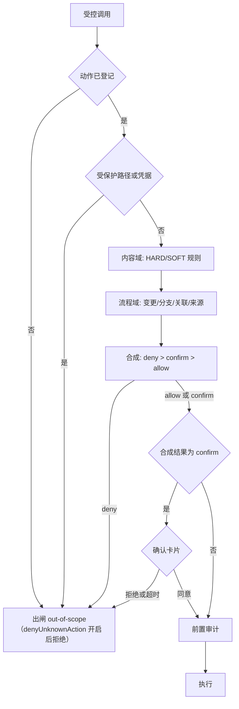

# 策略判定模型设计

## 文档信息

| 项 | 内容 |
|---|---|
| 文档编号 | CORP-DSH-DESIGN-020 |
| 文档名称 | 策略判定模型设计 |
| 版本 | V0.2.1 |
| 文档状态 | 草案 |
| 密级 | — |
| 编制 | DSH 平台组（代拟） |
| 负责 | 平台组（代拟） |
| 审核 | 待定 |
| 批准 | 待定 |
| 最后更新 | 2026-11-20 |
| 门禁 | G2 |
| 确认人 | 项目负责人 |
| 确认日期 | 2026-11-20 |
| 确认事项 | 移除 `denyDelegatedWrites`，受控写规则目录保留七条 |
| 适用范围 | 策略判定模型的规则目录。其他裁决见编制依据及实施计划 |

> 编制依据：2026-11-16 内网 UAT 观测——活动 profile 的补丁层未覆盖 `heluo-policy`，生效配置由 `forge-enterprise`、`forge-devops`、`forge-gitee` 三个 bundle 层同 id 折叠而成；策略目录只有六条只读动作，六个写动作全部返回 `deny / unregistered-action`，零子进程、零远端调用。同日源码核验：`packages/forge-policy/src/catalog.mjs:66,68`（`egress` 缺省 `confirm`、`enabled` 仅接受布尔 `true`）、`packages/forge-policy/src/installer.mjs:223-226`、`packages/forge-policy/src/approvals.mjs:142`、`packages/forge-policy/src/gate.mjs:65-88`、`packages/forge-gitee/src/gitee-guard.mjs:212,281`、`packages/forge-gitee/src/gitee-actions.mjs:53-58,490`。规则格式复用 `scripts/sensitive-scan/rules.example.json`，推送前扫描的提交集合取法复用 `scripts/sensitive-scan/team-pre-push.mjs` 的 `rev-list base..head`。判定模型的取舍经项目负责人 2026-11-16 逐项确认（确认人：项目负责人；确认事项：默认分层、托管与签名、身份与确认、内容规则边界；适用范围：本文 §4–§9）。**2026-11-19 复决**：确认通道改用宿主问答卡片、范围票据整层取消、规则开关代码默认全关由部署者逐条开启（决策与阶段见[实施计划](../plans/2026-11-19-policy-minimal-gates.md)；2026-11-20 复决删除 `denyDelegatedWrites`，现为七条），本文已按此修订。
>
> **已验**：上述观测、源码位置与离线复现结果；**未验**：企业 dop 事实源字段、IAM principal 取值、组织策略签名与验签在真实宿主内的装载、内容规则在真实仓库上的误报率。
>
> 关联文档：[需求基线](../requirements/requirements-baseline.md)、[总体架构](../architecture/platform-architecture.md)、[策略与审计详细设计](plugins/forge-policy.md)、[工程工具契约 §3](../contracts/engineering-tools.md)、[设计索引](README.md)。

## 1. 结论

目标判定模型由三类规则与五个轴组成，覆盖动作能力、写入内容、流程位置、身份和证据：

- **能力（which）**：动作是否随包存在、默认决策是什么。
- **内容（what）**：本次载荷是否命中凭据、私钥、内网地址、绝对路径、强制推送等规则。
- **流程（when/where）**：变更号、分支保护、PR 关联、审查来源与版本是否满足 SDD 顺序。
- **身份（who）**：以哪个 IAM subject 行动；写动作要求可信身份。
- **证据（evidence）**：谁、依据哪版策略、命中哪些规则。

默认分层：目录只登记六条写动作（`gitee.issue.write`、`gitee.pr.write`、`gitee.review.publish`、`change.clarification.write`、`gitee.git.push`、`gitee.review.record`）；读动作不进目录，未登记动作属于门禁作用域之外，放行且不读身份、不写审计；`gitee.review.record` 不由 Agent 发起；`git commit` 不进闸，只做 SOFT 扫描。动作分类与内容闸、流程闸由七条独立开关控制，代码默认全关，由部署者逐条开启；`gitee.git.push` 与 DOP 状态流转各有一条确认开关，开启后走宿主问答卡片询问用户。不再有范围票据：普通研发写不逐次确认，也不要求在有效期内复用"任务范围"。组织策略以包内 `policy/` 数据目录的签名信封随包下发（见[策略与审计详细设计 §5.1.4](plugins/forge-policy.md#514-组织策略数据目录2026-11-16)），不设有效期、不单独成包；本地只能收紧，不能放宽。

尚未闭合：内容规则清单与阈值需在企业真实仓库上评估误报，dop 事实源字段与 IAM principal 取值待核验，确认卡片的超时与并发语义未验，P1–P3 的规则尚未接入判定链路。

## 2. 目标与非目标

**目标**

- 分发后开箱即可完成 Issue、PR、评审意见与澄清回写的受控写，不需要用户手工编写批准台账。
- 拦截"写进去的东西"和"写发生的时机"，而不是笼统禁止"写"这种动作。
- 组织策略随包下发、可离线校验、无后台服务依赖；策略更新不牵动引擎与业务包。
- 每一次判定留下可追溯依据：策略版本、规则标识、内容摘要、actor 与 approver 分列。
- 单一动作的失败不连累其余能力：策略签名失效时写动作降级拒绝，只读与本地工作不受影响。

**非目标**

- 不做语义分析、数据分类分级或 DLP 能力；内容规则是有上限的正则集合，不宣称覆盖率。
- 不自建第二授权系统：最终权威仍是 IAM 身份与 Gitee／平台服务端权限，内容闸只是护栏。
- 不提供设置页：从用户视角没有主动收紧的动机，界面只会制造"已配置"的错觉（项目负责人 2026-11-16 决定）。
- 普通研发写默认不弹确认：只有 `gitee.git.push` 与 DOP 状态流转在各自开关开启后才询问用户，其余写在开关关闭时不打扰人。
- 不建规则下发中心、不做服务端策略计算。

## 3. 判定对象与阶段

判定输入由门禁在工具执行前组装，模型参数与正文都不参与身份与范围判定。

| 输入 | 来源 | 用途 |
|---|---|---|
| `action` | 工具映射表（登记时确定） | 能力域查表 |
| `target` | 调用参数，按工具派生，缺省即拒绝 | 业务目标判定 |
| `actor` | `ctx.get('iam')` 的只读身份视图 | 身份域；不可由参数填充 |
| 内容载荷 | 调用参数中的文本字段、文件路径、待推送提交集合 | 内容域 |
| 流程事实 | dop 变更状态、本地 git 分支与参数、PR 关联 | 流程域 |

判定顺序固定为：能力域（未登记动作出闸；`denyUnknownAction` 开启后硬拒绝）→ 受保护路径（`protectPaths` 开启后不可翻转的硬拒绝）→ 内容域（`contentGate`）→ 流程域（`enforceProcessRules`）→ 决策合成 → 必要的确认卡片（`confirmPush`、`confirmDopWrite`）→ 前置审计。P0 只实现能力域、身份与前置审计三段。

## 4. 五轴与三态决策

| 轴 | 回答的问题 | 判定输出 | 不可用时 |
|---|---|---|---|
| 身份 who | 谁在行动 | `attested` / `unattested` | 写动作拒绝；只读标注 `unattested` |
| 能力 which | 该动作是否存在、默认决策 | `allow` / `confirm` / `deny` | 策略引擎未挂载即入口关闭 |
| 内容 what | 载荷是否命中规则 | `deny`（HARD）或记录（SOFT） | 回落到随包内置规则集，内置集损坏则写动作拒绝 |
| 流程 when/where | SDD 顺序与仓库事实是否满足 | `deny` / `confirm` / 跳过并标记 | **跳过该规则、标记 `unevaluated`、动作继续**（用户决定） |
| 证据 evidence | 判定是否留痕 | `recorded` / `evidence_gap` | 记录缺口并计数；是否阻断由组织策略决定 |

合成规则：三态按 `deny > confirm > allow` 取最严；HARD 内容命中不可被任何确认提升；`allow` 不能覆盖其他轴的 `deny`。规则来源分三层——随包内置（builtin）、组织签名层（org）、本机层（local）——同轴规则取并集、上限取最严。

## 5. 动作分类与默认决策

动作标识与[工程工具契约 §3.1](../contracts/engineering-tools.md) 的实现映射同源，不另立命名；旧文档中的 `issue.create_or_update`、`pr.create_or_update`、`review.ai.publish`、`review.human.record`、`branch.create`、`commit.record`、`issue.close` 不是运行期标识，按旧名登记不会生效。

下表只列目录登记的六条写动作；读动作（`change.read`、`change.list`、`gitee.repository.read`、`gitee.issue.read`、`gitee.pr.read`、`gitee.delivery.judge`）不登记，属于门禁作用域之外。

| 动作 | 类别 | 默认决策 | 内容检查 | 流程检查 | 确认方式（开关开启后） |
|---|---|---|---|---|---|
| `gitee.issue.write` | 研发写 | allow | HARD + SOFT | 变更号可选关联 | 无 |
| `gitee.pr.write` | 研发写 | allow | HARD + SOFT | 关联 Issue 与验收段（SOFT，可配 HARD） | 无 |
| `gitee.review.publish` | 评审写 | allow | HARD + SOFT | 必须标注 AI 来源与 PR 版本（HARD） | 无 |
| `change.clarification.write` | 研发写 | allow | HARD + SOFT | 变更存在、版本匹配 | `confirmDopWrite` → 卡片 |
| `gitee.git.push` | 远端写 | allow | HARD + SOFT（待推送提交集合） | 保护分支、禁 force push、变更进行中 | `confirmPush` → 卡片 |
| `gitee.review.record` | 人工评审留痕 | deny（Agent 不可发起） | — | — | 由宿主在人工确认后写入，记录 IAM subject |

`git commit` 是本地动作，`出闸`：只做 SOFT 扫描，首行 `[变更号]` 由 `git-message.mjs` 校验。

三条设计约束：

1. **默认不拦截**：七条开关代码默认全关，普通研发写在开关关闭时不弹卡、不扫描内容、不检查流程。
2. **`review.record` 从 Agent 动作面移除**：它表示"人类做过评审"，由模型发起即伪造来源；宿主在人类确实确认后写入并记录 subject。现行 `confirm{repo,object}` 只能证明参数一致，不能证明人看过。
3. **`git commit` 继续不进闸**：本地动作必须可完成，否则中断即丢失工作；边界在 push。提交信息前缀校验保留，内容扫描按 SOFT 记录，不阻断。

## 6. 内容检查

内容规则回答"写进去的东西能不能落盘、能不能外发"，不回答"这个动作该不该被允许"。

| 项 | 规则 |
|---|---|
| 规则来源 | 内置集随包编译，不可删除；组织层只能追加规则或提高级别；本机层同样只能追加 |
| 规则格式 | 复用 `scripts/sensitive-scan/rules.example.json` 的 `id` / `pattern` / `severity` / `paths` 结构；`paths` 各项为正则表达式，匹配所有路径使用 `.*`，不是 glob |
| 规模上限 | 编译后不超过 30 条正则；单次检查载荷截断 256 KiB；二进制内容跳过并记录 `binary-skipped` |
| 检查对象 | 调用参数中的正文、路径、命令文本；`gitee.git.push` 另取 `rev-list base..head` 的提交信息，以及**每条提交各自的补丁**——只读基线到末端的净补丁会漏掉"先提交凭据、下一条删掉"的历史：净补丁干净，两个提交却都随 push 发出去 |
| 命中级别 | HARD → `deny`，返回规则标识与脱敏片段；SOFT → 记录 findings 后继续 |
| 脱敏 | 命中值不回显，仅保留首尾各 4 个字符；错误体与日志一致 |
| 覆盖声明 | 不做语义分析，不识别变体编码，不宣称"能发现所有密钥"；文档与错误文案不得暗示全量覆盖 |
| 不可用 | 内置规则集编译失败即写动作拒绝；不提供"跳过内容检查"的开关 |

HARD 级最小集合：私钥块、云厂商长期访问密钥、带凭据的连接串、写向受保护路径的凭据文件、`git push --force`（含 `+refspec`）。SOFT 级典型项：疑似内网地址、绝对路径、超长 base64 块、`.env` 直编（本地提交记录，push 时升 HARD）。完整清单在实现阶段随内置规则集冻结，不在本文复制。

## 7. 流程检查

流程规则回答"这一步在 SDD 顺序里是否该发生"，事实源在 dop、git 与 PR 元数据。

| 规则 | 事实源 | 级别 | 事实源不可用时 |
|---|---|---|---|
| 变更号存在且状态为进行中 | dop `change view` | HARD | 跳过、标记 `unevaluated`、继续（用户决定） |
| 禁止推送保护分支（`main`、`release/*`） | 本地分支名 + 远端保护声明 | HARD | 本地分支名恒可用，不降级 |
| 禁止 force push | 调用参数 | HARD | 参数恒可用，不降级 |
| 提交首行 `[变更号]` | 本地提交信息 | HARD（已由 `git-message.mjs` 实现） | 恒可用 |
| PR 关联 Issue 且含验收段 | PR 正文 | SOFT（可由组织策略升为 HARD） | 跳过并标记 |
| 审查意见标注 AI 来源与 PR 版本 | 审查正文与 PR 版本 | HARD | 版本缺失即拒绝，不跳过 |
| 计划未确认不得 push | dop 计划状态 | HARD | 跳过并标记 |

**事实源不可用即 open**：dop 不可达、凭据过期或接口变更时，相关流程规则跳过，动作按其余规则继续，审计记录 `fact_source_unavailable` 与被跳过的规则标识。这是项目负责人 2026-11-16 的明确决定：把可用性建立在内网接口的稳定性上，会让分发后的工具在接口抖动时整体停摆；未评估的风险必须留痕，而不是用拒绝掩盖。

保护分支与 force push 不适用该降级：它们只依赖本地参数与分支名，任何时刻都可判定。

## 8. 身份、批准与确认

**身份**：`actor` 取 `@heluo/forge-iam` 只读身份视图的 `principal`，不可由调用参数或正文填充。无可信身份时写动作拒绝，只读照常并标注 `unattested`——"个人模式无 IAM 即只读"是项目负责人 2026-11-16 的决定。

| 组织策略信封 | IAM 身份 | 模式 | 只读 | 写动作 |
|---|---|---|---|---|
| 验签通过 | 有 | 托管 | allow | 按组织策略上限执行，本地只能收紧 |
| 验签通过 | 无 | 托管但不可追责 | allow | deny（写需要身份） |
| 缺失 | 有 | 个人 | allow | 按内置默认，本机可收紧 |
| 缺失 | 无 | 个人只读 | allow | deny |
| 验签失败 | 任意 | 降级 | allow | deny，并记录 `org_policy_invalid` |

**策略级批准**：组织签发策略版本与规则摘要，`approved_by` 记录签发人；每次写动作仍须通过内容规则与流程规则。

**确认走宿主问答卡片**：

- **范围票据不复存在**：普通研发写不要求"任务范围"，也不用票据抑制确认疲劳；需要人确认的动作只有两条，且各由独立开关控制。
- **卡片**：`confirmPush`（`gitee.git.push`）与 `confirmDopWrite`（`change.clarification.write`）开启后，门禁通过 `ctx.userQuestions` 弹卡询问，绑定 `(action, target, contentDigest)`，只展示动作、目标与定位信息，不展示正文或凭据值。取消、超时（默认 120 秒）、通道不可用、会话卸载一律按拒绝处理。
- **不复用审批服务**：`ctx.approval` 在策略 `never` 时分发前就拒绝，卡片永远到不了用户；问答卡片与审批策略解耦。
- **子 Agent**：宿主不给委派调用方派发问答卡片，因此需要确认的动作在子会话一律拒绝，受控写必须在主会话发起。
- **HARD 命中不可确认**：内容闸的 HARD 结论不因"人已确认"而放行；卡片确认不能覆盖拒绝。
- **审计**：询问与应答各写一条记录（`phase: asked` / `phase: answered`）。

确认卡片的渲染与答案回传已在隔离 profile 实测；超时、多卡并存与会话切换语义仍未验。

## 9. 证据

| 字段 | 说明 |
|---|---|
| `policy_version` | 本次判定依据的策略版本（组织层存在时含其版本） |
| `rule_ids` | 命中的内容与流程规则标识；未命中为空数组 |
| `content_digest` | 被检查载荷的摘要，不含正文 |
| `actor` / `approver` | 分列；`approver` 为空表示未经人工确认 |
| `decision` / `reason` | 合成结论与最严规则的来源轴 |
| `unevaluated` | 被跳过的事实源规则（§7） |

记录不可写时按现行规则拒绝需要该保障的动作；但**证据缺失本身不因"非持久落点"阻断动作**，非持久内存落点标记 `non_durable` 并计数。企业侧是否要求持久落点，由组织策略的 `require_durable_audit` 决定——把合规强度交给组织策略，而不是写死成"没有持久落点就全停"。

## 10. 规则来源与单调合并

| 层 | 内容 | 可否放宽 |
|---|---|---|
| builtin | 动作分类、默认决策、内置内容规则、保护分支与 force push | 否 |
| org | 签名信封里的动作上限、附加规则、阈值、`require_durable_audit`（随包内置在 `policy/` 数据目录，见[策略设计 §5.1.4](plugins/forge-policy.md#514-组织策略数据目录2026-11-16)） | 否 |
| local | 本机 profile 补丁层的手工配置 | **只能收紧**：降级动作、追加规则、提高级别 |

合并语义：动作上限取最严（`allow` < `confirm` < `deny`）；内容规则取并集；阈值取严格方向；`require_durable_audit` 只允许由 false 变 true。

放宽尝试（本机把组织判为 `confirm` 的动作改成 `allow`、删除组织规则）在加载时被拒绝，记录 `policy_widening_rejected` 事件并在健康状态中可见；引擎照常启动，只读不受影响。整体加载失败只在结构不可解析时发生，且不卸载业务包。

## 11. 失败模式

| 场景 | 行为 | 用户可见结果 | 可重试 |
|---|---|---|---|
| 动作未登记 | 拒绝，零副作用 | `unregistered-action` 与可登记动作清单 | 登记后重试 |
| 组织策略验签失败 | 组织层不生效，写动作拒绝，只读照常 | `org_policy_invalid` 与原因 | 修复包后重试 |
| 内置规则编译失败 | 写动作拒绝 | `content_rules_unavailable` | 修复版本后重试 |
| dop 事实源不可用 | 跳过相关流程规则并标记 | `unevaluated` 与规则标识 | 恢复后重新判定 |
| IAM 身份缺失 | 写动作拒绝，只读标注 | `unattested` | 登录后重试 |
| 确认通道不可用 | push 拒绝 | `approval-unavailable` | 恢复后重试 |
| 内容 HARD 命中 | 拒绝，脱敏回显 | 规则标识与首尾片段 | 修改内容后重试 |
| 本机放宽组织策略 | 条目被忽略并记录 | 健康状态中的 `policy_widening_rejected` | 否 |

## 12. 迁移与实施

| 阶段 | 内容 | 判据 |
|---|---|---|
| P0 骨架（已交付） | 动作目录（六条写动作）、IAM 身份校验、恒开审计（memory/file 落点）、一次性收据与执行前复验、命令面同源判定、组织信封验签、装载期拒绝未接入面 | 登记动作必须解析身份并先落审计；未登记动作零拦截；`pnpm check` 全绿 |
| P1 安全基线 | 身份域补齐、确认卡片（`confirmPush`、`confirmDopWrite`）、决策复用 | 卡片拒绝/超时零执行；需要确认的子代理写由主会话代问，找不到根才拒绝 |
| P2 内容闸 | 内容规则集与 `contentGate`、256 KiB 截断、HARD/SOFT 语义 | HARD 命中零执行且不可被确认提升 |
| P3 收尾 | 流程规则与 `enforceProcessRules`、`unevaluated` 记账、常态观察、文档与验收收口 | 事实源断开时动作继续且审计可见跳过项 |

配置 schema 按 P0 破坏性简化：`catalog` 只接受 `action` / `target` / `category`；`revision`、`enabled`、`kind`、`egress`、`retry` 等旧键在装载期被拒绝；规则开关为七条布尔，置真但未实现的规则装载期拒绝；`categories`、`protectedPaths`、`paths.append`、`confirmation`、`content` 在对应阶段接入前一律装载期拒绝。旧 schema 不做兼容迁移。

## 13. 与既有决定的关系

- **策略规则**：写动作按类别、内容与流程规则判定，批准对象为策略版本与规则摘要；详见[策略与审计详细设计 §5.1](plugins/forge-policy.md#51-受控动作目录与统一门禁)及 ADR-27。
- **需求基线**：写动作按分类默认开放，内容与流程规则及确认开关逐条开启，组织策略只能收紧；默认值不构成授权，实际开放仍以 IAM 身份与服务端权限为准，见[需求基线](../requirements/requirements-baseline.md)。
- **授权边界**：内容闸判定写入内容与流程位置，最终授权来自 IAM 与平台服务端权限，不自建第二授权系统。
- **配置界面**：策略不提供设置页；分发与配置决策见 ADR-28。

## 14. 测试矩阵

| 层级 | 覆盖 | 命令 |
|---|---|---|
| 单元 | 三态合成取最严、HARD 不可被确认提升、放宽尝试被拒、脱敏片段、规则上限与截断 | `node --test packages/forge-policy/test/*.test.mjs` |
| 契约 | 决策体与审计字段（`policy_version` / `rule_ids` / `content_digest` / `unevaluated`）稳定 | 契约用例 |
| 集成 | 六条写动作在默认分层下的放行与拒绝路径；`review.record` 拒绝；push 确认超时 | 本地夹具 |
| 负测 | 组织验签失败只降级写；dop 不可用时动作继续并标记；策略过期不连累只读；含密钥载荷零执行且不回显 | 本地夹具 + 宿主探针 |
| 端到端 | 双端各跑一次 Issue 写、一次 PR 写、一次 push 确认 | 手工 + 脚本 |

## 15. 未决事项

| 问题 | 需要谁回答 | 阻塞的能力 | 截止门禁 |
|---|---|---|---|
| dop 变更状态与计划状态的可用字段及接口稳定性 | dop 提供方 | 流程规则 §7 前两条 | P2 编码前 |
| IAM 身份视图中可作为 `principal` 的字段 | IAM 提供方 | 身份域与批准记录 | P1 编码前 |
| 企业审计持久落点与 `require_durable_audit` 的默认值 | 安全团队 | 托管模式证据强度 | G2 前 |
| 内置内容规则清单与误报阈值 | 平台组（实测） | 内容闸上线 | P3 |
| 保护分支名单来源：本地配置还是远端保护声明 | Gitee 提供方 | push 流程规则 | P2 编码前 |
