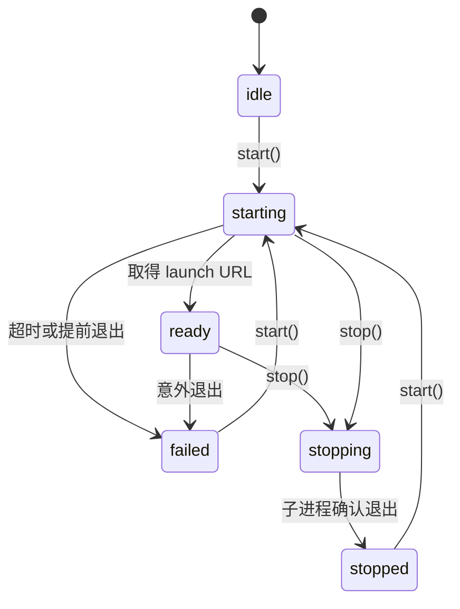

# 河洛 Forge 企业版桌面壳详细设计

## 文档信息

| 项 | 内容 |
|---|---|
| 文档编号 | CORP-DSH-DESIGN-025 |
| 文档名称 | 河洛 Forge 企业版桌面壳详细设计 |
| 版本 | V0.1.4 |
| 文档状态 | 草案 |
| 密级 | — |
| 编制 | DSH 平台组（代拟） |
| 负责 | 平台组（代拟） |
| 审核 | 待定 |
| 批准 | 待定 |
| 最后更新 | 2026-11-24 |
| 门禁 | G2 |
| 模块状态 | 可用（设计阶段；实现与验证见设计索引 §2.2） |

> 编制依据：实施计划 [CORP-DSH-PLAN-026 §4.3](../../plans/2026-11-19-desktop-bundle-packaging.md#43-p2-壳工程核心实现与-windows-x64-打包g2)。已核验方式为 2026-11-23 的静态阅读：本机 `@deepseek-ai/dsh` 0.2.2-rc.5 的命令行形态（`dsh --profile web`，web 应用的 `--host`、`--port`、`--no-open` 选项，以及 stdout 输出的 `dsh web: <认证地址>` 行）、仓库安装器 `scripts/init-enterprise-plugin.mjs` 的写入面与可编程入口、私版 tgz 经 `dsh.bundle.patch` 随包携带配置的装载方式。未核验：锁定版 0.2.1-rc.3 的同一命令行形态；Electron 44.7.0 内嵌 Node 下 `node:sqlite` 与凭据存储的可用性；Windows 与 Linux 自承载；三平台打包链。按项目负责人 2026-11-23 的决定，本模块的实现先于计划 P0 探针进行，上述未核验项以计划 P0 探针结论为准。按项目负责人 2026-11-24 的决定，本目录先建立 `package.json` 并标「状态：可用」，Electron 运行与打包链的验证后置；「可用」指模块、用例与清单已具备，不表示可分发。
>
> 关联文档：[总体架构](../../architecture/platform-architecture.md)、[需求基线](../../requirements/requirements-baseline.md)、[设计索引](../README.md)、[公版插件、企业私有包与官方 DSH 集成方案](../../architecture/public-enterprise-bundle.md)、[工程开发与发布约定](../../engineering/development-conventions.md)、[DSH 插件高阶规范](../../engineering/dsh-plugin-conventions.md)。

## 1. 结论

桌面壳是自有的 Electron 应用：一个窗口加载本机 `dsh --profile web`，一个托盘图标驻留。壳不修改 DSH，不编译上游 `apps/desktop`。壳只做四件事：管理 dsh 子进程，守住窗口的导航与权限边界，首启装载企业资产，处理托盘与退出。判断逻辑全部在不依赖 Electron 的模块里并可离线测试；Electron 只出现在装配层，装配层本身也以注入的接口对象接受测试。

进入可分发状态还缺三项，均属计划 P0 与 P2 的验证：锁定版的启动输出形态、Electron 内嵌 Node 下的凭据存储、三平台打包链。在这些结论出来之前不产出安装包。

## 2. 目标与非目标

**目标**

- 自有壳在全平台以「河洛 Forge 企业版」呈现，内嵌锁定版 dsh 运行时。
- 壳与终端 CLI 共用 `web` profile，共用会话、配置与登录态。
- web 服务只绑定 `127.0.0.1`；窗口只加载本机服务，其余链接交给系统浏览器。
- 首启时装载企业资产；任一步失败时不进入工作区。
- 关窗隐藏至托盘，运行中任务不中断；退出前确认。

**非目标**

- 不修改 DSH 源码或官方 `apps/desktop`，不重打包官方客户端。
- 不签名、不公证、不建自动更新 feed。
- 不实现自己的插件安装与凭据写入：这些由仓库安装器完成，壳只调用。
- 不向 `web` profile 写入 `cordis.patch.yml` 或企业 npm 源 / 索引 preset。是否需要，待计划 P0 第 6 项结论后确定（见 §12）。
- 不在壳内完成企业登录：登录在应用内的 web 界面完成，不设独立欢迎窗口。

## 3. 需求与依赖

| 需求/验收 | 关系 | 说明 |
|---|---|---|
| 需求基线 N5（仅回环监听） | 支撑 | 绑定地址与导航策略都只放行 `127.0.0.1` |
| 需求基线 S9 / N2（凭据边界） | 支撑 | 沿用 forge-credentials-keychain，壳不新增凭据存储 |
| 计划 G2（首启企业配置、托盘与退出） | 支撑 | §7 |

| 依赖 | 类型 | 版本约束 | 缺失时的行为 |
|---|---|---|---|
| Electron | 运行时 | 精确 `44.7.0`：dsh 原生加载器带 Electron 指纹白名单，浮动解析会被拒绝启动 | 壳不启动；版本断言是包体检查的一部分 |
| `@deepseek-ai/dsh` | 内嵌运行时 | [.dsh-version](../../../.dsh-version) 锁定版，npm 制品字节原样并校验 SHA-256 | 缺失或摘要不符时拒绝启动 |
| 员工包企业资产 | 随包目录 | `enterprise-plugin/`（私版 tgz、`private-release.json`、可选的客户端密钥文件）与 `installer/` | 首启失败，不进入工作区 |
| 安装器 `scripts/init-enterprise-plugin.mjs` | 随包脚本 | 员工包 `installer/` 内的那一份，经摘要清单校验 | 首启失败 |
| 企业 npm 源 / 索引 preset、profile 级补丁层 | 企业资产 | 尚未定义 | 不写入；见 §12 |

## 4. 扩展形态与边界

| 项 | 内容 |
|---|---|
| 形态 | 独立 Electron 应用，代码位置 `services/forge-desktop/` |
| 运行位置 | 用户本机；子进程为本机 `dsh --profile web` |
| 目标运行时 | Electron 44.7.0（自承载 Node）+ 锁定版 dsh |
| 使用的 seam | dsh 命令行与 stdout 的 launch URL 行；安装器的 `runInit` |
| 不修改的核心 | DSH 运行时、`web` profile 的内容（除安装器写入的插件与制品证据）、上游 `apps/desktop` |

每个模块是一份状态的唯一可写所有者，模块之间不互相 import；装配层只装配，跨模块只经参数与回调传递。

| 模块 | 职责 | 不负责 |
|---|---|---|
| `src/runtime.mjs` | dsh 子进程的生命周期状态机 | 解析输出、创建窗口 |
| `src/launch-url.mjs` | 从子进程输出取 launch URL 并校验回环 | 启动进程 |
| `src/loopback.mjs` | 回环地址的唯一判定 | 其他 URL 策略 |
| `src/navigation.mjs` | 窗口对目标地址的处置判定与权限请求判定 | 窗口操作 |
| `src/shell-env.mjs` | 登录 shell 环境解析、合并与子进程环境净化 | 启动 shell（由调用方注入） |
| `src/process.mjs` | 一次性子命令的执行与超时 | 命令内容 |
| `src/first-run.mjs` | 企业资产的发现、校验与首启初始化 | 安装细节（委托安装器） |
| `src/lifecycle.mjs` | 关窗、退出与托盘的判定 | 界面 |
| `src/shell.mjs` | 装配：把以上模块接到注入的 Electron 接口 | 业务判断 |
| `src/main.mjs` | 程序入口：引入真实的 `electron` 并调用装配 | 一切判断 |

## 5. 接口与配置

| 配置项 | 类型 | 默认值 | 必填 | 说明 |
|---|---|---|---|---|
| `bindHost` | string | `127.0.0.1` | 否 | 白名单只有这一个值；其他取值在装配前拒绝 |
| `profile` | string | `web` | 否 | 固定为 `web`，与终端 CLI 共用 |
| `startTimeoutMs` | 整数 | `60000` | 否 | 等待 launch URL 的上限 |
| `stopGraceMs` | 整数 | `5000` | 否 | 请求退出到强制终止的间隔 |

```js title="runtime：dsh 子进程的生命周期"
createRuntime({ spawn, findLaunchUrl, startTimeoutMs, stopGraceMs, onEvent })
// start() → Promise<{ href, origin }>   ready 时返回当前地址；starting 时返回同一个进行中的 Promise
// stop()  → Promise<void>               幂等；子进程确认退出后才完成
// snapshot() → { phase, origin, failure }
```

```js title="first-run：企业资产与首启"
locateEnterpriseAssets({ candidates })            // 第一个通过校验的员工包目录，否则抛 ASSETS_NOT_FOUND
firstRunNeeded({ markerPath, manifestDigest })    // 已完成且员工包未变时为 false
initializeProfile({ assets, runInit, env, exec }) // 委托安装器；非零结论抛 FIRST_RUN_FAILED

**首启未完成时的窗口语义（2026-11-25）**：需要首启或首启失败时，窗口先于运行时打开并加载壳自带的本地品牌引导页（`brand/status.html`，无 preload、无外链、不承载任何企业配置值；状态与错误码经查询串注入）。首启失败不退出应用：托盘菜单提供「重试企业配置」，重试复用同一安装器幂等续跑；成功后写入首启标记并转入正常启动（窗口改载 launch URL）。禁止以未打补丁的默认 profile 提前提供界面：官方登录旁路（O3）只有在企业补丁装载后才算关闭。
```

```js title="navigation：窗口边界"
classifyTarget(url, { origin })  // 'load'（本机服务同源）| 'external'（http/https，交系统浏览器）| 'block'
permissionAllowed(permission)    // 恒为 false
```

页面的导航请求与新窗口请求经上表判定：同源加载，http(s) 的其他地址交系统浏览器，其余拦截。服务端重定向（`will-redirect`）只拦截，不代用户打开系统浏览器：它不是用户在页面上的操作触发的。

## 6. 权限、凭据与数据

| 项 | 处理方式 | 生命周期 | 失败时 |
|---|---|---|---|
| launch URL | 带进程令牌，只交给窗口加载；事件、日志与错误体里只有 origin | 随子进程 | 视为启动失败 |
| 客户端密钥 | 壳不读取其内容；安装器把它写入本机凭据库后删除明文文件 | 写入后明文即消失 | 首启失败，保留文件供重跑 |
| 凭据存储 | forge-credentials-keychain 的 SQLite 值级加密与 0600 密钥文件，不使用系统钥匙串 | 随 `DSH_HOME` | 见该包失败模式 |
| 首启标记 | 应用用户数据目录下的 `first-run.json`，记录员工包清单摘要与 profile | 直到员工包变化 | 缺失即重做首启 |
| 日志 | 只记阶段与错误码 | — | 不影响运行 |
| 渲染进程权限 | 全部权限请求默认拒绝；不配置 preload，渲染进程不获得任何壳能力 | — | — |
| 员工包的信任模型 | 摘要校验证明包与其写出时一致，不证明来源：清单文件与摘要清单不带签名，能改写包的人同样能改写它们。壳自身的代码与包在同一安装目录、受同一保护，所以完整性由分发渠道与安装位置守护。不做签名验签：验签公钥若随包或随壳交付，不构成外部信任锚；安装包签名与公证是本计划的非目标 | — | 见 §8 |
| 企业资产的路径 | 摘要清单列出的每个路径都必须是包内的普通文件；任一级是符号链接即拒绝，否则校验会落到包外的文件上，该文件随后还会以包内身份被使用 | — | `ASSETS_INVALID` |
| 客户端密钥文件 | 安装器把密钥写入本机凭据库后删除明文文件；完整性校验只容忍这一个文件的缺失，其余列出的文件缺失即拒绝 | 写入后明文即消失 | 首启失败，保留文件供重跑 |
| 登录 shell 环境 | 合并进子进程的环境是用户自己的环境，与在终端运行 dsh 相同，不构成安全边界。壳只剥离会改变内嵌运行时工作方式的 Node 与 Electron 开关。库注入类变量（`LD_PRELOAD`、`DYLD_*` 等）保留：企业的终端管控常经它们注入，剥离会让内嵌运行时脱离企业自身的管控，而用户 profile 本身就是可执行代码 | 随用户环境 | — |

## 7. 流程



**启动**：`start()` 串行。`starting` 期间再次调用返回同一个进行中的 Promise，不产生第二个进程；`ready` 期间返回当前地址。`stopping` 期间调用被拒绝，不在停止过程中重启。

**就绪**：子进程 stdout 出现 `dsh web: <地址>` 行即为就绪，地址经回环校验。子进程在就绪前退出、或超过 `startTimeoutMs` 仍未输出地址，状态进入 `failed` 并带错误码；超时时先终止子进程。输出疑似端口占用时错误码为 `PORT_CONFLICT`。

**停止**：`stop()` 幂等。先请求子进程退出，超过 `stopGraceMs` 仍未退出则强制终止。只有观察到子进程退出才进入 `stopped`；观察不到时保持 `stopping`，Promise 不完成。

**不确定时**：任何无法确认的情形都停留在当前状态，不重发命令、不返回旧地址、不报告成功。

**首启**（装配层）：候选目录中第一个带清单文件的即为当前员工包，首启记录与首跑判断用的是同一份清单摘要。记录缺失或对不上时，校验该包完整并调用安装器完成插件安装与密钥入库，然后写入首启记录；记录对得上时不再触碰员工包，因为安装器已消耗其中一部分。当前员工包不完整时启动失败，不改用其他候选。记录在安装器之后、写入之前丢失时，下次启动重跑一次安装器；安装器对同版本与已入库的密钥都是幂等的。全部成功后才创建窗口并启动子进程。

**退出**（装配层）：征求确认后先 `stop()`，子进程确认退出后应用才退出；`stop()` 未完成时应用不退出。

## 8. 失败模式

| 场景 | 行为 | 用户可见结果 | 是否可重试 |
|---|---|---|---|
| 未找到可用的企业资产 | 抛 `ASSETS_NOT_FOUND`，提示指定员工包 | 错误提示，无工作区 | 是 |
| 当前员工包不完整：清单或摘要清单缺失、摘要不符、列出的路径是符号链接 | 抛 `ASSETS_INVALID`，不改用其他候选 | 错误提示，无工作区 | 是 |
| 安装器返回非零结论 | 抛 `FIRST_RUN_FAILED`，带安装器错误码；窗口加载本地品牌引导页（状态 + 错误码 + 企业网络指引），应用驻留，托盘菜单「重试企业配置」幂等续跑（2026-11-25 负责人裁决：先开界面、页内提示、后续配置） | 引导页提示，无工作区 | 回企业网后重试 |
| 启动超时 | 终止子进程，`START_TIMEOUT` | 错误提示 | 是 |
| 端口被占用 | `PORT_CONFLICT` | 提示关闭占用进程或换端口 | 是 |
| 就绪后意外退出 | `failed`，保留退出码 | 错误提示 | 是 |
| launch URL 不是 `127.0.0.1` | 拒绝加载 | 错误提示 | 修配置后重试 |
| 页面请求非本机地址 | 同源放行；http/https 交系统浏览器；其余拦截。服务端重定向只拦截 | 本机内容不变 | — |
| 权限请求 | 一律拒绝 | 对应能力不可用 | — |
| 无托盘时关窗 | Windows 与 Linux 退出应用，macOS 沿用 Dock | 见左 | — |

## 9. 可观测性

| 事件 | 字段 | 去向 | 保留 |
|---|---|---|---|
| 状态迁移 | 阶段、错误码、退出码 | 应用日志 | 随应用 |
| 首启结论 | 是否执行、安装器错误码 | 应用日志 | 随应用 |
| 登录 shell 环境不可用 | `SHELL_ENV_UNAVAILABLE` | 应用日志 | 随应用 |

launch URL 的查询串与片段、客户端密钥、环境变量取值不进入任何事件。

## 10. 测试矩阵

| 层级 | 覆盖 | 命令 |
|---|---|---|
| 单元 | 状态机的全部迁移、重复启动与重复停止、超时、端口占用；launch URL 解析；导航与权限判定；环境合并与净化；子命令执行；企业资产校验；关窗与退出判定 | `node --test services/forge-desktop/test` |
| 装配 | 以接口对象替代 Electron：单实例、首启失败不进入工作区、导航与权限处理器的接线、关窗隐藏、退出前先停子进程 | 同上 |
| 集成 | Electron 44.7.0 自承载内嵌 dsh，窗口渲染 | 部分执行（2026-11-24 mac 本机：`--dir` 构建、单实例、首启装入企业插件、内嵌 dsh 回环 `127.0.0.1` 监听、sandbox 渲染进程；IAM 登录止步企业网络边界） |
| 端到端 | 三平台安装、首启、托盘与退出 | 未执行（计划 G2、G3、G4） |

## 11. 打包、升级与回退

| 项 | 值 | 用途 |
|---|---|---|
| appId / bundle id | `com.heluo.forge.enterprise` | 应用唯一标识与 macOS `CFBundleIdentifier` |
| Windows 升级 GUID | `3fa730a8-e95c-45dc-9724-c525f3654136` | NSIS 升级识别 |
| productName | `Heluo Forge Enterprise` | 可执行文件、安装目录与 app bundle 名 |
| 可执行文件名 | `heluo-forge-enterprise` | 可执行文件、deb 包名与 `StartupWMClass` |
| 显示名 | 河洛 Forge 企业版 | 快捷方式、开始菜单、desktop entry 与关于页 |

本模块不是 DSH 插件。清单里的 `engines.dsh` 是仓库检查器对服务清单的要求，取值与内嵌运行时的锁定版一致；对宿主版本的约束由内嵌的锁定版运行时本身承担。清单暂不声明依赖：`electron`（精确钉 `44.7.0`）与 `electron-builder` 随计划 P2 的打包步骤一并加入，届时同步锁文件。仓库的离线检查不安装依赖，用例也不需要它们。构建入口是计划 §4.0 的统一构建；安装包形态与升级语义（异版本先卸载再安装）由计划 §1 与 §4.3 规定。`electron-builder`、打包配置与内嵌载荷的暂存脚本随计划 P2 的打包步骤建立。

## 12. 未决事项

| 问题 | 需要谁回答 | 影响 |
|---|---|---|
| 锁定版 0.2.1-rc.3 的 launch URL 输出形态与命令行选项是否与 0.2.2-rc.5 一致 | 平台组（计划 P0 #10） | `launch-url` 的解析规则 |
| Electron 44.7.0 内嵌 Node 下 `node:sqlite` 与凭据存储是否可用 | 平台组（计划 P0 #7） | 方案是否成立 |
| 企业 npm 源 / 索引 preset 的内容与写入位置 | 平台组（计划 P0 #6） | 首启是否增加 preset 与 profile 级补丁层写入 |
| 终端 CLI 与壳并发使用同一 `web` profile 是否安全 | 平台组（计划 P0 #9） | 壳是否改用独立 profile |
| 退出前是否能查询运行中任务的状态 | 平台组 | 退出提示文案；此前一律提示 |
| 托盘在麒麟桌面环境下的可用性 | 平台组（计划 P4） | 关窗行为 |

计划 §4.3 把首启第三步写为「向 `web` profile 写入 `cordis.patch.yml`」。现行私版制品把企业配置放在 tgz 内的 `dsh.bundle.patch`，由宿主随包装载，安装器不写 profile 级补丁层。壳当前不写 profile 级补丁层：同一行出现在两层时归属不明。是否还需要它（企业 npm 源 / 索引 preset 等 profile 级组合），由计划 P0 第 6 项的结论决定；项目负责人 2026-11-24 确认在此之前留空。
