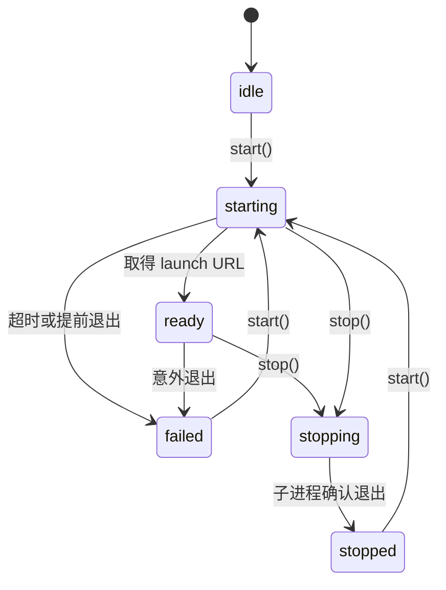

# 河洛 Forge 企业版桌面壳详细设计

## 文档信息

| 项 | 内容 |
|---|---|
| 文档编号 | CORP-DSH-DESIGN-025 |
| 文档名称 | 河洛 Forge 企业版桌面壳详细设计 |
| 版本 | V0.2.4 |
| 文档状态 | 草案 |
| 密级 | — |
| 编制 | DSH 平台组（代拟） |
| 负责 | 平台组（代拟） |
| 审核 | 待定 |
| 批准 | 待定 |
| 最后更新 | 2026-11-27 |
| 门禁 | G2 |
| 模块状态 | 可用（设计阶段；实现与验证见设计索引 §2.2） |

> 编制依据：实施计划 [CORP-DSH-PLAN-026 §4.3](../../plans/2026-11-19-desktop-bundle-packaging.md#43-p2-壳工程核心实现与-windows-x64-打包g2)。已核验（2026-11-23 及 2026-11-26 离线包核验 `@deepseek-ai/dsh` 0.2.2-rc.5）：`lib/bin.js` 导出 `runCli({ packageManager })`、`@deepseek-ai/dsh-web-app` 的 `--host`/`--port`/`--no-open` 与 stdout `dsh web: <认证地址>` 行、`node-addon-require-builtin-darwin-arm64@0.1.10` 的 Electron 指纹白名单含 `44.7.0`（`{43.0.0, 44.0.0, 44.7.0, 44.11.5, 45.0.0-alpha.6}`）；以及仓库安装器 `scripts/init-enterprise-plugin.mjs`、私版 tgz 经 `dsh.bundle.patch` 随包携带配置的装载方式。本机 macOS 开发构建已证实 Electron 44.7.0 自承载启动内嵌 dsh、随包 pnpm 安装企业插件及内嵌 Node 下 `node:sqlite` 凭据写入。未核验：Windows 与 Linux 自承载及 `node:sqlite` 实机表现、独占 profile `heluo-desktop` 与固定端口的真机表现、三平台实机安装与打包链。按项目负责人 2026-11-23 的决定，本模块的实现先于计划 P0 探针进行，上述未核验项以计划 P0 探针结论为准。按项目负责人 2026-11-24 的决定，本目录先建立 `package.json` 并标「状态：可用」，Electron 跨平台运行与打包链的验证后置；「可用」指模块、用例与清单已具备，不表示可分发。内置运行时部分以 2026-11-26 在同一锁定版上的本机实测为依据（上游 `web` profile 补丁层里的相关两行、已发布包导出的载荷布局函数、Electron 44.7.0 Node 模式下的到达性），记录见 [验证记录](../verification/desktop-primary-runtime.md)。按项目负责人 2026-11-26 的决定，壳不再与终端 CLI 共用 `web` profile，改为独占 `heluo-desktop` profile 并监听固定端口 30810，终端 `dsh web` 是否带企业插件由员工包内的启动器决定。端口固定的原因是窗口的本地存储按源隔离而源含端口：端口交由系统分配时，草稿、快捷键等状态每次启动都会重置。profile 归属依据上游 `apps/desktop`（`dsh-v0.2.2-rc.5`）的规则：Electron 应用独占 `$DSH_HOME/profiles/desktop`，与 CLI 只共享 `$DSH_HOME` 下的产品数据，不共享可执行包、插件激活、锁文件与 `node_modules`。安装包的装载布局以 2026-11-27 在同一锁定版上的本机实测为依据（macOS arm64：`--dir` 构建、构建期对归档的逐文件核对，以及以打出来的应用包为准的运行层核对，含原生库加载、ripgrep、pty 与 Office 引擎的真实转换），记录见 §10；Windows 与 Linux 上的构建、安装与运行未验，见 §12。
>
> 关联文档：[总体架构](../../architecture/platform-architecture.md)、[需求基线](../../requirements/requirements-baseline.md)、[设计索引](../README.md)、[公版插件、企业私有包与官方 DSH 集成方案](../../architecture/public-enterprise-bundle.md)、[工程开发与发布约定](../../engineering/development-conventions.md)、[DSH 插件高阶规范](../../engineering/dsh-plugin-conventions.md)。

## 1. 结论

桌面壳是自有的 Electron 应用：一个窗口，顶部是壳自绘的标题栏，下方加载本机 `dsh --profile heluo-desktop`；一个托盘图标驻留。壳独占 `heluo-desktop` profile：与终端 CLI 共用 `$DSH_HOME` 下的会话与登录态，不读写终端的 `web` profile。壳不修改 DSH，不编译上游 `apps/desktop`。壳只做五件事：管理 dsh 子进程，守住窗口的导航与权限边界，首启装载企业资产，处理托盘与退出，绘制窗口自身的标题栏。判断逻辑全部在不依赖 Electron 的模块里并可离线测试；Electron 只出现在装配层，装配层本身也以注入的接口对象接受测试。

应用随包携带上游的内置运行时：独立 Node.js、pnpm、CPython 与 Office 创作库组成的一份可搬迁载荷。壳对它只做一件事——把它的位置交给 `heluo-desktop` profile；读取、安装与运行都由上游自己的工具完成，企业底座的补丁层只是让上游 `web` 模板里的那两行对这个 profile 生效。

安装包里，内嵌运行时整棵收在应用归档 `app.asar` 一个文件里，安装器不再为它的三万多个文件逐个落盘。留在归档外的只有两类：运行时交给操作系统的东西（原生库、可执行程序、原生进程要读的目录），以 `app.asar.unpacked` 的名义按原相对路径解包在归档旁；以及不参与壳自身运行的内置运行时、品牌资产与员工包，按暂存时的样子随包。构建在打包之后把归档与暂存树逐文件核对，核对不过构建即失败。

进入可分发状态仍须完成计划 P0 与 P2–P4 的跨平台验证：Windows 与 Linux 自承载及凭据存储、内置运行时在 Windows 与 Linux 上的载荷构建与运行、独占 profile `heluo-desktop` 与固定端口的真机表现、第三方组件再分发许可书面结论与三平台安装包验收。在此之前已接入的 CI 构建产物仅作内部构建验证，不可对外分发。

## 2. 目标与非目标

**目标**

- 自有壳在全平台以「河洛 Forge 企业版」呈现，内嵌锁定版 dsh 运行时。
- 壳独占 `heluo-desktop` profile，不读写终端的 `web` profile；与终端 CLI 共用 `$DSH_HOME` 下的会话与登录态，profile 级设置各自保存。
- web 服务只绑定 `127.0.0.1` 的固定端口 30810，窗口的源跨启动不变；该端口不是终端 `dsh web` 的默认端口 3080，两者可同时运行。窗口只加载本机服务，其余链接交给系统浏览器。
- 首启时装载企业资产；任一步失败时不进入工作区。
- 随包携带内置运行时并交出其位置：员工机器上没有 Node.js 或 Python 时，Office 创作技能与工作区依赖查询照常可用。
- 内嵌运行时以一个归档文件随包：安装器逐文件写入的数量不随运行时闭包的文件数增长，只与必须落盘的那部分有关。
- 关窗隐藏至托盘，运行中任务不中断；退出前确认。
- macOS 与 Windows 上以无边框窗口呈现：标题栏与最小化、最大化、关闭按钮由壳自绘，样式随平台与系统外观。

**非目标**

- 不修改 DSH 源码或官方 `apps/desktop`，不重打包官方客户端。
- 不签名、不公证、不建自动更新 feed。
- 不实现自己的插件安装与凭据写入：这些由仓库安装器完成，壳只调用。
- 不向 `heluo-desktop` profile 写入 `cordis.patch.yml` 或企业 npm 源 / 索引 preset。是否需要，待计划 P0 第 6 项结论后确定（见 §12）。
- 不安装、不改动终端的 `web` profile：终端形态的企业插件由员工包内的启动器安装，壳的首启只作用于 `heluo-desktop`。
- 不在壳内完成企业登录：登录在应用内的 web 界面完成，不设独立欢迎窗口。

## 3. 需求与依赖

| 需求/验收 | 关系 | 说明 |
|---|---|---|
| 需求基线 N5（仅回环监听） | 支撑 | 绑定地址与导航策略都只放行 `127.0.0.1` |
| 需求基线 S9 / N2（凭据边界） | 支撑 | 沿用 forge-credentials-keychain，壳不新增凭据存储 |
| 计划 G2（首启企业配置、托盘与退出） | 支撑 | §7 |

| 依赖 | 类型 | 版本约束 | 缺失时的行为 |
|---|---|---|---|
| Electron | 运行时 | 精确 `44.7.0`：dsh 原生加载器带 Electron 指纹白名单，浮动解析会被拒绝启动 | 壳不启动；版本断言是包体检查的一部分 |
| `@deepseek-ai/dsh` | 内嵌运行时 | [.dsh-version](../../../.dsh-version) 锁定版，npm 制品字节原样并校验 SHA-256 | 缺失或摘要不符时拒绝启动 |
| pnpm | 载荷内工具 | 内置运行时载荷里的 pnpm，与根 `package.json` 的 `packageManager` 同版（现 `11.28.5`）；npm 制品按 `runtime-lock.json` 核验字节与 SHA-256 后随载荷解包到 `primary-runtime/dependencies/pnpm/`，壳不再另解包一份 `resources/pnpm` | 暂存拒绝；运行时缺失则壳拒绝启动 |
| 员工包企业资产 | 随包目录 | `enterprise-plugin/`（私版 tgz、`private-release.json`、可选的客户端密钥文件）与 `installer/` | 首启失败，不进入工作区 |
| 安装器 `scripts/init-enterprise-plugin.mjs` | 随包脚本 | 员工包 `installer/` 内的那一份，经摘要清单校验；须声明壳探测的能力（`CAPABILITIES` 导出，或旧版安装器的回显行常量） | 首启失败（`INSTALLER_CAPABILITY_MISSING`） |
| 内置运行时 | 随包载荷 | 上游为同一 dsh 版本锁定的 primary runtime，钉在 `primary-runtime-lock.json`：Node.js 与 `.node-version` 同版（现 `24.21.0`）、CPython 3.12.14、pnpm 与 `runtime-lock.json` 的同一制品，每个归档核对 SHA-256 | 缺失、清单不可读或不是为本机构建时壳拒绝启动 |
| 企业 npm 源 / 索引 preset、profile 级补丁层 | 企业资产 | 尚未定义 | 不写入；见 §12 |

## 4. 扩展形态与边界

| 项 | 内容 |
|---|---|
| 形态 | 独立 Electron 应用，代码位置 `services/forge-desktop/` |
| 运行位置 | 用户本机；子进程为本机 `dsh --profile heluo-desktop` |
| 目标运行时 | Electron 44.7.0（自承载 Node）+ 锁定版 dsh + 随包 pnpm，dsh 自应用归档 `app.asar` 加载；另随包携带供 agent 使用的内置运行时，它不参与壳自身的运行 |
| 使用的 seam | dsh 命令行与 stdout 的 launch URL 行；dsh 公开导出的 `runCli({ packageManager })`，包操作所用的 pnpm 由壳指定为载荷的 Node 运行载荷的 `bin/pnpm.mjs`；安装器模块（`runInit` 入口与 `CAPABILITIES` 能力清单，壳带 `--pnpm-from-host`、`--reinstall-on-store-mismatch` 与 `--pnpm-store` 调用）与 `scriptExec`（壳以应用二进制为 Node 运行插件自带的 CLI）；环境变量 `DSH_PRIMARY_RUNTIME`，上游的工具行按它读取内置运行时的位置 |
| 不修改的核心 | DSH 运行时、`heluo-desktop` 之外的一切 profile（含终端的 `web`）、上游 `apps/desktop` |

每个模块是一份状态的唯一可写所有者，模块之间不互相 import；装配层只装配，跨模块只经参数与回调传递。

| 模块 | 职责 | 不负责 |
|---|---|---|
| `src/runtime.mjs` | dsh 子进程的生命周期状态机 | 解析输出、创建窗口 |
| `src/launch-url.mjs` | 从子进程输出取 launch URL 并校验回环 | 启动进程 |
| `src/loopback.mjs` | 回环地址的唯一判定 | 其他 URL 策略 |
| `src/navigation.mjs` | 窗口对目标地址的处置判定与权限请求判定 | 窗口操作 |
| `src/shell-env.mjs` | 登录 shell 环境解析、合并与子进程环境净化 | 启动 shell（由调用方注入） |
| `src/process.mjs` | 一次性子命令的执行与超时；交给安装器的两个执行器 | 命令内容 |
| `src/embedded-cli.mjs` | dsh 的唯一入口：以 Node 运行，把载荷的 Node 与 pnpm 作为包管理器交给 dsh 的命令行；dsh 自归档加载时，先装好物理路径层再链接 dsh | 窗口、托盘与首启判断 |
| `src/physical-paths.mjs` | dsh 进程里，把交给操作系统的归档路径换成归档旁的解包副本 | 决定哪些文件解包（构建规则的职责）；读取归档内容 |
| `src/primary-runtime.mjs` | 校验随包的内置运行时，给出交给子进程的环境变量 | 读取载荷内容；安装或运行其中的解释器 |
| `src/pnpm-store.mjs` | 向载荷的 pnpm 问一次它为本机的 profile 解析出的 store 目录，交给首启 | 比对 store（安装器的职责）；修复（安装器的职责） |
| `src/diagnostic.mjs` | 失败时告诉人什么：安装器结论的提取、日志条目、交给状态页的参数 | 窗口、日志文件的位置（由装配层给） |
| `src/first-run.mjs` | 企业资产的发现、校验与首启初始化 | 安装细节（委托安装器） |
| `src/lifecycle.mjs` | 关窗、退出与托盘的判定 | 界面 |
| `src/window-chrome.mjs` | 窗口外观的判定：哪些平台由壳自绘标题栏、标题栏与内容如何分占窗口、标题栏可请求的窗口动作与调用方校验 | 窗口操作本身（由装配层执行） |
| `src/shell.mjs` | 装配：把以上模块接到注入的 Electron 接口 | 业务判断 |
| `src/main.mjs` | 程序入口：引入真实的 `electron` 并调用装配 | 一切判断 |

**窗口组成**：窗口自身的页面是壳的标题栏（`brand/titlebar.html`，随包资源，无外链）；引导页与工作区加载在它的内容视图（`WebContentsView`）里，位于标题栏下方。macOS 与 Windows 隐藏系统标题栏（`titleBarStyle: 'hidden'`，macOS 同时隐藏系统红绿灯），标题栏分别为 28 与 32 像素，按钮在左侧以红绿灯样式、在右侧以最小化 / 最大化 / 关闭排列，颜色随系统深浅色。全屏时标题栏收起，内容占满窗口。其他平台保留系统标题栏：内容占满窗口，不存在标题栏页面。工作区页面不打任何宿主标记、不注入样式，保持普通浏览器页面的布局，因此不随 DSH 页面结构变化而错位。

## 5. 接口与配置

| 配置项 | 类型 | 默认值 | 必填 | 说明 |
|---|---|---|---|---|
| `bindHost` | string | `127.0.0.1` | 否 | 白名单只有这一个值；其他取值在装配前拒绝 |
| `profile` | string | `heluo-desktop` | 否 | 固定；壳独占的自定义 profile 名，不与终端的 `web`、官方 Desktop 的 `desktop` 同名 |
| `port` | 整数 | `30810` | 否 | 固定。窗口的本地存储按源隔离而源含端口，端口固定这些状态才跨启动保留。30810 在 IANA 未分配，低于 Linux 临时端口范围起点 32768，也不是终端 `dsh web` 的默认端口 3080。代价是该端口被占用时壳启动失败（§8） |
| `startTimeoutMs` | 整数 | `60000` | 否 | 等待 launch URL 的上限 |
| `stopGraceMs` | 整数 | `5000` | 否 | 请求退出到强制终止的间隔 |

```js title="runtime：dsh 子进程的生命周期"
createRuntime({ spawn, findLaunchUrl, startTimeoutMs, stopGraceMs, onEvent })
// start() → Promise<{ href, origin }>   ready 时返回当前地址；starting 时返回同一个进行中的 Promise
// stop()  → Promise<void>               幂等；子进程确认退出后才完成
// snapshot() → { phase, origin, failure }
```

```js title="first-run：企业资产与首启"
locateEnterpriseAssets({ candidates })            // 第一个通过校验的员工包目录，否则抛 ASSETS_NOT_FOUND
firstRunNeeded({ markerPath, manifestDigest })    // 已完成且员工包未变时为 false
installerCapabilities(installer)                  // 安装器模块声明的能力（CAPABILITIES，旧版回退到回显行常量）
initializeProfile({ assets, installer, env, exec, pnpmStore }) // 按能力传参（--pnpm-from-host 为硬前提）；非零结论抛 FIRST_RUN_FAILED

**首启未完成时的窗口语义（2026-11-25）**：需要首启或首启失败时，窗口先于运行时打开并加载壳自带的本地品牌引导页（`brand/status.html`，无 preload、无外链，页面文件不承载企业配置值；状态、错误码与安装器结论经查询串注入，页面只以文本显示）。首启失败不退出应用：托盘菜单提供「重试企业配置」，重试复用同一安装器幂等续跑；成功后写入首启标记并转入正常启动（窗口改载 launch URL）。禁止以未打补丁的默认 profile 提前提供界面：官方登录旁路（O3）只有在企业补丁装载后才算关闭。

**首启失败时显示的明细**：状态页给出安装器的错误码、原因与处理办法，以及日志文件的位置；安装器没有给出处理办法时，显示壳对该错误码的指引。每段文字是一行且有长度上限（原因 600 字、处理 400 字），完整内容在日志里。这是开发阶段的决定：安装器的原文可能含本机路径与 Discovery 地址，正式分发前决定是否收起。
```

```js title="pnpm-store：向载荷的 pnpm 问一次 store"
resolvePnpmStore({ nodeEntry, pnpmEntry, cwd, env }) // 以载荷 Node 运行 `pnpm store path`（cwd 为 profile 目录）；解析不出时返回 null
```

```js title="embedded-cli：dsh 的唯一入口"
packageManagerFor({ nodeEntry, pnpmEntry })   // { command: 载荷的 node, args: [载荷 pnpm 的 bin/pnpm.mjs], env: {} }
runEmbeddedCli({ dshEntry, nodeEntry, pnpmEntry }) // 先按 dshEntry 所在的归档装好物理路径层，再调用 dsh 导出的 runCli({ packageManager })；命令行参数原样，不改 dsh
```

壳需要 dsh 的每个场合（启动 `heluo-desktop` profile、安装器走 dsh 的命令）都启动这一个入口。dsh 的每次包操作因此都由载荷自己的 Node 运行载荷自己的 pnpm，员工机器上有没有 Node 或 pnpm 都不影响插件安装；应用里不再有第二份 pnpm，包操作与载荷内的 agent 工具共用同一份制品与同一个解释器。`dshEntry` 位于应用归档之内（`layout.mjs` 的 `APP_ARCHIVE_PARTS` 与 `DSH_ENTRY_PARTS`）；载荷的 Node 与 pnpm 在归档之外原样随包。

```js title="physical-paths：交给操作系统的路径"
archiveRootOf(path)                     // 路径落在哪个应用归档里；不在归档内为 null
installPhysicalPaths({ archiveRoot })   // spawn、spawnSync、execFile、execFileSync 收到的归档路径，解包副本在盘上时换成副本；调用的其余部分保持原义（execFile 的回调、promisify 的返回）
```

Electron 对从归档加载的进程只放行三种用法：读归档、按归档路径 `execFile` 一个已解包的程序、按归档路径加载已解包的原生库；`spawn` 同一个程序报 `ENOTDIR`，被拉起的进程自己也打不开归档里的路径。物理路径层按一条规则补上这一半：凡是落在应用归档里、而它的解包副本在盘上的路径，交给操作系统时换成副本。规则覆盖程序的路径、字符串参数、环境变量的值与工作目录；副本对读得了归档的进程和读不了的进程一样可用，所以替换不会让任何调用变差，只在归档里而没有副本的路径原样保留、由调用方自己报错。

这一层不处理交给 shell 的命令行（`exec`：分不清哪一段是路径），也不处理原生库按运行时自算的路径去读文件；一个值只有整体是归档内的路径才会被替换，`PATH` 这类列表里的某一段原样保留。已知引擎在上游 0.2.2-rc.5 里自行把路径换到解包副本（Office 引擎包经 `dsh-office-kit`、ripgrep、node-pty 的 helper、Computer Use 助手），所以这一层是为不自行处理的调用兜底，不是它们的前提。内置模块的具名导出在导入方链接时绑定到当时的函数，因此这一层必须在任何 dsh 模块链接之前装好，并经 `syncBuiltinESMExports()` 同步。

```js title="primary-runtime：内置运行时的位置"
primaryRuntimeVariable(resources)   // { DSH_PRIMARY_RUNTIME: <resources>/primary-runtime }
                                     // 清单缺失、不可读或目标与本机不符时抛 EMBEDDED_RUNTIME_MISSING
```

内置运行时是上游为同一 dsh 版本锁定的载荷，布局为 `primary-runtime/runtime.json` 与 `dependencies/{node,pnpm,python}`。壳不读载荷内部，也不在载荷里拼任何路径：它只在子进程环境里写出上表的变量，上游的 `load_workspace_dependencies` 工具与 Office 技能的配置行按这个变量生效。上游自己只把这两行对名为 `desktop` 的 profile 打开；`@heluo/forge-enterprise` 的补丁层按 id 覆盖它们，去掉 profile 名这一条限制，其余语义不变。没有这个变量时工具行保持停用、Office 技能指向用户自己的 Python，所以终端的 `web` profile 不受影响。

工具在首次被调用时把载荷复制到 `$DSH_HOME/dsh-runtimes/dsh-primary-runtime` 并复用，直到 `runtime.json` 变化；这是上游的行为，壳不参与。载荷的 pnpm 只解包这一份：agent 的工具行与 dsh 的每次包操作运行的都是它，壳不再另带一份。

插件自带的 CLI 不经这个入口：安装器预置密钥（set、replace、空目录诊断三处）直接运行已安装插件的 `@heluo/forge-iam/bin/heluo-forge.mjs`。壳为此另给安装器一个脚本执行器（`embeddedScriptExec`）：以同一应用二进制为 Node 运行该脚本，前面什么都不加——dsh 的入口会把这个脚本的路径读成 profile 名。执行器只放行 profile 目录内路径归一的普通文件，profile 之外、目录与链接一律拒绝；终端单独运行安装器时不传它，行为与原先一致。

```js title="navigation：窗口边界"
classifyTarget(url, { origin })  // 'load'（本机服务同源）| 'external'（http/https，交系统浏览器）| 'block'
permissionAllowed(permission)    // 恒为 false
```

页面的导航请求与新窗口请求经上表判定：同源加载，http(s) 的其他地址交系统浏览器，其余拦截。服务端重定向（`will-redirect`）只拦截，不代用户打开系统浏览器：它不是用户在页面上的操作触发的。

```js title="window-chrome：窗口外观与标题栏的桥接"
windowChrome({ platform })                            // { frameless, barHeight, controls, hideSystemButtons, window }
contentBounds({ width, height, barHeight, fullscreen })  // 内容视图在窗口中的位置：标题栏下方，全屏时占满
isWindowAction(action)                                // 只有 minimize、toggle-maximize、close
isTitleBarRequest(sender, frame, window)              // 请求是否来自标题栏页面的主框架
hasTitleBarBridge(type)                               // 标题栏页面加载后，typeof window.forgeWindow 是否为 object
```

标题栏页面经它的 preload（`src/window-chrome.preload.cjs`）得到 `window.forgeWindow`：`minimize()`、`toggleMaximize()`、`close()` 三个无参动作，和 `onState()` 状态订阅。动作经 `forge:window-action` 送达主进程，主进程只在调用方是标题栏页面的主框架、且动作在白名单内时执行，并回传空值；窗口是否最大化、是否在前台经 `forge:window-state` 推给标题栏。全屏不在此列：那时标题栏被内容盖住，布局直接向窗口询问全屏状态。启动等标题栏页面加载完成，并在页面上确认桥接已注入才继续——页面能加载而桥接没有生效，那时按钮不起作用。标题栏页面不可导航、不可打开新窗口。关闭沿用关窗语义（§8），macOS 上的缩放按钮执行最大化，全屏经系统快捷键或菜单进入。

## 6. 权限、凭据与数据

| 项 | 处理方式 | 生命周期 | 失败时 |
|---|---|---|---|
| launch URL | 带进程令牌，只交给内容视图加载，标题栏页面从不接触它；事件、日志与错误体里只有 origin | 随子进程 | 视为启动失败 |
| 客户端密钥 | 壳不读取其内容；安装器把它写入本机凭据库后删除明文文件 | 写入后明文即消失 | 首启失败，保留文件供重跑 |
| 凭据存储 | forge-credentials-keychain 的 SQLite 值级加密与 0600 密钥文件，不使用系统钥匙串 | 随操作系统用户的应用数据目录（macOS `~/Library/Application Support/HeluoForge`、Windows `%LOCALAPPDATA%\HeluoForge`、Linux `$XDG_DATA_HOME/HeluoForge`），与 `DSH_HOME`、profile 无关 | 见该包失败模式 |
| 首启标记 | 应用用户数据目录下的 `first-run.json`，记录员工包清单摘要与 profile | 直到员工包或 profile 变化 | 缺失即重做首启 |
| profile 归属 | 壳只创建、安装与启动 `$DSH_HOME/profiles/heluo-desktop`；终端的 `web` 与官方 Desktop 的 `desktop` 不读不写。profile 不存在时由安装器经内嵌运行时从 web 模板创建 | 随 `$DSH_HOME` | 创建失败即 `FIRST_RUN_FAILED`，不进入工作区 |
| pnpm store 不一致 | 壳独占的 profile 里仍可能留着由另一个 pnpm 的 store 链接的 `node_modules`（上一版壳换了随包 pnpm 的 store 布局，或有人在终端用别的 pnpm 动过它），pnpm 拒绝在上面继续安装（`ERR_PNPM_UNEXPECTED_STORE`；触发条件是 store 目录不同，与 pnpm 版本无关）。壳向安装器声明拥有该 profile（`--reinstall-on-store-mismatch`），安装器据此清空 `profiles/heluo-desktop/node_modules` 并重试该步一次：只删这一个目录，目录内的链接只删链接本身；`node_modules` 本身是链接或不是目录时不动它。整次首启只修复一次，清空后仍不一致即停止 | 随 `$DSH_HOME` | `PROFILE_RESET_FAILED` 或 `PROFILE_STORE_MISMATCH`，结论的回显与警告写明清空过 |
| store 预检 | 首启前壳以载荷的 Node 运行载荷的 pnpm，在 profile 目录里问一次它解析出的 store（`pnpm store path`，与包操作同一工作目录与环境），把结果作为 `--pnpm-store` 交给安装器；安装器在执行任何包操作之前先与 profile 的 `node_modules` 记录的 store 比对（按归一化路径）。不一致且已获修复授权：先清空再卸载/安装，「先删后装」两侧都是确认过健康的操作；不一致且未获授权：以 `PROFILE_STORE_MISMATCH` 停止且不改动 profile。探测失败或未声明（终端形态）时不传该参数，回落到失败后修复；预检误判一致时同样回落——反应式自愈保留。探测是输入不是前提，全新 profile（目录尚不存在）探测自然失败，属正常 | 随首启尝试 | 探测失败静默回落；比对结论随安装器回显 |
| 与终端共享的状态 | 会话（`$DSH_HOME/sessions`）与官方凭据（`$DSH_HOME/.credentials.yaml`）在 `$DSH_HOME` 顶层，同一 `$DSH_HOME` 下的所有 profile 共用；设置与默认模型写入各 profile 自己的 `cordis.patch.yml`，不共用 | 随 `$DSH_HOME` | — |
| 企业会话在其他 profile 中的可见性 | 企业插件的管控范围是装载它的 profile。同一 `$DSH_HOME` 下不带企业插件的 profile（例如未运行启动器的终端 `web`）能列出壳产生的会话，并在该 profile 里改用它自己的模型续写。合规要求企业会话不出现在其他界面时，壳改用独立的 `DSH_HOME`，代价是不再与终端企业版共用会话（§12） | — | 接受，不处理 |
| 窗口按源保存的界面状态 | Web 客户端把会话草稿与视图选择（`dsh.conversation.<会话>`）、快捷键覆盖（`dsh.keybindings.v1`）、右侧栏状态、日程的常用时区和终端 shell 选择存在窗口的 `localStorage`，按源隔离而源含端口。壳的端口固定，窗口的源跨启动不变，这些状态得以保留；端口若交由系统分配，每次启动的源都不同，它们会在每次启动时重置（静态阅读内嵌运行时 0.2.1-rc.3 的客户端得出，未实跑）。上游 Desktop 从固定源 `dsh-app://app/` 加载界面，同样不受端口影响 | 随应用数据目录下的窗口会话存储 | — |
| 日志 | 应用数据目录下的 `logs/first-run.log`（0600）：每次首启尝试的安装器结论（错误码、原因、处理、回显与警告），以及每个导致应用退出的失败的错误码与说明。不记环境变量、客户端密钥、令牌与 launch URL | 随应用数据 | 写不进时照常运行，不构成启动失败 |
| 渲染进程权限 | 全部权限请求默认拒绝。加载引导页与工作区的内容视图不配置 preload、不获得任何壳能力；只有壳自有的标题栏页面配置 preload，经桥接得到三个无参窗口动作，主进程校验调用方是该页面的主框架且动作在白名单内，桥接不回传数据 | 随窗口 | 非标题栏页面或白名单外的请求不执行 |
| 员工包的信任模型 | 摘要校验证明包与其写出时一致，不证明来源：清单文件与摘要清单不带签名，能改写包的人同样能改写它们。壳自身的代码与包在同一安装目录、受同一保护，所以完整性由分发渠道与安装位置守护。不做签名验签：验签公钥若随包或随壳交付，不构成外部信任锚；安装包签名与公证是本计划的非目标 | — | 见 §8 |
| 企业资产的路径 | 摘要清单列出的每个路径都必须是包内的普通文件；任一级是符号链接即拒绝，否则校验会落到包外的文件上，该文件随后还会以包内身份被使用 | — | `ASSETS_INVALID` |
| 客户端密钥文件 | 安装器把密钥写入本机凭据库后删除明文文件；完整性校验只容忍这一个文件的缺失，其余列出的文件缺失即拒绝 | 写入后明文即消失 | 首启失败，保留文件供重跑 |
| 随包 pnpm | dsh 的每次包操作（首启安装、应用内安装插件）都由载荷的 Node 运行载荷的 `bin/pnpm.mjs`，不查找 PATH 上的 pnpm；不改 PATH、环境变量或包管理器配置，pnpm 自己的全局目录与 store 沿用用户设置。包脚本若需要 PATH 上的 `node`（例如原生插件构建），不在载荷 pnpm 的覆盖范围内 | 随应用（载荷内） | 缺失即拒绝启动（`EMBEDDED_RUNTIME_MISSING`） |
| 安装器能力 | 壳动态加载员工包内的安装器模块后先读其能力清单（`CAPABILITIES`；旧版安装器以回显行常量声明），按清单传参：`--pnpm-from-host` 是硬前提，缺失即报 `INSTALLER_CAPABILITY_MISSING` 而不是让安装器撞「未知参数」；`--reinstall-on-store-mismatch` 与 `--pnpm-store` 按能力可选。认识随包 pnpm 但不认识修复授权的中间版本安装器照常运行，只是失去对应的自愈 | 随员工包 | `INSTALLER_CAPABILITY_MISSING`，引导页按错误码给出换包指引 |
| 内置运行时的位置 | `DSH_PRIMARY_RUNTIME` 由壳在合并完继承环境之后设置，并从 GUI 与登录 shell 两处继承的环境里剥离：用户 shell 配置里的同名值到不了 `heluo-desktop` profile，到达子进程的只有应用随包的那一份。壳不读载荷内容；首次调用时由上游工具复制到 `DSH_HOME` 下 | 随应用；安装副本随 `DSH_HOME` | 缺失、清单不可读或目标不符时拒绝启动（`EMBEDDED_RUNTIME_MISSING`） |
| 登录 shell 环境 | 合并进子进程的环境是用户自己的环境，与在终端运行 dsh 相同，不构成安全边界。壳只剥离会改变内嵌运行时工作方式的 Node 与 Electron 开关，以及内置运行时的位置变量。库注入类变量（`LD_PRELOAD`、`DYLD_*` 等）保留：企业的终端管控常经它们注入，剥离会让内嵌运行时脱离企业自身的管控，而用户 profile 本身就是可执行代码 | 随用户环境 | — |

## 7. 流程



**启动**：`start()` 串行。`starting` 期间再次调用返回同一个进行中的 Promise，不产生第二个进程；`ready` 期间返回当前地址。`stopping` 期间调用被拒绝，不在停止过程中重启。

**就绪**：子进程 stdout 出现 `dsh web: <地址>` 行即为就绪，地址经回环校验。子进程在就绪前退出、或超过 `startTimeoutMs` 仍未输出地址，状态进入 `failed` 并带错误码；超时时先终止子进程。输出疑似端口占用时错误码为 `PORT_CONFLICT`。

**停止**：`stop()` 幂等。先请求子进程退出，超过 `stopGraceMs` 仍未退出则强制终止。只有观察到子进程退出才进入 `stopped`；观察不到时保持 `stopping`，Promise 不完成。

**不确定时**：任何无法确认的情形都停留在当前状态，不重发命令、不返回旧地址、不报告成功。

**首启**（装配层）：候选目录中第一个带清单文件的即为当前员工包，首启记录与首跑判断用的是同一份清单摘要。记录缺失或对不上时，校验该包完整并调用安装器完成插件安装与密钥入库，然后写入首启记录；记录对得上时不再触碰员工包，因为安装器已消耗其中一部分。当前员工包不完整时启动失败，不改用其他候选。壳先读安装器模块的能力清单再传参：`--pnpm-from-host` 是硬前提（pnpm 由壳经 dsh 交给每次包操作，安装器既不在 PATH 查找，也不补装），能力缺失时以 `INSTALLER_CAPABILITY_MISSING` 停下并指引换用同批次员工包，而不是让安装器撞「未知参数」。安装器声明相应能力时，壳另带 `--reinstall-on-store-mismatch` 与 `--pnpm-store`（store 探测的结果，§6）：前者授权安装器在该 profile 的 `node_modules` 来自另一个 store 时清空并重试一次；后者让比对与处理发生在任何包操作之前。记录在安装器之后、写入之前丢失时，下次启动重跑一次安装器；安装器对同版本与已入库的密钥都是幂等的。全部成功后才创建窗口并启动子进程。

**退出**（装配层）：征求确认后先 `stop()`，子进程确认退出后应用才退出；`stop()` 未完成时应用不退出。

## 8. 失败模式

| 场景 | 行为 | 用户可见结果 | 是否可重试 |
|---|---|---|---|
| 未找到可用的企业资产 | 抛 `ASSETS_NOT_FOUND`，提示补齐随包 `enterprise-assets` 后从托盘菜单重试 | 错误提示，无工作区 | 是 |
| 当前员工包不完整：清单或摘要清单缺失、摘要不符、列出的路径是符号链接 | 抛 `ASSETS_INVALID`，不改用其他候选 | 错误提示，无工作区 | 是 |
| 内嵌运行时、随包 pnpm 或内置运行时缺失，或内置运行时不是为本机构建 | 启动前拒绝，`EMBEDDED_RUNTIME_MISSING` | 错误提示，无工作区 | 重新安装应用 |
| 标题栏页面或它的桥接缺失，或页面加载后桥接没有生效 | 启动前拒绝或停在显示任何界面之前，`TITLE_BAR_MISSING`：没有标题栏的窗口没有控件，不显示 | 错误提示，无工作区 | 重新安装应用 |
| 安装器返回非零结论 | 抛 `FIRST_RUN_FAILED`，带安装器错误码；窗口加载本地品牌引导页（状态、错误码、安装器错误码、原因、处理办法与企业网络指引），日志记录安装器的完整结论，应用驻留，托盘菜单「重试企业配置」幂等续跑（2026-11-25 负责人裁决：先开界面、页内提示、后续配置） | 引导页提示，无工作区 | 回企业网后重试 |
| pnpm 拒绝该 profile 的 `node_modules`（由另一个 store 链接） | 安装器清空 `node_modules` 后重试这一步一次，回显与警告写明清空过 | 无，首启照常完成；该 profile 里不由本次交付装入的插件需要重新安装 | — |
| 清空 `node_modules` 失败（本身是链接、不是目录，或文件被进程占用）；清空后重试仍报 store 不一致 | 安装器分别报 `PROFILE_RESET_FAILED`、`PROFILE_STORE_MISMATCH`，带原因与处理 | 引导页提示，无工作区 | 退出占用该 profile 的进程，或由管理员核对该机器的 pnpm 配置后重试 |
| 启动超时 | 终止子进程，`START_TIMEOUT` | 错误提示 | 是 |
| 固定端口 30810 被占用：别的程序，或上一次壳异常退出后遗留的 dsh 子进程 | `PORT_CONFLICT` | 错误提示：关闭占用该端口的程序后重新启动应用。提示不带端口号 | 是 |
| 就绪后意外退出 | `failed`，保留退出码 | 错误提示 | 是 |
| launch URL 不是 `127.0.0.1` | 拒绝加载 | 错误提示 | 修配置后重试 |
| 页面请求非本机地址 | 同源放行；http/https 交系统浏览器；其余拦截。服务端重定向只拦截 | 本机内容不变 | — |
| 权限请求 | 一律拒绝 | 对应能力不可用 | — |
| 无托盘时关窗 | Windows 与 Linux 退出应用，macOS 沿用 Dock | 见左 | — |

## 9. 可观测性

| 事件 | 字段 | 去向 | 保留 |
|---|---|---|---|
| 状态迁移 | 阶段、错误码、退出码 | 应用日志 | 随应用 |
| 首启结论 | 是否执行、安装器错误码 | 应用日志 | 随应用 |
| 首启日志 | 安装器的结论、回显与警告；导致应用退出的失败的错误码与说明 | 应用数据目录下的 `logs/first-run.log` | 随应用数据 |
| 登录 shell 环境不可用 | `SHELL_ENV_UNAVAILABLE` | 应用日志 | 随应用 |

launch URL 的查询串与片段、客户端密钥、环境变量取值不进入任何事件，也不进入日志。

## 10. 测试矩阵

| 层级 | 覆盖 | 命令 |
|---|---|---|
| 单元 | 状态机的全部迁移、重复启动与重复停止、超时、端口占用；launch URL 解析；导航与权限判定；环境合并与净化；子命令执行；入口把载荷的 Node 与 pnpm 交给 dsh；入口声明的 profile 名、固定端口与启动参数（独占 profile、窗口的源跨启动不变）；失败结论的提取、日志条目与状态页参数；状态页只以文本显示明细；企业资产校验；安装器能力探测（三种声明形态、按能力传参、能力缺失的结论）；store 探测（成功、失败回落、末行解析）；关窗与退出判定；窗口外观判定、桥接是否生效的判定、标题栏桥接与页面约束（全工程只向标题栏发出一个 preload） | `node --test services/forge-desktop/test` |
| 载荷暂存 | `scripts/stage-primary-runtime.mjs`：布局、逐归档摘要、有界重试、台账防篡改、外平台原生包与上游测试目录的裁剪、冒烟只写副本 | `node --test tests/stage-primary-runtime.test.mjs tests/zip-archive.test.mjs` |
| 运行层 | 内置运行时到达 agent：注册、可见、首次调用安装、技能指向、agent 的 shell 运行；带基线对照。`--app` 以打出来的应用包为准 | `node scripts/probe/run-primary-runtime-probe.mjs --resources <暂存目录>` 或 `--app <.app>` |
| 装配 | 以接口对象替代 Electron：单实例、首启失败不进入工作区、导航与权限处理器的接线、关窗隐藏、退出前先停子进程；标题栏与内容视图的分工、标题栏就位以桥接生效为准、窗口动作的调用方校验、窗口状态推送、全屏与尺寸跟随、键盘焦点归属 | 同上 |
| 集成 | Electron 44.7.0 自承载内嵌 dsh，窗口渲染 | 以下冒烟均在壳改用独占 profile `heluo-desktop` 与固定端口之前取得（`--profile web` 与默认端口 3080），新形态尚无真机证据。部分执行（2026-11-24 mac 本机：`--dir` 构建、单实例、首启装入企业插件、内嵌 dsh 回环 `127.0.0.1` 监听、sandbox 渲染进程；IAM 登录止步企业网络边界。2026-11-25 mac 本机：PATH 上没有 node、npm、pnpm 时，首启经随包 pnpm 装入企业插件并进入工作区；同一条件下不带随包 pnpm 的构建停在 `FIRST_RUN_FAILED`。2026-11-25 mac 本机深色外观，无边框窗口（预写首启标记，内容是未装载企业插件的 web 界面）：标题栏与内容视图各就其位，工作区页面无桥接、无宿主标记；关闭、最小化、缩放三个按钮经桥接生效，最大化与失焦状态推送到标题栏，全屏收起并恢复标题栏，第二份实例把隐藏或最小化的窗口调回；标题栏的偏移、间距与颜色与系统原生逐像素核对一致。2026-11-26 mac 本机同一构建：以主进程报出的窗口事实为准，全屏往返、最大化与焦点状态变化时标题栏与内容页的表现逐项一致，启动在页面上确认桥接已注入。2026-11-26 mac 本机，装载企业插件后的窗口：载荷按台账重新暂存（dsh 0.2.2-rc.5），隔离 profile 装入从 HEAD 构建的企业插件并接仓库测试用的模拟 IdP（同 `scripts/probe/run-iam-local-uat.sh` 的做法），壳以沙箱 `HOME` 承载该 profile——工作区先显示企业服务初始化向导，经系统浏览器完成模拟登录后显示企业账号已认证；工作区页面仍无桥接、无宿主标记，标题栏与内容各就其位，壳无报错，开发者本机的真实凭据库、DSH 目录与应用数据未被触碰（运行前后指纹一致）。2026-11-26 mac 本机，经壳首启装载企业插件的完整路径：用制包工具从 HEAD 造一份配置指向仓库模拟 IAM 与网关（`scripts/probe/mock-iam-gateway.mjs`）的合成员工包，壳在沙箱 `HOME` 与全新的用户数据目录里首启——状态页显示初始化中，安装器经壳的内嵌入口与随包 pnpm 执行 `dsh plugin --profile web add` 并核验通过，客户端密钥写入沙箱内的凭据库、交付目录内的明文密钥被删除，首启标记写出，15 秒内进入工作区并显示企业服务初始化向导；向导三步走完（经系统浏览器登录模拟企业账号、保存合成网关凭证并取得企业模型、完成），缩放、全屏与焦点状态以主进程报出的窗口事实核对一致，壳全程无报错，开发者本机的真实数据未被触碰。未验：真实企业 IAM 与网关；带品牌配置的员工包（合成包不含品牌配置，应用内回退上游默认品牌）；拖动（自动化没有系统鼠标事件权限）；浅色外观与原生对照；Windows 全部。2026-11-26 mac 本机：带内置运行时的 `--dir` 构建，包内载荷经企业底座包到达 standard preset 的 agent，别名链接与文件摘要与暂存一致。2026-11-27 mac 本机（dsh 0.2.2-rc.5，归档布局，`--dir` 构建未签名，45 秒）：暂存资源 100,657 个文件中 63,184 个被规则裁掉，运行时闭包 32,238 个文件收进 `app.asar` 一个文件（约 457 MiB），838 个交给操作系统的文件与目录解包在 `app.asar.unpacked`，其余 5,235 个原样随包；`.app` 实际 5,273 个文件（归档布局前约 3.75 万）；构建在 afterPack 将归档与暂存树逐文件核对通过（421 个依赖清单缺少 electron-builder 移除的元数据字段，其余逐字节一致），结论进构建摘要。运行层以打出来的应用包为准（探针 `--app`，覆盖层模式 34/34、`--bundle` 模式 38/38）：既有 14 项照常通过（dsh 自归档内经壳入口启动、随包 pnpm 安装企业底座包、载荷安装到 Harness home、内置 Python 跑 Office 库）；归档布局 10 项通过——物理路径层先于 dsh 链接装好，解包树里 7 个本目标插件库全部经归档路径加载，dsh 把 ripgrep 解析到归档之外且两个路径都能运行，node-pty 的 helper 在归档之外且终端起了一个真实 pty（exit 0），Office 引擎包被解析到归档之外并把 docx 真转成 PDF（`%PDF` 头）。反向：把壳入口的物理路径层安装去掉重建后，上述 34 项中恰两项失败（层不在位；按归档路径拉起 ripgrep 报 ENOTDIR），其余照常——与静态结论一致：0.2.2-rc.5 的已知引擎各自处理归档，该层为其余调用兜底而非它们的前提） |
| 契约 | 壳的 profile 名是安装器接受的自定义名；profile 缺失时安装器经壳的入口从 web 模板创建它；壳传的参数即安装器声明的能力、安装器解析的参数（随包 pnpm、profile 所有权、store 声明）；壳声明所有权后，安装器对 store 不一致清空 `node_modules` 并重试，声明了 store 时在首个包操作之前完成 | `node --test tests/desktop-shell-contract.test.mjs` |
| 端到端 | 三平台安装、首启、托盘与退出 | 未执行（计划 G2、G3、G4） |

## 11. 打包、升级与回退

| 项 | 值 | 用途 |
|---|---|---|
| appId / bundle id | `com.heluo.forge.enterprise` | 应用唯一标识与 macOS `CFBundleIdentifier` |
| Windows 升级 GUID | `3fa730a8-e95c-45dc-9724-c525f3654136` | NSIS 升级识别 |
| productName | `Heluo Forge Enterprise` | 可执行文件、安装目录与 app bundle 名 |
| 可执行文件名 | `heluo-forge-enterprise` | 可执行文件、deb 包名与 `StartupWMClass` |
| 显示名 | 河洛 Forge 企业版 | 快捷方式、开始菜单、desktop entry 与关于页 |

本模块不是 DSH 插件。清单里的 `engines.dsh` 是仓库检查器对服务清单的要求，取值与内嵌运行时的锁定版一致；对宿主版本的约束由内嵌的锁定版运行时本身承担。清单只在 devDependencies 精确钉 `electron`（`44.7.0`）与 `electron-builder` 两个构建期工具，不声明运行时依赖；仓库的离线检查不安装依赖，用例也不需要它们。构建入口是计划 §4.0 的统一构建：`scripts/stage-desktop-payload.mjs` 按 `runtime-lock.json` 核验并暂存 dsh 与员工包；`scripts/stage-primary-runtime.mjs` 随后按钉住的上游锁暂存内置运行时（pnpm 制品也由它按 `runtime-lock.json` 的同一行核验并随载荷解包），布局取自暂存好的 dsh 闭包，为本机构建时先运行再报告；两份暂存都落在应用目录之内（`services/forge-desktop/.staged/`，git 忽略）——electron-builder 从应用目录起数它匹配的路径，只打包真实位于其内的文件。`scripts/build-desktop-installer.mjs` 从员工包的身份文件生成打包配置：规则在 `scripts/lib/desktop-payload.mjs`，一条规则两种投影（判定函数给核对与摘要，模式给 electron-builder），运行时闭包整棵进归档、两棵原生树整目录解包、其余随包；`scripts/lib/desktop-archive.mjs` 在 afterPack 把归档与暂存树逐文件核对（依赖清单允许缺少 electron-builder 明文移除的元数据字段，其余任何差异即失败），结果进入构建摘要。安装包形态与升级语义（异版本先卸载再安装）由计划 §1 与 §4.3 规定。

## 12. 未决事项

| 问题 | 需要谁回答 | 影响 |
|---|---|---|
| Electron 44.7.0 内嵌 Node 下 `node:sqlite` 与凭据存储在 Windows / Linux 的实机表现（macOS 本机已证实可写） | 平台组（计划 P0 #10） | 跨平台方案是否成立 |
| 企业 npm 源 / 索引 preset 的内容与写入位置 | 平台组（计划 P0 #6） | 首启是否增加 preset 与 profile 级补丁层写入 |
| 独占 profile `heluo-desktop` 与固定端口的真机表现（含自定义 profile 经内嵌运行时从 web 模板创建、窗口的本地状态跨启动保留） | 平台组 | 现有冒烟证据均取得于共用 `web` profile 时 |
| 固定端口 30810 被占用时的表现，尤其是上一次壳异常退出后遗留的 dsh 子进程占着端口 | 平台组 | 是否需要识别并清理遗留子进程，或在提示里给出端口号 |
| 同一会话被壳与终端 `dsh web` 同时打开时的行为 | 平台组 | 是否需要提示或保护 |
| 企业会话可被不带企业插件的终端 `dsh web` 列出并续写（§6） | 项目负责人 | 已接受；合规另有要求时壳改用独立的 `DSH_HOME`，不再与终端企业版共用会话 |
| 内置运行时在 Windows 与 Linux 上的构建与运行 | 平台组（计划 G3、G4） | 两平台的安装包是否携带可用的载荷；目前只有 mac-arm64 在本机构建并运行过 |
| 包操作改用载荷 Node 与 pnpm 后的跨平台实机表现：Windows 的 `node.exe` 启动、`pnpm store path` 的输出形态、store 预检在两平台的落点 | 平台组（计划 P0 #8、P2） | 统一 pnpm 一轮只有 mac-arm64 冒烟与离线用例；真机首启复测后收口 |
| 退出前是否能查询运行中任务的状态 | 平台组 | 退出提示文案；此前一律提示 |
| 托盘在麒麟桌面环境下的可用性 | 平台组（计划 P4） | 关窗行为 |
| 归档布局在 Windows 与 Linux 上的构建、安装与运行（NSIS 写入单个归档的安装耗时、Defender 对归档与解包树的实时扫描） | 平台组（计划 G2） | 安装提速的实测收益目前只有 macOS `--dir` 的文件数对比；Windows 真机数字待 G2 取证 |
| electron-builder 26 把每个解包文件列入一条通配串（minimatch 3 的 64 KiB 上限）；26.17 起改为逐文件标记，届时 `unpackedTrees` 的整目录文件集可退场 | 平台组 | 升级 electron-builder 钉版时同步简化 |
| 自绘标题栏在 Windows 上的实机表现：拖动、贴靠、最大化边距、Alt+Space 系统菜单、Win10 与 Win11 样式差异 | 项目负责人（Win10 x64 VM，计划 G2） | Windows 的栏高、悬停色与按钮尺寸是否需要微调 |

计划 §4.3 把首启第三步写为「向 `heluo-desktop` profile 写入 `cordis.patch.yml`」。现行私版制品把企业配置放在 tgz 内的 `dsh.bundle.patch`，由宿主随包装载，安装器不写 profile 级补丁层。壳当前不写 profile 级补丁层：同一行出现在两层时归属不明。是否还需要它（企业 npm 源 / 索引 preset 等 profile 级组合），由计划 P0 第 6 项的结论决定；项目负责人 2026-11-24 确认在此之前留空。
