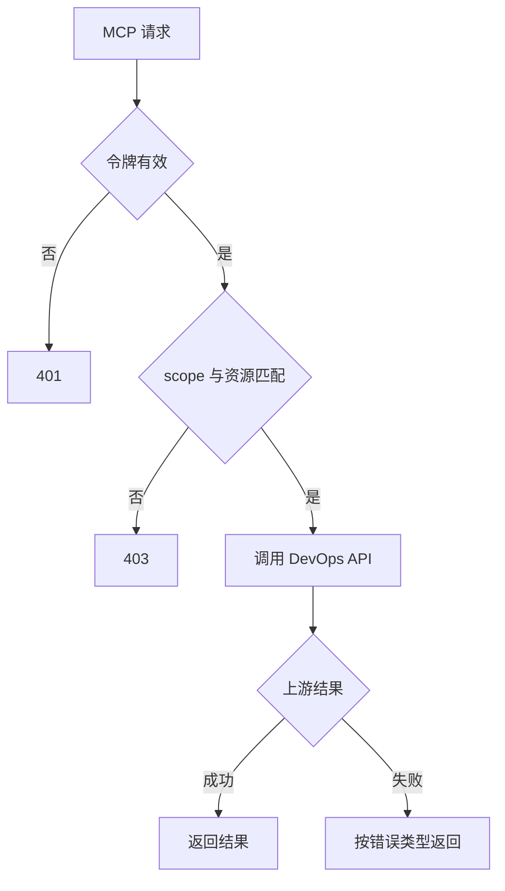

# DevOps MCP 服务详细设计

## 文档信息

| 项 | 内容 |
|---|---|
| 文档编号 | CORP-DSH-DESIGN-007 |
| 文档名称 | DevOps MCP 服务详细设计 |
| 版本 | V0.1 |
| 文档状态 | 草案 |
| 密级 | 内部 |
| 编制 | DSH 平台组（代拟） |
| 审核 | 待定 |
| 批准 | 待定 |
| 最后更新 | 2026-10-20 |
| 门禁 | G1 |
| 模块状态 | 规划（条件建设） |

> 编制依据：2026-10-20 依据 DevOps 平台已提供 CLI 与架构 P7（复用既有资产）。本设计给出服务的完整形态，同时给出**不建设**的判据；是否建设取决于 `forge-devops` 的三项前提是否成立。
>
> 关联文档：[DevOps 接入](plugins/forge-devops.md)、[总体架构 §7.3](../../architecture/platform-architecture.md)、[网关契约 §4](../../contracts/gateway-contract.md)。

## 1. 结论

**当前不建议建设。** DevOps 已有 CLI，按 P7 优先复用；自建 MCP 服务端只在 CLI 无法满足三项前提时才成立。

若建设，它只做一件事：把 DevOps API 包装成只读工具面，并让每个请求按资源校验令牌。不做缓存、不做写操作、不做二次授权。

## 2. 目标与非目标

**目标（仅在触发条件下生效）**

- 提供稳定的只读工具面，字段与 DevOps 服务端一致。
- 按请求校验调用方令牌与 `aud`，不信任客户端传入的角色。
- 暴露受保护资源元数据，声明所需 scope。

**非目标**

- 不做数据缓存与聚合。
- 不做写操作与审批。
- 不替代 DevOps 服务端的授权判定。

## 3. 需求与依赖

| 需求/验收 | 关系 | 说明 |
|---|---|---|
| REQ-12 | 条件相关 | 若启用本服务，MCP 补丁与 PRM 需求重新生效 |
| 验收 A7 只读闭环 | 支撑 | 查询可判定 |

| 依赖 | 类型 | 版本约束 | 缺失时的行为 |
|---|---|---|---|
| DevOps API | 服务 | 由团队提供版本 | 服务不可用，明确报错 |
| IAM 令牌校验 | 服务 | JWKS 或内省 | 拒绝所有请求 |

## 4. 扩展形态与边界

| 项 | 内容 |
|---|---|
| 形态 | 独立服务（`streamable-http`），非插件 |
| 运行位置 | 企业内网服务端 |
| 目标 DSH 与 SDK | 不涉及（客户端经 MCP 客户端连接） |
| 使用的 seam 或服务 | HTTP 传输、令牌校验、审计 |
| 不修改的核心 | DSH 本身 |

## 5. 接口与配置

| 配置项 | 类型 | 默认值 | 必填 | 说明 |
|---|---|---|---|---|
| `server.port` | number | `8443` | 是 | 监听端口 |
| `server.tls` | boolean | `true` | 是 | 强制 TLS |
| `auth.jwks` | string | 空 | 是 | 令牌验签来源 |
| `auth.audience` | string | 空 | 是 | 必须匹配的受众 |
| `devops.apiBase` | string | 空 | 是 | 上游 API 地址 |

## 6. 权限、凭据与数据

| 项 | 处理方式 | 生命周期 | 失败时 |
|---|---|---|---|
| 调用方令牌 | 每请求校验，不缓存超 60 秒 | 单次 | 401 拒绝 |
| 上游凭据 | 服务账号，服务端保管 | 随部署 | 拒绝请求并告警 |
| 查询结果 | 透传，不落盘 | 单次 | 失败即返回错误 |
| 审计 | 主体、资源、结果 | 180 天 | 不影响请求 |

## 7. 流程

## 8. 失败模式

| 场景 | 行为 | 调用方可见结果 | 是否可重试 |
|---|---|---|---|
| 令牌缺失或过期 | 401 | 提示重新获取 | 刷新后重试 |
| scope 不足 | 403 | 说明缺什么权限 | 否 |
| 上游不可达 | 502 | 提示暂不可用 | 可重试 |
| 上游超时 | 504 | 结果未知 | 否 |

## 9. 可观测性

| 事件 | 字段 | 去向 | 保留 |
|---|---|---|---|
| 请求 | 主体、工具、结果、耗时 | 审计 | 180 天 |
| 拒绝 | 原因 | 审计 | 180 天 |

## 10. 测试矩阵

| 层级 | 覆盖 | 命令 |
|---|---|---|
| 单元 | 令牌校验、scope 判定 | 服务自带测试 |
| 契约 | 工具字段与 PRM 一致 | 契约用例 |
| 集成 | 401/403/502/504 | 仿上游 |
| 端到端 | 客户端经 MCP 完成一次只读查询 | 手工 |

## 11. 打包、升级与回退

镜像部署，配置外置；升级按滚动发布。

回退：保留上一镜像；客户端切回 CLI 形态即可停用本服务。

## 12. 决策与未决事项

### 建设判据（满足任一才启动）

1. CLI 无银河麒麟 aarch64 产物，且无法在可接受成本内构建。
2. CLI 无法用环境变量注入凭据，必须写入自身配置目录。
3. CLI 无稳定结构化输出，导致工具面不可判定。

三项均不成立时，本服务不建设，`forge-devops` 的 CLI 形态独立成立。

| 问题 | 需要谁回答 | 影响 |
|---|---|---|
| 三项判据的核验结果 | DevOps 团队、平台组 | 是否建设 |
| 若建设，工具清单与字段 | DevOps 团队 | 第 5 节 |
| REQ-12 与 PRM 需求是否恢复 | 平台组、PMO | 范围与 A14 |

### 需用户确认的设计选项（增益不明确，暂不采用，保留待定）

| 选项 | 可能的增益 | 代价 | 当前处理 |
|---|---|---|---|
| 现在就建设，不等判据 | 提前就绪 | 可能与 CLI 路线重复投入 | 不采用 |
| 服务端做结果缓存 | 降低上游压力 | 权限变更后数据不新鲜 | 不采用 |
| 在服务端做汇总统计 | 报表方便 | 超出只读透传职责 | 不采用 |

以上三项均不影响 CLI 形态；是否建设按 §12 判据，由对应团队核验后再定。