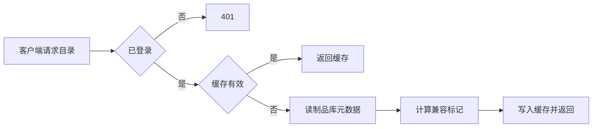

# 市场目录服务详细设计

## 文档信息

| 项 | 内容 |
|---|---|
| 文档编号 | CORP-DSH-DESIGN-012 |
| 文档名称 | 市场目录服务详细设计 |
| 版本 | V0.1 |
| 文档状态 | 草案 |
| 密级 | 内部 |
| 编制 | DSH 平台组（代拟） |
| 审核 | 待定 |
| 批准 | 待定 |
| 最后更新 | 2026-10-20 |
| 门禁 | G2 |
| 模块状态 | 不建设 |

> 编制依据：2026-10-20 依据架构 P7（复用既有资产）与市场接入设计。企业既有制品库可能已提供包元数据与目录能力；本设计给出服务形态与**不建设**的判据。
>
> 关联文档：[私有市场接入](../plugins/forge-market.md)、[总体架构 §2 P5](../../architecture/platform-architecture.md)、[部署说明](../../../deploy/README.md)。

## 1. 结论

**不建设。** 企业已有制品库（2026-10-20 用户确认），市场直接读它，不再自建目录服务。以下判据仅保留为将来制品库能力不足时的评估依据。

仅在制品库缺少目录能力、或需要在发布前做额外校验时才建设。此时它只做三件事：列出可安装包、给出兼容标记、记录发布状态。

## 2. 目标与非目标

**目标（仅在触发条件下生效）**

- 提供只读目录：包、版本、兼容范围、状态。
- 标记不可安装项及原因，供客户端直接展示。
- 发布状态可追溯：已发布、已撤回、被替换。

**非目标**

- 不存储包文件（制品库负责）。
- 不做用户鉴权之外的细粒度授权。
- 不做下载代理与加速。

## 3. 需求与依赖

| 需求/验收 | 关系 | 说明 |
|---|---|---|
| REQ 可治理分发 | 支撑 | 只暴露受信范围的包 |
| 验收 A10 分发 | 支撑 | 安装可重复、可回退 |

| 依赖 | 类型 | 版本约束 | 缺失时的行为 |
|---|---|---|---|
| 企业制品库 | 服务 | 企业现有 | 无源可读，服务不可用 |
| 企业身份 | 服务 | OIDC | 未登录不可读 |

## 4. 扩展形态与边界

| 项 | 内容 |
|---|---|
| 形态 | 只读目录服务（HTTP），无写入面 |
| 运行位置 | 企业内网 |
| 目标 DSH 与 SDK | 不涉及 |
| 使用的 seam 或服务 | 制品库 API、身份校验 |
| 不修改的核心 | 制品库与客户端 |

## 5. 接口与配置

| 配置项 | 类型 | 默认值 | 必填 | 说明 |
|---|---|---|---|---|
| `index.registry` | string | 空 | 是 | 制品库地址 |
| `index.allowedScopes` | string[] | `['@heluo']` | 是 | 暴露范围 |
| `index.compatSource` | string | `engines.dsh` | 是 | 兼容信息来源 |
| `index.refreshSeconds` | number | `300` | 否 | 目录刷新间隔 |

```json title="目录条目（示意）"
{
  "name": "@heluo/forge-gateway",
  "version": "0.3.0",
  "engines": { "dsh": ">=0.2.1" },
  "status": "published",
  "compatible": true,
  "reason": null
}
```

## 6. 权限、凭据与数据

| 项 | 处理方式 | 生命周期 | 失败时 |
|---|---|---|---|
| 读取凭据 | 只读令牌，服务端保管 | 随部署 | 拒绝并告警 |
| 目录缓存 | 内存，按 `refreshSeconds` 刷新 | 5 分钟 | 用旧值并标注 |
| 访问日志 | 主体、条目、结果 | 90 天 | 不影响读取 |

## 7. 流程



## 8. 失败模式

| 场景 | 行为 | 调用方可见结果 | 是否可重试 |
|---|---|---|---|
| 制品库不可达 | 返回旧缓存并标注 | 目录可能过期 | 可重试 |
| 元数据缺字段 | 标记为不可安装 | 说明缺什么 | 否 |
| 未登录 | 401 | 提示登录 | 登录后重试 |

## 9. 可观测性

| 事件 | 字段 | 去向 | 保留 |
|---|---|---|---|
| 目录请求 | 主体、条目数、是否命中缓存 | 访问日志 | 90 天 |
| 兼容判定 | 条目、结论、依据 | 本机日志 | 30 天 |

## 10. 测试矩阵

| 层级 | 覆盖 | 命令 |
|---|---|---|
| 单元 | 兼容判定、缓存刷新 | 服务自带测试 |
| 契约 | 条目字段与客户端一致 | 契约用例 |
| 集成 | 制品库不可达、未登录 | 仿制品库 |
| 端到端 | 客户端读目录并完成一次安装 | 手工 |

## 11. 打包、升级与回退

容器部署，配置外置；升级保留旧版本镜像。

回退：客户端切回直接读制品库即可停用本服务。

## 12. 决策与未决事项

### 建设判据

1. 企业制品库不提供包列表与版本元数据。
2. 需要在发布前增加本仓库特有的兼容与状态校验。
3. 需要在目录层统一多个来源（如不同部门的制品库）。

三条均不成立时不建设，市场包直接读制品库。

| 问题 | 需要谁回答 | 影响 |
|---|---|---|
| 制品库是否已提供目录与元数据 | IT 团队 | 是否建设 |
| 若建设，条目字段与状态机 | 平台组、IT | 第 5 节 |
| 是否允许多来源合并 | IT 团队 | 第 12 节第三条 |

### 需用户确认的设计选项（增益不明确，暂不采用，保留待定）

| 选项 | 可能的增益 | 代价 | 当前处理 |
|---|---|---|---|
| 现在就建设 | 目录完全可控 | 与制品库能力重复 | 不采用 |
| 做下载代理与加速 | 减少外网依赖 | 引入带宽与缓存运维 | 不采用 |
| 提供评分与评论 | 社区感 | 超出内部治理范围 | 不采用 |

以上三项均不影响市场包；是否建设按 §12 判据，由对应团队核验后再定。