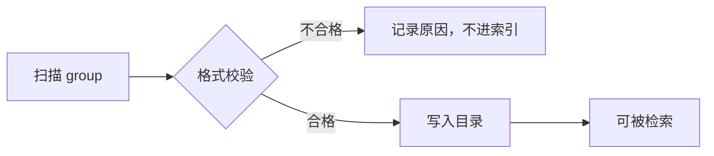
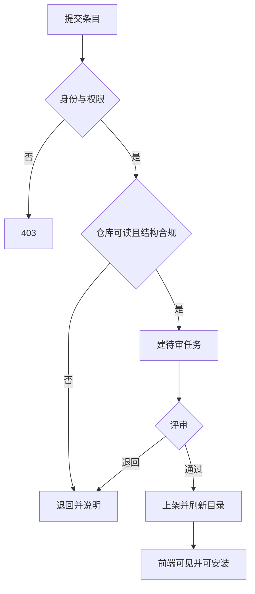

# 插件市场服务详细设计

## 文档信息

| 项 | 内容 |
|---|---|
| 文档编号 | CORP-DSH-DESIGN-012 |
| 文档名称 | 插件市场服务详细设计 |
| 版本 | V0.11.0 |
| 文档状态 | 草案 |
| 密级 | 内部 |
| 编制 | DSH 平台组（代拟） |
| 审核 | 待定 |
| 批准 | 待定 |
| 最后更新 | 2026-10-20 |
| 门禁 | G2 |
| 模块状态 | 规划 |

> 编制依据：2026-10-20 依据市场目标（浏览、下载、安装、上传、评价，且从企业 Gitee 发现插件）与上游包核验。**未核验**：Gitee API 的仓库检索与 release 字段、上游市场数据 schema。
>
> 关联文档：[企业插件市场](../plugins/forge-market.md)、[Gitee 接入](../plugins/forge-gitee.md)、[总体架构 §2 P5](../../architecture/platform-architecture.md)。

## 1. 结论

市场服务提供四件事：目录、版本、发布审核、Gitee 适配，外加两项用量计数。它是市场的唯一数据来源，"谁能上架、谁能评价"都在这里判定。

边界：不管包体存储（用 Gitee，制品库可选做缓存）、不跑构建（用企业流水线）、不做计费。

## 2. 目标与非目标

**目标**

- 一条目一记录：名称、说明、场景、维护人、仓库地址、版本、状态。
- 提交、评审、上架、下架、撤回全程留痕。
- 下载次数与 Gitee star 数可查、可展示，不存评论。
- 从专门 group 自动发现；全员可浏览，建仓需管理员批准，提交需仓库属于该 group；安装来源仅限该 group。

**非目标**

- 不做代码托管与构建。
- 不做付费与许可证交易。
- 不做公网访问。

## 3. 需求与依赖

| 需求/验收 | 关系 | 说明 |
|---|---|---|
| REQ 可治理分发 | 直接实现 | 上架与版本可追溯 |
| REQ 推荐能力落地 | 支撑 | 用量与场景支撑采用 |
| 验收 A10 分发 | 支撑 | 安装可重复 |

| 依赖 | 类型 | 版本约束 | 缺失时的行为 |
|---|---|---|---|
| 企业 Gitee API 或 CLI | 服务 | 企业现有 | 发现与取归档不可用 |
| 企业身份（IAM） | 服务 | OIDC | 拒绝写入类请求 |
| 制品库（可选） | 服务 | 企业现有 | 不缓存，直连 Gitee |
| 元数据库 | 服务 | PostgreSQL | 服务不可启动 |

## 4. 扩展形态与边界

| 项 | 内容 |
|---|---|
| 形态 | 独立服务（HTTP JSON API）+ 后台任务 |
| 运行位置 | 企业内网，容器部署 |
| 目标 DSH 与 SDK | 不涉及（前端经 HTTP 访问） |
| 使用的 seam 或服务 | Gitee API、IAM 校验、制品库、数据库 |
| 不修改的核心 | DSH 与 Gitee |

## 5. 接口与配置

| 配置项 | 类型 | 默认值 | 必填 | 说明 |
|---|---|---|---|---|
| `service.listen` | string | `:8080` | 是 | 监听地址 |
| `service.db` | string | 空 | 是 | 数据库连接 |
| `gitee.host` | string | 空 | 是 | 企业 Gitee 主机 |
| `gitee.group` | string | 空 | 是 | 专门存放 DSH 插件的 group |
| `review.required` | boolean | `true` | 否 | 是否必须人工评审 |
| `metrics.syncHours` | number | `6` | 否 | star 同步间隔 |

```text title="端点（示意）"
GET  /api/plugins                  条目列表与筛选
GET  /api/plugins/{name}           详情、版本、聚合分
POST /api/plugins                  提交或更新条目
GET  /api/metrics?plugin=          下载量与 star
POST /api/admin/review             上架、退回、撤回
GET  /api/discover/gitee           扫描专门 group 的仓库
GET  /api/admin/unindexed          未收录条目与原因，供诊断视图
```

数据模型要点：

| 实体 | 关键字段 |
|---|---|
| plugin | `name`、`title`、`summary`、`scenarios`、`maintainer`、`repo`、`status` |
| version | `version`、`tag`、`archiveUrl`、`engines`、`submittedAt` |
| review_task | 条目、状态、评审人、理由、时间 |
| metric | 条目、`downloads`、`stars`、`syncedAt` |

字段级约定（客户端与目录都按此命名）：

| 字段 | 类型 | 说明 |
|---|---|---|
| `name` | string | 包名，条目唯一键 |
| `title` | string | 展示名；缺省与 `name` 相同 |
| `status` | string | `pending`、`listed`、`rejected`、`revoked` 之一 |
| `tag` | string | 发布标签；缺失时按 `v<version>` 推导，不得由客户端伪造 |
| `archiveUrl` | string | 归档地址，由服务端填写 |
| `engines` | string | 目标 `engines.dsh`，形如 `>=0.2.1` |
| `submittedAt` | string | ISO 8601 提交时间 |
| `revoked` | boolean | 版本已撤回；为真时不再发放归档地址，下载端点返回 409 |

### 5.1 格式校验（索引前置条件）

扫描与提交都先过同一套校验。**不合格的仓库不进入索引，检索不到**；管理视图给出原因，避免开发者无从下手。

| 错误码 | 触发条件 | 处理 |
|---|---|---|
| `missing-file` | 缺 `cordis.patch.yml`、`package.json` 或 `README.md` | 不进索引 |
| `scope-not-allowed` | 包名不在受信范围（默认 `@heluo`） | 不进索引 |
| `bad-version` \| `bad-tag` \| `tag-mismatch` | 版本非 `x.y.z`、标签非 `vX.Y.Z`、两者不一致 | 不进索引 |
| `missing-engines` \| `bad-engines` | 未声明，或写法不在 `>=`、`^`、`~`、`=`、裸版本之内 | 不进索引 |
| `install-script` | 声明了 `preinstall`、`install` 或 `postinstall` | 不进索引 |
| `missing-section` | README 缺 `## 用途` 或 `## 维护人` | 不进索引 |
| `missing-name` | `package.json` 缺 `name` | 不进索引 |
| `patch-js-expr` | `cordis.patch.yml` 含 `!!js` 表达式 | 不进索引 |
| `patch-disables-row` | 补丁里出现 `disabled: true` | 不进索引 |
| `patch-overrides-protected` | 覆盖 IAM、策略、凭据、沙箱或权限预设的行 id | 不进索引 |
| `patch-include` | 使用 `cordis:include` 加载包外文件 | 不进索引 |
| `patch-unsafe-path` | 引用包外相对路径或绝对路径 | 不进索引 |

`engines.dsh` 只接受 `>=0.2.1`、`^0.2.1`、`~0.2.1`、`=0.2.1` 与裸 `0.2.1` 五种写法；`*`、`latest` 与复合区间（如 `>=0.2.0 <0.3.0`）判 `bad-engines`。`^` 与 `~` 对 `0.x` 按次版本收敛，超出范围的失败原因是 `outside-range`，低于下限是 `requires-newer-dsh`——两者对用户的含义不同。

`cordis.patch.yml` 会被 loader 执行，按代码对待而非配置：格式校验通过后仍要过内容规则，两者同属索引前置条件。

判定逻辑由 `packages/forge-market/src/validate.mjs` 承担，规则变更需同步该文件、本表与 `test/error-codes.test.mjs`。

## 6. 权限、凭据与数据

| 项 | 处理方式 | 生命周期 | 失败时 |
|---|---|---|---|
| 调用方身份 | OIDC 令牌校验主体与角色 | 单次 | 401/403 |
| Gitee 访问 | 只读服务账号，按仓库授权 | 随部署 | 标记不可见 |
| 条目数据 | 数据库，保留变更记录；提交文本入库前转义，展示按纯文本渲染 | 长期 | 写入失败即回滚 |
| 用量计数 | 下载次数在发放归档地址时自增，按（条目, 机器哈希, 日）去重；star 定期同步。**不观测安装是否成功**，因此该数字是「下载请求数」而非「安装数」 | 长期 | 保留上次值 |
| 审计日志 | 主体、动作、对象、结果 | 180 天 | 不影响主流程 |

## 7. 流程

### 7.1 发现与索引



### 7.2 提交与评审



**提交请求体**（`POST /api/plugins`）：

| 字段 | 类型 | 必填 | 说明 |
|---|---|---|---|
| `name` | string | 是 | 包名，须在受信范围 |
| `repo` | string | 是 | 仓库地址，须属于专门 group |
| `tag` | string | 是 | 形如 `v0.1.0`，与清单版本一致 |
| `summary` | string | 否 | 一句话说明，展示时按纯文本 |
| `scenarios` | string[] | 否 | 适用场景 |

维护人由服务端按仓库成员判定，不接受调用方自报；归档地址与 `engines.dsh` 由服务端从仓库读取，避免客户端伪造。

**并发**：同一条目发布加锁，避免版本覆盖；计数按（条目, 机器哈希, 日）去重。

**超时**：Gitee 调用超时按不可用处理，不落半条记录。

## 8. 失败模式

| 场景 | 行为 | 调用方可见结果 | 是否可重试 |
|---|---|---|---|
| 未登录 | 401 | 提示登录 | 登录后重试 |
| 非维护人提交 | 403 | 说明无权限 | 否 |
| 仓库不属于该 group | 退回 | 指出应为组内仓库 | 建仓后重提 |
| 仓库不可读 | 退回 | 指出需授权 | 授权后重提 |
| 缺 `cordis.patch.yml` 或清单 | 退回且不进索引 | 列出缺失项 | 修正后重提 |
| 扫描到不合格仓库 | 不进索引 | 管理视图给出错误码 | 修正后重扫 |
| 版本已存在 | 拒绝 | 提示改用新版本号 | 否 |
| Gitee 不可达 | 503 | 提示稍后重试 | 可重试 |
| star 同步失败 | 保留上次值并标注 | 显示可能过期 | 可重试 |
| 版本已撤回 | 不再出现在可安装列表 | 详情页标注已撤回 | 否 |
| Gitee 限流 | 扫描退避并复用缓存 | 目录可能延迟 | 可重试 |

## 9. 可观测性

| 事件 | 字段 | 去向 | 保留 |
|---|---|---|---|
| 提交与评审 | 条目、状态、评审人 | 审计 | 180 天 |
| 安装解析 | 条目、版本、归档地址 | 访问日志 | 90 天 |
| 计数变更 | 条目、类型、增量 | 审计 | 180 天 |
| 发现任务 | 扫描范围、命中数、耗时 | 任务日志 | 30 天 |

## 10. 测试矩阵

| 层级 | 覆盖 | 命令 |
|---|---|---|
| 单元 | 结构校验、版本冲突、评价去重 | 服务自带测试 |
| 契约 | 端点字段与前端一致 | 契约用例 |
| 集成 | 权限、退回重提、Gitee 不可达 | 仿 Gitee |
| 端到端 | 提交→评审→上架→安装→评价 | 手工 |

## 11. 打包、升级与回退

容器部署；数据库迁移向前兼容，升级前备份。

回退：保留上一镜像；数据模型只增不删，回退后新字段被忽略。

## 12. 未决事项

| 问题 | 需要谁回答 | 影响 |
|---|---|---|
| Gitee 检索与 release 字段 | Gitee 团队 | 第 5 节适配 |
| group 命名与管理员 | Gitee 团队、平台组 | `gitee.group` |
| 格式规范的维护与升版 | 平台组 | 校验规则与存量插件 |
| 建仓审批人及时限 | Gitee 组管理员 | 提交前置条件 |
| 评审人与时效 | 平台组、PMO | 上架周期 |
| star 同步频率 | 平台组 | `syncHours` |
| 扫描缓存与退避参数 | 平台组 | 目录新鲜度与 Gitee 限额 |
| 是否镜像归档到制品库 | IT、安全 | 可用性与审计 |
| 数据库选型与备份 | IT 团队 | 部署 |

### 需用户确认的设计选项（增益不明确，暂不采用，保留待定）

| 选项 | 可能的增益 | 代价 | 当前处理 |
|---|---|---|---|
| 服务内做在线构建 | 一条龙 | 与企业流水线重复 | 不采用 |
| 上传二进制包 | 不依赖 Gitee | 存储与审核成本上升 | 不采用 |
| 文字评论与星级 | 反馈更丰富 | 审核与治理成本 | 不采用 |
| 自动化免评审上架 | 快 | 安全风险 | 不采用 |
| 多租户部门市场 | 自治 | 治理碎片化 | 不采用 |

以上五项均不影响主链路；若后续确认增益，再单独评估。